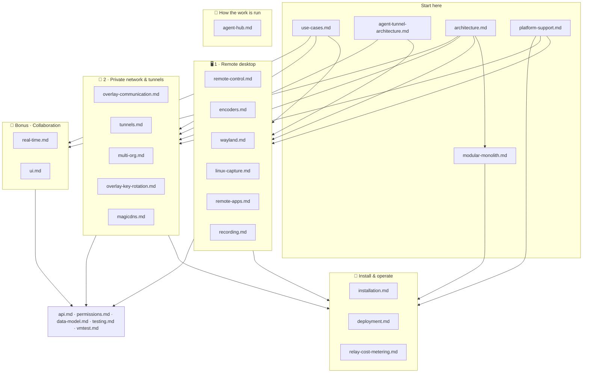

# Roomler AI — documentation index

Roomler is three products on one platform, in this order: **1 · desktop sharing &
remote control**, **2 · your own secure private network** (WireGuard overlay,
tunnels, SOCKS5), and — as the included bonus — **video conferencing & team
collaboration**. The map below shows how the docs hang together; the tables list
every document with its audience.

> **Looking for the USER documentation?** It is at
> **[roomler.ai/docs](https://roomler.ai/docs/)** — per-OS install guides,
> getting started, security and access control, troubleshooting and an FAQ,
> written for people using the product. Source lives in
> [`ui/docs/content/`](../ui/docs/content/) (FR-60, #1165).
>
> **This tree is the ENGINEERING record**: design decisions, field evidence and
> the reasoning behind them, written for whoever maintains the daemon. The two
> are deliberately separate content sets with different audiences — the user
> docs link out to these for depth, and nothing here is republished there.

> **Not an engineer?** Start with [use-cases.md](use-cases.md) — plain-language,
> scenario by scenario, with pictures. The main [README](../README.md) has the
> product tour.

## Start here

| Doc | What it covers |
|---|---|
| [use-cases.md](use-cases.md) | Scenario walkthroughs across all three pillars in plain language, plus the permission model |
| [self-hosting.md](self-hosting.md) | Running the whole product yourself — one compose file, TLS termination, the conference media-port caveat, upgrades and backups |
| [compare/](compare/README.md) | Head-to-head against Tailscale, RustDesk, TeamViewer, MeshCentral, NetBird and StarDesk — each page naming what the other product does better, first |
| [agent-tunnel-architecture.md](agent-tunnel-architecture.md) | The remote-access stack (daemon + CLI + coordination) in five minutes — written for end users and operators |
| [architecture.md](architecture.md) | The whole system: control plane vs the three data planes, workspace crate map, deployment topology |
| [platform-support.md](platform-support.md) | What each OS serves (FR-97): the install types and who each runs as, a table per pillar with the code each verdict comes from, and the reason for every feature an OS rules out |
| [modular-monolith.md](modular-monolith.md) | How the server is composed (FR-69): `roomler-core` + six modules behind one `Module` contract, the DAG, the five build profiles and what each leaves out, runtime capability gating, wire ownership, the hooks that carry the inverse cascades, and the composition baseline that gates every move — and (FR-75) how each profile is proven to CARRY TRAFFIC rather than merely link: a throwaway cell per profile whose 404-vs-401 door probes assert every absence positively, then chat + a real call, remote-desktop frames, and a two-agent overlay ping |

## 🖥️ 1 · Desktop sharing & remote control

*Any of your machines, live in a browser tab — nothing to install on the viewing
side, consent-gated, end-to-end encrypted.*

| Doc | What it covers |
|---|---|
| [remote-control.md](remote-control.md) | Full design: topology, agent internals, `rc:*` signalling, consent/security model, latency budget; **[§12.0 input to photon, measured (FR-98)](remote-control.md#120-input-to-photon-measured-fr-98)**: L4's stage split of the direct QSV cell (p50 40.1 ms outside the viewer's Wi-Fi bursts, encode 27 % of it) and the relay cell (130.2 ms, the network 34 %) on 0.4.187, with a mermaid diagram of the stages and every latency cut's switch; **§5.1b the honest no (FR-97 P0c)**: what a host cannot serve leaves the hello's lists and comes back in `AgentCaps.unavailable` with the device's reason, which the viewer shows on the control, and `not-applicable` is the one code that hides one; **§5.1c session audio (FR-97 P3c)**: the computer's sound, never a microphone, which on Linux was all a session ever captured (cpal lists only ALSA devices); since P3c-2 a Linux host records the default output's monitor (`@DEFAULT_MONITOR@`) through Pulse's client library, in the daemon for a per-user install and through the seat user's helper for a root one, a named `ROOMLERD_AUDIO_SOURCE` device wins, and a track that carries no sound says why (`rc:audio-unavailable`); **§5.1d a locked host (FR-97 P3b)**: Windows paints the overlay and suppresses input, while a Linux lock screen is captured and typed into, so logind's `LockedHint` reaches only the viewer's chip (`input: "passes"`), and a live session holds a logind block inhibitor (FR-55's Linux half); **§5.1e Ctrl+Alt+Del that reaches the lock screen (FR-97 P4a)**: `SendSAS` from the SCM host, which only the SYSTEM worker can ask (a SYSTEM-only relay; the worker's own call is ignored, measured), where the `SoftwareSASGeneration` policy lets services, advertised as `input: sas`, and elsewhere the three keys with the missing half named; **§11 session hygiene (FR-101)**: every credential over TLS (§11.1), clipboard, files and audio by the org's policy and the device owner's floor with a reason per refusal (§11.3b), what crossed those channels as the device's claim (§11.3a), and sessions that end at a maximum length or an idle limit (§11.6); **§12.1 the connect timeline (FR-22)** — the eleven time-to-first-frame marks and who can see each, the phase-aware signalling bound (`requesting` 4 s vs ICE's 15 s), the `agent_offline` fast-fail, the operator's verdict, the per-attempt records persisted to `agent_logs` (collection, filter, 7 d retention, the `hidden` validity flag, how to mine them), and the stall **traced end to end** from them — a half-open agent control WS after a host network-path change, surviving until the far end resets it; **§12.2 memory after a session ends (#2024)**: the session's encoder is freed but glibc kept the pages (9 MB in use, 290 MB held after three sessions), so a `malloc_trim` runs 5 s after the last session ends, and how to tell retention from a leak with `malloc_stats`; **§5.1g the capture waits (#3272)**: `next_frame`'s contract, the RTP pump's wait in the acquire and its 2 ms floor, the GDI arm held to its target, why a zero-copy host polls, the `SeatBusy` retry, the kill switch `ROOMLERD_RTP_CAPTURE_WAIT=0`, and what `avg_capture_ms` means from this release; **§5.4 above 60 fps (FR-119)**: the `fps-high` / `fps-retry` wire, the grant's refusal order and its one-rate-at-a-time step-down (144 → 120 → the cap), the rate class and its 10 s trial (proven for a week, failed for an hour), "try again", and what holds the rate up on Windows (WGC's update interval, the GPU clock pin); **§5.1f the frame stays on the GPU (FR-118)**: with `zero_copy` on, the SystemContext DXGI arm keeps the frame as a texture and a proven QSV cell takes it there, both arms' frame paths, and the field numbers (capture + encode 14.5 → 12.2 ms, CPU 52 → 34 % of a core); on macOS the display stream's IOSurface goes to a proven VideoToolbox cell, marked BT.601 (FR-118 P5); **§18.6.2 the decoder is told the colour space (FR-130 P2)**: every data-channel decoder is configured with set S, from every agent, with a per-browser kill switch, and a browser that refuses it keeps its picture; **§4.4 `auto`: the session decides (FR-128)**: under **Mesh: auto** the target rides the mesh only while its link to the viewer's device is direct, or, clamped, when the far TURN is dead; the agent decides at its offer from the Hub's `viewers` and far-TURN hint; the kill switch `ROOMLERD_RC_OVERLAY_AUTO=0`; and the hint's two blind spots (a Mac's GUI worker has no overlay node, and only the browser's first device counts) |
| [external-access.md](external-access.md) | Someone outside an org on one of its devices (FR-52), once it is running: the gates and who owns each, one session end to end, what the outsider is told against what the log says, who came in and who hears of it, what each way of stopping someone does and does not stop, and who pays |
| [recording.md](recording.md) | FR-85 screen recording: the recorder's own pipeline (capture → constant-rate pacer → recording encoder → fragmented MP4, remuxed moov-first on stop), crash recovery (the partial lock), where files go (the default-folder probe, `record_dir` rules, staging), the `roomlerd record` protocol and stop reasons, the daemon's local verbs (LocalAPI + the console-user gate, `roomler record`), the sidecar |
| [encoders.md](encoders.md) | The cell matrix a host advertises (codec × backend × chroma) and how the viewer resolves it into a session; the probe lifecycle (child processes, the cache, the denylist); the hardware-encoder cascade per platform (NVENC · QSV · AMF · VideoToolbox · VAAPI · D3D12 · Vulkan, with libva bundled on Linux); the **software encoders' clock and 60 fps** (FR-112: a Linux `uclamp_min` on the encoding threads, the paced software tier, OpenH264's runtime settings); the **GPU input path** (FR-118: a cell's third dimension, taken by QSV, NVENC and, on macOS, VideoToolbox; `zero_copy` and `zero_copy_deny`, the probe's `gpu` phase, the `input_path` / `input_reason` a session reports); **how a backend takes a rate move** (FR-62: the ladder, `RateReconfig` per backend, the measured cost table — NVENC in place with no IDR, QSV and AMF rebuilding at very different prices —, the heartbeat's rate counters, the `--reconfigure-sweep` read and its per-backend verdict, the switches with their retirement conditions); the **colour path** (FR-130: every converter's BT.601 at limited range, the description each encoder family writes and the ones that cannot, which lever reaches which viewer path, `color_description` and its remote push); the **NVENC driver floor and the arm64 cells** (FR-122: NVIDIA driver 530.41 on Linux and 570 on Windows, a container's `video` capability, and NVENC on arm64 Linux proven on an NVIDIA GB10); rate control, capture backends, viewer decode paths |
| [wayland.md](wayland.md) | **Start here for a Linux Wayland desktop** (FR-93): a system install captures a person it can tell by itself, bound to their session and blind while it is locked or away (FR-95); the support matrix — which desktop (GNOME, KDE, wlroots) and install (per-user, system) gets a picture, input and a cursor, who at the screen is asked, and the release each cell was verified on; what a lock, a display switched off, a resolution change, a user switch, a logout and a compositor crash do to a session in progress; every reason the viewer can show, and what to do about each; choosing between a per-user and a system install |
| [linux-capture.md](linux-capture.md) | How a Linux desktop is captured by a root daemon that sits in no session: FR-95: with no key set, a system install switches DRM and uinput on by itself for the person on screen whom it can tell (the companion or their notifications), bound to their session and reading and injecting nothing while it is locked or away (§1.2.1); the four arms of the cascade and why each is opt-in — X11 XShm + XDamage and the daemon's own Xvfb, DRM/KMS below the compositor (FR-36), the desktop portal through a privilege-dropped helper that `dlopen`s PipeWire (FR-45, with RemoteDesktop input on the same session), and mutter's own ScreenCast API where no portal backend can run (FR-45 P5); the **attended-only rule** (no greeter, no locked screen) and where the product says it; the logind session gate that keeps the mutter arm off WSL2 and headless hosts (open decision P5b); the knobs, and why flipping any of them forces a fresh capability probe that must run on an unloaded host; FR-93: a stock Wayland desktop says `wayland_not_enabled` (§1.1), a per-user Wayland session switches capture on by itself, mutter on GNOME and the portal elsewhere (§1.2, P2a and P2d-3), and every Linux device's hello says which desktop it shows and which arm would capture it, which the server counts per org and fleet-wide (§1.3); an attended portal request is one per host, handed to the newest session, and an open holds no runtime worker (§4.6, FR-93 P2d-1); a session waiting on that request tells the viewer, which shows "waiting for the person at the screen" and stops re-creating it (§4.7, P2d-2); mutter's own RemoteDesktop drives the mutter screencast and takes the viewer's input, so a per-user GNOME session can be driven, native windows included (§5.2, P4); the DRM arm reads the cursor plane (§3.1, P3c), skips a frame nothing changed in (§3.2, P3d: an idle session from 57.9 % to 6.3 % of a core) and says when the display is off (§3.3, P3e); at 4K the GPU reads the DRM scanout through an EGL import, scaled to the encode box, with the CPU's half-size, multi-threaded read as its fallback, and the frame period no longer pays for the grab (§3.4, FR-107: a moving window went from 6.3 to 27.9 fps on the VP9 path); the PipeWire arms end a stream whose compositor restarted (§4.8, P5d), wait out GNOME's lock screen (§5.3, P5b), record a reconfigured monitor again (§5.4, P5c), show a still desktop at once (§5.5, P5e), and name a user switch, for a running session and for one opened during it (§5.6, P5f and P5g); and a share the person at the screen stops with the desktop's own control (GNOME's Stop, KDE's End) ends the session as their Disconnect does, never reopened behind them (§5.7, P6c) |
| [remote-apps.md](remote-apps.md) | Remote Apps (FR-56): the three verbs on the control data channel (`rc:apps.list` · `focus` · `launch`) and their replies; how the Linux backend finds a desktop from a root daemon that has none — the daemon's own Xvfb first, then whoever is at the screen, `DISPLAY` **and** `XAUTHORITY`, privilege-dropped to the session's owner; the **tier-by-tier honesty table** — what each tier advertises in the hello, what its reply says and what the panel shows (X11-only listing on Wayland, GNOME's refused enumeration, the missing helpers, nobody logged in, no Xwayland, disabled, macOS); `coverage` and `unavailable`, and why the hello is a boot-time snapshot the live reply overrides; the tmux session model and the launch allowlist; per-window capture (P4); the field table; configuration and `roomlerd apps-probe`; a code map |
| [keep-busy.md](keep-busy.md) | Keep busy (FR-92): a controller with input leaves the host's pointer moving in a pattern, so the screensaver, the idle lock and "Away" never come; any real user — at the keyboard or remote — takes over at once. One more input source behind the arbiter, never a second injector; telling a person from the engine's own moves without a hook or a key poll (the idle clock read as an interval, the 32 ms spacing, calibration that cannot pass on a stuck pointer); the per-host clocks (Windows, X11 — proven on Xvfb in CI, macOS), Wayland refused from the display itself; the safe box away from hot corners; the three gates and how the org's deny reaches every device, a supervised Mac's GUI worker included; the per-person store, written as the person, and following the person under a root daemon or a SYSTEM worker; the tray and `roomler keep-busy`; the **permanent history** of every on, off and policy change (the server's decisions and the devices' claims, told apart) and the org's **default pattern** |
| [power.md](power.md) | Power (FR-55): what holds a device awake (a live session always; otherwise the device-owned `power_policy = never \| on-ac \| always`), by which call on each OS, and the macOS clamshell limit stated where the policy is set; **P4, asleep instead of offline**: the heartbeat's power posture, the `rc:agent.sleeping` goodbye each OS hook sends just before a sleep (bounded, never blocking the runtime, no new assertion), the server's record keyed by the hello's connection, the reconnect held until the wake, and what `roomler status`, `roomler devices`, the dashboard and peers each show |
| [display-match.md](display-match.md) | Display match (rc.191, FR-108): the host's display switches to the largest mode inside the viewer's window so remote text runs 1:1, and since FR-108 never on a screen someone is using. The device decides: its owner's `display_match` (auto, always, never; console-only, never pushable), and under `auto` whether anyone touched the input in 5 minutes, read from the idle clock less the controller's own injections, with no hooks. Every request gets an answer (`attended`, `locked`, `disabled_on_device`, …) that the viewer shows under the toggle; a locked screen cannot be switched by the worker, so it waits for the unlock (P1b) |
| [relative-mouse.md](relative-mouse.md) | Relative mouse (FR-109): Pointer Lock in the browser for an app that captures the pointer (a 3D viewport, a game camera), which absolute moves stop at the stage edge. `mouse_rel {dx, dy}` in whole counts (the viewer carries the fraction) and `mouse_press {btn}`, a press that never moves the pointer, both gated by `mouse-rel` in the agent's caps because an older agent cannot parse them. Windows hosts in P1 (`SendInput` relative, the user worker and SystemContext); Linux in P2 (X11 through XTest, system installs through a relative uinput pointer, per-user Wayland through the RemoteDesktop session); macOS later. Esc releases the mouse; the agent only injects and never reads input |
| [touch-controls.md](touch-controls.md) | Touch controls (FR-111): a phone or tablet as the controller. The stage keeps every touch (`touch-action: none`), and a pointer the browser cancels still lets go of its press, which once left the host's button down. The direct-mode gestures: a long press or a two-finger tap is the right button, two fingers moving together scroll, and a pinch zooms only the viewer. A trackpad mode (the finger moves the host's pointer; a tap clicks where it is) by `mouse_rel` or by absolute moves from `cursor:pos`. On-screen controls from the toolbar: rows of keys, a d-pad and a mouse stick in three built-in presets (office keys, arrows, WASD with mouse look), remembered per device, each sending frames every deployed agent takes. A preset fits a stage shorter than it was designed for (FR-125: a column becomes a row, a pad shrinks), so every control stays reachable on a phone held sideways |
| [privacy-mode.md](privacy-mode.md) | Privacy mode (FR-99): while a session runs, the person at a Windows computer sees "This computer is being used remotely" instead of the desktop, and the controller keeps seeing the real one, because the notice is kept out of capture (`WDA_EXCLUDEFROMCAPTURE`, set before it shows and read back after). Two parties agree: the device owner's `privacy_mode_allowed` (console-only, never pushable) and the viewer's toggle; the server's strip reasons and the device's own four gates, each said in words; the platforms (Windows 10 2004+ only) and the honest limits: the curtain hides the screen but does not stop the person at the keyboard (the `BlockInput` block is P2, not built), the shell draws over it, the secure desktop carries none |
| [rate-control.md](rate-control.md) | How a session spends its bits: the FR-79 **validity gate** every estimator reads first (one verdict per window, V5's one exception, the pair memory's write-back and seed, the V3b belief still in shadow), **the classifier the gate reads (FR-71 T1a)**: one verdict per constrained window — overproduced, transit-stalled (by the age split or by a report gap), viewer-late, clear, unknown — from the M0 split and the summed pass stats, the heartbeat's `pipe_state` / `pipe_states` / `pipe_gap_stalls` and the one-window offset when reading them, and what four days of fleet data said (96 % of stall verdicts are report gaps), **the ceiling learner (FR-35 P1)**: the five gates that grow a relayed session's cap above the 3 Mbps nominal, what CARRIED and DECREASE actually measure, the hard ×0.5 stall, and the stable rate it hands the pair memory, the Priority dial, the per-session control loops, the FR-74 **direct path** (a ceiling that is a bound, a gate that measures lag, and P5's gate read against the shadow), why resolution never flips mid-motion (rc.445), crisp-at-rest, the software encoders at 60 fps (FR-112), **the media plan in shadow (FR-70 M3a)**: the `Plan` the loop will read, its pure producer with every knob resolved once, the frame-cadence comparison against the inline decisions, the `plan_divergences` / `plan_epoch` heartbeat fields and the fleet-zero gate, with the lags and stale adoptions counted apart (`plan_lags`, `plan_stale_swaps`, `plan_stale_ticks`, M3a.1/M3a.3), **above 60 fps (FR-119)**: the rate law `60 × (fps / 60)^0.8` and the pipe checked per rate, **the shadow rate controller (FR-63 B1)**: the one delay-based controller (`encode::ratectl`) run beside the governor, its state machine, the six `shadow_*` heartbeat fields and the containment test that keeps it observe-only, **and how it is read (FR-63 B1b)**: `scripts/rc-shadow-report.cjs` measures AC2's flip criterion (what a window is, "elevated", the MET / NOT MET / INCONCLUSIVE verdict, two of B1's invariants read off the field), what the encoder spent against the shadow (why a shadow pinned at its floor meets the criterion, and the table that shows it), the bounded fleet read of `agent_logs` inside the Mongo pod and why neither the logs API nor an exec sweep can serve it, and the `mongo:7` rehearsal, config reference, **the kill-switch registry (FR-62 AC4)**: every rate-control switch with the evidence that retires it and the phase that deletes it, plus the A4 heuristics that have no switch |
| [stall-watch.md](stall-watch.md) | The pump stall watch (FR-65): the seventeen phases a remote-desktop pass is broken into and which of them count as work, the verdict's two field-paid rules (`work = iter − capture − pace`, a computed `other`), the `PassWatch` bookkeeping — the heartbeat's window reset that blinded it to every stall longer than 2 s until 2026-10-30, and the never-reset stall total FR-79's gate reads — what the kill switch does NOT turn off (it blinds the governor's gate), how to read a STALL line, the stall census, a fleet-wide server read of `agent_logs` split by build (`scripts/fr65-stall-census.sh`), and what it found (the send task holding the video DataChannel's mutex for a whole frame, two 30 s passes in no phase), and **what the watch itself costs**: `roomlerd stall-watch-cost`, an A/B of the real watch with a positive control, measured at 0.035 % of the frame budget on NEO16 (AC1) |
| [remote-desktop-latency.md](remote-desktop-latency.md) | Drag smoothness & the latency budget (FR-1): the fps-first even-cadence pace (P5), pointer cadence decoupled from the compositor (P6), and the end-to-end "age" pill — the RustDesk-"Delay" analogue (P7); the capture→encode→pace→send→paint pipeline as one diagram, with the 2026-10-26 and 2026-11-02 field evidence, including where ≥45 fps at 2880×1800 is reached (the frame on the GPU, FR-118) and where it is not (today's default path) |

## 🔐 2 · Your own secure private network

*All your devices on one private, encrypted network with stable names — plus
port forwards, SOCKS5, SSH without sshd, and exit nodes on top.*

| Doc | What it covers |
|---|---|
| [overlay-communication.md](overlay-communication.md) | **Start here for the overlay** — every carrier path (LAN, public, hole-punch, relay, DERP), inside and outside a corporate VPN, with field-proof; the direct carrier's socket buffers (FR-110: 116 → 543 Mbit/s into a Linux host on 0.4.141); the DERP carrier's queue discipline (FR-18): a 100 ms age bound, and a kernel send-buffer cap read back per OS, because a stock Linux kernel before 6.18 applies 208 KiB of the 256 asked and reports success; the node's own firewall (FR-97 P3i): carriers pass firewalld through conntrack, services on the overlay address do not unless the zone admits them, and `roomler status` names the zone instead of changing it; **§6 what a pod roll costs (FR-28)**: `/derp` down p50 7.6 s over 14 production rolls, the two levers at that wait (a flat redial on a 502 behind `ws_flat_redial`, an image pre-pull), why the agent waits on its own ladder, why make-before-break has no pod to dial, and why an RC session ends on the control WS whatever its carrier |
| [overlay-nat-traversal.md](overlay-nat-traversal.md) | The carrier cascade mechanics: NAT-type probing, srflx hole-punch, cooldowns, PathMonitor |
| [peer-relays.md](peer-relays.md) | The org relay (FR-19): one of the org's own devices forwarding its peers' WireGuard ciphertext over UDP 3478, so relayed pairs stop crossing the API pod — why it is a relay kind and not a tier, the five default-deny gates and who owns each, the mint and its audit vocabulary, the two-key bind, revocation as a push, **what the relay operator can still see**, and the measured ~74× pod offload |
| [overlay-exit-nodes.md](overlay-exit-nodes.md) | Tailscale-style exit nodes: full-egress routing (v4+v6+DNS) with the never-self-wedge safety model; what each OS can do as client and as exit, and how a Mac pins its exemptions (FR-97 P1a); a netstack client, whose exit carries only its SOCKS5 front's IPv4 dials, never steers the host's DNS and never serves as an exit (FR-97 P0c-3) |
| [overlay-wfp.md](overlay-wfp.md) | Windows: surviving a Group-Policy-locked firewall via the Windows Filtering Platform — and the daemon's own Defender rule, written by the service host before the worker's first bind (#1698) |
| [multi-org.md](multi-org.md) | One device in N organizations: `[[orgs]]`, address blocks, a join refused for want of an address (and the `roomler status` line that says so), growth and the allocator's two races, the shared carrier plane, an adapter per organization (the shared-TUN mux and its NAT are history since W7c), the sibling route defence's counters, overlap WARN and stress cells (FR-68) |
| [overlay-key-rotation.md](overlay-key-rotation.md) | Retiring a device's overlay (WireGuard) key from the device grid (FR-40): an **order, never a delivery** — the device mints locally, persists first, reports with public keys only and re-joins, the join is the proof, and the server never sees a private key; the four cells of the route's decision (`pushed` · `queued` · 409 `rate_limited` · 409 `agent_unsupported`), the server-resolved states the chip names, reconcile-on-connect and the three field-run races it must not re-run, the device kill switch, what is deliberately not rotated; P2's retired keys — the per-node ledger the accepted join writes, the `key_retired` refusal at join and DERP, the self-heal order through the same order path and its loop guard, and the per-org switch (`off` · `warn` · `enforce`, default `off`) |
| [tunnels.md](tunnels.md) | Concepts & protocol: forwards, SOCKS5 (TCP+UDP), mesh mode, declared routes, transports, the flow-owned listener + carriers (FR-86), LocalAPI, CLI |
| [tunnel-install.md](tunnel-install.md) | Step-by-step runbook: install, enroll, ACL policy, open and test a forward from a corporate network |
| [fleet-rpc.md](fleet-rpc.md) | `roomler exec` remote command execution: transport, the four default-deny gates, who runs the command (Windows: SYSTEM through an anchored device's service, FR-94), anchoring by hand or by the wizard with an anchor-capable token (FR-104), audit |
| [device-naming.md](device-naming.md) | Fleet name vs MagicDNS label, admin rename + overlay propagation, display_name/tags, the "hide device name" viewer preference (grid + remote page), display names on the CLI (`peers --display-name`, `peers NAME…`, and as `ping`/`exec`/`ssh` selectors — joined client-side, never shadowing a fleet name, ambiguity refused), the rehydrate-clobber rule, rename-proof exit-node pinning |
| [magicdns.md](magicdns.md) | Resolving peers by name: the resolver and the OS steer as two halves that both must be live, why the steer is gated on the bind (a dead `:53` blackholes the domain host-wide), per-platform steering, the resolver-lifecycle failure modes — and the three diagnostic tools that give confident wrong answers here |
| [ephemeral-nodes.md](ephemeral-nodes.md) | Devices that remove themselves (CI runners, containers): reusable enrollment keys with all four controls, the reaper, clean-stop self-removal, and why a restart is a new device; **a per-user Windows install (FR-97 P4d)**: `roomlerd service stop` and a hidden window that hears sign-out and shutdown give it the clean stop a service has, and an installer's Restart Manager is never a leave |
| [roomler-ssh.md](roomler-ssh.md) | SSH into any node by overlay address with no `sshd` and no bound port — why the packets are intercepted below the OS, the four default-deny gates, one-shot commands that **stream** with no ceiling and a channel-owned lifetime (FR-89), interactive shells on Unix and Windows, which account a session runs as on each install type, sessions as SYSTEM or the signed-in user **through a Windows device's SYSTEM service** with the worker carrying only ciphertext (FR-105), `sftp`/`scp`, port forwarding, and the audit + activity records |
| [remote-config.md](remote-config.md) | **PLAN** — enabling exec / SSH from the dashboard without making gate 4 server-settable: the device-local opt-in, why server-derived state was rejected, primary-only under multi-org, and who may flip a switch they cannot themselves walk through |

## 💬 Bonus · Video conferencing & team collaboration

*Rooms, threaded chat, and HD calls — included with the platform, running on the
same accounts and server.*

| Doc | What it covers |
|---|---|
| [real-time.md](real-time.md) | The WebSocket surfaces: user events, presence, mediasoup signalling — including a call session's lifecycle (join, leave, socket close, sweep, and #3416's join before the socket has its id) and FR-127's *receive what is visible* (`media:view`, the viewer's pause against the owner's, the `meeting` levers) — the `rc:*` agent protocol, DERP |
| [ui.md](ui.md) | Frontend map: views, stores, composables, the remote-desktop viewer, observability components, and the devices list's "needs a person" chips (a credential not renewing, FR-103; a device not updating, FR-106). On phones and tablets (FR-116): what each breakpoint is for, full-screen dialogs, stacked tables, settings as gates, detail on demand, nothing hover-only, devices by their display name. FR-120's four rules: a disabled control says why as text, facts reachable by a tap, 36 px touch targets on a coarse pointer, and a phone page at most twice its desktop height (one-line rows that open on a tap, `useOpenRows`). Calls: a black tile says why (FR-124): a camera sending a black picture (a covered lens) is named on its tile and, for your own, by a warning over the call; a tile the browser refused to start plays muted with "Tap for sound" until the next gesture. FR-125: on a phone held sideways a running remote session takes the whole screen; the bars come back behind a pull-tab, over the stage, which never resizes, and a per-browser setting turns the mode off. The frame-rate picker (FR-119): offered only for `fps-high` agents, the agent's answer as its hint, and "Try N fps again" for an unproven refusal |

## 🔧 Install & operate

| Doc | What it covers |
|---|---|
| [installation.md](installation.md) | Every install path: wizard, MSI flavours, `.deb`/`.pkg`, terminal installers, enrollment, service modes, self-update, the Mac's two halves and its supervised worker (FR-43), and the one-command uninstall (FR-97 P6d) |
| [device-pairing.md](device-pairing.md) | Device pairing (FR-129): an installer joins an organization with nothing to copy — the RFC 8628-shaped flow as a sequence, the two codes (a secret device code hashed at rest and sent only in POST bodies, a typed eight-consonant user code that retrieves nothing), the token minted on delivery by the one poll that wins the CAS and never stored, the threat model in both directions (a phished approval, a hijacked install) and the control that closes each, the per-address, per-pairing and per-account ceilings with their settings, `pairing_audit` and what it never holds, the admins' notice, why nothing is pod-local, the `/pair` page's three states and the email-activation detour through localStorage, the wizard's flow and its paste fallback, the kill switch and `/api/setup/features`, terminal pairing (A4), troubleshooting |
| [desktop-companion.md](desktop-companion.md) | The companion app (`roomler-desktop`, FR-84): its pages and what each reads from the LocalAPI, why the Routes page used to blink (a single listening pipe instance) and the listener pool that fixed it, the polling rules, grouped Settings, **what a device may learn about other devices** (the netmap boundary), Apply now and the supervisor it must prove, the encoder card, where dropped files land and the rules that confine a SYSTEM writer, the post-install launch + Welcome, and **the session banner's reveal + the red frame** (FR-27 P9: hide, top-edge reveal, never taking focus), and **the banner pinned to the top on Wayland** (#2286: a KWin script on KDE, Xwayland on GNOME), and **one version** (FR-117: how each OS keeps the companion at the daemon's version: Windows' refresh and its 4 h retry, the macOS `.pkg`, and on Linux the root update owner moving the `.deb`/`.rpm`, never a downgrade or a new install) |
| [code-signing.md](code-signing.md) | How every published artifact is signed: Azure Artifact Signing over GitHub OIDC, macOS notarisation, GPG + build provenance, and the operator scripts that (re)establish the credentials |
| [linux-self-update.md](linux-self-update.md) | The Linux self-update path: the universal tarball beside the `.deb`, how each installs, and why a tarball install never hands `/usr` to anyone. A per-user install's root update half is FR-96: `roomlerd update-helper` behind `roomler-update.{service,timer,path}`, woken by an advisory wake file whose content is never read. The per-user daemon steps aside for it, restarts onto the new binary once idle, and `install.sh` enables it; so does the `.deb` itself, however it is installed, and the helper steps aside on a system install. **FR-117:** the same owner moves the desktop companion's own `.deb`/`.rpm` to the daemon's version in the updater's loop (the daemon's trust path, the `.rpm` version binding, needrestart suspended) |
| [update-outcome.md](update-outcome.md) | An update's outcome (FR-67): the record the post-install watcher writes (`last-install.json`, its fields, where `<log_dir>` lands per platform and process role), the two Linux defects that kept a verdict off the disk (a wait on the daemon's own pid; no watcher on the `.deb` path), the life of a verdict, the **seven words** the daemon reports (`Absent` · a fresh or a stale `InProgress` · the five verdicts · `Unreadable`) and why three of them must never collapse, who reads it from which process (the Windows worker, never the SCM host; a two-half Mac's halves), the three surfaces (`roomler status`, the `last install:` startup line, the watcher's own verdict line), what is field-verified on 0.4.172 and what the fleet half (P5) still needs |
| [public-site.md](public-site.md) | The public site search engines read (FR-60, FR-87): one generator building `/docs`, `/blog` and the static homepage next to the SPA, the build gates, honest dates (git, then a manifest written on the image runner, else none: never the build date), content-hashed assets, one structured-data graph per page, the sitemap index, how nginx serves it (`expires` never `add_header`, no `try_files`, `/` chosen by the session cookie, and the signed-in hand-off that covers the refresh cookie nginx cannot see), the post contract, the click-to-load video facade (FR-88: nothing from YouTube before the click, `frame-src` for the player, a `VideoObject` per embed), what a campaign link carries (FR-88: keys in links and never on the device, sign-up attribution through email and OAuth, the purestat goals, how to read the activation view), the link hub and its short paths, the smoke that proves it on the served site, and the blog's own publishing lane (FR-91: `--blog-only`, `roomler-blog`, the publisher contract, the kill switch, the organic carry) |
| [deployment.md](deployment.md) | Deploying the server: Docker image and its profiles, the hosted-image pipeline (built on Actions, served from GHCR, promoted by a dispatch — FR-73), the country database the image carries (DB-IP's CC BY 4.0 "IP to Country Lite", fetched before every build, credited on the dashboard, and why GeoLite2 cannot go into a public image — #1896), dev compose stack, environment, health, release pipelines |
| [multi-pod-scale-out.md](multi-pod-scale-out.md) | The settled multi-pod architecture: identity, tenant-affinity routing, mediasoup scale ladder |
| [operator-systemcontext-smoke.md](operator-systemcontext-smoke.md) | Operator checklist: verifying Windows SystemContext (pre-logon control) on a field host |
| [build-caches.md](build-caches.md) | How the release lanes stay warm (FR-6): the `seed-cache` release that holds every lane's cargo seed; a release's five runs (rehearsal, tag, post-release reseed, the wizard's release and reseed); same-tree reuse, which lets a tag run skip its rehearsal's compile; the accretion GC and its caps (a seed grows per release, never per build); the merge freeze around a bump PR; and the log lines a run is read by |
| [testing.md](testing.md) | Test suites and harnesses: integration, unit, E2E, capture smoke, k8s E2E lane, the vmtest install matrix, the [agent-e2e lane](testing.md#the-agent-e2e-lane-fr-114) (FR-114 — the remote-session specs against three synthetic-frame agents in the nightly, which FR-126 keeps on the newest agent release), the [overlay stress lane](testing.md#the-overlay-stress-lane-fr-81) (FR-81 — latency distributions, SSH, transfer and carrier stability against the real fleet), the [L0 latency harness](testing.md#the-l0-latency-harness-fr-16) (FR-16 — capture → decode latency and the bench probe's round trip, of a real session, in CI), with [L4 on a release build](testing.md#l4-on-a-release-build-roomlerd-probe-target) and the field-run checklist FR-98's baseline produced (start `probe-target` over exec without redirection, display match off, a visible page proven by a timer-gap monitor, a gateway ping beside the run to attribute Wi-Fi bursts), and the [L1 encoder bench](testing.md#the-l1-encoder-bench-fr-16) (FR-16 — `roomlerd encoder-smoke --bench`: what each of a host's encoders costs and which one actually opened, a `fallback` verdict when hardware was asked for and software answered, run across the fleet through `roomler exec`) |
| [retired-names.md](retired-names.md) | The retired binary names and the audit that keeps them from coming back (FR-21, FR-46): one script, two marker classes (live ANCHOR vs historical RECORD), a guard pinned in both directions, the CI job that blocks, what is still live and the condition each class waits on, and the traps the audit has met |
| [vmtest.md](vmtest.md) | The throwaway-OS install & verify matrix (FR-61): fresh Win11 / Ubuntu-Wayland / ARM / macOS VMs installing from the real served scripts and release assets, enrolling ephemeral against prod, proving remote desktop + overlay + `roomler-desktop`, then destroying the VM — the per-cell checks, the design rules, the regression-issue lifecycle (isolated re-run, one issue per condition, close on green) and the traps |
| [business-model.md](business-model.md) | How the project earns: the three revenue mechanisms, what actually costs money (and what deliberately does not), the tier ladder and the measure-then-price sequence |
| [plans-and-limits.md](plans-and-limits.md) | The plans in code (FR-115): where the numbers live (`Plan::limits_for`), the one decision point and which limits ignore the enforcement mode, every gate and its refusal, per-seat billing and the seat reconcile, the session and meeting caps, the relay allowance (a DERP throttle, never a refusal) and per-org TURN bytes, the kill switches, and why a self-hosted server holds no org to any limit |
| [relay-cost-metering.md](relay-cost-metering.md) | Attributing relay cost to the tenant that caused it (FR-20): the bill-only-what-we-measured rule and the provenance split it rests on, the idempotent `stats_usage` ledger, the three collection points (API-pod DERP, PoP DERP, and coturn's per-org TURN bytes since FR-115 P4b), why the tenant surface shows units rather than money, and why "relayed fraction" counts connections and not bytes |
| [newsletter.md](newsletter.md) | The subscriber list and the sending program (FR-39/FR-58): public subscribe/confirm/unsubscribe + RFC-8058 one-click, the platform-admin issue pipeline (claim-first ledger, preview = the sent bytes), and the ops prerequisites for a real campaign |
| [growth-observability.md](growth-observability.md) | Growth observability (FR-102): the two planes joined by the campaign key and never by a person, the one taxonomy applied at ingress, the exclusion set every number applies, the **daily digest** — its sections and where each comes from, the once-only claim across pods, delivery, the routes and the Digest view, the settings, and what it never carries — and the **install trace** (P3): tokens issued → redeemed, fetches by client class with the updater never counted, the enroll's `install {method, scope}`, and the setup wizard's **opt-in** step diagnostics (P3b) — buffered until the enrolling server is known, sent to that server only; then the account funnel and org views (P2), the Campaigns (P6) and Channels (P8) tables, the newsletter's delivery (P5), and **revenue** (P4): what Stripe billed, billed MRR month by month (frozen once closed), upgrade intent from plan-limit collisions, and margin against the cost to serve; the **read key**, the **weekly roll-up** and the **alert rules** (P10); and **remote-desktop quality** from what is already recorded (P9a): sessions by outcome, FR-22's time to first frame frozen nightly before its 7-day log horizon, crashes per 100 device-days, by agent version; and the viewer's **post-session rating** (P9b): a thumb and reason chips after 30 s, once a day, never a dialog, never text; and the **session carrier** (P9c): what a session rode (direct · TURN · DERP · an org relay), recorded once it reaches Active — record, never decide; an unknown tier is never read as direct; and **GitHub, search and content** (P7): the repository's stars, forks and release downloads as daily snapshots differenced (a gap is null, never 0), Search Console's final days through a read-only service account, the blog's posts with their URL Inspection verdict, Bing at its own grain, the Content table and the digest's Search section |
| [resource-watch.md](resource-watch.md) | The resource watch (FR-134): a daemon samples its own open handles, logs the count hourly and warns while it climbs, without ever restarting anything; the rule that tells a leak that pauses from a spike or a one-off step; why a fleet read goes through the text index and never a plain read of `agent_logs`; the blind spots (a Windows supervisor is not watched, `roomler logs --grep` cannot see an hourly line); and a Windows peer probe that starts no process |
| [api.md](api.md) | Every HTTP route (method + path + purpose) and the auth model |
| [device-credentials.md](device-credentials.md) | The credentials a device and a tunnel client hold (FR-103): enrollment, agent, tunnel-client and service tokens; how a device **renews its own token** 180 days early (or at half-life), saves it by compare-and-swap and uses it everywhere at once through one live slot per enrollment; the 90-day grace that lets a device off across its expiry come back by itself; how a **removal ends every earlier token** (`token_gen`, checked at five sites); the kill switches; and where an expiry shows (`roomler status`, the dashboard chip) |
| [permissions.md](permissions.md) | The `u64` bit catalogue and the `ADMINISTRATOR` bypass; the five system-managed roles, seeded from ONE table and **reconciled** to it at boot so a permission bit reaches orgs that already exist (FR-82 — 63 of 72 prod orgs were frozen at their creation-day masks); the splits that are deliberately not implied (`MANAGE_AGENTS` ⇏ `EXEC_DEVICE` ⇏ `SSH_DEVICE`); and what a `403` means — **a permission refusal is not a logout**, only `not_a_member` navigates, and an unclassified 403 does nothing |
| [security-baseline.md](security-baseline.md) | The server and web security controls and **why each is shaped the way it is**: identity and session handling, the email-ownership invariant that closes the nOAuth class, object-level tenant scoping (`is_member` is not an authorization check), the device plane (the remote-desktop transport hardening, a device that reaches its server over TLS whatever its config says, the session-policy floor no server can lift, the session limits, and where FR-101's audit rows are written), SSRF/CORS/CSP and the loopback origins the remote-desktop viewer needs, content sniffing and the message-HTML allowlist, the four-layer publishing-identity allowlist, and the open gaps |
| [data-model.md](data-model.md) | Every MongoDB collection with ER diagrams, indexes, TTLs |

## 🧭 How the work is run

*How the FR backlog is worked: Claude Code sessions in parallel, each claim checked on GitHub, CI
or the fleet, and every merge, close and deploy left to the operator.*

| Doc | What it covers |
|---|---|
| [agent-hub.md](agent-hub.md) | The agent hub (FR-131, FR-136): one coordinator session hands FR phases, bugs, specs and research to worker sessions (`claude --bg`, each in its own worktree) and tracks them on one board. Why workers are sessions and not subagents or agent teams; the pieces (the `/hub` skill, the worker protocol, the `hub.mjs` helper, the hub view) and where their state lives; the tick loop and a worker's states; the message verbs both ways; the signal table; the tiers, with CLAUDE.md §3 work pinned to max, and why the effort goes through `--settings` (the project env beats `--effort`); context rotation at 40 and 60% and the budget hold at 85%, which is why a worker rotates before the hold; the hub view's keys and answer routes, and why an answer counts only once it shows in the worker's transcript; the measured traps (matching permission modes, `--bg --resume` forking a copy, `state: blocked`, `<synthetic>` replies, cron prompts as plain text); the rails; and since FR-136 (§12): process hygiene (why TaskStop alone leaves a Bash call's chain running on Windows, how `hub-guard` tags each call and ends what a stopped, interrupted or timed-out task started, and how `hub.mjs` ends what an ended generation left, on Windows and in WSL, with what is never killed), the host budget every hub shares (live sessions, free RAM and commit, CPU, staggered respawn after a reboot, one FIFO build-slot pool, the guard that refuses a bare build), the mailbox (mail that needs no matching permission modes, never restarts a stopped worker and is never delivered twice), and the idle handoff with the gate that skips it when it would be wasted |

## ⚖️ Licensing

| Doc | What it covers |
|---|---|
| [licensing.md](licensing.md) | How the AGPL / MPL / CC-BY split is classified (`scripts/licence-classes.sh` is the one source), the four CI checks that stop it rotting and how each is shaped (including why the manifest check walks the workspace members rather than a glob), and the FFmpeg LGPL obligations: per-platform linkage, the corresponding-source bundle with every patch our builds apply, and the release gate that keeps it complete. Practical questions: [`LICENSING.md`](../LICENSING.md) |
| [lgpl-relink.md](lgpl-relink.md) | Exercising the LGPL-2.1 §6 relink right on the statically linked Windows agent, step by step, and how to verify the result |

## 📐 Design records

Point-in-time design documents for features that are in flight or deliberately
deferred. They record *why*, not current behaviour — the feature docs above stay
authoritative.

| Doc | Status |
|---|---|
| [overlay-session-proof.md](overlay-session-proof.md) | In flight — moving the network plane out of the Windows session (`netd`, flag-off scaffold) |
| [overlay-warm-relay.md](overlay-warm-relay.md) | Shipping — a UDP relay leg that survives the corporate VPN (C4) |
| [overlay-symmetric-punch.md](overlay-symmetric-punch.md) | Design — symmetric-NAT-aware punch completion via observed-source promotion |
| [moq-remote-desktop-evaluation.md](moq-remote-desktop-evaluation.md) | Deferred — Media-over-QUIC evaluated for the remote desktop; revisit criteria inside |
| [plans/stardesk-teardown-program.md](plans/stardesk-teardown-program.md) | Program — the StarDesk teardown (2026-10-13): what a gaming-grade remote desktop claims (4K/144 fps, HDR, zero-copy, "under 50 ms", privacy mode, mutual authentication) checked against the code, the clean-room rule, and the FRs it became: FR-16 amended with L0/L4 input-to-photon, then FR-98 (latency budget), FR-99 (privacy mode), FR-100 (controller identity), FR-101 (session hygiene), and the wave-2/3 designs |
