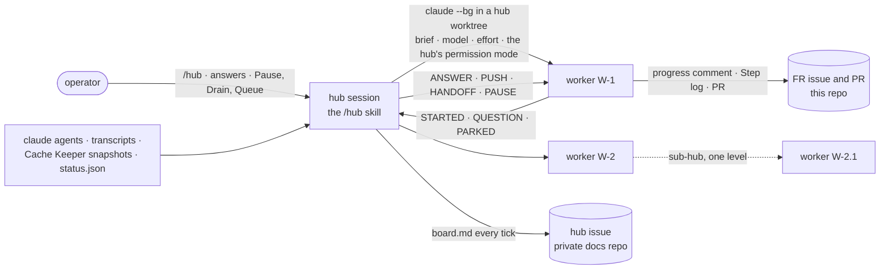
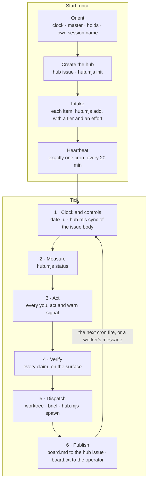
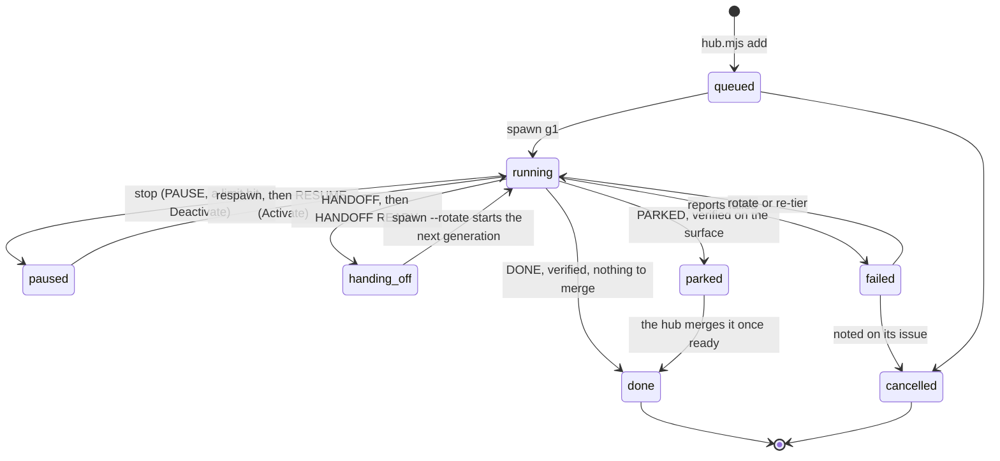
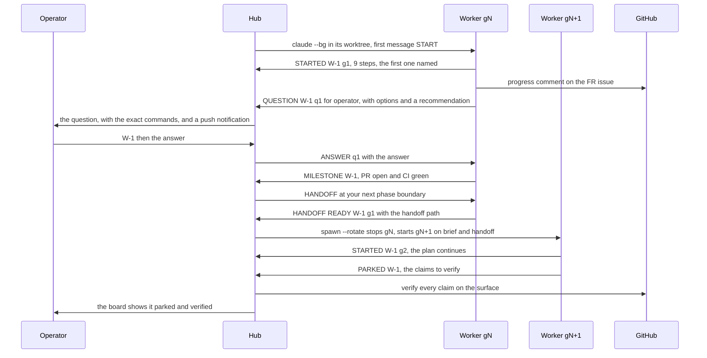
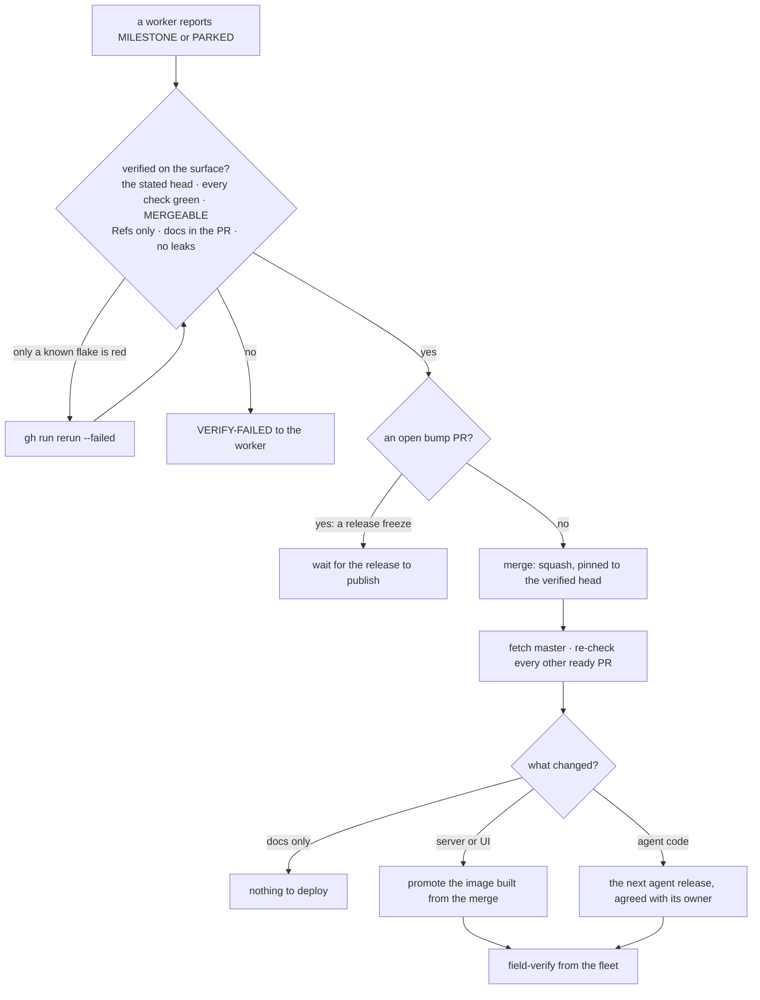

# The agent hub — one coordinator session, many worker sessions

The hub is how the FR backlog is worked in parallel. One Claude Code session, the **hub**,
hands each piece of work (an FR phase, a bug, a spec, a piece of research) to a **worker**: a
background Claude Code session (`claude --bg`) in a git worktree of its own. The hub measures
every worker on each tick, answers or routes its questions, rotates its context before it
degrades, and checks each claim it makes on GitHub, CI or the fleet before that claim counts.
The operator watches one board and can enter any worker and leave it again. Since
2026-10-30 the hub merges and deploys a PR as soon as it is ready (§11), and the operator
keeps every FR close and every decision that is theirs.

This page is the engineering reference. The decisions and their evidence are in the spec,
[FR-131](fr/FR-131-hub-coordinator.md) (#3127). The FR rules that every FR worker follows are in
[`fr/README.md`](fr/README.md) and [`.claude/agents/fr-worker.md`](../.claude/agents/fr-worker.md).
The tooling is **not in this repo**: on 2026-10-30 the operator decided it stays local for now, in
the user's Claude skills folder, with a source history of its own. Its files are cited below by
section name (`SKILL.md §Signals`), never by line.
*As of Claude Code 2.1.314, the hub skill of 2026-10-30, and `hub-view` 0.2.0.*

## 1. What it is, and why sessions



Before the hub, the backlog was worked one card at a time by the `autopilot` skill
([`.claude/skills/autopilot/SKILL.md`](../.claude/skills/autopilot/SKILL.md)), with two or three
workers sent out by hand as in-process subagents. Three failures were measured, each a cost of
running workers that way: a worker silently continued on a weaker model, two workers halted on a
usage limit, and a worker improvised live network manipulation on the dev box because "prove it in
the field" was left open. The hub answers each one: the model and effort of every turn are read
from the transcript, the account's usage windows gate every dispatch, and every brief carries an
explicit live-systems line.

A worker is a session, not something lighter:

| Option | Why it was not used for workers |
|---|---|
| In-process subagents (the `Agent` tool) | The operator can't enter one. It dies with its parent's `/clear`. It reports only when it finishes, and nobody sees its context fill or its prompt cache expire. |
| Agent teams | They can't nest, and they don't survive `/resume`. |
| **`claude --bg` sessions** (chosen) | Each is a job with its own transcript. The operator can attach to it and leave it running. It outlives the hub's `/clear`. It messages the hub as it goes, and its context, cache, model and effort can be read from outside. |

The hub works alongside `autopilot`, not instead of it. Its Dispatch step ranks FRs with
`autopilot.mjs next`. An FR worker follows the `fr-worker` contract: one phase per PR, docs in the
same PR, a field test shown RED on the current deploy before GREEN, and an AC ticked only with
evidence. An FR worker's branch starts with `fr<N>-`, because autopilot treats a card as in flight
only when a local branch matches `^fr-?<N>`.

## 2. The pieces

| Piece | Where | What it does |
|---|---|---|
| **Skill** `SKILL.md` | `~/.claude/skills/hub/` | The coordinator's prompt: Start, Tick, the signal table, the tiers, briefs, dispatch, rotation, verification, operator escalation, pause and resume, FR claims, nesting, the rails and the measured mechanics. It is invoked only by hand (`disable-model-invocation`). |
| **Worker protocol** `worker.md` | same | What a worker does: Start (orient on the surface, plan, report), the loop, the message verbs both ways (their single definition), questions, handoff, park, sub-hub, and the `status.json` schema. |
| **Templates** `templates.md` | same | The hub issue, the brief, the worker's progress comment, and the FR, task and sub-issue shapes. |
| **Helper** `hub.mjs` | same | A Node script with no dependencies, the mechanical half: `init`, `add`, `spawn` (with `--rotate [--from-status]`), `stop`, `respawn`, `msg`, `status` (with a read-only `--peek`), `sync`, `set`, `attach`, `convo` and `self`. `node ~/.claude/skills/hub/hub.mjs help` lists them. The judgement stays with the hub. |
| **Screen replay** `vt.mjs` | same | Replays a `claude logs` capture on a small VT grid and prints the last screen (`--all` prints every distinct one). §9 says why that is needed. |
| **Hub view** `hub-view` | `~/.claude/skills/hub-view/` | A function-hooks plugin. `/hub` with no arguments opens a pane that lists every worker of every hub, enters one, answers it, and activates or deactivates it (§8). |

Each tool folder is a git work tree whose repository sits outside it, so git's own writes never
land in a folder Claude Code watches.

**State lives on disk and on GitHub, never only in a context.** Any session can resume a hub from
its folder:

| Path under `~/.claude/hub/<id>/` | Written by | Holds |
|---|---|---|
| `state.json` | `hub.mjs` only, run by the hub or by the view | The registry: the hub's session name and permission mode, the config (tiers, effort, thresholds, slots), the flags, the queue, and each worker with its tier, worktree, branch, PR, state and every generation's session. |
| `status.json` | `hub.mjs status` | The last measurement: totals, account windows, free disk, every recommendation and every worker's view. |
| `board.md` · `board.txt` | `hub.mjs status` | The board, as the hub issue's body and as text for the terminal. |
| `events.log` | `hub.mjs` | One tab-separated line per action: init, add, spawn, stop, respawn, set. |
| `issue-body.md` | the hub, each tick | The hub issue's body as last read, the input to `sync`. |
| `hub-handoff.md` | the hub | Only what the hub was in the middle of, when its own context is rotated. |
| `workers/<W>/brief.md` | the hub | The worker's whole world (§3). |
| `workers/<W>/status.json` | the worker only | Its plan, heartbeat, state, phase, `next`, what it is blocked on, its open question, its claims, and what the operator owes. |
| `workers/<W>/handoff-g<N>.md` | the worker, or `spawn --from-status` | Generation N's handoff to N+1. |
| `workers/<W>/sub/` | a sub-hub | The same layout, one level down. |

The **hub issue** lives in the private docs repository (`roomler-ai-docs`), because the board
carries session telemetry and local paths. The operator edits only its ⚙ Controls (⏸ Pause,
🚰 Drain, the `hub-config` block) and its 📥 Queue, often from a phone, and `sync` reads them back
every tick. The public FR issue gets the worker's progress comment and a `## Step log` comment.

Worktrees are `<worktrees>/hub-<id>-<w>-<slug>`. The `hub-` prefix together with the path recorded
in `state.json` is the proof that the hub made one. Each worker gets a `CARGO_TARGET_DIR` of its own,
`<targets>/<worktree name>`, outside the worktree.

How the operator drives it:

| The operator types | The hub does |
|---|---|
| `/hub <spec, issue list, or "the open FRs">` | Start |
| `/hub tick <id>` (the heartbeat cron sends it too) | Tick |
| `/hub resume <id>` | Resume after a `/clear`, a crash or a reboot, then Tick |
| `/hub` with no arguments | Opens the hub view (§8) |
| `W-3: <answer>` | Relays it as `ANSWER q<id>: <answer>` |
| `taking W-3` · `W-3 back` | Holds the worker while the operator is inside it, then releases it |
| `pause` · `status` | Pauses every worker · prints the board |

## 3. The loop



| Tick step | What it reads or runs | Done when |
|---|---|---|
| 1 · Clock and controls | `date -u` (the host sleeps, so elapsed time is never assumed), then the hub issue's body through `hub.mjs sync` | every line `sync` printed is acted on, including queue lines it could not parse |
| 2 · Measure | `hub.mjs status`: `claude agents --json --all` for liveness, each transcript for model, effort, usage and limit hits, Cache Keeper's live snapshots for context and the cache countdown, its `limits.json` for the account's windows, each worker's `status.json`, and free disk | every recommendation is tagged `you` (needs the operator), `act` (the hub, now), `warn` (the hub, this tick) or `info` |
| 3 · Act | §5 | every `you`, `act` and `warn` item is handled, or carries a note (`hub.mjs set <dir> W-n note=…`) |
| 4 · Verify | the PR at its stated head, `gh pr checks`, `Refs #n` in its body and commits with no closing keyword, the comment, the evidence behind each ticked AC, a RED run before the GREEN one, no model drift in the turns that did the work | `hub.mjs set <dir> W-n verified=true`, or `VERIFY-FAILED: <what was seen>` to the worker |
| 5 · Dispatch | the free slots (`max_parallel` 3 workers, `max_sessions_total` 5 sessions); `autopilot.mjs next`, then the queue's order, then size | every free slot holds a live worker on the intended model and effort, which has sent `STARTED` |
| 6 · Publish | re-read the issue, `sync`, redraw, `gh issue edit --body-file board.md`, all in one shell call so an edit the operator made during the tick survives | the operator has the board, or one line: `tick HH:MMZ · no change · R/M running · next ~HH:MMZ` |

**A brief is the worker's whole world.** It names the goal and a checkable done-criterion; the
issue, branch and worktree; each AC, marked agent or operator; the skills and memory files to read,
by absolute path; the route to field verification; what is out of scope; and the
**live-systems line**, which says which hosts the worker may touch and how. The dev box is the
operator's daily driver, so a worker there runs no tc/netem, restarts no `roomlerd`, and leaves no
remote-control page open in the shared Chrome.

A worker's life, as the board shows it. `handing_off` comes from the worker's own `status.json`; every
other state is the worker's row in the hub's `state.json`, which `hub.mjs` writes on `add`, `spawn`,
`stop`, `respawn` and `set`:



A **generation** is one session of a worker. The worker keeps its id, brief, worktree and issue
across generations; only the session changes, and the old one stays readable.

## 4. Messages

Every message starts with its verb, and its first line stands on its own. Messages travel as
cross-session `SendMessage`s, which flow only between sessions in the same permission mode (§9).



The verbs are defined once, in `worker.md §Messages`:

| From the hub | The worker |
|---|---|
| `ANSWER q<id>: …` | applies it and sets the question's `answered: true` |
| `GRANT: <k> slots` | may run `k` sub-workers in a sub-hub |
| `PUSH: <step>` · `NUDGE` | continues, with that step if one is named |
| `HANDOFF now` · `HANDOFF at your next phase boundary` | reaches a clean point, writes `handoff-g<N>.md`, replies `HANDOFF READY` |
| `PAUSE` | finishes the current atomic step, writes `state: paused` with the exact resume point, replies `PAUSED` |
| `RESUME` | re-reads its protocol, brief, status and handoff, then the surface, and continues |
| `VERIFY-FAILED: …` | fixes the work or corrects the claim |
| `FYI: …` | folds in the new fact (a merged PR, a moved master, a freeze) |
| `STOP` | checkpoints, reports what is done and what is not, and ends its turn |

| To the hub | When |
|---|---|
| `STARTED W-n gN:` | the plan exists: the step count and the first step |
| `MILESTONE W-n:` | a step that matters is done, with its evidence link |
| `QUESTION W-n q<id> for hub\|operator:` | a decision it can't make; it keeps working on everything the question does not block |
| `BLOCKED W-n:` | it waits on CI, a build or an answer; information, not a request |
| `PAUSED W-n` · `HANDOFF READY W-n gN: <path>` | in answer to `PAUSE` or `HANDOFF` |
| `SLOTS W-n: <k> for <reason>` | its scope splits into parts that can run in parallel |
| `MEMORY W-n:` | a fact a future session needs that the repo does not record; the hub is the memory's single writer |
| `PARKED W-n:` · `DONE W-n:` | the agent part is done, with the claims to verify and what the operator owes |

**Who decides.** The hub answers what it can from the spec, the rails, master and GitHub. A
merge, a close, a release, a change of scope, risk to a live host, an operator-only AC, and a
design choice the spec leaves open go to the operator. The hub escalates with a first line that
stands alone and the exact commands to answer (in the hub's terminal, from the view, or by entering
the worker with `claude attach <short>`). A message from the hub view reads
`(the operator, from the hub view)` on its second line, and the worker treats it as the operator's
own words.

## 5. Signals

`hub.mjs status` turns each measurement into a coded recommendation, condensed here from
`SKILL.md §Signals`. The thresholds are the `hub-config` defaults.

| Code | Tag | Fires when | The hub |
|---|---|---|---|
| `WAITING` | you | the session's `status` is `waiting`: a permission prompt or other input only a person can give | escalates, with the attach command |
| `QUESTION` | act · you | `status.json` holds an unanswered question, for the hub or for the operator | answers it, or escalates it |
| `CTX_SOFT` · `CTX_HARD` | warn · act | context at 40% · 60% of the window | `HANDOFF at your next phase boundary` · `HANDOFF now`, then rotates |
| `CACHE_PUSH` | act | idle, the cache cold within 10 min (2 min on a 5-minute cache), and a `next` step with nothing blocking it | `PUSH: <that step>`, which warms the cache and moves the work |
| `CACHE_HANDOFF` | act | the same window, 150k tokens or more in context, and a wait longer than the cache lives | `HANDOFF now` while the cache is warm, then stops it |
| `CACHE_COOL` | info | the same window with a small context or a short wait | lets it cool: a cold re-read of a small context costs less than a handoff |
| `IDLE` | act | idle with nothing blocking it, heartbeat 10 min old | `NUDGE`; twice in a row, it reads `claude logs` to find out why |
| `STALE` | warn | busy, but no heartbeat and no transcript activity for 45 min | reads `claude logs`: a long build is fine, a hung one is not |
| `NO_STATUS` | warn | no `status.json` 15 min after spawn | `FYI: write your status.json now` |
| `STOPPED` · `GONE` | act | registered but not running · not in `claude agents` at all | `respawn` and `RESUME` · rotates, with `--from-status` if it left no handoff |
| `REBORN` | act | someone `/clear`ed inside the job, so a fresh session runs under the same job id | sends it the `msg` text |
| `FAILED` | act | its `status.json` says failed | rotates, re-tiers, or cancels with a note on its issue |
| `MODEL` · `EFFORT` | act · warn | a turn on another model than the tier's, or a switch mid-run · a turn at another effort | rotates with `--from-status` and has everything after the switch re-verified · notes it, and rotates a §3 step that ran below max |
| `LIMIT` | act | a real limit hit (§9), quoting the reset | stops it until the reset, then probes the model before a respawn |
| `API_ERROR` | warn | its last turn died on an API error | `NUDGE` once the API answers |
| `VERIFY` | act | it reports parked or done, not yet verified | verifies on the surface (§3, step 4) |
| `HELD` · `OPERATOR` | info | the operator is inside it, or typed there in the last 20 min | sends it nothing until "W-n back" |
| `DISPATCH` | act | a slot is free and work is queued | dispatches |
| `HOLD` · `PAUSED` · `DRAIN` | warn · info | an account window or the disk is at its cap (§7) · the issue's controls | starts nothing |
| `HUB_CTX` | act | the hub's own context at 40% | finishes the tick, writes `hub-handoff.md`, and asks the operator for `/clear` and `/hub resume <id>` |

## 6. Tiers and effort

Every worker gets a tier (a model) and an effort when it is added. The defaults are
`tier.complex: opus[1m]`, `tier.simple: sonnet`, `effort.default: max` and `effort.casual: xhigh`.

| Work | Tier | Effort |
|---|---|---|
| **CLAUDE.md §3 scope**, at any size: remote desktop and control; the overlay, WireGuard, NAT traversal, relays, DERP, tunnels; WebRTC conferencing | complex | **max**. This is the floor, and nothing lowers it. |
| design, debugging, cross-layer changes, security, anything near a release or deploy, field verification, writing an FR spec | complex | max |
| judgement on non-pillar work: restructuring docs, summarising a review, synthesising research | complex | xhigh |
| mechanical and fully specified: test-only additions, renames, link and anchor fixes, gathering data with citations | simple | max |
| casual: triage, labels, status sweeps, issue hygiene | simple | xhigh |

When unsure, the hub takes the higher row. A simple worker that runs into a row-one or row-two
concern asks `QUESTION for hub: re-tier`, and is re-tiered and rotated. A running worker is never
moved down a tier.

**Why the effort goes through `--settings`.** This repo's `.claude/settings.json:4` sets
`CLAUDE_CODE_EFFORT_LEVEL=max` in the project env, and that env beats the `--effort` flag: a worker
started with `--effort low` recorded `max` in its transcript. An env passed through `--settings`
outranks the project file: a worker started with
`--settings '{"env":{"CLAUDE_CODE_EFFORT_LEVEL":"high"}}'` recorded `high`. So `spawn` passes the
effort that way, and `status` reads the effort each turn actually used, which is what the `EFFORT`
signal compares. `spawn` runs, in the worker's worktree:

```bash
claude --bg -n <hub>-<W>-g<N>-<slug> --model <the tier's model> \
  --permission-mode <the hub's own mode> \
  --settings '{"env":{"CLAUDE_CODE_EFFORT_LEVEL":"<effort>","CARGO_TARGET_DIR":"<targets>/<worktree>","GH_CONFIG_DIR":"<forwarded>"}}' \
  "START — you are hub worker W-n of hub <id> … (the paths to its protocol, brief, status file and folder)"
```

`GH_CONFIG_DIR` is forwarded because it lives in the primary checkout's `settings.local.json`,
which a worktree does not have; without it the worker writes to GitHub as whichever `gh` account
is globally active.

## 7. Rotation and budget

A long context costs twice. Every turn re-reads all of it, and once the prompt cache expires on an
idle worker the next re-read is billed cold. It also degrades: early detail is followed less
reliably as the window fills. A **rotation** replaces the session before that, with a handoff the
worker writes while it still holds everything.

| Threshold | Signal | Action |
|---|---|---|
| context ≥ 40% (`handoff.soft_pct`) | `CTX_SOFT` | `HANDOFF at your next phase boundary` |
| context ≥ 60% (`handoff.hard_pct`) | `CTX_HARD` | `HANDOFF now` |
| idle, ≥ 150k tokens (`handoff.idle_min_tokens`), cache about to expire, a long wait ahead | `CACHE_HANDOFF` | `HANDOFF now` while the cache is warm, so the handoff is written from a cache read; stop it; rotate when the blocker clears |

1. The worker reaches a clean point and writes `handoff-g<N>.md`: Goal, Done with evidence,
   In flight (every changed file, what is verified and what is not), numbered Next steps, Traps
   learned, Open questions, Refs.
2. The hub reads it. It must stand on its own, or the hub asks for more before stopping anything.
3. `hub.mjs spawn <dir> W-n --rotate` refuses without a handoff, stops gN, and starts gN+1 on the
   brief plus the handoff. When gN can't write one (it is gone, drifted or out of budget),
   `--from-status` writes one from its `status.json` and marks it UNVERIFIED, so gN+1 re-checks it
   on the surface first.

**The budget hold.** The hub starts no session while an account window is at its cap: the 5-hour
window at 85% (`budget.max_5h_pct`), the 7-day window at 90%, a tier's model at 95%, or the disk
under 40 GB free. Cache Keeper's `~/.claude/cache-keeper/limits.json` holds the windows. A rotation
starts a session too, so **a worker that is close to a handoff rotates before the hold, not under
it**. A worker caught by the hold hands off, is stopped, and waits for the window to reset. A
`LIMIT` signal is a real limit hit: the hub stops the worker until the quoted reset, then sends one
probe line on the tier's model before it respawns.

## 8. The hub view

`/hub` with no arguments opens the hub view, the `hub-view` plugin. `/hub-view` opens it too. The
plugin is a `command.run` hook on `/hub`: with no arguments it answers the command itself, with the
board as text, and opens the pane, so no model turn runs and the board costs nothing. With
arguments it passes the command on, and `/hub tick <id>` still reaches the skill.

The hub view as the live check of 2026-10-30 drew it, with a scratch hub of two throwaway workers:

```text
[ Refresh ] refreshed 04:15Z

🧭 hvtest · hub-view live check (throwaway) · ▰▰▱▱▱▱▱▱ 29% · ● 2/2 running · ❓ 1 waiting on you

W-1  Throwaway A  sonnet·xhigh  ● running
▰▰▰▱▱▱▱▱▱▱ 33% · 3 total · 1 done · 1 in progress · 1 pending · ctx 7% · 59m left
○ idle
 [ Enter ] [ Deactivate ] [ Copy attach ]

❓ W-2  Throwaway B (asks a question)  sonnet·xhigh  ● running
▰▰▰▱▱▱▱▱▱▱ 25% · 4 total · 1 done · 1 in progress · 2 pending · ctx 7% · 59m left
❓ q1 for operator: Draw progress as a bar or as dots?
 [ Enter ] [ Deactivate ] [ Copy attach ]
```

| Part | Shows | Comes from |
|---|---|---|
| Section | one per hub: id, title, overall %, running out of `max_parallel`, how many wait on the operator; a sub-hub's workers sit indented under their parent | each `state.json`, then `hub.mjs status --json --peek`, which writes no file |
| Row | id, title, model·effort, state, a progress bar with total · done · in progress · pending (dropped steps leave the total), context %, the cache countdown, and ❓ with the open question | `status`'s view of the worker, and its `status.json` plan |
| Worker view | the header, the open question with its options and recommendation, the answer field, the tasks (✔ ▶ ○), and the whole conversation, oldest first, with each tool call as one dim line | `hub.mjs convo`, paged back from the transcript's end by byte offset, because `$.fs.read` refuses a file over 4 MiB and worker transcripts are bigger |

| Key or button | Does |
|---|---|
| **Enter** (`1`–`9`) | opens the worker view |
| **← Back** (`b`) · **Esc** | back to the hub view; Esc there closes the pane. An arrow key can't be a hotkey, which is why Back is `b`. |
| **⇡ Older** (`o`) | loads the page before the one shown |
| `g1 g2 …` | opens an earlier generation, read-only, with no answer field |
| **Refresh** (`r`) | refreshes now; the view also refreshes on open and every 30 s while the pane is open |
| the answer field, then Enter | sends the answer by the first route that applies (below) |
| **Activate** | `hub.mjs respawn`, then the RESUME text by the answer route, retried for 30 s while the session comes up |
| **Deactivate** | asks `Stop W-n?` first, then `hub.mjs stop`; the worker reads paused until the operator activates it or says so |
| **Copy attach** | copies `claude attach <short>` |

Activate and Deactivate go through `hub.mjs`, so the hub's `state.json` follows both. On a phone
there is no text field, and the worker view says how to answer instead.

| Route | When | What happens |
|---|---|---|
| **a** | the worker runs, and this session's permission mode equals the worker's (or either mode is unknown) | `$.session.send` straight to the worker: `ANSWER q<id>: <text>` while a question is open, else `FYI: <text>`, with `(the operator, from the hub view)` as the second line |
| **b** | this session is the hub, and the modes differ | `W-n: <text>` goes into the hub's own prompt, and the hub relays it as `ANSWER` |
| **c** | anything else, or the worker is not running | nothing is sent; `claude attach <short>` is copied, and the view says why |

**An answer counts as received only once it shows in the worker's transcript.** The send's
`isDelivered` only means *queued*. A session in another permission mode holds a cross-session
message for a person there and lets it expire, while the sender still reads it as delivered. So
the view shows `⋯ queued · route a` first, and `✔ received <time>` only once the worker's
transcript holds the message. When the operator answers that way, the worker's `answered: true` is
the hub's notice, and the hub does not relay it a second time.

| Command | |
|---|---|
| `/hub` · `/hub-view` | opens the view |
| `/hub-view status` | the board as text; it works headless too |
| `/hub-view enter <ref> [g<N>]` | opens the view on that worker, or read-only on its generation N |
| `/hub-view answer <ref> <text>` | answers by the routes above, then waits up to 30 s to see it arrive |
| `/hub-view activate <ref>` · `deactivate <ref>` · `attach <ref>` | the actions; a typed `deactivate` is its own confirmation |

`<ref>` is `W-2`, or `<hub>/W-2` when two hubs have a W-2. Each verb calls the same function as the
pane's button or field, which is how a background session runs the view's own path and
`claude logs` shows the result. Inside, `hooks/core.ts` is pure (rows, counts, routes, the received
check, paging, the command grammar) and the tests drive it directly; `hooks/view.tsx` draws both
screens; `hooks/register.ts` is the glue to the engine.

## 9. Mechanics and traps

Measured on Claude Code 2.1.280 and 2.1.314 on 2026-10-30. Each one reads as a harmless detail
until it breaks a run.

| Trap | What happens | What the tooling does |
|---|---|---|
| **Permission modes must match** | A session in a different permission mode holds an incoming cross-session message for its human ("permission mode class doesn't match") and lets it expire. With the modes matched, messages flow both ways. A background session in a new worktree also ignores the project's `permissions.defaultMode` (`.claude/settings.json:7`) and starts in `default`. | `init` reads the hub's mode from its transcript; `spawn` passes `--permission-mode` explicitly and refuses while the mode is unknown. |
| **`claude --bg --resume` forks a copy** | On a registered session, stopped ones included, it starts a copy under a new id that inherits the name, and then two live sessions answer to that name. | Pause is `claude stop`; resume is `claude respawn`, which brings the same job back in place, idle, with nothing replayed. |
| **`state: blocked` is not a need** | In `claude agents --json --all`, `state` is the agent view's own label, and a job idle after a normal turn reads `blocked`. A person is needed only when `status` reads `waiting` with `waitingFor`. `status` is present only while the process runs. | Liveness and `WAITING` follow `status`, never `state`. |
| **A `/clear` inside a job** | It starts a new session id under the same job id. | Liveness follows the job id; the fresh session is `REBORN` and gets the `msg` text. |
| **Not every `<synthetic>` reply is a limit hit** | A limit hit carries `error: "rate_limit"` and "You've hit your session limit · resets …". An API failure carries `server_error` or "Can't reach the API server". After a stop or respawn the session writes "No response requested.", which is no error at all. | `LIMIT` fires on real limit hits only and quotes the reset; `API_ERROR` is a separate signal; the respawn reply raises nothing. |
| **Git Bash rewrites a leading `/`** | An argument that starts with `/` becomes a Windows path before a native exe sees it: `/plugin-types` arrived as a path under the Git install folder. | Prefix such a command with `MSYS_NO_PATHCONV=1`. `hub.mjs` starts `claude` through Node, so its own arguments are safe. |
| **Trust** | 2.1.314 refuses `claude --bg` in an untrusted folder ("Workspace not trusted"). A worktree of a trusted repo, and any subfolder of a trusted folder, inherit the trust. | Every worker, research ones included, gets a worktree of this repo. |
| **What a worktree session misses** | It shares auto-memory, `CLAUDE.md`, the rules, the project env and the hooks, but not `settings.local.json`, `permissions.defaultMode` or the untracked skills. | `spawn` forwards `GH_CONFIG_DIR` and sets the mode; briefs pass untracked skills by absolute path. |
| **A cron prompt arrives as plain text** | `/hub tick <id>` from a cron reaches the model as bare text, not as a skill invocation, so it works only while the skill is already in context. A session cron survives `/clear`. Fires that queued up while the session was busy arrive as one message, or back to back, which reads like a doubled cron (§11). | The heartbeat prompt says how to load the skill if it is missing. The hub runs `CronList` before any `CronCreate`, so a second cron never doubles the tick. |
| **`claude rm` keeps the transcript** | It removes a session from the registry but keeps its transcript, so an earlier generation stays readable. It also deletes a worktree that Claude itself made for the session; a hub-made worktree stays. | The view opens earlier generations from their transcripts. |
| **Reading `claude logs`** | It is a stream of full-screen frames. Each starts with ESC[H, and its rows wrap at the terminal width with no line breaks, so stripping the ANSI garbles the layout. | `node ~/.claude/skills/hub/vt.mjs <capture> 200 60` replays it and prints the last screen; a docked pane reads as the right-hand columns. |

## 10. Rails

| Rail | Why |
|---|---|
| **The hub merges and deploys a READY PR; workers never merge.** The operator closes FRs and keeps scope, priority, money and accounts, risk to a host they use, operator-only ACs, and the design choices a spec leaves open. | A ready PR that waits goes stale as master moves (§11, lesson 2). Ready means verified on the surface, because a worker's report is a claim until someone has looked. The rest are decisions about the product. |
| **`Refs #n` only**, never `close`, `fix` or `resolve #n`, in a PR body or a commit | GitHub closes the issue the moment the PR merges. On 2026-09-25 "close #819" in a worker's PR body closed FR-22 with two criteria still open ([`.claude/agents/fr-worker.md:57-61`](../.claude/agents/fr-worker.md)). |
| **The only commit the hub pushes to master is an FR claim**: the spec and its ledger row in one commit, made back to back with the issue, and only while no release-bump PR is open | Only master arbitrates a number ([`fr/README.md`](fr/README.md)). Only the hub claims, one claim at a time, so its workers never race each other for N. |
| **Public text names no hostnames, local paths, session ids or account names** | The repo is public. A name edited out later stays in the edit history. The hub issue lives in the private docs repo for this reason. |
| **Every brief has a live-systems line** | "Prove it in the field" left open once became live network manipulation on the dev box. |
| **An AC is ticked only with evidence on the surface**, and CI green is not a field read | A ticked box is the record that the verification happened, and a field test proves something only when it was shown failing on the current deploy first (`CLAUDE.md`, the FR workflow). |
| **Gates exit**: `[ "$N" = 0 ] \|\| exit 1` in front of any `gh pr merge` or `gh workflow run` a brief allows | A check whose result is only printed stops nothing. |
| **GitHub is polled no faster than every 60 s, with one watcher per PR** | About 34 sessions share the account. |
| **A worktree is removed only** if it is a `hub-` worktree recorded in state, its issue is closed and its PR merged, with `git worktree remove` and no `--force`, together with its target folder; branches stay | A name alone is no proof of who made a worktree, and each target folder runs to several GB. |

## 11. Operating lessons from the first real run

Hub `bl1` worked the backlog on 2026-10-30 (FR-131 P3,
[field log](fr/FR-131-hub-coordinator.md#field-log)). It ran ten workers, at most three at once, and
the hub merged four PRs. Six lessons came out of it. The last column says where each rule lives now:
four are in the generic skill, and two are specific to this repo and are kept here.

| # | Lesson | What bl1 measured | The rule | Where it lives |
|---|---|---|---|---|
| 1 | **A message respawns a stopped background worker.** So does the operator typing into it, and likely a viewer opening its session. | A peer session's release broadcasts went to the workers' session names. They revived two parked workers and FR-55 P4's rotated g3, which then wrote into the live g4's handoff and status files: two generations on one worktree. The operator's `go`, typed into the retired g3, revived it again. A parked worker also came back with no turn in its transcript, likely when a viewer opened it. | Peers send a hub's notices to the hub, never to a worker. On every tick, after `hub.mjs status`, the hub runs `claude agents --json --all`. A generation that should be stopped but shows a `status` first has its transcript tail read (what woke it, and whether it touched the worktree), then gets `claude stop <short>`. `hub.mjs stop` reaches only the latest generation, so an older one is stopped by its short id. | `SKILL.md §Tick` (Measure), `§Messages` |
| 2 | **Merge and deploy as soon as a PR is ready.** This is the operator's standing rule, from 2026-10-30 16:28Z. | Verified PRs that waited for the operator's merge kept conflicting as master moved. FR-55 P4's PR ([#3148](https://github.com/gjovanov/roomler-ai/pull/3148)) needed five merge rounds in one afternoon, and each round cost its worker a rebuild. | §11.1. Ready means verified by the hub on the surface. FR closes stay the operator's. | `SKILL.md §Rails` |
| 3 | **Anchor churn.** PRs that move a heavily anchored file conflict with each other, and with master, in many docs at once. | 24 docs anchor into `agents/roomlerd/src/app.rs`. After one merge to master, FR-16 L1's PR ([#3155](https://github.com/gjovanov/roomler-ai/pull/3155)) conflicted in 16 docs. FR-55 P4's conflicted in 4 to 11 docs a round. Every hunk differed only in anchor numbers. | One of the two methods in §11.2, each with its cross-check. Merging soon after green (lesson 2) keeps the rounds few. | here (repo-specific) |
| 4 | **Disk.** Container target volumes grow fast. | One worker held about 72 GB: a 39 GB target volume, a 30 GB native target and a 3 GB image. The hub read C: falling 21 GB in 11 minutes. | Every brief tells the worker to run `df` before each build, build one feature set at a time, send `BLOCKED: disk` under 45 GB free, and tear down its containers, volumes and images at park. Under pressure, the hub may delete a parked or done worker's regenerable target cache, never a running one's. One such cache gave back 16 GB. The budget hold starts nothing under 40 GB free (§7). | `SKILL.md §Rails` |
| 5 | **Missed cron fires can arrive back to back.** | While the hub was busy, the heartbeat's missed fires came in one after another, which reads like a doubled cron. | It is not a second cron: `CronList` shows one. Never add another. | `SKILL.md §Start` (Heartbeat) |
| 6 | **Known flakes are not the worker's failure.** | The macOS lane's `thread_dump` test failed on three of the run's PRs ([#3148](https://github.com/gjovanov/roomler-ai/pull/3148), [#3151](https://github.com/gjovanov/roomler-ai/pull/3151), #3155). On the loaded dev box, `exec::tests::concurrency_cap_refuses_rather_than_queues` ([`agents/roomlerd/src/exec.rs:2731`](../agents/roomlerd/src/exec.rs#L2731)) failed a native Windows `cargo test -p roomlerd --lib` for two workers. | Re-run the macOS job (`gh run rerun <run> --failed`) until it is green, and never merge red. The exec test passes alone. It also still fails with the PR's own tests skipped, which rules the PR out, and CI's Windows lane is the gate of record. | here (repo-specific) |

### 11.1 Merge and deploy, once a PR is ready



The gate and the merge run in **one** shell call, so a freeze stops the merge itself and does not
just get printed beside it:

```bash
N=$(gh pr list -R gjovanov/roomler-ai --state open --search 'bump in:title' --json number -q length)
[ "$N" = 0 ] || exit 1
gh pr merge <n> -R gjovanov/roomler-ai --squash --match-head-commit <verified sha>
```

One merge at a time. The branch is kept (no `--delete-branch`). After each merge the hub posts the FR's
`## Step log` row, brings the issue body's ticks in line with the merged spec, and fetches master, because
every other ready PR may conflict now. Merging is the hub's alone, and a worker never merges.

### 11.2 Anchor churn: two ways through a conflict

Both methods start from a merge of master **pinned to a SHA**, not to `origin/master`, because a
parallel fetch once moved that ref in the middle of a merge. Both end the same way:

- the anchor cross-check, both ways: every shifted number lands on the same code text it named before;
- the pin scan, down to 0: a line under an anchor pin keeps its day's number;
- `bash scripts/anchor-range-audit.sh`, and the other CI docs audits.

| Method | Steps | Use it when |
|---|---|---|
| **(a) master's side, then both deltas** | 1. Show with a diff3 view that every conflicting hunk differs only in digits. 2. `git merge -X theirs <sha>`; in a merge of master into the branch, *theirs* is master. 3. Re-apply both anchor deltas: the PR's code moves onto the hunks that took master's side, and master's code moves onto the PR's own docs. | the conflicts sit in docs the PR touched only to shift anchors |
| **(b) master's text, plus the PR's delta once** | For each conflicting doc, take master's text and shift it once for the code files the PR moves. For the PR's own docs, keep its text and shift it once for master's moved files. | the PR had already shifted hunks that master also changed, where (a) would shift them twice |

FR-55 P4's worker used (a) on rounds of 4 to 11 docs. FR-16 L1's used (b) on a 16-doc round, where all 60
of its conflicting changes were digits only. Both cross-checks came back clean.

## 12. Field log

- **2026-10-30 — P3, the first real run, hub `bl1`.** Ten workers in all, at most three at once, all on
  Opus. The hub merged [#3144](https://github.com/gjovanov/roomler-ai/pull/3144) (FR-131 P4) and
  [#3145](https://github.com/gjovanov/roomler-ai/pull/3145) (the FR-47 close-out), which had parked in
  parallel, then [#3151](https://github.com/gjovanov/roomler-ai/pull/3151) (FR-18 AC4) and
  [#3158](https://github.com/gjovanov/roomler-ai/pull/3158) (FR-76 P3). There were five rotations on
  context signals, across FR-55 P4's worker (g1→g4) and FR-16 L1's (g1→g3). Each handoff stood on its
  own. The hub deferred `CTX_SOFT` three times, for workers two or three steps from parking, because a
  rotation that close to the end costs more than it saves. It gave each of them a higher mark to hand
  off at instead. Late in the day the account's 5-hour window reached 72%, and the hub moved the next
  rotation and the server promote past the window's reset: under the hold it could not have started the
  rotation, and it would not promote what it could not then field-verify. The lessons are in §11.
- **2026-10-30 — P2, the hub view, under its own first hub.** One worker built `hub-view` across
  three generations. g1 handed off to g2 at 35% context, after reading the function-hooks API
  declarations had grown it by about 80k tokens in nine minutes. g2 handed off to g3 across a
  budget hold: the account's 5-hour window went from 55 to 89% in about 50 minutes, with one
  Opus-max worker and the operator's other sessions sharing it. The hub had g2 hand off at 85%,
  stopped it, and started g3 after the window reset. That is where the rule to rotate *before*
  the hold comes from. Each handoff stood on its own. By checking claims on the surface, the hub
  caught two gaps before the park: AC7's paging had not been shown live, and the helper's `self`
  read the permission mode as null from a 2.1.280 transcript. Both were closed before the worker
  parked. The plugin ships with 35 tests on Claude Code's own engine kit, every UI test on both
  terminal and desktop, and AC6–AC9 were then shown live on 2.1.314 with two throwaway workers
  ([Step log](https://github.com/gjovanov/roomler-ai/issues/3127#issuecomment-6515103295)).

P1 (the skill, the protocol and the helper) and P1b (the move to 2.1.314) are logged in the
[spec](fr/FR-131-hub-coordinator.md#field-log).
