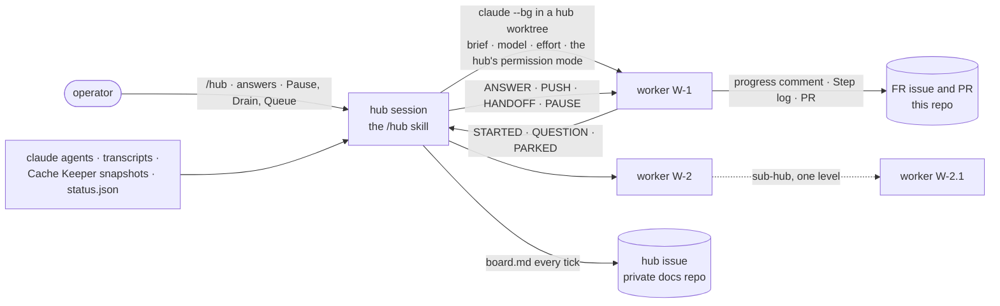
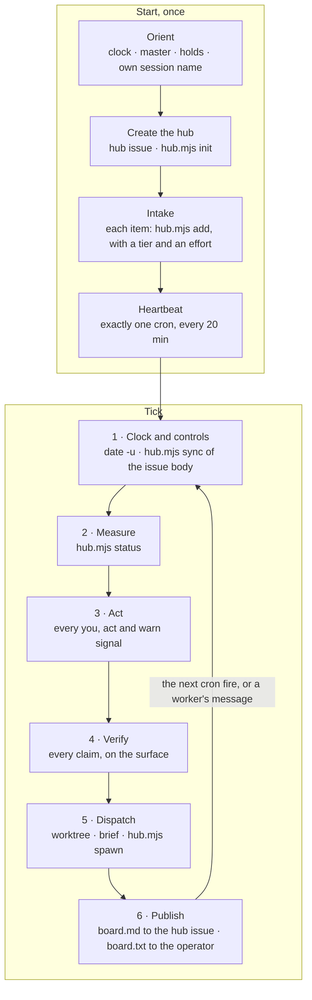
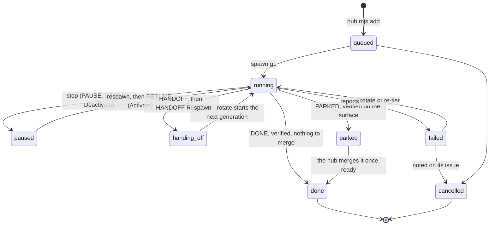
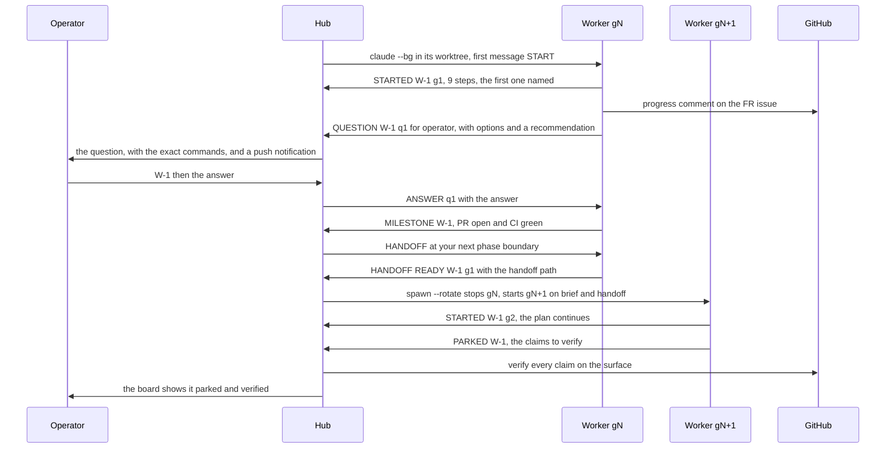
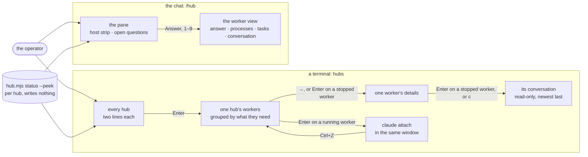
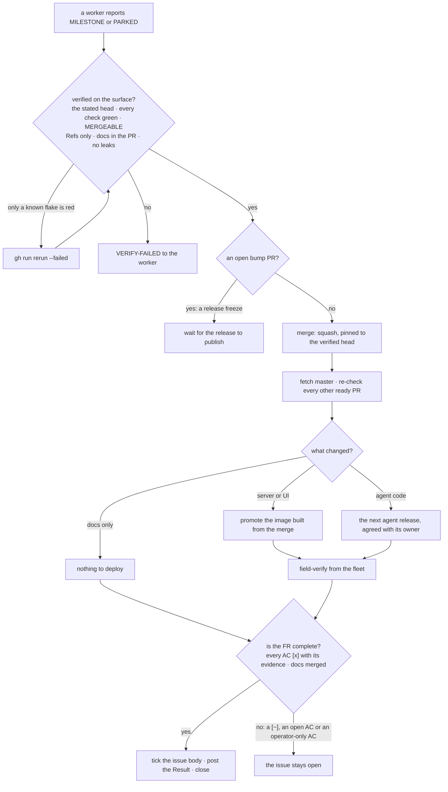
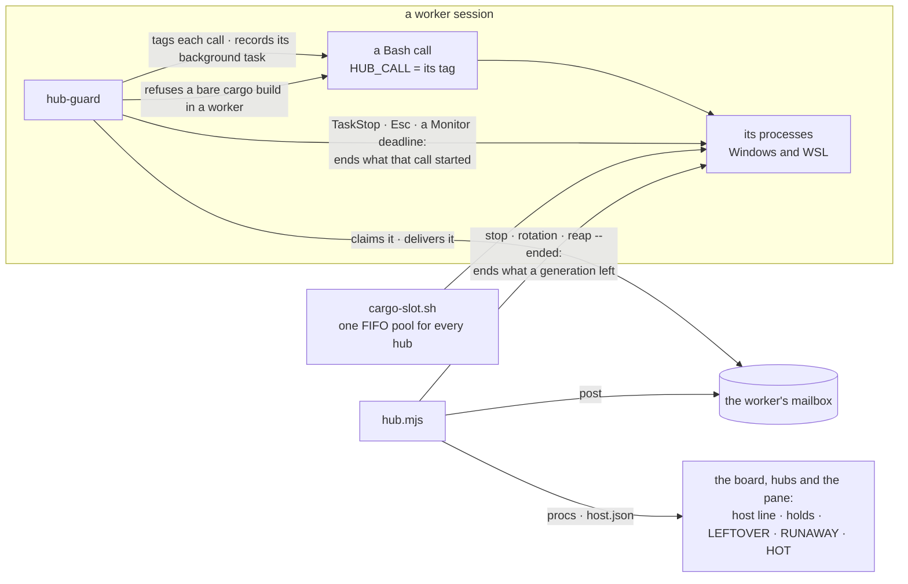
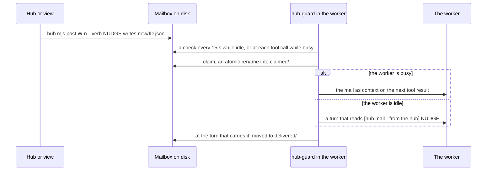

# The agent hub — one coordinator session, many worker sessions

The hub is how the FR backlog is worked in parallel. One Claude Code session, the **hub**,
hands each piece of work (an FR phase, a bug, a spec, a piece of research) to a **worker**: a
background Claude Code session (`claude --bg`) in a git worktree of its own. The hub measures
every worker on each tick, answers or routes its questions, rotates its context before it
degrades, and checks each claim it makes on GitHub, CI or the fleet before that claim counts.
The operator watches one board and can enter any worker and leave it again. Since
2026-10-30 the hub merges and deploys a PR as soon as it is ready, and closes an FR once every
criterion is ticked with its evidence (§11). The operator keeps every decision that is theirs.

This page is the engineering reference. The decisions and their evidence are in the spec,
[FR-131](fr/FR-131-hub-coordinator.md) (#3127), and for process hygiene, the host budget, the
mailbox and the idle handoff (§12) in [FR-136](fr/FR-136-hub-process-hygiene.md) (#3457). The FR
rules that every FR worker follows are in
[`fr/README.md`](fr/README.md) and [`.claude/agents/fr-worker.md`](../.claude/agents/fr-worker.md).
The tooling is **not in this repo**: on 2026-10-30 the operator decided it stays local for now, in
the user's Claude skills folder, with a source history of its own. Its files are cited below by
section name (`SKILL.md §Signals`), never by line.
*As of Claude Code 2.1.314, the hub skill of 2026-11-05, `hub-view` 0.4.1 and `hub-guard` 0.4.3.*

## 1. What it is, and why sessions



Before the hub, the backlog was worked one card at a time by the `autopilot` skill
([`.claude/skills/autopilot/SKILL.md`](../.claude/skills/autopilot/SKILL.md)), with two or three
workers sent out by hand as in-process subagents. Three failures were measured, each a cost of
running workers that way: a worker silently continued on a weaker model, two workers halted on a
usage limit, and a worker improvised live network manipulation on the dev box because "prove it in
the field" was left open. The hub answers each one: the model and effort of every turn are read
from the transcript, the account's usage windows gate every dispatch, and every brief carries an
explicit live-systems line.

A worker is a session, not something lighter:

| Option | Why it was not used for workers |
|---|---|
| In-process subagents (the `Agent` tool) | The operator can't enter one. It dies with its parent's `/clear`. It reports only when it finishes, and nobody sees its context fill or its prompt cache expire. |
| Agent teams | They can't nest, and they don't survive `/resume`. |
| **`claude --bg` sessions** (chosen) | Each is a job with its own transcript. The operator can attach to it and leave it running. It outlives the hub's `/clear`. It messages the hub as it goes, and its context, cache, model and effort can be read from outside. |

The hub works alongside `autopilot`, not instead of it. Its Dispatch step ranks FRs with
`autopilot.mjs next`. An FR worker follows the `fr-worker` contract: one phase per PR, docs in the
same PR, a field test shown RED on the current deploy before GREEN, and an AC ticked only with
evidence. An FR worker's branch starts with `fr<N>-`, because autopilot treats a card as in flight
only when a local branch matches `^fr-?<N>`.

## 2. The pieces

| Piece | Where | What it does |
|---|---|---|
| **Skill** `SKILL.md` | `~/.claude/skills/hub/` | The coordinator's prompt: Start, Tick, the signal table, the tiers, briefs, dispatch, rotation, verification, operator escalation, pause and resume, FR claims, nesting, the rails and the measured mechanics. It is invoked only by hand (`disable-model-invocation`). |
| **Worker protocol** `worker.md` | same | What a worker does: Start (orient on the surface, plan, report), the loop, the message verbs both ways (their single definition), questions, handoff, park, sub-hub, and the `status.json` schema. |
| **Templates** `templates.md` | same | The hub issue, the brief, the worker's progress comment, and the FR, task and sub-issue shapes. |
| **Helper** `hub.mjs` | same | A Node script with no dependencies, the mechanical half: `init`, `add`, `spawn` (with `--rotate [--from-status]`), `stop`, `respawn`, `msg`, `status` (with a read-only `--peek`), `sync`, `set`, `attach`, `convo`, `self`, and since FR-136 `procs`, `reap`, `post`, `mail` and `role`. `node ~/.claude/skills/hub/hub.mjs help` lists them. The judgement stays with the hub. |
| **Screen replay** `vt.mjs` | same | Replays a `claude logs` capture on a small VT grid and prints the last screen (`--all` prints every distinct one). §9 says why that is needed. |
| **Build slots** `cargo-slot.sh` | same | One host-wide FIFO pool of build slots that every hub shares (§12.2). |
| **Navigator** `hubs.mjs` | same, run as `hubs` | A terminal program with no dependencies: every hub, then one hub's workers grouped by what they need, then one worker, in one window, with a filter across every hub. It answers, cleans up, opens and attaches in the same window (§8.1). |
| **Hub view** `hub-view` | `~/.claude/skills/hub-view/` | A function-hooks plugin. `/hub` with no arguments opens a pane with the host strip and one question list across hubs. A question enters its worker, which the operator can answer through its mailbox, activate, deactivate, attach to, or clean up after (§8.2). |
| **Guard** `hub-guard` | `~/.claude/skills/hub-guard/` | A function-hooks plugin in every session. It ends what a stopped, interrupted or timed-out call started, refuses a bare build in a worker, delivers a worker's mail, and gates the idle handoff (§12). |
| **Idle handoff** `hub-handoff` | `~/.claude/skills/hub-handoff/` | The skill the auto-handoff plugin runs in a session that sat idle; what it writes depends on whether the session is a worker, a hub or neither (§12.4). |

Each tool folder is a git work tree whose repository sits outside it, so git's own writes never
land in a folder Claude Code watches.

**State lives on disk and on GitHub, never only in a context.** Any session can resume a hub from
its folder:

| Path under `~/.claude/hub/<id>/` | Written by | Holds |
|---|---|---|
| `state.json` | `hub.mjs` only, run by the hub or by the view | The registry: the hub's session name and permission mode, the config (tiers, effort, thresholds, slots), the flags, the queue, and each worker with its tier, worktree, branch, PR, state and every generation's session. |
| `status.json` | `hub.mjs status` | The last measurement: totals, account windows, free disk, every recommendation and every worker's view. |
| `board.md` · `board.txt` | `hub.mjs status` | The board, as the hub issue's body and as text for the terminal. |
| `events.log` | `hub.mjs` | One tab-separated line per action: init, add, spawn, stop, respawn, set. |
| `issue-body.md` | the hub, each tick | The hub issue's body as last read, the input to `sync`. |
| `hub-handoff.md` | the hub | Only what the hub was in the middle of, when its own context is rotated. |
| `workers/<W>/brief.md` | the hub | The worker's whole world (§3). |
| `workers/<W>/status.json` | the worker only | Its plan, heartbeat, state, phase, `next`, what it is blocked on, its open question, its claims, and what the operator owes. |
| `workers/<W>/handoff-g<N>.md` | the worker, or `spawn --from-status` | Generation N's handoff to N+1. |
| `workers/<W>/mailbox/` | `hub.mjs post` writes `new/`; hub-guard moves a message to `claimed/`, then `delivered/` | The worker's mail (§12.3). |
| `workers/<W>/sub/` | a sub-hub | The same layout, one level down. |

Two files sit one level up and are shared by every hub: `~/.claude/hub/host.json`, the host
budget (§12.2), and the CPU sample ring `status` reads it with.

The **hub issue** lives in the private docs repository (`roomler-ai-docs`), because the board
carries session telemetry and local paths. The operator edits only its ⚙ Controls (⏸ Pause,
🚰 Drain, the `hub-config` block) and its 📥 Queue, often from a phone, and `sync` reads them back
every tick. The public FR issue gets the worker's progress comment and a `## Step log` comment.

Worktrees are `<worktrees>/hub-<id>-<w>-<slug>`. The `hub-` prefix together with the path recorded
in `state.json` is the proof that the hub made one. Each worker gets a `CARGO_TARGET_DIR` of its own,
`<targets>/<worktree name>`, outside the worktree.

How the operator drives it:

| The operator types | The hub does |
|---|---|
| `/hub <spec, issue list, or "the open FRs">` | Start |
| `/hub tick <id>` (the heartbeat cron sends it too) | Tick |
| `/hub resume <id>` | Resume after a `/clear`, a crash or a reboot, then Tick |
| `/hub` with no arguments | Opens the hub view (§8.2) |
| `hubs`, in a terminal | Nothing: the navigator only reads, until a key attaches, answers, cleans up or opens (§8.1) |
| `W-3: <answer>` | Relays it as `ANSWER q<id>: <answer>` |
| `taking W-3` · `W-3 back` | Holds the worker while the operator is inside it, then releases it |
| `pause` · `status` | Pauses every worker · prints the board |

## 3. The loop



| Tick step | What it reads or runs | Done when |
|---|---|---|
| 1 · Clock and controls | `date -u` (the host sleeps, so elapsed time is never assumed), then the hub issue's body through `hub.mjs sync` | every line `sync` printed is acted on, including queue lines it could not parse |
| 2 · Measure | `hub.mjs status`: `claude agents --json --all` for liveness, each transcript for model, effort, usage and limit hits, Cache Keeper's live snapshots for context and the cache countdown, its `limits.json` for the account's windows, each worker's `status.json`, and free disk | every recommendation is tagged `you` (needs the operator), `act` (the hub, now), `warn` (the hub, this tick) or `info` |
| 3 · Act | §5 | every `you`, `act` and `warn` item is handled, or carries a note (`hub.mjs set <dir> W-n note=…`) |
| 4 · Verify | the PR at its stated head, `gh pr checks`, `Refs #n` in its body and commits with no closing keyword, the comment, the evidence behind each ticked AC, a RED run before the GREEN one, no model drift in the turns that did the work | `hub.mjs set <dir> W-n verified=true`, or `VERIFY-FAILED: <what was seen>` to the worker |
| 5 · Dispatch | the free slots (`max_parallel` 3 workers, `max_sessions_total` 5 sessions); `autopilot.mjs next`, then the queue's order, then size | every free slot holds a live worker on the intended model and effort, which has sent `STARTED` |
| 6 · Publish | re-read the issue, `sync`, redraw, `gh issue edit --body-file board.md`, all in one shell call so an edit the operator made during the tick survives | the operator has the board, or one line: `tick HH:MMZ · no change · R/M running · next ~HH:MMZ` |

**A brief is the worker's whole world.** It names the goal and a checkable done-criterion; the
issue, branch and worktree; each AC, marked agent or operator; the skills and memory files to read,
by absolute path; the route to field verification; what is out of scope; and the
**live-systems line**, which says which hosts the worker may touch and how. The dev box is the
operator's daily driver, so a worker there runs no tc/netem, restarts no `roomlerd`, and leaves no
remote-control page open in the shared Chrome.

A worker's life, as the board shows it. `handing_off` comes from the worker's own `status.json`; every
other state is the worker's row in the hub's `state.json`, which `hub.mjs` writes on `add`, `spawn`,
`stop`, `respawn` and `set`:



A **generation** is one session of a worker. The worker keeps its id, brief, worktree and issue
across generations; only the session changes, and the old one stays readable.

## 4. Messages

Every message starts with its verb, and its first line stands on its own. Since FR-136 every
message from the hub to a worker goes through the worker's **mailbox** (`hub.mjs post`, §12.3), which
needs no matching modes and never restarts a stopped worker. A worker's messages to the hub, and the
hub's to a generation spawned before the mailbox, are cross-session `SendMessage`s, which flow only
between sessions in the same permission mode (§9).



The verbs are defined once, in `worker.md §Messages`:

| From the hub | The worker |
|---|---|
| `ANSWER q<id>: …` | applies it and sets the question's `answered: true` |
| `GRANT: <k> slots` | may run `k` sub-workers in a sub-hub |
| `PUSH: <step>` · `NUDGE` | continues, with that step if one is named |
| `HANDOFF now` · `HANDOFF at your next phase boundary` | reaches a clean point, writes `handoff-g<N>.md`, replies `HANDOFF READY` |
| `PAUSE` | finishes the current atomic step, writes `state: paused` with the exact resume point, replies `PAUSED` |
| `RESUME` | re-reads its protocol, brief, status and handoff, then the surface, and continues |
| `VERIFY-FAILED: …` | fixes the work or corrects the claim |
| `FYI: …` | folds in the new fact (a merged PR, a moved master, a freeze) |
| `STOP` | checkpoints, reports what is done and what is not, and ends its turn |

| To the hub | When |
|---|---|
| `STARTED W-n gN:` | the plan exists: the step count and the first step |
| `MILESTONE W-n:` | a step that matters is done, with its evidence link |
| `QUESTION W-n q<id> for hub\|operator:` | a decision it can't make; it keeps working on everything the question does not block |
| `BLOCKED W-n:` | it waits on CI, a build or an answer; information, not a request |
| `PAUSED W-n` · `HANDOFF READY W-n gN: <path>` | in answer to `PAUSE` or `HANDOFF` |
| `SLOTS W-n: <k> for <reason>` | its scope splits into parts that can run in parallel |
| `MEMORY W-n:` | a fact a future session needs that the repo does not record; the hub is the memory's single writer |
| `PARKED W-n:` · `DONE W-n:` | the agent part is done, with the claims to verify and what the operator owes |

**Who decides.** The hub answers what it can from the spec, the rails, master and GitHub. A
change of scope or priority, money or accounts, risk to a live host, an operator-only AC, and a
design choice the spec leaves open go to the operator. Merging, deploying, testing, ticking and
closing complete work are the hub's since 2026-10-30 (§10). The hub escalates with a first line that
stands alone and the exact commands to answer (in the hub's terminal, from the view, or by entering
the worker with `claude attach <short>`). An answer from the hub view arrives as mail headed
`[hub mail · from the operator, in the hub view]`, or, sent to an older generation, with
`(the operator, from the hub view)` on its second line, and the worker treats it as the operator's
own words. A question the worker marks `"typed": true` is the exception. It counts only when the
operator types the answer in the worker's own session, because the permission check refuses an OK
that anyone relays. So the hub gives only the ways in (`hubs`, `claude attach <short>`), and no view
sends an answer to it.

## 5. Signals

`hub.mjs status` turns each measurement into a coded recommendation, condensed here from
`SKILL.md §Signals`. The thresholds are the `hub-config` defaults.

| Code | Tag | Fires when | The hub |
|---|---|---|---|
| `WAITING` | you | the session's `status` is `waiting`: a permission prompt or other input only a person can give | escalates, with the attach command |
| `QUESTION` | act · you | `status.json` holds an unanswered question, for the hub or for the operator | answers it, or escalates it |
| `CTX_SOFT` · `CTX_HARD` | warn · act | context at 20% · 30% of the window, 200k · 300k tokens of 1M | `HANDOFF at your next phase boundary` · `HANDOFF now`, then rotates |
| `CACHE_PUSH` | act | idle, the cache cold within 10 min (2 min on a 5-minute cache), and a `next` step with nothing blocking it | `PUSH: <that step>`, which warms the cache and moves the work |
| `CACHE_HANDOFF` | act | the same window, 150k tokens or more in context, and a wait longer than the cache lives | `HANDOFF now` while the cache is warm, then stops it |
| `CACHE_COOL` | info | the same window with a small context or a short wait | lets it cool: a cold re-read of a small context costs less than a handoff |
| `IDLE` | act | idle with nothing blocking it, heartbeat 10 min old | `NUDGE`; twice in a row, it reads `claude logs` to find out why |
| `STALE` | warn | busy, but no heartbeat and no transcript activity for 45 min | reads `claude logs`: a long build is fine, a hung one is not |
| `NO_STATUS` | warn | no `status.json` 15 min after spawn | `FYI: write your status.json now` |
| `STOPPED` · `GONE` | act, or info past `respawn_per_tick` | registered but not running · not in `claude agents` at all | `respawn`, which posts the `RESUME` · rotates, with `--from-status` if it left no handoff. After a reboot only `respawn_per_tick` of them a tick are `act`, and none under a host hold (§12.2). |
| `LEFTOVER` | act | a generation that no longer runs still owns processes, on Windows or in WSL | `hub.mjs reap <dir> W-n [--gen N]`, or `reap --ended` for all (§12.1) |
| `RUNAWAY` | act | a live `yes`, or an MSYS2 shell or perl over 1 GB | a running worker is told to TaskStop the task that started it; a stopped one is reaped |
| `HOT` | warn | a worker's processes average over 4 cores for 10 min, or hold over 8 GB | reads `hub.mjs procs`, and asks the worker what runs |
| `MAIL_WAITING` | act | mail waits for a worker that is not running | `respawn` or a rotation delivers it; never a cross-session send |
| `REBORN` | act | someone `/clear`ed inside the job, so a fresh session runs under the same job id | sends it the `msg` text |
| `FAILED` | act | its `status.json` says failed | rotates, re-tiers, or cancels with a note on its issue |
| `MODEL` · `EFFORT` | act · warn | a turn on another model than the tier's, or a switch mid-run · a turn at another effort | rotates with `--from-status` and has everything after the switch re-verified · notes it, and rotates a §3 step that ran below max |
| `LIMIT` | act | a real limit hit (§9), quoting the reset | stops it until the reset, then probes the model before a respawn |
| `API_ERROR` | warn | its last turn died on an API error | `NUDGE` once the API answers |
| `VERIFY` | act | it reports parked or done, not yet verified | verifies on the surface (§3, step 4) |
| `HELD` · `OPERATOR` | info | the operator is inside it, or typed there in the last 20 min | sends it nothing until "W-n back" |
| `DISPATCH` | act | a slot is free and work is queued | dispatches |
| `HOLD` · `PAUSED` · `DRAIN` | warn · info | an account window or the disk is at its cap (§7), or the host is (`host:` live sessions, free RAM or commit, CPU, §12.2) · the issue's controls | starts nothing |
| `HUB_CTX` | act | the hub's own context at 20%, 200k tokens | finishes the tick, writes `hub-handoff.md`, and asks the operator for `/clear` and `/hub resume <id>` |

## 6. Tiers and effort

Every worker gets a tier (a model) and an effort when it is added. The defaults are
`tier.complex: opus[1m]`, `tier.simple: sonnet`, `effort.default: max` and `effort.casual: xhigh`.

| Work | Tier | Effort |
|---|---|---|
| **CLAUDE.md §3 scope**, at any size: remote desktop and control (capture, encode, input, consent, recording, the RC wire); the overlay, WireGuard, NAT traversal, relays, DERP, tunnels, roomler SSH; WebRTC conferencing, coturn included | complex | **max**. This is the floor, and nothing lowers it. |
| fleet-critical outside §3: the updater, installers and their trust (MSI, signing), the daemon's lifecycle, server security, device identity, releases and deploys | complex | xhigh |
| other code and judgement: server features, UI, flaky tests and CI, packaging bugs, removing code, merging finished work, restructuring docs, an FR spec outside the pillars | complex | high |
| non-product or fully specified: promo, blog, attribution, test-only additions, renames, link and anchor fixes, gathering data with citations | simple | high |
| casual: triage, labels, status sweeps, issue hygiene | simple | high |

Until 2026-11-04 most rows ran at max and the rest at xhigh. The 7-day window then ran fast with
every worker on Opus at max, and the operator had the tiers set by each worker's need
([FR-136](fr/FR-136-hub-process-hygiene.md), field log, 16:00). The hub judges by what a worker's
code touches, not by its title: a "flaky tests" worker whose tests are consent and recording is §3.
When unsure whether work is §3, it is.

A worker below max that runs into a §3 surface asks `QUESTION for hub: re-tier`, and the hub sets
`tier=complex effort=max` and rotates it. **A tier binds at `spawn` only**, for a new worker or at
`--rotate`: `respawn` revives the same session on the model and effort it started with. So a
re-tiered worker takes its new tier at its next rotation, never in place.

**Why the effort goes through `--settings`.** This repo's `.claude/settings.json:4` sets
`CLAUDE_CODE_EFFORT_LEVEL=max` in the project env, and that env beats the `--effort` flag: a worker
started with `--effort low` recorded `max` in its transcript. An env passed through `--settings`
outranks the project file: a worker started with
`--settings '{"env":{"CLAUDE_CODE_EFFORT_LEVEL":"high"}}'` recorded `high`. So `spawn` passes the
effort that way, and `status` reads the effort each turn actually used, which is what the `EFFORT`
signal compares. `spawn` runs, in the worker's worktree:

```bash
claude --bg -n <hub>-<W>-g<N>-<slug> --model <the tier's model> \
  --permission-mode <the hub's own mode> \
  --settings '{"env":{"CLAUDE_CODE_EFFORT_LEVEL":"<effort>","CARGO_TARGET_DIR":"<targets>/<worktree>","GH_CONFIG_DIR":"<forwarded>"}}' \
  "START — you are hub worker W-n of hub <id> … (the paths to its protocol, brief, status file and folder)"
```

`GH_CONFIG_DIR` is forwarded because it lives in the primary checkout's `settings.local.json`,
which a worktree does not have; without it the worker writes to GitHub as whichever `gh` account
is globally active.

## 7. Rotation and budget

A long context costs twice. Every turn re-reads all of it, and once the prompt cache expires on an
idle worker the next re-read is billed cold. It also degrades: early detail is followed less
reliably as the window fills. A **rotation** replaces the session before that, with a handoff the
worker writes while it still holds everything.

| Threshold | Signal | Action |
|---|---|---|
| context ≥ 20% (`handoff.soft_pct`), 200k tokens of a 1M window | `CTX_SOFT` | `HANDOFF at your next phase boundary` |
| context ≥ 30% (`handoff.hard_pct`), 300k tokens | `CTX_HARD` | `HANDOFF now` |
| idle, ≥ 150k tokens (`handoff.idle_min_tokens`), cache about to expire, a long wait ahead | `CACHE_HANDOFF` | `HANDOFF now` while the cache is warm, so the handoff is written from a cache read; stop it; rotate when the blocker clears |

The marks were 40% and 60% until 2026-11-04. Every call re-reads the whole context, and those
re-reads were most of what the hubs spent, so the operator moved them to 200k and 300k tokens, in
each hub's `hub-config` and as the helper's default.

1. The worker reaches a clean point and writes `handoff-g<N>.md`: Goal, Done with evidence,
   In flight (every changed file, what is verified and what is not), numbered Next steps, Traps
   learned, Open questions, Refs.
2. The hub reads it. It must stand on its own, or the hub asks for more before stopping anything.
3. `hub.mjs spawn <dir> W-n --rotate` refuses without a handoff, stops gN, and starts gN+1 on the
   brief plus the handoff. When gN can't write one (it is gone, drifted or out of budget),
   `--from-status` writes one from its `status.json` and marks it UNVERIFIED, so gN+1 re-checks it
   on the surface first.

**The budget hold.** The hub starts no session while an account window is at its cap: the 5-hour
window at 85% (`budget.max_5h_pct`), the 7-day window at 90%, a tier's model at 95%, or the disk
under 40 GB free. Cache Keeper's `~/.claude/cache-keeper/limits.json` holds the windows. A rotation
starts a session too, so **a worker that is close to a handoff rotates before the hold, not under
it**. A worker caught by the hold hands off, is stopped, and waits for the window to reset. A
`LIMIT` signal is a real limit hit: the hub stops the worker until the quoted reset, then sends one
probe line on the tier's model before it respawns.

The machine has a budget of its own, shared by every hub: live sessions, free memory and commit,
CPU, and the build slots (§12.2). A worker that sits idle long enough is handed off by the idle
handoff, unless the hub would not hand it off either (§12.4).

## 8. The hub view

The operator sees the hubs in two places. **`hubs`**, the navigator, runs in a terminal and lists
every hub and worker. **The pane** that `/hub` opens in the chat holds what needs the operator now:
the host and the open questions. Until 2026-11-04 the pane listed every hub and worker itself. The
operator's look at it found too many at once, with no way to search them, and Attach opening another
window. So the operator chose a navigator in the style of `claude agents` instead
([FR-136](fr/FR-136-hub-process-hygiene.md) D5). The lists moved there (P9), and the pane shrank
around the questions (P10).



### 8.1 The navigator, `hubs`

`hubs` is `~/.claude/skills/hub/hubs.mjs`, a Node script with no dependencies, started by a launcher
on the `PATH` (`hubs.cmd` on Windows, `~/bin/hubs` in Git Bash). It reads `hub.mjs status <dir>
--json --peek` for every hub folder, `hub.mjs convo` for a worker's last lines and, a page at a time,
its whole conversation, and hub-guard's task records. It changes nothing until a key asks it to.
Drawn from a made-up fixture with `--snapshot`, the top level and one hub look like this:

```text
 Hubs
 host · CPU 20% · free 40 GB · sessions 9/15 · build slots 1/3
────────────────────────────────────────────────────────────────────────────────────────────────
> hvtest   hub-view live check (throwaway)
>          ▰▰▰▰▰▱▱▱▱▱  50%  ● 2 running  ? 1 for you  ⚠ 2 left behind  ·  1 paused · 1 queued · 1 done
  docs     Docs sweep
           ▰▰▰▰▰▰▰▰▰▰ 100%  ● 0 running  ·  1 parked · 3 done
────────────────────────────────────────────────────────────────────────────────────────────────
 ↑↓ j k move  Enter open  / filter  r refresh  q quit
```

```text
 Hubs › hvtest · hub-view live check (throwaway)
 host · CPU 20% · free 40 GB · sessions 9/15 · build slots 1/3
────────────────────────────────────────────────────────────────────────────────────────────────
 Needs you · 1
> W-2 g1     Throwaway B (asks a question)         ‖ paused    ctx 30%
 Running · 2
  W-1 g1     Throwaway A                           ● busy      ctx 30%  10m   ⚙ 0.4c 120M
? W-3 g1     Throwaway C                           ● idle      ctx 30%
 Paused or stopped · 1
  W-4 g1     Throwaway D                           ‖ paused    ctx 30%                       ⚠ 2 left
 Queued · 1
  W-5 g0     Throwaway E                           ◌ queued    ctx 30%
 Done · 1 (d shows them)
────────────────────────────────────────────────────────────────────────────────────────────────
 ↑↓ j k move  Enter attach (running)  → details  c conversation  ← back  / filter  d show done  q quit
```

A hub's workers come in six groups: **Needs you** (a question for the operator), **Running**,
**Paused or stopped**, **Parked**, **Queued**, and **Done**, which stays folded until `d`. A `?`
marks a question for the hub, `⚙ 0.4c 120M` what a worker's processes cost (from 110 columns; a
narrower window drops it, then the cache, then the context), and `⚠ N left` what an ended generation
left running. On the top level, a hub's `● N running` counts its workers with a live session, the way
their rows do, not the workers its own state says it runs.

| Key | Does |
|---|---|
| `↑` `↓` `j` `k` · PgUp PgDn Home End | moves; in a conversation they scroll it |
| **Enter** | goes in. On a running worker it attaches in this window, and Ctrl+Z comes back to the navigator where it was. On a stopped one it shows the details first, and Enter again opens its conversation. |
| `→` or `i` · `←` or Backspace | a worker's details: its question with the options, tasks, processes, background tasks, links and last lines · back, and from a conversation back to where it was opened |
| `c` | a worker's conversation, running or stopped, read-only and newest last, up to 150 entries a page through `hub.mjs convo`. ↑, PgUp or Home at its top reads the page before, `r` reloads it, and Enter in it attaches a running worker. |
| `t` | attaches in a new tab of this window |
| `R` | restarts a stopped worker and attaches; twice when its hub stopped it, and never while the host holds new sessions. Enter never restarts one. |
| `/` | filters every hub and worker by id, title, PR or issue; Esc clears it |
| `d` · `r` · `q` | shows or hides finished workers · refreshes (it also refreshes every 30 s) · quits |
| in a worker: `a` · `u` · `w` · `p` · `o` | answers its question, into its mailbox (a typed question gets nothing: `a` says Enter or `R` instead) · cleans up what earlier generations left (`hub.mjs reap`) · opens the worktree · the PR · the issue |

**Attaching in the same window.** The navigator can't hand its own console to `claude attach`, so
it writes the session to attach to into a file and exits. The launcher then runs `claude attach`,
and starts the navigator again where it was once Ctrl+Z gives the terminal back.

`node hubs.mjs --snapshot [--at hubs|hub:<id>|worker:<id>/<W-n>] [--keys '…'] [--fixture DIR]`
prints one screen as text after those keys, attaching, posting, reaping and opening nothing. The
15 cases in `node --test hubs.test.mjs` are built on it.

### 8.2 The pane

`/hub` with no arguments opens the pane, the `hub-view` plugin. `/hub-view` opens it too. The plugin
is a `command.run` hook on `/hub`: with no arguments it answers the command itself, with what the pane
draws as text, and opens the pane, so no model turn runs and it costs nothing. With arguments it
passes the command on, and `/hub tick <id>` still reaches the skill. `/hub-view status` still answers
the whole board as text, for a phone or a model.

The pane of 0.4.0, laid out with the data of the earlier live checks (the 2026-10-30 scratch hub,
the 2026-11-04 host strip):

```text
[ Refresh ] refreshed 08:40Z
host · CPU 8% · free 54 GB (RAM 54, commit 126) · sessions 7/15 · build slots 0/3

❓ Questions · 1
hvtest/W-2 q1 for operator: Draw progress as a bar or as dots?  [ Answer ]
1 hub · 2 workers, 2 running · browse them with `hubs` in a terminal
```

| Part | Shows | Comes from |
|---|---|---|
| Host strip | CPU over the last minute (n/a until two samples 45 s apart exist), free RAM and commit, live sessions out of `max_sessions`, build slots in use, and what holds the host | `status`'s `host` (§12.2) |
| Questions | every open question of every hub, the operator's first, each with **Answer**, which enters that worker; `No open questions.` when there are none | each worker's `status.json` question |
| A hub it could not read | `⚠ <hub>: <why>`, so a question missing from the list has its reason beside it | `hub.mjs status` answering an error |
| Where the workers are | how many hubs, workers and running workers, and where to browse them | the hubs' views |
| Worker view | the header, the open question with its options and recommendation, the answer field with its route and the mailbox's counts, the tasks (✔ ▶ ○), the processes with what earlier generations left, the background tasks hub-guard recorded (▶ running, ✔ ended, ⏹ stopped, ⚠ stopped with processes still alive), and the whole conversation, oldest first, with each tool call as one dim line | `hub.mjs convo`, paged back from the transcript's end by byte offset, because `$.fs.read` refuses a file over 4 MiB and worker transcripts are bigger; `~/.claude/hub-guard/tasks/<session>.json` |

| Key or button | Does |
|---|---|
| **Answer** (`1`–`9`) | opens that question's worker view |
| **← Back** (`b`) · **Esc** | back to the pane's first screen; Esc there closes the pane. An arrow key can't be a hotkey, which is why Back is `b`. |
| **⇡ Older** (`o`) | loads the page before the one shown |
| `g1 g2 …` | opens an earlier generation, read-only, with no answer field |
| **Refresh** (`r`) | refreshes now; the view also refreshes on open and every 30 s while the pane is open |
| the answer field, then Enter | sends the answer by the first route that applies (below) |
| **Activate** | `hub.mjs respawn`, which posts the RESUME into the mailbox; an older generation gets the RESUME text by the answer route, retried for 30 s while the session comes up |
| **Deactivate** | asks `Stop W-n?` first, then `hub.mjs stop`; the worker reads paused until the operator activates it or says so |
| **Attach** (`t`) | on Windows, from a terminal or desktop surface: `wt.exe -w 0 nt --title "W-n gN" claude attach <short>`, a new tab in the current Windows Terminal window. Attaching restarts a stopped worker, so a stopped one asks first and is refused under a host hold. A tab that fails to open falls back to the copy. |
| **Copy attach** (`c`) | copies `claude attach <short>` |
| **Open worktree** (`w`) · **Open PR** (`p`) · **Open issue** (`i`) | `cmd /d /c code -n <worktree>`, refused for a path holding a cmd metacharacter · `rundll32 url.dll,FileProtocolHandler <url>`, for GitHub issue and PR pages only, since `explorer.exe` exits 1 even when the page opened |
| **Clean up** (`u`) | asks first, then `hub.mjs reap <dir> W-n --gen N` for each generation that left processes; it refuses a generation that still runs |

Every button from ⇡ Older down is the worker view's; since 0.4.0 the pane has no worker rows to
carry them. Activate, Deactivate and Clean up go through `hub.mjs`, so the hub's `state.json` and
event log follow them. Each confirmation answers to `y` and `n`, so only one shows at a time. On a
phone there is no text field, and the worker view says how to answer instead.

| Route | When | What happens |
|---|---|---|
| **m** | the worker's current generation was spawned with a mailbox, running or not | `hub.mjs post --verb ANSWER --q q<id> --from operator --text <text>` (or `FYI`), one argv with no shell; it reads `✉ in its mailbox`, or `✉ waits` while the worker is stopped, then `✔ delivered <time>` once hub-guard moves it to `delivered/` |
| **a** | the worker runs, and this session's permission mode equals the worker's (or either mode is unknown) | `$.session.send` straight to the worker: `ANSWER q<id>: <text>` while a question is open, else `FYI: <text>`, with `(the operator, from the hub view)` as the second line |
| **b** | this session is the hub, and the modes differ | `W-n: <text>` goes into the hub's own prompt, and the hub relays it as `ANSWER` |
| **c** | anything else, or the worker is not running; and, since hub-view 0.4.1, any typed question, mailbox or not | nothing is sent; `claude attach <short>` is copied, and the view says why. A typed question's worker view says so under the question, and the Questions list marks it `(typed)`. |

Routes a and b serve only generations spawned before the mailbox, and c serves those and every
typed question.
**A route-a answer counts as received only once it shows in the worker's transcript.** The send's
`isDelivered` only means *queued*. A session in another permission mode holds a cross-session
message for a person there and lets it expire, while the sender still reads it as delivered. So
the view shows `⋯ queued · route a` first, and `✔ received <time>` only once the worker's
transcript holds the message. When the operator answers that way, the worker's `answered: true` is
the hub's notice, and the hub does not relay it a second time.

| Command | |
|---|---|
| `/hub` · `/hub-view` | opens the pane, and answers what it draws as text |
| `/hub-view status` | the whole board as text: every hub and worker with its counts, context, cache, question and process badge (`⚙ cores · memory · N left`). It works headless too, and on a phone it is how to see the workers. |
| `/hub-view enter <ref> [g<N>]` | opens the view on that worker, or read-only on its generation N; the way into a worker with no question |
| `/hub-view answer <ref> <text>` | answers by the routes above, then waits up to 30 s to see it arrive |
| `/hub-view activate <ref>` · `deactivate <ref>` · `attach <ref>` | the actions; a typed `deactivate` is its own confirmation, and `attach` copies the command |
| `/hub-view open <ref> worktree\|pr\|issue` · `clean <ref>` | the Open buttons, and Clean up; a typed `clean` is its own confirmation |

`<ref>` is `W-2`, or `<hub>/W-2` when two hubs have a W-2. Each verb calls the same function as the
pane's button or field, which is how a background session runs the view's own path and
`claude logs` shows the result. Inside, `hooks/core.ts` is pure (rows, counts, routes, the received
check, paging, the pane and board text, the command grammar) and the tests drive it directly;
`hooks/view.tsx` draws both screens; `hooks/register.ts` is the glue to the engine.

## 9. Mechanics and traps

Measured on Claude Code 2.1.280 and 2.1.314 on 2026-10-30. Each one reads as a harmless detail
until it breaks a run.

| Trap | What happens | What the tooling does |
|---|---|---|
| **Permission modes must match** | A session in a different permission mode holds an incoming cross-session message for its human ("permission mode class doesn't match") and lets it expire. With the modes matched, messages flow both ways. A background session in a new worktree also ignores the project's `permissions.defaultMode` (`.claude/settings.json:7`) and starts in `default`. | `init` reads the hub's mode from its transcript; `spawn` passes `--permission-mode` explicitly and refuses while the mode is unknown. |
| **`claude --bg --resume` forks a copy** | On a registered session, stopped ones included, it starts a copy under a new id that inherits the name, and then two live sessions answer to that name. | Pause is `claude stop`; resume is `claude respawn`, which brings the same job back in place, idle, with nothing replayed. |
| **`state: blocked` is not a need** | In `claude agents --json --all`, `state` is the agent view's own label, and a job idle after a normal turn reads `blocked`. A person is needed only when `status` reads `waiting` with `waitingFor`. `status` is present only while the process runs. | Liveness and `WAITING` follow `status`, never `state`. |
| **A `/clear` inside a job** | It starts a new session id under the same job id. | Liveness follows the job id; the fresh session is `REBORN` and gets the `msg` text. |
| **Not every `<synthetic>` reply is a limit hit** | A limit hit carries `error: "rate_limit"` and "You've hit your session limit · resets …". An API failure carries `server_error` or "Can't reach the API server". After a stop or respawn the session writes "No response requested.", which is no error at all. | `LIMIT` fires on real limit hits only and quotes the reset; `API_ERROR` is a separate signal; the respawn reply raises nothing. |
| **Git Bash rewrites a leading `/`** | An argument that starts with `/` becomes a Windows path before a native exe sees it: `/plugin-types` arrived as a path under the Git install folder. | Prefix such a command with `MSYS_NO_PATHCONV=1`. `hub.mjs` starts `claude` through Node, so its own arguments are safe. |
| **Trust** | 2.1.314 refuses `claude --bg` in an untrusted folder ("Workspace not trusted"). A worktree of a trusted repo, and any subfolder of a trusted folder, inherit the trust. | Every worker, research ones included, gets a worktree of this repo. |
| **What a worktree session misses** | It shares auto-memory, `CLAUDE.md`, the rules, the project env and the hooks, but not `settings.local.json`, `permissions.defaultMode` or the untracked skills. | `spawn` forwards `GH_CONFIG_DIR` and sets the mode; briefs pass untracked skills by absolute path. |
| **A cron prompt arrives as plain text** | `/hub tick <id>` from a cron reaches the model as bare text, not as a skill invocation, so it works only while the skill is already in context. A session cron survives `/clear`. Fires that queued up while the session was busy arrive as one message, or back to back, which reads like a doubled cron (§11). | The heartbeat prompt says how to load the skill if it is missing. The hub runs `CronList` before any `CronCreate`, so a second cron never doubles the tick. |
| **`claude rm` keeps the transcript** | It removes a session from the registry but keeps its transcript, so an earlier generation stays readable. It also deletes a worktree that Claude itself made for the session; a hub-made worktree stays. | The view opens earlier generations from their transcripts. |
| **Reading `claude logs`** | It is a stream of full-screen frames. Each starts with ESC[H, and its rows wrap at the terminal width with no line breaks, so stripping the ANSI garbles the layout. | `node ~/.claude/skills/hub/vt.mjs <capture> 200 60` replays it and prints the last screen; a docked pane reads as the right-hand columns. |

## 10. Rails

| Rail | Why |
|---|---|
| **The hub merges and deploys a READY PR, and closes an FR once it is complete; workers never merge or close.** The operator keeps scope, priority, money and accounts, risk to a host they use, operator-only ACs, and the design choices a spec leaves open. | A ready PR that waits goes stale as master moves (§11, lesson 2). Ready means verified on the surface, because a worker's report is a claim until someone has looked. Complete means every criterion `[x]` with its evidence and the docs merged; a `[~]`, an open AC or an operator-only AC keeps the issue open. The rest are decisions about the product. |
| **`Refs #n` only**, never `close`, `fix` or `resolve #n`, in a PR body or a commit | GitHub closes the issue the moment the PR merges. On 2026-09-25 "close #819" in a worker's PR body closed FR-22 with two criteria still open ([`.claude/agents/fr-worker.md:57-61`](../.claude/agents/fr-worker.md)). |
| **The only commit the hub pushes to master is an FR claim**: the spec and its ledger row in one commit, made back to back with the issue, and only while no release-bump PR is open | Only master arbitrates a number ([`fr/README.md`](fr/README.md)). Only the hub claims, one claim at a time, so its workers never race each other for N. |
| **Public text names no hostnames, local paths, session ids or account names** | The repo is public. A name edited out later stays in the edit history. The hub issue lives in the private docs repo for this reason. |
| **Every brief has a live-systems line** | "Prove it in the field" left open once became live network manipulation on the dev box. |
| **An AC is ticked only with evidence on the surface**, and CI green is not a field read | A ticked box is the record that the verification happened, and a field test proves something only when it was shown failing on the current deploy first (`CLAUDE.md`, the FR workflow). |
| **Gates exit**: `[ "$N" = 0 ] \|\| exit 1` in front of any `gh pr merge` or `gh workflow run` a brief allows | A check whose result is only printed stops nothing. |
| **GitHub is polled no faster than every 60 s, with one watcher per PR** | About 34 sessions share the account. |
| **A worktree is removed only** if it is a `hub-` worktree recorded in state, its issue is closed and its PR merged, with `git worktree remove` and no `--force`, together with its target folder; branches stay | A name alone is no proof of who made a worktree, and each target folder runs to several GB. |

## 11. Operating lessons from the first real run

Hub `bl1` worked the backlog on 2026-10-30 (FR-131 P3,
[field log](fr/FR-131-hub-coordinator.md#field-log)). It ran ten workers, at most three at once, and
the hub merged four PRs. Six lessons came out of it. The last column says where each rule lives now:
four are in the generic skill, and two are specific to this repo and are kept here.

| # | Lesson | What bl1 measured | The rule | Where it lives |
|---|---|---|---|---|
| 1 | **A message respawns a stopped background worker.** So does the operator typing into it, and likely a viewer opening its session. | A peer session's release broadcasts went to the workers' session names. They revived two parked workers and FR-55 P4's rotated g3, which then wrote into the live g4's handoff and status files: two generations on one worktree. The operator's `go`, typed into the retired g3, revived it again. A parked worker also came back with no turn in its transcript, likely when a viewer opened it. | Peers send a hub's notices to the hub, never to a worker. On every tick, after `hub.mjs status`, the hub runs `claude agents --json --all`. A generation that should be stopped but shows a `status` first has its transcript tail read (what woke it, and whether it touched the worktree), then gets `claude stop <short>`. `hub.mjs stop` reaches only the latest generation, so an older one is stopped by its short id. | `SKILL.md §Tick` (Measure), `§Messages` |
| 2 | **Merge and deploy as soon as a PR is ready.** This is the operator's standing rule, from 2026-10-30 16:28Z. | Verified PRs that waited for the operator's merge kept conflicting as master moved. FR-55 P4's PR ([#3148](https://github.com/gjovanov/roomler-ai/pull/3148)) needed five merge rounds in one afternoon, and each round cost its worker a rebuild. | §11.1. Ready means verified by the hub on the surface. From 19:50Z the same holds for a close: once an FR is complete, the hub ticks the issue body, posts the Result and closes it. | `SKILL.md §Rails` (Merge, Close when complete) |
| 3 | **Anchor churn.** PRs that move a heavily anchored file conflict with each other, and with master, in many docs at once. | 24 docs anchor into `agents/roomlerd/src/app.rs`. After one merge to master, FR-16 L1's PR ([#3155](https://github.com/gjovanov/roomler-ai/pull/3155)) conflicted in 16 docs. FR-55 P4's conflicted in 4 to 11 docs a round. Every hunk differed only in anchor numbers. | One of the two methods in §11.2, each with its cross-check. Merging soon after green (lesson 2) keeps the rounds few. | here (repo-specific) |
| 4 | **Disk.** Container target volumes grow fast. | One worker held about 72 GB: a 39 GB target volume, a 30 GB native target and a 3 GB image. The hub read C: falling 21 GB in 11 minutes. | Every brief tells the worker to run `df` before each build, build one feature set at a time, send `BLOCKED: disk` under 45 GB free, and tear down its containers, volumes and images at park. Under pressure, the hub may delete a parked or done worker's regenerable target cache, never a running one's. One such cache gave back 16 GB. The budget hold starts nothing under 40 GB free (§7). | `SKILL.md §Rails` |
| 5 | **Missed cron fires can arrive back to back.** | While the hub was busy, the heartbeat's missed fires came in one after another, which reads like a doubled cron. | It is not a second cron: `CronList` shows one. Never add another. | `SKILL.md §Start` (Heartbeat) |
| 6 | **Known flakes are not the worker's failure.** | The macOS lane's `thread_dump` test failed on three of the run's PRs ([#3148](https://github.com/gjovanov/roomler-ai/pull/3148), [#3151](https://github.com/gjovanov/roomler-ai/pull/3151), #3155). On the loaded dev box, `exec::tests::concurrency_cap_refuses_rather_than_queues` ([`agents/roomlerd/src/exec.rs:2542`](../agents/roomlerd/src/exec.rs#L2542)) failed a native Windows `cargo test -p roomlerd --lib` for two workers. | Re-run the macOS job (`gh run rerun <run> --failed`) until it is green, and never merge red. The exec test passes alone. It also still fails with the PR's own tests skipped, which rules the PR out, and CI's Windows lane is the gate of record. | here (repo-specific) |

### 11.1 Merge and deploy, once a PR is ready



The gate and the merge run in **one** shell call, so a freeze stops the merge itself and does not
just get printed beside it:

```bash
N=$(gh pr list -R gjovanov/roomler-ai --state open --search 'bump in:title' --json number -q length)
[ "$N" = 0 ] || exit 1
gh pr merge <n> -R gjovanov/roomler-ai --squash --match-head-commit <verified sha>
```

One merge at a time. The branch is kept (no `--delete-branch`). After each merge the hub posts the FR's
`## Step log` row, brings the issue body's ticks in line with the merged spec, and fetches master, because
every other ready PR may conflict now. If that leaves the FR complete, the hub posts its
`## Result — field-verified on <version>` and closes the issue in the same pass; it never ticks a box
in order to close. Merging and closing are the hub's alone, and a worker does neither.

### 11.2 Anchor churn: two ways through a conflict

Both methods start from a merge of master **pinned to a SHA**, not to `origin/master`, because a
parallel fetch once moved that ref in the middle of a merge. Both end the same way:

- the anchor cross-check, both ways: every shifted number lands on the same code text it named before;
- the pin scan, down to 0: a line under an anchor pin keeps its day's number;
- `bash scripts/anchor-range-audit.sh`, and the other CI docs audits.

| Method | Steps | Use it when |
|---|---|---|
| **(a) master's side, then both deltas** | 1. Show with a diff3 view that every conflicting hunk differs only in digits. 2. `git merge -X theirs <sha>`; in a merge of master into the branch, *theirs* is master. 3. Re-apply both anchor deltas: the PR's code moves onto the hunks that took master's side, and master's code moves onto the PR's own docs. | the conflicts sit in docs the PR touched only to shift anchors |
| **(b) master's text, plus the PR's delta once** | For each conflicting doc, take master's text and shift it once for the code files the PR moves. For the PR's own docs, keep its text and shift it once for master's moved files. | the PR had already shifted hunks that master also changed, where (a) would shift them twice |

FR-55 P4's worker used (a) on rounds of 4 to 11 docs. FR-16 L1's used (b) on a 16-doc round, where all 60
of its conflicting changes were digits only. Both cross-checks came back clean.

## 12. Process hygiene, the host budget, the mailbox and the idle handoff

On 2026-11-03 a worker ran a docs helper that built a shell command out of a file's text. The shell
ran a doc comment's `` `yes` ``, which held a core and 2.35 GB for 1 h 45 min. The worker's TaskStop
answered "Successfully stopped", but perl, sh and yes kept running, and nothing in the hub could see
them. The hubs together also allowed 23 sessions on a box that carries about 15, each hub kept its
own build-slot pool, and after the reboot that followed, 13 workers were marked running and would
all have restarted at once. [FR-136](fr/FR-136-hub-process-hygiene.md) (#3457) is the answer.



### 12.1 A stopped task leaves nothing running

What was measured on the dev box, on 2026-11-03 and 2026-11-04:

| Fact | What follows |
|---|---|
| TaskStop ends only the tool's own bash. MSYS2 recreates a process at every exec, so Windows parent links point at stubs that have exited. Running elevated makes no difference. | Nothing in the engine reaches the rest of the chain. |
| A Bash call runs as claude → the native launcher bash → MSYS2's bash, whose MSYS2 parent is 1 → the command, in a process group of its own. | One `kill -TERM -- -<PGID>` ends a chain. |
| Every Bash child inherits `CLAUDE_PID` and `CLAUDE_CODE_SESSION_ID`, readable through `/proc/<pid>/environ` with no admin rights. | A process can be traced to its session, and to its call once the call carries a tag. |

**hub-guard** tags each Bash call without rewriting it: before the call runs it sets
`HUB_CALL=<8 hex>` with `$.env.set`, so the call's children inherit the tag, and WSL's do too through
`WSLENV`. It records each background task with the tag its process tree actually carries, since two
parallel calls can race on the variable. Then it ends a task's processes when the task ends badly:

| When | It ends |
|---|---|
| TaskStop on a background task (`run_in_background`, or a call that timed out into the background) | the task's tree, listed before the stop and checked again after it, plus orphans that carry its tag; nothing when the stop was denied or failed |
| a call interrupted with Esc | what carries that call's tag, swept from a timer 1.5 s later |
| a Monitor task, at TaskStop or at its deadline | the same |
| a subagent's background command, when it is stopped | what that command started |

Each process is read again by pid and start time just before it is killed, so a stored pid is never
trusted. MSYS2 processes get TERM, 5 s, then KILL; a native subtree gets `taskkill /T /F`; WSL
processes get the same through a helper that reads `/proc`. The transcript gets one line, such as
`hub-guard cleanup: ended 4 processes task … (sh, perl, sleep, bash)`, or what was left. A sweep that
no tool call is waiting on, at a Monitor deadline or after an interrupt, rides on the next tool
result instead: `hub-guard cleanup, after the interrupt: ended 5 processes …`. **Never killed:** a
`roomlerd*` (force-killing a test daemon can install the live release), a process started with
`HUB_KEEP=1`, a browser, an editor, a terminal, `claude`, and anything without a marker.

Three things the field showed, each now handled:

| What happens | So |
|---|---|
| Claude Code 2.1.314 answers Esc on a running call exactly as it answers a refused prompt: an error result, `Exit code 137` with `[Request interrupted by user for tool use]`, and never `interrupted: true`. A sweep run inside that call dies with it. | hub-guard treats a refused call as interrupted, and sweeps from a timer outside the call (0.4.2, 0.4.3). |
| A subagent's background command outlives the subagent's final answer: Claude Code waits on it. | There is no end to sweep at the answer; stopping the command ends what it started. |
| One native process's environment, seen on a PowerShell and on Blender, kills any MSYS2 reader of `/proc/<pid>/environ` with "cmalloc would have returned NULL", and a scan with bash builtins alone dies the same way. | `hg.pl` scans in child processes of 40 pids each, and names a pid it could not read `unreadable`. A reap that could not read one never says "nothing left running" (0.4.1). |

> **A running session loads a newly installed plugin on `/reload-plugins` or in a fresh process,
> never on `/clear`.** Four `/clear`s on 2026-11-04 left the calls after them untagged, while the
> first background calls after a `/reload-plugins` carried their tags. So hub-guard guards every
> session started after its install, and a hub that was already running needs `/reload-plugins`, or
> `/exit`, `claude` and `/hub resume <id>`. Check a session with `echo $HUB_CALL`, or by hub-guard's
> record of its background tasks, never by its start time.

**A generation's leftovers.** For hub workers only, `spawn` marks every session with
`HUB_WORKER=<hub>/<W-n>/g<N>`. `hub.mjs stop` and a rotation wait up to 30 s for that generation's
claude process to exit, then end every process it still owns, on Windows and in WSL, forked
databases included, and write an event line. The tick's `reap --ended` catches what a hard kill or a
reboot left. The operator's own sessions get only the per-task cleanup: a sweep at session end would
also kill the browsers, tunnels and servers they started on purpose, and the engine gives a
session's end 1.5 s, too little for a reaper.

The kill switch is `~/.claude/hub-guard/off`, or `HUB_GUARD=off`, for the whole guard or one part
(`cleanup`, `cargo`, `mail`, `gate`). A failing hook is skipped, so the guard fails open.

### 12.2 The host sets the pace

`~/.claude/hub/host.json` is read by every hub:

| Key | Default | Effect |
|---|---|---|
| `max_sessions` | 15 | live sessions (from `claude agents`) at or over it hold dispatch |
| `min_free_gb` | 15 | free RAM or Windows commit under it holds dispatch; commit, not RAM, ran out first on this box |
| `max_cpu_pct` | 85 | CPU over it for the last minute holds dispatch |
| `respawn_per_tick` | 2 | after a reboot, at most this many `STOPPED` or `GONE` workers a tick are `act`; the rest are `info` |
| `slots` | 3 | the build slots of the one host-wide pool |

CPU comes from a ring of samples, each compared with one at least 45 s older, so four hubs peeking
every 30 s don't skew it; with no such pair it reads n/a. `hub.mjs procs` reads every marked process
with one `/proc` scan and one CIM read, shared through a 20 s cache. The board's host line and the
view's strip read `host · CPU 8% · free 54 GB (RAM 54, commit 126) · sessions 7/15 · build slots 0/3`,
and a hold names its reason.

**Builds.** `cargo-slot.sh` is one FIFO pool for the whole host; it used to be two slots per hub,
six in all. A slot is reclaimed only when its owner, a pid with its start time, has gone, never by
age. A waiter in the background never gives up, one cached memory read serves every waiter, and the
build runs with `CARGO_BUILD_JOBS=2`. In a worker, hub-guard refuses a bare `cargo` build, test,
check, clippy, run, bench, nextest or doc in command position, at the top level or one level into
`wsl … bash -c '…'`, and answers with the exact `cargo-slot.sh` command. A quoted argument, as in
`git commit -m "… cargo test"`, passes.

### 12.3 The mailbox

Every message from the hub to a worker, and every answer from the view, is a file:



| Property | Why it holds |
|---|---|
| A stopped worker keeps its mail, and nothing it receives restarts it | A stopped session runs no plugin. The board shows `MAIL_WAITING`, and a respawn or a rotation delivers it. |
| It works in any permission mode, on either side | hub-guard submits it inside the worker's own session. A cross-session send between two modes waits for a person there and expires. |
| Nothing is delivered twice | The claim is an atomic rename, so a `--bg --resume` copy can't deliver it again. A `/clear` before delivery returns it to `new/`. |
| Mail never reads as the operator typing | The turn's origin is the plugin, and `hub.mjs`'s activity scan skips plugin-origin and system prompts. |
| Nothing is submitted while a turn runs | A submit from a timer can push a running Bash call into the background, so mail that arrives during a turn rides on a tool result. |

`hub.mjs respawn` posts the RESUME itself. A generation spawned before the mailbox (its
generation in `state.json` has no `mail: true`) still gets cross-session messages. `post` takes its
text from `--file`, or one plain line from `--text` in single quotes: a double-quoted `--text` runs
every backtick and `$(…)` inside it, the failure that started FR-136.

### 12.4 The idle handoff

The third-party auto-handoff plugin runs a command once a session has sat idle for its configured
minutes. It is set to run the `hub-handoff` skill with `idle-triggered` after 45 minutes, while the
prompt cache, which lives an hour, is still warm. The skill asks `hub.mjs role` what the session is:

| Role | It writes |
|---|---|
| hub worker | `handoff-g<N>.md` by `worker.md §Handoff`, `state: handing_off`, then `HANDOFF READY` |
| hub | `hub-handoff.md`, with no `/clear` |
| any other session | the plugin's own sections, under `~/.claude/handoffs/<project>/`, never inside a repository |

hub-guard's gate on `command.run` answers in the skill's place, with no model turn, when the
handoff would be wasted:

1. the cache is cold, or within 2 minutes of it, by Cache Keeper's live snapshot;
2. the worker is parked, done, paused or already handing off;
3. its hub ticked within 15 minutes, and will act itself;
4. the worker has a next step with nothing blocking it, a context under 150k tokens, or a wait shorter
   than the cache's life: the cases where `CACHE_HANDOFF` would not hand off either.

The plugin marks its idle period done before its command runs, so a skipped run spends that
period's one try until a person types again. That is why the gate skips instead of waiting.

## 13. Field log

- **2026-10-30 — P3, the first real run, hub `bl1`.** Ten workers in all, at most three at once, all on
  Opus. The hub merged [#3144](https://github.com/gjovanov/roomler-ai/pull/3144) (FR-131 P4) and
  [#3145](https://github.com/gjovanov/roomler-ai/pull/3145) (the FR-47 close-out), which had parked in
  parallel, then [#3151](https://github.com/gjovanov/roomler-ai/pull/3151) (FR-18 AC4) and
  [#3158](https://github.com/gjovanov/roomler-ai/pull/3158) (FR-76 P3). There were five rotations on
  context signals, across FR-55 P4's worker (g1→g4) and FR-16 L1's (g1→g3). Each handoff stood on its
  own. The hub deferred `CTX_SOFT` three times, for workers two or three steps from parking, because a
  rotation that close to the end costs more than it saves. It gave each of them a higher mark to hand
  off at instead. Late in the day the account's 5-hour window reached 72%, and the hub moved the next
  rotation and the server promote past the window's reset: under the hold it could not have started the
  rotation, and it would not promote what it could not then field-verify. The lessons are in §11.
- **2026-10-30 — P2, the hub view, under its own first hub.** One worker built `hub-view` across
  three generations. g1 handed off to g2 at 35% context, after reading the function-hooks API
  declarations had grown it by about 80k tokens in nine minutes. g2 handed off to g3 across a
  budget hold: the account's 5-hour window went from 55 to 89% in about 50 minutes, with one
  Opus-max worker and the operator's other sessions sharing it. The hub had g2 hand off at 85%,
  stopped it, and started g3 after the window reset. That is where the rule to rotate *before*
  the hold comes from. Each handoff stood on its own. By checking claims on the surface, the hub
  caught two gaps before the park: AC7's paging had not been shown live, and the helper's `self`
  read the permission mode as null from a 2.1.280 transcript. Both were closed before the worker
  parked. The plugin ships with 35 tests on Claude Code's own engine kit, every UI test on both
  terminal and desktop, and AC6–AC9 were then shown live on 2.1.314 with two throwaway workers
  ([Step log](https://github.com/gjovanov/roomler-ai/issues/3127#issuecomment-6515103295)).
- **2026-11-04 — FR-136, built in one session while the hubs were down after the reboot.** The
  platform checks passed first: plugins and the hooks flag load in a `claude --bg` session started
  the way `spawn` starts one, `$.env.set` reaches a call's children (WSL's through `WSLENV`), and
  `$.prompt.submit` from a timer works with no client attached, its turn reading `origin.kind: plugin`.
  A TaskStop on the 2026-11-03 shape then left nothing, for a background call and for one that had
  timed out into the background: `hub-guard cleanup: ended 4 processes … (sh, perl, sleep, bash)`.
  The first live test also caught the reaper killing itself, since it inherited the latest call's
  tag; it now skips itself, its ancestors and every other run of itself. `hub.mjs stop` on a worker
  ended 5 processes, one of them in WSL, in 3.2 s. A worker's bare `cargo check` was refused with the
  slot command. After the reboot one hub showed 2 stopped workers as `act` and 5 as `info`, and the
  slot pool held 2 of 5 waiters. The gate skipped a parked worker with no assistant turn and let a
  plain session through. Mail reached an idle throwaway worker in 5 s; posted while it was stopped,
  it waited with `MAIL_WAITING` and no respawn, and a respawn delivered it with its RESUME 17 s later.
  `/hub-view status` drew the host strip and one questions line across five live hubs. Still to
  show: a real TaskStop inside a working hub, and a day with nothing left behind (AC9).
- **2026-11-04 to 2026-11-05 — FR-136 in the field.** Two hubs resumed on it at 09:01, and at 12:12 a
  real worker's TaskStop of its CI watch read `hub-guard cleanup: ended 3 processes … (bash, gh,
  timeout)`. A real worker with 383k of context, waiting on CI under a tick an hour old, wrote its
  handoff and reported HANDOFF READY, and its hub rotated it 8 s later. Four findings changed the
  design:
  - a running session loads a newly installed plugin on `/reload-plugins` or in a fresh process, but
    never on `/clear` (the callout in §12.1);
  - the operator's look at the full board failed it, so the lists moved to the navigator, and the pane
    kept the host and the questions (§8);
  - Claude Code reports Esc on a running call as a refused call, so the interrupt sweep had never run
    until hub-guard 0.4.2, and only from outside the call since 0.4.3;
  - one native process's environment crashed every `/proc` scan, so a reap could have said "nothing
    left" while processes ran (0.4.1).

  The third hub, whose process predated the install, came onto the guard at a `/reload-plugins` on
  2026-11-05 01:14, and onto a fresh process at 01:23. A day after the resume, at 11:30,
  `hub.mjs procs` found nothing left in any of the three hubs, and FR-136 closed.

P1 (the skill, the protocol and the helper) and P1b (the move to 2.1.314) are logged in the
[spec](fr/FR-131-hub-coordinator.md#field-log).
