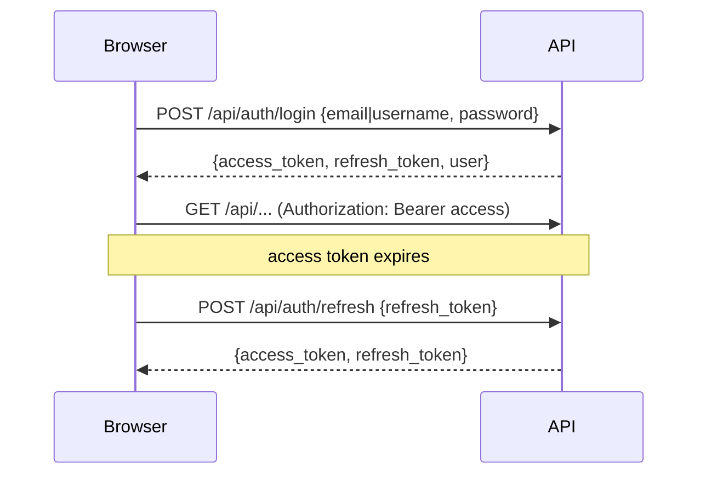
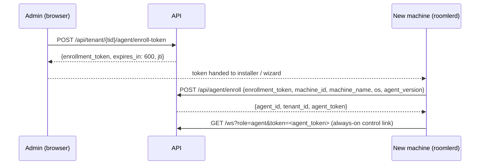
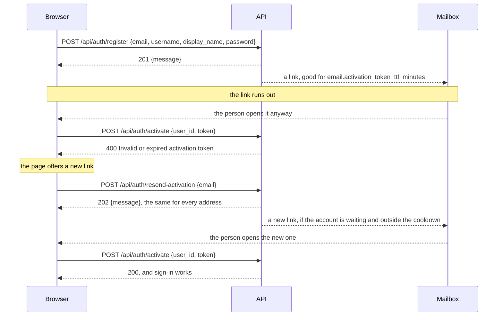

# API Reference

Every HTTP endpoint the server exposes, grouped the way `build_router`
(`crates/api/src/lib.rs`) composes them. *As of 0.3.0-rc.381 the surface is ~165
endpoints across 38 route modules.* Request/response schemas are shown for the key
flows; for everything else the handler modules in `crates/api/src/routes/` are the
source of truth.

- **Base URL**: `https://roomler.ai` (or your deployment). All JSON.
- **IDs** are MongoDB ObjectIds serialized as 24-char hex strings.
- **Errors** are JSON with an HTTP status; 404 is also used to *hide* resources the
  caller may not see (platform-admin routes). The body is `{error, message}`: `error`
  is the code to branch on, and `message` is for reading. A collision no route put in
  words answers `409 conflict` with `That already exists`
  ([security-baseline.md](security-baseline.md) §5).

## Authentication

JWT bearer tokens (`Authorization: Bearer <jwt>`), Argon2 password hashing. Six
audience-checked token types — a token of one audience is rejected everywhere else:

| Token | Audience | Lifetime | Held by |
|---|---|---|---|
| `Access` | user routes + `/ws` (user role) | 7 d (config) | browser |
| `Refresh` | `POST /api/auth/refresh` only | 30 d (config) | browser |
| `Enrollment` | `POST /api/agent/enroll` | 10 min, single-use (`jti`) | pasted into installer |
| `Agent` | `/ws?role=agent`, agent ingest routes, `/derp` | long-lived | `roomlerd` config |
| `TunnelEnrollment` | `POST /api/tunnel-client/enroll` | 10 min, single-use | pasted into CLI |
| `TunnelClient` | `/ws?role=tunnel-client`, tunnel routes | long-lived | `roomler` CLI config |



Device enrollment is a two-step exchange — an admin mints a short-lived token, the
installer trades it for the device's long-lived credential:



`machine_id` is a stable hardware-derived hash, unique per `(tenant_id, machine_id)`
— re-enrolling a known machine reuses its row. The tunnel-client flow is identical
in shape (`…/tunnel-client/enroll-token` → `POST /api/tunnel-client/enroll` →
`{tunnel_client_token}`), with a distinct audience so a leaked agent token can't
impersonate a client or vice-versa.

Since FR-129 A1 the installer can obtain the same `Enrollment` (or `TunnelEnrollment`)
token **without anyone copying it**: `POST /api/pair/start` → the person types the
`user_code` on `/pair` and approves → the installer's `POST /api/pair/poll` receives the
token, minted on that first poll behind the same gate (`MANAGE_AGENTS` / membership),
once. Everything after it — the enroll route, the single-use `jti`, the 10-minute life,
the device cap, the archived-org refusal — is unchanged. The routes are in the public and
user-scoped tables below; the contract is in
[the spec](fr/FR-129-guided-cross-platform-installer.md#the-pairing-api).

### Email sign-up and activation

A password sign-up creates the account unverified and mails a link, which lands on the
SPA's `/auth/activate` page. `login` refuses the account until the page has redeemed that
link. The row keeps holding the address the whole time, because `users.email` is a unique
index, so registering the same address again answers 409. The way back from a link that
ran out is a new link, not a new account (#3199):



| Rule | Where | Why |
|---|---|---|
| One answer for every address: unknown, waiting, active, inside the cooldown, malformed | `accept_resend`, `crates/api/src/routes/auth.rs:417` | a difference is an oracle for `users.email`, the key account-linking resolves against |
| The answer does not wait for the lookup | the same function, deliberately not `async` | a known address costs more Mongo round trips than an unknown one, which is the same oracle in the latency |
| Per client address: 5, then one every 3 minutes, a 429 with `Retry-After` | `ip_rate_limit`, `crates/api/src/middleware/auth_rate_limit.rs:157` | the route mails whoever its body names, so the budget must not reset per address |
| Per account: one new link every 15 minutes, silently | `ACTIVATION_RESEND_COOLDOWN_SECS`, `crates/services/src/dao/user.rs:28` | a 429 here would only ever fire for an address that has an account |
| Only a password sign-up still waiting is mailed: never an active account, a tombstone or a `.invalid` placeholder | `claim_activation_resend`, `crates/services/src/dao/user.rs:197` | it is one atomic update, so two pods cannot both send |

⚠️ Sign-up does not start the cooldown. At a 5-minute link, a person back at minute 6 would
otherwise be told a new one is coming and get nothing until minute 15. So the first resend
is immediate at any TTL, and the stamp lives on the `users` row because `activation_codes`
is TTL-reaped.

⚠️ The address must match the sign-up's as typed, as it must for `login`: the index is
case-sensitive, so `Alice@x` and `alice@x` can be two accounts.

### Rate limiting

Everything under `/api` sits behind a per-client-IP governor (trusted-proxy-aware —
it will not believe a client-supplied `X-Forwarded-For`). `POST /api/auth/login` and
`/register` carry an additional per-(IP, account) brute-force gate.
`/resend-activation` has a stricter bucket of its own, keyed on the client address alone
([above](#email-sign-up-and-activation)). `/health`, `/ws`, `/derp`, and the Stripe
webhook are deliberately outside the governor.

## Public routes (no user JWT)

Auth, where present, is in-handler (enrollment tokens, agent/tunnel bearer tokens,
capability URLs, webhook signatures).

| Method | Path | Purpose |
|---|---|---|
| POST | `/api/auth/register` | Create account (+ optionally a tenant, or accept `invite_code`). A taken address or username answers 409, in words (#3199). A taken `tenant_slug` answers 409 before anything is created, a deleted organization's slug included, so no account or activation mail is left behind (#3247) |
| POST | `/api/auth/login` | Password login (`email` or `username`). A `username` that matches no account and holds an `@` is looked up as an address, since the sign-in page sends its one box as `username` (#3247) |
| POST | `/api/auth/logout` | Invalidate session |
| POST | `/api/auth/refresh` | Rotate the access token |
| POST | `/api/auth/activate` | Redeem an email activation code (`{user_id, token}`); the SPA's `/auth/activate` page, where the activation email's link lands, posts it (#3029) |
| POST | `/api/auth/resend-activation` | Ask for a new activation link (`{email}`). Always 202 with the same sentence; the lookup and the mail happen after the answer ([rules](#email-sign-up-and-activation), #3199) |
| GET/PUT | `/api/auth/me` | Current user (read / update) |
| GET | `/api/oauth/{provider}` | OAuth redirect (google, facebook, github, linkedin, microsoft) |
| GET | `/api/oauth/callback/{provider}` | OAuth callback |
| GET | `/api/invite/{code}` | Public invite info |
| POST | `/api/invite/{code}/accept` | Accept an invite (authed) |
| GET | `/api/stripe/plans` | Plan catalogue |
| POST | `/api/stripe/checkout` · `/portal` | Stripe checkout / customer portal |
| POST | `/api/stripe/webhook` | Stripe events (HMAC-signed; un-governed). FR-102 P4: the six billing kinds (`customer.subscription.{created,updated,deleted,trial_will_end}`, `invoice.paid`, `invoice.payment_failed`) are also recorded in `billing_events` with the invoice's amounts ([growth-observability.md](growth-observability.md#revenue-what-stripe-billed-p4)) |
| POST | `/api/sendgrid/webhook` | FR-102 P5 (`saas`): SendGrid's Event Webhook — ECDSA P-256 signed, verified **before the body is parsed** (401), the empty 404 without `ROOMLER__NEWSLETTER__EVENT_WEBHOOK_PUBLIC_KEY`; records `delivered` · `bounce` · `dropped` · `spamreport` of newsletter messages on their ledger rows (never opens or clicks); un-governed ([growth-observability.md](growth-observability.md#the-newsletter-delivery-per-issue-tags-and-unsubscribes-p5)) |
| POST | `/api/pair/start` | FR-129 A1: an installer starts a **device pairing** instead of asking for a pasted token — `{machine_name, os, arch, role: daemon\|tunnel, halves?, client, client_version}` → `{device_code, user_code: "BCDF-GHJK", verification_uri, expires_in, interval}`. The `device_code` is the installer's secret (stored only as a hash, in no other response); the `user_code` is what the person types on `/pair`. Per-address ceiling (429 `rate_limited`); 415 unless the body declares `application/json` (every `/api/pair/*` route — a cross-site `text/plain` form cannot reach the cookie-authenticated routes without a preflight); 400 `network_unmounted` for a tunnel role on a server without the network module; the **empty 404** while `ROOMLER__PAIRING__ENABLED=false` ([the spec](fr/FR-129-guided-cross-platform-installer.md#the-pairing-api)) |
| POST | `/api/pair/poll` | FR-129 A1: `{device_code}` → `{status: authorization_pending \| slow_down (+interval) \| access_denied \| expired_token \| approved (+tokens[], org_name, org_slug, approver_name, approver_username)}` — the installer shows the two unique handles beside the display names before it installs. The device code **is** the auth; an unknown, delivered or expired code answers `expired_token` alike. The first poll after an approval mints the ordinary single-use enrollment token(s) behind the approver's gate, re-checked — delivery is once |
| POST | `/api/agent/enroll` | Exchange enrollment token → agent credential |
| GET | `/api/agent/latest-release` | Agent release manifest (cached GitHub proxy) |
| GET | `/api/agent/installer/{flavour}` (+`/health`) | Stream the MSI/installer through roomler.ai (`peruser` \| `permachine`) |
| POST | `/api/agent/crash` | Crash-report ingest (agent JWT in-handler). Every string of the report is scrubbed again on the way in, as a log line's is ([security-baseline.md](security-baseline.md#device-diagnostics-manage_agents-and-a-second-scrub)) |
| POST | `/api/consent/{token}/approve` · `/deny` | Owner-consent capability URLs (token **is** the auth, single-use) |
| POST | `/api/tunnel-client/enroll` | Exchange tunnel enrollment token → client credential. 403 for an **archived** org, into a new row or back into an old one, in the daemon route's words |
| GET | `/api/tunnel-client/agents` | Reachable agents (TunnelClient bearer) |
| GET | `/api/tunnel/latest-release` · `/installer/{platform}` (+`/health`) | Tunnel-CLI release manifest + artifact proxy |
| GET | `/api/setup/latest-release` · `/{platform}` (+`/health`) | `roomler-setup` wizard manifest + artifact proxy. `?version=` (default `latest`). FR-129 C2, `?format=exe\|zip` (default `exe`): on Windows the default streams the signed wizard EXE itself (`roomler-setup-<v>-x86_64-pc-windows-msvc.exe`, `application/vnd.microsoft.portable-executable`) from the first `setup-v*` release that publishes one (`setup-v0.4.197`), and that release's zip otherwise; `zip` streams the zip, for a proxy that refuses an EXE download. Linux and macOS ignore the value; any other value is a 400. The health's `uri` carries a `format` the caller named. A sidecar (`.sha256`, `.asc`) is never the download (`crates/modules/fleet/src/setup_release.rs`, `pick_setup_asset`) |
| GET | `/api/setup/install.sh` · `/install.ps1` | Terminal installers (served from the binary, curl-able) |
| GET | `/api/setup/features` | FR-129 B1-s: the switches a client reads before offering an install path — `{"pairing": bool, "wizard_linux_daemon": bool, "wizard_macos_daemon": bool, "wizard_unix_daemon": bool, "wizard_pairing": bool}`, unauthenticated. `pairing` mirrors `ROOMLER__PAIRING__ENABLED`, a fact about this **server** (whether `/api/pair/*` answers), for the wizard to read. The `[setup]` switches are the operator's assertions about the **released** wizard, each default **`false`** and flipped after its field run: `wizard_linux_daemon` (`ROOMLER__SETUP__WIZARD_LINUX_DAEMON`) and `wizard_macos_daemon` (`ROOMLER__SETUP__WIZARD_MACOS_DAEMON`) — it installs the full daemon on that OS, so the enrollment dialog, both homepages and the wizard show that OS's daemon cards only on `true` (AC14; one switch per OS since B1-s2). The legacy `ROOMLER__SETUP__WIZARD_UNIX_DAEMON` turns both on, and each per-OS key answers its effective value. `wizard_unix_daemon` answers `wizard_linux_daemon && wizard_macos_daemon`: it is the one key the wizards released before the split read, for both OSes, so one OS on alone shows them nothing. A client reads its OS's key OR `wizard_unix_daemon`, which keeps a server from before the split working. `wizard_pairing` (`ROOMLER__SETUP__WIZARD_PAIRING`) — it pairs (A3), so the homepages say "sign in from your browser" only on `pairing && wizard_pairing`, never on the server's fact alone. ⚠️ Every consumer reads anything but a JSON `true` as `false`: a 404 (an older server), a 503 (fleet unmounted), non-JSON, a timeout — absent means the daemon wizard on Windows only and the token lead. Deliberately not a field on `latest-release`, whose bare array every shipped wizard parses ([the spec](fr/FR-129-guided-cross-platform-installer.md#b--the-full-daemon-from-the-gui-on-linux-and-macos)) |
| POST | `/api/setup/diagnostics` | FR-102 P3b: the setup wizard's **opt-in** step diagnostics — one `{run, step, outcome, elapsed_ms, error_code, os, wizard_version}` per step boundary, sent only when the person ticked the box. Unauthenticated by necessity, so every field is checked against its vocabulary (422 with a code, nothing stored); body ≤ 1 KiB; ≤ 48 rows per run (429 `run_capped`); 202 with no body. Stores no IP and no User-Agent. The empty 404 while `ROOMLER__GROWTH__SETUP_DIAGNOSTICS=false` ([growth-observability.md](growth-observability.md#the-wizards-opt-in-diagnostics-p3b)). The static segment also makes `GET /api/setup/diagnostics` a 405 (it used to fall into the `{platform}` proxy's 400) |
| POST | `/api/releases/refresh` | CI cache-bust after a release is published (bearer; fans out to all pods) |
| GET | `/api/turn/credentials` | Ephemeral TURN credentials (user-scoped) |
| GET | `/api/relay/regions` | Multi-region relay PoP topology (read-only) |
| POST | `/api/log/browser` | Browser console-log batch ingest (user JWT + explicit `tenant_id`), scrubbed on the way in as the device's batches are |
| GET | `/api/cluster/status` | Per-pod identity, counters, gauges. Platform admins only (`require_platform_admin`, the 404 every `/api/admin/*` route gives): it names every live meeting room on the pod and the pods' ids |
| POST | `/api/stats/pageview` | SPA route-change beacon (authed, paths normalized) |
| GET | `/health` | Liveness — cheap process-alive 200 |
| GET | `/health/ready` | Readiness — Mongo ping + Redis round-trip + live subscription |

### User-scoped (access JWT, no tenant prefix)

| Method | Path | Purpose |
|---|---|---|
| PUT | `/api/user/me` | Update profile |
| GET | `/api/user/unread-summary` | Cross-tenant unread counters |
| GET | `/api/user/{user_id}` | Public profile |
| GET | `/api/giphy/search` · `/trending` | Giphy proxy |
| GET | `/api/push/config` | VAPID public key |
| POST | `/api/push/subscribe` · `/unsubscribe` | Web-push subscription |
| GET | `/api/notification` · `/unread` · `/unread-count` | Notification feeds |
| PUT | `/api/notification/{id}/read` | Mark one read |
| POST | `/api/notification/read-all` | Mark all read |
| GET/PUT | `/api/user/newsletter` | FR-58: the signed-in newsletter toggle — a door into the same `subscribers` store the public form writes; subscribing pre-confirms only on a verified account email |
| POST | `/api/pair/lookup` | FR-129 A1: `{user_code}` → what the typed code names, before approving it — `{machine_name, os, arch, role, halves, client, client_version, country, started_at, expires_at}`; 404 unless a live pending pairing has that code. Each 404 is a miss against the account; past `ROOMLER__PAIRING__MISSES_PER_ACCOUNT_PER_HOUR` the three pairing routes answer 429 for the hour. Every call audited (`pairing_audit`) |
| POST | `/api/pair/approve` | FR-129 A1: `{user_code, tenant_id}` → `{approved: true}`. The decision, recorded; **no token yet**. `MANAGE_AGENTS` in that org for a daemon pairing, membership for a tunnel one — the same gate the enroll-token routes hold, re-checked at delivery. 403 `forbidden` (the gate, counted as a miss, or an **archived** org, refused before the decision is recorded; **never `not_a_member`**, the one code the SPA leaves the org on — a refused approval must not evict the person from `/pair`), 404 not pending, 400 `network_unmounted`. The org's other `MANAGE_AGENTS` holders are told by push and email |
| POST | `/api/pair/deny` | FR-129 A1: `{user_code}` → `{denied: true}`; the installer's next poll answers `access_denied`. 404 counted as a miss |

### Device-scoped — `/api/agent/self/*` (agent JWT, no tenant prefix)

The device's own view of its org, for the desktop companion (FR-84 D5a). The
companion reaches only its local daemon, and the daemon holds an **agent** token,
so the admin grid and the org mesh above are out of its reach; these answer the
same questions **for one device**. Authentication is the agent's bearer token,
audience- and status-checked on every call (a user JWT, a quarantined or a deleted
device are each a 401); without the fleet module the answer is 503.

| Method | Path | Purpose |
|---|---|---|
| GET | `/api/agent/self/devices` | The devices this device may see, itself included — searched, sorted and paged on the server (`page`, `per_page`, `q`, `sort`, `dir`, `kind`, the admin grid's own contract; an unknown `sort` is a 400) |
| GET | `/api/agent/self/mesh` | The org mesh graph restricted to the same set, with a server-computed `label` per node and the caller's `self_node_id`; `{"enabled": false}` when stats are off |

**The visibility rule.** `visible = self ∪ what this device's overlay netmap
already carries`. The set is computed by the join path's own shaping
(`overlay::shape_full_netmap`, the function that builds the `rc:overlay.netmap` a
node receives), never by a second rule: under ACL `off` and `warn` every live node
is listed, under `enforce` exactly the peers the netmap would ship. A device
without a live overlay node lists itself alone (`overlay: "no_node"`; `"no_network"`
when the org has no mesh yet, `"unavailable"` without the network module), and the
GET never creates a network row. Rows carry `display_name`, `name`, `os`, `version`,
`presence`, `overlay_ip`, MagicDNS, `tags`, `reachable`, `is_self` and, on a device
that is not online because it announced a sleep, `asleep_since` (FR-55 P4: the fact
and the moment, never its power policy, [power.md](power.md) §3.4) — never
`machine_id`, owner ids, keys, consent settings or codecs; those fields are blanked
before the search runs, so `q` cannot probe them.

```json
{
  "items": [{ "kind": "agent", "id": "…", "name": "bravo-box", "display_name": "Kilo",
              "os": "linux", "version": "0.4.103", "presence": "online", "is_online": true,
              "last_seen_at": "2026-09-25T09:00:00Z", "overlay_ip": "100.64.0.3",
              "overlay_node_id": "…", "magic_dns_name": "bravo-box", "reachable": true,
              "is_self": false }],
  "total": 2, "page": 1, "per_page": 25, "total_pages": 1,
  "overlay": "ok", "acl_mode": "enforce", "self_node_id": "…"
}
```

### Public newsletter list (FR-39/FR-58 — no auth; see [newsletter.md](newsletter.md))

| Method | Path | Purpose |
|---|---|---|
| POST | `/api/subscribe` | Always **202** (membership-oracle control); double-opt-in confirmation mail, 15-min per-address resend cooldown |
| GET | `/api/subscribe/confirm/{token}` | **Pure redirect** to the confirm page — never confirms (mailbox link scanners follow GETs; field-hit on day one) |
| POST | `/api/subscribe/confirm/{token}` | The deliberate click (the confirm page's button); single-use, answers `{confirmed: bool}` |
| GET | `/api/subscribe/unsubscribe/{token}` | Idempotent; 303 → `/newsletter/unsubscribed?status=…`; the token never expires. FR-102 P5: `?i=<slug>` (an issue's link, the same for every recipient) is recorded once as `subscribers.unsubscribed_via` |
| POST | `/api/subscribe/unsubscribe/{token}` | RFC 8058 one-click target — plain 200 for every outcome, body unread; `?i=` as the GET |

### Platform-admin (`platform_admins` ObjectId allowlist; 404 on miss)

| Method | Path | Purpose |
|---|---|---|
| GET | `/api/admin/stats/relay/current` · `/relay/history` | Relay (TURN/DERP) load, live + series |
| GET | `/api/admin/stats/orgs` · `/users` · `/machines` · `/calls` | Platform-wide inventories |
| GET | `/api/admin/stats/usage` · `/usage/{user_id}` | Per-user usage across every org |
| GET | `/api/admin/stats/attribution` | FR-88: sign-ups by campaign key, and FR-91: by blog landing page, and how many activated — counts only |
| GET/PUT | `/api/admin/growth/exclusions` | FR-102 P1c: the orgs and people no growth number counts — the implicit set (platform admins, the orgs they own) marked beside the explicit rows; PUT replaces the explicit list (`{kind: tenant\|user, id, reason}`). 404 also when `growth.enabled = false` |
| GET | `/api/admin/growth/digest?day=` · `/digests?since=&limit=` | FR-102 P1d: a stored daily digest (the latest when `day` is omitted; dates as RFC 3339 strings), and the list with each day's status and headline ([growth-observability.md](growth-observability.md)) |
| POST | `/api/admin/growth/digest/run?day=&send=false` | Recompute and overwrite a closed day's sections, through the same claim the scheduler uses (409 while a run of that day is in progress); `send=false` ends `preview`, which the scheduler still claims; mails only with `send=true` AND a day not already `sent` |
| GET | `/api/admin/growth/digest/preview?day=&include_internal=` | Compute a day live — stores nothing, mails nothing; `include_internal=true` is the raw totals with the exclusion set empty |
| GET | `/api/admin/growth/funnel?since&until&by&include_internal` · `/cohorts?unit=week&since` · `/orgs?limit&include_internal` · `/org/{tenant_id}/timeline` | FR-102 P2: the account funnel with `pending`/`settled` per step and time to value, the weekly cohorts with the WAO north star, the org table, one org's milestones |
| POST | `/api/admin/growth/org-daily/backfill?since&until` | FR-102 P2: recompute a closed range of `growth_org_daily`, clamped to its 25-month retention |
| GET | `/api/admin/growth/revenue?since=YYYY-MM&until=YYYY-MM&include_internal` | FR-102 P4: billed revenue from `billing_events` — billed MRR and paying orgs now per currency, new · expansion · contraction · churned MRR month by month (a closed month read frozen from `growth_daily`; a month before the first billing row `on_record: false`, never 0), trial → paid, by the owner's channel; beside the list-price ESTIMATE, the 30-day cost to serve and margin per org, and the range's plan-limit collisions. `billed` is `not_measured` without `saas` or with nothing on record ([growth-observability.md](growth-observability.md#revenue-what-stripe-billed-p4)) |
| POST | `/api/admin/growth/billing/backfill?since=YYYY-MM-DD` | FR-102 P4 (`saas`): the operator's one-off read of Stripe's paid invoices into `billing_events` (idempotent; reads Stripe, never writes), then a refreeze of the closed months they touch; answers the counts (`invoices`, `recorded`, `already`, `no_org`, `truncated`) and the months. 400 without `ROOMLER__STRIPE__SECRET_KEY` |
| GET | `/api/admin/growth/channels?since&until&include_internal` | FR-102 P8: per platform and per post published in the range — the platform's own reach (raw metric names, summed per snapshot age), then visitors → sign-ups → activated by each post's normalised key, and spend (`cost_cents`, per visitor / per sign-up from n ≥ 30); a platform with nothing pushed reads `not_measured` |
| GET/POST | `/api/admin/growth/keys` | FR-102 P8 (D12): list the growth machine keys (prefix, label, use, revoked — never the key or its hash) / mint one `{kind: "ingest" \| "read", label}` — the key is in the 201 answer only, its SHA-256 is all that is stored; at most 10 live per kind. **Session only**: a read key meets the empty 404 here, GET included |
| DELETE | `/api/admin/growth/keys/{key_id}` | Revoke a key (204, idempotent) |
| GET | **every `/api/admin/growth/*` GET view** | FR-102 P10 (D12): besides the platform admin's session, a **read key** (`Authorization: Bearer rgr_…`) opens the GET data routes — the digests, funnel, cohorts, orgs, timeline, campaigns, channels, newsletter, revenue, weekly, alerts — and answers exactly what the session answers (AC20). Every non-GET, `/keys`, `/exclusions`, an ingest key, a malformed, unknown or revoked key and `growth.enabled = false` are the empty 404 of an absent path; a lookup failure is 503 ([growth-observability.md](growth-observability.md#the-read-key-d12)) |
| GET | `/api/admin/growth/weekly?week=` · `/weeklies?since=&limit=` | FR-102 P10: a stored weekly roll-up (`YYYY-Www`, the latest when omitted; the week's headline against the weeks before, and the funnel, cohorts, campaigns, channels, newsletter and alerts computed for that week), and the list with each week's status and headline |
| POST | `/api/admin/growth/weekly/run?week=&send=false` | Recompute a closed ISO week through the same claim the Monday scheduler uses (409 while a run of that week is in progress; 400 for an open week); `send=false` ends `preview`; mails only with `send=true` AND a week not already `sent` |
| GET | `/api/admin/growth/alerts?since=` | FR-102 P10: the open alert rows and the ones cleared since `since` (default 7 days) — rule, key, fired/cleared, the numbers behind it — plus the rule table; `enabled` says whether the hourly evaluator runs here |
| POST | `/api/admin/growth/alerts/evaluate?dry_run=` | Evaluate every rule now as the hourly job would (fire, clear, mail at most once per rule and key per day); 409 when `growth.alerts` is off unless `dry_run=true`, which decides and writes nothing |
| GET | `/api/admin/growth/quality?since&until&include_internal` | FR-102 P9a: remote-desktop quality over a closed range of days frozen nightly into `growth_quality_daily` (default the last 28; an open `until` is clamped to yesterday; at most 400 days) — `totals` (every version pooled: sessions requested → reached Active / never / pending with `by_end_reason`, duration · peak fps · RTT as pooled `{n, p50, p90, exact}`, FR-22's time to first frame with the records set aside, crashes, device-days, crashes per 100 device-days from n = 30), `by_agent_version` (newest first, `unknown` last), `series` (one row per frozen day), `frozen_days` of `days`; `not_measured` with the reason when nothing is frozen; `include_internal=true` reads the `all` scope ([growth-observability.md](growth-observability.md#remote-desktop-quality-from-what-is-recorded-p9a)) |
| POST | `/api/admin/growth/quality/backfill?since=YYYY-MM-DD&until=` | FR-102 P9a: re-freeze a closed range, both scopes, with the current exclusion set — clamped to 730 days back, never today (400 otherwise); time to first frame comes back only for the days whose `agent_logs` are still complete |
| POST | `/api/tenant/{tenant_id}/session/{session_id}/feedback` | FR-102 P9b (`remote`): the viewer's post-session rating `{rating: up \| down, reasons: [lag \| picture \| input \| could_not_connect \| other]}` (≤ 1 KiB, `deny_unknown_fields`), from the session's controller or a watcher, resolved within the org — 201 with what was stored; 403 `not_a_member` / `forbidden`; 404 for a session the org does not own; 409 `too_early` (sooner than 30 s after the request) / `already_rated` (one per session **per person** — the unique `(session_id, user_id)` index decides; the controller and each watcher rate once each); 422 `invalid_json` / `unknown_rating` / `unknown_reason` / `too_many_reasons` with a code and nothing stored; 413 over the limit; the **empty 404** of an absent path while `ROOMLER__GROWTH__FEEDBACK=false`. `GET /api/capabilities` → `features.session_feedback` says whether a viewer may offer the prompt ([growth-observability.md](growth-observability.md#the-post-session-rating-p9b)) |
| POST | `/api/admin/growth/ingest/posts` · `/ingest/snapshots` | FR-102 P8, **`saas` only, authenticated by an ingest key** (`Authorization: Bearer rgi_…`), not a user JWT: the promotion pipeline pushes a post `{platform, platform_id, account, format, url, published_at, utm_*, cost_cents?}` (idempotent on `(platform, platform_id)`) or a snapshot `{platform, platform_id, snapshot: T+1d\|T+7d\|T+28d, taken_at, metrics}` (stored once). A missing, wrong or revoked key is the empty 404 of an absent path; unknown platforms and any field that looks like post text are `422` ([growth-observability.md](growth-observability.md)) |
| GET | `/api/admin/growth/newsletter?since&until&include_internal` | FR-102 P5: the list over time (new · confirmed · unsubscribed · suppressed per day and by source, the size now) and one row per issue sent in the range — recipients and accepted from the ledger, delivered · bounced · complaints from SendGrid's signed events, unsubscribed through the issue's link, purestat visits and sign-ups by the issue's campaign key; delivery `not_measured` without the webhook key, never 0 ([growth-observability.md](growth-observability.md#the-newsletter-delivery-per-issue-tags-and-unsubscribes-p5)) |
| GET | `/api/admin/growth/campaigns?since&until&by&include_internal` | FR-102 P6: per normalised campaign key (`by` = `source`·`medium`·`campaign`·`content`), purestat's web plane queried **live** for the exact UTC-day range beside the account funnel; a purestat outage or revoked key reads `not_measured`, never 0; every rate `{n, value}` with a value only at n ≥ 30 ([growth-observability.md](growth-observability.md)) |
| POST | `/api/admin/overlay-block/reclaim` | Reclaim quarantined overlay address blocks (dry-run by default) |
| POST | `/api/admin/room-members/prune` | `chat`: end the room memberships of people who are no longer in the room's org, through the same hook run as a removal (call seats, then the rows). `{dry_run?: bool (default true), limit?: 1..2000 (default 200)}` pairs of (org, person) per call; answers `{dry_run, pairs, rows, ended, failed, more}`. Idempotent: call again while `more` is true |
| POST/GET | `/api/admin/newsletter/issues` | FR-58: create draft / list issues |
| PUT/GET | `/api/admin/newsletter/issues/{slug}` | Edit while draft (409 after) / read back |
| GET | `/api/admin/newsletter/issues/{slug}/preview` | The exact send-path bytes (sample unsubscribe link substituted) |
| POST | `/api/admin/newsletter/issues/{slug}/test-send` | Render + send to one address, real headers, honest failures |
| POST | `/api/admin/newsletter/issues/{slug}/send` | Claim + fan out; re-POST = resume; `{"retry_stale":true}` re-attempts stuck rows |
| GET | `/api/admin/newsletter/issues/{slug}/status` | Live ledger counts while sending; stored snapshot once completed |

## Tenant-scoped routes — `/api/tenant/{tenant_id}/…`

Caller must be a member of the tenant; write operations check the caller's role
permissions (24-bit bitfield — see [use-cases.md](use-cases.md#permission-system)).

### Organization

| Method | Path | Purpose |
|---|---|---|
| GET/POST | `/api/tenant` | List my tenants / create one |
| GET | `/api/tenant/{tid}` | Tenant detail |
| POST | `…/archive` · `…/unarchive` | Owner-only; archiving revokes every device enrollment and releases the mesh |
| GET | `…/member` · POST `…/member` | List / add members |
| GET | `…/member/me` | My membership + permissions |
| GET/POST | `…/role` | List / create roles |
| PUT/DELETE | `…/role/{role_id}` | Update / delete a role |
| POST/DELETE | `…/role/{role_id}/assign/{user_id}` | Assign / unassign |
| GET/POST | `…/invite` | List / create invites |
| POST | `…/invite/batch` | Batch email invites |
| DELETE | `…/invite/{invite_id}` | Revoke |
| GET | `…/search?q=` | Full-text search: messages of rooms the caller may read, rooms the caller may see listed (a Secret room only to its members), people |

### Rooms, chat, calls

| Method | Path | Purpose |
|---|---|---|
| GET/POST | `…/room` | List / create rooms (hierarchical: `parent_id`, `path`) |
| GET | `…/room/explore` | Discoverable rooms |
| GET/PUT/DELETE | `…/room/{rid}` | Room CRUD |
| POST | `…/room/{rid}/join` · `/leave` | Membership |
| GET | `…/room/{rid}/member` | Room members |
| POST | `…/room/{rid}/call/start` · `/join` · `/leave` · `/end` | Call lifecycle (mediasoup) |
| GET | `…/room/{rid}/call/participant` | Live participants |
| GET/POST | `…/room/{rid}/message` | Paginated history / send |
| GET | `…/message/pin` | Pinned messages |
| PUT/DELETE | `…/message/{mid}` | Edit (the author's; 404 for anyone else) / delete (the author's; 403 for anyone else) |
| PUT | `…/message/{mid}/pin` | Toggle pin |
| GET | `…/message/{mid}/thread` | Thread replies |
| POST | `…/message/{mid}/reaction` | Add reaction |
| DELETE | `…/message/{mid}/reaction/{emoji}` | Remove reaction |
| POST | `…/message/read` · `/read-all` | Read markers |
| GET | `…/message/unread-count` | Unread count |
| GET/POST | `…/room/{rid}/recording` | List / create recordings (the room guard, visibility included) |
| DELETE | `…/recording/{rec_id}` | Delete a live recording of the path room: by whoever started it, or by a `MANAGE_CHANNELS` holder (403 for anyone else). A recording of another room or org, or a deleted one, answers 404, as a missing one does |

A room or message response may carry `binding {module, ref}`: another module owns what it
means. Chat stores it and never interprets it, and no module sets it now. The rooms and turn
stubs that parked FR-90 wrote still carry it (FR-137), and such a room opens as a plain Secret
room. A message also carries `author_type` (`user` · `bot` · `webhook` · `system`). A non-user
author keeps its own name in `author_name`, and the edit and delete routes match the author, so
they refuse every person on such a message.

Every route with `{mid}` in its path resolves it as a live message of the path room, and that
room must be one the caller may read: a Secret room answers 404 and a Private one 403, as the
room routes do. A message attachment is a live file of the message's own room.

A send names its thread with `thread_id` and may quote with `referenced_message_id`. Either must be
a live message of the same room, or the send answers 404 and stores nothing. A thread lists the
replies of its own room, and `mentions.users` notifies members of the room only.

### Files, tasks, export

A file is reached through the room it was uploaded to. `…/file/{fid}` and its download answer
only for a live file of a room the caller may read: a Secret room answers 404 and a Private one
403. A room's file list and both uploads take a room of the org that the caller may read. The
org's file list (`GET …/file`) lists, and names, only such rooms' files.

| Method | Path | Purpose |
|---|---|---|
| GET | `…/room/{rid}/file` · POST `…/file/upload` | Room-scoped files (100 MB limit) |
| GET/POST | `…/file` · `…/file/upload` | Tenant file library |
| GET | `…/file/{fid}` · `/download` | Metadata / streamed download |
| DELETE | `…/file/{fid}` | Delete (the uploader's; 403 for anyone else) |
| POST | `…/file/{fid}/recognize` | AI document recognition (Claude vision) |
| GET | `…/task` · `…/task/{tid}` · `/download` | Background tasks + results |
| POST | `…/export/conversation` | XLSX export |
| POST | `…/export/conversation-pdf` | PDF export |

Both exports take `{room_id}`: a room of the path org that the caller may read. They resolve it as the room routes do, before a task is made. Another org's room answers 404, the same as a room that does not exist. A Secret room the caller is not in answers 404, and a Private one 403.

### Fleet — agents & remote sessions

| Method | Path | Purpose |
|---|---|---|
| GET | `…/agent` | List enrolled devices (status, caps, overlay info). FR-55 P4: `power {policy, on_ac?, held}`, the posture the device last reported (absent from an agent that predates it: unknown, never `never`), and, on a device that is not online, `sleep {since, power}` when it announced a sleep ([power.md](power.md) §3) |
| GET | `…/device` | The unified devices grid (agents and tunnel clients), searched, sorted and paged on the server. FR-55 P4: an agent that is not online and announced a sleep carries `sleep {since, power}`, which the dashboard reads as **asleep** ([power.md](power.md) §3.4) |
| POST | `…/agent/enroll-token` | Mint an enrollment token (10 min, single-use). 403 for an **archived** org |
| POST | `…/agent/update` · `…/agent/{aid}/update` | Operator-forced self-update (fleet / one device), `{pin?, force?}` (+ `agent_ids?` for the fleet). A push that would not be acted on is refused, never sent: FR-2's downgrade guard (`pin_downgrade`, unless `force`), and since FR-67 P7 a device whose caps say it ignores the push (`primary_org`, a secondary enrollment) or drops it (`auto_update_off`). `force` lifts only the first. One device answers **409** with the reason; the fleet route skips the device with a `refused` reason and its `refused_code`, and counts it in `refused` |
| POST | `…/agent/{aid}/join-org` · GET `…/join-targets` | Add an enrolled device to a second org (multi-org) |
| GET/PUT/DELETE | `…/agent/{aid}` | Device detail / settings / remove (cascades: revoke + mesh release). Removal is final: from then on the device is a **404 on every per-device route** — this GET and PUT, the policies, `desired-config`, `update`, `exec`, `ssh`, `join-org` — and a repeat DELETE is a 404 too, like the listing that no longer shows it. Only the audit views (`…/agent/{aid}/crash`, `…/agent/{aid}/logs`, `…/recording-activity/{aid}`, `…/transfer-activity/{aid}`, `…/privacy-activity/{aid}`) still resolve a removed device |
| GET | `…/agent/{aid}/crash` | The device's last 50 crash reports, newest first. `MANAGE_AGENTS`, decided before the device is looked up, so a caller without it gets one 403 `forbidden` whatever the id names. For a holder, another org's device or an id that names nothing is a 404, and a removed device still reads (an audit view) — see [security-baseline.md](security-baseline.md#device-diagnostics-manage_agents-and-a-second-scrub) |
| POST/GET | `…/agent/{aid}/logs` | **POST** — log batch ingest (agent JWT). Every string of every line (`msg`, `target`, each string in `fields`) is scrubbed again on the way in. **GET** `?limit=1..=500` (default 50) — the device's uploaded batches of the last 7 days, newest first, under the same gate as `…/crash` |
| POST | `…/agent/exec` · `…/agent/{aid}/exec` | Fleet RPC: run a command (fleet sweep / one device) — see [fleet-rpc.md](fleet-rpc.md) |
| POST | `…/agent/{aid}/exec/{request_id}/cancel` | Cancel a running exec |
| PUT | `…/agent/{aid}/exec-policy` | Per-device exec gate (a management act, separate from the exec power) |
| POST | `…/agent/{aid}/overlay-key/rotate` | Order the device to retire its overlay (WireGuard) key — it mints locally, re-joins and reports back; the server never sees a private key (FR-40). `MANAGE_AGENTS`, one order per device per minute. 200 `{request_id, dispatch: "pushed" \| "queued", delivered}`; 409 `rate_limited` / `agent_unsupported` (online device without the `key-rotate` verb) — see [overlay-key-rotation.md](overlay-key-rotation.md) |
| GET/POST | `…/agent/{aid}/connect-code` | The code an outsider names a device by (FR-52). `MANAGE_AGENTS`, and never in the ordinary device list. **GET** reads it whether or not the device is approved: 200 `{connect_code, connect_code_rotated_at}`, both null when none has been minted; 404 for a removed device. **POST** mints or rotates it: 200 `{connect_code, rotated_at}`, and the old code stops working at once; 404 for a removed device too |
| GET/PUT | `…/external-access` | FR-52 gate 1, the org's switch ([external-access.md](external-access.md)). GET `MANAGE_AGENTS`, with the approved devices. PUT `MANAGE_TENANT`: it decides whether the org can be reached from outside at all, and turning it off ends the org's external sessions |
| PUT | `…/agent/{aid}/external-access-policy` | FR-52 gate 2: approve a device, with a ceiling and an optional expiry, or clear it. `MANAGE_AGENTS` + `REMOTE_CONTROL` to approve, `MANAGE_AGENTS` alone to clear, and clearing ends the device's external sessions. Both arms and every refusal reach the log. 404 for a removed device, with nothing written and no row in the log |
| GET | `…/external-rc-audit` | Every external-access decision, the refusals included, newest first (`page`, `per_page`). `VIEW_REMOTE_AUDIT`. 90 d TTL |
| GET | `…/external-principals` | Who has come in from outside, one row per person per device, the most recent first (`page`, `per_page`): `{agent_id, user_id, name, first_session_at, last_session_at, revoked_at}`. `name` is what the account calls itself today, a claim, and `null` once it is gone. `VIEW_REMOTE_AUDIT` (FR-52 P5) |
| PUT | `…/agent/{aid}/external-principals/{user_id}` | Bar a person from this device, or let them back: `{revoked}`. `MANAGE_AGENTS` to bar, + `REMOTE_CONTROL` to let back, decided before the row is read, so a refused caller gets one 403 whether or not the person came in. A bar ends their external session on whichever pod holds it. 404 for a person with no row: only a session makes one (FR-52 P5), and 404 for a removed device |
| GET | `…/exec-audit` | Org-wide exec attempt log (every refusal included) |
| GET/PUT | `…/exec-settings` | Org exec kill-switch (gate 1 of 4) |
| GET/PUT | `…/keep-busy-settings` | The org's keep-busy policy (FR-92): `{keep_busy_denied, keep_busy_default_pattern}`. **GET: any member** (a viewer pre-selects the default). **PUT: `MANAGE_TENANT`**; each field optional, absent = unchanged, `keep_busy_default_pattern: null` = the product default (circle); a pattern not in the agent's exact wire list is a 400; a deny in the body is pushed to every device — see [keep-busy.md](keep-busy.md) §7, §12 |
| GET | `…/keep-busy-history` | The **permanent** keep-busy history (FR-92 P7), newest first: `?agent_id=<hex>&before=<RFC 3339 \| unix ms>&limit=<1..=200, default 50>`. `MANAGE_AGENTS`; always tenant-scoped (another org's device id answers with nothing). `source: server` rows are the server's own decisions, `device` rows the device's claims from its heartbeats — see [keep-busy.md](keep-busy.md) §11 |
| GET | `…/session/{sid}` | Remote-desktop session detail |
| POST | `…/session/{sid}/terminate` | Force-terminate |
| GET | `…/session/{sid}/audit` | Session audit trail |
| GET | `…/recording-activity/{aid}` | What a device reported about remote recordings (FR-85), newest first; `VIEW_REMOTE_AUDIT` — see [recording.md](recording.md) §10 |
| GET | `…/transfer-activity/{aid}` | The clipboard and file traffic a device reported for remote sessions (FR-101 P3): counts, bytes, and a SHA-256 of each file name. Never content, never a name. Newest first; `VIEW_REMOTE_AUDIT`. A removed device's trail still resolves — see [remote-control.md](remote-control.md) §11.3a |
| GET/POST | `…/touch-preset` | The org's on-screen control presets (FR-111 P4a, module `remote`), which every member's viewer offers beside the built-ins. GET for **any member**: `{items: [{id, name, controls, updated_at}]}` in name order. POST with `MANAGE_TENANT`: `{name, controls}` (≤ 32 KiB, `deny_unknown_fields` at every level) → 201 with the stored preset; 409 `name_taken` (unique per org) / `too_many_presets` (50); 422 with a code and nothing stored (`invalid_json`, `name_empty`, `key_invalid`, `macro_too_long`, … — `TouchPresetRequest::validate`); 413 over the limit. See [touch-controls.md](touch-controls.md#the-orgs-presets-p4) |
| PUT/DELETE | `…/touch-preset/{preset_id}` | Replace a preset's name and controls (200, the stored row; the same 409 and 422 as a create) or delete it (204). `MANAGE_TENANT`; the preset resolved **within** the org, so a foreign id is a 404 that leaks nothing |
| GET | `…/privacy-activity/{aid}` | What a device reported about privacy mode (FR-99 P1d): each curtain `on`, `off` with its reason (`controller`, `session_end`, `disabled_on_device`, `worker_exit`) and each `refused` "on". The device's claim, kept only for a session whose grant held `PRIVACY`. Newest first; `VIEW_REMOTE_AUDIT`. A removed device's trail still resolves — see [privacy-mode.md](privacy-mode.md#what-is-recorded) |

Exec body (`POST …/exec`): `{shell?: "pwsh"|"powershell"|"cmd"|"bash"|"sh", command,
timeout_ms?, max_output_bytes?}` — clamped server-side; output is secret-redacted
before it leaves the host.

### Tunnels

| Method | Path | Purpose |
|---|---|---|
| GET | `…/tunnel-client` | List enrolled tunnel clients |
| POST | `…/tunnel-client/enroll-token` | Mint a tunnel enrollment token. 403 for an **archived** org |
| PUT/DELETE | `…/tunnel-client/{cid}` | Rename / relabel / re-tag a client · revoke it (releases its overlay node; a live session is kicked by the 60 s revocation sweep with `rc:tunnel.revoked`). Removal is final: from then on the client is a **404 on both routes** — PUT and a repeat DELETE — like the listing that no longer shows it. There is no GET by id; the listing is the only read |
| GET/POST | `…/tunnel-policy` | List / create ACL policies (default-deny) |
| GET/PUT/DELETE | `…/tunnel-policy/{pid}` | Policy CRUD. A deleted policy is a **404 on all three** (GET, PUT, repeat DELETE), exactly as it is absent from the listing and from the forward gate's compile set — it is never served, edited or compiled again |

### Overlay network

| Method | Path | Purpose |
|---|---|---|
| GET | `…/overlay-node` | Mesh nodes with advertised + approved routes |
| PUT | `…/overlay-node/{nid}/approved-routes` | `{approved_routes: ["10.0.0.0/24", …]}` — approve subnet-router routes (the data-plane signal) |
| PUT | `…/overlay-node/{nid}/exit-node` | `{enabled: bool}` — designate an exit node (also adds `/0` to approved routes) |
| DELETE | `…/overlay-node/{nid}` | Evict from the mesh + release the address back to the pool |
| GET/POST | `…/overlay-acl` | Overlay L3 ACL policies |
| GET/PUT | `…/overlay-acl/mode` | Tenant posture: `off` (default) \| `warn` \| `enforce` |
| GET/PUT | `…/overlay-retired-keys` | FR-40 P2: `{mode: "off" (default) \| "warn" \| "enforce"}` — whether a join or a DERP registration presenting a RETIRED overlay key (one a node moved away from) is refused `key_retired`. Under `enforce` a refused device that advertises `key-rotate` is ordered to rotate. `MANAGE_AGENTS` for both; a mode outside the three is a 400. Read per join, so a change disturbs no live session — see [overlay-key-rotation.md](overlay-key-rotation.md#retired-keys) |
| GET/PUT/DELETE | `…/overlay-acl/{pid}` | ACL policy CRUD. A deleted policy is a **404 on all three** (GET, PUT, repeat DELETE), exactly as it is absent from the listing and from the netmap compiler's set — it is never served, edited (in particular never re-`enabled`) or compiled again, and a repeat DELETE re-fans nobody |
| GET/PUT | `…/magic-dns` | Tenant MagicDNS domain + upstream resolvers |
| GET | `…/overlay-block` | The tenant's overlay address block |
| POST | `…/overlay-block/renumber` | Migrate onto a disjoint block (**dry-run by default**; cycles agent connections) |
| POST | `…/overlay-block/reconcile-hosts` | FR-47 P3: return leaked host ordinals to the tenant's recycle pool, each through `release_host`. Platform operator only (anyone else gets 404); **dry-run by default** ([overlay-communication.md](overlay-communication.md), *Pre-release gaps*) |

### Observability

| Method | Path | Purpose |
|---|---|---|
| GET | `…/stats/overview` | Tenant overview (member-visible) |
| GET | `…/stats/mesh` | Mesh graph edges + carrier types |
| GET | `…/stats/machines` · `/calls` · `/tunnels` | Per-domain series (MANAGE_AGENTS) |
| GET | `…/stats/usage` · `/usage/{user_id}` | Usage (own row self-service; others need MANAGE_AGENTS) |

## Non-HTTP surfaces

| Surface | Where documented |
|---|---|
| `/ws` — user, agent, and tunnel-client roles; chat/presence/media signalling + the whole `rc:*` protocol | [real-time.md](real-time.md) |
| `/derp` — pubkey-addressed relay for UDP-blocked overlay pairs | [real-time.md](real-time.md#derp) |
| LocalAPI — on-host named pipe / unix socket used by `roomler`, `roomler-desktop` | [tunnels.md](tunnels.md#localapi) |
