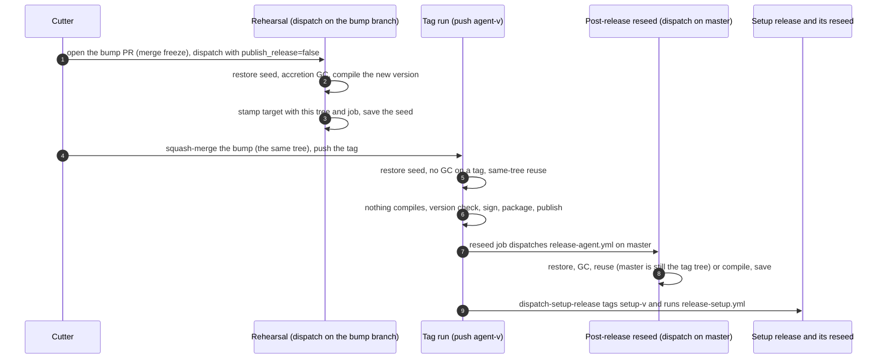
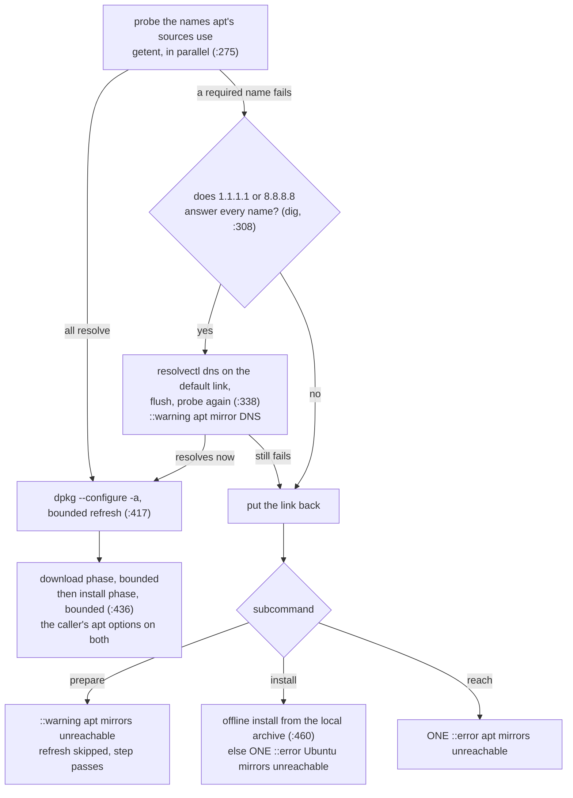

# Build caches: seeds, same-tree reuse and the accretion GC

How the release lanes keep Rust builds warm, so that an `agent-v*` tag publishes in about
six minutes instead of the hour it took when FR-6 started (#773: ~60–69 min per release,
2026-07). Three mechanisms do the work:
- a **seed store** that a release can always restore;
- **same-tree reuse**, which lets a tag run skip the compile its rehearsal already did;
- an **accretion GC**, which keeps a seed from growing without bound.

All three live in composite actions under `.github/actions/`. Each one fails loudly on the
run page rather than silently going cold. The program's full history, wave by wave, is in
[FR-6](fr/FR-6-ci-release-build-speed-slo.md).

---

## 1. Where the caches live

| Lane | Store | Family per job | Who saves |
|---|---|---|---|
| `release-agent.yml`, 8 build jobs | `seed-cache` release assets | `seed-<shared-key>-<os>-<arch>`, e.g. `seed-agent-windows-vp9-444-Windows-X64` | non-tag runs: rehearsals, post-release reseeds, the Monday 03:17 UTC cron |
| `release-setup.yml`, 4 build jobs | `seed-cache` release assets | `seed-setup-<platform>-…` | non-tag runs |
| `integration-tests.yml`'s shards, `installer-smoke.yml`, every cargo cache in `ci.yml` (its Linux lanes since wave 34) | `seed-cache` release assets (`ci-<family>-…`, through `ci-seed-restore` / `ci-seed-save`) | one per lane; the two recorder lanes share one | master only |
| `ci.yml`'s apt and bun sets | the Actions cache | one per package set | any run |
| `release-agent.yml`'s apt set, shared by `build-linux` and `build-linux-companion` | the Actions cache (cache-apt-pkgs-action) | `release-linux-u2204-v1`, plus a hash of the versions the index names (§5) | any run of either job |
| `release-setup.yml`'s Linux apt packages | `seed-cache` release assets (`apt-seed-install` / `apt-seed-save`) | `apt-<family>-<ID><VERSION_ID>-<arch>.tar.zst`, e.g. `apt-setup-linux-ubuntu26.04-X64` | non-tag runs |

**Why a release and not the Actions cache.** The 10 GB cache pool kept evicting the seeds.
LRU dropped a *verified* save 29 minutes after it landed (rc.472), and saves made from a tag
ref can never be restored by a later tag. Release assets have no LRU, no budget, no
reservations and no ref scoping.
- Each family is two assets, `<fam>-cargo.tar.zst` and `<fam>-target.tar.zst`. A CI
  family's target archive over the 2 GiB asset cap goes up in numbered 1,900 MiB parts,
  `<fam>-target.tar.zst.part00`, `.part01`, … (`ci-seed-save/action.yml:135`), which the
  restore concatenates (`ci-seed-restore/action.yml:111`). A publish writes one form and then
  retires the other (`ci-seed-save/action.yml:170`). A whole asset wins over parts, and parts
  from two publishes fail zstd's checksum, so a mixed set builds cold rather than wrong.
- `--clobber` on upload is the retention policy: keep the newest one
  (`.github/actions/seed-cache-save/action.yml:72`).
- `--latest=false` keeps the `seed-cache` release from ever becoming the
  `/releases/latest` that fielded agents poll for updates (`seed-cache-save/action.yml:67`).
- After uploading, the save checks through the API that both assets landed, and warns on
  the run page if they did not.

## 2. One release, five runs



| Run | Restores | GC | Reuses | Compiles | Saves |
|---|---|---|---|---|---|
| Rehearsal | yes | yes | no: a new version is a new tree | our crates only, 6–22 units a job | yes |
| Tag run | yes | **no** | **yes** | nothing | no: a tag-ref save is unrestorable |
| Post-release reseed | yes | yes | yes, while master is still the tag's tree | nothing, or our crates if master moved | yes |
| Weekly cron / `seed-release-caches.yml` | yes | yes | rarely | as needed | yes |

Rehearsals and reseeds share the concurrency group `agent-seed-rehearsal`, with
`cancel-in-progress`: a newer one cancels an older one. A tag run gets a group of its own
and is never cancelled (`.github/workflows/release-agent.yml:88-96`).

> ⚠️ **An open bump PR freezes every merge, docs included.** A merge between the rehearsal
> and the bump's squash gives the tag a different tree from the one the rehearsal stamped,
> so nothing reuses and the tag run compiles everything. Agent code also waits for the
> cutter's "published".

> ⚠️ **A change to `release-agent.yml` or the `seed-cache-*` actions dispatches a master
> rehearsal by itself** (`.github/workflows/seed-release-caches.yml:27-38`). That run joins
> `agent-seed-rehearsal` and cancels, or is cancelled by, whatever rehearsal is running. Merge
> such a change only when no rehearsal or reseed is in flight, and tell the next cutter.

## 3. Same-tree reuse

Cargo judges a path crate stale when any of its files is newer than its last build, and a
fresh checkout makes every file new. So before wave 29, every tag run recompiled all of our
crates, even though its rehearsal had built that exact tree minutes earlier.

1. **Stamp.** After a job's last cargo build, `seed-tree-stamp` writes
   `tree=<HEAD^{tree}> job=<workflow>/<job>` into `target/.seed-source-tree`
   (`.github/actions/seed-tree-stamp/action.yml:84`). A failed or skipped build never stamps.
2. **Reuse.** After restoring the seed, `seed-tree-reuse` reads the stamp and deletes it
   (`.github/actions/seed-tree-reuse/action.yml:34`). If the stamp names this tree and this
   job, and no tracked file is modified, it does three things:
   - sets every tracked file and directory to the mtime 2000-01-01;
   - does the same to the build's own OUT_DIR files (wave 31, `:73`);
   - exports `ROOMLER_SEED_REUSED_TREE` and prints a notice (`:85`).

   In any other case it changes nothing, and cargo rebuilds our crates as usual.
3. **Check.** On a reused build, `seed-tree-stamp` requires the daemon to print the release
   version, `reused build reports 'roomlerd X' (want X): OK`. Where the binary cannot run
   before packaging, it requires the version string inside the binary instead. The macOS
   daemon links an `@rpath` FFmpeg that only the `.app` resolves.

Kill switch: the repository variable `SEED_REUSE_SAME_TREE=off` (`seed-tree-reuse/action.yml:41`).

Reuse is only as good as each unit's declared inputs. Each of these cost a recompile on every
release until it was found:

| Trap | Found in | Fix |
|---|---|---|
| A build script with no `rerun-if` line is rerun on any change | wave 29, `scrap` | give it its `rerun-if` lines |
| A watched path that does not exist counts as changed | wave 30, tauri's `capabilities` | the directory exists (`agents/roomler-desktop/capabilities/README.md`) |
| A unit whose own compile writes an input into its OUT_DIR: tauri's `generate_context!` writes `out/tauri-codegen-assets/<hash>` while `roomler-desktop` compiles, only when the file is missing | wave 31, the macOS companion, ~2.5 min per release | reuse marks OUT_DIR files unchanged too |
| The seed's tar keeps whole seconds, and cargo treats an equal mtime as fresh | wave 31's probes | none needed: it is why the OUT_DIR trap struck Windows only when the write and the compile's start fell in different seconds |

`cargo build -v` prints each unit's `Dirty` reason. For the full story, put
`CARGO_LOG=cargo::core::compiler::fingerprint=info` on the build step.

## 4. Growth control: the accretion GC

Each run restores the previous seed, builds on top of it and saves everything. Without a
sweep, old artifacts pile up: one generation once grew from ~500 MB to 1.4–2.6 GB in four
days. So before every non-tag build, `seed-cache-restore` runs a GC step
(`.github/actions/seed-cache-restore/action.yml:63`):
1. It deletes registry `.crate` files older than four days. They are safe to sweep: a missing
   one is downloaded again.
2. It measures `target`. Over `SEED_TARGET_MAX_MB`, it drops the **whole** target (`:85-90`).

> ⚠️ **Never delete individual files under `target`.** Cargo decides whether to rerun a
> build script from `.fingerprint/`, not from the outputs. Remove an output while its
> fingerprint survives, and cargo silently never rebuilds it: rc.422–424 failed on a seed
> whose `env-libvpx-sys` `OUT_DIR/ffi.rs` had been GC'd. A whole-target drop costs one cold
> build and leaves a correct seed.

| Jobs | Cap | Set at |
|---|---|---|
| Default (companions, everything else) | 3,000 MB | `seed-cache-restore/action.yml:85` |
| The four daemon jobs (`.deb` ×2, MSI, `.pkg`) | 4,500 MB | `release-agent.yml:393`, `:1134`, `:1654`, `:2744` |
| The wizard's macOS universal job (two triples) | 5,000 MB | `release-setup.yml:404` |
| CI caches in the release-asset store (`ci-seed-restore`), default | 4,000 MB | `ci-seed-restore/action.yml:29` |
| The integration shards and `ci.yml`'s macOS overlay check | 6,000 MB | `integration-tests.yml:168`, `ci.yml:1572` |
| `ci.yml`'s Windows clippy lane (#3940) | 11,000 MB | `ci.yml:1923` |
| `ci.yml`'s Linux lanes (wave 34): unit, lint, agent; recorder-audio, ffmpeg-encoder, recording-ffmpeg, profiles | 16,000, 10,000, 7,000; 5,000 each | `ci.yml:507`, `:237`, `:658`; `:1204`, `:2330`, `:2510`, `:3035` |

**A cold build has to fit under its cap.** If it does not, every restore drops the cache, every
run builds cold, and each master run publishes the same size again, so the GC never recovers.
#3116's wizard step put the Windows clippy lane there on 2026-10-30: its cold build pruned to
4,440 MB against the default 4,000, and the lane took 17–23 min on every CI run instead of
~8 (FR-6 wave 33). A master run that publishes a CI cache over its cap now warns
`CI cache over its cap` on the run page (`ci-seed-save/action.yml:99`).

The same lane crossed its 6,000 MB cap on 2026-11-03, and the warning fired on every master
run from then on: each cold build pruned to 6,248–6,510 MB, and every run took 20–32 min,
against 9 and 13 for the last two warm runs on 2026-11-02. #3940 raised the cap to 11,000 MB
when it added the desktop companion's step to that lane. The companion's own cold clippy and
test build prunes to 2,686 MB, part of it the setup wizard's Tauri tree that the lane already
holds, so the lane's cold build prunes to at most 9,196 MB. At the lane's 4.1:1 packing
(6,509 MB to a 1,582 MiB archive), that target is over the 1.9 GiB asset margin and goes up in
two parts (`ci-seed-save/action.yml:140-152`), as the unit lane's 9,536 MB target already does.

**A cold build also has to fit its job's ceiling, publish included.** A run cut off before
it publishes leaves the next run cold as well, and that one is cut off the same way. Wave 34's
first master run built the unit lane cold (1,795 crates) and hit the 30-minute ceiling at
30 min 15 s, with the second part of its 2.6 GB archive still uploading. That part landed two
seconds after the cut. The unit and lint lanes now allow 45 and 40 minutes (`ci.yml:477`,
`:159`), about 1.5 times their measured cold runs (FR-6 wave 36). The macOS overlay check
allows 35 (`ci.yml:1538`): its cold run took 22 min 33 s on 2026-10-30, after its cache crossed
its 6,000 MB cap, against a 25-minute ceiling (FR-6 wave 37). The Windows clippy lane allows 55
(`ci.yml:1882`) since #3940: its cold runs took up to 32 min against 40 before the companion's
step joined them. Every other `ci.yml` lane with a cold run on record allows about 1.5 times it
or more. A forced cold run on 2026-11-01 gave
Windows sessions and the FR-85 recorder their first: 11.1 min against 40 and 8.9 against 30.
It also put unit at 27.3 min against 45 and lint at 18.0 against 40, prune and pack included.
Unit's upload adds about 90 s.

**A cache that grows past its cap is the GC at work, not that failure.** The bump to 0.4.191
published the macOS overlay cache at 6,440 MB, over its 6,000, and the warning fired. The next
three macOS jobs dropped it and built cold, in 9.2, 20.9 and 22.1 min, inside the 35-minute
ceiling. The master run among them published 4,664 MB 23 minutes after the oversize publish,
and the job after that was warm. So after that warning, read the next master publish. Under the
cap, nothing is owed. Only a cold build that publishes over the cap again calls for raising it.

**That growth was a prune bug, which wave 38 fixed.** macOS's default `split-debuginfo=unpacked`
leaves `<crate>-<hash>.<cgu>-cgu.N.rcgu.o` beside each unit, and the prune read a unit's name at
its last dash, which in those names is not the one before the hash. So every local crate's
objects survived: 602 MB in a one-version cache, and 525–552 MB more with each version bump, while
the lanes that leave no such files stayed flat. Those names are now read at the first dash
(`ci-seed-save/action.yml:85`), and the same cold build prunes to 4,039 MB against 4,664 MB.

**A macOS job's time does not say whether it ran cold.** Two of those jobs built the same 976
crates and started 88 s apart: one took 9.2 min, the other 22.1. Warm jobs on that lane took
6.9–17.3 min. Read the job's log instead: `restored target is N MB (> C) — dropping it whole`
is a cold run, and `restored <family>: target N MB, same key` or `key changed` is a warm one.
A warm job compiled 41 crates against the cold job's 976.

The Linux lanes' caps began as estimates, about 1.5 times each lane's old Actions-cache archive
at the 4.3× unpack ratio the integration lane measures (its 1,181 MB asset restores to
5,077 MB). Wave 34's first master publish (run 41107105820) put every lane at 32–65 % of its
cap: unit 10,373 MB of 16,000, lint 6,081 of 10,000, agent 3,268 of 7,000, and the four
5,000 MB lanes at 1,601–2,445.

**A seed grows per release, not per build.** Cargo names an artifact by the unit's name,
version, features and profile, never by its source. So a rebuild of the same version
overwrites in place, and only a new version adds artifacts: ~350–400 MB per daemon lane per
release. A fresh Windows seed (~2.7 GB) therefore lasts about four releases under 4,500 MB.
Under 3,000 MB it was dropped one release later, every time.

Measured on two consecutive releases (FR-6 wave 32):

| Post-release reseed | Cap | MSI seed restored | Outcome | MSI job |
|---|---|---|---|---|
| 0.4.184 | 3,000 MB | 3,082 MB | dropped whole, 586 crates compiled cold | 26.3 min |
| 0.4.185 | 4,500 MB | 3,037 MB | kept, reused, 0 compiles (the `.deb` x86_64's 3,367 MB too) | 6.0 min |

The GC line reports the cap in effect and the disk left on the volume:
`target is N MB (cap C) — kept intact; F MB free on the volume`, or
`target is N MB (> C) — dropping it whole; …`. Measured on 2026-10-29: macOS runners
~40 GB free, Linux 84–109 GB, Windows 147–222 GB. A compressed seed is 535–818 MiB, far under
GitHub's 2 GiB limit per asset.

## 5. How apt reaches the mirrors

Every apt step in CI and the Linux release lanes goes through one helper,
[`ci-apt.sh`](../.github/actions/ci-linux-system-deps/ci-apt.sh) (#3698, #3710), or is
left for a stated reason (below). The helper exists because of the 2026-11-11 outage. The
runners' resolver (systemd-resolved's stub, forwarding to the runner's upstream) stopped
answering for `*.ubuntu.com` while public resolvers still did. `apt-get update` then exits
**0** with only `W:` lines after 2–5 minutes, and every package of the install that follows
waits about 20 s on the resolver. No timeout inside apt covers that wait, so a lane hung
until its job ceiling.



**The names.** They come from apt's own sources (`derive_hosts`, `ci-apt.sh:239`): one-line
`.list` files, deb822 `.sources` and the list a `mirror+file:` URI names. The Ubuntu archive
hosts are **required** (`ci-apt.sh:136`). Any other repository, such as
`packages.microsoft.com`, is probed with a shorter wait and only reported, so a dead
third-party name never blocks an install from the archive. Until #3710 only
`/etc/apt/apt-mirrors.txt` was read. The arm64 image carries that file, but none of its
sources names it: they name `ports.ubuntu.com` directly. So the probe tested the amd64 trio,
passed, and the install waited on a name that did not resolve. `reach --containers` adds the
container images' mirrors (`ci-apt.sh:133-134`).

**The failover never weakens apt's verification.** No `--allow-unauthenticated`, no
`[trusted=yes]`. Every index is checked against Ubuntu's signing keys and every package
against the index, so a DNS answer can make a download fail but never install a wrong
package.

**Containers get the switch passed in; they do not always inherit it.** Docker gives a
container the host's resolv.conf without its loopback entries. Where `/etc/resolv.conf`
links to the stub, Docker reads `/run/systemd/resolve/resolv.conf` instead, which the
switch rewrites, so the container inherits the switch. The 11-20 self-test measured that on
ubuntu-latest and ubuntu-22.04 (D2 of #3710). Some ubuntu-22.04-arm runners have a static
`/etc/resolv.conf` instead, per runner and not per image: an egress proxy on `127.0.0.100`, the stub, then the
Azure upstream. A container's copy then holds only the upstream the switch went around,
and its `apt-get update` timed out after the failover. So a switch that helped also writes
its resolvers to `/tmp/ci-apt.docker-dns` as `docker run` arguments (`--dns`, then an
address, one per line; `ci-apt.sh:171`). Every container step passes them:
`deb-bare-check.sh --dns-file /tmp/ci-apt.docker-dns`, and the two bundle checks read the
file into an array on their `reach` line. With no failover there is no file, and a
container starts exactly as before.

| Runner image | `/etc/resolv.conf` | A container after the switch, by itself | With the helper's arguments |
|---|---|---|---|
| ubuntu-latest (26.04), ubuntu-22.04 | link to the stub | reaches its mirror | reaches its mirror |
| ubuntu-22.04-arm, some runners (seen on image 20261116.196.1) | static file, written by `repoint-resolv-conf` | `apt-get update` times out | reaches its mirror in about 3 s |

### The subcommands and where each runs

| Subcommand | Does | Callers |
|---|---|---|
| `prepare [BOUND...]` (`:544`) | probe and failover, a bounded refresh, the apt-fast stand-in. It never fails the step | the composite (`ci-linux-system-deps/action.yml:63`); `ffmpeg-encoder-check` (`ci.yml:2342`); `recording-ffmpeg` (`ci.yml:2519`); release-agent's `build-linux` and `build-linux-companion`, before their cached steps (`release-agent.yml:313`, `:793`) |
| `fallback PKG...` (`:614`) | bounded install, `--no-install-recommends`; with no resolver, one `::error` | the composite's verify steps (`action.yml:130`, `:186`); `ci.yml:2366`, `:2527` |
| `install [BOUND...] [OPT...] -- PKG...` (`:634`) | `dpkg --configure -a`, probe and failover, bounded refresh, bounded two-phase install with exactly the caller's options. It adds no option, so recommends stay wherever the step had them | the recorder-audio lane's xvfb and xclip (`ci.yml:1301`, `:1337`, `:1445`); release-agent's fallbacks (`:364`, `:826`), `rpm` (`:884`), and the arm64 installs (`:972`, `:1107`); `apt-seed-install` (`action.yml:69`); release-tunnel (`:166`) |
| `reach [--containers] [HOST...]` (`:672`) | probe and failover alone, for apt that runs elsewhere; one `::error` when the names do not resolve | `ui-phone-smoke.yml:78` (Playwright's `--with-deps` runs apt itself); the bundle checks' containers (`release-agent.yml:665`, `:1240`); every `deb-bare-check.sh` run (`release-agent.yml:1358`, `release-tunnel.yml:334`, `deb-bare-image.yml:78`) |
| the stand-in (`:575`) | what cache-apt-pkgs-action's cold path runs as `apt-fast`: the bounded two-phase install. On failure it removes `~/cache-apt-pkgs`, so the action saves no empty set | every cached-apt step after a `prepare` |

**Left, and why.**

| Site | Reason |
|---|---|
| `vendor-ffmpeg-windows.yml`'s two apt steps | Dispatch-only. The FR-24 gate hashes the file whole (`release-agent.yml:506-510`), so one byte turns every release-agent run red until `lgpl-source-offer.yml` is re-dispatched |
| `Dockerfile:29`, `:135` | Debian mirrors inside a buildx build of the server image: a different resolver path |
| `scripts/install.sh` | Product code on customers' hosts |
| `install-sh-output-check.sh`, `macos-postinstall-check.sh` | Their containers run `--network none` |

### Bounds

All of them are in seconds (`ci-apt.sh:141-152`). Each phase runs under its own `timeout`,
inside its own process tree. A step-level `timeout-minutes` kills nothing below the step,
and a composite step cannot carry one at all.

| Phase | Default | Release lanes | Why |
|---|---|---|---|
| probe (`getent`) | 25 (5 for a name that is only reported) | same | a dead resolver fails a name in ~10 s |
| refresh | 90 | 300 | healthy 3–7 s |
| download | 300 | 600 on an `install`; 120 for the stand-in | a 5–10 minute Azure mirror stall stays a slow success on a release job |
| install (dpkg) | 600 | 180 for the stand-in | ends a hung maintainer script only |
| kill after SIGTERM | 30 | same | |

The stand-in's bounds come from `prepare --download-bound 120 --install-bound 180`. `prepare`
records them in `/usr/local/etc/ci-apt.bounds`, and the stand-in reads that file without
sourcing it (`:508`). This keeps a failover (~85 s), the download, the install and the
action's own work inside release-agent's 8-minute cached step, so that step's timeout can
never land inside dpkg. The defaults (300 + 600 s) would not fit there.

### What a run log says

| Title | Kind | What it asks of you |
|---|---|---|
| `apt mirror DNS` | warning | Nothing: the runner's resolver failed and the job now uses a public one. Look at the job if it repeats on every run |
| `apt index` | warning | The refresh did not complete, so the image's older index is in use and a cached set can MISS (below) |
| `apt mirrors unreachable` | warning from `prepare`; error from `reach` | No resolver resolves the mirrors. `prepare` goes on (a cache HIT needs no mirror); `reach` stops the step. Re-run later |
| `apt cold path` | warning | The cached set missed and its install was not attempted or failed; the verify step decides |
| `apt-fast stand-in` | warning | The stand-in could not be installed, so the cached action's cold path is unbounded |
| `apt offline install` | warning | No resolver, but the restored seed held every package, which installed offline |
| `Ubuntu mirrors unreachable` | error | `install` or `fallback` with no resolver and no local copy. Re-run later |
| `apt install failed` | error | The names resolved and apt still failed: read apt's output above it |
| `bare-image check: mirror unreachable` | error | A `deb-bare-check.sh` container could not refresh its index (exit 3). That says nothing about the package: re-run |

`deb-bare-check.sh` keeps the coupling's two readings apart (ship-it). A container whose
refresh cannot resolve its mirror, or waits out its 240 s bound, prints
`MIRROR UNREACHABLE` and exits 3 (`scripts/deb-bare-check.sh:47`). A package that does not
start prints `DOES NOT START: <package>` and exits 1 (`:113`, `:156`). `deb-bare-image.yml`'s
control accepts only the second.

### The cache-key risk that stays

Every cached-apt set (cache-apt-pkgs-action) keys on the versions the local index names.
When the refresh fails, the image's older index stays in use, the key moves, and a set that
would have hit misses.
- **Only the runner's resolver dead:** the failover repairs the refresh, and the set still
  hits.
- **Every resolver dead:** the refresh is skipped and the set misses. A CI lane then fails
  in about 70 s with one `::error`. A release job fails within its bounds instead of running
  to its 60-minute ceiling.

A key that does not depend on the index is a redesign, out of #3710's scope.

### The self-test

[`ci-apt-selftest.yml`](../.github/workflows/ci-apt-selftest.yml) runs on a PR or master push
that touches the helper's directory, `apt-seed-install`, `deb-bare-check.sh`, the three
release workflows or itself. It has two jobs:
- **Offline:** `ci-apt.test.sh` (stub binaries, fixtures of the three images' sources, a
  case count it checks), shellcheck, and actionlint (pinned by version and sha256) over
  every workflow that calls the helper, the release workflows included, which no PR runs.
- **Fault cells:** `ubuntu-latest`, `ubuntu-22.04` and `ubuntu-22.04-arm` × `healthy`,
  `runner-dead`, `all-dead`, plus `arm64-names` on arm64. Each cell is a fresh job.
  `ci-apt-fault.sh` is a functional resolver-fault control on the job's own throwaway
  runner. It drops DNS answers that carry the mirror names (an iptables string match in
  the raw table), from the runner's own upstream (read from `resolvectl`, never hard-coded)
  or from every source, and nothing else, so the runner's connection to GitHub keeps
  working.
- **Proof that the fault applied:** each fault cell checks that the fault took effect
  before its result counts (`getent` fails, `dig @1.1.1.1` answers, github.com resolves),
  and checks at the end that the DROP rules matched packets.
- **The runner-dead cells** also run a negative control (today's bare `apt-get` must fail
  or hang), a container before and after the failover (D2), and `deb-bare-check.sh` on an
  empty package (exit 3 under the fault, a pass after it). After the failover the cell
  measures a container started bare, then requires one started with the helper's
  `/tmp/ci-apt.docker-dns` arguments to reach its mirror. Every cell logs the runner image
  and whether `/etc/resolv.conf` is a link, because the images change between pushes.
- **The healthy cells** require that no `/tmp/ci-apt.docker-dns` exists, so a healthy job
  starts its containers as before.
- **The all-dead cells** read the cached action in front of a failing stand-in, and
  `apt-seed-install`'s offline path.

## 6. Reading a release run

Cargo prints `Compiling\x1b[0m <crate>`, so a raw grep for `Compiling <crate>` counts 0 even
when the crate compiled. Strip the colour codes first, and check every zero against a
positive control: the rehearsal compiles each companion exactly once.

```bash
gh api repos/<owner>/<repo>/actions/jobs/<job-id>/logs | sed -E 's/\x1b\[[0-9;]*m//g' > job.log
grep -c '##\[notice\]the seed was built from tree' job.log        # reuse
grep -cE '^\S+Z\s+Compiling ' job.log                             # units compiled
grep -oE "reused build reports '[^']+' \(want [0-9.]+\): OK" job.log
grep -oE 'target is [0-9]+ MB.*' job.log                          # GC line, non-tag runs
```

| Line | Means |
|---|---|
| `the seed was built from tree <12 hex> by this job` | same-tree reuse fired |
| `seed carries no source-tree stamp` | the seed was built by a run that never stamped |
| `seed stamp is '…', this job is '…'` | a different tree or job: a normal rebuild |
| `same tree, but tracked files differ from HEAD` | a step modified tracked files before the restore |
| `::warning title=Seed publish did not land::` | the save's own check failed; the next run may build cold |
| `tag run — skipping accretion GC` | expected on every tag run |

A failed rehearsal opens a GitHub issue (`release-agent.yml:3848`), and the next green one
closes it (`:3912`).

## 7. The waves that built this

| Wave | Change | Effect |
|---|---|---|
| 13 | seeds move from the Actions cache to `seed-cache` release assets | no more evicted seeds |
| 29 (#2914) | a tag run reuses its rehearsal's compile | tag to publish 14.9 → 7.2 min (0.4.115 → 0.4.174) |
| 30 (#2940) | the companion's `capabilities/` exists, cached-apt steps bounded | the Linux companions stop recompiling |
| 31 (#3030) | reuse marks OUT_DIR files unchanged | no companion recompiles on a tag run since 0.4.181 |
| 32 (#3068) | the daemon seeds' cap rises to 4,500 MB, and the GC line reports free disk | a reseed reuses instead of a 26-minute cold MSI |
| 33 (#3153) | the Windows clippy lane's CI cache cap rises to 6,000 MB, and a master run warns when it publishes a cache over its cap | ends a cold build of that lane on every CI run since #3125 (17–23 min, against 7.4–8.3 before it) |
| 34 (#3157) | `ci.yml`'s seven Linux cargo caches move from the Actions cache to `seed-cache`, the largest in parts | a download the Actions cache refuses ("Egress is over the account limit") no longer builds a lane cold (the unit lane: 27 min against ~8) |
| 35 (#3170) | a docs-only PR skips the twelve heavy jobs; a push to master still runs every job | a docs PR's CI runs the audits and the frontend build, not 20 jobs (22 of 60 runs on 2026-10-30 were docs, each running all 20 jobs, up to 44 min) |
| 36 (#3170) | the unit and lint lanes' job ceilings rise from 30 to 45 and 40 min | a cold run of either lane finishes its publish (wave 34's first cold unit run was cut off mid-upload at 30 min 15 s) |
| 37 (#3192) | the macOS overlay check's ceiling rises from 25 to 35 min | its cold run (22 min 33 s, measured) finishes its publish |
| 38 (#3251) | the prune removes local crates' macOS object files, which the last-dash name match missed | the macOS overlay cache stops growing 525–552 MB a version, and a cold prune lands at 4,039 MB, not 4,664 |
| — (#3940) | the Windows clippy lane's cap rises to 11,000 MB and its ceiling to 55 min, with the desktop companion's step | ends a cold build of that lane on every CI run since 2026-11-03 (20–32 min, against 9–13 warm) |

What is left is runner queueing, not compiling. On 0.4.182 and 0.4.183 the `.pkg` waited
about 8 minutes for a macOS runner, and tag to publish took 13–16 minutes. On 0.4.184 and
0.4.185 every job started within 100 s, and it took 5 min 32 s and 6 min 38 s.
