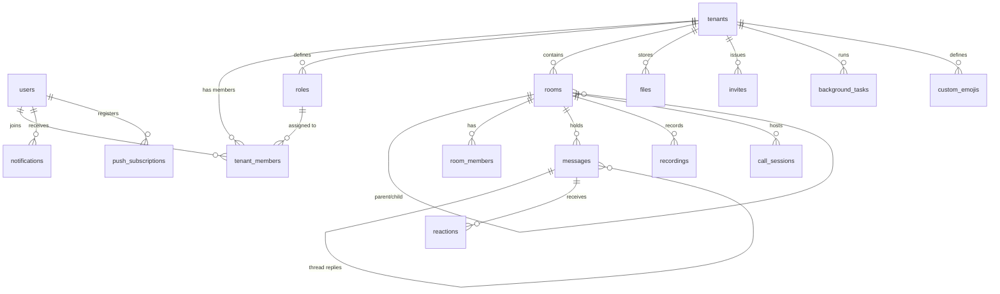
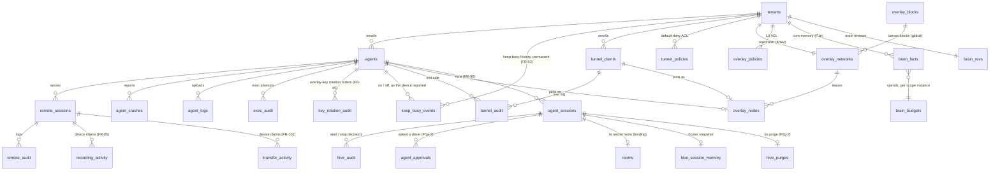

# Data Model

MongoDB (native Rust driver, BSON documents, no ORM). *As of 0.3.0-rc.381* the
server maintains indexes on **39 collections plus 8 stats-rollup collections**
(`crates/db/src/indexes.rs` is the authoritative list; models live in
`crates/db/src/models/` and — for the fleet subsystem — `crates/remote_control/src/models.rs`).

Everything is scoped by `tenant_id` (multi-tenancy) except the global registries
called out below.

## Collaboration core

| Collection | Purpose · key fields / indexes |
|---|---|
| `tenants` | Organizations. Unique `slug`; `owner_id`; plan + Stripe linkage |
| `users` | Accounts. Unique `email`, `username`; text index on `display_name`+`username`. ⚠️ Unique `email` is a **reservation**, so it holds only an address the account has *proven* (activation, or a provider that verified it) — an unproven claim goes to the non-indexed `unverified_email` and the row takes a `.invalid` placeholder |
| `tenant_members` | Membership + role assignment. Unique `(tenant_id, user_id)` |
| `roles` | Permission bitfield (`u64`; 33 bits defined since FR-90's `HIVE_RUN` — [permissions.md](permissions.md)). Unique `(tenant_id, name)`, ordered by `position` |
| `rooms` | Hierarchical tree (text + voice/video): `parent_id`, unique `(tenant_id, path)`, sparse-unique `meeting_code`; text index on `name`+`purpose`+`tags`. Optional `binding {module, ref}` — another module owns what the room *means* (FR-90: an agent session's room, `secret`, path `hive-<session id>`); chat stores it and never interprets it |
| `room_members` | Per-room membership |
| `messages` | Chat. Thread via `thread_id`, pins, embeds; text index on `content`. `author_type` `user` (default) · `bot` · `webhook` · `system`; a non-user author carries its own `author_display` (FR-90: `Claude · <device>`), which is read **only** when `author_type` is not `user` — a person cannot rename themselves through it. Optional `binding` (FR-90: a turn's stub, edited in place when the turn ends) |
| `reactions` | Unicode + custom-emoji reactions, keyed by `message_id` |
| `recordings` | Call recordings; storage provider `S3`/`MinIO`/`Local` |
| `call_sessions` | Call lifecycle rows (**730 d** TTL on `started_at` — the conference module's index set, not 90 d) |
| `call_chat_messages` | In-call chat (no secondary indexes) |
| `files` | Versioned uploads; uploader, room linkage |
| `invites` | Shareable/email/batch invites; unique `code` |
| `custom_emojis` | Tenant emoji sets |
| `notifications` | @mention & system notifications; `is_read`. FR-90's `approval_request` names a session that waits for a driver, never the call. ⚠️ A `notification_type` a build does not know reads as `other` — one new kind must not fail a user's whole list on an older pod mid-roll |
| `push_subscriptions` | Web-push endpoints (VAPID) |
| `background_tasks` | Export/processing pipeline; TTL-expired |
| `activation_codes` | Email activation; TTL on `expires_at` |
| `stripe_events` | Stripe webhook dedupe/audit |
| `consent_requests` | Remote-session owner-consent capability tokens |
| `used_tokens` | Single-use JWT `jti` burn list (1 h TTL) |
| `growth_exclusions` | FR-102 P1c: the platform admin's explicit exclusion list — `{kind: tenant\|user, id, reason, by, at}`, unique `(kind, id)`. The implicit exclusions (every platform admin, every org an excluded user owns) have no row; `roomler_core::growth::ExclusionSet` folds both into the one set every growth number applies ([growth-observability.md](growth-observability.md)). No TTL |
| `growth_digests` | FR-102 P1d: one daily digest per closed UTC day, `_id = "YYYY-MM-DD"` — `status` (`computing` → `sent` · `stored` · `failed`), `claimed_at`, `computed_at`, `sent_at`, `attempts`, `error`, `recipients` (a **count**, never the addresses), `excluded {users, tenants}`, `sections` (the typed sections, serialised whole). The unique `_id` is the once-only claim: the insert decides which pod computes and mails. **25-month TTL** on `computed_at` |
| `growth_daily` | FR-102 P3: the frozen daily totals — one row per `(source, metric, dims, day)`, `_id = "<source>:<metric>:<k=v,…>:<day>"` (since P6 every part percent-escapes `%` `,` `=` `:`, so a client-chosen value cannot forge another row's id), `{day: "YYYY-MM-DD", source, metric, dims, value}`. `install:fetch` with `dims {asset, client, os}` from the fleet module's fetch counters, upserted with `$inc` — **never a User-Agent, never an IP**, and never the updater's own checks. **P6**: `source: purestat`, written by the `saas` puller with `$set` (idempotent; write-then-prune per pulled day) — `dims.by` `site` · `campaign` (the normalised key `source`/`medium`/`campaign`/`content`) · `path`, metrics `visitors` `visits` `pageviews` `reads` `goal.<name>`; zeros are not stored, and a day older than 7 days is frozen, never rewritten. Index `(source, metric, day)`; no TTL (aggregates about the product, no person) ([growth-observability.md](growth-observability.md)) |
| `growth_pulls` | FR-102 P6: one row per `(source, UTC day)` a puller attempted, `_id = "<source>:<YYYY-MM-DD>"` — `status` (`ok` once a pull succeeded, and it stays `ok` through a later failure; `failed` while none has), `pulled_at`, `attempted_at`, `attempts`, `rows`, `error` (a short reason, never a credential), `missing_goal`, `truncated`. What lets a reader of `growth_daily` tell **not pulled** (no row) or **failed** from a pulled zero. Written by the `saas` purestat puller, read by the Campaigns table's pull summary. Index `(source, day)`; no TTL, like the rows it describes |
| `growth_org_daily` | FR-102 P2: one row per org per UTC day with any activity, `_id = "{tenant_hex}:{YYYY-MM-DD}"` — the day's `rc_sessions` / `rc_session_minutes` / `rc_controllers`, `calls` / `call_participant_minutes`, `tunnel_flows`, `ssh_sessions`, `exec_runs`, `devices_online`, `members_active`, and `value` (bool) + `value_kinds`. Folded whole by a singleton nightly host job (recompute-last-3-closed-days, replace-then-prune per day); it **outlives the 90-day audit rows** it was computed from, which is why it exists. Indexes `(tenant_id, day)` and `(day)`. Bounded by a **25-month TTL** on `day_start`; `roomler_core::growth::purge_tenant` is the one call an org deletion must make to take an org's rows (and its `growth_daily` rows) with it, but **no org hard-delete path exists yet** (orgs are only archived, reversibly), so the TTL is what bounds it for now ([growth-observability.md](growth-observability.md)) |

## Fleet: agents, remote desktop, tunnels, overlay

| Collection | Purpose · key fields / indexes |
|---|---|
| `agents` | One row per enrolled machine: name, os, version, caps (codecs/transports/rpc), exec policy, status. **Unique `(tenant_id, machine_id)`** — re-enrollment reuses the row. FR-102 P3 adds `install {method, scope, run?}` — how the device was installed, as its enroll said (`wizard` · `script-sh` · `script-ps1` · `msi` · `deb` · `pkg` · `manual` · `container` · `other`; `unknown` when the agent predates the field); written when the row is created, refreshed by a re-enroll only when that request says, absent on rows from before P3. FR-40 adds three records of different trust: `overlay_identity` (the public key + epoch the device last **joined** with, server-verified, stamped on every join), `key_rotation` (the standing order, with `public_key_before`) and `key_rotation_report` (the device's **claim**; a later refusal never overwrites a `rotated` claim for the same order) — see [overlay-key-rotation.md](overlay-key-rotation.md) |
| `remote_sessions` | Remote-desktop sessions: agent, controller user, state machine, stats. FR-101 P3: `transfer_totals`, the last cumulative clipboard tallies the device reported. These sit outside `stats` so that `mark_ended`'s whole-`stats` write cannot reset them; a reset would count everything again. **No TTL** — the remote module's index set carries none, so controller sessions outlive the 90-day audit rows (the usage view's `watchers_complete` flag exists for that reason) |
| `remote_audit` | Per-session audit events (connect, consent, input, terminate). 90 d TTL |
| `recording_activity` | FR-85: what a device **claims** about remote recordings (prompt outcome, started, stopped, refused, downloaded), with name, bytes, duration and reason, never content. Kept only for a session of that device whose grant held `RECORD`; the decision itself is in `remote_audit`. `(tenant_id, agent_id, at desc)`, `(session_id, at)`. 90 d TTL |
| `transfer_activity` | FR-101 P3: the clipboard and file traffic a device **claims** for a remote session. Two kinds of row: a clipboard row per direction per 30 s sample (`count`, `bytes`), and a file row per completed file (`bytes`, `name_sha256`). Never content, never a file name. Kept only for a session of that device, clipboard rows only under `CLIPBOARD`, file rows only under `FILES`; a name hash that is not 64 lowercase hex digits is dropped. `(tenant_id, agent_id, at desc)`, `(session_id, at)`. 90 d TTL |
| `consent_requests` | Pending owner-consent decisions (capability token = the auth) |
| `agent_crashes` | Crash-report ingest. 90 d TTL on `reported_at` |
| `enroll_token_issued` | FR-102 P3: one row per standard enrollment token **minted**, `_id = jti` — `tenant_id`, `issued_by` (an id), `issued_at`, `kind: standard`, and `redeemed_at` + `agent_id` once an enroll spent it (an upsert from the token's claims, so a token minted before the ledger existed is on record too). **The token itself is never stored.** Read by the digest for "issued → redeemed"; the single-use control stays `used_tokens`. 90 d TTL on `issued_at` ([growth-observability.md](growth-observability.md)) |
| `agent_logs` | Centralized log batches (agent + browser ingest). **7 d TTL**, text index on `lines.msg` |
| `exec_audit` | Fleet-RPC attempt log — every exec **including refusals**. 90 d TTL |
| `key_rotation_audit` | FR-40 overlay-key rotation orders — every order **including refusals**: what the **server** decided (`dispatch: pushed`/`queued` or `denied: rate_limited`/`agent_unsupported`), who and when, never what the device did and never any key material. `(tenant_id, at)`, `(agent_id, at)`. 90 d TTL |
| `keep_busy_events` | FR-92 P7 — the keep-busy history: `kind` (`on` · `off` · `org_denied` · `org_allowed` · `org_default_pattern`), `source` (**`server`** = the server's own decision from the settings route, naming the admin in `actor_user_id`/`actor_name`; **`device`** = a claim derived from two consecutive heartbeat briefs, `actor_name` the brief's `set_by`), `agent_id` (absent on an org row), `agent_name` (denormalised: the row outlives the device), `pattern`, `reason`, `at`. The `ssh_audit` / `ssh_activity` trust split inside one collection. `(tenant_id, at desc)`, `(tenant_id, agent_id, at desc)`. ⚠️ **No TTL — permanent** (operator decision, 2026-10-11); owned by the fleet module — see [keep-busy.md](keep-busy.md) §11 |
| `tunnel_clients` | Enrolled `roomler` CLI identities (`owner_user_id`) |
| `tunnel_policies` | Default-deny tunnel ACL: subject × target × destination (`dst_host`) |
| `tunnel_audit` | One row per tunnel flow (`tunnel_session_id`). 90 d TTL |
| `overlay_networks` | **One per tenant** — the mesh IPAM row: CIDR (default carved from `100.64.0.0/10`), monotonic `next_host` cursor + `free_hosts` recycle pool, MagicDNS domain, ACL mode (`off`/`warn`/`enforce`) |
| `overlay_nodes` | Mesh membership: overlay IP, WG pubkey, advertised + approved routes, exit-node flag. Unique `(tenant_id, machine_id)` and `(tenant_id, network_id, overlay_ip)`; **partial-unique `name`** (MagicDNS) scoped to live rows — nodes are *tombstoned*, not deleted, so a released address/name can be re-issued while history is kept |
| `overlay_policies` | Overlay L3 ACL rules (compiled into per-node netmaps under `enforce`) |
| `overlay_blocks` | **Global** (not tenant-scoped) registry of disjoint `/22` address blocks for multi-org; slot-unique, freed blocks quarantined |
| `agent_sessions` | FR-90 (module `hive`): one agent session — owner, `drivers` (P1c: who else may prompt it and answer its approvals — room members the owner named, each holding `HIVE_RUN` when named, at most 16, the owner never listed; absent on an older record = the owner alone), title, harness + its own session UUID, `location {device_id, device_name, folder, account}`, `room_id` (its secret room), `last_turn {turn, message_id}` (the newest turn's stub — advanced by a compare-and-set, so a late report of an older turn never rewinds it), `status` (`starting` → `idle`/`running`/`awaiting_approval` → `stopping` → `ended`; or `refused`/`lost`), `fence`, `accepted_at`, `refusal`, `end_reason`, `brain_rev` (P1e: the brain revision its core memory was rendered from, pinned at creation; absent when its device takes no core memory). **Never content** — no prompt, tool call or output. Every device-driven move is a compare-and-set on device + fence + status. P2g-2 — `purged {purge_id, by, at}` makes the record a purge's tombstone: ended (`end_reason: purged`), its title, folders and room gone, read by nobody, its owner included; deleted once its purge completes. `(tenant_id, owner_id, created_at desc)`, `(tenant_id, location.device_id, status)`, `(tenant_id, status)`. No TTL |
| `agent_approvals` | FR-90 P1a-2: one per approval a session asked a driver for — `session_id`, `device_id`, the device's `approval_id` (unique per session, so a replayed frame makes no second record or stub), `turn`, `status` (`open` → `allowed`/`denied`/`expired`/`withdrawn`, the end a compare-and-set on `open`), `message_id` (its stub in the session's room), `answered_by`, `requested_at`, `resolved_at`. **Never which tool or what it would run** — the device's `rc:hive.approval` cannot carry them. ⚠️ `answered_by` is the DEVICE's report (the answer travels over the viewer peer), believed only when it names a driver. `(session_id, approval_id)` unique, `(tenant_id, requested_at desc)`. 90 d TTL |
| `hive_audit` | FR-90: the server's own decision on every session start (`sent` or `refused` with the gate) and stop (`sent`/`queued`/`ended`), on every view of one (`action: view` — `sent` or `refused` with the gate; P0d-2), and on every change of who takes part (`action: participant`, P1c — `driver` · `reader` · `removed`, or `refused` with `no_permission` · `too_many_drivers`; `target_id` names whom it was about), and on every write to core memory (`action: brain`, P1e — `added` · `edited` · `archived`, or `refused` with `over_budget`; `target_id` the fact; `device_id` only for a device's fact — absent for an org's or a user's). `(tenant_id, at desc)`, `(session_id, at)`. 90 d TTL |
| `brain_facts` | FR-90 P1e: core memory people curate — `scope` (`org` · `user` · `device`), `owner_id` (the user or the device; stored null for the org, since it is part of the budget's key), `text` (one line, ≤ 500 characters), `chars`, `kind` (`preference` · `convention` · `path` · `gotcha` · `decision` · `warning`), `status` (`active` · `archived` — archived facts stay as records), `version` (an edit names the version it read), `created_*`, `updated_*`. ⚠️ The one thing the server holds that a session's model reads — as the user's own overriding instructions — so who writes each scope is gated (`docs/fr/FR-90-hive-agent-sessions.md` §3f). `(tenant_id, scope, owner_id, status, created_at)` |
| `brain_budgets` | FR-90 P1e: one per scope instance — `used`, the characters its active facts hold. Spent by ONE conditional update (`$inc` under `used ≤ budget − n`, an upsert) over the **unique** `(tenant_id, scope, owner_id)`: a write with no room collides with that index, and the collision is the `409 over_budget`. A refusal recounts once from the facts, so a reservation a crash left behind cannot shrink a budget for ever. Budgets: org 3,000 · user 1,500 · device 800 |
| `brain_revs` | FR-90 P1e: `{_id: tenant_id, rev}` — the org's brain revision, `$inc` by every write |
| `hive_session_memory` | FR-90 P1e: a session's frozen core-memory snapshot by `_id` = its session — `brain_rev`, `claude_md` (org + starter), `memory_md` (its device), rendered when the session was created; what a re-sent `rc:hive.start` carries again. 1 d TTL on `created_at` — past the start's redelivery window the device holds its own copy. Deleted with the session's purge (P2g-2) |
| `hive_purges` | FR-90 P2g-2: a purge of a deleted session, the tombstone of design §4.4 — `session_id`, `owner_id` (who may read it), `by`, `reason` (`owner`, or P2g-3a `retention`: the server's sweep, `by` then the owner), `room_id`, `at`, `done_at?`, and one entry per device the session's record named: `{device_id, state: pending · done · closed, store?, account?, detail?, answered_at?, closed?: device_removed · holds_nothing}`, the device's own words per part (`done` · `not_there` · `failed`). Written BEFORE the record's tombstone, which names it; sent only while that tombstone does. Ids, words and times only. `(tenant_id, devices.device_id, done_at)` (what a device that connects has to answer), `(tenant_id, session_id, owner_id)`. 90 d TTL on `done_at`: a pending purge, which has none, never expires |

## Observability & analytics

Raw event streams with short TTLs, rolled up hourly/daily by an in-server task
(`$merge` on `_id`, whole-bucket replace).

| Collection | TTL | Purpose |
|---|---|---|
| `stats_relay` · `stats_machine` · `stats_mesh` · `stats_events` · `stats_call` · `stats_call_user` | 7 d | Raw series: relay load (by region), per-machine, mesh edges, platform events, calls, per-user call usage |
| `stats_relay_1h` · `stats_machine_1h` · `stats_call_1h` · `stats_call_user_1h` | 90 d | Hourly rollups |
| `stats_relay_1d` · `stats_machine_1d` · `stats_call_1d` · `stats_call_user_1d` | 730 d | Daily rollups |
| `page_views` | 90 d | SPA route-change beacons (paths normalized server-side) |
| `ws_sessions` | 90 d | WebSocket session bookkeeping |

## Index & retention summary

| Guarantee | Where |
|---|---|
| Unique identity | `users.email`, `users.username`, `tenants.slug`, `(tenant_id, user_id)` membership, `(tenant_id, machine_id)` on `agents` **and** `overlay_nodes`, `(tenant_id, network_id, overlay_ip)`, partial-unique live `overlay_nodes.name`, `overlay_blocks.slot`, sparse-unique `rooms.meeting_code` |
| Full-text search | `messages.content` · `rooms.{name,purpose,tags}` · `users.{display_name,username}` · `agent_logs.lines.msg` |
| TTL retention | 90 d: `remote_audit`, `recording_activity`, `transfer_activity`, `tunnel_audit`, `exec_audit`, `key_rotation_audit`, `hive_audit`, `hive_purges` (from `done_at`), `agent_approvals`, `agent_crashes`, `enroll_token_issued`, `page_views`, `ws_sessions`, hourly rollups · 7 d: `agent_logs`, raw stats · 730 d: `call_sessions`, daily rollups · 25 months: `growth_digests`, `growth_org_daily` · 1 d: `hive_session_memory` · 1 h: `used_tokens` · on-expiry: `activation_codes`, `background_tasks` · **never** (permanent, by decision): `keep_busy_events` (FR-92 P7, operator 2026-10-11), `agent_sessions`, `remote_sessions`, `growth_exclusions`, `growth_daily`, `growth_pulls` |

Two patterns worth knowing when touching this layer:

- **Tombstones over deletes** in `overlay_nodes`: release paths CAS a tombstone
  *first* (the CAS win is the release token), then return the host number to the
  pool, then fan `netmap_delta{removes}` — that order is load-bearing; see the
  address-lease section of [overlay-communication.md](overlay-communication.md).
- **Hand-built updates must name every field** — the DAO layer builds `doc!{}`
  updates explicitly, so adding a model field means adding it to the DAO update or
  it silently never persists.
