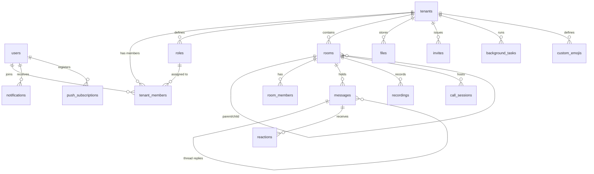

# Data Model

MongoDB (native Rust driver, BSON documents, no ORM). *As of 0.3.0-rc.381* the
server maintains indexes on **39 collections plus 8 stats-rollup collections**
(`crates/db/src/indexes.rs` is the authoritative list; models live in
`crates/db/src/models/` and — for the fleet subsystem — `crates/remote_control/src/models.rs`).

Everything is scoped by `tenant_id` (multi-tenancy) except the global registries
called out below.

## Collaboration core

| Collection | Purpose · key fields / indexes |
|---|---|
| `tenants` | Organizations. Unique `slug`; `owner_id`; plan + Stripe linkage |
| `users` | Accounts. Unique `email`, `username`; text index on `display_name`+`username`. ⚠️ Unique `email` is a **reservation**, so it holds only an address the account has *proven* (activation, or a provider that verified it) — an unproven claim goes to the non-indexed `unverified_email` and the row takes a `.invalid` placeholder |
| `tenant_members` | Membership + role assignment. Unique `(tenant_id, user_id)` |
| `roles` | Permission bitfield (`u64`; 33 bits defined since FR-90's `HIVE_RUN` — [permissions.md](permissions.md)). Unique `(tenant_id, name)`, ordered by `position` |
| `rooms` | Hierarchical tree (text + voice/video): `parent_id`, unique `(tenant_id, path)`, sparse-unique `meeting_code`; text index on `name`+`purpose`+`tags`. Optional `binding {module, ref}` — another module owns what the room *means* (FR-90: an agent session's room, `secret`, path `hive-<session id>`); chat stores it and never interprets it |
| `room_members` | Per-room membership |
| `messages` | Chat. Thread via `thread_id`, pins, embeds; text index on `content`. `author_type` `user` (default) · `bot` · `webhook` · `system`; a non-user author carries its own `author_display` (FR-90: `Claude · <device>`), which is read **only** when `author_type` is not `user` — a person cannot rename themselves through it. Optional `binding` (FR-90: a turn's stub, edited in place when the turn ends) |
| `reactions` | Unicode + custom-emoji reactions, keyed by `message_id` |
| `recordings` | Call recordings; storage provider `S3`/`MinIO`/`Local` |
| `call_sessions` | Call lifecycle rows (**730 d** TTL on `started_at` — the conference module's index set, not 90 d) |
| `call_chat_messages` | In-call chat (no secondary indexes) |
| `files` | Versioned uploads; uploader, room linkage |
| `invites` | Shareable/email/batch invites; unique `code` |
| `custom_emojis` | Tenant emoji sets |
| `notifications` | @mention & system notifications; `is_read`. FR-90's `approval_request` names a session that waits for a driver, never the call. ⚠️ A `notification_type` a build does not know reads as `other` — one new kind must not fail a user's whole list on an older pod mid-roll |
| `push_subscriptions` | Web-push endpoints (VAPID) |
| `background_tasks` | Export/processing pipeline; TTL-expired |
| `activation_codes` | Email activation; TTL on `expires_at` |
| `stripe_events` | Stripe webhook dedupe/audit. **FR-102 P4**: an event whose processing failed is un-marked, so Stripe's retry is processed rather than skipped |
| `billing_events` | FR-102 P4 (`saas`): what Stripe billed — one row per webhook event of the six billing kinds (`subscription_created` · `subscription_updated` · `subscription_deleted` · `invoice_paid` · `invoice_payment_failed` · `trial_will_end`) and one per paid invoice the operator's backfill read: `tenant_id`, `kind`, `plan`, `seats`, `amount_cents` (invoices: what was billed, after coupons, before tax; `null` on a subscription event, never 0), `recurring_cents` (the non-proration subscription lines — the basis of billed MRR), `interval_months`, `currency`, `period_start` / `period_end`, `stripe_id` (`in_…` / `sub_…`), `subscription_id`, `status`, `reason`, `cancel_at_period_end`, `event_id` (absent on a backfilled row), `source` (`webhook` · `backfill`), `ts`, `recorded_at`. **Never a card, an address or a name.** Indexes: sparse-unique `event_id`; unique `(kind, stripe_id)` partial on `kind: invoice_paid` (the webhook and the backfill meet on it); `(tenant_id, ts)`; `(kind, ts)`. No TTL — **kept with the org**: `roomler_core::growth::purge_tenant` takes them; the monthly totals frozen into `growth_daily` carry no org and stay ([growth-observability.md](growth-observability.md#revenue-what-stripe-billed-p4)) |
| `subscribers` | FR-39/FR-58 (`saas`): the public updates list — normalised `email` (unique), `source`, `confirmed` + `confirm_token` (double opt-in), `unsubscribe_token` (unique, never expires), `created_at` · `confirmed_at` · `unsubscribed_at`. Rows are kept and stamped on unsubscribe, never deleted (the consent record). **FR-102 P5**: `unsubscribed_via` (the slug of the issue whose link ended the subscription, written once; cleared by fresh consent) and `suppressed_at` + `suppressed_reason` (`bounce` · `spamreport`: SendGrid reported a hard bounce or a spam report — never mailed again until fresh consent). No TTL ([newsletter.md](newsletter.md)) |
| `newsletter_issues` | FR-58 (`saas`): one issue — `slug` (unique), subject, preheader, `body_md`, hero/CTA, `status` (`draft` → `sending` → `completed`), the send claim, `counts` stamped at completion, `sent_at`. **FR-102 P5**: `campaign` (the `utm_campaign` its links carried, `nl-<slug>`; absent with the tags off) and `delivery_events` (its delivery events are recorded: every message named the issue for SendGrid and this server verified the webhook) — stamped when the fan-out starts; `audience` (a **test** issue's 1–20 addresses: the send goes only to the confirmed subscribers among them; fixed with the draft). No TTL |
| `newsletter_sends` | FR-58 (`saas`): the per-recipient delivery ledger — unique `(issue_id, subscriber_id)` (the at-most-once invariant), the address as mailed, `status` (`claimed` → `sent` · `failed` · `suppressed`; `sent` = accepted by SendGrid), `error`. **FR-102 P5**: `delivery {delivered_at, bounced_at, bounce_type, dropped_at, spam_reported_at, reason}` — what SendGrid's signed Event Webhook reported, each time the earliest (`$min`, so a replay writes nothing); **never an open or a click**. Index `(issue_id, status)`. No TTL — the send record, as FR-58 ([growth-observability.md](growth-observability.md#the-newsletter-delivery-per-issue-tags-and-unsubscribes-p5)) |
| `consent_requests` | Remote-session owner-consent capability tokens |
| `used_tokens` | Single-use JWT `jti` burn list (1 h TTL) |
| `growth_exclusions` | FR-102 P1c: the platform admin's explicit exclusion list — `{kind: tenant\|user, id, reason, by, at}`, unique `(kind, id)`. The implicit exclusions (every platform admin, every org an excluded user owns) have no row; `roomler_core::growth::ExclusionSet` folds both into the one set every growth number applies ([growth-observability.md](growth-observability.md)). No TTL |
| `growth_content` | FR-102 P7b (`saas`, its index set in the module): one row per blog post, `_id` = the post's path (`/blog/<slug>/`) — `url`, `title`, `published_at`, `updated_at`, `first_seen_at`, `last_seen_at`, `in_feed`, and `inspection {verdict, coverage_state, indexing_state, page_fetch_state, robots_txt_state, last_crawl_time, google_canonical, inspected_at, attempted_at, error}` from Google's URL Inspection — `inspected_at` the time the verdict was read (absent until one was), `attempted_at` the newest attempt. Read from the site's own Atom feed once a day by the content puller — only an Atom feed changes the list: a 404, a redirect or a page that is not a feed is a failed read; a post that leaves the feed is kept with `in_feed: false`; a failed inspection keeps the last good verdict and its `inspected_at` and records `error`. Read by the host through `roomler_ai_services::dao::growth_content`. Index `(published_at desc)`; no TTL (our own content, no person) ([growth-observability.md](growth-observability.md#search-search-console-bing-and-the-blogs-posts-p7b)) |
| `growth_digests` | FR-102 P1d: one daily digest per closed UTC day, `_id = "YYYY-MM-DD"` — `status` (`computing` → `sent` · `stored` · `failed`), `claimed_at`, `computed_at`, `sent_at`, `attempts`, `error`, `recipients` (a **count**, never the addresses), `excluded {users, tenants}`, `sections` (the typed sections, serialised whole). The unique `_id` is the once-only claim: the insert decides which pod computes and mails. **25-month TTL** on `computed_at` |
| `growth_daily` | FR-102 P3: the frozen daily totals — one row per `(source, metric, dims, day)`, `_id = "<source>:<metric>:<k=v,…>:<day>"` (since P6 every part percent-escapes `%` `,` `=` `:`, so a client-chosen value cannot forge another row's id), `{day: "YYYY-MM-DD", source, metric, dims, value}`. `install:fetch` with `dims {asset, client, os}` from the fleet module's fetch counters, upserted with `$inc` — **never a User-Agent, never an IP**, and never the updater's own checks; since **P3c** `client` is `internal` for a fetch from the operator's internal networks (`growth.internal_networks`, matched in memory against the limiter's client address, which is then dropped), in place of its class; **P3b**: `install:wizard_step` with `dims {step, outcome, os}`, the value the number of **distinct** opted-in wizard runs that ended that step with that outcome that day, written with `$set` by the host's nightly freeze from `setup_diagnostics` (the last three closed days, idempotent; a day with no runs holds no rows) and never rewritten once past that window, so the counts outlive the 90-day rows. **P6**: `source: purestat`, written by the `saas` puller with `$set` (idempotent; write-then-prune per pulled day) — `dims.by` `site` · `campaign` (the normalised key `source`/`medium`/`campaign`/`content`) · `path`, metrics `visitors` `visits` `pageviews` `reads` `goal.<name>`; zeros are not stored, and a day older than 7 days is frozen, never rewritten. **P4**: `quota:collision` with `dims {tenant, limit}` — a plan-limit collision per org, limit and UTC day (`$inc`, from `roomler_core::quota`; refused or let through in `warn`), which **goes with the org** (`purge_tenant` takes every row with a `tenant` dimension); and `source: billing` — the monthly billed totals frozen from `billing_events` (`day` the month's first day, `dims {currency, period: month}`, metrics `mrr_cents` `paying_orgs` `new_cents` `new_orgs` `expansion_cents` `contraction_cents` `churned_cents` `churned_orgs` `net_new_cents` `invoices_paid` `billed_cents`; `$set` by the nightly freeze, no org, rewritten only by the operator's backfill). **P7a**: `source: github` — the `saas` GitHub puller's cumulative snapshot of each closed UTC day (`dims.by` `repo` with `stars` `forks` `watchers` `downloads` (the product's releases, their `.asc`/`.sha256` sidecars left out) `helper_downloads` (the vendored builds and caches CI downloads); `release` (with `kind: product|helper`) and `flavour` (product assets) with `downloads`; `dims.repo` always), `$set` and never rewritten after its 01:00–07:00 window, differenced by the readers (a missing snapshot makes every delta across it null); and with a token `source: github_traffic` — `by: traffic` views / clones per day (13 closed days re-pulled, then frozen) and `by: referrer` GitHub's 14-day ranking under the day it was read after. **P7b**: `source: search_console` — Google's FINAL days only (Pacific-time dates), `by` `site` · `page` · `query` · `page_query` with `clicks`, `impressions` and `position_x100` (the position weighted by impressions ×100; CTR is derived, not stored); `source: bing` — Bing's daily site `clicks` / `impressions`; `source: bing_weekly` — Bing's weekly buckets per `query` and `page` with `clicks`, `impressions`, `avg_impression_position_x10`, `avg_click_position_x10`, under the bucket's date. Index `(source, metric, day)`; no TTL (aggregates about the product, no person) ([growth-observability.md](growth-observability.md)) |
| `growth_keys` | FR-102 P8 (D12): the growth surface's machine keys — `{kind: ingest \| read, label, prefix, hash, created_by, created_at, revoked_at, last_used_at}`. **Only `hex(SHA-256(key))` and a display prefix (`rgi_AbCd1234` / `rgr_…`) are stored**; the key itself is answered once, at mint. An `ingest` key opens `POST /api/admin/growth/ingest/{posts,snapshots}` and nothing else; a `read` key (P10) opens the `GET /api/admin/growth/*` views and nothing else — never a write, never `/keys` or `/exclusions`; revocation is a timestamp. Unique `hash`, index `(kind, created_at)`; no TTL ([growth-observability.md](growth-observability.md)) |
| `growth_weekly` | FR-102 P10: one weekly roll-up per closed ISO week, `_id = "YYYY-Www"` — the daily digest's row shape (`status`, `claimed_at`, `computed_at`, `sent_at`, `attempts`, `error`, `recipients` as a **count**, `excluded`, `sections`) and the same once-only claim, in a collection of its own so the daily store's "latest" never meets a week. `sections` = the week's headline against the weeks before, and the funnel, cohorts, campaigns, channels, newsletter and alerts reports computed for that week. **25-month TTL** on `computed_at` ([growth-observability.md](growth-observability.md#the-read-key-the-weekly-roll-up-and-alerts-p10)) |
| `session_feedback` | FR-102 P9b (`remote`): a person's rating of one remote session, asked by the viewer after a session of 30 s or more — `{session_id, tenant_id, user_id, agent_id, rating: up \| down, reasons: [codes], ts}`; `reasons` from the fixed vocabulary `lag` · `picture` · `input` · `could_not_connect` · `other`, **no text field**; `user_id` from the authenticated request, `agent_id` denormalised from the session row, `ts` the server's clock. Written only by `POST /api/tenant/{tid}/session/{sid}/feedback` from the session's controller or a watcher, never before 30 s after the request, the empty 404 while `ROOMLER__GROWTH__FEEDBACK=false`. Indexes: **unique `(session_id, user_id)`** (one rating per session **per person** — a rating is one person's experience, so the controller and each watcher rate once each; the arbiter between two posts by one person), `(tenant_id, ts)`, `(user_id)`; **25-month TTL** on `ts`; `SessionFeedbackDao::purge_user` takes a person's rows with the account ([growth-observability.md](growth-observability.md#the-post-session-rating-p9b)) |
| `touch_presets` | FR-111 P4a (`remote`): an org's on-screen control presets — `{tenant_id, name, controls, created_by, updated_by, created_at, updated_at}`, where `controls` is the viewer's own `TouchPreset` list (rows of buttons, d-pads, sticks; a button's action is `keys`, `mouse` or a `macro` of press / release / tap steps with waits). Read by any member, written with `MANAGE_TENANT` through `TouchPresetRequest::validate` (keys only on the keyboard page, bounded counts, sizes and waits, labels as text). Index: **unique `(tenant_id, name)`**, which also serves the name-ordered listing. Deleted, not tombstoned: nothing holds a preset's id but a browser's remembered choice, which falls back to off ([touch-controls.md](touch-controls.md#the-orgs-presets-p4)) |
| `growth_quality_daily` | FR-102 P9a: remote-desktop quality per UTC day, scope and agent version, `_id = "{day}:{scope}:{agent_version}"` — `scope` (`external` = the exclusion set applied, `all` = nothing excluded; both frozen, with the set as it stood at the freeze), `agent_version` (a release, `unknown`, or `*` for every version), `sessions {requested, reached_active, not_reached, pending, by_end_reason [{reached_active, reason, count}], duration_ms, peak_fps, avg_rtt_ms, by_carrier [{carrier, reached_active, duration_ms, peak_fps, avg_rtt_ms}]}` (each a `Dist {n, p50, p90, edges, hist}` — the day's exact nearest-rank percentiles plus a histogram over fixed edges so a window can be pooled; `by_carrier` is P9c, the Active sessions by the carrier they rode, a day frozen before P9c having none), `ttff {dist, hidden, later_attempts, outcomes}` (FR-22's time to first frame over foreground first-attempt paints, **present only when every `agent_logs` record of the day still existed at the freeze**), `crashes` (by the payload's `agentVersion`), `device_days` (`stats_machine_1d.online_minutes > 0`), `computed_at`. An absent part is **not measured**, never 0. Written whole by the host's nightly freeze under the org-day fold's claim (the last 3 closed days; 28 on a first fill) and by `POST …/growth/quality/backfill`; replace-then-prune per `(day, scope)`. Index `(scope, day)`; **no TTL** — counts and percentiles about the product, no org, no device, no person ([growth-observability.md](growth-observability.md#remote-desktop-quality-from-what-is-recorded-p9a)) |
| `growth_alerts` | FR-102 P10: one row per time a rule fired — `{rule, key, fired_at, cleared_at, detail, mailed_on}`. `cleared_at` is an explicit **`null` while open** (never absent): the **partial unique index on `(rule, key)` where `cleared_at` is `$type: "null"`** is the fire's arbiter across pods — at most one open row per rule and key, a recurrence after a clear a new row. `detail` holds days, counts and source names, never a person; `mailed_on` is the UTC day of the one mail (a compare-and-set, at most once per rule and key per day). **90-day TTL** on `fired_at` ([growth-observability.md](growth-observability.md#alerts)) |
| `growth_posts` | FR-102 P8: one row per social post the promotion pipeline pushed — `{platform, platform_id, account, format, url, published_at, key {source, medium, campaign, content}, cost_cents, created_at, updated_at}`; the key normalised as a sign-up's attribution is. **Never the post's text** — the ingest refuses any field that looks like copy. Written by the `saas` ingest route through the core DAO, read by the host's Channels and Campaigns views. Unique `(platform, platform_id)` (a re-push updates), index `published_at`; no TTL (our own content, no person) |
| `growth_post_snapshots` | FR-102 P8: a post's metrics at `T+1d` · `T+7d` · `T+28d` — `{platform, platform_id, snapshot, taken_at, metrics {raw name: number}, received_at}`, the platform's own metric names kept verbatim. Unique `(platform, platform_id, snapshot)` and **written once** (`$setOnInsert`): a snapshot pushed twice is stored once (AC18). No TTL |
| `growth_pulls` | FR-102 P6: one row per `(source, UTC day)` a puller attempted, `_id = "<source>:<YYYY-MM-DD>"` — `status` (`ok` once a pull succeeded, and it stays `ok` through a later failure; `failed` while none has), `pulled_at`, `attempted_at`, `attempts`, `rows`, `error` (a short reason, never a credential), `missing_goal`, `truncated`. What lets a reader of `growth_daily` tell **not pulled** (no row) or **failed** from a pulled zero. Written by the `saas` purestat puller, read by the Campaigns table's pull summary. **P4**: `billing:YYYY-MM-01` marks a month's billed totals frozen (the host's nightly freeze), and `billing_backfill:YYYY-MM-DD` a run of the operator's Stripe backfill (`rows` = invoices recorded) — what tells "billed since the webhook was wired" from "billed, history included". **P7a**: `github:YYYY-MM-DD` (the closed day's snapshot, `truncated` when the release list hit its 10-page bound) and `github_traffic:YYYY-MM-DD` (with a token), written by the `saas` GitHub puller and read by `growth::github` — only an `ok` day is a snapshot. **P7b**: `search_console:YYYY-MM-DD` for each FINAL day pulled (a day Google has not settled has no row: pending, never 0), `content:YYYY-MM-DD` and `url_inspection:YYYY-MM-DD` for the day's read of the blog's feed and its inspections, and `bing:YYYY-MM-DD` for a cycle's read of Bing (under the day it followed). Index `(source, day)`; no TTL, like the rows it describes |
| `growth_org_daily` | FR-102 P2: one row per org per UTC day with any activity, `_id = "{tenant_hex}:{YYYY-MM-DD}"` — the day's `rc_sessions` / `rc_session_minutes` / `rc_controllers`, `calls` / `call_participant_minutes`, `tunnel_flows`, `ssh_sessions`, `exec_runs`, `devices_online`, `members_active`, and `value` (bool) + `value_kinds`. Folded whole by a singleton nightly host job (recompute-last-3-closed-days, replace-then-prune per day); it **outlives the 90-day audit rows** it was computed from, which is why it exists. Indexes `(tenant_id, day)` and `(day)`. Bounded by a **25-month TTL** on `day_start`; `roomler_core::growth::purge_tenant` is the one call an org deletion must make to take an org's rows (and its `growth_daily` rows) with it, but **no org hard-delete path exists yet** (orgs are only archived, reversibly), so the TTL is what bounds it for now ([growth-observability.md](growth-observability.md)) |

## Fleet: agents, remote desktop, tunnels, overlay

```mermaid
erDiagram
    tenants ||--o{ agents : enrolls
    agents ||--o{ remote_sessions : serves
    remote_sessions ||--o{ remote_audit : logs
    remote_sessions ||--o{ recording_activity : "device claims (FR-85)"
    remote_sessions ||--o{ transfer_activity : "device claims (FR-101)"
    remote_sessions ||--o{ privacy_activity : "device claims (FR-99)"
    agents ||--o{ agent_crashes : reports
    agents ||--o{ agent_logs : uploads
    agents ||--o{ exec_audit : "exec attempts"
    agents ||--o{ key_rotation_audit : "overlay-key rotation orders (FR-40)"
    tenants ||--o{ keep_busy_events : "keep-busy history, permanent (FR-92)"
    agents ||--o{ keep_busy_events : "on / off, as the device reported"
    tenants ||--o{ tunnel_clients : enrolls
    tenants ||--o{ tunnel_policies : "default-deny ACL"
    tunnel_clients ||--o{ tunnel_audit : "flow log"
    agents ||--o{ tunnel_audit : "exit side"
    tenants ||--|| overlay_networks : "one mesh (IPAM)"
    overlay_networks ||--o{ overlay_nodes : leases
    agents ||--o| overlay_nodes : "joins as"
    tunnel_clients ||--o| overlay_nodes : "joins as"
    tenants ||--o{ overlay_policies : "L3 ACL"
    overlay_blocks ||--o{ overlay_networks : "carves blocks (global)"
    agents ||--o{ agent_sessions : "runs (FR-90)"
    agent_sessions ||--o{ hive_audit : "start / stop decisions"
    agent_sessions ||--o{ agent_approvals : "asked a driver (P1a-2)"
    agent_sessions ||--o| rooms : "its secret room (binding)"
    tenants ||--o{ brain_facts : "core memory (P1e)"
    brain_facts }o--|| brain_budgets : "spends, per scope instance"
    tenants ||--|| brain_revs : "brain revision"
    agent_sessions ||--o| hive_session_memory : "frozen snapshot"
    agent_sessions ||--o| hive_purges : "its purge (P2g-2)"
    tenants ||--o{ vault_secrets : "the vault (FR-90 P3-1)"
    vault_secrets ||--o{ vault_versions : "sealed values, last 10 per field"
    tenants ||--o{ vault_audit : "every decision, allow and deny"
    tenants ||--o{ vault_roles : "roles sessions assume (P3-2a)"
    tenants ||--o{ vault_policies : "Cedar policies, checked on write"
    agent_sessions ||--o{ vault_leases : "values released to it (P3-3b)"
```

| Collection | Purpose · key fields / indexes |
|---|---|
| `agents` | One row per enrolled machine: name, os, version, caps (codecs/transports/rpc), exec policy, status. **Unique `(tenant_id, machine_id)`** — re-enrollment reuses the row. FR-102 P3 adds `install {method, scope, run?}` — how the device was installed, as its enroll said (`wizard` · `script-sh` · `script-ps1` · `msi` · `deb` · `pkg` · `manual` · `container` · `other`; `unknown` when the agent predates the field); written when the row is created, refreshed by a re-enroll only when that request says, absent on rows from before P3. FR-40 adds three records of different trust: `overlay_identity` (the public key + epoch the device last **joined** with, server-verified, stamped on every join), `key_rotation` (the standing order, with `public_key_before`) and `key_rotation_report` (the device's **claim**; a later refusal never overwrites a `rotated` claim for the same order) — see [overlay-key-rotation.md](overlay-key-rotation.md). FR-90 P3-3a adds `vault_key`: the public half of the key the device's daemon holds now for the values the vault will lease to it (standard base64 of 32 bytes), written from **every** hello and empty when the hello carries none or a malformed one; the daemon makes a new key at each start, so the field never outlives the process ([vault.md](vault.md) §9) |
| `remote_sessions` | Remote-desktop sessions: agent, controller user, state machine, stats. **FR-102 P9c**: `carrier` — the path the session rode (`direct` · `turn` · `turn_local` · `overlay_direct` · `overlay_turn` · `derp` · `org_relay` · `unknown`), recorded by the agent once the session reached Active and written by the live stats merge **beside** `stats` (so `mark_ended`'s whole-`stats` write cannot reset it); **absent is unknown, never direct**. FR-101 P3: `transfer_totals`, the last cumulative clipboard tallies the device reported. These sit outside `stats` so that `mark_ended`'s whole-`stats` write cannot reset them; a reset would count everything again. **25-month TTL** on `created_at` since 2026-10-17 (`RemoteSession::TTL_SECONDS`; the operator's decision when the privacy policy, which claimed 90 days, was found to disagree with the code, which kept the rows forever; the policy now says 25 months). Controller sessions still outlive the 90-day audit rows, which is why the usage view's `watchers_complete` flag exists. The long-term numbers are frozen in `growth_org_daily` and `growth_quality_daily` |
| `remote_audit` | Per-session audit events (connect, consent, input, terminate). 90 d TTL |
| `recording_activity` | FR-85: what a device **claims** about remote recordings (prompt outcome, started, stopped, refused, downloaded), with name, bytes, duration and reason, never content. Kept only for a session of that device whose grant held `RECORD`; the decision itself is in `remote_audit`. `(tenant_id, agent_id, at desc)`, `(session_id, at)`. 90 d TTL |
| `transfer_activity` | FR-101 P3: the clipboard and file traffic a device **claims** for a remote session. Two kinds of row: a clipboard row per direction per 30 s sample (`count`, `bytes`), and a file row per completed file (`bytes`, `name_sha256`). Never content, never a file name. Kept only for a session of that device, clipboard rows only under `CLIPBOARD`, file rows only under `FILES`; a name hash that is not 64 lowercase hex digits is dropped. `(tenant_id, agent_id, at desc)`, `(session_id, at)`. 90 d TTL |
| `privacy_activity` | FR-99 P1d: what a device **claims** about privacy mode in a remote session: `kind` `on` · `off` · `refused`, with a short `reason` code (`controller`, `session_end`, `disabled_on_device`, `worker_exit`; a refusal names the device gate). Kept only for a session of that device whose grant held `PRIVACY`, the stored row deciding after the session ended (a `worker_exit` comes from the next process); a reason that is not a code (`a-z0-9_`, at most 64) is dropped and the row kept. `(tenant_id, agent_id, at desc)`, `(session_id, at)`. 90 d TTL |
| `consent_requests` | Pending owner-consent decisions (capability token = the auth) |
| `agent_crashes` | Crash-report ingest. **30 d TTL** on `reported_at` since 2026-10-17 (FR-102 decision 15, as the privacy policy's §7 says; it was 90 d). The digest's 28-day window, the nightly per-day freeze and the per-device list of the last 50 all fit inside it |
| `enroll_token_issued` | FR-102 P3: one row per standard enrollment token **minted**, `_id = jti` — `tenant_id`, `issued_by` (an id), `issued_at`, `kind: standard`, and `redeemed_at` + `agent_id` once an enroll spent it (an upsert from the token's claims, so a token minted before the ledger existed is on record too). **The token itself is never stored.** Read by the digest for "issued → redeemed"; the single-use control stays `used_tokens`. 90 d TTL on `issued_at` ([growth-observability.md](growth-observability.md)) |
| `setup_diagnostics` | FR-102 P3b: one row per **step boundary** a setup-wizard run reported, **only when the person ticked the opt-in box** — `{run, step, outcome, elapsed_ms, error_code, os, wizard_version, ts}`: `run` a random 32-hex id the wizard mints per launch (also on `agents.install.run` of the device that run enrolled), `step` and `outcome` (`ok` · `failed` · `cancelled`) and `error_code` from fixed vocabularies (`roomler_ai_remote_control::setup_diagnostics`), `os` the family, `ts` the server's clock. **No IP, no User-Agent, no name, no path, no token** — the handler reads the body and nothing else about the request, and every field is validated or the record is refused. At most 48 rows per `run`. Indexes `(run)` and the TTL on `ts`, which doubles as the range scan. 90 d TTL; the per-day distinct-run counts the host freezes into `growth_daily` (`install:wizard_step`) outlive it ([growth-observability.md](growth-observability.md#the-wizards-opt-in-diagnostics-p3b)) |
| `agent_logs` | Centralized log batches (agent + browser ingest). **7 d TTL**, text index on `lines.msg` |
| `exec_audit` | Fleet-RPC attempt log — every exec **including refusals**. 90 d TTL |
| `key_rotation_audit` | FR-40 overlay-key rotation orders — every order **including refusals**: what the **server** decided (`dispatch: pushed`/`queued` or `denied: rate_limited`/`agent_unsupported`), who and when, never what the device did and never any key material. `(tenant_id, at)`, `(agent_id, at)`. 90 d TTL |
| `keep_busy_events` | FR-92 P7 — the keep-busy history: `kind` (`on` · `off` · `org_denied` · `org_allowed` · `org_default_pattern`), `source` (**`server`** = the server's own decision from the settings route, naming the admin in `actor_user_id`/`actor_name`; **`device`** = a claim derived from two consecutive heartbeat briefs, `actor_name` the brief's `set_by`), `agent_id` (absent on an org row), `agent_name` (denormalised: the row outlives the device), `pattern`, `reason`, `at`. The `ssh_audit` / `ssh_activity` trust split inside one collection. `(tenant_id, at desc)`, `(tenant_id, agent_id, at desc)`. ⚠️ **No TTL — permanent** (operator decision, 2026-10-11); owned by the fleet module — see [keep-busy.md](keep-busy.md) §11 |
| `tunnel_clients` | Enrolled `roomler` CLI identities (`owner_user_id`) |
| `tunnel_policies` | Default-deny tunnel ACL: subject × target × destination (`dst_host`) |
| `tunnel_audit` | One row per tunnel flow (`tunnel_session_id`). 90 d TTL |
| `overlay_networks` | **One per tenant** — the mesh IPAM row: CIDR (default carved from `100.64.0.0/10`), monotonic `next_host` cursor + `free_hosts` recycle pool, MagicDNS domain, ACL mode (`off`/`warn`/`enforce`) |
| `overlay_nodes` | Mesh membership: overlay IP, WG pubkey, advertised + approved routes, exit-node flag. Unique `(tenant_id, machine_id)` and `(tenant_id, network_id, overlay_ip)`; **partial-unique `name`** (MagicDNS) scoped to live rows — nodes are *tombstoned*, not deleted, so a released address/name can be re-issued while history is kept |
| `overlay_policies` | Overlay L3 ACL rules (compiled into per-node netmaps under `enforce`) |
| `overlay_blocks` | **Global** (not tenant-scoped) registry of disjoint `/22` address blocks for multi-org; slot-unique, freed blocks quarantined |
| `agent_sessions` | FR-90 (module `hive`): one agent session — owner, `drivers` (P1c: who else may prompt it and answer its approvals — room members the owner named, each holding `HIVE_RUN` when named, at most 16, the owner never listed; absent on an older record = the owner alone), title, harness + its own session UUID, `location {device_id, device_name, folder, account}`, `room_id` (its secret room), `last_turn {turn, message_id}` (the newest turn's stub — advanced by a compare-and-set, so a late report of an older turn never rewinds it), `status` (`starting` → `idle`/`running`/`awaiting_approval` → `stopping` → `ended`; or `refused`/`lost`), `fence`, `accepted_at`, `refusal`, `end_reason`, `brain_rev` (P1e: the brain revision its core memory was rendered from, pinned at creation; absent when its device takes no core memory), `vault_role` (FR-90 P3-2b: the vault role it took at its start, as the vault allowed it on that device, decided again at every move and fork; absent = none). **Never content** — no prompt, tool call or output. Every device-driven move is a compare-and-set on device + fence + status. P2g-2 — `purged {purge_id, by, at}` makes the record a purge's tombstone: ended (`end_reason: purged`), its title, folders and room gone, read by nobody, its owner included; deleted once its purge completes. `(tenant_id, owner_id, created_at desc)`, `(tenant_id, location.device_id, status)`, `(tenant_id, status)`. No TTL |
| `agent_approvals` | FR-90 P1a-2: one per approval a session asked a driver for — `session_id`, `device_id`, the device's `approval_id` (unique per session, so a replayed frame makes no second record or stub), `turn`, `status` (`open` → `allowed`/`denied`/`expired`/`withdrawn`, the end a compare-and-set on `open`), `message_id` (its stub in the session's room), `answered_by`, `requested_at`, `resolved_at`. **Never which tool or what it would run** — the device's `rc:hive.approval` cannot carry them. ⚠️ `answered_by` is the DEVICE's report (the answer travels over the viewer peer), believed only when it names a driver. `(session_id, approval_id)` unique, `(tenant_id, requested_at desc)`. 90 d TTL |
| `hive_audit` | FR-90: the server's own decision on every session start (`sent` or `refused` with the gate) and stop (`sent`/`queued`/`ended`), on every view of one (`action: view` — `sent` or `refused` with the gate; P0d-2), and on every change of who takes part (`action: participant`, P1c — `driver` · `reader` · `removed`, or `refused` with `no_permission` · `too_many_drivers`; `target_id` names whom it was about), and on every write to core memory (`action: brain`, P1e — `added` · `edited` · `archived`, or `refused` with `over_budget`; `target_id` the fact; `device_id` only for a device's fact — absent for an org's or a user's), and on every search of an archive replica's copies (`action: search`, P2i-2 — `sent`, or `refused` with the gate; `device_id` the archive replica asked, no `session_id`, and `sessions` how many the grant named; never a query, which the server never has). `(tenant_id, at desc)`, `(session_id, at)`. 90 d TTL |
| `brain_facts` | FR-90 P1e: core memory people curate — `scope` (`org` · `user` · `device`), `owner_id` (the user or the device; stored null for the org, since it is part of the budget's key), `text` (one line, ≤ 500 characters), `chars`, `kind` (`preference` · `convention` · `path` · `gotcha` · `decision` · `warning`), `status` (`active` · `archived` — archived facts stay as records), `version` (an edit names the version it read), `created_*`, `updated_*`. ⚠️ The one thing the server holds that a session's model reads — as the user's own overriding instructions — so who writes each scope is gated (`docs/fr/FR-90-hive-agent-sessions.md` §3f). `(tenant_id, scope, owner_id, status, created_at)` |
| `brain_budgets` | FR-90 P1e: one per scope instance — `used`, the characters its active facts hold. Spent by ONE conditional update (`$inc` under `used ≤ budget − n`, an upsert) over the **unique** `(tenant_id, scope, owner_id)`: a write with no room collides with that index, and the collision is the `409 over_budget`. A refusal recounts once from the facts, so a reservation a crash left behind cannot shrink a budget for ever. It recounts only a counter untouched for a minute (`touched_at`), under a compare-and-swap on `v`, which every write bumps BEFORE it changes a fact, so a reservation still in flight is never counted away. Budgets: org 3,000 · user 1,500 · device 800 |
| `brain_revs` | FR-90 P1e: `{_id: tenant_id, rev}` — the org's brain revision, `$inc` by every write |
| `hive_session_memory` | FR-90 P1e: a session's frozen core-memory snapshot by `_id` = its session — `brain_rev`, `claude_md` (org + starter), `memory_md` (its device), rendered when the session was created; what a re-sent `rc:hive.start` carries again. 1 d TTL on `created_at` — past the start's redelivery window the device holds its own copy. Deleted with the session's purge (P2g-2) |
| `hive_purges` | FR-90 P2g-2: a purge of a deleted session, the tombstone of design §4.4 — `session_id`, `owner_id` (who may read it), `by`, `reason` (`owner`, or P2g-3a `retention`: the server's sweep, `by` then the owner), `room_id`, `at`, `done_at?`, and one entry per device the session's record named: `{device_id, state: pending · done · closed, store?, account?, detail?, answered_at?, closed?: device_removed · holds_nothing}`, the device's own words per part (`done` · `not_there` · `failed`). Written BEFORE the record's tombstone, which names it; sent only while that tombstone does. Ids, words and times only. `(tenant_id, devices.device_id, done_at)` (what a device that connects has to answer), `(tenant_id, session_id, owner_id)`. 90 d TTL on `done_at`: a pending purge, which has none, never expires |
| `vault_secrets` | FR-90 P3-1 (module `vault`): a secret's name and rules, **never a value** — `path` (unique among the org's live secrets; the RRN `rrn:{org slug}:secret:{path}` is rendered from it, never stored), `kind` (`static` · `structured`, stored as a string so a later kind still reads), `description`, `fields {name: {seq, current, updated_at}}` (`seq` handed out by `$inc`, `current` moved by `$max`), `audiences`, `exec_allow`, `tags`, `owner_id`, `rotation_days?`, `disabled`, `created_by`, `deleted_at` (an explicit `null` while live). Tombstoned, not deleted. Unique `(tenant_id, path)` partial on `deleted_at: {$type: "null"}`, `(tenant_id, deleted_at, path)`. No TTL ([vault.md](vault.md)) |
| `vault_versions` | FR-90 P3-1: one value written to one field — `secret_id`, `field`, `n`, `ciphertext` (XChaCha20-Poly1305 under the version's own data key, bound to org · secret · field · `n` as associated data), `nonce`, `dek_wrapped` (the data key, `age`-encrypted to the KEK), `kek` (the KEK's public recipient), `created_by`, `expires_at?`. A field keeps its last 10; every version goes with its secret. Unique `(secret_id, field, n)`, `(tenant_id, kek)` |
| `vault_audit` | FR-90 P3-1: every `secret:*` and `vault:verify` decision, allow and deny — `principal` (`user`), `user_id`, `action`, `op`, `decision`, `reason` (`administrator` · `not_administrator`), `secret_id?`, `rrn?`, `field?`, `n?`; P3-2a adds `policy:write` (`role_create` · `role_delete` · `policy_create` · `policy_update` · `policy_delete`) with `target?` (`role:<name>` · `policy:<id>`); P3-2b adds `role:assume` (`op`: `start` · `promote` · `teleport` · `fork`) with `session_id`, `device_id` and `request` (the Cedar request as decided, which `simulate/replay` decides again); P3-3b adds `secret:use` (`op`: `lease`, `principal`: `session`, `user_id` the session's owner) with `target` `lease:<id>` on an allow or `asked:<name>` for a name that resolved to no secret; P3-3c adds every revocation (`op`: `revoke`, `decision`: `revoke`, `principal`: `vault`, `reason` the word: `session_ended` · `session_moved` · `value_changed` · `secret_disabled` · `secret_deleted` · `key_changed` · `device_removed` · `not_served`), one row per lease, by the pod whose compare-and-set took it back — a revocation carries no `request`, so `simulate/replay` never reads it; P3-4b adds `secret:list` (`principal`: `session`): `op` `describe`, allow or deny, with the secret and the `request`, and `op` `list`, one row a call, `reason` `listed N of M`, `target` `asked:<prefix>` (`asked:*` for all), with no `request` (an aggregate, never replayed). An allow is written BEFORE it is acted on, and fails closed. `(tenant_id, at desc)`, `(secret_id, at)`. 90 d TTL |
| `vault_leases` | FR-90 P3-3b: one value released to one agent session — `secret_id`, `field`, `n`, `session_id`, `fence`, `device_id`, `owner_id`, `sealed_to` (the device key it was sealed to: a later hello with another key is another process, which cannot open it), `mode`, `audience`, `issued_at`, `expires_at` (at most its version's `expires_at`, P3-3c), `revoked_at?`/`revoked_why?` (P3-3c: set by a compare-and-set, so of two pods one acts; the device is told with `rc:vault.revoke`). Its `_id` is the lease id the device is told. **Never the value.** Written after the allow is recorded and before the sealed box is sent. `(tenant_id, session_id)`; P3-3c `(device_id, expires_at)`, `(secret_id, expires_at)`; TTL a week past `expires_at` ([vault.md](vault.md) §10, §11) |
| `vault_roles` | FR-90 P3-2a: a vault role sessions assume — `name` (one spelling, unique among live roles), `description`, `created_by`, `deleted_at`. Tombstoned, never while a live policy names it. Unique `(tenant_id, name)` partial on `deleted_at: {$type: "null"}`. No TTL |
| `vault_policies` | FR-90 P3-2a: one Cedar statement an administrator wrote, checked before it was kept (the schema, strictly; this organization's names only) — `name`, `description`, `text`, `effect` (`permit` · `forbid`), `rev` (a write names the one it read), `created_by`, `updated_by`, `deleted_at`. The guardrails are code, never rows. Unique `(tenant_id, name)` partial on live rows, `(tenant_id, deleted_at, created_at)`. No TTL |

## Observability & analytics

Raw event streams with short TTLs, rolled up hourly/daily by an in-server task
(`$merge` on `_id`, whole-bucket replace).

| Collection | TTL | Purpose |
|---|---|---|
| `stats_relay` · `stats_machine` · `stats_mesh` · `stats_events` · `stats_call` · `stats_call_user` | 7 d | Raw series: relay load (by region), per-machine, mesh edges, platform events, calls, per-user call usage |
| `stats_relay_1h` · `stats_machine_1h` · `stats_call_1h` · `stats_call_user_1h` | 90 d | Hourly rollups |
| `stats_relay_1d` · `stats_machine_1d` · `stats_call_1d` · `stats_call_user_1d` | 730 d | Daily rollups |
| `page_views` | 90 d | SPA route-change beacons (paths normalized server-side) |
| `ws_sessions` | 90 d | WebSocket session bookkeeping |

## Index & retention summary

| Guarantee | Where |
|---|---|
| Unique identity | `users.email`, `users.username`, `tenants.slug`, `(tenant_id, user_id)` membership, `(tenant_id, machine_id)` on `agents` **and** `overlay_nodes`, `(tenant_id, network_id, overlay_ip)`, partial-unique live `overlay_nodes.name`, `overlay_blocks.slot`, sparse-unique `rooms.meeting_code` |
| Full-text search | `messages.content` · `rooms.{name,purpose,tags}` · `users.{display_name,username}` · `agent_logs.lines.msg` |
| TTL retention | 90 d: `remote_audit`, `recording_activity`, `transfer_activity`, `privacy_activity`, `tunnel_audit`, `exec_audit`, `key_rotation_audit`, `hive_audit`, `vault_audit`, `hive_purges` (from `done_at`), `agent_approvals`, `enroll_token_issued`, `setup_diagnostics` (from `ts`; FR-102 P3b), `growth_alerts` (from `fired_at`), `page_views`, `ws_sessions`, hourly rollups · 30 d: `agent_crashes` (from `reported_at`; FR-102 decision 15), `stripe_events` (from `processed_at`) · 7 d: `agent_logs`, raw stats · 730 d: `call_sessions`, daily rollups · 25 months: `remote_sessions` (from `created_at`; FR-102 decision 14), `growth_digests`, `growth_weekly`, `growth_org_daily`, `session_feedback` (FR-102 P9b; also with the user) · 1 d: `hive_session_memory` · 1 h: `used_tokens` · on-expiry: `activation_codes`, `background_tasks` · **never** (permanent, by decision): `keep_busy_events` (FR-92 P7, operator 2026-10-11), `agent_sessions`, `growth_exclusions`, `growth_daily`, `growth_pulls`, `growth_keys`, `growth_posts`, `growth_post_snapshots`, `growth_quality_daily` (FR-102 P9a), `growth_content` (FR-102 P7b), `vault_secrets` (tombstoned; FR-90 P3-1) · **the last 10 per field, and with their secret**: `vault_versions` · kept as the consent and send record, erased on request: `subscribers`, `newsletter_issues`, `newsletter_sends` (with FR-102 P5's delivery status) · **with the org** (no TTL; `purge_tenant` takes them): `billing_events` (FR-102 P4; Stripe is the record), and `growth_daily`'s `quota:collision` rows |

Two patterns worth knowing when touching this layer:

- **Tombstones over deletes** in `overlay_nodes`: release paths CAS a tombstone
  *first* (the CAS win is the release token), then return the host number to the
  pool, then fan `netmap_delta{removes}` — that order is load-bearing; see the
  address-lease section of [overlay-communication.md](overlay-communication.md).
- **Hand-built updates must name every field** — the DAO layer builds `doc!{}`
  updates explicitly, so adding a model field means adding it to the DAO update or
  it silently never persists.
