# roomler-desktop — the companion app

**Status:** FR-84 ([#1633](https://github.com/gjovanov/roomler-ai/issues/1633)) — every
phase merged; field verification rides `agent-v0.4.103` (the FR's field-verification log
records each result).

`roomler-desktop` is the tray + window app a person uses on an enrolled machine. It is a
**thin client of the local daemon**: every number it shows and every change it makes goes
through the LocalAPI to `roomlerd`, which runs as SYSTEM / root (or as the user, for a
per-user install). The companion never holds a user credential and never talks to the
server on its own — when it needs server data (the devices this machine can see), the
daemon fetches it with the device's agent token and hands it over.

It is also one of the consent **prompt surfaces** (FR-27): when the daemon cannot draw a
native panel, the companion shows the "someone wants to view your screen" prompt.

| | |
|---|---|
| Crate | `agents/roomler-desktop` (Tauri 2; Rust in `src/`, a plain-JS front in `src/front/`, no bundler) |
| Window | one 1100×740 main window (close = hide to tray) + two always-on-top panels (consent, "being viewed") |
| Talks to | the LocalAPI only — `\\.\pipe\roomler` on Windows, a Unix socket elsewhere |
| Ships in | the agent release (standalone EXE on Windows; on Linux a `.deb` and an `.rpm`, each for x86_64 and aarch64 (FR-93 P6d, P6e; §10.1); the `.pkg` on macOS) |

## 1. Where it sits

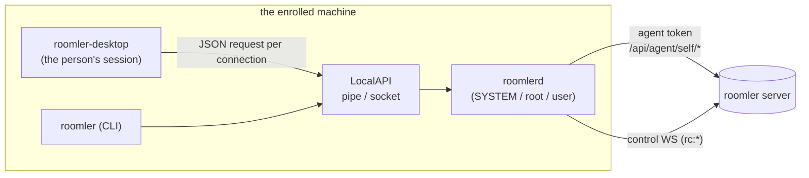

⚠️ The LocalAPI is the trust boundary. On Windows its SDDL grants **SYSTEM, Administrators
and the daemon's own account** in full and **Interactive Users** reading and writing data
only, at medium integrity (`crates/localapi/src/lib.rs:4021-4022`): any person logged in at
the machine can call it, but only the first three add an instance of the pipe, and a
sandboxed low-integrity process cannot call it. Everything
below that lets the companion *change* something is therefore something any interactive user
can do — which is why the device-side rules (the `files_dir` SYSTEM rule, the visibility rule
on the Devices page) are enforced in the daemon and on the server, never in the page.

## 2. The pages

Hash routes in `src/front/app.js`; one `<section id="view-*">` per page. The install matrix
(vmtest, FR-61) asserts that every `#view-<name>` renders — keep those ids.

| Page | Route | What it shows | Data (LocalAPI) | Refresh |
|---|---|---|---|---|
| Overview | `#/overview` | this device (name, overlay IPs, server, service, versions), exit node, updates | `Status` (via the shared device view) | on the 2 s device-view tick |
| Devices | `#/devices` | the devices this machine's mesh can see: a server-side grid (search, sort, paging, column chooser) and the mesh graph — see §6 | `Devices` / `Mesh` (daemon-proxied), live connection cells from `Peers` | list 30 s and mesh 60 s while visible; peers 2 s |
| Recordings | `#/recordings` | local and remote screen recordings (FR-85) | FR-85's verbs | on entry |
| Routes | `#/tunnels` | declared routes (`[[tunnel_routes]]`) and live forwards, with add / edit / enable / disable / remove | `RouteList` + `Flows` on **one** connection; `RouteAdd` / `RouteUpdate` / `RouteSetEnabled` / `RouteRemove` | 2 s while visible |
| Settings | `#/settings` | the config surface, grouped (§5); device name; service; the log | `ConfigGet` / `ConfigSet`, `SetDeviceName`, `TailLog` | on entry |
| Onboarding | `#/onboarding` | enrol (server, name, token) or re-enrol | in-process enrolment | — |
| Welcome | `#/welcome` | the first-run tour — see §10 | `Status`, `ConfigSet`, `RestartDaemon`, the files commands | while a step waits |

## 3. The LocalAPI, and why the Routes page used to blink

Every companion request opens the pipe **fresh**, sends one JSON request (or a short batch
on one connection) and closes. Five things poll it at once in a running companion:

| Poller | Where | Interval | Connections per tick |
|---|---|---|---|
| service status | `src/front/app.js:166` | 10 s | 0 (reads config, runs `roomlerd service status`) |
| device view (`Status` + `Peers`) | `src/front/app.js:168` → `cmd_device_view`, `src/commands.rs:323` | 2 s | 1 |
| Routes (`RouteList` + `Flows`) | `src/front/tunnels.js:512` → `cmd_tunnels_view`, `src/commands.rs:2181` | 2 s, visible only | 1 |
| consent (in-window) | `src/front/consent.js:157` | 1.5 s | 1 |
| consent watcher (Rust) | `src/main.rs` | 750 ms | 1 |

**What went wrong (field, 2026-09-25):** the Routes page's tables appeared and disappeared
every few seconds while the daemon's data was steady. Three raw back-to-back opens of the
pipe — exactly what the Rust client does — failed the 2nd open with `ERROR_PIPE_BUSY` (231)
**60 of 60 times**: the server kept **one** listening instance and created the next only
after `connect()` returned. The companion opened three connections in the same millisecond
every 2 s; the client retried once after 50 ms; and the two Routes commands turned the
loser's error into an empty list, which the page painted as "no routes".

⚠️ A .NET `NamedPipeClientStream.Connect(0)` probe of the same pipe reported 90/90 OK — it
calls `WaitNamedPipe` first, and `0` there means the server's *default* wait (50 ms). A
probe that waits cannot see a gap a non-waiting client falls into.

**The fix, in three layers:**

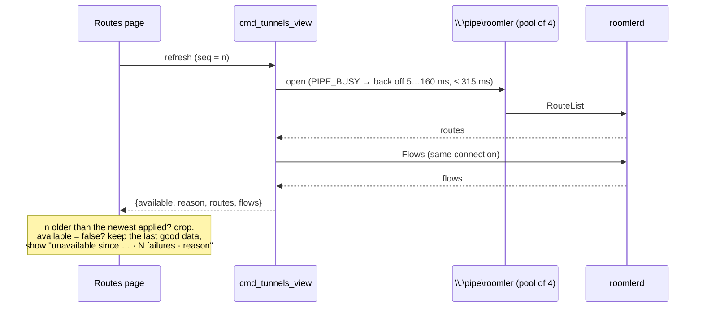

1. **The page never paints an error as data.** `cmd_tunnels_view` answers
   `{available, reason, routes, flows}` from one connection; `tunnels.js` keeps the last good
   data on a failure and says why (`noteUnavailable`, `src/front/tunnels.js:98`), drops a
   response older than the newest it applied, and patches rows in place keyed by route id /
   flow id (`routeRows`, `:48`) so a button never moves under the cursor. Refresh failures
   are also written to the companion's own log (`src/desktop_log.rs`, capped at 2 MiB,
   one rolled generation).
2. **The pipe always has a spare.** `serve_windows_at` (`crates/localapi/src/lib.rs:4121`)
   binds the first instance (retrying while another process holds the name), then runs a
   pool of accept tasks (`accept_pipe`, `:4235`), each owning one listening instance and
   re-creating it before handing a connected one off. Default 4
   (`DEFAULT_PIPE_POOL`, `:3974`); config `localapi_pipe_pool` (1–16) — **`1` is the kill
   switch** and reproduces the old single-instance behaviour.
3. **The client backs off instead of giving up.** `pipe_busy_backoff` (`:5218`) retries a
   busy pipe at 5, 10, 20, 40, 80, 160 ms (≤ 315 ms in total); any other error (the daemon
   is not running) returns at once.

A route can now be **edited** in place: `RouteUpdate` replaces the descriptor in one save
under the config write lock and restarts its flow; an invalid replacement is refused and the
old route keeps running (`agents/roomlerd/src/tunnel/route_reconciler.rs:437`). A daemon
that predates the verb answers "bad request", which the companion shows as *"The device
service predates route editing"* (`src/commands.rs:2232`), never as a blank page.

⚠️ A route whose edit keeps the **same local port** restarts its listener on that port. If
the old listener is still held (the #1035 class — a listener outliving the flow that owned
it), the new flow retries on its backoff until the port frees.

**A route's state is the port's truth (#1685).** `active` is shown only once the route's
tunnel session is up and its local listener is **bound** — the daemon flips it from the bind
itself (`tunnel_core::driver::ListeningHook`), not from `rc:tunnel.opened`, which the server
also answers for a node whose data plane then fails to come up. Until then the page shows
`connecting` (first attempt in flight) or `retrying (N, next in Ss) — <last error>` (the
session failed N times in a row), and appends `· device offline` when the Devices data
already knows the target is offline. Field, 2026-09-25: three routes to an offline laptop
read `active` with nothing listening while the daemon log looped `tunnel session failed;
retrying`. The wire keeps its state words and adds fields (`flow_id`, `attempts`), so a
companion older than the fix shows those routes as `pending` / `retrying in Ss: <error>`
rather than losing the page to a tag it cannot parse; a companion from the fix on shows a
state word it does not know (a newer daemon) as that word, never as an error
(`stateLabel`, `src/front/tunnels.js`).

## 4. Polling rules every page follows

- **Poll only while visible.** A page's own timer runs only while its view is the current
  one; re-entering a view never stacks a second timer. The one exception is the shared
  device view (2 s), which the sidebar status dot and the Overview both read.
- **One connection per refresh.** A page that needs two answers asks for both on one
  connection (`cmd_device_view`, `cmd_tunnels_view`).
- **Stale-while-error.** A failed refresh never replaces data with an empty state; it keeps
  the last good data and says how long it has been stale and why.
- **A sequence guard.** A response older than the newest applied is dropped.
- **Keyed rows.** Rows are patched in place by a stable key; `replaceChildren` on every tick
  destroys focus, hover and in-flight clicks.

## 5. Settings, grouped

The config surface (`crates/agent-core/src/config_surface.rs`) is one table of
`KeyMeta { key, kind, group, tier, live, description }` (`:268`) — adding a key without
saying which group and tier it belongs to, and whether the daemon applies it live, does not
compile.

| Group | Example keys | Default state |
|---|---|---|
| **Essentials** (every `tier = essential` key, shown first) | `overlay_enabled`, `auto_grant_session`, `exec_enabled`, `remote_config_enabled`, `ssh_enabled`, `encoder_preference`, `power_policy`, `auto_update` | **open** |
| Access & consent · Private network · Network carriers & relays · Routing & adapter · Tunnels & SOCKS · Roomler SSH · Remote desktop · Capture & input · Video encoding · Video rate & latency · Files · Device & service | the other ~140 keys | collapsed |

- **`restart_required` is per key.** `live = true` only where the daemon really applies a
  change at once — `exec_enabled` and `remote_config_enabled` (the LocalAPI `ConfigSet`
  re-seeds them through `adopt_local`). Every other key is read once at startup.
- **"Modified"** compares a value with the key's built-in default, computed from a config
  that contains nothing but the identity fields (`builtin_default`, `:1481`).
- **Which daemon it edits (#2871).** `cmd_config_entries` / `cmd_config_set` go to the
  daemon `localapi::connect()` resolves — on a Mac running both halves (FR-43), the
  per-user GUI worker, whose `config.toml` is its own: FR-43 keeps the worker enrolled
  through P2. Meanwhile the Overview's network lines are the root half's (§6), so the two
  pages described different daemons and nothing said so: a person switching `ssh_enabled`
  on here changed a file the mesh node never reads (measured on 0.4.169). **Design A
  (#2871, the operator, 2026-10-25):** the root half's person socket now serves the
  configuration — the listing, with every key it will not set marked
  `read_only = "root_only"`, and `ConfigSet` of exactly the keys that are the console
  person's own call (`localapi::CONSOLE_PERSON_KEYS`, `crates/localapi/src/lib.rs:3205`;
  the device-owned gates are not among them) — and the page shows the Mac as one device:
  each row comes from, and a change goes to, the half that READS the key. The split is the
  key's group (`config_surface::Owner`, `crates/agent-core/src/config_surface.rs:212`):

  | Owner | Groups | On a two-half Mac | Examples |
  |---|---|---|---|
  | **session** — the per-user half, which serves the remote-desktop session | Remote desktop · Capture & input · Video encoding · Video rate · Files | the worker's row, edited on the worker as before | `rc_clipboard`, `privacy_mode_allowed`, `lock_on_end`, `display_match`, `peer_auth`, `keep_busy_enabled`, `record_*`, `files_dir`, `encoder_preference` |
  | **machine** — the root half, the device `roomler ssh` / `roomler exec` reach | Access & consent · Private network · Carriers · Routing · Tunnels · Roomler SSH · Device & service | the root half's row, over its person socket: editable where that socket sets the key (`external_*`), otherwise read-only with the administrator's command | `exec_enabled`, `ssh_enabled`, `remote_config_enabled`, `overlay_enabled`, `auto_grant_session`, `auto_update`, `external_access_enabled` |

  `merge_two_halves` (`agents/roomler-desktop/src/commands.rs:636`) builds the rows —
  machine-side keys from the root half's listing, in the worker's order — and
  `cmd_config_set` (`:828`) sends a machine-side key to the root half
  (`root_half_config_set_beside`, `:753`), whose answer is final: the worker's copy of
  such a key is a file the Mac's device never reads, so it is not written. The worker's
  own copies of machine keys stay reachable with `roomler config …` in a terminal, and
  the CLI's note says so. ⚠️ Two caveats the split cannot express, both P3's to dissolve:
  the root half forwards its own value of a few session knobs to the worker as a floor
  (FR-43's `WORKER_ENV_FORWARD`), and a delegated session's policies are judged by both
  halves' configs, so the worker's copy — the one this edits — can only tighten the
  root's. The banner (`cmd_config_target`, `:1185`; `two_halves_note`, `:1007`) names both
  halves' files and says which rows change here. It is shown only when the reached daemon
  says it runs unprivileged AND a root daemon of another identity answers `Status` over the
  person socket (`two_halves`, `:990`) — one daemon behind both sockets, a root daemon's
  legacy per-user bind, is not two halves. A root half older than design A still refuses
  the listing; the rows are then the worker's alone and the banner carries the #2879 words
  (`two_halves_legacy_note`, `:1028`): the root half's switches are
  `sudo roomler config set <key> <value>`.
- **A Linux system install, and a Mac with a root half alone (#2891, #2871).** There the
  daemon the page reaches runs as root and this app does not: `connect()`'s first candidate
  on Linux, `$XDG_RUNTIME_DIR/roomler.sock`, IS the root daemon's person socket (§12). Until
  #2891 the page took that socket's refusal of `ConfigGet` for a daemon that was down, fell
  back to the per-user config file — a path a system install does not have — and showed
  "Could not load the configuration" with a Retry that never helped; with a stale per-user
  file left by an earlier per-user install it would have read, and `cmd_config_set`
  written, a file no daemon reads (#2871's failure, on Linux). #2891 made a root daemon's
  refusal final for `cmd_config_entries`, `cmd_config_set` and `cmd_set_device_name`: none
  falls back to the file (`refused_by_root_daemon`,
  `agents/roomler-desktop/src/commands.rs:1141`). Since design A the same socket serves the
  listing, marked: `cmd_config_target` (`:1185`) reports `root_only` (`root_daemon_only`,
  `:1053`, pure: the reached daemon says it runs as root, this process does not, and the OS
  is not Windows, whose pipe admits interactive users to those verbs), the person's own keys
  are editable, and the rest — the device-owned gates, the network, SSH, the updater, the
  recordings folder — show the root daemon's value with "administrator's" and
  `sudo roomler config set <key> <value>`
  (`settings.js`, the `read_only` row; `root_only_note`, `:1080`). From a daemon older than
  design A the card still shows the daemon, its file (`Status.config_path`:
  `/etc/roomler/config.toml`) and the administrator's commands in place of rows
  (`root_only_legacy_note`, `:1102`).
- **The Service line on Linux and macOS (#2871).** `probe_service_state` reads the root
  daemon's own `--as-service` answer — `com.roomler.daemon: running, enabled`,
  `roomlerd.service: active, enabled` (`system_answer`, `:3386`) — as
  `service_kind = "systemDaemon"`, rendered "System daemon (root) · running". It only ever
  read Windows' `Roomler:` line before, so a supervised Mac, whose LaunchAgent FR-43 P2d
  boots out, said "not installed" while its root daemon served the mesh.
- A daemon that predates the grouping sends entries without `group`; the page falls back to
  the flat list.
- Every new agent knob is registered here (the standing rule): the `config.rs` field, the
  `KeyMeta` entry, the `current_value` / `apply` arms, and a set/echo test.

## 6. What the companion may know about other devices

The Devices page shows **the devices this machine's overlay netmap already carries, plus
itself** — never the organisation's inventory. The companion cannot sign in as a user, so the
daemon asks the server with its **agent token**:

| Route | Auth | Returns |
|---|---|---|
| `GET /api/agent/self/devices?page&per_page&q&sort&dir&kind` | agent JWT (status-checked on every use) | `VisibleDevicesPage` — rows with display name, name, OS, version, presence, overlay IP, MagicDNS, tags, reachability, `is_self`; plus `overlay` (`ok` / `no_node` / `no_network` / `unavailable`) and `acl_mode` |
| `GET /api/agent/self/mesh` | agent JWT | the web dashboard's mesh payload, restricted to the same set, with a server-computed `label` per node and `self_node_id`; `{"enabled": false}` when stats are off |

How the set is computed (`crates/api/src/routes/agent_self.rs:107`):

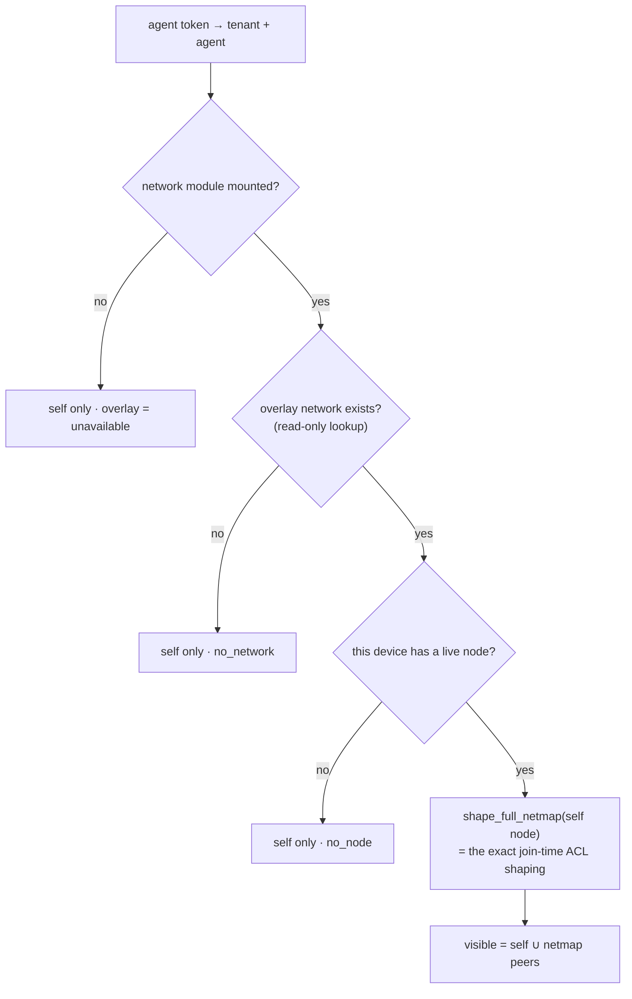

- **The same code decides both.** `shape_full_netmap`
  (`crates/modules/network/src/overlay.rs:2810`) was extracted from the overlay join and is
  what the join itself now calls, so the list can never show a peer the netmap withholds:
  ACL `off` / `warn` list every live node, `enforce` only the shaped set.
- ⚠️ **The device's node is found before any ACL read.** Loading the ACL can create the
  tenant's overlay network if it is missing; a GET must never allocate one.
- **What never leaves the server:** machine ids, owner ids, WireGuard keys and key epochs,
  consent settings, codecs. Those fields are blanked *before* search runs, so `q` cannot be
  used to probe them. Search, sort and paging are the web grid's own
  (`parse_query` / `apply_query`, `crates/api/src/routes/device.rs:295`, `:337`), so the two
  grids cannot drift.
- Proven by a negative control: with visibility taken from every live node instead of the
  shaped netmap, the enforce test leaks a withheld peer and fails
  (`crates/tests/src/agent_self_tests.rs`).

### The companion's side

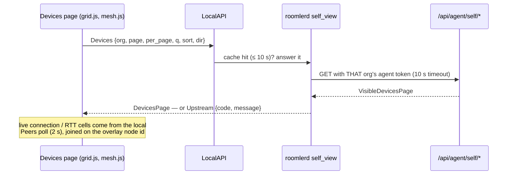

- **The daemon proxies, per org.** `agents/roomlerd/src/self_view.rs` keeps each org's server
  URL and agent token (the token is redacted from `Debug` and never logged) and asks with
  the right one. Answers are cached — 10 s for a page, 20 s for the mesh, 32 entries, one
  request in flight per key — so the companion, the CLI and re-renders share a fetch.
- **A failure has a name, never an empty list.** `Response::Upstream { code }`:
  `server_unreachable` (connect, TLS, timeout), `unauthorized` (401), `unsupported_server`
  (404 — a server older than the route), `module_unmounted` (the server's own 503),
  `rate_limited` (429), `server_error`, `unknown_org`, `org_disabled`.
- **The page.** `front/grid.js` is the web grid's model ported to plain JS: server sort keys,
  debounced search, pager, and a column chooser (show / hide, drag, ▲/▼) remembered per org
  in `localStorage`. `front/mesh.js` draws the web dashboard's ring graph in plain SVG; its
  pure helpers `front/mesh-util.js` are **generated** from `ui/src/utils/mesh.ts`, and a
  Vitest check fails when the copy is stale. The list refreshes every 30 s only while the
  view is visible (60 → 120 s back-off after an error, the last page kept on screen).
- **Older sides still work.** A daemon that predates the verbs, or a server without the
  routes, gets the pre-FR-84 peers table with a one-line note to update. `overlay:
  "no_node"` shows this device and the "private network is off" hint; ACL `enforce` with no
  visible peers says so.
- **From a terminal:** `roomler devices [--org L] [-q TEXT] [--sort KEY] [--desc]
  [--page N] [--per-page N] [--json]`.

### A two-half Mac asks its root half (FR-97 P2g)

A Mac with both halves (FR-43) is **two devices**, and only the root half is on the private
network: only root can hold a utun. The companion talks to the per-user half, whose own answer
is `no_node`, so the page listed the Mac and nothing else. The per-user half now asks the root
half for the machine's view, over a person socket the root half serves the console user:

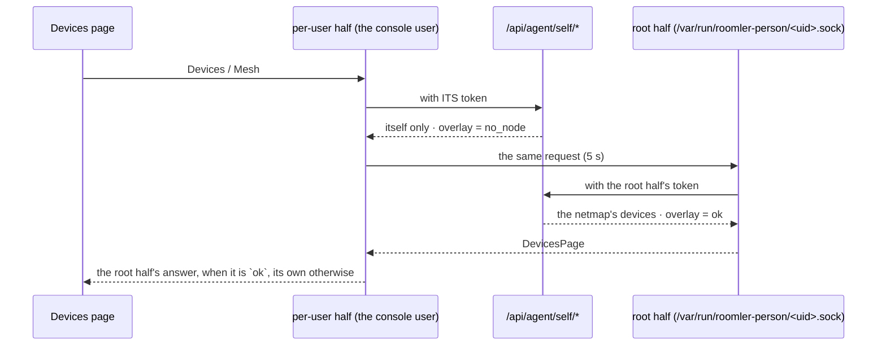

- **Only a `no_node` answer off root asks** (`person_socket::machine_view_wanted`), and only an
  `ok` answer replaces it (`machine_view_usable`). A root half that is missing, older, switched
  off (`ROOMLERD_PERSON_SOCKET=0`) or itself off the network leaves the per-user half's own
  answer on screen, as before. So does a socket served by anyone but root
  (`localapi::connect_unix_served_by_root`).
- **"This device" is the root half's row.** The per-user half's own row has no node, so the
  machine's netmap does not carry it, and it is not in the list.
- **The live view comes from the root half too (FR-97 P2h).** The Connection column and the
  Overview page read `Peers` and `Status`, which the half answered from its own overlay. It
  runs none, so before P2h a Mac showed:
  - `—` in the Connection column, with the dot falling back to the server's presence;
  - no online count and "(no overlay IP)" on Overview, with no MagicDNS or exit line.

  Both requests now pass through one async hook (`LocalApiState::status_view` /
  `peers_view`, which default to the sync reads). When the half holds no overlay address of
  its own (`person_socket::network_view_wanted`), its hook answers:
  - `Peers` with the root half's peers, as the person socket serves them: the link (online,
    direct or relayed and over what, round trip) without any endpoint;
  - `Status` with its own name, version and server link, plus the root half's overlay
    addresses, exit status and MagicDNS (`person_socket::with_machine_network`) — and, since
    #2892, **`network_from`** (`crates/localapi/src/lib.rs:197`): the root half's node id and
    name, set only when those fields were lent. Nothing on the wire said so before, and `roomler status` as the console user
    printed the root half's address as this half's, right above this half's own "overlay OFF"
    enrollments. The CLI now marks `overlay ip` / `overlay ip6` "(the root daemon's)", adds a
    `network` line naming that daemon (`sudo roomler status` asks it), and its "not on the
    mesh" line stops prescribing netstack to a half that is off the mesh by design (FR-43);
    Overview's address reads "· the root daemon's (<name>)". The field is additive and absent
    unless lent, so every other host's JSON and output are byte-identical.

  A root half that is slow to answer (1.5 s) leaves the half's own answer on screen for that
  poll.
- **What the per-user half does NOT borrow: configuration (#2871).** The per-user half
  never forwards a config verb to the root half. Since design A the COMPANION asks the root
  half's person socket itself for the machine-side rows and sends their changes there
  (§5), so the person always knows which daemon answered; the per-user half's own
  `ConfigGet` / `ConfigSet` stay its own file's. The same socket tells the companion, and
  the CLI's `config ls` / `config set` note (`localapi::other_daemon_socket`,
  `crates/localapi/src/lib.rs:5105`), that a root half exists: `/var/run/roomler` is
  `0700`, so the console user's `stat` of the root socket fails and that note had been
  silent for them.
- The root half's person socket, its directory and the uid check: §12 and the
  [security baseline](security-baseline.md) §4.

## 7. Apply now — restarting the service from the companion

Most settings are read once at startup, so saving one is not the same as applying it. The
Settings page collects the saved restart-required keys in a bar with an **Apply now** button;
`roomler restart` is the same thing from a terminal. Both send `Request::RestartDaemon`
(`crates/localapi/src/lib.rs:1736`), and **the daemon decides**.

It restarts only when it can prove that something will start it again — exiting an
unsupervised `roomlerd run` would take the device offline for good:

| How the daemon runs | How it knows (`agents/roomlerd/src/supervision.rs:193`) | Leaves with | Who starts it again |
|---|---|---|---|
| Windows service (SCM host) | the host passes `run --supervisor scm` | `0` — the host respawns 0 at once | the service host |
| Windows Scheduled Task (per-user) | the task passes `run --supervisor task` | `9` | **the caller**: the task's `IgnoreNew` policy drops a start while the old process is still exiting, so the companion / CLI runs `roomlerd service start` every 3 s until a new process answers |
| systemd | `INVOCATION_ID` **and** `/proc/self/cgroup` puts the process inside one of our units, **and** `systemctl show` says this process is the unit's main PID and its restart policy restarts exit `9` | `9` | systemd |
| launchd | `XPC_SERVICE_NAME` starts with `com.roomler.` | `9` — `KeepAlive{SuccessfulExit:false}` relaunches only a non-zero exit | launchd |
| the macOS supervisor (FR-43) | the worker's `--supervised` flag | `9` | the supervisor |
| anything else | — | **refused** | — |

`9` is `RESTART_REQUESTED_EXIT_CODE` (`agents/roomlerd/src/watchdog.rs:210`); it is outside
systemd's `RestartPreventExitStatus=7 8`, and the SCM host maps it to *respawn* as well.

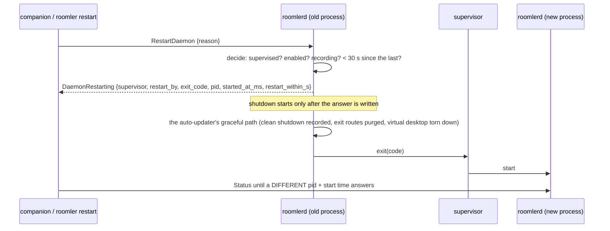

- **It is not a crash.** The restart leaves through the same internal shutdown an auto-update
  uses, so the clean shutdown is recorded and the crash / rollback accounting never sees it
  (`exit_for_requested_restart`, `agents/roomlerd/src/app.rs:2243`).
- ⚠️ **A virtual-desktop host reaps its own desktop before it exits (#1684).** On Linux the
  daemon may run a virtual desktop (Xvfb + WM + apps, `ROOMLERD_VIRTUAL_DESKTOP=1`), and under
  systemd `KillMode=control-group` whatever it spawned that outlives it — the desktop's
  setsid'd `at-spi-bus-launcher` grandchild, which **ignores SIGTERM** — keeps the unit's
  cgroup non-empty until systemd SIGKILLs it after `TimeoutStopSec` (90 s), then pays
  `RestartSec`: a `roomler restart` took **96 s**. So every graceful exit now tears the whole
  desktop tree down (`virtual_desktop::teardown`, `agents/roomlerd/src/virtual_desktop.rs`) —
  the tree is spawned into its own process group, and teardown unions the group members with
  the parent-link closure of the daemon's direct children (which reaches a setsid'd
  grandchild, since `setsid` changes the session and group but never the parent), SIGTERMs,
  waits a 2 s grace, then SIGKILLs the remainder. systemd then finds an empty cgroup and
  relaunches after `RestartSec` (~5 s). ⚠️ It SIGKILLs **as root**, so it never signals a
  recycled pid: the daemon's own children are reaped only **after the last signal** (an
  unreaped zombie keeps its pid — and, for Xvfb, the desktop's pgid — reserved), and any
  other pid is signalled only after its `/proc` **starttime** is re-read and matches the
  snapshot that selected it (`same_process`). Both rules are unit-tested against a scripted
  process table (`kill_tree_signals_everything_before_it_reaps_anything`,
  `kill_tree_never_signals_a_recycled_pid`).
- **The wait follows the supervisor.** A caller waits for the relaunched daemon at least as
  long as the supervisor says a stop + relaunch can take — under systemd,
  `TimeoutStopSec + RestartSec`, read from `systemctl show` and carried as the additive
  `restart_within_s` in `DaemonRestarting` — plus a margin, never below the 60 s floor and
  never past 10 minutes (`localapi::restart_wait`, `RESTART_WAIT_CAP`: a unit with
  `TimeoutStopSec=1h` must not make `roomler restart` hang for an hour). Before this, a fixed
  60 s wait was shorter than the supervisor's
  worst case, so the CLI reported failure on a restart that had in fact worked. `restart_within_s`
  is absent for every non-systemd supervisor and from an older daemon, where the wait stays 60 s.
- **Refusals are named and shown verbatim:** no supervisor it can prove,
  `local_restart_enabled = false` (read on every request, so turning it off applies to the
  very next one), a screen recording in progress (FR-85), a previous restart less than 30 s
  ago (`RESTART_MIN_INTERVAL`, persisted next to the config, so it also bounds a loop across
  processes), and on the macOS supervisor a worker younger than 30 s.
- **"Back" means a new process.** The companion waits for a different pid **and** start time
  (`cmd_restart_wait`, `src/commands.rs:1522`) — the leaving process keeps answering for a
  moment, and Windows can hand the relaunched daemon the old pid.
- ⚠️ **This is local only.** Remote configuration never restarts a daemon: a server push is
  persisted and reported as *applied-pending-restart*, and there is no server message that
  restarts anything (`docs/remote-config.md` §7b).

### 7.1 The macOS permission card's Restart (#3164)

macOS applies a Screen Recording grant to a freshly started process only, so a Mac's card offers
**Restart roomlerd** beside its Screen Recording row: the same flow as *Apply now*
(`window.Roomler.restartDaemon`, the LocalAPI `RestartDaemon` verb, the agent's own supervisor
relaunches it). Accessibility needs none: the agent reads it live and opens its input backend
again once it is granted.

The card shows the **agent's** grants, as the agent reports them in its status
(`NodeStatus.macos_grants`, read from its own process). Before #3164 it asked TCC about the
menu-bar app's own process, `ai.roomler.agent-tray`, which never holds either grant: the card
kept asking for both after the person had granted them to `roomlerd`, and its button registered
the menu-bar app itself in the pane, as the "Roomler" entry that changes nothing. The buttons now
only open the pane. An agent that does not report its grants (older than #3164, not running, or a
root half with no GUI session) shows no card.

macOS's own **Quit & Reopen** restarts the agent too (`agents/roomlerd/src/macos_quit.rs`): a
Quit AppleEvent from anyone but `loginwindow` ends it with the supervisor's restart code instead
of AppKit's exit 0. Up to 0.4.189 that button left the agent offline (`docs/installation.md`,
the macOS grants).

## 8. What this device can encode

The Overview's **Hardware video encoding** card is a codec × backend matrix — H.264, HEVC,
AV1 and VP9 against NVENC, QSV, AMF, VideoToolbox, VAAPI, D3D12, Vulkan, Media Foundation and
the software encoders — with the chroma each cell produced (4:2:0 / 4:4:4), denied cells
struck through, and how long the probe took.

- It asks `Request::EncoderCaps`, which answers from the probe's **cached** result only
  (`caps::cached()`, `agents/roomlerd/src/encode/caps.rs:194`). The capability probe runs in
  child processes (vendor driver code) at the first server hello; a control-surface poll
  must never be what launches it — locked by `not_probed_never_triggers_a_probe`.
- Three states: `ready` (the matrix), `not_probed` (the daemon has not connected yet — the
  card polls every 5 s while the Overview is visible, then stops), `unsupported` (a build
  with no video encoder). An older service gets a one-line "update the service" instead.
- `denied` is the effective `encoder_cells_deny` list (env, config or built-in), shown
  because a denied cell is never opened by the probe or a session, so it could not appear in
  the matrix otherwise. The resolved `encoder_preference` is shown under it.
- It is the same data `roomlerd caps` prints and the server's `AgentCaps` carries; see
  [encoders.md](encoders.md) for what a cell means and why a probe proves an open, not a
  session.

## 9. Where files dropped from a remote viewer land

The Overview's **Incoming files** card shows where a file a controller drops onto this
screen will land **right now**, with **Open folder**, **Change…** (the native folder picker,
which can create a folder) and **Use default**. The setting is `files_dir`; unset, the ladder
is the active user's Downloads, then the service's own fallback (a Windows background service
with nobody signed in refuses the file instead, §9.2; on Linux the service's own folder is never
one another account can write, §9.5; a Mac's system daemon transfers no file itself, and a
session no GUI worker serves is told why, §9.6). It is **live**: every
transfer reads the current value, so a change needs no restart.

⚠️ `files_dir` is a security control, because the daemon writing the file can be SYSTEM or
root and the LocalAPI admits any interactive user. The rules
(`crates/agent-core/src/files_dir.rs`):

| Rule | Why |
|---|---|
| Absolute, or `~\…` — expanded against the **active** user's profile when a file arrives | one machine-wide setting stays right for whoever is signed in |
| No device / kernel-namespace paths (`\\?\GLOBALROOT`, `\\.\…`), no admin or device shares, no `..` | none of those is a folder a person meant |
| No name Windows silently rewrites (a trailing dot or space, `:stream`) | `C:\Windows.\Temp` would otherwise pass the system-folder check |
| Not under the system folders (`%WINDIR%`, `%ProgramFiles%`, `/etc`, `/usr`, `/bin`, `/System`, …) | remote-supplied files must never land where the OS executes from |
| **When the writer is SYSTEM or root, inside the active user's profile — and refused when no profile is known** | otherwise a non-admin user could make SYSTEM write remote-supplied files anywhere |
| Links resolved and re-checked; an unresolvable link is refused for a privileged writer | a junction must not carry the path outside the rules |
| Creatable and writable | a folder that cannot take the file is a failed drop later |

- Checked **when set** (the daemon refuses the `ConfigSet` with the reason, which the card
  shows verbatim) **and when used** (`download_dir()` re-validates per transfer and falls back
  to the default ladder with a warning — the check that holds even if `config.toml` was
  edited by hand).
- Only the **console user** may change it through the LocalAPI: an RDP user on the same
  machine must not choose where the console user's incoming files land. A SYSTEM shell
  (`roomler exec`, SSH) can still edit the config file; the use-time check applies.
- The Status the companion shows is refreshed off the request path, so a Downloads folder
  redirected to an offline share cannot stall the 2 s poll. On a Linux system install the refresh
  also waits 1.5 s at most for who is at the screen, and shows the folder as pending until a
  lookup answers (#3796, §9.4).

### 9.1 A Linux system install writes the file as the person at the screen (FR-97 P3d)

A root daemon serves the session of whoever is at seat0, and "the active user's Downloads"
used to mean root's own ladder: with no XDG Downloads for root, the file landed in **`/tmp`,
owned `root:root`** (measured on 0.4.143, FR-97 §8). It now lands in the person's Downloads
and is **born theirs**:

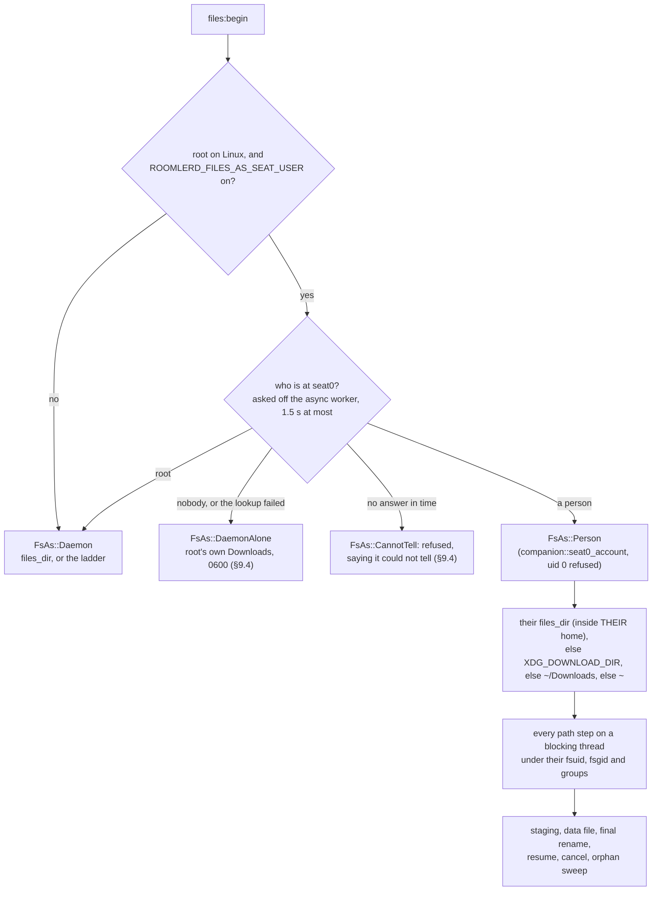

| What | Where (`agents/roomlerd/src/files.rs`) | Why |
|---|---|---|
| Who writes | `FsAs` (`:282-809`), chosen once in `begin` (`FsAs::for_write`, `:499`, off the async worker since #3711, §9.4) and carried by the transfer and by `PARTIAL_REGISTRY`'s `PartialEntry` (`:1496-1499`) | the end-time rename, a resume and a cancel act as whoever staged the partial, even after a user switch |
| How | `FsAs::run` → `crate::fs_identity::FsIdentity` (FR-85's guard, moved out of `recording`) | Linux checks every open, create and unlink against the thread's fsuid, fsgid and groups; root's bypass capabilities leave with the fsuid |
| Their folder | `person_downloads` / `xdg_download_dir` (`:1088-1121`) | `user-dirs.dirs` is the person's to write, so only a folder inside their home is taken |
| The staging | `stage_held` (`files.rs:5080`) → `staging::stage` (`agents/roomlerd/src/files/staging.rs:746`): `mkdirat` for its folders, `openat` with `O_CREAT`, `O_EXCL` and `O_NOFOLLOW` for its files | an upload's own folder (`<id>`) is never reused, and a link or a folder planted where it goes refuses the begin; the stager's own `.roomler-partial` is reused once it is made 0700, and a folder that keeps no modes stages privately (§9.5) |

⚠️ **Never as root followed by a `chown`.** In a folder the person owns, a link they planted
would be followed with root's rights, and the staging folder's `meta.json`, which a resume reads
and whose `dest_dir` the final rename trusts, is theirs to edit. Under their identity, a tampered
`meta.json` reaches nothing they could not write themselves. A root-only test
(`seat_user_tests::as_root`, run under `sudo` in CI) plants a link into a `0700 root` folder and
shows the begin refused, with a control proving root's own rights go straight through it.

⚠️ "The person" is seat0's (`companion::seat0_account`, FR-97 P5a), never whoever asked: an xrdp
session sits on no seat. With nobody at seat0, the daemon's own ladder applies, but never a folder
a controller chose, nor the configured one, and that ladder ends in root's own Downloads (#3688,
§9.5). Since #3688 downloads and browsing (the host → viewer
direction) take the same person (§9.4).

### 9.2 A Windows background-service install writes the file as the person at the screen (#3048)

The background service's worker (SystemContext) is LocalSystem in the session it serves. It used to
write a received file as LocalSystem: into a Downloads built from the person's user name, or, when
that Downloads was out of its reach (redirected to a share), into the machine's own `uploads` folder.
Either way the file was not the person's. It is now written the way §9.1 writes it on Linux: every
path step on the person's side runs as the person signed in to that session, so the file is born
theirs.

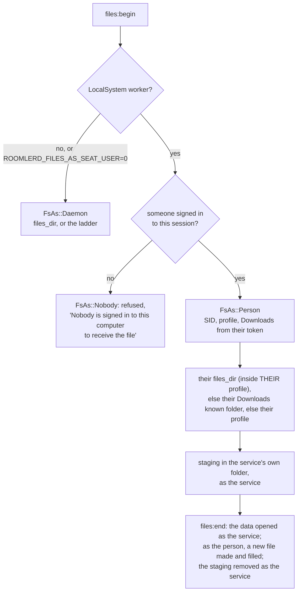

| What | Where | Why |
|---|---|---|
| Who writes | `FsAs::Person` and `FsAs::Nobody` (`agents/roomlerd/src/files.rs:282-332`), chosen by `fs_as_for` (`:418`) when the process is LocalSystem | the person is read from their token (`win_identity::session_person`, `agents/roomlerd/src/win_identity.rs:308`), never from a name, which can name another account's folder |
| How | `win_identity::as_person` (`agents/roomlerd/src/win_identity.rs:381`), on a blocking thread | it impersonates the session user's token after checking its SID is the person's; no token, another SID or a refused impersonation is an error, never a step as LocalSystem; a failed revert aborts |
| Their folder | `person_downloads_windows` (`agents/roomlerd/src/files.rs:817`) | the Downloads known folder for their token, read with `KF_FLAG_DONT_VERIFY`, local or redirected to a share: the write is theirs, made with their logon (the share is a lab read, #3048). None, or not a folder: their profile. The status card takes it as it is and probes nothing. The choice is a unit test on every OS (`person_downloads_windows_is_the_known_folder_else_the_profile`, `:8337`), and the worker's whole decision one in the Windows lane (`a_system_context_worker_takes_the_person_downloads_never_the_machine_folder`, `:10894`): never the machine-global folder |
| The staging | `stager_for` (`:2377`) | the service's own `%PROGRAMDATA%` staging, as before (rc.22); the person needs no right to it |
| The end | `place_across` (`:2931`) | no rename crosses from the service's folder into theirs, which would carry the staging file's permissions along: the data is copied into a new file the person creates, with their folder's permissions. A failed copy removes its half file and keeps the staging for a resume |
| A resume | `resume_incoming_as` (`:3182`), `PartialMeta::person_sid` (`:1541`) | the file is placed only for the person the transfer began for; for anyone else it is refused. A partial from a daemon before #3048 goes to whoever is signed in |

- **A locked screen keeps its user**, so a file sent then lands in their Downloads.
- **Nobody signed in** (before sign-in, after sign-out): the upload is refused with the reason
  above, which the viewer shows. File transfer never writes as LocalSystem.
- **The viewer says where the file landed**, by path, local or on a share: "Uploaded report.pdf
  to `\\server\share\…\Downloads`" ([`remote-control.md`](remote-control.md) §18.2).
- `files_dir` and a folder the viewer chose keep FR-84 D4's rule (inside the person's profile), and
  are checked and written as the person.
- `ROOMLERD_FILES_AS_SEAT_USER=0` keeps the service's own identity, as on Linux.
- Per-user and attended installs are unchanged: their daemon already is the person.

### 9.3 A Windows background-service install reads as the person at the screen too (#3669)

The other direction, host → viewer, is three verbs: a download (`files:get`), a folder download
(`files:get-folder`, one zip) and the drawer's listing (`files:dir`). On a background-service
install they used to run as the worker, LocalSystem. They now run as the person a write takes
(§9.2), chosen by the same function, through the same impersonation:

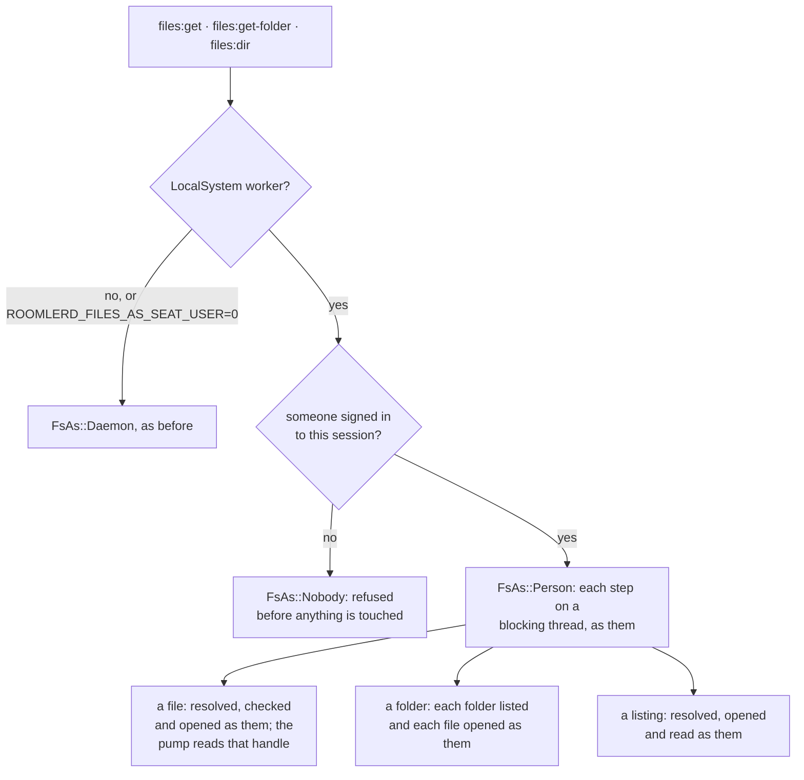

| What | Where (`agents/roomlerd/src/files.rs`) | Why |
|---|---|---|
| Who reads | `FsAs::for_read` (`:478`), one function with `FsAs::now` (`session_or_daemon`, `:538`) | a read and a write cannot take different people. The person is fixed when the request arrives, and every step asks for the session user's token again and checks its SID (`win_identity::as_person`) |
| A download | `begin_outgoing_as` (`:3542`), `open_to_send` (`:3660`) | one step resolves the path, refuses the agent's own secrets, states, caps and opens the file. Windows checks access when a handle is opened, and a handle on a share keeps the logon it was opened with, so the pump reads through it and needs no identity |
| A folder | `begin_outgoing_zip_as` (`:4252`), `walk_and_zip` (`:4333`), `zip_folder_entries` (`:4527`) | the root is resolved and opened for listing as them, so a folder they may not list is refused at the start, never sent as an empty zip. Each folder is listed, and each file opened, in its own step as them; what they may not open is left out, as an unreadable file always was. A step whose identity fails (they signed out) ends the walk with an error, never a short zip that looks complete |
| A listing | `list_dir_as` (`:4026`), `list_canonical` (`:4044`) | resolved and opened as them inside the 3 s timeout, then the entries read through that handle |

- **Nobody signed in**: a download or a folder download is refused with "Nobody is signed in to
  this computer to send the file"; the drawer, its drive list included, with "Nobody is signed in
  to this computer to browse its files". The viewer shows either.
- **A file or folder Windows refuses to open for the person** (their own rights, or a filter
  such as an EDR or DLP product, which answers with the same code) is refused, as a download or a
  listing, with "`<path>`: Windows refused to open it for the person signed in to this computer".
  Inside a folder download, an entry they may not open is left out of the zip, not refused, as an
  unreadable file always was; only a folder they may not list at all is refused.
- **A locked screen keeps its user**, so reads run as them, as writes do.
- **Another person signs in** (switch user): the console moves to their session and the service
  replaces the worker with one there, so a read takes them from then on, as a write does. A
  transfer under way ends with the old worker, and every step checks the SID it began with.
- **A Downloads folder redirected to a share** is listed and downloaded with the person's own
  logon, which the folder grants, where the computer's own account is refused. Like the write in
  §9.2, the share is a lab read, not a unit test. Its path is the one the upload message names.
- **The service's own folders** (the drawer's **Upload staging folder** button, `<staging>`,
  and the service's logs and crash dumps) are SYSTEM's and the Administrators' alone once
  sealed ([installation.md](installation.md)). A standard user may not list them, nor may an
  administrator while UAC is on (the session holds an administrator's filtered token), so the
  drawer shows the refusal. An administrator fetches those files with `roomler exec`.
- **The denylists stay**, as a second line: the registry-hive and kernel-namespace refusals of
  `validate_outgoing_path` and `is_agent_secret` run on the path the person resolved.
- `ROOMLERD_FILES_AS_SEAT_USER=0` keeps the service's own identity for reads too: one switch, both
  directions.
- **A worker that cannot read its own token** is taken for LocalSystem (`fs_as_for`,
  `agents/roomlerd/src/files.rs:418`; the token is read once, `win_identity::own_token_is_local_system`,
  `agents/roomlerd/src/win_identity.rs:62`): reads and writes then take the person, or nobody, never
  the worker itself.
- **The entry points are tested with the person**, not only their steps: a test stands the
  low-integrity person in for what `FsAs::for_read` answers (`files::stand_in`), and drives
  `files:get` (`begin_outgoing`), `files:dir` (`list_dir`) and `files:get-folder` through the task
  the viewer's request runs (`peer::outgoing_zip`). A person who signs out partway through a folder
  ends it with `files:error`, never `files:eof`.
- Per-user and attended installs and macOS are unchanged; a Linux system install takes the person at
  seat0 since #3688 (§9.4). Three small changes reach every
  install, each a unit test in `files::tests`: a folder that cannot be listed is refused when its
  download begins (`an_unlistable_folder_is_refused_when_its_download_begins`; it used to arrive
  as an empty zip), a download opens its file before its offer and checks the handle it sends, so
  one that will not open is refused at once
  (`a_file_that_will_not_open_is_refused_before_its_offer`), and a listing resolves its path off
  the async worker, inside its 3 s timeout (`a_listing_resolves_its_path_off_the_async_worker`).

### 9.4 A Linux system install reads as the person at the screen too (#3688)

On a Linux system install the daemon is root. A download (`files:get`), a folder download
(`files:get-folder`) and the drawer's listing (`files:dir`) used to run as root, while a received
file was already written as the person at seat0 (§9.1). They now take that same person, by the
same rule, and each read step also gives up the thread's capabilities:

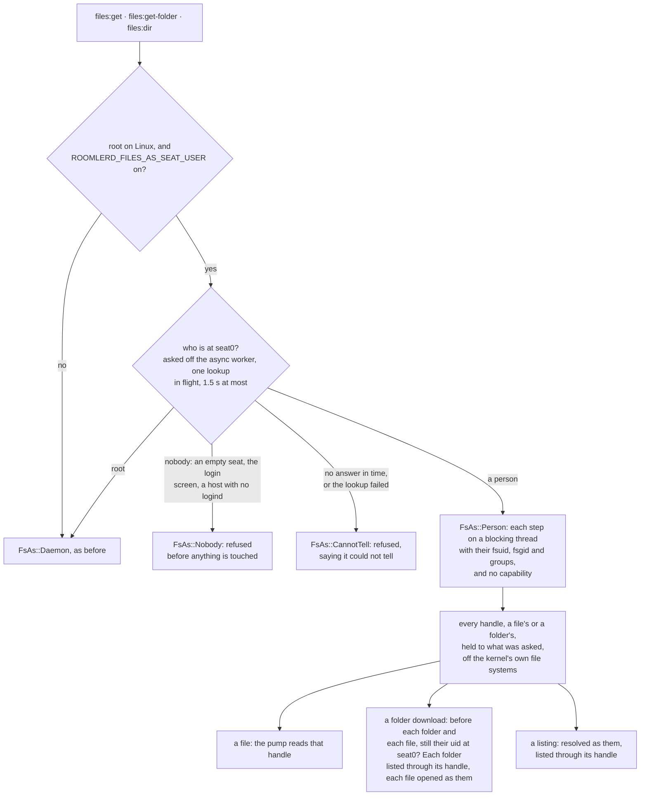

| What | Where (`agents/roomlerd/src/files.rs`) | Why |
|---|---|---|
| Who reads | `FsAs::for_read` (`:478`) → `linux_fs_as` (`:949`), the function `FsAs::now` (`:447`) asks for a write | a read and a write cannot take different people. The person is seat0's (`seat_now`, `:856`, through `companion::seat0_account`, `agents/roomlerd/src/companion.rs:2832`, FR-97 P5a's rule), fixed when the request arrives. A name that resolves to another uid than the one logind recorded for the session is nobody (`seat_of`, `files.rs:872`): that account's rights are not the person's |
| The lookup | `seat_within` (`:1059`), `SEAT_LOOKUP_WAIT` (`:1028`), `FsAs::CannotTell` (`:331`), `linux_fs_as_within` (`:1001`), one lookup in flight `SEAT0` (`:1037`, `OneInFlight`, `agents/roomlerd/src/one_in_flight.rs:72`) | logind and the account database are other processes: the lookup runs on a thread of its own, never a stalled async worker, and each caller waits for it 1.5 s. #3796 — one lookup at a time, on a thread named `seat0-lookup`: a caller who asks while one runs waits on it, within its own 1.5 s, and starts none of its own, so retries during a hang hold one thread, not one each. A caller takes only the answer of a lookup that began at or after it asked (the list below says why). A listing then waits for its own 3 s timeout, and the viewer's drawer gives up on `files:dir` after 5 s, so the two leave room inside it; `files:get` and `files:get-folder` have no timer of their own in the viewer. Only seat0's own answer is nobody (`companion::is_nobody_at_the_screen`, `agents/roomlerd/src/companion.rs:2953`), and so is a host with no logind at all, which has no seat: `loginctl` is not installed (`loginctl_did_not_start`, `companion.rs:2868`), or systemd did not boot the host (`loginctl_failed`, `:2884`). Any other lookup that fails cannot tell who is there (`Seat::CannotTell`), and one that runs out of time does not know yet (`Seat::OutOfTime`, `files.rs:850`): the read is refused with its own text either way, logged |
| A received file's lookup (#3711) | `FsAs::for_write` (`:499`), from `FilesHandler::begin` (`:2421`), `FilesHandler::resume_incoming` (`:3188`) and `sweep_orphans` (`:1760`) | the same path as a read's, with the same wait. These three asked inline on the async worker, with no time limit, so a slow account database (SSSD or LDAP refreshing a large group list) stalled that worker for as long as the lookup took, and the startup sweep, which signalling waits for, held the daemon's start as long. What a received file takes with each answer is in the list below |
| A files folder's set (#3769) | `FilesDirSet` (`files.rs:1371`): `check` (`:1385`), `saved` (`:1415`), `refresh_status` (`:1425`), from `config_set` (`agents/roomlerd/src/localapi_state.rs:1369`) | a `ConfigSet` of `files_dir` asks who a drop would be written as once, as a received file asks it, and runs §9's set-time check for and as that person before it takes the config write lock (`:1389`, the lock `:1396`). Under the lock are only the load, the change, the save and the live folder. The status answer is recomputed for the same person after the lock (`:1470`), and published only while what the set saved is still the configured value (`publish_effective`, `files.rs:1270`), so an earlier set's late answer never shows after a later set. Both checks used to ask under the lock with no time limit, so a slow logind or account database held every other config read and write behind it. What a set answers is in the list below |
| The person socket's check (#3796) | `person_socket::at_the_seat_now` (`agents/roomlerd/src/person_socket.rs:387`), its own lookup in flight `PERSON_AT_SEAT0` (`:425`), from the dispatch (`crates/localapi/src/lib.rs:3775`) | before it applies a `ConfigSet`, the person-at-the-device socket asks again whether its caller is still the person at seat0 (#2871's review). That is logind's answer, so it is asked as a received file's is: one lookup in flight (`seat0-person`), 1.5 s at most. It used to wait as long as logind took, a blocking thread for each request. With no answer in time the set is refused with "Could not tell who is signed in at this computer's screen. Try again." (`AtTheSeat::NotKnownYet`, `crates/localapi/src/lib.rs:3560`), the text a read or a received file gets then, never "the seat changed". The socket's 5 s poll, which moves it to whoever is at the seat, still asks on its own, one look at a time |
| The status answer (#3796) | `spawn_effective_refresh` (`files.rs:1311`), `refresh_effective_files_dir_as` (`:1252`), `FsAs::now` (`:447`), the read `effective_files_dir` (`:1221`) | the card's folder comes from one background refresh at a time, which asks who a drop would be written as. It asked seat0 inline, with no time limit: while a lookup hung the refresh never finished, and the card kept the folder it showed before, perhaps for a person who had left. It now asks through `SEAT0`, 1.5 s at most. With no answer in time it publishes the folder as pending (no folder, not fresh: #3769's shape), and the next status read starts another refresh, which waits on the same lookup. The status read itself answers from its cache and never waits for a lookup |
| How | `FsIdentity::begin_reading` (`agents/roomlerd/src/fs_identity.rs:233`), from `run_here` (`files.rs:739`) | §9.1's fsuid, fsgid and groups, and the thread's effective capabilities emptied for the step. An fsuid that is not 0 takes away only the file-system capabilities, and the rest would still answer for root wherever a check asks for one. The drop gives the capabilities back first (the groups' restore needs `CAP_SETGID`), then the identity, then the capabilities again, and checks all of it: a thread it cannot restore aborts the daemon |
| Exec and SSH as `console_user` (#3822) | `exec::console_account` (`agents/roomlerd/src/exec.rs:919`), `exec::console_person` (`agents/roomlerd/src/exec.rs:972`), through `ask_seat0` (`agents/roomlerd/src/files.rs:1046`) | Fleet RPC's exec, SSH's exec and shell, and SFTP find the person at the screen through the same lookup in flight, `SEAT0`, 1.5 s at most, awaited from their own task. They used to run `loginctl` inline on the async worker, with no time limit. Only `Seat::Person` is an account. No answer in time, or a lookup that failed, refuses with the try-again text; nobody and root at the screen refuse. Nothing else stands in for the person. Details: `docs/roomler-ssh.md` § `console_user` on Linux and macOS |
| The handles | `held_to_the_person` (`:4611`), `folder_held_to_the_person` (`:4623`), `folder_listing` (`:4503`), `KERNEL_FILE_SYSTEMS` (`:4585`) | inside the step, before a handle leaves it or anything is listed through it: never on one of the kernel's own file systems (procfs, sysfs, debugfs, tracefs, securityfs, efivarfs, bpf, pstore, configfs, cgroup, …: `fstatfs` on the handle, a file's or a folder's), and the kernel's own path for the handle must be the path asked for. A folder is opened first, checked so, and listed through that handle (`/proc/self/fd/N`), never through its path again. Some kernel files answer by who reads at `read()`, which the pump does as root, so the person's rights to them say nothing; and a link swapped in after the path was resolved is followed by the open, through a `/proc/<pid>/fd` link even onto a file or folder the daemon holds open |
| A folder download, the person leaves | `FsAs::still_at_the_screen` (`:688`), `seat0_active_uid` (`:904`), `walk_and_zip` (`:4347`) | before each folder is listed and before each file is opened, seat0's active uid (`ACTIVE_UID=` in `/run/systemd/seats/seat0`, logind's own record of the seat, as `sd-login` reads it) must still be the person's. Once it is not, or it does not read, the walk ends with `files:error`, never `files:eof` (§9.3's rule) |
| A received file, nobody at seat0 | `FsAs::DaemonAlone` (`:296`), `resolve_dest_path_as` (`:3796`), `FsAs::writer` (`:770`), `new_file` (`:1687`) | written as the daemon, as before, but neither a folder the controller chose nor the configured one (`files_dir`) is taken: the first is refused before it is touched, and the second is checked with no active home, so its `~` never resolves in root's. The upload lands in the default folder: FR-84 D4's rule for a privileged writer with nobody signed in (§9). Its partial and the partial's notes are created 0600 from the first byte, so the file is root's only (`root:root`, 0600), in root's own Downloads (§9.5). Nothing changes the mode after |

- **Nobody at seat0** (an empty seat, the login screen, a server or a cluster node with no session
  at all): a download or a folder download is refused with "Nobody is signed in at this computer's
  screen to send the file"; the drawer, its roots view included, with "Nobody is signed in at this
  computer's screen to browse its files". The viewer shows either. Uploads still work, into
  root's own `/root/Downloads` (§9.5), as files only root may read. The rule is the screen, not a
  sign-in: someone signed in over SSH is not at it.
- **A host with no logind at all** (no `loginctl`, or a host systemd did not boot: a container, WSL
  without systemd, a minimal VM) has no seat0, so nobody is at its screen: its reads get the texts
  above, never "Try again", and the switch below gives them back.
- **Who is at seat0 could not be told** (logind did not answer, on a host that has it; the account
  database did not answer; or the lookup took longer than 1.5 s): every read is refused
  with "Could not tell who is signed in at this computer's screen. Try again." A retry asks again.
  A lookup that ran out of time keeps going on its own thread, so the account database's own
  caches (SSSD's, nscd's) usually hold its answer by then. #3796 — that thread is the only one: a
  retry, a read or the status refresh that asks while it runs waits on it, within its own 1.5 s, and
  starts no lookup of its own. When it ends, its answer, late, is no one's, and the next caller asks
  afresh. A caller takes only the answer of a lookup that began at or after it asked: one that
  began earlier may answer for a moment that has passed. A stopped logind's D-Bus call fails after
  about 25 s, and a failed lookup leaves a received file to the daemon alone, so a caller who took
  that failure would get a write as root where its own lookup gives "Try again". An account lookup
  that stalls after logind has answered could name a person who has since left. So a caller waits
  such a lookup out, then asks a fresh one. The cost: with a slow lookup that still works, taking
  `d`, a caller who asks `e` after one began waits `(d - e) + d`. Up to `d` = 0.75 s every caller is
  answered. At `d` = 1 s a caller who asks within 0.5 s of a lookup's start gets "Try again" where
  its own lookup would have answered (`one_in_flight::tests::the_cost_a_caller_just_after_a_slow_lookup_began_waits_for_two`).
  A normal lookup takes tens of milliseconds. A received file takes one of two answers
  (#3711):
  - **No answer in 1.5 s**: the upload is refused with the same text before anything is touched,
    and the viewer shows it on the upload's row. The lookup is still running and a retry usually
    finds the person, so the file is not written for anyone else in the meantime. A resume whose
    partial the daemon still holds needs no answer and goes on; one it does not hold is refused, and
    the viewer starts that upload again. The startup sweep sweeps nothing that start.
  - **The lookup failed outright** (logind or the account database answered with an error): the
    file is the daemon's alone, as with nobody there, in root's own Downloads, 0600. Reads and
    writes differ here on purpose. A write has a safe place to go: no controller chose it, and only
    root reads what lands there, so a host whose lookup always fails (its logind masked, say) keeps
    its uploads. A read has no such place: read as root, it would send whatever root may read, so a
    read whose lookup failed is refused, as above.
- **Setting the files folder while who is at seat0 is not known** (#3769):
  - **No answer in 1.5 s**: a folder (the card's **Change…**, or `roomler config set files_dir`) is
    refused with "Could not tell who is signed in at this computer's screen. Try again." before
    anything is saved or made, and the card shows that text. **Use default** needs no one and goes
    through. Until a lookup answers, the status names no folder, so the card shows the default with
    its folder pending (`…`), never the folder just cleared. The next status read asks again, and
    the next file asks for itself.
  - **The lookup failed outright**: today's answers. The daemon writes alone with no one's profile,
    so the placement rule refuses a folder ("… no active user profile is known right now, so
    files_dir cannot be honoured"), and **Use default** shows root's own default folder (§9.5).
  - Either way nothing else waits for the lookup: a `ConfigGet`, a set of another key and the status
    answer at once.
  - Off Linux the answers are today's: a Windows service asks for the person signed in to its
    session (its token, with no time limit) on a blocking thread, now before the lock; a Mac's
    daemon asks for no one.
- **The status card while who is at seat0 is not known** (#3796): a status read (the companion's
  2 s poll, `roomler status`) answers at once, from its cache. Within 1.5 s of the refresh asking,
  the card shows the default with its folder pending (`…`), never the folder it showed before; once
  a lookup answers, the folder is back.
- **The person's own settings while who is at seat0 is not known** (#3796): a `ConfigSet` over the
  person-at-the-device socket (the companion's settings, or `roomler config set` as the person) is
  refused within 1.5 s with "Could not tell who is signed in at this computer's screen. Try
  again.", and nothing is saved. On a Mac the check is a look at `/dev/console`, which has no wait.
- **A person who leaves seat0 during a folder download** (signs out, or the login screen or another
  person takes seat0) ends it before its next file or folder with `files:error`, "the person this
  began for is no longer signed in", never `files:eof`, as on Windows (§9.3). The file being zipped
  when they left still goes.
- **A file or folder Linux refuses to open for the person** (their own rights, or an LSM such as
  AppArmor or SELinux, which answers with the same code) is refused, as a download or a listing,
  with "`<path>`: Linux refused to open it for the person signed in at this computer's screen".
  The switch covers file permissions only: SELinux and AppArmor still judge the daemon's own
  domain, so a refusal of theirs is the daemon's, which the text cannot tell from the person's.
  Inside a folder download, an entry they may not open is left out of the zip, as an unreadable
  file always was; only a folder they may not list at all is refused.
- **A kernel file system** is refused with "`<path>`: procfs is a kernel file system, which file
  transfer does not read for the person signed in at this computer's screen" (sysfs and the others
  alike), a handle that is not the file asked with "`<path>`: what opened is not the file asked
  for, so file transfer does not send it", and one that is not the folder asked with "`<path>`:
  what opened is not the folder asked for, so file transfer does not list it". Inside a folder
  download each is left out without a word: the zip ends `files:eof` without that entry.
- **A locked screen keeps its person**: GNOME and KDE lock inside the session, and seat0 still shows
  it (`companion::console_tests::a_locked_screen_keeps_its_person`). LightDM's light-locker switches
  seat0 to a greeter, which is nobody, for reads as for writes.
- **seat0's active session only**: someone signed in over SSH or xrdp, or on another seat, is never
  the one a read takes. After a user switch, a read takes whoever seat0 shows then, and nobody while
  the greeter is between them.
- **root itself at seat0** reads as the daemon: that person is root.
- **The denylists stay**, as a second line, on the path the person resolved: `validate_outgoing_path`
  and `is_agent_secret`. The agent's config is `0600 root`, so the person is refused it anyway.
- **A cost**: on a case-insensitive mount, a path asked in another case than the one it is listed in
  is refused, since the kernel names the handle as listed. Inside a folder download such an entry
  is left out without a word.
- **Writes with a person at seat0 are §9.1's, unchanged**: their steps keep the thread's
  capabilities, which the placement rule already holds to the person's own folders.
- Per-user installs (the daemon already is the person), macOS and Windows are unchanged.
- **Tested as root in CI**: `files::seat_user_tests::as_root` runs under `sudo` in the
  `rust-recorder` job with `ROOMLERD_TEST_REQUIRE_ROOT=1`, so a skip is a failure. It drives a
  download, a folder download and a listing through their entry points with the person stood in at
  seat0 (`files::stand_in::seat`), so `FsAs::for_read` itself decides who reads. It shows a read
  step holding no capability and leaving the thread as it found it (after a panic too), and
  refuses the kernel file systems to the person while the daemon reads them (the control). It
  refuses a folder swapped for a link after it resolved, whether the link leads to the daemon's own
  handle or to procfs, at the listing, a folder download's root and a folder of its walk
  (`a_folder_swapped_for_a_link_to_the_daemons_own_handle_is_not_listed`,
  `a_folder_swapped_for_a_link_to_a_kernel_file_system_is_not_listed`). It ends a folder download
  whose person leaves seat0 with `files:error`, at the next folder
  (`a_person_who_leaves_the_screen_mid_folder_ends_it_with_an_error_not_eof`) and at the next file
  (`a_person_who_leaves_the_screen_between_two_files_ends_it_at_the_next_file`), and receives a file
  with nobody at seat0 as root's, 0600, its partial included
  (`nobody_at_the_screen_receives_a_file_only_root_may_read`). It asks who a received file is written
  as at `files:begin`, `files:resume` and the startup sweep with a stood-in lookup that gives no
  answer in time, on a current-thread runtime, and sees each refused inside the wait, nothing
  touched, and the lookup on another thread than the runtime's own
  (`a_lookup_past_its_time_refuses_a_received_file_at_every_entry_point`); a lookup that answers in
  time still gives the file to the person (`a_lookup_in_time_still_receives_the_file_as_the_person`).
  It sets the files folder through a `ConfigSet` with a stood-in lookup that gives no answer in
  time, and sees the set refused inside the wait, nothing saved or made, and a `ConfigGet` asked
  meanwhile answered at once (`a_files_folder_set_whose_lookup_is_late_holds_no_config_read`); with
  a lookup in time, the folder saved and made as the person
  (`a_files_folder_set_whose_lookup_answers_in_time_is_checked_as_the_person`); with one that failed
  outright, the placement rule's refusal (`a_files_folder_set_whose_lookup_failed_keeps_todays_refusal`).
  #3796 — with a stood-in lookup held the way a stopped logind holds it, it asks three times in a
  row and four at once, and sees one lookup between them and each caller refused inside its wait
  (`retries_while_a_seat0_lookup_hangs_share_one_lookup`). It sends `ConfigSet`s over the person
  socket and sees each refused with the try-again text inside the wait, nothing saved and one
  lookup; after the release, the person's set is saved and someone else's refused in today's words
  (`the_person_sockets_seat_check_answers_within_its_wait_while_seat0_hangs`). It reads the status
  while the refresh's lookup hangs, and sees each read answered at once and the folder pending
  within the wait, never the folder from before (`a_status_read_shows_the_folder_pending_while_seat0_hangs`).
  It asks `FsAs::now()` and the set-time check from a thread of their own, and sees both told not
  known yet, never the daemon alone (`every_blocking_asker_is_told_not_known_yet_while_seat0_hangs`).
  How one lookup in flight is shared is a unit test on every OS (`one_in_flight::tests`: one lookup
  however many ask, an answer from before the question not taken, the cost, a panic that holds
  nothing), and the person socket's refusal one in `crates/localapi`
  (`a_seat_not_known_in_time_refuses_a_person_socket_set_with_try_again`).
  The decision itself (`reads_take_whom_writes_take`, `a_seat0_name_that_resolves_to_another_uid_is_nobody`),
  a lookup that cannot tell (`a_seat_that_cannot_be_told_is_not_nobody`, a received file's two
  answers included), a write's lookup past its time
  (`a_seat0_lookup_past_its_time_refuses_a_write_as_it_refuses_a_read`), a host with no logind
  (`a_host_with_no_logind_has_nobody_at_the_screen`, in `companion` too) and the lookup's wait
  (`a_listing_waits_for_the_seat_inside_the_drawers_timer`), nobody's texts, seat0's own record
  (`seat0s_active_uid_is_logind_s_own_record`), the handle checks, and the default folder with nobody
  at seat0 (`nobody_at_the_screen_takes_no_folder_a_controller_chose`,
  `nobody_at_the_screen_takes_no_configured_folder_either`), and a files folder's set with no one
  known (`a_files_folder_set_with_no_one_known_is_refused_and_a_clear_shows_pending`) are unit tests
  on every Linux run. An earlier set's late status answer
  (`an_earlier_files_folder_sets_late_answer_is_never_published`) is one on every OS.

**A server where nobody signs in at the screen** (most servers, cluster nodes, containers, WSL)
loses the drawer and downloads to this rule. Its administrator gives them back on that one machine
with a drop-in for the service:

```bash
sudo mkdir -p /etc/systemd/system/roomlerd.service.d
printf '[Service]\nEnvironment=ROOMLERD_FILES_AS_SEAT_USER=0\n' \
  | sudo tee /etc/systemd/system/roomlerd.service.d/files-as-the-service.conf
sudo systemctl daemon-reload
sudo systemctl restart roomlerd.service   # ends the sessions under way
```

- **What it sets**: `ROOMLERD_FILES_AS_SEAT_USER=0` in the daemon's environment.
- **Who may write it**: root alone. The drop-in folder is root's, and remote config cannot set the
  switch: the daemon reads it from its environment and nowhere else.
- **What it gives back**: the daemon's own identity for file transfer on that machine, both
  directions. Every controller allowed file transfer there then browses, downloads and receives
  files as root.
- **To undo it**: remove the file, `sudo systemctl daemon-reload`, and restart the service.
- **A host systemd did not boot** (a container, WSL without systemd) has no service to drop it
  into: the same variable goes into the daemon's environment wherever root starts it.

### 9.5 A received file stays off folders another account can write (#3688)

On Linux, a received file is staged beside the folder it lands in, as
`<folder>/.roomler-partial/<id>/{meta.json,data}`, and renamed into place at its end. Where the
daemon's own files land (§9.4: nobody at seat0, root at it, the switch off, a per-user daemon) and
everything in that staging is now its writer's own, made so and checked so, and a transfer holds
its folders from its begin to its end. A folder on a file system that keeps no Unix owners or modes
(a FAT or exFAT disk, NTFS without permissions, WSL's drive mounts without metadata, a share mounted
with fixed modes) cannot hold a staging folder of its writer's own. An upload into it, the
person's included, stages in its writer's own private folder instead, and its end copies the file
across:

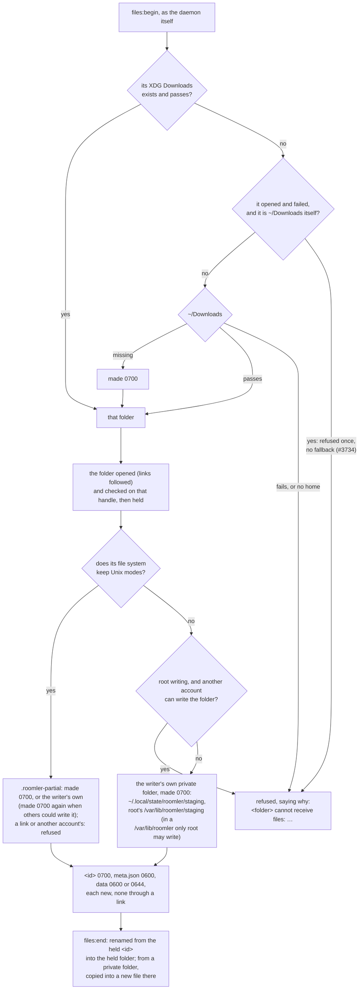

| What | Where (`agents/roomlerd/src/files.rs`, `agents/roomlerd/src/files/staging.rs`) | Why |
|---|---|---|
| The daemon's own default folder | `default_download_dir` (`files.rs:4986`), `own_home_and_downloads` (`:5299`), `account_home` (`:5155`), `may_receive` (`staging.rs:201`), `same_folder` (`:380`) | the XDG Downloads folder when it exists and passes, else `~/Downloads`, made 0700 when a file arrives (looking, for the status card, the sweep or a resume, makes nothing), else a refusal the viewer shows. An XDG folder that fails and is `~/Downloads` itself (the same device and inode, on the same mount, so a link to it counts) is that refusal at once, in the fallback's words, with no line saying `~/Downloads` is being tried: the fallback could only refuse it again for the same reason (#3734). Each is opened following its links, and the folder it leads to must be the writer's own and never the temp dir; for root, one no other account may write; for a per-user daemon, one not every account may (Ubuntu's private-group umask makes `~/Downloads` 0775), unless its file system keeps no owners or modes, where it need only be one the daemon can write into. Root's home is the one its account names (`getpwuid`), never `HOME`, and must pass root's rule itself; its `user-dirs.dirs` counts only when it is root's own plain file that nobody else may write, and only for a folder inside that home. It was the temp dir, which for root on a server is `/tmp`. The person at seat0 keeps their own folder (§9.1) |
| The folder held | `stage_held` (`files.rs:5080`), called from `begin_as` (`:2584`) with what `drop_folder_for` (`:4843`) resolved | begin opens the target folder once and holds it; whenever begin resolved the daemon's default folder, that very handle is checked again by the rule above |
| The staging, made | `open_staging` (`staging.rs:541`), `stage` (`:746`) | every folder and file with an explicit mode, whatever the umask: a per-user daemon on Ubuntu runs under 0002, and its staging still passes its own checks. A `.roomler-partial` that is a link, or another account's, is refused with a reason and left as it is; the writer's own, open to others, is made 0700 again through its handle. Another upload's end removes an empty `.roomler-partial`, and one gone between its open and the making of `<id>` in it is made and opened again. `data` is 0600 for the daemon alone (§9.4), 0644 otherwise, and is the received file itself after the rename |
| A folder that keeps no modes | `keeps_modes` (`staging.rs:296`), `writable` (`:244`), `stage_privately` (`:789`), `private_staging_root` (`files.rs:5121`), from `stage_held` (`:5110`) | whether a folder made in the target 0700, under a random name, reads back its writer's own (after one `fchmod`, made only on a folder that reads as the writer's), or exactly like the target (the same owner and permission bits: no modes kept). Anything else is no answer, and the target's owner and modes still count. A definite answer is kept per mount, file system type and writer, and nothing the probe makes stays: the startup sweep removes an empty probe folder a crash left (`sweep_probes`). Where it does not, the upload stages in its writer's own private folder, on a file system that keeps modes: `~/.local/state/roomler/staging` in the person's home, or a per-user daemon's (under `$XDG_STATE_HOME` when that is set), `/var/lib/roomler/staging` for root, in a `/var/lib/roomler` opened without following a link that is root's and no other account may write (made 0755 when absent), else that staging is refused; made 0700 and checked as `.roomler-partial` is. There a folder's owner and modes say nothing (a VirtualBox shared folder reads `root:vboxsf`, a share mounted with a fixed owner that owner), so a per-user daemon's default folder needs only to be one it can write into, as the kernel answers for it (`writable`), and receives by copy. A root writer still places only in a folder no other account may write |
| The staging, trusted | `reopen` (`staging.rs:819`), `read_notes` (`:875`), `reopen_data` (`:895`), `FilesHandler::resume_held` (`files.rs:3405`) | a resume walks the partial again from its notes' path: the folder it sits beside (links followed: that folder's own rule) or the writer's private folder, then each step below it without following a link (and without waiting on a FIFO), and trusts it only when its folder, `meta.json` and `data` are its stager's own and nobody else may write them. Anything else is "no partial state for id …", and the viewer starts that upload over. `data` is opened once and truncated on that handle |
| A root writer's resume and end | `root_may_place_in` (`files.rs:5200`), `FsAs::writes_as_root` (`:663`), from `resume_held` (`:3462`, `:3477`) and `end` (`:2826`) | the folder a partial's notes record must be one the rule gives it now, under a bare name: the default folder, its handle passing the rule; for root at the screen or the switch off, also the configured folder or a folder a controller may choose now. A partial beside a folder must record that very folder; one in root's private folder places only in a folder no other account may write. The person's partial, and a per-user daemon's, are placed where their notes say, as them (§9.1) |
| The end | `place` (`staging.rs:937`), `copy_across` (`:1009`), `discard` (`:1040`), from `end` (`files.rs:2839`) | renamed from the held `<id>` into the held folder, under a name nothing there has yet, a link counted; a folder upload's subfolders are made and opened one by one from it, and for a root writer a link among them refuses. From a private folder, or across file systems, copied through handles into a new file (`O_CREAT`, `O_EXCL`, `O_NOFOLLOW`) with the staged file's mode. A folder moved aside mid-upload, with another put in its place, changes nothing |
| Cancel and the sweep | `cancel_incoming` (`files.rs:3071`), `sweep_orphans` (`:1760`), `sweep_orphans_dir_here` (`:1905`), `sweep` (`staging.rs:1140`) | a cancel removes through the handles the transfer holds, or walks again with the same checks and removes only what passes. The startup sweep walks each drop folder's `.roomler-partial` and the writer's private folder. It registers only a partial that passes in full; removes one whose notes are missing or corrupt, and, once over a day old, the stager's own that fails the checks; and leaves a link, or anything another account owns, as it is |
| A resume's lookup | `drop_folder_without_creating` (`files.rs:5062`), from `resume_incoming_as` (`:3237`) | with nothing registered, a resume looks in the writer's private folder, then beside the folder a file would land in now, and makes nothing while it looks |

What a user notices:

- **With nobody at the screen, uploads land in `/root/Downloads`** (made 0700, root's), where they
  used to land in `/tmp`; each file is 0600, root's only (§9.4).
- **With the switch off (§9.4's drop-in) and a person at the screen**, received files sit in root's
  own 0700 folder too, out of that person's reach; before, they landed in `/tmp`, 0644.
- **A headless per-user install with no `user-dirs.dirs`** makes `~/Downloads` (0700) and receives
  there; before, it used `/tmp`.
- **A folder on a disk that keeps no Unix modes** (a FAT USB stick, a Windows drive under WSL, a
  share mounted with fixed modes) receives files: the upload stages in its writer's own private
  folder (`~/.local/state/roomler/staging`, or `/var/lib/roomler/staging` for root), and its end
  copies the file across, so the whole file must also fit where that private folder is. The sandboxed
  per-user unit may write only `~/.local/state/roomler`, so with `XDG_STATE_HOME` set elsewhere that
  staging is refused (read-only). A per-user daemon's Downloads there is not refused for reading
  world-writable; root still refuses a folder another account can write.
  Nor for reading another account's (a VirtualBox shared folder, a share mounted with a fixed owner), as
  long as the daemon can write into it ("… cannot receive files: file transfer cannot write into it").
- **A root writer's `files:end` can be refused** when its folder no longer passes the rule:
  "`<folder>` is not a folder this computer receives files into now (…), so the file is not placed
  there". The partial stays, and a resume completes the upload once the folder passes again.
- **A daemon running as root takes its home from its account**, not from `HOME`: one started by hand
  with another account's `HOME` (as `sudo -E` keeps it) receives into root's own Downloads.
  A configured folder, or one a controller chose, must then sit inside root's own home as well.
- **A default folder that cannot receive files says so**: "`<folder>` cannot receive files: another
  account can write to it" (or "it belongs to another account", "every account can write to it",
  "it is not a folder", "it could not be made (…)"). The sandboxed per-user unit
  (`ProtectHome=read-only`) can make no `~/Downloads` and says so; it could not write `/tmp` either.
- **A per-user daemon's partials from before this change** (made under umask 0002, so its group
  could write them) are refused once on resume, and that upload starts over; the sweep removes them
  after a day. Its `.roomler-partial` is made 0700 again.
- **A received file on a per-user daemon is 0644** where umask 0002 made it 0664.
- **A host whose XDG Downloads folder is configured but missing** receives into `~/Downloads`;
  before, the first upload made the XDG folder.
- **A host whose XDG Downloads folder is `~/Downloads` itself and cannot receive files** logs one
  line for a refused upload, the refusal (#3734). Before, a line first said the fallback was trying
  `~/Downloads`, the folder just refused. The viewer's message is the same as before. An XDG folder
  elsewhere still falls back to `~/Downloads` and says so.
- **A root writer's folder upload into a subfolder that is a link is refused**: "`<path>` is not a
  folder, so file transfer does not place the file there". The person's, and a per-user daemon's,
  still follow their own links with their own rights.
- macOS and Windows are unchanged: macOS's default is always `~/Downloads`, and a Windows service
  stages in the machine's own folder (§9.2).

**Tested**: `files::seat_user_tests::own_staging`, on every Linux run and again as root in the
`rust-recorder` job's sudo step (`ROOMLERD_TEST_REQUIRE_ROOT=1`). Each stands in the daemon's own
home (`stand_in::own_home`, carried by `FsAs::run` to the step's thread), so none touches a real
home, `/root/Downloads` or `/tmp`: the temp dir is never the folder
(`the_temp_dir_is_never_a_writers_folder`), the fallback is made 0700 and its writer's
(`the_fallback_folder_is_made_0700_and_owned_by_its_writer`), each writer's check on its folder
and through a link (`a_downloads_folder_is_checked_by_its_writer`), an XDG Downloads that is
`~/Downloads` itself refused once, a link to it included, while one elsewhere still falls back
(`an_xdg_downloads_that_is_downloads_itself_is_refused_once`,
`an_xdg_downloads_that_links_to_downloads_is_refused_once`,
`an_xdg_downloads_elsewhere_that_cannot_receive_still_falls_back`), the modes under any umask
(`a_partial_is_made_its_stagers_own_whatever_the_umask`), the writer's own open staging folder made
0700 (`the_writers_own_open_staging_folder_is_tightened_not_refused`), a staging folder that is a
link or another account's refused at begin and by the sweep
(`a_staging_folder_that_is_a_link_is_refused_at_begin_and_by_the_sweep`,
`a_staging_folder_another_account_owns_is_refused_at_begin_and_by_the_sweep`, root), a link at
`data` or `meta.json` and a partial others may write refused on resume
(`a_link_at_data_or_meta_json_is_refused_on_resume`,
`a_resume_of_a_partial_another_account_can_write_is_refused`), the sweep's choices
(`the_sweep_trusts_only_partials_that_are_their_stagers_own`), a root writer's resume held to the
rule's folder (`a_resume_whose_recorded_folder_is_not_the_rules_folder_is_refused`), a staging
folder moved aside mid-upload (`a_staging_folder_swapped_mid_upload_is_not_followed`) and a root
writer's folder upload through a link (`a_folder_upload_follows_no_link_for_root`). With file
systems standing in as keeping no modes (`stand_in::modes_kept`): a per-user daemon's upload
(`a_per_user_daemons_folder_that_keeps_no_modes_receives_by_copy`), the person's
(`a_persons_folder_that_keeps_no_modes_receives_by_copy`, root) and root's, which stays strict
(`root_stays_strict_where_modes_are_not_kept`, root), each staged privately, copied across, resumed
after a restart and swept; a per-user daemon's Downloads leading to a folder another account owns,
which it can write into, taken and filled by copy, and another account's it cannot write into passed
over (`a_per_user_daemons_folder_of_another_owner_keeping_no_modes_receives_by_copy`; as root, the
same folder refused). Then root's home taken from its account, never `HOME`
(`a_root_daemon_takes_its_home_from_its_account_not_its_environment`, root, with
`stand_in::env_home`), and FR-84's rule for a configured or a chosen folder judged against that home
(`a_root_daemons_configured_or_chosen_folder_is_judged_against_its_accounts_home`, root), a probe
that does not open as made answering nothing (`a_probe_that_does_not_open_as_it_was_made_answers_nothing`),
root's private staging only in root's own `/var/lib/roomler`
(`roots_private_staging_sits_only_in_roots_own_var_lib_roomler`, root), a probe folder left behind
swept (`the_sweep_removes_a_probe_folder_left_behind`), a failed copy across keeping its partial
(`a_copy_across_that_fails_keeps_its_partial`), a private partial resumed past 256 KiB
(`a_private_partial_resumes_past_256_kib`), a
`.roomler-partial` removed before the upload's own folder is made in it
(`a_begin_whose_staging_folder_goes_before_its_id_is_made_makes_it_again`), a default folder swapped
before its staging opens it (`a_default_folder_swapped_before_its_staging_is_held_to_its_rule`), a
daemon that is root placing in the configured or a chosen folder
(`a_root_daemon_places_in_the_configured_or_a_chosen_folder`, root), and an end the rule refuses,
whose partial survives it (`an_end_the_rule_refuses_keeps_its_partial_for_a_resume`). The umask
test runs again in a child process of its own under umask 0002.

### 9.6 A Mac's system install transfers files only in the person's session (#3757)

On a Mac with a system install, the root daemon holds the enrollment and hands each remote-control
session to the GUI worker it runs in the session of the person signed in at the screen (FR-43 P2b,
[remote-control.md §11.16.1](remote-control.md#11161-a-supervised-macs-delegated-sessions-fr-138-p2b)).
The session's peer, and with it every data channel, then lives in the worker, which runs as that
person: a file a viewer sends lands in their folder and is theirs, and a download or the drawer reads
with their rights, as on a per-user install. A session no worker serves has its peer in the root
daemon instead: nobody is signed in at the screen yet, or the Mac has two rows and this is its
`-daemon` row, which supervises no worker, or it is a secondary organization's session on a Mac that
is not one row (only the primary's sessions cross there). Until #3757 the root daemon served that
session's `files` channel itself, both ways. It now declines it:

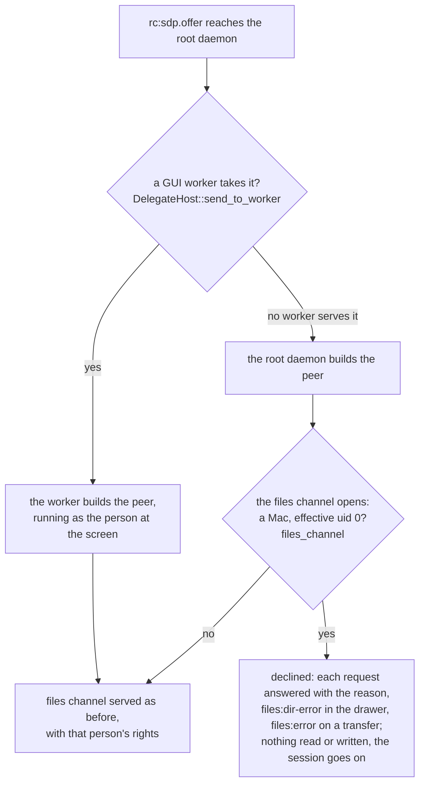

| What | Where (`agents/roomlerd/src/peer.rs`) | Why |
|---|---|---|
| The decision | `files_channel` (`agents/roomlerd/src/peer.rs:12998`), asked as the channel opens (`files_channel_here`, `:13007`, from the `"files"` arm, `:1331`) | a Mac process whose effective uid, the uid its file access runs under, is 0 declines; every other process serves. It needs no word from the delegation: a session's data channels live in its peer, an offer a worker takes builds that peer in the worker (`agents/roomlerd/src/signaling.rs:3944`), which runs as the person (the supervisor starts none for the login window, `agents/roomlerd/src/macos_supervisor.rs:1153`, and starts it with `sudo -u`), and an offer no worker takes builds it in the root daemon (`signaling.rs:4889`) |
| Mid-session | the peer stays where its offer was answered | a worker that attaches later moves no peer, so a declined channel stays declined until the session ends, and the next session is the worker's. A worker that leaves takes its own peer with it, never to the daemon. A new offer is decided again wherever it lands |
| The channel | `attach_files` (`agents/roomlerd/src/peer.rs:13033`), `attach_files_declined` (`:13056`), `declined_reply` (`:13087`) | a grant without FILES gets the FILES-denied channel first, as before. A declined one answers each request with the reason in the frame its waiter in the viewer settles on: `files:dir-error` for a listing, `files:error` for an upload, a download, a folder download, a resume, an end or a cancel; a chunk is dropped. Nothing on the host is read or written, and nothing ends the channel or the session |
| The reason | `FILES_IN_THE_PERSONS_SESSION` (`agents/roomlerd/src/peer.rs:12966`) | "File transfer on this Mac needs someone signed in at its screen and runs in their session, not in this one. Reconnect once someone is signed in, or connect to the Mac's user-session agent." |
| What stays | the device's caps (`agents/roomlerd/src/encode/caps.rs:4482`) | the row still offers file transfer: on a one-row Mac it is the row the worker serves whenever someone is signed in, and the hub puts FILES in a grant, which consent names, from these words when a session is asked. Consent, the session request and every other channel are unchanged |

What a viewer notices:

- **Before anyone signs in at the Mac's screen**, a session shows no screen, and Files shows the
  reason in the drawer and on every transfer. The session stays up. Reconnect once someone is signed
  in: the next session is the worker's.
- **On a two-row Mac's `-daemon` row** the same, whoever is signed in: the person's own row serves
  the screen and files.
- **A session that began before the person signed in** keeps its declined channel until it ends.
- **The no-screen sentence** that daemon sends (`no_display`, `agents/roomlerd/src/capture/mod.rs:754`)
  ends "Remote shell works here.", where it said file transfer worked there too.
- Windows, Linux, a per-user Mac and every session a GUI worker serves are unchanged.

**Tested**: `peer::files_channel_tests` (`agents/roomlerd/src/peer.rs:17089`), on every lane's lib
tests: the decision and its reason's words; each request's answer (`declined_reply`); and through
the router over an in-process peer pair, both peers closed after each test, a declined channel that
answers each request with the reason, leaves the folder asked about as it was and stays up
(`a_declined_channel_answers_each_request_with_the_reason_and_stays_up`), a served one that lists the
folder (`a_served_channel_keeps_the_file_transfer_handler`), and a grant without FILES that keeps its
own words (`a_session_without_files_keeps_the_not_granted_channel`). The row's offer:
`encode::caps::tests::a_macs_root_half_still_offers_file_transfer`. In the macOS job the module runs as
the runner's user and again under sudo with `ROOMLERD_TEST_REQUIRE_ROOT=1`, where the Mac's own
effective uid declines (`as_root::a_root_process_on_a_mac_declines_the_files_channel`); the step fails
unless that test ran.

## 10. Starting after install, and the Welcome flow

Every install path ends with the daemon starting, so the **daemon** opens the companion —
once per install, into the signed-in user's session, with `--first-run`
(`agents/roomlerd/src/companion/launch_once.rs`). Who does it on each platform, the login
start, the marker that makes it one-shot, and why an upgrade is *adopted* rather than
launched into are in [installation.md](installation.md) §"After install: the companion
opens". The rules that matter here:

- ⚠️ **No inherited handles.** A companion the daemon starts gets none of the daemon's
  handles: `CreateProcessW` with `bInheritHandles = FALSE`, detached, and outside the
  daemon's job object where that is allowed
  (`agents/roomlerd/src/win_service/companion_spawn.rs:98`). Before this, a companion
  spawned by a daemon worker could outlive it holding the worker's handles — the #1035
  signature, tunnel ports held by a process whose parent was already gone. A route that
  cannot bind its port for two minutes now logs who holds it.
- **Per-machine Windows launches from the service host, with the console user's own,
  non-elevated token** — never from a worker that may run elevated.
- **The companion decides what to show** (`agents/roomler-desktop/src/first_run.rs:63`):
  it reads its own arguments on the first launch too (`--first-run`, `--autostart`,
  `--view=<name>`) and a per-user `desktop-state.json` (`first_run_done`, the start-at-login
  opt-out; `crates/agent-core/src/desktop_state.rs`). A missing or unreadable file is a
  first run. Until the tour is finished or skipped it shows at every start; afterwards a
  login start stays in the tray.

**The Welcome** (`front/welcome.js`) is six steps — this device · the private network ·
who may view this screen · files you receive · start at login · done:

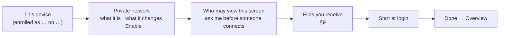

- **Enable** on the private network writes `overlay_enabled`, then uses the same restart
  flow as Settings' Apply now (`window.Roomler.restartDaemon`, `front/settings.js`) and
  waits up to a minute for the overlay address. A per-user install cannot create the
  WireGuard adapter, so it is offered **userspace mode** instead: `netstack_socks_port` on a
  free port (never a hard-coded one a declared route may already hold), explained as "apps
  reach the mesh through SOCKS5 on 127.0.0.1:<port>; remote desktop needs nothing".
- Every refusal from the daemon — Apply now's, `files_dir`'s — is shown verbatim, and a
  service too old for a step says so and points at the manual way instead.
- The tour can be reopened from the tray and from Settings.
- The whole device can opt out: `companion_autostart = false` stops the post-install launch
  and removes the Windows login start. On a multi-user server that is the switch to use —
  the machine-wide login start opens a companion in every interactive session.

### 10.1 The Linux packages (FR-93 P6d, P6e)

Before P6d the companion shipped as an x86_64 `.deb` only, so a system install on Fedora,
the RHEL family or openSUSE, and every aarch64 host (Asahi, Ampere), had no consent prompt
and no "being viewed" banner. The release now carries four Linux packages, built from the same
binary per architecture:

| | x86_64 | aarch64 |
|---|---|---|
| `.deb` (`cargo deb`) | `roomler-desktop-<v>-x86_64-unknown-linux-gnu.deb` | `roomler-desktop-<v>-aarch64-unknown-linux-gnu.deb` |
| `.rpm` (`cargo generate-rpm`) | `roomler-desktop-<v>-x86_64-unknown-linux-gnu.rpm` | `roomler-desktop-<v>-aarch64-unknown-linux-gnu.rpm` |

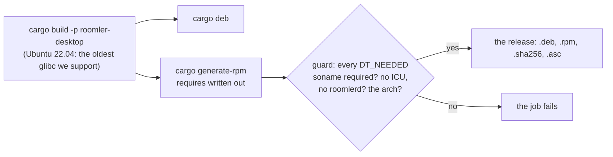

- ⚠️ **The `.rpm`'s requires are written out** in `agents/roomler-desktop/Cargo.toml`
  (`auto-req = "no"`). `cargo generate-rpm`'s discovery runs `ldd`, which names the build host's
  *transitive* libraries, Ubuntu 22.04's ICU 70 among them, and no Fedora satisfies those. The
  list is the binary's own `DT_NEEDED`, by soname (the spelling every RPM distro provides), plus
  `libayatana-appindicator3.so.1`, which the tray dlopens. A hand-kept list drifts, so the
  release job reads both back: a library the binary links that the package does not require
  fails the job.
- There is **no `roomlerd` require** in the `.rpm`: those hosts install the daemon from the
  tarball, not a package. The `.deb` keeps its `Depends: roomlerd`.
- `install.sh` picks the package by the host's tools: `dpkg` takes the `.deb`; otherwise `rpm` with
  `dnf`, `zypper` or `yum` takes the `.rpm`, and the package manager pulls webkit2gtk, GTK and the
  tray library from the distro's repositories. zypper needs `--allow-unsigned-rpm` for a local
  package; the sha256 is checked first.
- The daemon reports the installed companion's version from `dpkg-query`, else from
  `rpm -q --qf '%{VERSION}'` (`companion.rs`, `installed_version_inner`).
- Every asset is signed (`.asc`) like the daemon's. The server's daemon-first ordering
  (`agent_release::order_assets_daemon_first`) keys on the `roomler-desktop-` prefix, so an
  `.rpm` sorts after the daemon's packages too. The daemon's own picker never takes a companion
  package: it matches the daemon's `.deb` and `.tar.gz` only. From FR-117 the updater moves an
  INSTALLED companion package to the daemon's version through a picker of its own (§13).

### 10.2 The tray's start for a prompt on Linux, off the async worker (#3855)

The tray is the surface a "Prompt on host" device asks through when the daemon draws no panel of
its own (a root daemon has no display), so a consent prompt starts it when it is not running
(`ensure_running`, [`companion.rs:582`](../agents/roomlerd/src/companion.rs#L582)). On Linux that
start asks four other processes: logind for the graphical session (`loginctl`), the process list
for the person's tray (`pgrep -u`), the person's user manager for the session's environment (a
root daemon reads it as them, which looks their account up in the account database), and
systemd-run. Until #3855 the start was an async function that never awaited, so every step ran
on the async worker that polled it, for as long as the step took, and the callers' 3 s timeout
(`COMPANION_START_BUDGET`, [`signaling.rs:341`](../agents/roomlerd/src/signaling.rs#L341)) could
not fire: a future that never yields is never timed out. A stopped logind or a stalled SSSD held
that worker, and every socket and timer on it, the shape #3830 measured.

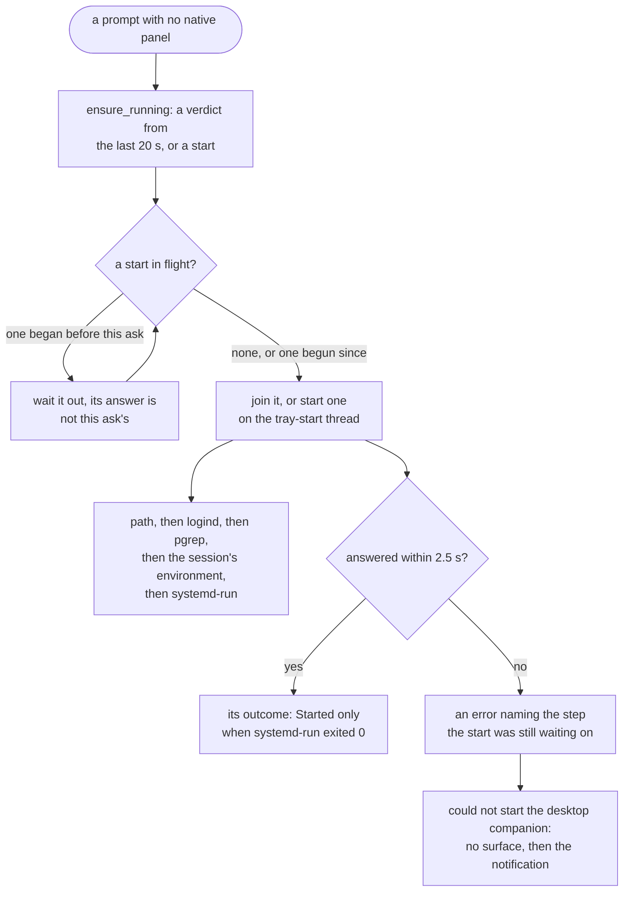

| Piece | Where | What |
|---|---|---|
| the start, off the worker | `ensure_running_inner`, [`companion.rs:1011`](../agents/roomlerd/src/companion.rs#L1011) (one for Linux, Windows and macOS since #3858, §10.4); `TrayStarts::start`, [`:1392`](../agents/roomlerd/src/companion.rs#L1392) | the prompt's task awaits the start; it never runs a step itself |
| one start in flight | `TRAY_STARTS`, [`companion.rs:1366`](../agents/roomlerd/src/companion.rs#L1366), a `one_in_flight::OneInFlight` on a thread named `tray-start` | while a step hangs, every prompt that asks waits on that one start and starts none of its own, so a hang holds one thread however often a viewer asks. A start that began before an ask is waited out, and the ask then starts afresh: the person at the screen may have changed meanwhile |
| the steps | `TraySteps`, [`companion.rs:1477`](../agents/roomlerd/src/companion.rs#L1477); `start_tray`, [`:1525`](../agents/roomlerd/src/companion.rs#L1525) | in the order the start always took them, each recorded as it begins (`TrayStep`, [`:1411`](../agents/roomlerd/src/companion.rs#L1411)). Who the tray is for (logind's active graphical session, `pgrep -u` per uid), the user manager for a per-user daemon and the system manager as the person for a root one, #2713's environment and #2729's `KillMode=process` are as before |
| the bound | `TRAY_START_WAIT`, [`companion.rs:1585`](../agents/roomlerd/src/companion.rs#L1585): 2.5 s | under the callers' 3 s, so the start's own reason lands before their fallback fires (with equal timers the hub's fallback fired first, FR-27). A start that works takes tens to a few hundred milliseconds, under half the wait, which one start in flight needs to answer an ask that comes just after another began |
| the failure | `started_in_time`, [`companion.rs:1449`](../agents/roomlerd/src/companion.rs#L1449) | a start's own failure keeps its words (`finding a graphical login session: …`, `systemd-run failed: …`); no answer in time is `the tray's start did not finish within 2.5s: it was still waiting on logind (…)`, naming the step. `ensure_running` logs either as `could not start the desktop companion` and the prompt has no surface, as for any failed start. The start goes on on its thread: if it later brings the tray up, the tray reads the `.pending` marker and shows the question |

The session's environment is read as the person through `exec::drop_to_std`, whose account lookup
is bounded too (1.5 s, `docs/roomler-ssh.md`, "The blocking callers"); a lookup that does not answer
starts the tray with logind's four variables, as any failed read always did. The environment's own
read keeps its 5 s (`stdout_bounded`), so a wedged user manager fails the prompt's wait and the
start goes on without it.

- Every caller gets the bound: the remote-control prompt on the WS loop, the exec prompt, a
  recording's and an SSH session's `Companion::up`, and the "being viewed" banner (FR-93 P6g),
  two of which had no timeout at all.
- After a failed start the remote-control prompt tries FR-93 P6f's notification, whose
  session lookup (the portal helper's `loginctl` walk) this did not bound: with logind
  stopped, the WS loop waited out `loginctl`'s own D-Bus timeout (~25 s) there. #3857 takes
  the notification off the loop and bounds the walk (§10.3).
- Tested with the steps stood in for each test's own tasks (`tray_start_tests`,
  [`companion.rs:1636`](../agents/roomlerd/src/companion.rs#L1636); rust-agent's "Test agent under
  vp9-444"): with logind, the environment or systemd-run held, a start fails within 2.5 s naming
  the step; a 10 ms timer on a two-worker runtime stays on time while prompts ask; asks at once
  and in a row share one start; and a start in time does what it always did, the argv included.
  Field cells: a paused logind during a prompt, the start after it resumes, and the control.

### 10.3 The notification fallback on Linux, off the WS loop (#3857)

Where neither the native panel nor the tray can show a remote-control question (no tray
installed, its start failed, or no marker for it to read), FR-93 P6f puts it up as a desktop
notification (`docs/remote-control.md`, "Prompt surfaces"). The session helper that posts it
runs as the person at the screen, so its start asks logind for the graphical session
(`loginctl list-sessions`, then `show-session` for each), the account database for the
person's account, and the person's session bus. Until #3857 the org's WS loop waited for all
of that inline, and the session walk had no bound: with logind stopped, every `loginctl` waits
out its D-Bus timeout, about 25 s. No async worker was held (the show ran on the blocking
pool), but that org's control channel read no frame meanwhile: another viewer's request, a live
session's ICE, a `Terminate` for this very question and Fleet RPC all waited behind it. And the
agent's `no_prompt_surface` came after the hub's own timer (5 s past the window,
`CONSENT_VERDICT_GRACE`), so the controller was told "nobody answered".

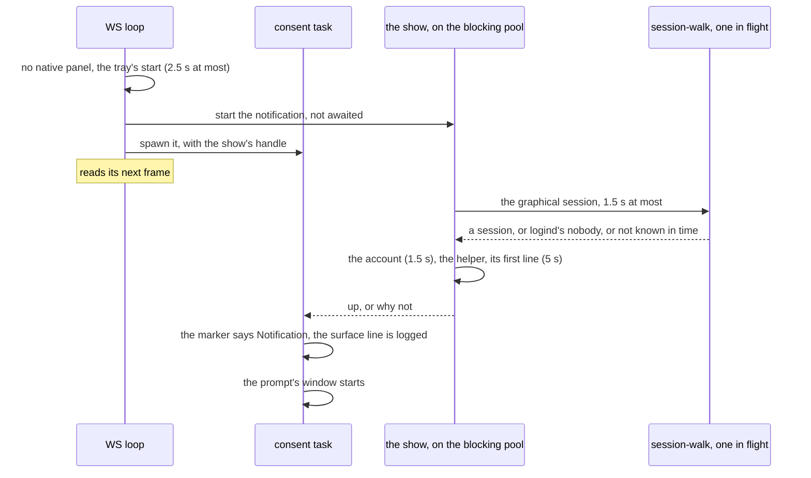

| Piece | Where | What |
|---|---|---|
| the loop's side | `notification_for_rc`, [`signaling.rs:7543`](../agents/roomlerd/src/signaling.rs#L7543); `ViewerIndicator::start_notification_prompt`, [`indicator/mod.rs:287`](../agents/roomlerd/src/indicator/mod.rs#L287) | only where the tray cannot show the question, in FR-27's order. It STARTS the show and returns: the show runs on the blocking pool as it always did, and nothing on the loop waits for it |
| the consent task | [`signaling.rs:4639`](../agents/roomlerd/src/signaling.rs#L4639); `notification_shown`, [`:7558`](../agents/roomlerd/src/signaling.rs#L7558) | waits for the show's verdict before it first looks at the prompt, so the window still starts after the show. Then it writes the marker's `Notification` and logs `consent prompt surface` (`native`, `notified`, `have_surface`), as the loop did |
| the session walk | `graphical_session_within`, [`companion.rs:5238`](../agents/roomlerd/src/companion.rs#L5238); `SESSION_WALKS`, [`:5266`](../agents/roomlerd/src/companion.rs#L5266) | one walk in flight per kind of ask (the uid asked for, and whether only a person's session will do), on a thread named `session-walk`. Each caller waits `SESSION_WALK_WAIT`, 1.5 s ([`:5222`](../agents/roomlerd/src/companion.rs#L5222)), the seat and account lookups' wait. No answer in time is "not known" with its reason (`walked_in_time`, [`:5279`](../agents/roomlerd/src/companion.rs#L5279)), never "nobody at the screen" |
| a question that ends on the way | `Prompts::coming`, [`indicator/notify.rs:338`](../agents/roomlerd/src/indicator/notify.rs#L338); `launch`, [`:479`](../agents/roomlerd/src/indicator/notify.rs#L479) | the question is on the books as coming before its show starts. `hide_prompt` (a `Terminate`, an answer from another surface, the closed socket the consent task watches) takes it off, and the show then starts no helper, or drops the one it started, whose helper closes the notification and exits. Its verdict is `its question ended while the notification was being put up`, once |

Every caller of the portal's session helper takes the walk through `helper_session`
([`capture/portal/mod.rs:1330`](../agents/roomlerd/src/capture/portal/mod.rs#L1330)), all on
blocking threads: the capture, the portal probe, the audio, keep busy, FR-95's notification
probe, the notification prompt and the being-viewed notice (FR-93 P6g). So does the recorder's
launch (`session_of`,
[`recording/launch.rs:1827`](../agents/roomlerd/src/recording/launch.rs#L1827)). A walk out of
time is `SpawnError::Other` with the reason for the helper's callers (so the capture says the
session is not known, the audio is a `backend_error`, keep busy a spawn error), and an error
naming the uid for the recorder. logind's own answer keeps its words and its kind
(`NoSession`).

- **The bounds on the consent path**, with logind stopped: the tray's start gives up at 2.5 s
  (§10.2) and the walk at 1.5 s, so the consent task hears "not up" about 4 s after the request.
  The window starts then, and the agent's `no_prompt_surface` reaches the controller about a
  second ahead of the hub's own timer. With logind answering and the session bus wedged, the
  helper's own 5 s (`SHOW_BUDGET`) still applies, and the helper is killed then, as before.
- **A late prompt: nothing comes up late.** A walk out of time starts no helper (its late
  answer reaches no one, and the next ask waits for it or walks afresh); a helper that has not
  posted within 5 s is killed; a question that ended on the way gets none. The viewer waits out
  the window and is told `no_prompt_surface`, unless someone answers on another surface (the
  CLI). The log has `no notification prompt (FR-93 P6f)` with the session and the reason, then
  `consent prompt surface … notified=false have_surface=false`.
- **Fork safety** is unchanged: the session and the account are resolved in the parent, before
  the fork, and nothing new runs in `pre_exec`.
- **Unchanged:** which surface is chosen and when, the question's words, and the tray's start
  (§10.2). While logind hangs, the tray's start holds its `tray-start` thread and the
  notification's walk its `session-walk` thread, one each however many prompts ask.
- **Tested** in rust-agent's "Test agent under vp9-444" (`portal-capture`):
  `signaling::notification_off_the_loop_tests` (a frame sent while logind holds the
  notification is handled at once, and the verdict comes within the walk's wait; a request that
  ends while its notification comes up drops it, with nothing up and one verdict; a socket that
  closes meanwhile drops it at once; prompts asking again and again delay no 10 ms timer and
  share one walk; the control keeps P6f's order), `companion::session_walk_tests` (asks at once
  and in a row share one walk, and after logind answers the next ask walks afresh; the
  control) and `capture::portal::helper::tests` (a held walk refuses the helper within its wait,
  root and per-user; the control). The recorder's in rust-recorder's "Test the recorder
  (FR-85)": `recording::launch::unix::tests` (a held walk refuses the recorder's session within
  its wait, naming the uid; the control). Field cells: a paused logind while a viewer asks, the
  next prompt after it resumes, and the control.

### 10.4 The tray's start for a prompt on Windows and macOS (#3858)

The same start runs off the async worker on Windows and macOS. Until #3858 their
`ensure_running_inner` was what §10.2 describes on Linux before #3855: an async function that never
awaited, so the process list, `CreateProcessAsUserW`, `pgrep`, `stat`, `id -u` and `launchctl` ran
on the worker that polled it, and the callers' 3 s budget could not fire. There is now one
`ensure_running_inner` for the three OSes ([`companion.rs:1011`](../agents/roomlerd/src/companion.rs#L1011)), over §10.2's start in flight (`TRAY_STARTS`,
a thread named `tray-start`), its 2.5 s wait (`TRAY_START_WAIT`) and its failure
(`started_in_time`: `the tray's start did not finish within 2.5s: it was still waiting on <step>`).
Each OS has only its own steps: `TrayStep` (what a refusal names), `TraySteps` (the seams a test
stands in, `TraySteps::real` the daemon's) and `start_tray` (the steps in the order the start always
took them, each recorded as it begins).

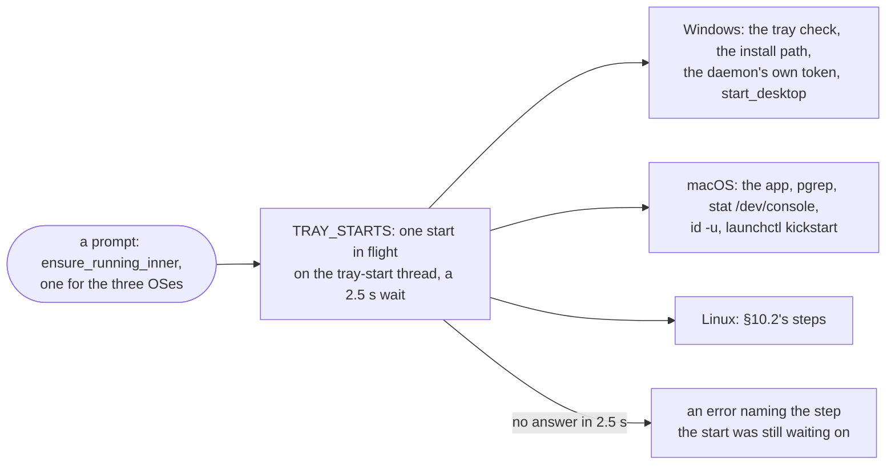

| OS | Step, in order | What runs | A refusal out of time names |
|---|---|---|---|
| Windows: `start_tray`, [`companion.rs:1109`](../agents/roomlerd/src/companion.rs#L1109); `TrayStep`, [`:1026`](../agents/roomlerd/src/companion.rs#L1026) | the tray check | `desktop_running`: `win_service::companion_procs::find`, a process snapshot, then each candidate's loaded image (#1686) | `the process list (…)` |
| | the install path | `installed_desktop`: the companion beside the daemon | `the companion's install path` |
| | the daemon's own token | `respawn_context_for_self`: is this the SYSTEM service? | `the daemon's own token (…)` |
| | the start | `start_desktop`, #3848's, with its session choice: the SYSTEM service starts the tray in the console session as its person (`WTSQueryUserToken`, `CreateEnvironmentBlock`, `CreateProcessAsUserW`), the person's own daemon a plain `CreateProcessW` in its session | `the start in the console session (…)`, or `the start in the daemon's own session (…)` |
| macOS: `start_tray`, [`companion.rs:1266`](../agents/roomlerd/src/companion.rs#L1266); `TrayStep`, [`:1183`](../agents/roomlerd/src/companion.rs#L1183) | the app | `/Applications/Roomler.app` exists | `the companion's app bundle (…)` |
| | the tray check | `pgrep -x roomler-desktop` | `the process list (pgrep)` |
| | the console's owner | `console_user_name`: `stat -f %Su /dev/console`, the way the pkg's postinstall reads it | `the console's owner (stat /dev/console)` |
| | the uid | `account_uid`: `id -u <user>`, from the account database | `the account database (id -u, …)` |
| | the start | `launchctl kickstart -k gui/<uid>/com.roomler.desktop`: launchd starts the LaunchAgent in the console user's GUI domain | `launchd (launchctl kickstart)` |

- **`Started` only when the process was created.** On Windows `started_outcome` (#3824) reads
  `start_desktop`'s answer: nobody signed in, or a refused `CreateProcessAsUserW`, is an error in its
  own words. On macOS only a `launchctl` that exited 0 is a start.
- A start's own failure keeps its words as before (`locating own exe: …`,
  `nobody is signed in at this computer's screen`, `resolving the console user: …`,
  `launchctl kickstart gui/<uid>/com.roomler.desktop failed: …`). `ensure_running` logs either kind
  as `could not start the desktop companion`, and the prompt has no surface. FR-93 P6f's
  notification (§10.3) is Linux's alone; on Windows and macOS the next surface is the CLI.
- Unchanged: who the tray is started for (the console session's person on Windows, the console's
  owner on macOS), #3848's start and session choice, the launchctl domain, the callers and their
  3 s budget, and the 20 s verdict (`ENSURE_COOLDOWN`).
- `one_in_flight` compiles on Windows for this; its per-key lookups (`OneInFlightPerKey`) stay
  Unix-only.
- Tested in `tray_start_tests` ([`companion.rs:1636`](../agents/roomlerd/src/companion.rs#L1636)), now one module for the three OSes: a shared harness
  and three tests that run on each OS against its own stood-in steps (`on_linux`, `on_windows`,
  `on_mac`): a held step fails the start within 2.5 s naming it, a 10 ms timer on a two-worker
  runtime stays on time while prompts ask, and asks at once and in a row share one start. Each OS
  keeps its control, `a_start_in_time_works_as_today` (the systemd-run argv, the start's context,
  path and arguments, the launchctl argv). Linux's tests keep their names. They run in "Windows
  agent unit tests" (the whole `--lib` suite), in the macOS job's "cargo check + test the agent's
  Mac-only units" (`companion::tray_start_tests::`), and on Linux as in §10.2. Field cells: the
  control on a per-Machine Windows lab guest and a lab Mac, and a start held there (a thread frozen
  at `CreateProcessAsUserW`, a stopped `opendirectoryd`).

## 11. Testing it

- **Unit:** `cargo test -p roomler-desktop` (the Rust side), `cargo test -p roomler-localapi
  --lib` (the pipe pool and backoff, including the back-to-back-open test that fails with 231
  on the single-instance server), `cargo test -p roomlerd --lib route_reconciler`.
- **The front without a daemon:** serve `src/front/` over loopback with a fake
  `window.__TAURI__` that answers the commands from fixtures, and drive it in a browser.
  That is how the Routes page (stale-while-error, the sequence guard, stable rows, edit) and
  the grouped Settings were verified before they shipped.
- **The install matrix:** vmtest's `desktop` check asserts every view renders on fresh
  Windows and Linux installs.

⚠️ A browser tab driven by automation can be a **background** tab (`visibilityState:
"hidden"`): timers are throttled to once a minute after a while and synthetic mouse presses
are dropped. Script clicks through the page (`element.click()`) or run timing checks right
after a reload.

## 12. The session banner and the red frame (FR-27 P9)

On macOS and Linux the companion IS the "Being viewed by …" indicator (Windows draws its own,
in the daemon, `indicator/win.rs`). P9 gives it the Windows badge's manners:

⚠️ **Only where the companion can reach its daemon.** On a Linux **system** install the
daemon's own LocalAPI is root-only (`/var/run/roomler`, 0700, and the socket 0600), and the
companion runs as the desktop user. Until FR-27 P11 it read "Service offline". There was no
banner, no Disconnect, and on Wayland no companion consent prompt (measured 2026-10-09;
#1911).

**P11 fixes it** without widening that ACL. The root daemon also serves a **person socket**
at the person's own `/run/user/<uid>/roomler.sock`, which is the path the companion already
tries first:
- it is theirs, mode 0600, and only they or root may connect (`SO_PEERCRED`);
- it follows the person signed in at the machine's own screen: logind's active session on
  `seat0`, when that session is a person's (`companion::seat0_uid`). Never a remote login,
  which sits on no seat although logind calls it active (#2871's review: the first active
  graphical session anywhere, which the socket followed before, could be an xrdp user's).
  Before it applies a config change it asks again whether that person is still at the
  seat ([security baseline](security-baseline.md) §4);
- it serves the safety surface: status, the sessions viewing the screen, their Disconnect,
  consent, the recording state and keep busy (FR-92); and, since FR-97 P2g, the Devices page
  and the mesh, read-only (§6); since P2h, the peers too, without the endpoints of either end
  or of a relay, the carrier snapshot, the path decision or the probes (`localapi::person_view`);
  since FR-85 P2e, recording: the Recordings view's start, stop, list and delete, and the
  **Stop recording** on the banner and the tray; and since #2871 (design A) the
  configuration — the listing, with every key the socket will not set marked `read_only`,
  and `ConfigSet` of exactly the keys that are the person's own call
  (`localapi::CONSOLE_PERSON_KEYS`, §5), never the device-owned gates.

Everything else on it — a config key that is not the person's own included, refused by name
with the `sudo` command — is refused with a pointer to `sudo roomler …`, so the companion's
other views show that refusal on a system install. The kill switch is
`ROOMLERD_PERSON_SOCKET=0`.

A Mac's root half serves its console user one as well (FR-97 P2g), at
`/var/run/roomler-person/<uid>.sock` in a directory only root writes: there the per-user half
is the person's own daemon already, and what it asks the root half for is the machine's
private-network view (§6).

⚠️ **A session the compositor says nothing about starts the companion** (FR-93 P6g). On
Wayland the desktop's own screen-sharing indicator (GNOME's pill, KDE's tray icon) shows for
the portal and mutter arms, but the DRM arm reads the scanout below the compositor, so neither
appears. A session that needs no prompt also never started the companion, so nothing at the
screen said anyone was watching. Now each pump, once its capture opens on DRM, starts the
companion (`companion::ensure_running`), whose banner lists every live session. Where no
companion can run, the daemon posts a notification instead: *"This screen is being viewed —
Alice is viewing this screen and can use its keyboard and mouse."*, with **Disconnect**, which
ends the session as the banner's does. The notification stays on screen (critical urgency),
comes down with the session, and stays down for that session once the person closes it.
The kill switch is `ROOMLERD_VIEWING_NOTICE=0`.
A per-user install, and a supervised Mac through its worker (FR-43), never had this problem.

⚠️ **The banner waits while the desktop's own dialog asks** (FR-93 P6h). A per-user Wayland
session that the portal must ask about (KDE's *Remote Control*, a portal's *Share screen*) is
registered the moment it connects, and the banner used to come up then. It said "Being viewed"
while nothing was shared yet. On a desktop that centres new windows, it also sat right over the
dialog the person had to answer. Measured on Plasma 6.6, its **Disconnect** sat beside the
dialog's **Approve**. Now the capture open's wait hook marks its session `asking` while that
dialog is the wait (`agents/roomlerd/src/peer.rs:5879`, `AskingMark`
`agents/roomlerd/src/rc_sessions.rs:43`). The LocalAPI row carries the mark (`asking`,
`crates/localapi/src/lib.rs:1370`), and the banner comes up only for a session that sees the
screen (`wants_banner`, `agents/roomler-desktop/src/main.rs:325`). The mark goes
when the open does, whether the dialog was approved, denied or timed out, so a dialog nobody
answers still ends with the banner. The kill switch is `ROOMLERD_BANNER_WAITS_FOR_DIALOG=0`.

⚠️ **On a system install this banner is what lets a Wayland desktop be captured by itself**
(FR-95 P2, [`linux-capture.md`](linux-capture.md) §1.2.1). With no capture key set, a root
daemon switches DRM and `uinput` on for the person's session on screen only where that
person can be told: the companion runs for them, or their session's notification server
shows buttons. That is checked live, at every capture open (`indicator::notify::can_tell`).
An installed companion that is not running does not count on its own. Without either,
nothing switches on, and the viewer's hint says so. `ROOMLERD_VIEWING_NOTICE=0` therefore
also keeps a system install's Wayland capture opt-in.

| | Behaviour | Where |
|---|---|---|
| Shown | when a session starts, for at least `FIRST_SHOW` (4 s), **without taking focus** | `panels.rs:127`, `:416` |
| Hides | 2.5 s after the pointer leaves it (`HIDE_DELAY`) | `panels.rs:54` |
| Comes back | after the pointer rests within 4 px of the top edge for 1.2 s (`TOP_ZONE`, `REVEAL_DWELL`) — the Windows badge's numbers | `panels.rs:50-52` |
| Stays | while a recording runs, this device's or a controller's (`tray::recording_now`) | `tray.rs:380` |
| Moves | by dragging its body (`data-tauri-drag-region`, unchanged) | `front/panel-viewing.html` |
| Frame | a 2 px red frame round the main screen for the whole session — four click-through strips (macOS) | `panels.rs:513` |

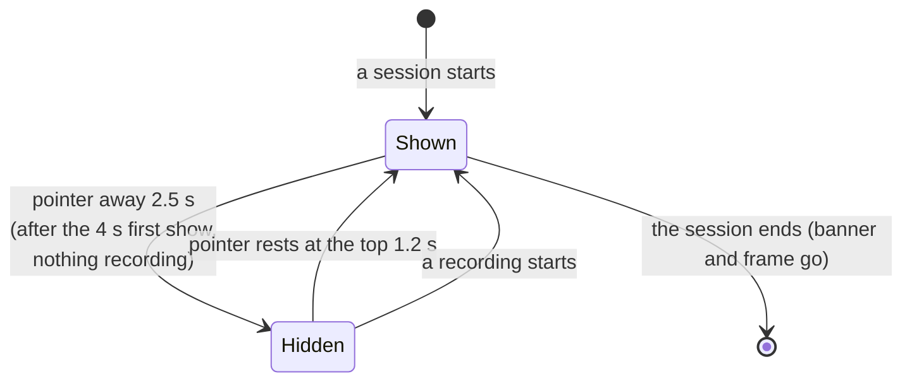

The decision is a pure state machine (`Reveal::step`, `panels.rs:274`) fed every 120 ms by a
watch thread; its six unit tests are the spec.

⚠️ **On macOS `show()` makes a window KEY**, whatever `focused(false)` said when it was built.
Every session's banner therefore took key status from the window the person was using, and
their next click into it was spent making it key again and did nothing else (measured
2026-10-06: the first click into roomler-desktop after each new session was lost). The banner
is now brought up with `orderFrontRegardless` (`show_without_focus`, `panels.rs:432`), the way
the native consent panel shows itself.

⚠️ **The pointer cannot always be read** (a Wayland session keeps it to itself, and under
Xwayland it is not trusted, §12.2). Then the banner never hides: one that tucked itself away
with no way back would be worse than one that stays.

⚠️ **Both the banner and the frame appear in the captured stream on macOS.** Our capture is
`CGDisplayStream`, which ignores `NSWindowSharingNone`; the flag is set anyway and becomes
true the day capture moves to ScreenCaptureKit (FR-27's deviations). The controller sees a red
frame round a Mac's screen during a session; that was the operator's call (2026-10-06).

Kill switches, each on its own: `ROOMLER_DESKTOP_BANNER_AUTOHIDE=0` (the banner stays, as
before P9) and `ROOMLER_DESKTOP_FRAME=0` (no frame).

### 12.1 The banner's Disconnect (FR-27 P10)

The banner's **Disconnect** ends every live session (`panel-viewing.js` sends one
LocalAPI `RcDisconnect` per session, `cmd_rc_disconnect`) — and since P10 it ends them
**for good**: control ends at the click (no more input, clipboard, files or frames),
the daemon tells the server `host_disconnect` before it closes the peer,
the viewer is told "The person at the device ended the session." and stays
disconnected, and coming back is an explicit Reconnect on the viewer's side, through
consent like any new session. Before P10 the viewer read the closed peer as an ordinary
drop and was back within ~3 s of being sent away (measured on this banner, 0.4.119,
2026-10-08). The mechanism, the ordering it relies on and the version matrix are in
`docs/remote-control.md` §11.5; the companion itself did not change — the fix is in the
daemon's arm that every Disconnect surface reaches, so the Windows badge gets it too.

On a supervised Mac the session lives in the GUI worker (FR-43), and so does the
Disconnect: the worker's `host_disconnect` rides the delegation link to the daemon's
WS, the way the session's answer did.

### 12.2 Pinned to the top on Wayland (#2286)

`position_top_centre` (`panels.rs:455`) asks for the top centre of the primary monitor.
Windows, macOS and X11 grant it. **A Wayland compositor ignores it**, because a client
cannot place its own window there. Measured on Plasma 6.6 and GNOME (2026-10-16), both put
the banner in the middle of the screen for the whole session. That is where the controller
was working, and on Linux the banner is in the captured stream too. Each desktop now gets
the one placement it allows a client (`agents/roomler-desktop/src/pin.rs`):

| Desktop | How the banner gets to the top | Where |
|---|---|---|
| **KDE Plasma** (Wayland) | A KWin script, loaded into the running KWin over D-Bus (`org.kde.kwin.Scripting`). It finds the banner by its title (`BANNER_TITLE`), puts it at the top centre of its screen, 48 px down, and keeps it above everything and out of the task switchers. It places the banner again each time it maps, because a hidden banner comes back as a new window. Nothing is written to the person's KWin configuration, and the script goes when that KWin does. | `pin.rs:120`, the script `pin.rs:82` |
| **GNOME** (Wayland) | mutter offers no placement, no layer-shell and no scripting. The companion runs under **Xwayland** instead (`GDK_BACKEND=x11`), where an X11 window places itself and stays above. It is set as `main`'s first statement: GTK reads it when it starts, and an environment variable may only be set while no other thread exists. | `pin.rs:63`, `agents/roomler-desktop/src/main.rs:53` |
| X11, Windows, macOS | Unchanged: the window places itself. | `panels.rs:455` |

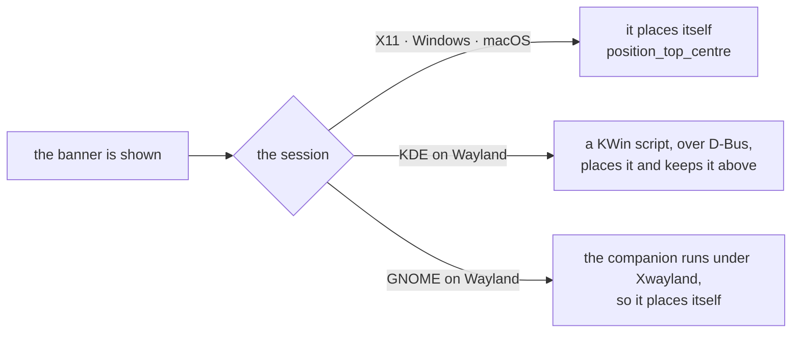

⚠️ **Under Xwayland the banner never tucks itself away.** Its pointer is known only over X11
windows. At GNOME's top bar it reads wherever it last was, so the top-edge gesture that brings
a hidden banner back would never be seen. The pointer is treated as unreadable there
(`Sample::read`, `panels.rs:220`), and an unreadable pointer keeps the banner up (§12).

⚠️ **A non-resizable GTK window takes its webview's natural height.** The banner asked for
76 px and came out 198 px tall, the rest of it empty. On Linux the panels are resizable with
min = max, which is the same fixed size without that (`panels.rs:333-339`).

⚠️ **On Linux the consent window goes in the middle, not at the top.** The daemon's own X11
consent panel holds the top centre (`agents/roomlerd/src/indicator/x11.rs`). With the
companion on Xwayland, a consent window placed there too landed right under it when both
were asking. `WebviewWindow::center` put the window's corner at the middle under Xwayland at
2×, half a window off, so the centre is computed the way the top centre is
(`position_centre`, `panels.rs:392`).

Measured on Fedora Asahi Remix 42 (an Apple M2 Pro Mac mini), 2026-10-16:

| Session | The banner | Its Disconnect | The consent window |
|---|---|---|---|
| Plasma 6.6 (KWin 6.6.4) | 360×76 at the top centre, above the other windows | ended the session (`host_disconnect`) | — |
| GNOME, at 2× | `720x152+1688+96` (360×76 logical, 48 down), still there after its first show | ended the session | centred, clear of the daemon's panel; **Approve** on each granted its own session |

The kill switch is `ROOMLER_DESKTOP_BANNER_PIN=0`. It loads no KWin script, and on GNOME the
companion stays on native Wayland.

## 13. One version: the companion follows the daemon (FR-117)

After an update a device runs one version: the daemon (`roomlerd`), the CLI (`roomler`) and the
companion (`roomler-desktop`). Each OS packages the companion differently, so each keeps it in
step differently:

| OS | How the companion ships | What moves it with the daemon |
|---|---|---|
| Windows | a standalone EXE beside the daemon, in neither MSI | `refresh_if_stale` (`agents/roomlerd/src/companion.rs:3029`): at the start of the process that owns it (#1686), and from FR-117 P2 again every 4 h (`refresh_periodically`, `companion.rs:86`), within minutes while the tray is too old to connect (§13.2), and within a minute while a tray it stopped is not running again (§13.3) |
| macOS | inside the daemon's `.pkg` (`/Applications/Roomler.app`) | the same `.pkg`: one install moves both |
| Linux | its own `.deb`, or `.rpm` (§10.1) | FR-117 P1: the root update owner moves the package (`companion/package_sync.rs`) |

The CLI needs nothing of its own: it ships inside every daemon package (the MSI's `roomler.exe`
shim, the `.pkg`, the `.deb`, and the tarball, where `usr/bin/roomler` is a required member).

**Where the release is looked up (#3818).** Windows and Linux both move the companion to the
daemon's OWN release, `agent-v<own>`. Both look that release up in the update feed on roomler.ai:
`GET /api/agent/latest-release`, or `ROOMLERD_UPDATE_URL`, the list the daemon's update check
reads. They take the exact tag from that list (`fetch_release_by_tag`,
[`agents/roomlerd/src/updater.rs:1695`](../agents/roomlerd/src/updater.rs#L1695); where each
lookup asks is `release_sources`, `:1674`). They never ask GitHub's API. Until #3818 they asked it
by tag, unauthenticated, from every device at every release. Behind a corporate network's shared
egress address, GitHub's per-address limit answered `403 Forbidden` during the agent-v0.4.218 push,
and the tray stayed a release behind until its next try, 4 h later.

| Case | What happens |
|---|---|
| the feed lists the tag | the companion's asset comes from that release. Its bytes come from the asset's URL in the list, through `download_asset`'s checks, as the daemon's own update does |
| roomler.ai cannot answer (unreachable, a 5xx, a 429) | the refresh logs `desktop companion refresh skipped` with the feed's error, and the retry tries again (§13.2). The Linux sync tries again at the updater's next tick. Neither asks GitHub |
| the feed lacks the tag | the same skip, logged as `release agent-v<own> is not in the update feed …`. The feed carries GitHub's newest page of releases (48 agent releases on 2026-11-13), so the cause is a daemon further behind than that, or a build that was never released |

**Why Linux needed it.** The companion's package is installed once, by `install.sh` or the wizard,
from a release asset. There is no apt or dnf repository, so nothing ever upgraded it. **Update
all** moved the daemon and left the companion behind, and the grid showed the skew: a Fedora
Asahi box read `v0.4.147 · desktop v0.4.139` on 2026-10-20. `refresh_if_stale` had been
Windows-only on the false premise that apt upgrades the companion.

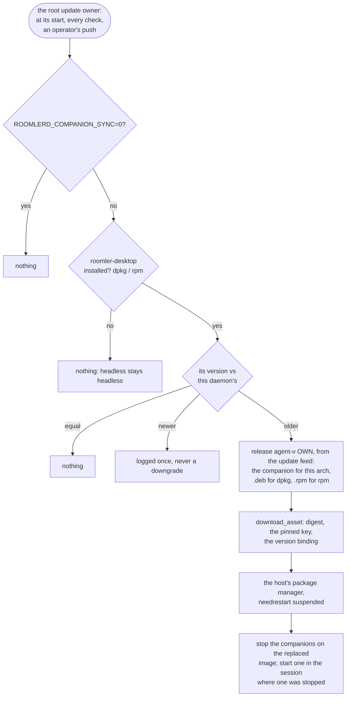

- **Who:** the process that installs updates as root on this host, so a person is never asked for
  a password. That is a system install's root daemon, or a per-user install's root update
  helper (FR-96). A per-user daemon that sees the skew wakes its helper. Mechanics:
  [linux-self-update.md](linux-self-update.md#the-desktop-companion-follows-the-daemon-fr-117).
- **What it reads:** `installed_package` (`companion.rs:759`) asks dpkg, then rpm. ⚠️ dpkg's
  answer counts only for an INSTALLED package (`dpkg_installed_version`,
  `companion/package_sync.rs:56`). `dpkg-query -W` also answers, with a version, for one that was
  removed with its config kept, and a companion a person removed must stay removed.
- **Never a downgrade, never a new install** (`plan`, `package_sync.rs:79`). A companion newer
  than the daemon is someone's deliberate install, and the next daemon update catches up. A host
  with no companion stays without one.
- ⚠️ **The picker is a positive match** on `roomler-desktop-…-unknown-linux-gnu.<deb|rpm>`
  (`pick_asset`, `package_sync.rs:103`), the mirror of the daemon picker's `is_daemon_asset`. So
  the two can never take each other's package (§10.1's freeze, one axis over).
- **A running companion is restarted** (`restart_replaced`, `package_sync.rs:412`). The package
  manager renames the new binary over the old, so a running companion's `/proc/<pid>/exe` reads
  `… (deleted)` (`is_replaced_companion`). Those are stopped, and a new one starts in the
  graphical session where one was stopped, through FR-27's `systemd_run_command`, as the Windows
  swap does (#1686). A companion that was not running stays stopped.
- **The grid catches up at once:** the sync drops `installed_version`'s 10-minute cache
  (`forget_installed_version`, `companion.rs:714`).
- **Kill switch:** `ROOMLERD_COMPANION_SYNC=0` turns off FR-117's two additions, the Linux sync and
  the Windows retry (§13.2's faster one with it). Windows' refresh at start is older and stays.

### 13.1 Checking for updates: one click from the tray (#2936)

The tray's **Check for Updates** and the Overview's **Updates** card run one routine. A tray click
shows the window at once and hands the rest to the page:

```mermaid
sequenceDiagram
    participant T as tray.rs check_updates
    participant P as overview.js
    participant C as cmd_check_update
    T->>T: show and focus the main window
    T->>P: raise the pending flag, fire roomler-tray-check-update
    P->>P: clear the flag, show "Checking for updates…" in the card
    P->>P: switch to Overview, scroll the card into view (instant), ring it once
    P->>C: invoke (off the main thread)
    Note over P: the page becomes visible: scroll again
    C-->>P: what roomlerd self-update --check-only said
    P->>P: after at least 0.7 s, the answer and "Checked at 21:45:25."
    P->>P: "Install update" when one is available, scroll again
```

| Piece | Where | Why |
|---|---|---|
| the tray's half | `check_updates`, `src/tray.rs:588` | it used to run the check on the menu thread and show the window only afterwards, at the top of Overview. So: seconds of nothing, then a result in the last card, below the fold, and people scrolled down and clicked again |
| the event and the flag | `tray_check_update_js`, `src/tray.rs:574` | the flag covers a page that is not listening yet. A test pins the event name on both sides (`the_tray_update_check_fires_what_the_overview_listens_for`) |
| one check | `runUpdateCheck`, `src/front/overview.js:184` | the card's button and the tray share it: a stale "Install update" is hidden first, the button is disabled while it runs, and a failure lands in the card |
| a check you can see | `MIN_CHECKING_MS`, `src/front/overview.js:173` | "Checking for updates…" stays up at least 0.7 s, and the answer carries the time it was asked ("Checked at 21:45:25."). On 0.4.177 an answer that came back at once read as no check at all (field, a Mac, 2026-10-26) |
| into view | `scrollToUpdates`, `src/front/overview.js:214`; `revealUpdates`, `:234` | the Updates card is the last one on Overview, and `#content` is what scrolls. The scroll is INSTANT and repeated: once the page is visible, and when the answer lands. On 0.4.177 a smooth scroll never happened on a Mac: it is driven by animation frames, and the tray runs it while the window is still coming up |
| the ring | `flashUpdates`, `src/front/overview.js:220`; `.card.flash` in `styles.css` | draws the eye to the card. A static outline instead when the OS asks for reduced motion |
| off the main thread | `cmd_check_update`, `agents/roomler-desktop/src/commands.rs:2023` | a synchronous Tauri command runs on the app's main thread, and this one waits for a spawned `roomlerd` and a network round-trip |

⚠️ **Installing stays a separate click.** The menu item says "Check for Updates", and on macOS
**Install update** queues the root update helper (FR-27).

### 13.2 A tray too old for its daemon (Windows, #3781)

From `agent-v0.4.217` the LocalAPI pipe gives an interactive user only the open a tray makes from
`agent-v0.4.216` on: reading and writing data, and nothing that adds an instance of the pipe
(#3742, #3760; the DACL is §1's trust-boundary note). A tray from before 0.4.216 opens the pipe
with `GENERIC_WRITE`. Every connect it makes is refused, and none of its pages reach the daemon.
That holds where the daemon runs elevated or as SYSTEM: a machine-wide install, unless its worker
runs as a person without administrator rights. A daemon that runs as the person owns its pipe (a
per-user install, or such a worker), so that person's old tray still connects, through the
owner's entry.

The refresh (§13's table) normally replaces the tray within seconds of the daemon's update. On
2026-11-12 every online Windows device had its tray refreshed within seconds of its 0.4.216 update.
This section is for a device whose refresh keeps failing, such as a corporate laptop whose
endpoint protection blocks the swap. Before #3760 that device kept a stale tray that still worked;
now it keeps one that cannot connect. So while the tray is that old, the daemon retries the
refresh within minutes, and `roomler status` says what is wrong.

```mermaid
flowchart TD
    W([the retry loop:<br/>one plan per wait]) --> K{ROOMLERD_COMPANION_SYNC=0?}
    K -->|yes| N[4 h, no refresh, no line]
    K -->|no| M{roomler-desktop.exe.version}
    M -->|0.4.216 or later| R[4 h]
    M -->|older, missing, unreadable,<br/>or no version in it| F[2, 5, 10, 15, 15, 15 min,<br/>then 4 h]
    F --> L[one warn line before the wait:<br/>installed, needs, next_try_in_min]
```

| Piece | Where | What |
|---|---|---|
| the floor | `MIN_COMPANION_VERSION`, `agents/roomlerd/src/companion.rs:141`; `predates_min_companion`, `:147` | `0.4.216`, the first release whose tray opens the pipe exactly (`agent-v0.4.215` was cut before #3742). It moves only with the pipe's DACL or the client's open. A marker that is missing, unreadable or names no version counts as older: nothing vouches for the open such a tray makes |
| the schedule | `next_refresh_wait`, `companion.rs:223`; `FAST_REFRESH_WAITS`, `:115`; `RefreshSchedule::next`, `:195` | keyed on the version marker. While it reads too old the waits are 2, 5, 10 and 15 minutes, then 15 to the end of the first hour, so the tries land 2, 7, 17, 32, 47 and 62 minutes after the loop starts; after that the updater's 4 h. A marker that reads current starts them over. While a tray the refresh stopped is not running again, the waits are 1, 5 and 15 minutes when those are shorter (§13.3) |
| the loop | `retry_refresh`, `companion.rs:242` | one plan per wait, so one line per wait while the tray is too old: `desktop companion is too old to connect to this daemon; its refresh is retried`, with `installed`, `needs` and `next_try_in_min`. It runs in the one refresher per install (#1686): on a machine-wide install the service host, whose log is `roomler logs --source service` |
| what status is told | `too_old_to_connect`, `companion.rs:297`; `too_old_here`, `:386` | `NodeStatus.companion_too_old` (`crates/localapi/src/lib.rs:496`), read fresh on every answer, because the service host, another process, may have just refreshed the tray. Absent means fine or not applicable, never unknown: a marker that names no version is reported without one, and a token or a file the daemon cannot read counts as reportable |
| the log the hint names | `newest_service_log`, `crates/agent-core/src/logging.rs:992` | `--source service` reads the service host's `roomlerd-service.log` alone, the newest of its daily files (#3814). It used to take whichever was newer of that and the SystemContext worker's `roomlerd.log` in the same `service-logs` folder. The busier worker's nearly always was, so the hint's own command showed none of the warn lines. The worker's log is `--source daemon`, since the worker answers the verb |
| whether the retry is off | `retry_off_where_it_runs`, `companion.rs:327`; `sync_enabled_in`, `:350`; `service_sync_enabled`, `:368` | `companion_too_old.retry_off` (#3814): `ROOMLERD_COMPANION_SYNC=0` is set where the retry runs. A daemon that runs the retry itself reads its own environment. So does the SystemContext worker: the service host starts it with the host's own environment. A worker the host starts as the person gets the person's environment, which leaves the service's `Environment` value out, so it reads that value: once a process, because a restart of the service starts a new worker. A value it cannot read, or one that does not name the switch, leaves the retry on |
| what status says | `tray_lines`, `agents/roomler-cli/src/localclient.rs:2499` | the lines below |

`roomler status` on a machine-wide install whose tray is 0.4.212:

```
  tray        OUT OF DATE: 0.4.212 cannot connect to this daemon, which needs 0.4.216 or later
              Roomler replaces it by itself, retrying every few minutes for an hour after a start, then every 4 h
              To retry now: Restart-Service Roomler (as an administrator)
              Why it failed: roomler logs --source service --grep "desktop companion"
```

- A tray whose marker is missing, or names no version, reads `version UNKNOWN (no version
  marker): one older than 0.4.216 cannot connect to this daemon`.
- A daemon that refreshes the tray itself, not the service (an elevated `roomlerd run`), names
  `restart roomlerd` and its own log instead.
- With `ROOMLERD_COMPANION_SYNC=0` set where the refresh runs, the second line reads
  `Roomler replaces it only at a start: its automatic retry is off (ROOMLERD_COMPANION_SYNC=0)`
  (#3814). The refresh at a start stays on with the switch, so the other three lines stand.
- A worker that runs as the person reads the switch from the service's `Environment` value,
  where it is documented to go. A machine-wide system variable `ROOMLERD_COMPANION_SYNC=0` also
  turns the host's retry off, but such a worker's hint keeps the retry's wording: the safe
  direction.
- The fields are additive: an older daemon sends none, an older CLI ignores them, and
  `status --json` carries them as `companion_too_old`, with `retry_off` only when it is true.
- **Kill switch:** `ROOMLERD_COMPANION_SYNC=0` turns the whole retry off, the faster one with it,
  and `status` says so.

### 13.3 The tray is stopped last, and a tray the refresh lost comes back (Windows, #3824)

The refresh replaces `roomler-desktop.exe` beside the daemon, and the person's tray usually runs
from it. Until #3824 the refresh stopped the tray first and only then renamed the EXE aside. In the
agent-v0.4.218 release lab that rename was refused (a deny for SYSTEM on the EXE; in the field a
scanner or endpoint protection can refuse it the same way). The start of the old tray then failed
as well, and the person had no tray while the log said `respawned it: true`. A later refresh that
did swap the EXE started no tray, because none was running.

From `agent-v0.4.221` the tray is stopped last, once the new EXE is in place:

```mermaid
flowchart TD
    S([a refresh pass whose marker is stale]) --> G[stage: copy the downloaded tray<br/>in as .exe.new]
    G --> A[rename the installed EXE aside,<br/>to .exe.old or the first free .exe.old.N,<br/>while the tray still runs from it]
    A --> P[rename .exe.new into place]
    P --> R[stop the running trays,<br/>found by the path they started from]
    R --> V{did every one stop?}
    V -->|no| B[the old EXE back over the new one,<br/>start what stopped, marker unchanged:<br/>the retry tries again]
    V -->|yes| W[write the marker, start what stopped,<br/>remove the copies moved aside]
    G -.->|fails| K[put back what moved:<br/>nothing stopped, the tray runs on,<br/>the retry tries again]
    A -.->|fails| K
    P -.->|fails| K
```

| Piece | Where | Why |
|---|---|---|
| the order | `swap`, `agents/roomlerd/src/companion.rs:3274`, over `SwapOps`, `:3186`; on disk `FsSwap`, `:3578` | NTFS renames a running image aside, while it refuses a delete of that file or a replace onto it (`a_running_program_is_found_by_its_started_from_path_and_stopped_by_pid`, `agents/roomlerd/src/win_service/companion_procs.rs:319`). So the rename aside and the promote both run while the tray runs, and the tray is stopped only after both worked. What refuses the rename is an ACL, a handle opened without `FILE_SHARE_DELETE` (a scanner's, #3005's err 32) or endpoint protection: each now leaves the tray running, and the retry tries again |
| a tray that would not stop | `swap`'s branch, `companion.rs:3302` | it keeps the single-instance lock, so a new tray could not take over. The old EXE goes back over the new one, which nothing runs, what was stopped is started again, and the marker stays as it was, so the retry tries again |
| a name for the copy | `free_aside_name`, `companion.rs:3550`; `ASIDE_NAMES`, `:3542`; the sweep, `FsSwap::remove_old`, `:3651`, with `is_aside_name`, `:3566` | a copy an earlier swap left that is still mapped (a tray that would not stop) or held (a scanner) refuses a delete and a replace onto it alike, and used to fail the next swap's rename. The copy now takes the first free name of `.exe.old`, `.exe.old.1` … `.exe.old.8`, and a swap that lands removes every one it can. The sweep takes nothing else: never the marker (`.exe.version`) or the staged `.exe.new` |
| the line | `refresh_line`, `companion.rs:3444`, logged by `log_refresh`, `:3127` | one renderer, tested: "respawned" only after a start that worked, and a start that failed is a warning with its error. The prefixes are the ones the lab kits read |
| the consent prompt's start | `started_outcome`, `companion.rs:1154` | FR-27's `ensure_running` was told the tray started even when its start had failed, so the prompt waited out its window for nobody. It now reports `no_prompt_surface` then |

The refresh's lines, message first, then its fields:

```
INFO desktop companion refreshed version="0.4.221" stopped=[4120] tray=respawned (pid 5236, session 1)
INFO desktop companion refreshed version="0.4.221" stopped=[] tray=none was running
WARN desktop companion refreshed, but the tray could not be started again version="0.4.221" stopped=[4120] error=CreateProcessAsUserW(…\roomler-desktop.exe) failed (err 5)
WARN desktop companion refresh skipped error=moving the old companion aside failed: renaming the desktop EXE aside: Access is denied. (os error 5) (no tray was stopped)
```

**A tray the refresh lost.** A tray this process's refresh stopped and could not start again is
marked lost: its start failed, or nobody was signed in at the console to start it for. Only then
does a refresh start a tray that is not running. A tray the person quit, or one that never ran,
stays as it is; on a first run the post-install launcher owns the first launch (§10).

```mermaid
flowchart TD
    E([after a refresh pass]) --> S{did this pass stop a tray?}
    S -->|yes| N1[nothing more: its own start<br/>brought the tray back or marked it lost]
    S -->|no| L{is a tray marked lost?}
    L -->|no| N2[nothing: a tray the person quit stays quit]
    L -->|yes| U{someone signed in, no tray<br/>in that session, the Run value?}
    U -->|a tray runs there| C[forget the loss]
    U -->|all three| T["start it with --autostart"]
    T -->|it started| C
    T -->|it did not| W[a warn line, then debug lines:<br/>tried again after 1, 5 and 15 min,<br/>then at the next refresh]
    U -->|nobody signed in, or no Run value| W
```

| Piece | Where | What |
|---|---|---|
| the flag | `TrayLost`, `companion.rs:3380`, one per process (`TRAY_LOST`, `:3424`), set and cleared by `start_stopped`, `:3326` | set when a swap stopped the tray and its start did not bring it back; cleared when a start works or a tray is seen running. In memory only: after a restart the sign-in start owns the tray |
| when it is tried | `refresh_if_stale`, `companion.rs:3029`; `bring_back_lost_tray`, `:3149`; `restore_lost_tray`, `:3510` | after every pass that stopped no tray: nothing to swap (the marker reads current, the case after a swap whose start failed), a swap with none running, one that gave up before any stop, or a failed download. A pass that stopped a tray has tried its own start already |
| how it is started | `start_lost_tray`, `companion.rs:3774`; `signed_in_session`, `:3792`; `set_to_start_at_sign_in`, `:3809` | where someone is signed in (the console session's person, for the service), no tray runs in that session, and the tray is set to start at sign-in: the `Roomler Desktop` Run value, in `HKLM` for a machine-wide install (present while the device's switch is on) or in `HKCU` for a per-user one (gone once its person opted out). With `--autostart`, the sign-in start's argument, so a person who switched that off sees nothing (`decide_startup` exits) |
| the retry | `LOST_TRAY_WAITS`, `companion.rs:128`; `RefreshSchedule::next`, `:195` | a lost tray is tried again within a minute, then at 5 and 15 min, then at the next refresh or sign-in. While it is lost the loop waits 1, 5 and 15 minutes (§13.2's wait when that is shorter), then its usual period, and each refresh tries the start |
| the lines | `bring_back_lost_tray`, `companion.rs:3149` | `desktop companion is back after a refresh stopped it`, with `how=` (INFO); `desktop companion is still not running after a refresh stopped it; it is tried again`, with `why=`: WARN for the first try that did not bring it back, DEBUG for the rest |

- While a lost tray is being retried, a tray the person quits within those minutes can be started
  once more.
- **Kill switch:** `ROOMLERD_COMPANION_SYNC=0` turns this retry off with the rest. A lost tray then
  waits for the next sign-in, or for the next start of the process that refreshes it.
- Out of scope, #3844: a start goes to the console session, not to the sessions the stopped trays
  ran in.
- The tests (`swap_tests`, `companion.rs:3830`) drive the order through a fake swap and start that
  fail on cue: a refused rename or promote stops nothing, a tray that would not stop gets the old
  EXE back, a start that failed is never "respawned" and marks the tray lost, the next pass starts
  it, and a tray the person quit, or a first run, gets none.

## 14. Opening links: View screen and Open Roomler (#2713)

**View screen** on the Devices page (`cmd_open_remote`, `src/commands.rs:1173`), **Open Roomler**
on the Overview page and the tray all open a link through one function, `open_web_or_browser`
(`src/commands.rs:976`):

| OS | Where the link opens | When nothing can open it |
|---|---|---|
| Windows | the in-app WebView2 window (Chromium: the full viewer works), else the default browser | the browser fallback's error |
| macOS | the default browser (`open`) | the shell's error |
| Linux | **the app registered for the link's scheme**, through GIO, with an activation token that brings a running browser forward (`open_in_browser`, `src/commands.rs:1026`; §14.2) | a dialog and the button's error as its tooltip: *No web browser is set up on this computer…*, until the next success puts the button's own back (`src/front/devices.js:261`, #2729) |

⚠️ **Linux never uses `xdg-open` for this.** When no app claims a link's scheme, xdg-open (GNOME:
`gio open`) falls back to the link's **content** type: it fetches the page, sees `text/html` and
hands the link to the `text/html` default. Measured 2026-10-22 on a Fedora Asahi GNOME box with no
browser installed: View screen opened the viewer's URL in GNOME Text Editor, which showed the
page's HTML. A missing browser must be an error the person can act on, never a text editor.

```mermaid
flowchart TD
    C([View screen / Open Roomler]) --> S{the link's scheme<br/>url_scheme}
    S -->|none| E1[error: not a link]
    S -->|https| D{GIO: the default app<br/>for x-scheme-handler/https}
    D -->|none| E2[dialog + red button:<br/>no web browser is set up]
    D -->|a browser| L[launch THAT app with the link<br/>and an activation token, §14.2]
    X[xdg-open / gio open] -. would have .-> T[sniffed text/html:<br/>the text editor]
```

### 14.1 A companion the daemon starts carries the desktop's environment

The lookup above reads the desktop's own defaults, which depends on the companion's environment:

| Variable | What it changes |
|---|---|
| `XDG_CURRENT_DESKTOP` | GIO reads the desktop's `<desktop>-mimeapps.list` only with it (GNOME's names Firefox, KDE's Falkon) |
| `XDG_DATA_DIRS` | where apps are found, `~/.local/share/flatpak/exports/share` included: a browser installed as a **per-user Flatpak** is invisible without it |
| `XAUTHORITY` | X11 authorisation beside `DISPLAY` |
| `LANG`, `LANGUAGE`, `LC_*` | the person's locale rather than the system's |

A companion the desktop starts (its autostart entry) has all of these. One the **daemon** starts
did not: FR-27's consent launch, FR-117's restart after an update
(`restart_replaced`, `agents/roomlerd/src/companion/package_sync.rs:412`) and the post-install
first run all go through `systemd_run_command` (`agents/roomlerd/src/companion.rs:2456`). For a
root daemon that is a transient **system** unit, which inherits nothing of the desktop; its
environment was logind's four variables (`XDG_RUNTIME_DIR`, the session bus, `DISPLAY`,
`WAYLAND_DISPLAY`) and nothing else.

Since #2713 a root daemon reads the session user's systemd manager environment, the store the
desktop fills at login, by running `systemctl --user show-environment` **as that user** (the one
privilege-drop path, `exec::drop_to_std`), bounded at 5 s (`user_manager_environment`,
`companion.rs:2536`). It passes on an **allowlist** of it (`SESSION_ENV_KEYS`, `companion.rs:2484`;
parsing in `session_env_pairs`, `companion.rs:2510`):

- ⚠️ **An allowlist, not the whole environment.** The values are the user's own, and the companion
  runs as that user, so no privilege crosses. But loader plumbing (`LD_*`, `GTK_MODULES`) has no
  business in a process the daemon starts, and the bus, display and runtime dir keep coming from
  logind.
- ⚠️ A value systemd had to shell-escape (`KEY=$'…'`), an empty one, or one with a control
  character is skipped, never decoded. Nothing on the allowlist needs one.
- A per-user daemon's `systemd-run --user` unit inherits the manager's environment already, so it
  reads nothing. When the manager's environment cannot be read, the companion starts as it always
  did.
- 🔑 **Check it on a host:** read the running companion's `/proc/<pid>/environ` (as root) for
  `XDG_CURRENT_DESKTOP`, and its `/proc/<pid>/cgroup` for which manager started it: a
  `system.slice/run-…service` is the daemon's launch, an `app-…` scope or service under
  `user@<uid>.service` is the desktop's.

### 14.2 A browser that is already running comes forward (#2729)

With the browser already open behind the companion, a launch without a token opened the tab and
left the window where it was. GNOME's focus-stealing prevention does not raise a window for a
request that names no user action, so to the person View screen did nothing. The companion now
asks GDK for an **activation token** tied to the click and hands it to the browser
(`launch_default_handler`, `src/commands.rs:1065`; the token, `activation_token`,
`src/commands.rs:1084`):

```mermaid
sequenceDiagram
    autonumber
    participant P as the person
    participant C as companion (GTK main thread)
    participant M as compositor
    participant N as new browser process
    participant B as the running browser
    P->>C: clicks View screen
    C->>M: xdg_activation_v1: a token for this click
    M-->>C: the token
    C->>N: launch the https handler with the link,<br/>XDG_ACTIVATION_TOKEN and DESKTOP_STARTUP_ID set
    N->>B: the link and the token (its single-instance hand-off)
    B->>M: activate my window, with the token
    M-->>P: the browser comes forward on the new tab
```

- ⚠️ **The token goes in the environment explicitly**, in a plain GIO launch context. GLib asks a
  launch context for a token only when the app's desktop file says `StartupNotify=true`, and
  Fedora's Chromium's has no such key. Measured 2026-10-22 on the lab's Fedora Asahi GNOME box
  (GTK 3.24.52, GLib 2.84, mutter 48, Chromium 148), three launches from a GTK 3 window with the
  browser open behind it:

  | Launch | New tab | Window raised |
  |---|---|---|
  | no launch context (the companion before #2729) | yes | **no** |
  | GDK's own launch context | yes | **no**: GLib asked it for no token |
  | GDK's token, set explicitly in a plain GIO context | yes | **yes** |

- ⚠️ **A plain context, never GDK's own with the token set on it.** On Wayland, GDK's launch
  context answers `get_display` with the compositor socket's name, and GIO writes that answer into
  the launched program's `DISPLAY`. An X11 client the browser starts would then look for an X
  server called `wayland-0`. Measured on the same box: GDK's context answers `'wayland-0'`, a
  plain one `None`.
- ⚠️ **GTK main thread only.** The token comes from GDK, while View screen and Open Roomler are
  async commands on Tauri's runtime, so the launch hops to the main thread and waits for the
  answer (`on_main_thread`, `src/commands.rs:1098`). The tray's Open Roomler is already there,
  and Tauri runs a main-thread task in place for a caller on the main thread, so the wait cannot
  deadlock.
- Best-effort: with no GDK display, or off its thread, there is no token and the link opens as
  it did before.
- **GNOME Web is covered**, although it runs as one instance. Fedora's package (48.5) has no
  `DBusActivatable`, so GIO starts `epiphany <link>`, and that process hands the link, with the
  token from its environment, to the running GNOME Web over D-Bus. Measured 2026-10-23 on the same
  box, with the companion on 0.4.158: GNOME Web was minimized, and View screen restored it and
  brought it forward on the new tab.
- Not covered: a browser whose desktop file says `DBusActivatable=true`. GIO starts it over D-Bus
  itself, so it takes no environment from the companion, and GLib puts a token into the activation
  only from a context that answers for one, which a plain context never does. It would open the tab
  and may stay behind. None measured.

### 14.3 A browser the companion opened outlives the companion (#2729)

A browser that View screen or Open Roomler **started**, because none was running, is the
companion's child, so it starts in the companion's cgroup. Chromium moves its own browser process
into an `app-org.chromium.Chromium-<pid>.scope` once it is up, but everything it started before
that stays where it was launched: its zygotes, the GPU process, the renderers, the network and
storage services and its crash handlers (measured on Chromium 148: the browser process in its
scope, 10 helpers in the companion's unit). A companion the desktop autostarted sits in an
`app-…` scope, and a scope does not stop when one process in it exits. One the **daemon** started
(§14.1) is the main process of a transient `systemd-run` **service**: systemd stops a
`Type=simple` service when its main process exits, and under the default `KillMode=control-group`
kills everything left in its cgroup. Quitting the companion, a crash, and FR-117's restart after
**every** update (`restart_replaced` sends the old companion SIGTERM,
`agents/roomlerd/src/companion/package_sync.rs:418`) each killed those helpers, and the browser
crashed with them (the field check below).

Since #2729 the daemon starts the companion with `--property=KillMode=process`
(`systemd_run_command_with`, `agents/roomlerd/src/companion.rs:2621`), in a root daemon's system
unit and a per-user daemon's `--user` unit alike: stopping the unit signals the companion only.
Its own helpers end with it regardless, since WebKit's web and network processes exit when their
UI process's connection closes.

Measured 2026-10-22 on the same box, with a replica of the daemon's unit whose main process starts
a child and exits after 4 s:

| Unit | The child at 2 s | The child at 8 s |
|---|---|---|
| `systemd-run --quiet --collect --uid=<uid>` (before #2729) | alive, in `system.slice/run-…service` | **killed** |
| the same with `--property=KillMode=process` | alive | alive |

- ⚠️ A unit keeps the mode it started with. On the update that brings this change, FR-117's
  restart of the OLD companion still takes a browser that companion opened with it, once; every
  companion the new daemon starts is `KillMode=process`.
- 🔑 **Check it on a host:** `systemctl show <unit> -p KillMode`, with the unit read from the
  companion's `/proc/<pid>/cgroup`. The helpers of a browser the companion started name the same
  unit in their own `cgroup` files (Chromium's browser process names its `app-…` scope), and all
  of them survive `kill -TERM <companion pid>`.

### 14.4 Field check (#2729)

Run on the lab's Fedora Asahi GNOME box (GNOME 48 Wayland, Chromium 148) with a companion the
daemon started. The before column comes from 0.4.153; the after column is the release that
carries #2729, run 2026-10-23 00:19–00:24 UTC.

| Check | 0.4.153 | 0.4.154 |
|---|---|---|
| A browser the companion opened, through FR-117's restart of that companion on an update | the old unit (`KillMode=control-group`) stopped at 00:19:55, and **in the same second** the browser died: SIGTRAP, a core dump, none of its 11 processes left; its next start offered "Restore pages? Chromium didn't shut down correctly" | the new unit reads `KillMode=process`. A SIGTERM to the companion, which is what FR-117 sends, leaves the browser and all its helpers running (the dead unit still holds them), the companion's two WebKit helpers exit by themselves, and the browser opens new tabs afterwards |
| View screen with the browser open behind the companion | a new tab, and the window stays behind | the window comes forward on the new tab (twice) |
| The button after a failure (the browser's entry masked with a user-level `Hidden=true`), then a success | the *No web browser is set up…* tooltip outlives the success | the failure shows it, and the success puts the button's own tooltip back and drops the red |

The update path itself was the operator's: `roomlerd self-update`, then a restart of the service
(#2724). The new daemon's FR-117 sync logged `companion: the desktop companion package now matches
this daemon … from=0.4.153 to=0.4.154 restarted=1`.
