# roomler-desktop — the companion app

**Status:** FR-84 ([#1633](https://github.com/gjovanov/roomler-ai/issues/1633)) — every
phase merged; field verification rides `agent-v0.4.103` (the FR's field-verification log
records each result).

`roomler-desktop` is the tray + window app a person uses on an enrolled machine. It is a
**thin client of the local daemon**: every number it shows and every change it makes goes
through the LocalAPI to `roomlerd`, which runs as SYSTEM / root (or as the user, for a
per-user install). The companion never holds a user credential and never talks to the
server on its own — when it needs server data (the devices this machine can see), the
daemon fetches it with the device's agent token and hands it over.

It is also one of the consent **prompt surfaces** (FR-27): when the daemon cannot draw a
native panel, the companion shows the "someone wants to view your screen" prompt.

| | |
|---|---|
| Crate | `agents/roomler-desktop` (Tauri 2; Rust in `src/`, a plain-JS front in `src/front/`, no bundler) |
| Window | one 1100×740 main window (close = hide to tray) + two always-on-top panels (consent, "being viewed") |
| Talks to | the LocalAPI only — `\\.\pipe\roomler` on Windows, a Unix socket elsewhere |
| Ships in | the agent release (standalone EXE on Windows; on Linux a `.deb` and an `.rpm`, each for x86_64 and aarch64 (FR-93 P6d, P6e; §10.1); the `.pkg` on macOS) |

## 1. Where it sits

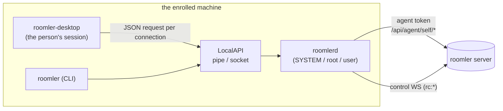

⚠️ The LocalAPI is the trust boundary. On Windows its SDDL grants **SYSTEM, Administrators
and Interactive Users** at medium integrity (`crates/localapi/src/lib.rs:2040`): any person
logged in at the machine can call it, a sandboxed low-integrity process cannot. Everything
below that lets the companion *change* something is therefore something any interactive user
can do — which is why the device-side rules (the `files_dir` SYSTEM rule, the visibility rule
on the Devices page) are enforced in the daemon and on the server, never in the page.

## 2. The pages

Hash routes in `src/front/app.js`; one `<section id="view-*">` per page. The install matrix
(vmtest, FR-61) asserts that every `#view-<name>` renders — keep those ids.

| Page | Route | What it shows | Data (LocalAPI) | Refresh |
|---|---|---|---|---|
| Overview | `#/overview` | this device (name, overlay IPs, server, service, versions), exit node, updates | `Status` (via the shared device view) | on the 2 s device-view tick |
| Devices | `#/devices` | the devices this machine's mesh can see: a server-side grid (search, sort, paging, column chooser) and the mesh graph — see §6 | `Devices` / `Mesh` (daemon-proxied), live connection cells from `Peers` | list 30 s and mesh 60 s while visible; peers 2 s |
| Recordings | `#/recordings` | local and remote screen recordings (FR-85) | FR-85's verbs | on entry |
| Routes | `#/tunnels` | declared routes (`[[tunnel_routes]]`) and live forwards, with add / edit / enable / disable / remove | `RouteList` + `Flows` on **one** connection; `RouteAdd` / `RouteUpdate` / `RouteSetEnabled` / `RouteRemove` | 2 s while visible |
| Settings | `#/settings` | the config surface, grouped (§5); device name; service; the log | `ConfigGet` / `ConfigSet`, `SetDeviceName`, `TailLog` | on entry |
| Onboarding | `#/onboarding` | enrol (server, name, token) or re-enrol | in-process enrolment | — |
| Welcome | `#/welcome` | the first-run tour — see §10 | `Status`, `ConfigSet`, `RestartDaemon`, the files commands | while a step waits |

## 3. The LocalAPI, and why the Routes page used to blink

Every companion request opens the pipe **fresh**, sends one JSON request (or a short batch
on one connection) and closes. Five things poll it at once in a running companion:

| Poller | Where | Interval | Connections per tick |
|---|---|---|---|
| service status | `src/front/app.js:166` | 10 s | 0 (reads config, runs `roomlerd service status`) |
| device view (`Status` + `Peers`) | `src/front/app.js:168` → `cmd_device_view`, `src/commands.rs:323` | 2 s | 1 |
| Routes (`RouteList` + `Flows`) | `src/front/tunnels.js:512` → `cmd_tunnels_view`, `src/commands.rs:2181` | 2 s, visible only | 1 |
| consent (in-window) | `src/front/consent.js:157` | 1.5 s | 1 |
| consent watcher (Rust) | `src/main.rs` | 750 ms | 1 |

**What went wrong (field, 2026-09-25):** the Routes page's tables appeared and disappeared
every few seconds while the daemon's data was steady. Three raw back-to-back opens of the
pipe — exactly what the Rust client does — failed the 2nd open with `ERROR_PIPE_BUSY` (231)
**60 of 60 times**: the server kept **one** listening instance and created the next only
after `connect()` returned. The companion opened three connections in the same millisecond
every 2 s; the client retried once after 50 ms; and the two Routes commands turned the
loser's error into an empty list, which the page painted as "no routes".

⚠️ A .NET `NamedPipeClientStream.Connect(0)` probe of the same pipe reported 90/90 OK — it
calls `WaitNamedPipe` first, and `0` there means the server's *default* wait (50 ms). A
probe that waits cannot see a gap a non-waiting client falls into.

**The fix, in three layers:**

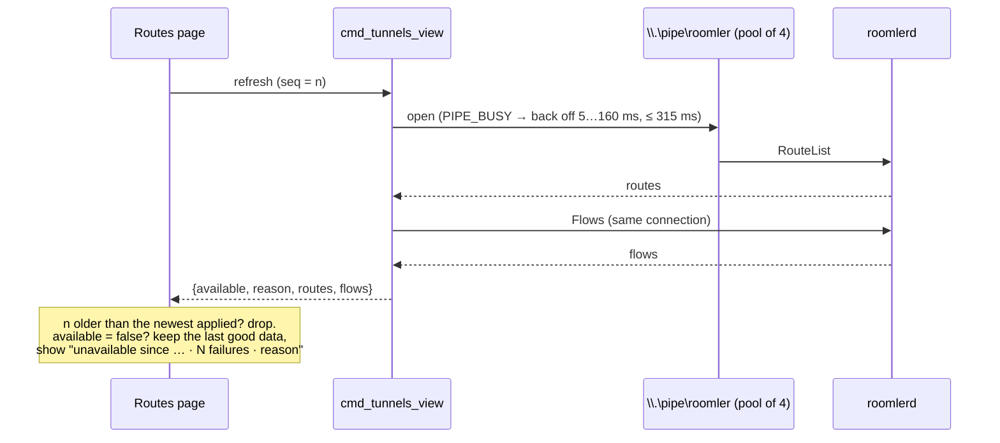

1. **The page never paints an error as data.** `cmd_tunnels_view` answers
   `{available, reason, routes, flows}` from one connection; `tunnels.js` keeps the last good
   data on a failure and says why (`noteUnavailable`, `src/front/tunnels.js:98`), drops a
   response older than the newest it applied, and patches rows in place keyed by route id /
   flow id (`routeRows`, `:48`) so a button never moves under the cursor. Refresh failures
   are also written to the companion's own log (`src/desktop_log.rs`, capped at 2 MiB,
   one rolled generation).
2. **The pipe always has a spare.** `serve_windows_at` (`crates/localapi/src/lib.rs:2133`)
   binds the first instance (retrying while another process holds the name), then runs a
   pool of accept tasks (`accept_pipe`, `:1976`), each owning one listening instance and
   re-creating it before handing a connected one off. Default 4
   (`DEFAULT_PIPE_POOL`, `:1725`); config `localapi_pipe_pool` (1–16) — **`1` is the kill
   switch** and reproduces the old single-instance behaviour.
3. **The client backs off instead of giving up.** `pipe_busy_backoff` (`:2299`) retries a
   busy pipe at 5, 10, 20, 40, 80, 160 ms (≤ 315 ms in total); any other error (the daemon
   is not running) returns at once.

A route can now be **edited** in place: `RouteUpdate` replaces the descriptor in one save
under the config write lock and restarts its flow; an invalid replacement is refused and the
old route keeps running (`agents/roomlerd/src/tunnel/route_reconciler.rs:437`). A daemon
that predates the verb answers "bad request", which the companion shows as *"The device
service predates route editing"* (`src/commands.rs:2232`), never as a blank page.

⚠️ A route whose edit keeps the **same local port** restarts its listener on that port. If
the old listener is still held (the #1035 class — a listener outliving the flow that owned
it), the new flow retries on its backoff until the port frees.

**A route's state is the port's truth (#1685).** `active` is shown only once the route's
tunnel session is up and its local listener is **bound** — the daemon flips it from the bind
itself (`tunnel_core::driver::ListeningHook`), not from `rc:tunnel.opened`, which the server
also answers for a node whose data plane then fails to come up. Until then the page shows
`connecting` (first attempt in flight) or `retrying (N, next in Ss) — <last error>` (the
session failed N times in a row), and appends `· device offline` when the Devices data
already knows the target is offline. Field, 2026-09-25: three routes to an offline laptop
read `active` with nothing listening while the daemon log looped `tunnel session failed;
retrying`. The wire keeps its state words and adds fields (`flow_id`, `attempts`), so a
companion older than the fix shows those routes as `pending` / `retrying in Ss: <error>`
rather than losing the page to a tag it cannot parse; a companion from the fix on shows a
state word it does not know (a newer daemon) as that word, never as an error
(`stateLabel`, `src/front/tunnels.js`).

## 4. Polling rules every page follows

- **Poll only while visible.** A page's own timer runs only while its view is the current
  one; re-entering a view never stacks a second timer. The one exception is the shared
  device view (2 s), which the sidebar status dot and the Overview both read.
- **One connection per refresh.** A page that needs two answers asks for both on one
  connection (`cmd_device_view`, `cmd_tunnels_view`).
- **Stale-while-error.** A failed refresh never replaces data with an empty state; it keeps
  the last good data and says how long it has been stale and why.
- **A sequence guard.** A response older than the newest applied is dropped.
- **Keyed rows.** Rows are patched in place by a stable key; `replaceChildren` on every tick
  destroys focus, hover and in-flight clicks.

## 5. Settings, grouped

The config surface (`crates/agent-core/src/config_surface.rs`) is one table of
`KeyMeta { key, kind, group, tier, live, description }` (`:181`) — adding a key without
saying which group and tier it belongs to, and whether the daemon applies it live, does not
compile.

| Group | Example keys | Default state |
|---|---|---|
| **Essentials** (every `tier = essential` key, shown first) | `overlay_enabled`, `auto_grant_session`, `exec_enabled`, `remote_config_enabled`, `ssh_enabled`, `encoder_preference`, `power_policy`, `auto_update` | **open** |
| Access & consent · Private network · Network carriers & relays · Routing & adapter · Tunnels & SOCKS · Roomler SSH · Remote desktop · Capture & input · Video encoding · Video rate & latency · Files · Device & service | the other ~140 keys | collapsed |

- **`restart_required` is per key.** `live = true` only where the daemon really applies a
  change at once — `exec_enabled` and `remote_config_enabled` (the LocalAPI `ConfigSet`
  re-seeds them through `adopt_local`). Every other key is read once at startup.
- **"Modified"** compares a value with the key's built-in default, computed from a config
  that contains nothing but the identity fields (`builtin_default`, `:1481`).
- **Which daemon it edits (#2871).** `cmd_config_entries` / `cmd_config_set` go to the
  daemon `localapi::connect()` resolves — on a Mac running both halves (FR-43), the
  per-user GUI worker, whose `config.toml` is its own: FR-43 keeps the worker enrolled
  through P2. Meanwhile the Overview's network lines are the root half's (§6), so the two
  pages described different daemons and nothing said so: a person switching `ssh_enabled`
  on here changed a file the mesh node never reads (measured on 0.4.169). The card now
  carries a banner (`cmd_config_target`, `agents/roomler-desktop/src/commands.rs:828`)
  naming the file it edits and the root half's (`/etc/roomler/config.toml`), with the
  administrator's command for the root half's switches: `sudo roomler config set <key>
  <value>`. It is shown only when the reached daemon says it runs unprivileged AND a root
  daemon of another identity answers `Status` over the person socket (`two_halves`,
  `:687`) — one daemon behind both sockets, a root daemon's legacy per-user bind, is not
  two halves. ⚠️ The banner reads the root half's **status** and nothing else: the person
  socket refuses every config verb (`localapi::person_may`), so the root half's
  device-owned gates stay root's to set. Admitting them is the decision open on #2871.
- **A Linux system install, and a Mac with a root half alone (#2891).** There the daemon the
  page reaches runs as root and this app does not: `connect()`'s first candidate on Linux,
  `$XDG_RUNTIME_DIR/roomler.sock`, IS the root daemon's person socket (§12), which serves
  `Status` and refuses every config verb. Until #2891 the page took that refusal for a daemon
  that was down, fell back to the per-user config file — a path a system install does not
  have — and showed "Could not load the configuration" with a Retry that never helped; with a
  stale per-user file left by an earlier per-user install it would have read, and
  `cmd_config_set` written, a file no daemon reads (#2871's failure, on Linux). Now
  `cmd_config_target` (`agents/roomler-desktop/src/commands.rs:828`) reports `root_only`
  (`root_daemon_only`, `agents/roomler-desktop/src/commands.rs:726`, pure: the reached daemon
  says it runs as root, this process does not, and the OS is not Windows, whose pipe admits
  interactive users to those verbs) and the card shows the daemon, its file
  (`Status.config_path`: `/etc/roomler/config.toml`) and the administrator's commands —
  `sudo roomler config ls`, `sudo roomler config set <key> <value>` — in place of rows. A
  refusal from a root daemon is final for `cmd_config_entries`, `cmd_config_set` and
  `cmd_set_device_name`: none falls back to the file (`refused_by_root_daemon`,
  `agents/roomler-desktop/src/commands.rs:783`). ⚠️ No new authorization path: `person_may`
  is unchanged, and #2879's test still pins `ConfigSet` of the gate keys as refused there.
- **The Service line on Linux and macOS (#2871).** `probe_service_state` reads the root
  daemon's own `--as-service` answer — `com.roomler.daemon: running, enabled`,
  `roomlerd.service: active, enabled` (`system_answer`, `:2954`) — as
  `service_kind = "systemDaemon"`, rendered "System daemon (root) · running". It only ever
  read Windows' `Roomler:` line before, so a supervised Mac, whose LaunchAgent FR-43 P2d
  boots out, said "not installed" while its root daemon served the mesh.
- A daemon that predates the grouping sends entries without `group`; the page falls back to
  the flat list.
- Every new agent knob is registered here (the standing rule): the `config.rs` field, the
  `KeyMeta` entry, the `current_value` / `apply` arms, and a set/echo test.

## 6. What the companion may know about other devices

The Devices page shows **the devices this machine's overlay netmap already carries, plus
itself** — never the organisation's inventory. The companion cannot sign in as a user, so the
daemon asks the server with its **agent token**:

| Route | Auth | Returns |
|---|---|---|
| `GET /api/agent/self/devices?page&per_page&q&sort&dir&kind` | agent JWT (status-checked on every use) | `VisibleDevicesPage` — rows with display name, name, OS, version, presence, overlay IP, MagicDNS, tags, reachability, `is_self`; plus `overlay` (`ok` / `no_node` / `no_network` / `unavailable`) and `acl_mode` |
| `GET /api/agent/self/mesh` | agent JWT | the web dashboard's mesh payload, restricted to the same set, with a server-computed `label` per node and `self_node_id`; `{"enabled": false}` when stats are off |

How the set is computed (`crates/api/src/routes/agent_self.rs:107`):

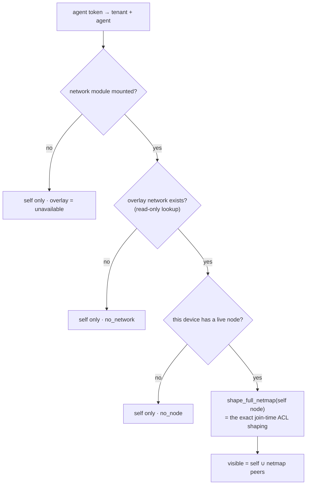

- **The same code decides both.** `shape_full_netmap`
  (`crates/modules/network/src/overlay.rs:2492`) was extracted from the overlay join and is
  what the join itself now calls, so the list can never show a peer the netmap withholds:
  ACL `off` / `warn` list every live node, `enforce` only the shaped set.
- ⚠️ **The device's node is found before any ACL read.** Loading the ACL can create the
  tenant's overlay network if it is missing; a GET must never allocate one.
- **What never leaves the server:** machine ids, owner ids, WireGuard keys and key epochs,
  consent settings, codecs. Those fields are blanked *before* search runs, so `q` cannot be
  used to probe them. Search, sort and paging are the web grid's own
  (`parse_query` / `apply_query`, `crates/api/src/routes/device.rs:295`, `:337`), so the two
  grids cannot drift.
- Proven by a negative control: with visibility taken from every live node instead of the
  shaped netmap, the enforce test leaks a withheld peer and fails
  (`crates/tests/src/agent_self_tests.rs`).

### The companion's side

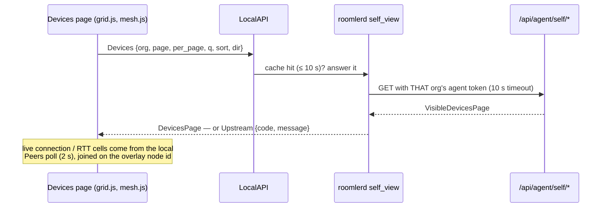

- **The daemon proxies, per org.** `agents/roomlerd/src/self_view.rs` keeps each org's server
  URL and agent token (the token is redacted from `Debug` and never logged) and asks with
  the right one. Answers are cached — 10 s for a page, 20 s for the mesh, 32 entries, one
  request in flight per key — so the companion, the CLI and re-renders share a fetch.
- **A failure has a name, never an empty list.** `Response::Upstream { code }`:
  `server_unreachable` (connect, TLS, timeout), `unauthorized` (401), `unsupported_server`
  (404 — a server older than the route), `module_unmounted` (the server's own 503),
  `rate_limited` (429), `server_error`, `unknown_org`, `org_disabled`.
- **The page.** `front/grid.js` is the web grid's model ported to plain JS: server sort keys,
  debounced search, pager, and a column chooser (show / hide, drag, ▲/▼) remembered per org
  in `localStorage`. `front/mesh.js` draws the web dashboard's ring graph in plain SVG; its
  pure helpers `front/mesh-util.js` are **generated** from `ui/src/utils/mesh.ts`, and a
  Vitest check fails when the copy is stale. The list refreshes every 30 s only while the
  view is visible (60 → 120 s back-off after an error, the last page kept on screen).
- **Older sides still work.** A daemon that predates the verbs, or a server without the
  routes, gets the pre-FR-84 peers table with a one-line note to update. `overlay:
  "no_node"` shows this device and the "private network is off" hint; ACL `enforce` with no
  visible peers says so.
- **From a terminal:** `roomler devices [--org L] [-q TEXT] [--sort KEY] [--desc]
  [--page N] [--per-page N] [--json]`.

### A two-half Mac asks its root half (FR-97 P2g)

A Mac with both halves (FR-43) is **two devices**, and only the root half is on the private
network: only root can hold a utun. The companion talks to the per-user half, whose own answer
is `no_node`, so the page listed the Mac and nothing else. The per-user half now asks the root
half for the machine's view, over a person socket the root half serves the console user:

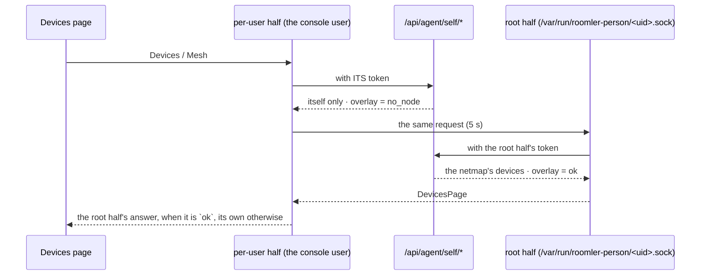

- **Only a `no_node` answer off root asks** (`person_socket::machine_view_wanted`), and only an
  `ok` answer replaces it (`machine_view_usable`). A root half that is missing, older, switched
  off (`ROOMLERD_PERSON_SOCKET=0`) or itself off the network leaves the per-user half's own
  answer on screen, as before. So does a socket served by anyone but root
  (`localapi::connect_unix_served_by_root`).
- **"This device" is the root half's row.** The per-user half's own row has no node, so the
  machine's netmap does not carry it, and it is not in the list.
- **The live view comes from the root half too (FR-97 P2h).** The Connection column and the
  Overview page read `Peers` and `Status`, which the half answered from its own overlay. It
  runs none, so before P2h a Mac showed:
  - `—` in the Connection column, with the dot falling back to the server's presence;
  - no online count and "(no overlay IP)" on Overview, with no MagicDNS or exit line.

  Both requests now pass through one async hook (`LocalApiState::status_view` /
  `peers_view`, which default to the sync reads). When the half holds no overlay address of
  its own (`person_socket::network_view_wanted`), its hook answers:
  - `Peers` with the root half's peers, as the person socket serves them: the link (online,
    direct or relayed and over what, round trip) without any endpoint;
  - `Status` with its own name, version and server link, plus the root half's overlay
    addresses, exit status and MagicDNS (`person_socket::with_machine_network`) — and, since
    #2892, **`network_from`** (`crates/localapi/src/lib.rs:201`): the root half's node id and
    name, set only when those fields were lent. Nothing on the wire said so before, and `roomler status` as the console user
    printed the root half's address as this half's, right above this half's own "overlay OFF"
    enrollments. The CLI now marks `overlay ip` / `overlay ip6` "(the root daemon's)", adds a
    `network` line naming that daemon (`sudo roomler status` asks it), and its "not on the
    mesh" line stops prescribing netstack to a half that is off the mesh by design (FR-43);
    Overview's address reads "· the root daemon's (<name>)". The field is additive and absent
    unless lent, so every other host's JSON and output are byte-identical.

  A root half that is slow to answer (1.5 s) leaves the half's own answer on screen for that
  poll.
- **What the per-user half does NOT borrow: configuration (#2871).** `ConfigGet` /
  `ConfigSet` are refused on the person socket, so Settings edits the per-user half's own
  file — and says so (§5). The same socket does tell the companion, and the CLI's
  `config ls` / `config set` note (`localapi::other_daemon_socket`,
  `crates/localapi/src/lib.rs:4592`), that a root half exists: `/var/run/roomler` is
  `0700`, so the console user's `stat` of the root socket fails and that note had been
  silent for them.
- The root half's person socket, its directory and the uid check: §12 and the
  [security baseline](security-baseline.md) §4.

## 7. Apply now — restarting the service from the companion

Most settings are read once at startup, so saving one is not the same as applying it. The
Settings page collects the saved restart-required keys in a bar with an **Apply now** button;
`roomler restart` is the same thing from a terminal. Both send `Request::RestartDaemon`
(`crates/localapi/src/lib.rs:1428`), and **the daemon decides**.

It restarts only when it can prove that something will start it again — exiting an
unsupervised `roomlerd run` would take the device offline for good:

| How the daemon runs | How it knows (`agents/roomlerd/src/supervision.rs:193`) | Leaves with | Who starts it again |
|---|---|---|---|
| Windows service (SCM host) | the host passes `run --supervisor scm` | `0` — the host respawns 0 at once | the service host |
| Windows Scheduled Task (per-user) | the task passes `run --supervisor task` | `9` | **the caller**: the task's `IgnoreNew` policy drops a start while the old process is still exiting, so the companion / CLI runs `roomlerd service start` every 3 s until a new process answers |
| systemd | `INVOCATION_ID` **and** `/proc/self/cgroup` puts the process inside one of our units, **and** `systemctl show` says this process is the unit's main PID and its restart policy restarts exit `9` | `9` | systemd |
| launchd | `XPC_SERVICE_NAME` starts with `com.roomler.` | `9` — `KeepAlive{SuccessfulExit:false}` relaunches only a non-zero exit | launchd |
| the macOS supervisor (FR-43) | the worker's `--supervised` flag | `9` | the supervisor |
| anything else | — | **refused** | — |

`9` is `RESTART_REQUESTED_EXIT_CODE` (`agents/roomlerd/src/watchdog.rs:201`); it is outside
systemd's `RestartPreventExitStatus=7 8`, and the SCM host maps it to *respawn* as well.

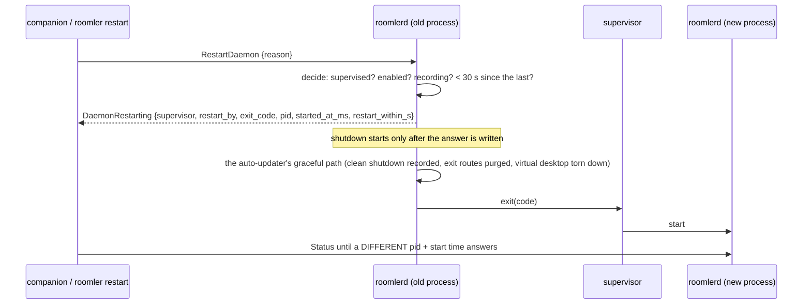

- **It is not a crash.** The restart leaves through the same internal shutdown an auto-update
  uses, so the clean shutdown is recorded and the crash / rollback accounting never sees it
  (`exit_for_requested_restart`, `agents/roomlerd/src/app.rs:1774`).
- ⚠️ **A virtual-desktop host reaps its own desktop before it exits (#1684).** On Linux the
  daemon may run a virtual desktop (Xvfb + WM + apps, `ROOMLERD_VIRTUAL_DESKTOP=1`), and under
  systemd `KillMode=control-group` whatever it spawned that outlives it — the desktop's
  setsid'd `at-spi-bus-launcher` grandchild, which **ignores SIGTERM** — keeps the unit's
  cgroup non-empty until systemd SIGKILLs it after `TimeoutStopSec` (90 s), then pays
  `RestartSec`: a `roomler restart` took **96 s**. So every graceful exit now tears the whole
  desktop tree down (`virtual_desktop::teardown`, `agents/roomlerd/src/virtual_desktop.rs`) —
  the tree is spawned into its own process group, and teardown unions the group members with
  the parent-link closure of the daemon's direct children (which reaches a setsid'd
  grandchild, since `setsid` changes the session and group but never the parent), SIGTERMs,
  waits a 2 s grace, then SIGKILLs the remainder. systemd then finds an empty cgroup and
  relaunches after `RestartSec` (~5 s). ⚠️ It SIGKILLs **as root**, so it never signals a
  recycled pid: the daemon's own children are reaped only **after the last signal** (an
  unreaped zombie keeps its pid — and, for Xvfb, the desktop's pgid — reserved), and any
  other pid is signalled only after its `/proc` **starttime** is re-read and matches the
  snapshot that selected it (`same_process`). Both rules are unit-tested against a scripted
  process table (`kill_tree_signals_everything_before_it_reaps_anything`,
  `kill_tree_never_signals_a_recycled_pid`).
- **The wait follows the supervisor.** A caller waits for the relaunched daemon at least as
  long as the supervisor says a stop + relaunch can take — under systemd,
  `TimeoutStopSec + RestartSec`, read from `systemctl show` and carried as the additive
  `restart_within_s` in `DaemonRestarting` — plus a margin, never below the 60 s floor and
  never past 10 minutes (`localapi::restart_wait`, `RESTART_WAIT_CAP`: a unit with
  `TimeoutStopSec=1h` must not make `roomler restart` hang for an hour). Before this, a fixed
  60 s wait was shorter than the supervisor's
  worst case, so the CLI reported failure on a restart that had in fact worked. `restart_within_s`
  is absent for every non-systemd supervisor and from an older daemon, where the wait stays 60 s.
- **Refusals are named and shown verbatim:** no supervisor it can prove,
  `local_restart_enabled = false` (read on every request, so turning it off applies to the
  very next one), a screen recording in progress (FR-85), a previous restart less than 30 s
  ago (`RESTART_MIN_INTERVAL`, persisted next to the config, so it also bounds a loop across
  processes), and on the macOS supervisor a worker younger than 30 s.
- **"Back" means a new process.** The companion waits for a different pid **and** start time
  (`cmd_restart_wait`, `src/commands.rs:1522`) — the leaving process keeps answering for a
  moment, and Windows can hand the relaunched daemon the old pid.
- ⚠️ **This is local only.** Remote configuration never restarts a daemon: a server push is
  persisted and reported as *applied-pending-restart*, and there is no server message that
  restarts anything (`docs/remote-config.md` §7b).

### 7.1 The macOS permission card's Restart (#3164)

macOS applies a Screen Recording grant to a freshly started process only, so a Mac's card offers
**Restart roomlerd** beside its Screen Recording row: the same flow as *Apply now*
(`window.Roomler.restartDaemon`, the LocalAPI `RestartDaemon` verb, the agent's own supervisor
relaunches it). Accessibility needs none: the agent reads it live and opens its input backend
again once it is granted.

The card shows the **agent's** grants, as the agent reports them in its status
(`NodeStatus.macos_grants`, read from its own process). Before #3164 it asked TCC about the
menu-bar app's own process, `ai.roomler.agent-tray`, which never holds either grant: the card
kept asking for both after the person had granted them to `roomlerd`, and its button registered
the menu-bar app itself in the pane, as the "Roomler" entry that changes nothing. The buttons now
only open the pane. An agent that does not report its grants (older than #3164, not running, or a
root half with no GUI session) shows no card.

macOS's own **Quit & Reopen** restarts the agent too (`agents/roomlerd/src/macos_quit.rs`): a
Quit AppleEvent from anyone but `loginwindow` ends it with the supervisor's restart code instead
of AppKit's exit 0. Up to 0.4.189 that button left the agent offline (`docs/installation.md`,
the macOS grants).

## 8. What this device can encode

The Overview's **Hardware video encoding** card is a codec × backend matrix — H.264, HEVC,
AV1 and VP9 against NVENC, QSV, AMF, VideoToolbox, VAAPI, D3D12, Vulkan, Media Foundation and
the software encoders — with the chroma each cell produced (4:2:0 / 4:4:4), denied cells
struck through, and how long the probe took.

- It asks `Request::EncoderCaps`, which answers from the probe's **cached** result only
  (`caps::cached()`, `agents/roomlerd/src/encode/caps.rs:48`). The capability probe runs in
  child processes (vendor driver code) at the first server hello; a control-surface poll
  must never be what launches it — locked by `not_probed_never_triggers_a_probe`.
- Three states: `ready` (the matrix), `not_probed` (the daemon has not connected yet — the
  card polls every 5 s while the Overview is visible, then stops), `unsupported` (a build
  with no video encoder). An older service gets a one-line "update the service" instead.
- `denied` is the effective `encoder_cells_deny` list (env, config or built-in), shown
  because a denied cell is never opened by the probe or a session, so it could not appear in
  the matrix otherwise. The resolved `encoder_preference` is shown under it.
- It is the same data `roomlerd caps` prints and the server's `AgentCaps` carries; see
  [encoders.md](encoders.md) for what a cell means and why a probe proves an open, not a
  session.

## 9. Where files dropped from a remote viewer land

The Overview's **Incoming files** card shows where a file a controller drops onto this
screen will land **right now**, with **Open folder**, **Change…** (the native folder picker,
which can create a folder) and **Use default**. The setting is `files_dir`; unset, the ladder
is the active user's Downloads, then the service's own fallback. It is **live**: every
transfer reads the current value, so a change needs no restart.

⚠️ `files_dir` is a security control, because the daemon writing the file can be SYSTEM or
root and the LocalAPI admits any interactive user. The rules
(`crates/agent-core/src/files_dir.rs`):

| Rule | Why |
|---|---|
| Absolute, or `~\…` — expanded against the **active** user's profile when a file arrives | one machine-wide setting stays right for whoever is signed in |
| No device / kernel-namespace paths (`\\?\GLOBALROOT`, `\\.\…`), no admin or device shares, no `..` | none of those is a folder a person meant |
| No name Windows silently rewrites (a trailing dot or space, `:stream`) | `C:\Windows.\Temp` would otherwise pass the system-folder check |
| Not under the system folders (`%WINDIR%`, `%ProgramFiles%`, `/etc`, `/usr`, `/bin`, `/System`, …) | remote-supplied files must never land where the OS executes from |
| **When the writer is SYSTEM or root, inside the active user's profile — and refused when no profile is known** | otherwise a non-admin user could make SYSTEM write remote-supplied files anywhere |
| Links resolved and re-checked; an unresolvable link is refused for a privileged writer | a junction must not carry the path outside the rules |
| Creatable and writable | a folder that cannot take the file is a failed drop later |

- Checked **when set** (the daemon refuses the `ConfigSet` with the reason, which the card
  shows verbatim) **and when used** (`download_dir()` re-validates per transfer and falls back
  to the default ladder with a warning — the check that holds even if `config.toml` was
  edited by hand).
- Only the **console user** may change it through the LocalAPI: an RDP user on the same
  machine must not choose where the console user's incoming files land. A SYSTEM shell
  (`roomler exec`, SSH) can still edit the config file; the use-time check applies.
- The Status the companion shows is refreshed off the request path, so a Downloads folder
  redirected to an offline share cannot stall the 2 s poll.

### 9.1 A Linux system install writes the file as the person at the screen (FR-97 P3d)

A root daemon serves the session of whoever is at seat0, and "the active user's Downloads"
used to mean root's own ladder: with no XDG Downloads for root, the file landed in **`/tmp`,
owned `root:root`** (measured on 0.4.143, FR-97 §8). It now lands in the person's Downloads
and is **born theirs**:

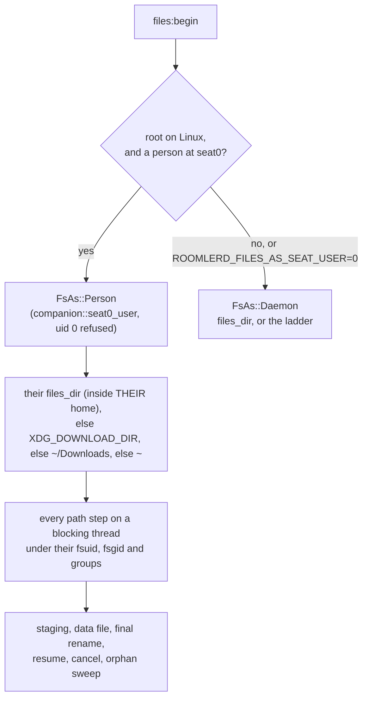

| What | Where (`agents/roomlerd/src/files.rs`) | Why |
|---|---|---|
| Who writes | `FsAs` (`:223-294`), chosen once in `begin` and carried by the transfer and by `PARTIAL_REGISTRY`'s `PartialEntry` (`:556-559`) | the end-time rename, a resume and a cancel act as whoever staged the partial, even after a user switch |
| How | `FsAs::run` → `crate::fs_identity::FsIdentity` (FR-85's guard, moved out of `recording`) | Linux checks every open, create and unlink against the thread's fsuid, fsgid and groups; root's bypass capabilities leave with the fsuid |
| Their folder | `person_downloads` / `xdg_download_dir` (`:310-343`) | `user-dirs.dirs` is the person's to write, so only a folder inside their home is taken |
| The staging | `create_dir` and `create_new`, never reuse (`begin_as`) | a folder or a link planted where the staging goes refuses the begin |

⚠️ **Never as root followed by a `chown`.** In a folder the person owns, a link they planted
would be followed with root's rights, and the staging folder's `meta.json`, which a resume reads
and whose `dest_dir` the final rename trusts, is theirs to edit. Under their identity, a tampered
`meta.json` reaches nothing they could not write themselves. A root-only test
(`seat_user_tests::as_root`, run under `sudo` in CI) plants a link into a `0700 root` folder and
shows the begin refused, with a control proving root's own rights go straight through it.

⚠️ "The person" is seat0's (`companion::seat0_user`, FR-97 P5a), never whoever asked: an xrdp
session sits on no seat. With nobody at seat0, the daemon's own ladder applies, as before.
Downloads and browsing (the host → viewer direction) still read as the daemon.

## 10. Starting after install, and the Welcome flow

Every install path ends with the daemon starting, so the **daemon** opens the companion —
once per install, into the signed-in user's session, with `--first-run`
(`agents/roomlerd/src/companion/launch_once.rs`). Who does it on each platform, the login
start, the marker that makes it one-shot, and why an upgrade is *adopted* rather than
launched into are in [installation.md](installation.md) §"After install: the companion
opens". The rules that matter here:

- ⚠️ **No inherited handles.** A companion the daemon starts gets none of the daemon's
  handles: `CreateProcessW` with `bInheritHandles = FALSE`, detached, and outside the
  daemon's job object where that is allowed
  (`agents/roomlerd/src/win_service/companion_spawn.rs:98`). Before this, a companion
  spawned by a daemon worker could outlive it holding the worker's handles — the #1035
  signature, tunnel ports held by a process whose parent was already gone. A route that
  cannot bind its port for two minutes now logs who holds it.
- **Per-machine Windows launches from the service host, with the console user's own,
  non-elevated token** — never from a worker that may run elevated.
- **The companion decides what to show** (`agents/roomler-desktop/src/first_run.rs:63`):
  it reads its own arguments on the first launch too (`--first-run`, `--autostart`,
  `--view=<name>`) and a per-user `desktop-state.json` (`first_run_done`, the start-at-login
  opt-out; `crates/agent-core/src/desktop_state.rs`). A missing or unreadable file is a
  first run. Until the tour is finished or skipped it shows at every start; afterwards a
  login start stays in the tray.

**The Welcome** (`front/welcome.js`) is six steps — this device · the private network ·
who may view this screen · files you receive · start at login · done:

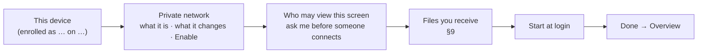

- **Enable** on the private network writes `overlay_enabled`, then uses the same restart
  flow as Settings' Apply now (`window.Roomler.restartDaemon`, `front/settings.js`) and
  waits up to a minute for the overlay address. A per-user install cannot create the
  WireGuard adapter, so it is offered **userspace mode** instead: `netstack_socks_port` on a
  free port (never a hard-coded one a declared route may already hold), explained as "apps
  reach the mesh through SOCKS5 on 127.0.0.1:<port>; remote desktop needs nothing".
- Every refusal from the daemon — Apply now's, `files_dir`'s — is shown verbatim, and a
  service too old for a step says so and points at the manual way instead.
- The tour can be reopened from the tray and from Settings.
- The whole device can opt out: `companion_autostart = false` stops the post-install launch
  and removes the Windows login start. On a multi-user server that is the switch to use —
  the machine-wide login start opens a companion in every interactive session.

### 10.1 The Linux packages (FR-93 P6d, P6e)

Before P6d the companion shipped as an x86_64 `.deb` only, so a system install on Fedora,
the RHEL family or openSUSE, and every aarch64 host (Asahi, Ampere), had no consent prompt
and no "being viewed" banner. The release now carries four Linux packages, built from the same
binary per architecture:

| | x86_64 | aarch64 |
|---|---|---|
| `.deb` (`cargo deb`) | `roomler-desktop-<v>-x86_64-unknown-linux-gnu.deb` | `roomler-desktop-<v>-aarch64-unknown-linux-gnu.deb` |
| `.rpm` (`cargo generate-rpm`) | `roomler-desktop-<v>-x86_64-unknown-linux-gnu.rpm` | `roomler-desktop-<v>-aarch64-unknown-linux-gnu.rpm` |

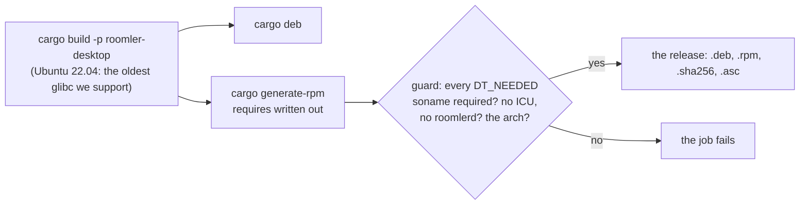

- ⚠️ **The `.rpm`'s requires are written out** in `agents/roomler-desktop/Cargo.toml`
  (`auto-req = "no"`). `cargo generate-rpm`'s discovery runs `ldd`, which names the build host's
  *transitive* libraries, Ubuntu 22.04's ICU 70 among them, and no Fedora satisfies those. The
  list is the binary's own `DT_NEEDED`, by soname (the spelling every RPM distro provides), plus
  `libayatana-appindicator3.so.1`, which the tray dlopens. A hand-kept list drifts, so the
  release job reads both back: a library the binary links that the package does not require
  fails the job.
- There is **no `roomlerd` require** in the `.rpm`: those hosts install the daemon from the
  tarball, not a package. The `.deb` keeps its `Depends: roomlerd`.
- `install.sh` picks the package by the host's tools: `dpkg` takes the `.deb`; otherwise `rpm` with
  `dnf`, `zypper` or `yum` takes the `.rpm`, and the package manager pulls webkit2gtk, GTK and the
  tray library from the distro's repositories. zypper needs `--allow-unsigned-rpm` for a local
  package; the sha256 is checked first.
- The daemon reports the installed companion's version from `dpkg-query`, else from
  `rpm -q --qf '%{VERSION}'` (`companion.rs`, `installed_version_inner`).
- Every asset is signed (`.asc`) like the daemon's. The server's daemon-first ordering
  (`agent_release::order_assets_daemon_first`) keys on the `roomler-desktop-` prefix, so an
  `.rpm` sorts after the daemon's packages too. The daemon's own picker never takes a companion
  package: it matches the daemon's `.deb` and `.tar.gz` only. From FR-117 the updater moves an
  INSTALLED companion package to the daemon's version through a picker of its own (§13).

## 11. Testing it

- **Unit:** `cargo test -p roomler-desktop` (the Rust side), `cargo test -p roomler-localapi
  --lib` (the pipe pool and backoff, including the back-to-back-open test that fails with 231
  on the single-instance server), `cargo test -p roomlerd --lib route_reconciler`.
- **The front without a daemon:** serve `src/front/` over loopback with a fake
  `window.__TAURI__` that answers the commands from fixtures, and drive it in a browser.
  That is how the Routes page (stale-while-error, the sequence guard, stable rows, edit) and
  the grouped Settings were verified before they shipped.
- **The install matrix:** vmtest's `desktop` check asserts every view renders on fresh
  Windows and Linux installs.

⚠️ A browser tab driven by automation can be a **background** tab (`visibilityState:
"hidden"`): timers are throttled to once a minute after a while and synthetic mouse presses
are dropped. Script clicks through the page (`element.click()`) or run timing checks right
after a reload.

## 12. The session banner and the red frame (FR-27 P9)

On macOS and Linux the companion IS the "Being viewed by …" indicator (Windows draws its own,
in the daemon, `indicator/win.rs`). P9 gives it the Windows badge's manners:

⚠️ **Only where the companion can reach its daemon.** On a Linux **system** install the
daemon's own LocalAPI is root-only (`/var/run/roomler`, 0700, and the socket 0600), and the
companion runs as the desktop user. Until FR-27 P11 it read "Service offline". There was no
banner, no Disconnect, and on Wayland no companion consent prompt (measured 2026-10-09;
#1911).

**P11 fixes it** without widening that ACL. The root daemon also serves a **person socket**
at the person's own `/run/user/<uid>/roomler.sock`, which is the path the companion already
tries first:
- it is theirs, mode 0600, and only they or root may connect (`SO_PEERCRED`);
- it follows the active graphical session's user;
- it serves the safety surface: status, the sessions viewing the screen, their Disconnect,
  consent, the recording state and keep busy (FR-92); and, since FR-97 P2g, the Devices page
  and the mesh, read-only (§6); since P2h, the peers too, without the endpoints of either end
  or of a relay, the carrier snapshot, the path decision or the probes (`localapi::person_view`);
  and since FR-85 P2e, recording: the Recordings view's start, stop, list and delete, and the
  **Stop recording** on the banner and the tray.

Everything else on it is refused with a pointer to `sudo roomler …`, so the companion's other
views show that refusal on a system install. The kill switch is `ROOMLERD_PERSON_SOCKET=0`.

A Mac's root half serves its console user one as well (FR-97 P2g), at
`/var/run/roomler-person/<uid>.sock` in a directory only root writes: there the per-user half
is the person's own daemon already, and what it asks the root half for is the machine's
private-network view (§6).

⚠️ **A session the compositor says nothing about starts the companion** (FR-93 P6g). On
Wayland the desktop's own screen-sharing indicator (GNOME's pill, KDE's tray icon) shows for
the portal and mutter arms, but the DRM arm reads the scanout below the compositor, so neither
appears. A session that needs no prompt also never started the companion, so nothing at the
screen said anyone was watching. Now each pump, once its capture opens on DRM, starts the
companion (`companion::ensure_running`), whose banner lists every live session. Where no
companion can run, the daemon posts a notification instead: *"This screen is being viewed —
Alice is viewing this screen and can use its keyboard and mouse."*, with **Disconnect**, which
ends the session as the banner's does. The notification stays on screen (critical urgency),
comes down with the session, and stays down for that session once the person closes it.
The kill switch is `ROOMLERD_VIEWING_NOTICE=0`.
A per-user install, and a supervised Mac through its worker (FR-43), never had this problem.

⚠️ **The banner waits while the desktop's own dialog asks** (FR-93 P6h). A per-user Wayland
session that the portal must ask about (KDE's *Remote Control*, a portal's *Share screen*) is
registered the moment it connects, and the banner used to come up then. It said "Being viewed"
while nothing was shared yet. On a desktop that centres new windows, it also sat right over the
dialog the person had to answer. Measured on Plasma 6.6, its **Disconnect** sat beside the
dialog's **Approve**. Now the capture open's wait hook marks its session `asking` while that
dialog is the wait (`agents/roomlerd/src/peer.rs:5612`, `AskingMark`
`agents/roomlerd/src/rc_sessions.rs:42`). The LocalAPI row carries the mark (`asking`,
`crates/localapi/src/lib.rs:1207`), and the banner comes up only for a session that sees the
screen (`wants_banner`, `agents/roomler-desktop/src/main.rs:325`). The mark goes
when the open does, whether the dialog was approved, denied or timed out, so a dialog nobody
answers still ends with the banner. The kill switch is `ROOMLERD_BANNER_WAITS_FOR_DIALOG=0`.

⚠️ **On a system install this banner is what lets a Wayland desktop be captured by itself**
(FR-95 P2, [`linux-capture.md`](linux-capture.md) §1.2.1). With no capture key set, a root
daemon switches DRM and `uinput` on for the person's session on screen only where that
person can be told: the companion runs for them, or their session's notification server
shows buttons. That is checked live, at every capture open (`indicator::notify::can_tell`).
An installed companion that is not running does not count on its own. Without either,
nothing switches on, and the viewer's hint says so. `ROOMLERD_VIEWING_NOTICE=0` therefore
also keeps a system install's Wayland capture opt-in.

| | Behaviour | Where |
|---|---|---|
| Shown | when a session starts, for at least `FIRST_SHOW` (4 s), **without taking focus** | `panels.rs:127`, `:416` |
| Hides | 2.5 s after the pointer leaves it (`HIDE_DELAY`) | `panels.rs:54` |
| Comes back | after the pointer rests within 4 px of the top edge for 1.2 s (`TOP_ZONE`, `REVEAL_DWELL`) — the Windows badge's numbers | `panels.rs:50-52` |
| Stays | while a recording runs, this device's or a controller's (`tray::recording_now`) | `tray.rs:380` |
| Moves | by dragging its body (`data-tauri-drag-region`, unchanged) | `front/panel-viewing.html` |
| Frame | a 2 px red frame round the main screen for the whole session — four click-through strips (macOS) | `panels.rs:513` |

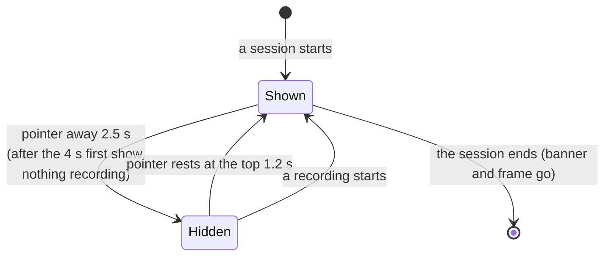

The decision is a pure state machine (`Reveal::step`, `panels.rs:274`) fed every 120 ms by a
watch thread; its six unit tests are the spec.

⚠️ **On macOS `show()` makes a window KEY**, whatever `focused(false)` said when it was built.
Every session's banner therefore took key status from the window the person was using, and
their next click into it was spent making it key again and did nothing else (measured
2026-10-06: the first click into roomler-desktop after each new session was lost). The banner
is now brought up with `orderFrontRegardless` (`show_without_focus`, `panels.rs:432`), the way
the native consent panel shows itself.

⚠️ **The pointer cannot always be read** (a Wayland session keeps it to itself, and under
Xwayland it is not trusted, §12.2). Then the banner never hides: one that tucked itself away
with no way back would be worse than one that stays.

⚠️ **Both the banner and the frame appear in the captured stream on macOS.** Our capture is
`CGDisplayStream`, which ignores `NSWindowSharingNone`; the flag is set anyway and becomes
true the day capture moves to ScreenCaptureKit (FR-27's deviations). The controller sees a red
frame round a Mac's screen during a session; that was the operator's call (2026-10-06).

Kill switches, each on its own: `ROOMLER_DESKTOP_BANNER_AUTOHIDE=0` (the banner stays, as
before P9) and `ROOMLER_DESKTOP_FRAME=0` (no frame).

### 12.1 The banner's Disconnect (FR-27 P10)

The banner's **Disconnect** ends every live session (`panel-viewing.js` sends one
LocalAPI `RcDisconnect` per session, `cmd_rc_disconnect`) — and since P10 it ends them
**for good**: control ends at the click (no more input, clipboard, files or frames),
the daemon tells the server `host_disconnect` before it closes the peer,
the viewer is told "The person at the device ended the session." and stays
disconnected, and coming back is an explicit Reconnect on the viewer's side, through
consent like any new session. Before P10 the viewer read the closed peer as an ordinary
drop and was back within ~3 s of being sent away (measured on this banner, 0.4.119,
2026-10-08). The mechanism, the ordering it relies on and the version matrix are in
`docs/remote-control.md` §11.5; the companion itself did not change — the fix is in the
daemon's arm that every Disconnect surface reaches, so the Windows badge gets it too.

On a supervised Mac the session lives in the GUI worker (FR-43), and so does the
Disconnect: the worker's `host_disconnect` rides the delegation link to the daemon's
WS, the way the session's answer did.

### 12.2 Pinned to the top on Wayland (#2286)

`position_top_centre` (`panels.rs:455`) asks for the top centre of the primary monitor.
Windows, macOS and X11 grant it. **A Wayland compositor ignores it**, because a client
cannot place its own window there. Measured on Plasma 6.6 and GNOME (2026-10-16), both put
the banner in the middle of the screen for the whole session. That is where the controller
was working, and on Linux the banner is in the captured stream too. Each desktop now gets
the one placement it allows a client (`agents/roomler-desktop/src/pin.rs`):

| Desktop | How the banner gets to the top | Where |
|---|---|---|
| **KDE Plasma** (Wayland) | A KWin script, loaded into the running KWin over D-Bus (`org.kde.kwin.Scripting`). It finds the banner by its title (`BANNER_TITLE`), puts it at the top centre of its screen, 48 px down, and keeps it above everything and out of the task switchers. It places the banner again each time it maps, because a hidden banner comes back as a new window. Nothing is written to the person's KWin configuration, and the script goes when that KWin does. | `pin.rs:120`, the script `pin.rs:82` |
| **GNOME** (Wayland) | mutter offers no placement, no layer-shell and no scripting. The companion runs under **Xwayland** instead (`GDK_BACKEND=x11`), where an X11 window places itself and stays above. It is set as `main`'s first statement: GTK reads it when it starts, and an environment variable may only be set while no other thread exists. | `pin.rs:63`, `agents/roomler-desktop/src/main.rs:53` |
| X11, Windows, macOS | Unchanged: the window places itself. | `panels.rs:455` |

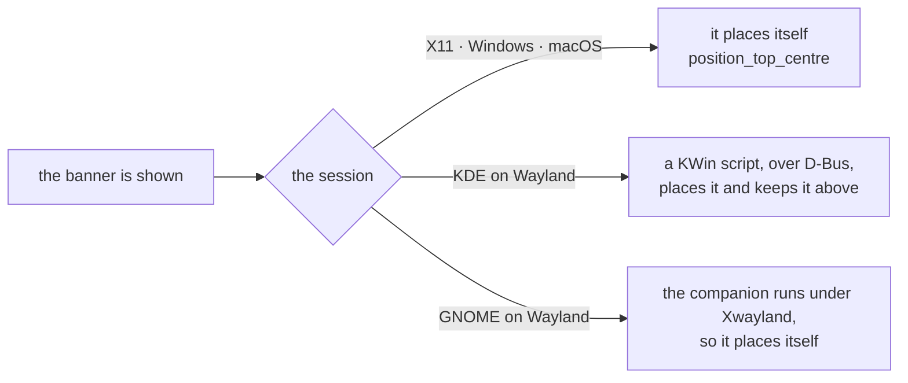

⚠️ **Under Xwayland the banner never tucks itself away.** Its pointer is known only over X11
windows. At GNOME's top bar it reads wherever it last was, so the top-edge gesture that brings
a hidden banner back would never be seen. The pointer is treated as unreadable there
(`Sample::read`, `panels.rs:220`), and an unreadable pointer keeps the banner up (§12).

⚠️ **A non-resizable GTK window takes its webview's natural height.** The banner asked for
76 px and came out 198 px tall, the rest of it empty. On Linux the panels are resizable with
min = max, which is the same fixed size without that (`panels.rs:333-339`).

⚠️ **On Linux the consent window goes in the middle, not at the top.** The daemon's own X11
consent panel holds the top centre (`agents/roomlerd/src/indicator/x11.rs`). With the
companion on Xwayland, a consent window placed there too landed right under it when both
were asking. `WebviewWindow::center` put the window's corner at the middle under Xwayland at
2×, half a window off, so the centre is computed the way the top centre is
(`position_centre`, `panels.rs:392`).

Measured on Fedora Asahi Remix 42 (an Apple M2 Pro Mac mini), 2026-10-16:

| Session | The banner | Its Disconnect | The consent window |
|---|---|---|---|
| Plasma 6.6 (KWin 6.6.4) | 360×76 at the top centre, above the other windows | ended the session (`host_disconnect`) | — |
| GNOME, at 2× | `720x152+1688+96` (360×76 logical, 48 down), still there after its first show | ended the session | centred, clear of the daemon's panel; **Approve** on each granted its own session |

The kill switch is `ROOMLER_DESKTOP_BANNER_PIN=0`. It loads no KWin script, and on GNOME the
companion stays on native Wayland.

## 13. One version: the companion follows the daemon (FR-117)

After an update a device runs one version: the daemon (`roomlerd`), the CLI (`roomler`) and the
companion (`roomler-desktop`). Each OS packages the companion differently, so each keeps it in
step differently:

| OS | How the companion ships | What moves it with the daemon |
|---|---|---|
| Windows | a standalone EXE beside the daemon, in neither MSI | `refresh_if_stale` (`agents/roomlerd/src/companion.rs:1139`): at the start of the process that owns it (#1686), and from FR-117 P2 again every 4 h (`refresh_periodically`, `companion.rs:79`) |
| macOS | inside the daemon's `.pkg` (`/Applications/Roomler.app`) | the same `.pkg`: one install moves both |
| Linux | its own `.deb`, or `.rpm` (§10.1) | FR-117 P1: the root update owner moves the package (`companion/package_sync.rs`) |

The CLI needs nothing of its own: it ships inside every daemon package (the MSI's `roomler.exe`
shim, the `.pkg`, the `.deb`, and the tarball, where `usr/bin/roomler` is a required member).

**Why Linux needed it.** The companion's package is installed once, by `install.sh` or the wizard,
from a release asset. There is no apt or dnf repository, so nothing ever upgraded it. **Update
all** moved the daemon and left the companion behind, and the grid showed the skew: a Fedora
Asahi box read `v0.4.147 · desktop v0.4.139` on 2026-10-20. `refresh_if_stale` had been
Windows-only on the false premise that apt upgrades the companion.

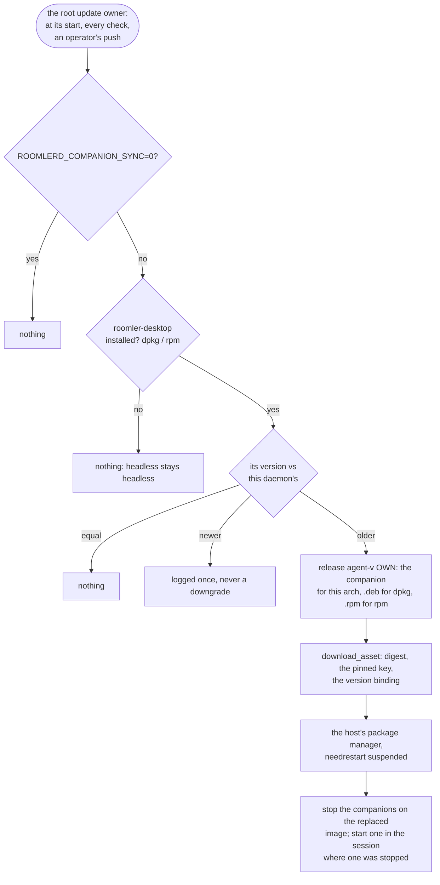

- **Who:** the process that installs updates as root on this host, so a person is never asked for
  a password. That is a system install's root daemon, or a per-user install's root update
  helper (FR-96). A per-user daemon that sees the skew wakes its helper. Mechanics:
  [linux-self-update.md](linux-self-update.md#the-desktop-companion-follows-the-daemon-fr-117).
- **What it reads:** `installed_package` (`companion.rs:367`) asks dpkg, then rpm. ⚠️ dpkg's
  answer counts only for an INSTALLED package (`dpkg_installed_version`,
  `companion/package_sync.rs:56`). `dpkg-query -W` also answers, with a version, for one that was
  removed with its config kept, and a companion a person removed must stay removed.
- **Never a downgrade, never a new install** (`plan`, `package_sync.rs:79`). A companion newer
  than the daemon is someone's deliberate install, and the next daemon update catches up. A host
  with no companion stays without one.
- ⚠️ **The picker is a positive match** on `roomler-desktop-…-unknown-linux-gnu.<deb|rpm>`
  (`pick_asset`, `package_sync.rs:103`), the mirror of the daemon picker's `is_daemon_asset`. So
  the two can never take each other's package (§10.1's freeze, one axis over).
- **A running companion is restarted** (`restart_replaced`, `package_sync.rs:412`). The package
  manager renames the new binary over the old, so a running companion's `/proc/<pid>/exe` reads
  `… (deleted)` (`is_replaced_companion`). Those are stopped, and a new one starts in the
  graphical session where one was stopped, through FR-27's `systemd_run_command`, as the Windows
  swap does (#1686). A companion that was not running stays stopped.
- **The grid catches up at once:** the sync drops `installed_version`'s 10-minute cache
  (`forget_installed_version`, `companion.rs:322`).
- **Kill switch:** `ROOMLERD_COMPANION_SYNC=0` turns off FR-117's two additions, the Linux sync and
  the Windows retry. Windows' refresh at start is older and stays.

### 13.1 Checking for updates: one click from the tray (#2936)

The tray's **Check for Updates** and the Overview's **Updates** card run one routine. A tray click
shows the window at once and hands the rest to the page:

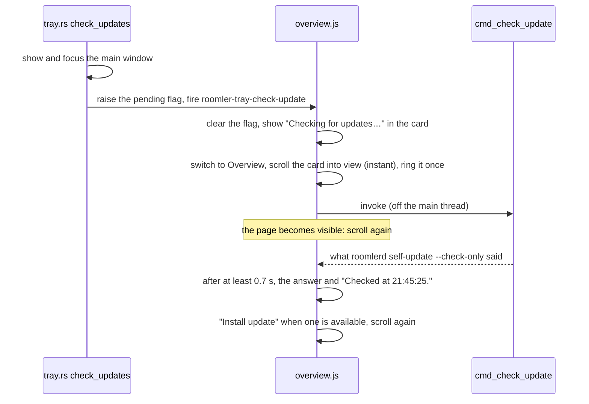

| Piece | Where | Why |
|---|---|---|
| the tray's half | `check_updates`, `src/tray.rs:588` | it used to run the check on the menu thread and show the window only afterwards, at the top of Overview. So: seconds of nothing, then a result in the last card, below the fold, and people scrolled down and clicked again |
| the event and the flag | `tray_check_update_js`, `src/tray.rs:574` | the flag covers a page that is not listening yet. A test pins the event name on both sides (`the_tray_update_check_fires_what_the_overview_listens_for`) |
| one check | `runUpdateCheck`, `src/front/overview.js:184` | the card's button and the tray share it: a stale "Install update" is hidden first, the button is disabled while it runs, and a failure lands in the card |
| a check you can see | `MIN_CHECKING_MS`, `src/front/overview.js:173` | "Checking for updates…" stays up at least 0.7 s, and the answer carries the time it was asked ("Checked at 21:45:25."). On 0.4.177 an answer that came back at once read as no check at all (field, a Mac, 2026-10-26) |
| into view | `scrollToUpdates`, `src/front/overview.js:214`; `revealUpdates`, `:234` | the Updates card is the last one on Overview, and `#content` is what scrolls. The scroll is INSTANT and repeated: once the page is visible, and when the answer lands. On 0.4.177 a smooth scroll never happened on a Mac: it is driven by animation frames, and the tray runs it while the window is still coming up |
| the ring | `flashUpdates`, `src/front/overview.js:220`; `.card.flash` in `styles.css` | draws the eye to the card. A static outline instead when the OS asks for reduced motion |
| off the main thread | `cmd_check_update`, `agents/roomler-desktop/src/commands.rs:1611` | a synchronous Tauri command runs on the app's main thread, and this one waits for a spawned `roomlerd` and a network round-trip |

⚠️ **Installing stays a separate click.** The menu item says "Check for Updates", and on macOS
**Install update** queues the root update helper (FR-27).

## 14. Opening links: View screen and Open Roomler (#2713)

**View screen** on the Devices page (`cmd_open_remote`, `src/commands.rs:1173`), **Open Roomler**
on the Overview page and the tray all open a link through one function, `open_web_or_browser`
(`src/commands.rs:976`):

| OS | Where the link opens | When nothing can open it |
|---|---|---|
| Windows | the in-app WebView2 window (Chromium: the full viewer works), else the default browser | the browser fallback's error |
| macOS | the default browser (`open`) | the shell's error |
| Linux | **the app registered for the link's scheme**, through GIO, with an activation token that brings a running browser forward (`open_in_browser`, `src/commands.rs:1026`; §14.2) | a dialog and the button's error as its tooltip: *No web browser is set up on this computer…*, until the next success puts the button's own back (`src/front/devices.js:261`, #2729) |

⚠️ **Linux never uses `xdg-open` for this.** When no app claims a link's scheme, xdg-open (GNOME:
`gio open`) falls back to the link's **content** type: it fetches the page, sees `text/html` and
hands the link to the `text/html` default. Measured 2026-10-22 on a Fedora Asahi GNOME box with no
browser installed: View screen opened the viewer's URL in GNOME Text Editor, which showed the
page's HTML. A missing browser must be an error the person can act on, never a text editor.

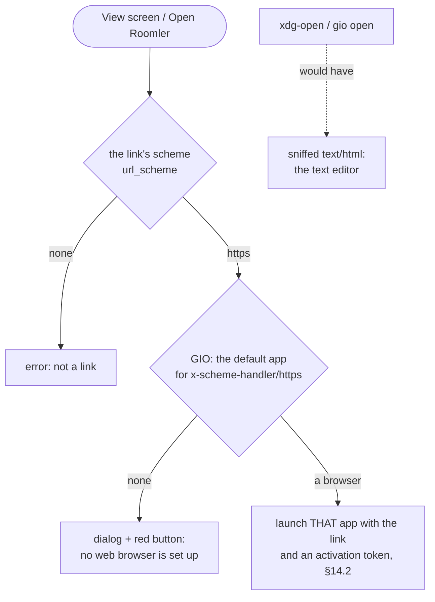

### 14.1 A companion the daemon starts carries the desktop's environment

The lookup above reads the desktop's own defaults, which depends on the companion's environment:

| Variable | What it changes |
|---|---|
| `XDG_CURRENT_DESKTOP` | GIO reads the desktop's `<desktop>-mimeapps.list` only with it (GNOME's names Firefox, KDE's Falkon) |
| `XDG_DATA_DIRS` | where apps are found, `~/.local/share/flatpak/exports/share` included: a browser installed as a **per-user Flatpak** is invisible without it |
| `XAUTHORITY` | X11 authorisation beside `DISPLAY` |
| `LANG`, `LANGUAGE`, `LC_*` | the person's locale rather than the system's |

A companion the desktop starts (its autostart entry) has all of these. One the **daemon** starts
did not: FR-27's consent launch, FR-117's restart after an update
(`restart_replaced`, `agents/roomlerd/src/companion/package_sync.rs:412`) and the post-install
first run all go through `systemd_run_command` (`agents/roomlerd/src/companion.rs:724`). For a
root daemon that is a transient **system** unit, which inherits nothing of the desktop; its
environment was logind's four variables (`XDG_RUNTIME_DIR`, the session bus, `DISPLAY`,
`WAYLAND_DISPLAY`) and nothing else.

Since #2713 a root daemon reads the session user's systemd manager environment, the store the
desktop fills at login, by running `systemctl --user show-environment` **as that user** (the one
privilege-drop path, `exec::drop_to_std`), bounded at 5 s (`user_manager_environment`,
`companion.rs:804`). It passes on an **allowlist** of it (`SESSION_ENV_KEYS`, `companion.rs:752`;
parsing in `session_env_pairs`, `companion.rs:778`):

- ⚠️ **An allowlist, not the whole environment.** The values are the user's own, and the companion
  runs as that user, so no privilege crosses. But loader plumbing (`LD_*`, `GTK_MODULES`) has no
  business in a process the daemon starts, and the bus, display and runtime dir keep coming from
  logind.
- ⚠️ A value systemd had to shell-escape (`KEY=$'…'`), an empty one, or one with a control
  character is skipped, never decoded. Nothing on the allowlist needs one.
- A per-user daemon's `systemd-run --user` unit inherits the manager's environment already, so it
  reads nothing. When the manager's environment cannot be read, the companion starts as it always
  did.
- 🔑 **Check it on a host:** read the running companion's `/proc/<pid>/environ` (as root) for
  `XDG_CURRENT_DESKTOP`, and its `/proc/<pid>/cgroup` for which manager started it: a
  `system.slice/run-…service` is the daemon's launch, an `app-…` scope or service under
  `user@<uid>.service` is the desktop's.

### 14.2 A browser that is already running comes forward (#2729)

With the browser already open behind the companion, a launch without a token opened the tab and
left the window where it was. GNOME's focus-stealing prevention does not raise a window for a
request that names no user action, so to the person View screen did nothing. The companion now
asks GDK for an **activation token** tied to the click and hands it to the browser
(`launch_default_handler`, `src/commands.rs:1065`; the token, `activation_token`,
`src/commands.rs:1084`):

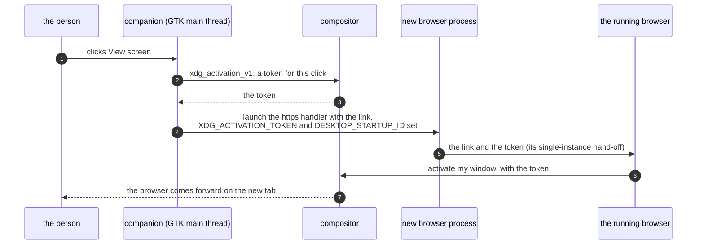

- ⚠️ **The token goes in the environment explicitly**, in a plain GIO launch context. GLib asks a
  launch context for a token only when the app's desktop file says `StartupNotify=true`, and
  Fedora's Chromium's has no such key. Measured 2026-10-22 on the lab's Fedora Asahi GNOME box
  (GTK 3.24.52, GLib 2.84, mutter 48, Chromium 148), three launches from a GTK 3 window with the
  browser open behind it:

  | Launch | New tab | Window raised |
  |---|---|---|
  | no launch context (the companion before #2729) | yes | **no** |
  | GDK's own launch context | yes | **no**: GLib asked it for no token |
  | GDK's token, set explicitly in a plain GIO context | yes | **yes** |

- ⚠️ **A plain context, never GDK's own with the token set on it.** On Wayland, GDK's launch
  context answers `get_display` with the compositor socket's name, and GIO writes that answer into
  the launched program's `DISPLAY`. An X11 client the browser starts would then look for an X
  server called `wayland-0`. Measured on the same box: GDK's context answers `'wayland-0'`, a
  plain one `None`.
- ⚠️ **GTK main thread only.** The token comes from GDK, while View screen and Open Roomler are
  async commands on Tauri's runtime, so the launch hops to the main thread and waits for the
  answer (`on_main_thread`, `src/commands.rs:1098`). The tray's Open Roomler is already there,
  and Tauri runs a main-thread task in place for a caller on the main thread, so the wait cannot
  deadlock.
- Best-effort: with no GDK display, or off its thread, there is no token and the link opens as
  it did before.
- **GNOME Web is covered**, although it runs as one instance. Fedora's package (48.5) has no
  `DBusActivatable`, so GIO starts `epiphany <link>`, and that process hands the link, with the
  token from its environment, to the running GNOME Web over D-Bus. Measured 2026-10-23 on the same
  box, with the companion on 0.4.158: GNOME Web was minimized, and View screen restored it and
  brought it forward on the new tab.
- Not covered: a browser whose desktop file says `DBusActivatable=true`. GIO starts it over D-Bus
  itself, so it takes no environment from the companion, and GLib puts a token into the activation
  only from a context that answers for one, which a plain context never does. It would open the tab
  and may stay behind. None measured.

### 14.3 A browser the companion opened outlives the companion (#2729)

A browser that View screen or Open Roomler **started**, because none was running, is the
companion's child, so it starts in the companion's cgroup. Chromium moves its own browser process
into an `app-org.chromium.Chromium-<pid>.scope` once it is up, but everything it started before
that stays where it was launched: its zygotes, the GPU process, the renderers, the network and
storage services and its crash handlers (measured on Chromium 148: the browser process in its
scope, 10 helpers in the companion's unit). A companion the desktop autostarted sits in an
`app-…` scope, and a scope does not stop when one process in it exits. One the **daemon** started
(§14.1) is the main process of a transient `systemd-run` **service**: systemd stops a
`Type=simple` service when its main process exits, and under the default `KillMode=control-group`
kills everything left in its cgroup. Quitting the companion, a crash, and FR-117's restart after
**every** update (`restart_replaced` sends the old companion SIGTERM,
`agents/roomlerd/src/companion/package_sync.rs:418`) each killed those helpers, and the browser
crashed with them (the field check below).

Since #2729 the daemon starts the companion with `--property=KillMode=process`
(`systemd_run_command_with`, `agents/roomlerd/src/companion.rs:889`), in a root daemon's system
unit and a per-user daemon's `--user` unit alike: stopping the unit signals the companion only.
Its own helpers end with it regardless, since WebKit's web and network processes exit when their
UI process's connection closes.

Measured 2026-10-22 on the same box, with a replica of the daemon's unit whose main process starts
a child and exits after 4 s:

| Unit | The child at 2 s | The child at 8 s |
|---|---|---|
| `systemd-run --quiet --collect --uid=<uid>` (before #2729) | alive, in `system.slice/run-…service` | **killed** |
| the same with `--property=KillMode=process` | alive | alive |

- ⚠️ A unit keeps the mode it started with. On the update that brings this change, FR-117's
  restart of the OLD companion still takes a browser that companion opened with it, once; every
  companion the new daemon starts is `KillMode=process`.
- 🔑 **Check it on a host:** `systemctl show <unit> -p KillMode`, with the unit read from the
  companion's `/proc/<pid>/cgroup`. The helpers of a browser the companion started name the same
  unit in their own `cgroup` files (Chromium's browser process names its `app-…` scope), and all
  of them survive `kill -TERM <companion pid>`.

### 14.4 Field check (#2729)

Run on the lab's Fedora Asahi GNOME box (GNOME 48 Wayland, Chromium 148) with a companion the
daemon started. The before column comes from 0.4.153; the after column is the release that
carries #2729, run 2026-10-23 00:19–00:24 UTC.

| Check | 0.4.153 | 0.4.154 |
|---|---|---|
| A browser the companion opened, through FR-117's restart of that companion on an update | the old unit (`KillMode=control-group`) stopped at 00:19:55, and **in the same second** the browser died: SIGTRAP, a core dump, none of its 11 processes left; its next start offered "Restore pages? Chromium didn't shut down correctly" | the new unit reads `KillMode=process`. A SIGTERM to the companion, which is what FR-117 sends, leaves the browser and all its helpers running (the dead unit still holds them), the companion's two WebKit helpers exit by themselves, and the browser opens new tabs afterwards |
| View screen with the browser open behind the companion | a new tab, and the window stays behind | the window comes forward on the new tab (twice) |
| The button after a failure (the browser's entry masked with a user-level `Hidden=true`), then a success | the *No web browser is set up…* tooltip outlives the success | the failure shows it, and the success puts the button's own tooltip back and drops the red |

The update path itself was the operator's: `roomlerd self-update`, then a restart of the service
(#2724). The new daemon's FR-117 sync logged `companion: the desktop companion package now matches
this daemon … from=0.4.153 to=0.4.154 restarted=1`.
