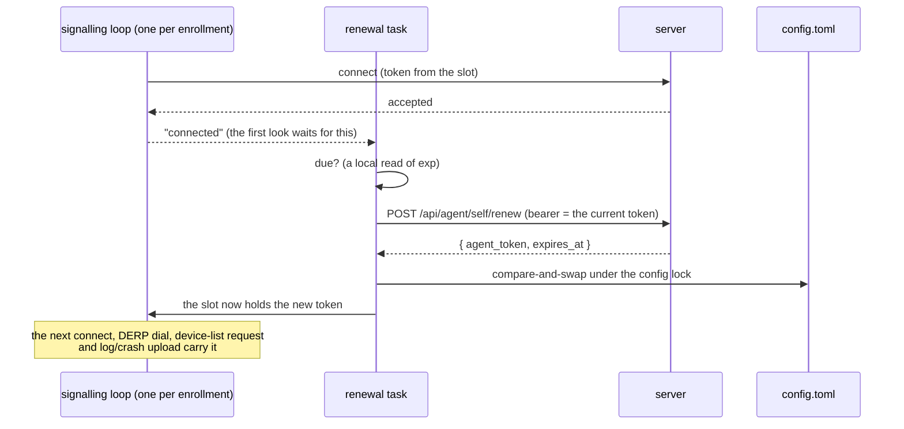
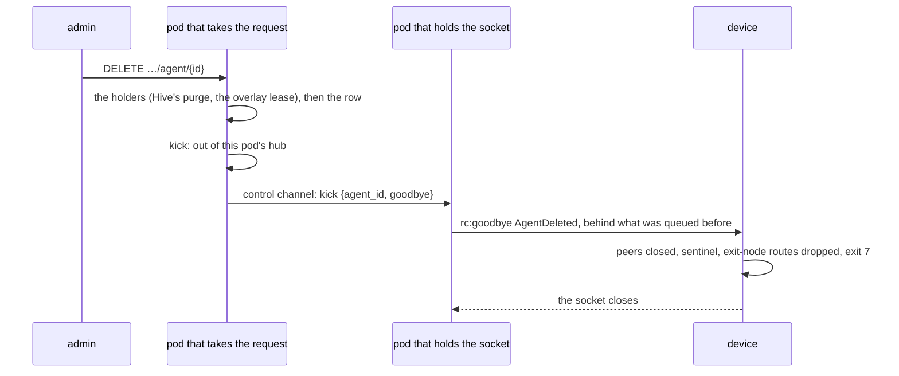

# Device credentials — enrollment, renewal, removal

Every enrolled device and every `roomler` tunnel client holds a long-lived credential the server issued. This page is what each one is, how it stays alive without hands on the machine (FR-103), and how it ends.

> **The short version.** A device's agent token lives a year. The device renews it itself, 180 days early. A device that was off across its expiry renews within a 90-day grace when it comes back. Removing a device ends every token it was ever given, even if the same machine enrolls again and revives the row. A device connected at its removal is told at once and stops (#2267).

## 1. The credentials

| Credential | Issued by | Lives | Renewed by | Ends when | Where it is kept |
|---|---|---|---|---|---|
| **Enrollment token** | an admin (`POST /api/tenant/{tid}/agent/enroll-token`) | 10 min, **single use** | — | used, or 10 min pass | pasted once; never stored |
| **Agent token** (`aud = agent`) | `POST /api/agent/enroll` | 365 days (`rc.agent_token_ttl_secs`) | **the device** (`POST /api/agent/self/renew`) | the device is removed (generation), or it lapses past the grace | the daemon's `config.toml` (`agent_token`, or `[[orgs]].agent_token`) |
| **Tunnel-client token** (`aud = tunnel-client`) | `POST /api/tunnel-client/enroll` | 365 days | **the `roomler` CLI** (`POST /api/tunnel-client/renew`) | the client is removed (generation), or it lapses past the grace | the CLI's `config.toml`, `0600` |
| **Service credential** (`AgentService`, FR-94) | `POST /api/agent/anchor`, elevated | 365 days | the SYSTEM service (`POST /api/agent/service/renew`) | the device is un-anchored, re-anchored or removed | `%ProgramData%\roomler\roomler\exec-service\anchor.json`, SYSTEM + Administrators only |
| **Egress grant** (`net_grant`, FR-90 P3-7-1b) | the vault, answering `rc:vault.net` for one agent session | at most 900 s, with no leeway past its end | never: a session asks again for each tool call | its end; the network module believes it only on its origin device's own connection, toward the exit it names, in its organization, and holds every flow to it (P3-7-2a, [`tunnels.md`](tunnels.md#an-agent-sessions-grant-fr-90-p3-7-2a)) | the daemon that asked, once one does (P3-7-3) ([`vault.md`](vault.md) §21) |

FR-104 adds one variation on the first row: an enrollment token minted with `anchor: true` may also anchor the device it enrolled, once ([`fleet-rpc.md`](fleet-rpc.md) § Anchoring).

## 2. The lifecycle of an agent token

```mermaid
stateDiagram-v2
  [*] --> Live: enroll (gen = row.token_gen)
  Live --> Live: renewed when due (same gen; the old token stays valid)
  Live --> Expired: exp passes while the device is off
  Expired --> Live: renewed within 90 days (the grace)
  Expired --> Dead: more than 90 days past exp
  Live --> Dead: the device is removed (token_gen + 1)
  Dead --> Live: re-enrollment mints at the new generation
```

**When it is "due"** (one rule, shared by the daemon and the CLI: `roomler_cli::credential::renew_at`):

| Token | Due at |
|---|---|
| a year-long token | **180 days before expiry**, i.e. at 185 days old |
| a short-lived token (a server minting with a short `rc.agent_token_ttl_secs`) | **half its lifetime**, whichever of the two comes first |
| with `ROOMLERD_TOKEN_RENEW_BEFORE_DAYS=N` | exactly *N* days before expiry: the field-test override, which can make a fresh token due at once |

## 3. Renewal

- **Idempotent, no rotation.** The server mints a fresh token for the same device and generation; the old one stays valid until its own `exp`. A lost answer costs nothing, and a copy that missed the renewal keeps working.
- **One live slot per enrollment** (`TokenSlot`, `crates/agent-core/src/token_slot.rs:21`). Every consumer reads it at the moment of use rather than keeping a startup copy:
  - the control socket, per connect;
  - the DERP dialer, per dial: the overlay runtime outlives the connection that built it;
  - the device-list HTTP identity and the LocalAPI status row, per request;
  - for the primary, the log and crash uploaders.
- **When it looks** (`agents/roomlerd/src/token_renewal.rs`, `run`):
  - after every connect the server accepted, and on the schedule that look returns (at most 12 h, at least 1 min);
  - never before the first connect, so a device that cannot reach its server asks it nothing;
  - a random 0–60 s delay spreads a fleet that reconnected at once;
  - after a failure that may pass, it waits a full hour, and reconnects meanwhile do not trigger another try.
- **Saving** (`RemoteConfigServices::persist_agent_token`, `agents/roomlerd/src/remote_config.rs:408`). A compare-and-swap under the daemon's config lock, finding the enrollment by `(server_url, tenant_id)` wherever it now lives (scalar or `[[orgs]]`).
  - A file holding a *different* token was re-enrolled meanwhile, and that token wins.
  - A file naming another device for the enrollment is refused, with nothing written.
  - A save that fails still puts the renewed token in use: the file's token stays valid, so nothing is lost.
- **The tunnel CLI** has no daemon, so it renews when it is used: before `roomler forward` and `roomler socks5` dial. Its save is the same compare-and-swap, through an owner-only temp file renamed over the target.

### On a 401: recover before backing off

When the server refuses the token at the socket (`signaling.rs:838`), the loop tries two things before its back-off ladder:

1. **A newer token in the config file**, matched by server, tenant *and* device id. `roomlerd re-enroll` (or the companion's Re-enroll) wrote it while the daemon ran. Before FR-103 the daemon ignored it until a restart.
2. **A renewal**, which the server grants up to **90 days past `exp`** (`RENEWAL_GRACE_SECS`, `crates/services/src/auth/mod.rs:110`). On the renew routes only; every other route enforces `exp` as before.

Either earns one prompt retry. A refusal straight after a recovery waits out the normal ladder, so a server that renews a token its socket then refuses cannot spin the loop.

> ⚠️ The grace is what makes an anniversary survivable for a device that was off. The release routes are unauthenticated, so such a device first updates (if it was too old to renew), then renews, then reconnects. It needs no hands on the machine as long as it comes back within 90 days of its token's expiry.

## 4. A removal ends every earlier token

Enrollment **revives** a removed row in place for the same `(tenant_id, machine_id)`, so a revived row used to accept every token it had ever issued (#2133's shape).

- **`token_gen`** is the fix. Each token carries the row's generation (`gen`), and removing a device increments it in the same atomic update that tombstones the row (`soft_delete`, `crates/services/src/dao/agent.rs:1101`; tunnel clients `crates/services/src/dao/tunnel_client.rs:297`). From then on only tokens minted after the removal are accepted.
- **Where it is checked**, at all five sites, each of which already loads the row:

| Site | Where |
|---|---|
| `AuthAgent` (every agent HTTP route) | `generation_refusal`, `crates/modules/fleet/src/auth_agent.rs:96` |
| the agent socket, decided before the upgrade (answers 401) | `ws_upgrade_agent`, `crates/modules/fleet/src/socket.rs:1442` |
| DERP | `crates/modules/network/src/derp.rs:400` |
| the tunnel-client socket | `crates/modules/network/src/tunnel.rs:2305` |
| the tunnel-client HTTP routes | `accepted_tunnel_client`, `crates/modules/network/src/routes/tunnel.rs:249` |

- **The order at each site:** the deleted/quarantined check runs first, so a removed device still gets its typed `Goodbye AgentDeleted` and exits 7. The generation is compared only on a live row.
- **The service credential** has no generation: a removal clears `exec_anchor` (#2133), which ends it.

> ⚠️ Rows removed before FR-103 P1 reached the server keep generation 0, so their old tokens can still revive. That is accepted (the spec's decision 3): such rows are few, and only an old removal is affected.

### A connected device is told at once (#2267)

A removal ends with a **kick**, run on the pod the request landed on and, through the control channel, on the pod that holds the device's socket (`kick`, `crates/modules/fleet/src/removal.rs:96`). It takes the device out of the hub and queues `rc:goodbye AgentDeleted` on its socket (`Hub::kick_removed_agent`, `crates/modules/fleet/src/hub.rs:1125`). The daemon stops on it exactly as it does when a connection is refused: it closes its peers, raises the needs-attention sentinel, drops any exit-node routes and exits 7 (`agents/roomlerd/src/signaling.rs:1051`).

Before #2267 the kick only took the device out of the hub. The device kept its socket and heard nothing. It learned of its removal at its next connection, after a network change or a pod roll, and on a stable network that could take days. Nothing could be done through that socket, because every action re-checks the row, but the device's own status read "connected" throughout.

| Removal | Is the device told? | Why |
|---|---|---|
| the admin's `DELETE …/agent/{id}` | yes | |
| the ephemeral reaper | yes | |
| an organization's archive | yes | before #2267 the archive did not even take the device out of the hub (`crates/modules/fleet/src/tenant_hooks.rs:50`) |
| an ephemeral device's own unenroll | **no** | it is already shutting down, and a goodbye racing that clean stop would turn it into exit 7 (`tells_the_device`, `crates/modules/fleet/src/removal.rs:111`) |
| a device this removal sent `rc:hive.purge_all` (FR-90 P2g-4a), on a build that drains (`hive-purge-drain`, #2294) | yes, after the purge's frame | its daemon finishes that purge before the goodbye's exit, bounded at 5 min (`finish_removal_purge`, `agents/roomlerd/src/hive/supervisor.rs:1273`) |
| the same on `agent-v0.4.137` or `0.4.138` (`hive-purge-all` without `hive-purge-drain`) | **no**, and its socket stays open as before | that build exits at once on the goodbye, and its purge runs after its frame lands (`crates/modules/fleet/src/hub.rs:1134`) |

> ⚠️ `hive.replicaset` is server-wide, and the removal's purge goes to every connected device that advertises `hive-purge-all`, in any org. Every release since 0.4.137 does, as a property of the build. Before #2294 that meant no removed device on those builds was told once the replicaset was turned on. A build that drains is told whatever the setting. The same drain also covers a pod roll mid-purge, whose reconnect is refused with the same goodbye.

What happens after exit 7 depends on how the daemon is installed. The device stays down until it is re-enrolled, and on some installs it needs a hand to start again. `roomlerd re-enroll` ends by naming the right step for the install it runs on, and so does the removal's needs-attention sentinel (`Install`, `agents/roomlerd/src/service.rs`; #2293):

| Install | After exit 7 | After `roomlerd re-enroll` |
|---|---|---|
| Windows, the `Roomler` service (machine installs, attended or not) | its supervisor starts the worker again with a backoff of up to 60 s, for good; each start is refused and exits 7 (`decide_exit_reaction`, `agents/roomlerd/src/win_service/supervisor.rs:937`) | the next start connects with the new token, with no hand |
| Windows, the per-user Scheduled Task | `<RestartOnFailure>` relaunches it **ten times, a minute apart**, then it stays down until the next sign-in | within those ten minutes, the next relaunch; after them, `roomlerd service start` |
| macOS (launchd, `KeepAlive` on a failed exit) | relaunched at most every 10 s | the next relaunch, with no hand |
| Linux, the system unit `roomlerd` | stays stopped: `RestartPreventExitStatus=7 8`, because restarting only hammers a server that already said no (`agents/roomlerd/packaging/linux/roomlerd.service:72`) | `sudo systemctl start roomlerd` |
| Linux, the per-user unit `roomler` | stays stopped, by the same rule | `roomlerd service start` |

A secondary organization's goodbye ends only that organization's loop, and nothing starts the loop again: after re-enrolling it, restart the daemon (`roomler restart`, or `sudo systemctl restart roomlerd` for the Linux system unit).

> ⚠️ Never answer a removal with `roomlerd run` on a host whose daemon a service manager owns. By hand it starts an unmanaged orphan beside the unit, the task or launchd. `re-enroll` suggested exactly that until #2293.

A first `roomlerd enroll` ends the same way, by naming the step that connects the new enrollment on its install (`Install::after_enroll`, #2371). A fresh primary may land on a daemon that is stopped, crash-looping on its missing config, or running, so each step works in all three states:

| Install | After `roomlerd enroll` |
|---|---|
| Linux, the system unit | `sudo systemctl restart roomlerd` |
| Linux, the user unit | `roomlerd service start` (`roomlerd service install` also starts it at every login), or `roomler restart` if it is running |
| Windows, the `Roomler` service | the supervisor picks the config up within a minute, or `roomler restart` |
| Windows, the per-user task | `roomlerd service start` (`roomlerd service install` first if there is no task), or `roomler restart` |
| macOS | launchd picks it up within seconds, or `roomler restart` |
| an added organization (`[[orgs]]`), any install | a daemon restart, since only a restart starts its loop |

`roomlerd run` is named last, for a host without the package.

> ⚠️ Linux's "start it again" is not new. Before #2267 the same exit happened at the device's next connection, so a remove → `re-enroll` sequence kept running without a start only while the socket happened to stay up between the two steps.

> ⚠️ A device is told only on a socket it holds. One that is offline at its removal hears it at its next connection, as before.

## 5. Kill switches and knobs

| Where | Switch | Default | Off means |
|---|---|---|---|
| server | `rc.token_renewal` (`ROOMLER__RC__TOKEN_RENEWAL`) | on | both renew routes answer 404; devices keep the token they have |
| server | `rc.token_generation_check` | on | the generation is not compared; removal no longer ends earlier tokens |
| server | `rc.agent_token_ttl_secs` | one year | test knob: the TTL tokens are minted with. Prod is never shortened |
| server | `rc.removal_goodbye` (`ROOMLER__RC__REMOVAL_GOODBYE`) | on | a removal's kick only takes the device out of the hub, and a connected device keeps its socket until something else drops it, as before #2267 |
| device | `ROOMLERD_TOKEN_RENEWAL=0` | on | no renewal and no adopting a token from the file: the token it started with, as before FR-103 |
| device | `ROOMLERD_TOKEN_RENEW_BEFORE_DAYS=N` | unset | renew exactly *N* days before expiry (testing) |

> ⚠️ On an attended Windows install the signalling loop runs in the per-user **worker**, which does not inherit a service's environment. To set a device knob there, set a machine-wide environment variable and restart the machine.

## 6. Seeing it

- **`roomler status`** prints `credential  expires in N days` for the primary enrollment, and one line per enrollment on a multi-org device. It is read from the token in use, so it moves the moment a renewal lands. An expired token says how much grace is left.
- **The dashboard** stays quiet for a healthy device. A device within 60 days of expiry gets an amber "credential expires in N d" chip in its Status cell (it is not renewing: an agent too old, or a refused renewal). An expired one gets a red chip that says whether the grace still covers it.
- **The device row** records the `exp` of the newest token the device holds (`token_exp`), and the API returns it as `token_expires_at`. A renewal records it at once: the device keeps its socket and presents the new token only when it reconnects, which can be weeks away. Every connect then records the token actually presented, so a device that lost a renewal's answer is corrected at its next connect (`agent.rs` `self_renew`, `socket.rs` at the upgrade).

## 7. Related

- [`fleet-rpc.md`](fleet-rpc.md) — the anchor and the service credential.
- [`security-baseline.md`](security-baseline.md) — the device plane.
- [`multi-org.md`](multi-org.md) — one token per enrollment.
- `docs/fr/FR-103-device-credentials-renew-themselves.md` — the spec, decisions and field log.
