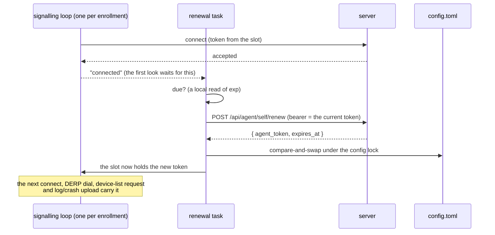

# Device credentials — enrollment, renewal, removal

Every enrolled device and every `roomler` tunnel client holds a long-lived credential the server issued. This page is what each one is, how it stays alive without hands on the machine (FR-103), and how it ends.

> **The short version.** A device's agent token lives a year. The device renews it itself, 180 days early. A device that was off across its expiry renews within a 90-day grace when it comes back. Removing a device ends every token it was ever given, even if the same machine enrolls again and revives the row.

## 1. The credentials

| Credential | Issued by | Lives | Renewed by | Ends when | Where it is kept |
|---|---|---|---|---|---|
| **Enrollment token** | an admin (`POST /api/tenant/{tid}/agent/enroll-token`) | 10 min, **single use** | — | used, or 10 min pass | pasted once; never stored |
| **Agent token** (`aud = agent`) | `POST /api/agent/enroll` | 365 days (`rc.agent_token_ttl_secs`) | **the device** (`POST /api/agent/self/renew`) | the device is removed (generation), or it lapses past the grace | the daemon's `config.toml` (`agent_token`, or `[[orgs]].agent_token`) |
| **Tunnel-client token** (`aud = tunnel-client`) | `POST /api/tunnel-client/enroll` | 365 days | **the `roomler` CLI** (`POST /api/tunnel-client/renew`) | the client is removed (generation), or it lapses past the grace | the CLI's `config.toml`, `0600` |
| **Service credential** (`AgentService`, FR-94) | `POST /api/agent/anchor`, elevated | 365 days | the SYSTEM service (`POST /api/agent/service/renew`) | the device is un-anchored, re-anchored or removed | `%ProgramData%\roomler\roomler\exec-service\anchor.json`, SYSTEM + Administrators only |

FR-104 adds one variation on the first row: an enrollment token minted with `anchor: true` may also anchor the device it enrolled, once ([`fleet-rpc.md`](fleet-rpc.md) § Anchoring).

## 2. The lifecycle of an agent token

```mermaid
stateDiagram-v2
  [*] --> Live: enroll (gen = row.token_gen)
  Live --> Live: renewed when due (same gen; the old token stays valid)
  Live --> Expired: exp passes while the device is off
  Expired --> Live: renewed within 90 days (the grace)
  Expired --> Dead: more than 90 days past exp
  Live --> Dead: the device is removed (token_gen + 1)
  Dead --> Live: re-enrollment mints at the new generation
```

**When it is "due"** (one rule, shared by the daemon and the CLI: `roomler_cli::credential::renew_at`):

| Token | Due at |
|---|---|
| a year-long token | **180 days before expiry**, i.e. at 185 days old |
| a short-lived token (a server minting with a short `rc.agent_token_ttl_secs`) | **half its lifetime**, whichever of the two comes first |
| with `ROOMLERD_TOKEN_RENEW_BEFORE_DAYS=N` | exactly *N* days before expiry: the field-test override, which can make a fresh token due at once |

## 3. Renewal

- **Idempotent, no rotation.** The server mints a fresh token for the same device and generation; the old one stays valid until its own `exp`. A lost answer costs nothing, and a copy that missed the renewal keeps working.
- **One live slot per enrollment** (`TokenSlot`, `crates/agent-core/src/token_slot.rs:21`). Every consumer reads it at the moment of use rather than keeping a startup copy:
  - the control socket, per connect;
  - the DERP dialer, per dial: the overlay runtime outlives the connection that built it;
  - the device-list HTTP identity and the LocalAPI status row, per request;
  - for the primary, the log and crash uploaders.
- **When it looks** (`agents/roomlerd/src/token_renewal.rs`, `run`):
  - after every connect the server accepted, and on the schedule that look returns (at most 12 h, at least 1 min);
  - never before the first connect, so a device that cannot reach its server asks it nothing;
  - a random 0–60 s delay spreads a fleet that reconnected at once;
  - after a failure that may pass, it waits a full hour, and reconnects meanwhile do not trigger another try.
- **Saving** (`RemoteConfigServices::persist_agent_token`, `agents/roomlerd/src/remote_config.rs:262`). A compare-and-swap under the daemon's config lock, finding the enrollment by `(server_url, tenant_id)` wherever it now lives (scalar or `[[orgs]]`).
  - A file holding a *different* token was re-enrolled meanwhile, and that token wins.
  - A file naming another device for the enrollment is refused, with nothing written.
  - A save that fails still puts the renewed token in use: the file's token stays valid, so nothing is lost.
- **The tunnel CLI** has no daemon, so it renews when it is used: before `roomler forward` and `roomler socks5` dial. Its save is the same compare-and-swap, through an owner-only temp file renamed over the target.

### On a 401: recover before backing off

When the server refuses the token at the socket (`signaling.rs:836`), the loop tries two things before its back-off ladder:

1. **A newer token in the config file**, matched by server, tenant *and* device id. `roomlerd re-enroll` (or the companion's Re-enroll) wrote it while the daemon ran. Before FR-103 the daemon ignored it until a restart.
2. **A renewal**, which the server grants up to **90 days past `exp`** (`RENEWAL_GRACE_SECS`, `crates/services/src/auth/mod.rs:104`). On the renew routes only; every other route enforces `exp` as before.

Either earns one prompt retry. A refusal straight after a recovery waits out the normal ladder, so a server that renews a token its socket then refuses cannot spin the loop.

> ⚠️ The grace is what makes an anniversary survivable for a device that was off. The release routes are unauthenticated, so such a device first updates (if it was too old to renew), then renews, then reconnects. It needs no hands on the machine as long as it comes back within 90 days of its token's expiry.

## 4. A removal ends every earlier token

Enrollment **revives** a removed row in place for the same `(tenant_id, machine_id)`, so a revived row used to accept every token it had ever issued (#2133's shape).

- **`token_gen`** is the fix. Each token carries the row's generation (`gen`), and removing a device increments it in the same atomic update that tombstones the row (`soft_delete`, `crates/services/src/dao/agent.rs:960`; tunnel clients `crates/services/src/dao/tunnel_client.rs:297`). From then on only tokens minted after the removal are accepted.
- **Where it is checked**, at all five sites, each of which already loads the row:

| Site | Where |
|---|---|
| `AuthAgent` (every agent HTTP route) | `generation_refusal`, `crates/modules/fleet/src/auth_agent.rs:96` |
| the agent socket, decided before the upgrade (answers 401) | `ws_upgrade_agent`, `crates/modules/fleet/src/socket.rs:1295` |
| DERP | `crates/modules/network/src/derp.rs:400` |
| the tunnel-client socket | `crates/modules/network/src/tunnel.rs:2076` |
| the tunnel-client HTTP routes | `accepted_tunnel_client`, `crates/modules/network/src/routes/tunnel.rs:249` |

- **The order at each site:** the deleted/quarantined check runs first, so a removed device still gets its typed `Goodbye AgentDeleted` and exits 7. The generation is compared only on a live row.
- **The service credential** has no generation: a removal clears `exec_anchor` (#2133), which ends it.

> ⚠️ Rows removed before FR-103 P1 reached the server keep generation 0, so their old tokens can still revive. That is accepted (the spec's decision 3): such rows are few, and only an old removal is affected.

## 5. Kill switches and knobs

| Where | Switch | Default | Off means |
|---|---|---|---|
| server | `rc.token_renewal` (`ROOMLER__RC__TOKEN_RENEWAL`) | on | both renew routes answer 404; devices keep the token they have |
| server | `rc.token_generation_check` | on | the generation is not compared; removal no longer ends earlier tokens |
| server | `rc.agent_token_ttl_secs` | one year | test knob: the TTL tokens are minted with. Prod is never shortened |
| device | `ROOMLERD_TOKEN_RENEWAL=0` | on | no renewal and no adopting a token from the file: the token it started with, as before FR-103 |
| device | `ROOMLERD_TOKEN_RENEW_BEFORE_DAYS=N` | unset | renew exactly *N* days before expiry (testing) |

> ⚠️ On an attended Windows install the signalling loop runs in the per-user **worker**, which does not inherit a service's environment. To set a device knob there, set a machine-wide environment variable and restart the machine.

## 6. Seeing it

- **`roomler status`** prints `credential  expires in N days` for the primary enrollment, and one line per enrollment on a multi-org device. It is read from the token in use, so it moves the moment a renewal lands. An expired token says how much grace is left.
- **The dashboard** stays quiet for a healthy device. A device within 60 days of expiry gets an amber "credential expires in N d" chip in its Status cell (it is not renewing: an agent too old, or a refused renewal). An expired one gets a red chip that says whether the grace still covers it.
- **The device row** records the `exp` of the newest token the device holds (`token_exp`), and the API returns it as `token_expires_at`. A renewal records it at once: the device keeps its socket and presents the new token only when it reconnects, which can be weeks away. Every connect then records the token actually presented, so a device that lost a renewal's answer is corrected at its next connect (`agent.rs` `self_renew`, `socket.rs` at the upgrade).

## 7. Related

- [`fleet-rpc.md`](fleet-rpc.md) — the anchor and the service credential.
- [`security-baseline.md`](security-baseline.md) — the device plane.
- [`multi-org.md`](multi-org.md) — one token per enrollment.
- `docs/fr/FR-103-device-credentials-renew-themselves.md` — the spec, decisions and field log.
