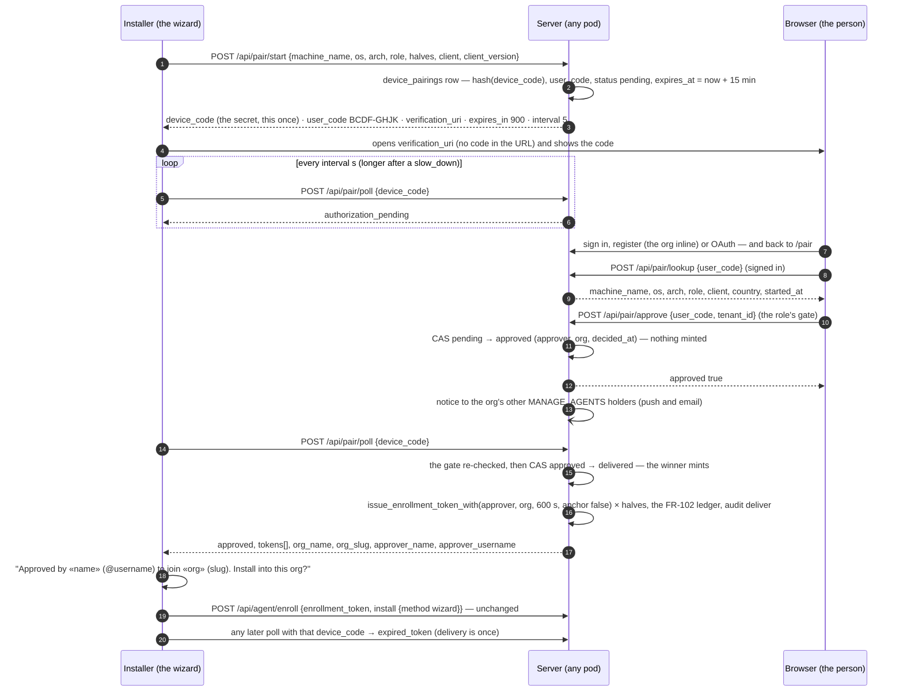
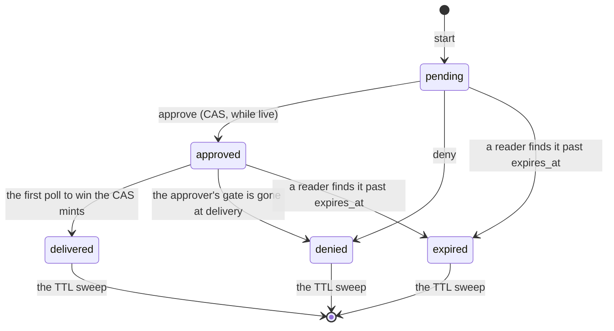

# Device pairing — an installer joins an organization with nothing to copy

**Anchors:** master `f44058c8f` (FR-129 A1 [#3040](https://github.com/gjovanov/roomler-ai/pull/3040),
A2 [#3026](https://github.com/gjovanov/roomler-ai/pull/3026), A3
[#3027](https://github.com/gjovanov/roomler-ai/pull/3027) and B1-s
[#3044](https://github.com/gjovanov/roomler-ai/pull/3044) merged; §13, terminal pairing: master
`fa8ce1147`, A4 [#3045](https://github.com/gjovanov/roomler-ai/pull/3045)) ·
**Spec:** [FR-129](fr/FR-129-guided-cross-platform-installer.md)
([#3022](https://github.com/gjovanov/roomler-ai/issues/3022)) · **Routes:** [api.md](api.md) ·
**Collections:** [data-model.md](data-model.md)

Every `file:line` below was read at that commit. The spec carries the decisions and the
field-verification log; this document describes what the merged code does and why it is
shaped that way.

## 1 · What pairing is for

Before FR-129, a person who had just downloaded Roomler and had no account faced a text box:
"Paste a fresh token from the Roomler admin UI". Getting one took seven steps across two
applications and an inbox, with a ten-minute clock on the last two (the spec's
[field evidence](fr/FR-129-guided-cross-platform-installer.md#the-field-evidence)).

Pairing turns the token step around. The installer asks the server for a pairing, shows an
eight-letter code and opens the browser on `/pair`. The person signs in or creates an account
(and their organization) there, types the code, sees which device is asking, and approves it.
The installer's next poll receives the ordinary enrollment token, says which organization it
was approved into and by whom, and installs on the person's click. Nothing is copied: not a
token, not a link with a code in it.

The shape is RFC 8628, the OAuth 2.0 Device Authorization Grant — two codes, a polling
installer, `slow_down`, `access_denied`, `expired_token` — because its split between what the
device holds and what the person types is exactly the property this flow needs, and its
failure modes are known rather than new.

## 2 · The flow



The three server-side requests — `start`, `approve`, `poll` — may each land on a different
pod, and nothing about a pairing lives in a pod's memory (§9). The row is the pairing:



Every transition is a compare-and-set on the stored `status`
(`crates/services/src/dao/device_pairing.rs:60-144`), so two concurrent approvals, or two
polls after one approval, cannot both win.

## 3 · Two codes, two holders

| | `device_code` | `user_code` |
|---|---|---|
| What it is | 32 CSPRNG bytes as unpadded base64url, 43 characters (`generate_device_code`, `crates/modules/fleet/src/pairing.rs:292-296`) | 8 letters from `BCDFGHJKLMNPQRSTVWXZ` — the 20 consonants with no look-alikes, about 34.6 bits, rejection-sampled so every letter is equally likely (`generate_user_code`, `:247-258`); shown `XXXX-XXXX` (`:262-268`) |
| Who holds it | the installer, in memory: `DeviceCode` has no `Display` and a `Debug` that prints nothing of it (`crates/agent-core/src/pairing.rs:99-116`); the wizard keeps it in its `PairStore`, never in the webview (§11) | the person, who reads it off the installer and types it in the browser |
| At rest | only `hex(SHA-256(code))`, as `device_code_hash`, unique (`hash_device_code`, `:299-301`; `crates/db/src/models/device_pairing.rs:26-27`) — a copy of the database cannot poll | stored without the hyphen; unique **among `pending` rows** by a partial index, so a decided pairing frees its code and `start` regenerates on a collision (`crates/modules/fleet/src/lib.rs:632-643`) |
| On the wire | POST bodies only: `start`'s response is the one time it leaves the server, and `poll`'s request the only place it goes | `start`'s response, and the bodies of `lookup`, `approve` and `deny` |
| What it retrieves | the token — the **only** credential that can | nothing: it names a pairing to a signed-in person |
| In a log line | never: the two structs that carry it redact it from `{:?}` on the server (`:192-216`), the client does the same (`crates/agent-core/src/pairing.rs:112-116`), and an integration test asserts no response but `start`'s and no database row carries it (`crates/tests/src/pairing_tests.rs:531`) | not a secret: it names the pairing, as its row id does |
| Typed input | — | case-insensitive, hyphens and spaces optional; anything that is not exactly eight letters of the alphabet names no pairing and counts as a miss (`normalize_user_code`, `:273-289`). The page drops every other character as it is typed, so a vowel or a digit never fills the field (`ui/src/utils/pairing.ts:21-29`) |

The split is what makes the rest hold. A code read off a screen, photographed or
shoulder-surfed is worth nothing to an attacker **as a poller** — it retrieves no token. It is
worth something only to an attacker **as an approver**, which is the hijack direction, and §5
says what closes it.

> ⚠️ The alphabet has no vowels and no digits. A code that reads `O` or `0`, `I` or `1`, was
> misread: neither is in it. The page cannot be made to accept them.

## 4 · Mint on delivery

**Approval is a decision, not a mint.** `approve` records the approver, the organization and
the time by CAS `pending → approved` and mints nothing (`pairing.rs:1246-1267`); the row
holds no token, and the FR-102 ledger has no row yet (test `:299-304`).

**The first poll that sees `approved` mints**, in this order (`deliver`, `:928-1063`):

1. **The gate, asked again.** The same question the approval asked — `MANAGE_AGENTS` in that
   organization for a daemon pairing, membership for a tunnel one (`gate_holds`,
   `:659-696`) — is asked of the approver *now*. An approver demoted in between gets nothing:
   the row is closed `approved → denied` (`deny_at_delivery`,
   `crates/services/src/dao/device_pairing.rs:101-111`), the poll answers `access_denied`,
   and the audit says `refuse refused:gate_lost` with the approver's id (test `:820`).
2. **The CAS `approved → delivered`** (`DevicePairingDao::deliver`, `:115-129`). Winning it
   is the right to mint. A loser — a second poll in flight, or any poll after a delivery —
   gets the same `expired_token` a swept row gets, audited once per source per hour as
   `refused:already_delivered`.
3. **The mint, by the existing calls**, `halves` times. A daemon pairing takes
   `issue_enrollment_token_with(approver, org, ENROLLMENT_TTL_SECS, anchor = false)`
   (`crates/services/src/auth/mod.rs:541`; the 600 s is the admin route's own constant,
   `crates/modules/fleet/src/agent.rs:26`) and writes the FR-102 ledger with
   `record_issued(jti, org, approver, now)` exactly as `POST …/agent/enroll-token` does
   (`pairing.rs:992-1011` beside `agent.rs:115-126`). A tunnel pairing takes
   `issue_tunnel_enrollment_token(approver, org, 600)` (`auth/mod.rs:731`) through the
   services layer, so no `fleet → network` edge appears; like the tunnel admin route, it
   writes no ledger row.
4. **The names and the unique handles.** The organization's `name` and `slug`, the
   approver's `display_name` and `username` (`:1032-1045`) — the installer's hijack guard
   (§5).

Consequences, each a property rather than a feature:

- **No token ever rests in the database.** `device_pairings` holds a hash and a decision;
  `pairing_audit` holds ids. The test that greps every row for the device code also greps
  the ledger (`pairing_tests.rs:591-599`).
- **Everything downstream is unchanged**: the enroll route, the single-use `jti`, the
  10-minute life, the plan's device cap and the archived-org refusal all meet a paired token
  exactly as they meet a pasted one (tests `:908`, `:947`). A paired token never anchors
  (`anchor = false`, operator decision 4): anchoring stays a deliberate act through the
  enrollment dialog (FR-104).
- **Delivery is once.** A delivery response lost on the wire is not recoverable: the row is
  `delivered`, the token expires unused in ten minutes, and the installer starts a new
  pairing. The wizard's Cancel on the approval card has the same effect by design (AC5): the
  device stays unenrolled, the pairing stays `delivered`.
- **Two halves, one approval.** `halves: 2` is accepted only for `os: macos, role: daemon`
  (`validate_start`, `:327-334`): delivery then mints two daemon tokens, each on the ledger,
  for the per-user half and the root half of a macOS install (operator decision 7, B2).

> ⚠️ The tunnel enroll route never checked for an archived organization — a pre-existing gap
> the spec files separately. `approve` refuses an archived organization for **both** kinds,
> before the decision is recorded (`:1223-1245`), so no administrator is told a device was
> paired into a closed org.

## 5 · The threat model, in both directions

The device-code flow has a known phishing hole, and here it runs both ways, because the
thing being approved is a device that will run as SYSTEM or root on somebody's machine.

### 5.1 Phishing — an attacker's device into a victim's organization

The attack: the attacker starts a pairing on their own machine and sends the victim "open
roomler.ai/pair and approve the device". If the victim does, a daemon the attacker controls
joins the victim's org — on its mesh, under the tenant's coarse scope wherever no overlay ACL
is compiled.

| Control | Where |
|---|---|
| **The link never carries the code.** `/pair` has no `:code` parameter and reads no query (`ui/src/plugins/router.ts:116-123`); `verification_uri` is `app.frontend_url + /pair` and nothing else (`pairing.rs:820-823`). The person must **type** the eight letters, which is them saying "this is the device in front of me" (operator decision 1: a pre-filled link is exactly what a phishing message carries) | router, `start` |
| **The device is shown before Approve.** Machine name, system (OS and architecture), what it becomes (the daemon, or a tunnel client), the installer and its version, the starting address's country (or "an unknown location"), and when it started — ticking, so "3 minutes ago" stays true (`ui/src/views/pair/PairView.vue:102-109`, `:351-374`) | `lookup`, the page |
| **The warning sits beside the facts**: "Only approve a device you are setting up right now, in front of you. If you did not start this install yourself, deny it." (`ui/src/locales/en.json:133-134`), with **Deny** as the second button. A denial closes the pairing: the installer's next poll answers `access_denied` and the code names nothing any more (`deny`, `pairing.rs:1293-1362`; test `:789`) | the page, `deny` |
| **The gate.** Only a `MANAGE_AGENTS` holder can approve a daemon pairing into an org; a plain member cannot be talked into adding a root-level agent. Any member may approve a **tunnel** client — the same rule the tunnel enroll-token route has always had — and the notice names the kind so an admin can tell the two apart (`gate_holds`, `:659-696`; `role_label`, `crates/modules/fleet/src/pairing_notice.rs:32-39`) | `approve`, delivery |
| **The org's other admins are told** (§8), with the words "If nobody in your organization was setting this device up, remove it from the device list and review who holds the permission to add devices." (`crates/services/src/email.rs:668-671`) | the notice |
| **The installer's free text is text.** `machine_name`, `client` and `client_version` are trimmed, stripped of control characters and capped at 64 characters, never refused; markup is kept as text and every renderer escapes it, so a pairing named like a password-reset link mails its own characters, not a link (`clamp_field`, `:307-313`; `render_device_paired_notice`, `email.rs:649-683`; test `:1183-1217`) | `start`, the notice, the SPA |

### 5.2 Hijack — a victim's device into an attacker's organization

The attack: a signed-in attacker guesses a live `user_code` and approves someone else's
pending install into *their* org, and gets remote control of a stranger's machine.

| Control | Where |
|---|---|
| **The code space and the clock.** 20⁸ ≈ 2.6 × 10¹⁰ codes, and a pairing lives 15 minutes (`[pairing] ttl_secs`), so at any moment the live codes are a vanishing fraction of the space | `start`, `expires_at` |
| **Misses are counted per account.** A lookup, deny or approve of a code that names no live pairing, and an approval the gate refused ("an org you cannot add devices to is as much a probe as a code that names nothing", `:1207-1210`), each count; at `[pairing] misses_per_account_per_hour` (10) that account's `lookup`, `approve` and `deny` answer 429 for the rest of the hour (`account_locked`, `:625-629`; test `:1001`). Every miss is on the audit with the user's id | §6 |
| **The real lock: the installer shows the org and the approver before it installs**, by their **unique** handles beside the display names — "Approved by «Dana» (@dana) to join «Acme» (acme). Install into this org?" — and installs only on that click (`agents/roomler-setup/src/front/index.html:213-221`; `app.js:923-932`). A display name is free text anyone can set; the username and the slug are unique, so a name copied from the real admin does not pass as them (`pairing.rs:1029-1045`). An approval into an org you do not recognise ends at your own screen: Cancel leaves the device unenrolled | delivery, the wizard |
| **The token is bound to the pairing it came from.** The wizard refuses to install with it for a different role or a different server than the pairing was started for (`PairStore::token_for`, `agents/roomler-setup/src/pairing.rs:247-272`) | the wizard |

> ⚠️ The ceilings are **abuse ceilings, per pod, in memory** — not the security boundary. The
> boundary is the device code (nothing but it retrieves a token) and the installer's
> confirmation (nothing installs without the person's click on the org they recognise). A
> caller spread across pods gets each pod's allowance (`crates/core/src/rate_limit.rs:97-101`),
> which is the right trade against a Redis round trip on every poll.

## 6 · The limits

| Ceiling | Keyed by | Default | Past it | Where |
|---|---|---|---|---|
| The global per-`/api` governor | the client address | — | 429 from the governor, which the installer treats like a `slow_down` (below) | [api.md](api.md#rate-limiting) |
| `start` per address per hour | the client address as the trusted-proxy chain reports it (`client_ip_or_peer`, `crates/core/src/client_ip.rs:67`, `app.rate_limit_trusted_hops`) | 60 (`[pairing] start_per_ip_per_hour`; `0` disables) | 429 `rate_limited`, **before the body is read**; a refused attempt still counts, so a flood stays refused (`pairing.rs:712-730`; `WindowLimiter::check`, `rate_limit.rs:138-151`); audited `start refused:ip_ceiling` once per address per hour | `start` |
| The poll interval, per pairing | the row's `poll_interval_secs` and `last_poll_at` | 5 s (`[pairing] poll_interval_secs`) | `{status: slow_down, interval}` with the interval lengthened by 5 s, capped at 60 (`SLOW_DOWN_STEP_SECS`, `MAX_POLL_INTERVAL_SECS`, `:74-77`; `decide_poll`, `:356-384`), persisted with `$max` so a concurrent poll that read the old interval can never lower what another answered (`slow_down_update`, `dao/device_pairing.rs:177-182`; test `:631`) | `poll` |
| Misses per account per hour | the user id | 10 (`[pairing] misses_per_account_per_hour`; `0` disables) | 429 `rate_limited` — "Too many pairing codes that matched nothing; try again in an hour" — on `lookup`, `approve` and `deny` for the rest of the hour; audited `refused:account_locked` with the user id | `lookup` · `approve` · `deny` |
| The pairing's life | the row's `expires_at` | 900 s (`[pairing] ttl_secs`) | `expired_token` to the installer, 404 to the page; the first reader past the clock flips the row to `expired` by CAS, so the expiry is audited exactly once (`live_pending`, `:591-612`; `expire_once`, `:615-622`; test `:757`) | every route |
| A user-code collision | — | 5 retries (`CODE_RETRIES`, `:87`) | both codes regenerated, never reused; 503 "Could not allocate a pairing code" after five | `start` |

**What is a miss, exactly** (`record_miss`, `:633-637`): a `lookup` 404; a `deny` 404; an
`approve` 404 for a code that names no live pending pairing; an `approve` 403 by the gate
(`no_permission`, `not_a_member`). **Not a miss**: an archived organization (403 — the code
was real, `:1223-1227`), a decision lost to a concurrent one (404 — not a guess, `:1252-1265`),
a bad `tenant_id` or a body that is not a request (400), and anything a locked account sends
(429, answered before the counter). The lock lifts when the oldest of the last ten misses
leaves the hour (`WindowLimiter::at_limit`, `rate_limit.rs:172-187`): a locked account's
further attempts do not extend it.

**RFC 8628 §3.5 in the clients.** A `slow_down` carries the server's next interval; the
client takes the longer of that and what it polled with (`interval_after_slow_down`,
`crates/agent-core/src/pairing.rs:226-228`). An HTTP **429** on `poll` is not the pairing's
own answer but the governor's — several installers behind one corporate NAT trip it
together — so the client types it `PollOutcome::RateLimited` rather than failing
(`:383-389`) and backs off like a `slow_down`: the polled interval plus 5 s, or `Retry-After`
when that is longer, never shorter (`interval_after_rate_limit`, `:219-222`). The wizard
shows "The server asked for a slower pace — trying again." and keeps the pairing
(`agents/roomler-setup/src/front/app.js:785-794`). A 429 on `start` is an error shown with
the Start button, not a loop (`app.js:671-677`). On the web page a 429 is shown in the
product's words — the server's own message where it sent one, else the client's text with
`Retry-After` (`ui/src/api/client.ts:156-167`, `rateLimitMessage`, `:74-82`) — and is never
read as a session failure.

**Every route takes JSON and says so.** A body whose content type is not `application/json`
or a `+json` type is refused 415 before it is read (`declares_json`, `parse_body`,
`:529-568`): a cross-site `text/plain` form post cannot reach the cookie-authenticated
`approve` or `deny` without a CORS preflight, which a foreign origin does not get (test
`:665`).

### Settings

| Setting | Env | Default | What it is |
|---|---|---|---|
| `[pairing] enabled` | `ROOMLER__PAIRING__ENABLED` | `true` | the kill switch (§12) |
| `[pairing] ttl_secs` | `ROOMLER__PAIRING__TTL_SECS` | `900` | a pairing's life from `start`; `expires_in` to the installer, `expires_at` on the row |
| `[pairing] poll_interval_secs` | `ROOMLER__PAIRING__POLL_INTERVAL_SECS` | `5` | the interval the installer is told; a poll sooner than the row's current interval earns `slow_down` |
| `[pairing] start_per_ip_per_hour` | `ROOMLER__PAIRING__START_PER_IP_PER_HOUR` | `60` | per address, on top of the governor — a corporate NAT rolling out a floor of machines must not be refused at install twenty-one; `0` disables |
| `[pairing] misses_per_account_per_hour` | `ROOMLER__PAIRING__MISSES_PER_ACCOUNT_PER_HOUR` | `10` | per account; `0` disables |
| `[setup] wizard_pairing` | `ROOMLER__SETUP__WIZARD_PAIRING` | `false` | the operator's assertion that the **released** wizard pairs (§12) |
| `[setup] wizard_unix_daemon` | `ROOMLER__SETUP__WIZARD_UNIX_DAEMON` | `false` | its sibling for B1 — the released wizard installs the daemon on Linux and macOS; not a pairing switch. Since B1-s2 (after this doc's anchors) it is the legacy key, which turns both per-OS switches below on |
| `[setup] wizard_linux_daemon` | `ROOMLER__SETUP__WIZARD_LINUX_DAEMON` | `false` | B1-s2: the same claim for Linux alone, so Linux can go live without macOS (`SetupSettings::linux_daemon`) |
| `[setup] wizard_macos_daemon` | `ROOMLER__SETUP__WIZARD_MACOS_DAEMON` | `false` | B1-s2: the same for macOS (`SetupSettings::macos_daemon`) |

`PairingSettings` and its defaults: `crates/config/src/settings.rs:118-183`; `SetupSettings`:
`:91-112`. Both load whole or absent (a file with no `[pairing]` table is the defaults), and a
test pins every default (`settings.rs:2070-2095`, `:2097-2124`).

## 7 · The audit — `pairing_audit`

One row per decision (`PairingAuditEvent`, `crates/db/src/models/pairing_audit.rs:15-44`):
`action`, `outcome` (`ok` or `refused:<reason>`), `pairing_id`, `user_id`, `tenant_id`,
`client_ip` (as the trusted-proxy chain reports it), `machine_name`, `role`, `at`. The refused
rows are the point — an account probing codes, an address flooding `start`, an approver whose
gate was gone at delivery must all leave a trace.

| `action` | `ok` means | `refused:<reason>` |
|---|---|---|
| `start` | a pairing was created (pairing id, machine name, role, address) | `ip_ceiling` · `not_json` · `invalid_request` · `network_unmounted` |
| `lookup` | the typed code named a live pairing (user id, pairing id) | `account_locked` · `not_pending` |
| `approve` | the decision was recorded (user, org, pairing) | `account_locked` · `not_pending` · `no_permission` · `not_a_member` · `network_unmounted` · `archived` |
| `deny` | the pairing was closed by a person | `account_locked` · `not_pending` |
| `deliver` | the token(s) were minted (user = the approver, org, pairing) | — (its refusals are `refuse` rows) |
| `expire` | this reader flipped the row to `expired` (once per pairing) | — |
| `refuse` | — | `unknown_code` · `slow_down` · `already_delivered` · `gate_lost` |

**Durable or bounded.** Every decision about a real pairing and everything a signed-in
account does is a durable row: every `start ok`, every `lookup`, `approve` and `deny` with
either outcome, every `deliver`, `expire` and `gate_lost`. A refusal an anonymous caller can
repeat at will — an address past its ceiling, a body that is not a request, a code that names
nothing, a poll too soon, a poll after delivery — is written **once per
`(action, reason, address)` per hour per pod**, the repeats counted in a debug line
(`Audit::record`, `pairing.rs:466-481`; `WindowLimiter::once`, `rate_limit.rs:200-220`), or a
flood could write a 90-day row per request. The de-duplication map remembers 50 000 sources
per pod (`AUDIT_DEDUPE_MAX_KEYS`, `:95`); past that a new source gets a debug line, not a row —
the safe direction for "we cannot remember whether we saw this source" is to write nothing
more.

**Not audited at all**: a `poll`, `lookup`, `approve` or `deny` body that is not JSON or not a
request (415 / 400, refused before any row — only `start`'s parse refusals are on the trail),
an `approve` with an unparseable `tenant_id` (400), and the empty 404s of the kill switch.

**Never in it**: the device code, a token, an email address. The pairing is named by its row
id, the person by theirs. Rows live **90 days** from `at` (`TTL_SECS`,
`pairing_audit.rs:50`), indexed by `(pairing_id, at)`, `(tenant_id, at)` and `(user_id, at)`
(`lib.rs:646-658`). Writes are best-effort — a failed insert is logged and the request
proceeds (`:495-497`) — so the audit never gates a pairing. The server's own `info!` lines
(`pairing: started` · `approved` · `delivered` · `denied`) name the pairing id, the org and the
user id, never a code.

> ⚠️ A read of the audit on a production pod is a bounded read or nothing: filter by
> `pairing_id`, `tenant_id` or `user_id` (each has its index), sort by `at` descending, and
> `.limit()` it. An unbounded scan inside the Mongo pod has taken the database down before.

## 8 · The admins' notice

An approval tells the organization's **other** `MANAGE_AGENTS` holders — never the approver,
who knows — that a device was paired (operator decision 3). `approve` spawns it after the
decision is recorded (`pairing.rs:1276-1286`; `spawn_paired_notice`,
`crates/modules/fleet/src/pairing_notice.rs:42-66`), and it never gates the answer: a notice
that could not be sent is logged and the approval stands.

| | |
|---|---|
| **Who** | `members_with_permission(org, MANAGE_AGENTS)` minus the approver (`:82-88`). An org whose only admin approved gets none ("no other admin to notify", `:89-92`). A tunnel pairing approved by a plain member still reaches the admins |
| **Two legs per recipient** | an email through `send_device_paired_notice` (`crates/services/src/email.rs:506-513`), rendered by `render_device_paired_notice` (`:649-683`), and a web push to each of the admin's subscriptions (`:142-166`). A failure on one leg or one recipient does not stop the rest; the pod log line `pairing: device-paired notice sent` carries both counts (`:168`) |
| **What it says** | "«approver» paired «machine» («OS») into «org» from «country or 'an unknown location'» — «what it enrolls»", where the kind is "remote desktop and the private network (roomlerd — runs as SYSTEM/root when installed system-wide)" or "a tunnel client (the roomler CLI)" (`role_label`, `:32-39`), and the link is the org's device list. The country is the server's GeoIP answer for the starting address (`GeoIp::country`, `crates/core/src/user_analytics.rs:140`; the image's DB-IP lite database, [deployment.md](deployment.md)) — `None` when it has no answer, never a guess |
| **Escaping** | every field of the mail body goes through the HTML escaper, the subject is plain text with control characters dropped (`header_text`, `email.rs:642-644`), and the push body is plain text the browser renders as text (`pairing_notice.rs:99-109`). The machine name is the installer's own text (§5.1) |
| **Who does not get it** | the approver; members without `MANAGE_AGENTS`; anyone for a *refused* approval — an archived org is refused before the decision (§4), so no admin is told about a closed org; nobody for a denial, a delivery or an expiry |
| **Push reaches only opted-in browsers** | web push is a per-browser opt-in through the notification panel (#2817); an admin who never turned it on gets the email alone. With no mail service configured the push is the only leg |

## 9 · No pod-local state

The front proxy hashes long-lived sockets and requests on the **tenant** so one org's users,
agents and relays share a pod ([multi-pod-scale-out.md](multi-pod-scale-out.md)). A pairing
**has no tenant until it is approved**, so `start`, `approve` and `poll` may each land on a
different pod, and the only state is the Mongo row: no in-memory waiter, no map
(`crates/services/src/dao/device_pairing.rs:3-13`). The consent flow's `ConsentSlot` oneshot
is pod-local and was deliberately not reused. An integration test starts on one server,
looks up, approves and polls on another over one database, and checks delivery is once
across both (`pairing_tests.rs:468`).

What *is* per pod, on purpose: the three `WindowLimiter`s (the start ceiling, the account
misses, the audit de-duplication; `lib.rs:120-130`, built `:316-318`). They are abuse
ceilings, not the boundary (§5), and a flood can therefore leave up to one audit row per pod
per hour rather than one.

The clock is the authority on a pairing's life, not the TTL sweep: the TTL index on
`expires_at` (`lib.rs:641`) only tidies, because its monitor passes every 60 s (an expired row lingers up to a minute, or goes at once), and
**every reader compares `expires_at` to now** (`live_pending`; `decide_poll`; the CAS filters
`expires_at > now` on `approve` and `deliver`). A row found past its life is flipped to
`expired` by whichever reader found it, so the expiry is audited exactly once.

## 10 · The `/pair` page

The route has no `meta.auth` — someone with no account lands here — and no `meta.guest` — a
signed-in person is the one who approves; it is gated on the `fleet` module, which owns
pairing (`ui/src/plugins/router.ts:110-124`). It is reached from a phone as often as from
the PC the installer runs on, so every width is first-class ([ui.md](ui.md)).

Three states by the session (`ui/src/views/pair/PairView.vue`):

| State | What the page does |
|---|---|
| **Signed out** | says what this is ("This connects the installer running on your computer to your account…") and offers every way in: Sign in, Create an account, and the OAuth providers. Each leaves **both** returns before leaving (`keepReturn`, `:289-296`): `pending_redirect = /pair` in sessionStorage for the same tab, and the pending-pairing marker in localStorage for the tab that comes back (below) |
| **Signed in, no code** | the code field, normalised as it is typed and shown `XXXX-XXXX`; **Look up** posts `/pair/lookup` (`:328-345`). A 404 says "No pending pairing with that code. Check the code in your installer; a pairing lasts 15 minutes, and the installer can start a new one. If this server does not offer pairing, paste a token into your installer instead." — the same 404 a server with pairing switched off answers, and the words cover both without claiming either (`en.json:119`). A 429 shows the server's lock message |
| **The review** | the device card (§5.1), the warning, and the organization: a picker over the person's orgs, defaulting to the current one (`:334`), or — with none — "Create an organization" inline, name and slug, the slug following the name until edited, a taken slug said in words (`:135-162`, `:398-414`). **Approve** posts `/pair/approve {user_code, tenant_id}`; **Deny** posts `/pair/deny` (`decide`, `:422-454`). Then `approved` ("your installer continues on its own. You can close this tab"), `denied`, or `gone` on a 404 (expired, or already decided — "Enter another code") |

A **403** on Approve is an answer, not an expired credential: the page says, in the product's
words, that the org needs the *Manage devices* permission (or, for a tunnel client,
membership) and shows the server's message underneath (`:438-449`). The route never sends
`not_a_member` — the one code the SPA navigates out of an org on — even to an outsider
(`gate_holds`, `pairing.rs:653-658`; [security-baseline.md](security-baseline.md), *A 403 is an
answer*), because an approval refused mid-flow must not evict the approver from the page.
The audit row still says `refused:not_a_member`.

### The email-activation detour, carried through localStorage

On production a new email account gets **no session** from `register` and cannot log in until
the activation link is opened — and that link opens in a **new tab** from the mail client,
where `sessionStorage` is empty, so the same-tab `pending_redirect` that brings an OAuth
signup back cannot carry an email signup.

The page therefore also leaves a marker in `localStorage`, which every tab of the origin
shares: `pending_pair_until = now + 15 min` (`rememberPendingPair`,
`ui/src/utils/pairing.ts:72-79`; the TTL matches a pairing's life, `:58`). Each "just signed
in — where to?" decision honours it while it is unexpired, after the invite and the
same-origin `pending_redirect` it already honoured:

| Decision point | Where |
|---|---|
| the router guard's signed-in branch | `ui/src/plugins/router.ts:447-451` |
| the sign-in page | `ui/src/views/auth/LoginView.vue:153-157` |
| the OAuth callback | `ui/src/views/auth/OAuthCallbackView.vue:91-94` |
| the sign-up page: with a session (the auto-verified overlay) straight back; with none it **stays** and says "Registration successful. Please check your email to activate your account. Then sign in, and you will be brought back to the pairing page. The code in your installer stays valid for 15 minutes; if it ran out, start the pairing again there." | `ui/src/views/auth/RegisterView.vue:279-287`; `en.json:95-96` |

While the marker is set, the sign-up page also shows an optional organization name and slug,
so the account can be born with the org the device will join (`RegisterView.vue:72-81`,
`:219`, `:237-241` — the server creates it from `tenant_name` + `tenant_slug`). Without the
marker, the ordinary sign-up page is unchanged.

> ⚠️ **The marker says *when*, never *where*.** The destination is the literal `PAIR_PATH`
> (`utils/pairing.ts:51-55`), never a stored URL, so it adds no open-redirect surface. It is
> consumed once (`takePendingPair`, `:108-112`), an expired or unreadable one reads false and
> is cleared (`hasPendingPair`, `:93-105`), and the page clears it when it mounts signed in
> (`PairView.vue:465-470`) so a later sign-in is not sent back to a pairing that is over. In a
> private window where even touching `localStorage` throws, only the same-tab return remains
> (`:62-69`, `:76-78`).

Production keeps requiring activation before login: pairing works **with** it, never around
it.

## 11 · The wizard

Step 3, "Join your organization" (`agents/roomler-setup/src/front/index.html:176-243`),
leads with "Approve this device from your browser — nothing to copy. Or paste a token you
already have." The pairing card is the primary action; the paste is a collapsed
`I already have a token` beneath it (`:235-237`).

**Where the secrets live.** The device code and, later, the delivered token exist only in
the wizard's `PairStore` (`agents/roomler-setup/src/pairing.rs:112-114`), in this process's
memory, for as long as the session lives. The webview is answered the user code, the page to
open and the clock (`PairStartView`, `agents/roomler-setup/src/commands.rs:455-463`) and a
poll's status, org and approver (`PairPollView`, `pairing.rs:55-63`) — never a secret. This is
structural: `WizardState` has no field for either, so `cmd_save_state` cannot persist one;
the store's `Debug` prints `<redacted>` (test `:554`). The store's mutex is never held across
an await — a command copies what the request needs out (`snapshot`, `:152-159`), awaits the
HTTP call, then applies the answer under a fresh lock (`apply_poll`, `:181-233`).

**The flow** (`app.js:609-624`):

| Phase | What happens |
|---|---|
| **Set up in the browser** | `cmd_pair_start` (`commands.rs:474-509`) posts `start` with the device name from the Server page, this host's OS and architecture, the role's kind, `halves: 1` and `client: wizard` with the wizard's version. The verification URI must be `http(s)://` or the wizard refuses to hand it to the OS (`:496-500`, `:551`). The store replaces whatever pairing it held and bumps the session's **generation** (`begin`, `pairing.rs:134-149`) |
| **Waiting** | the code, large, with **Copy code**; **Open ‹host›/pair** — the store's own URI, carrying no code — which becomes **Open the page again** once used (`cmd_pair_open`, `commands.rs:535-540`); "Waiting for approval in the browser… the code expires in mm:ss"; "Approve it in the browser only if this is the device in front of you."; **Cancel pairing** |
| **The poll loop** | one tick per second updates the countdown and fires `cmd_pair_poll` when the interval is due (`pairTick`, `app.js:739-816`; `commands.rs:520-529`). A poll copies the generation out with the device code, and its answer is applied only if the session is still that one — a poll in flight when the person clicked Cancel or Start again can neither deliver an old pairing's token into the new session nor end the new one with the old one's denial (`apply_poll`, `pairing.rs:189-196`; test `:434`). A failed poll (the network blinked) is retried at the interval with "Could not reach the server … — trying again."; the clock ends the loop one grace interval past expiry, giving the server's own answer a chance first (`:745-749`). `slow_down` and a 429 lengthen the interval as §6 says; a status this build does not know keeps polling and lets the clock decide (`:810-814`) |
| **Approved** | "Approved by «name» (@username) to join «org» (slug). Install into this org?" with **Cancel** and **Install →** (`index.html:213-221`). Install sets `installMode = paired` and runs the ordinary install (`app.js:641-646`): `cmd_install` with `usePaired: true` and an empty `token` (`commands.rs:312-331`), which clones the token out of the store for *this* role and server (`resolve_install_token`, `:362-371`; `token_for`, `pairing.rs:247-272`) — a pasted call never reads the store, so a pairing left behind cannot leak into a paste. The token is cleared when the install **succeeds** (`finish`, `:275-278`), so an install that broke before its enroll can Retry with the same still-valid token; a paired install that failed drops the pairing instead (`app.js:1010-1012`). The done page says which org it joined and who approved it (`:1277-1282`) |
| **Ended** | "This was denied in the browser." or "The code expired.", with **Start again** — a fresh `start`, a fresh pairing (`endPairing`, `app.js:818-827`) |
| **Back, Cancel, a paste** | each forgets the pairing on both sides: the loop here, the device code and any delivered token in the store (`cancelPairing`, `:718-737`; `cmd_pair_cancel`, `commands.rs:546-548`). Nothing is told to the server — the row expires on its own, and Cancel after an approval leaves it `delivered` with the token unused (AC5) |

**The paste fallback.** The `I already have a token` box is the scripted, MSP, offline-mint
and FR-104 anchoring path, and the only path when the server has no pairing: a 404 on
`start` is `StartOutcome::Unavailable`, not an error (`crates/agent-core/src/pairing.rs:336-339`),
and the wizard then hides the card, retitles the box "Enrollment token" and opens it
(`app.js:686-694`, `:889-901`) — silently, because a client cannot tell "switched off" from
"not there".

## 12 · The kill switch, and `/api/setup/features`

**`[pairing] enabled = false`** (`ROOMLER__PAIRING__ENABLED=false`) makes every `/api/pair/*`
route answer the **empty 404** an older server answers — to everyone, signed in or not,
because the switch is read before the person is (`disabled`, `pairing.rs:511-513`;
`require_auth`, `:578-585`; test `:1045`). A disabled server does not even tell an anonymous
caller the routes exist. The clients fall back to paste: the wizard as §11 says, the shared
client with `Unavailable`, and the `/pair` page with the 404 words of §10. A pasted token
enrolls unchanged (test `:1071-1089`). Nothing is unmounted and no index moves: the row
collections stay, empty.

**`GET /api/setup/features`** (B1-s; `setup_features`,
`crates/modules/fleet/src/setup_release.rs:139-146`; route `lib.rs:567`) is the server's
word on which install paths a client may offer, a public JSON object with every key present
(`SetupFeatures`, `:88-99`):

| Key | Reads | Meaning |
|---|---|---|
| `pairing` | `[pairing] enabled` (`:141`) | a fact about **this server**: `/api/pair/*` answers. It mirrors the kill switch, so a consumer can offer "sign in from your browser" up front rather than discover the 404 on `start` |
| `wizard_pairing` | `[setup] wizard_pairing` (`settings.rs:111`) | the operator's assertion about the **released** wizard: it pairs (A3), and that is field-proven against this server. Default `false`, flipped in the deploy env after the field run |
| `wizard_unix_daemon` | `[setup] wizard_unix_daemon` (`settings.rs:100`); since B1-s2, `wizard_linux_daemon && wizard_macos_daemon` | B1's sibling: the released wizard installs the daemon on Linux and macOS; it gates the Linux and macOS daemon cards, not pairing. Since B1-s2 it is what the wizards released before the split read, for both OSes, so one OS on alone shows them nothing; a newer client reads its OS's key OR this one, so a server from before the split, which sends only this key, still works |
| `wizard_linux_daemon` | B1-s2: `[setup] wizard_linux_daemon`, or the legacy `wizard_unix_daemon` (`SetupSettings::linux_daemon`) | the Linux daemon cards alone, so Linux can go live without macOS |
| `wizard_macos_daemon` | B1-s2: `[setup] wizard_macos_daemon`, or the legacy `wizard_unix_daemon` (`SetupSettings::macos_daemon`) | the same for macOS |

The homepages word the install lead as "sign in from your browser" only on
**`pairing && wizard_pairing`** (`ui/docs/theme/home.js:195`, `ui/src/views/LandingView.vue:287`):
`pairing` alone is on by default, and a server image promoted before the first `setup-v*`
that carries A3 would otherwise promise a flow the download cannot do. Every consumer reads
anything but a JSON `true` as **false** — an older server's **400** (measured on production
before B1-s shipped: its `/api/setup/{platform}` route takes "features" as an unknown platform),
a 404, a 503 with fleet unmounted, a proxy's HTML error page, a string `"true"` — so absent means the token lead and
the Windows-only daemon wizard, which is the safe direction. The route is deliberately not a
field on `/api/setup/latest-release` (a bare array every shipped wizard parses), and is not
counted by the install trace. As merged, the wizard itself does not read it: A3 learns
whether the server pairs from `start`'s answer.

## 13 · Terminal pairing

*Anchors in this section: master `fa8ce1147` (A4,
[#3045](https://github.com/gjovanov/roomler-ai/pull/3045)).*

The same flow without a GUI — a server, an SSH session, a script. `roomlerd enroll --pair` runs
the whole pairing in the daemon's own process: the code, the poll, the question, the enroll.
The two install scripts call it where they used to pass `--token`, so the delivered token
never reaches a command line or a file other than the enrolled config.

```text
$ curl -fsSL https://roomler.ai/api/setup/install.sh | sh -s -- --role daemon --pair
==> pairing this machine as 'my-server' with https://roomler.ai — open the page below and type the code

To pair this device, open   https://roomler.ai/pair
and type the code           BCDF-GHJK

(The code expires in 15 minutes. Waiting for the approval…)

Approved in the browser.
  Organization: Acme  (slug: acme)
  Approved by:  Dana  (username: dana)
Join «Acme» (acme) as approved by «Dana» (@dana)? [y/N]
```

| | What it does | Where |
|---|---|---|
| **The flags** | `--pair` stands in for `--token`: one of the two is required, and both together are refused. `--pair-org SLUG` belongs to `--pair`, and a blank one is refused rather than read as absent, because a scripted `--pair-org "$SLUG"` with an empty variable must not quietly turn into the question. `--pair` also refuses `--ephemeral` | `enroll_token_source`, `agents/roomlerd/src/app.rs:2480-2507` |
| **When it pairs** | after every preflight (the target path, the install trace, the archive replica's), so a refusal costs nobody an approval; and **before** the existing config is read, because a daemon running on this machine saves its own config during the wait, and a copy read earlier would be merged and saved over those changes. From that read on, the enroll is exactly the `--token` path: the same machine id, the same `apply_enrollment` merge, the same save | `app.rs:2577-2620` |
| **The code** | the page and the user code, printed. The device code never is (`code_block`, `crates/agent-core/src/pairing_terminal.rs:308`) | |
| **The poll** | the shared client's RFC 8628 back-off, as in the wizard (§6). A poll that fails on the network retries with its own back-off, capped at 30 s, until the pairing's own clock runs out, rather than giving up early (`interval_after_poll_error`, `:100`; `poll_until`, `:512`) | |
| **The guard** | the org's name **and** slug, and the approver's name **and** username. A warning sits beside a slug the admin UI could not have made, or a username with spaces or non-ASCII characters — what a lookalike has to use (`approved_block`, `:320`). Every server-sent string is shown with its control and invisible characters escaped (ESC, CR, bidi overrides, zero-width marks), so a display name cannot repaint the line the person is reading (`shown`, `:277`) | |
| **The question** | `Join «org» (slug) as approved by «name» (@username)? [y/N]` (`question`, `:364`), asked on `/dev/tty` on Unix and on the console (`CONIN$` / `CONOUT$`, written with `WriteConsoleW` so non-ASCII names read right) on Windows (`TtyConsole`, `:152`, `:244`). It is never asked on stdin: under `curl … \| sh`, stdin is the script the shell is still reading. Only `y` or `yes` is yes (`is_yes`, `:265-267`) | |
| **`--pair-org SLUG`** | the approval's slug must equal it **byte for byte**, and then it replaces the question. A server that sends no slug is refused, rather than trusting a display name (`decide`, `:455`) | |
| **No terminal** | with no console and no `--pair-org`, it refuses **before** starting a pairing, so nobody approves one that could never be confirmed (`no_console_before_start`, `:425-427`) | |
| **A refusal** | a no, a mismatched org, no console: nothing is enrolled, the pairing stays `delivered` and its token goes unused, expiring in ten minutes. Each refusal says so (`leaves_behind`, `:392`) | |
| **An older server** | `start` answering 404: "this server does not support pairing … use --token" (`unavailable_message`, `:384`), and a non-zero exit | |
| **The install trace** | `client` on `start` is `script-sh`, `script-ps1` or `roomlerd`, from the install trace's method (`client_for`, `:109`); the enroll records the method as `--token` does | |

> ⚠️ `--pair-org` takes the slug **exactly** as the admin UI shows it. The server accepts any
> string as a slug, so `ACME` or `acme` with a Cyrillic `а` is a *different* org. That is the
> reason for the byte-for-byte match, and an early draft that case-folded let exactly such a
> lookalike through on the dev stack.

**The scripts.** `install.sh --pair [--pair-org SLUG]` (`scripts/install.sh:256-295`) is refused
beside `--token` or `--no-enroll`, for the tunnel role (the `roomler` CLI has no `--pair` yet),
beside `--daemon-token`, and on a B0 half. The slug is checked against a spelled-out character
class, because a range like `a-z` follows the locale's collation in some shells. The enroll
then runs where `--token` ran: as the console user for a per-user install, as root into
`/etc/roomler/config.toml` for `--system`, with stdin from `/dev/null` (`:936-957`). On macOS
the root half is a second enrollment, so a paired per-user install prints the two commands
that pair it afterwards, as root (`:806-814`); one approval for both halves is B2.
`install.ps1 -Pair [-PairOrg SLUG]` has the same refusals (`scripts/install.ps1:207-221`, a
case-sensitive `-cnotmatch`) and enrolls with the role's own elevation and `--machine-global`
logic (`:298`).

## 14 · Troubleshooting

**`expired_token` covers several cases by design** — an unknown or forged device code, a
pairing past its 15 minutes, one already delivered (a second poll, a lost delivery response,
a Cancel and a retry), and a swept row all answer it, and the response never says which, so
a poll is not an oracle (test `:494`). Tell them apart in `pairing_audit`, by the pairing id
where there is one:

| What the audit shows | What happened |
|---|---|
| `refuse refused:unknown_code` with an address and **no** `pairing_id` | the device code named nothing (forged, or a stale one after the row was swept) |
| `expire ok` on the pairing | it ran past `expires_at`; the row is `expired` |
| `deliver ok`, then `refuse refused:already_delivered` | the token went out once already; if the installer did not install, the token expires unused in ten minutes — start again |
| `refuse refused:gate_lost` with the approver's id | the poll answered `access_denied`, not `expired_token`: the approver lost the gate between approve and delivery; the row is `denied` |
| `deny ok` with a user id | a person denied it (`access_denied`) |

The row itself says the same in `status`, `decided_at` and `delivered_at`
(`DevicePairing`, `crates/db/src/models/device_pairing.rs:23-70`).

**"No pending pairing with that code" on the page** (a 404 from `lookup`): the code was
misread (no vowels, no digits — §3); the pairing expired or was already decided (the
installer shows which); the person is on a different server than the installer (a self-hosted
server and roomler.ai do not share pairings); or the server has pairing switched off, which
answers the same 404. A locked account gets a 429 instead, with its own words.

**The 429 lock.** "Too many pairing codes that matched nothing; try again in an hour" is the
per-account ceiling: ten misses within an hour on that account, counted per pod. The
`refused:account_locked` and `refused:not_pending` rows name the user; the lock lifts when
the oldest miss leaves the hour, and nothing the locked account sends extends it.
`ROOMLER__PAIRING__MISSES_PER_ACCOUNT_PER_HOUR=0` disables the ceiling. A `start` refused
429 is the per-address ceiling (sixty an hour per address, `refused:ip_ceiling` with the
address) or the global governor; a floor of machines behind one NAT may need the setting
raised.

**Approved on the page, the installer still waiting.** The installer polls on its own clock
— the page pushes nothing — at an interval that may have grown to 60 s after slow-downs or a
429 from the governor. Look for the `deliver ok` row; until it exists the installer has not
asked since the approval.

**"This server does not offer pairing from the browser."** `[pairing] enabled` is off, or
the server predates A1. Paste a token.

**`network_unmounted`** (400) on a tunnel pairing: this server runs without the network
module, so a tunnel token would have no enroll route to be redeemed on; a daemon pairing is
unaffected (test `:1096`).

**"This organization is archived and accepts no device enrollments"** (403 on Approve): pick
another org. The pairing is still pending and can be approved elsewhere.

**No notice arrived.** There may be no *other* `MANAGE_AGENTS` holder; push reaches only
browsers that opted in; email needs the server's mail service. The pod log's
`pairing: device-paired notice sent` line carries the counts, and `pairing: the
device-paired notice failed` says why when the whole notice failed.

## 15 · Code map

| Layer | Where |
|---|---|
| The routes and every invariant | `crates/modules/fleet/src/pairing.rs` (`start` `:702`, `poll` `:847`, `deliver` `:928`, `lookup` `:1068`, `approve` `:1135`, `deny` `:1293`); mounted at `lib.rs:590-595`, `:615` |
| The notice | `crates/modules/fleet/src/pairing_notice.rs`; the mail `crates/services/src/email.rs:621-683` |
| The rows and their DAOs | `crates/db/src/models/device_pairing.rs`, `pairing_audit.rs`; `crates/services/src/dao/device_pairing.rs`, `pairing_audit.rs`; the index sets `lib.rs:632-658` |
| The ceilings | `crates/core/src/rate_limit.rs:109-220` (`WindowLimiter`); the state `lib.rs:115-130` |
| The settings | `crates/config/src/settings.rs:91-183` (`SetupSettings`, `PairingSettings`) |
| The features route | `crates/modules/fleet/src/setup_release.rs:88-146` |
| The integration tests | `crates/tests/src/pairing_tests.rs` — the happy paths, the codes, the clocks, the decisions, the downstream refusals, the limits, the switches |
| The `/pair` page | `ui/src/views/pair/PairView.vue`, `ui/src/utils/pairing.ts`, `ui/src/plugins/router.ts:110-124`, the three auth views, `ui/src/locales/en.json:109-158` |
| The wizard | `agents/roomler-setup/src/pairing.rs` (the store), `commands.rs:442-548` (the four commands, `cmd_install`'s `usePaired` at `:312-371`), `front/app.js:609-947`, `front/index.html:176-243` |
| The shared client | `crates/agent-core/src/pairing.rs` (`start` `:315`, `poll` `:368`, re-exported as `roomlerd::pairing`) |
| The composition baseline | `crates/tests/fixtures/composition.baseline.json` — the five routes and `/api/setup/features`, re-recorded with `COMPOSITION_UPDATE=1` |
