# Encoders & the Video Pipeline

Everything between the remote host's framebuffer and the viewer's canvas: capture
backends, the **cell matrix** a host advertises and how the viewer resolves it, the
probe that discovers it, the encoder cascade per platform, rate control, and the
browser decode paths. Agent side lives in `agents/roomlerd/src/{capture,encode}/`;
viewer side in `ui/src/composables/{useRemoteControl,videoCells}.ts` + `ui/src/workers/`.
*As of 0.4.87 (FR-77 P0–P4, 2026-09-08).* The design record with every decision's
pros and cons is [`docs/fr/FR-77-encoder-chroma-matrix.md`](fr/FR-77-encoder-chroma-matrix.md);
the words below are the glossary's ([`CONTEXT.md`](../CONTEXT.md)).

| Word | Meaning | Example |
|---|---|---|
| **codec** | the bitstream family | H.264 · HEVC · AV1 · VP9 |
| **backend** | what produces it | NVENC · QSV · AMF · VideoToolbox · VAAPI · D3D12 · Vulkan · Media Foundation · openh264 · libvpx |
| **encoder** | codec × backend, an FFmpeg name | `hevc_nvenc`, `vp9_vaapi` |
| **chroma format** | how much colour the bitstream keeps | 4:2:0 (`yuv420`) · 4:4:4 (`yuv444`, "crisp text") |
| **cell** | codec × chroma format — what a session actually asks for | HEVC 4:4:4 |
| **probe** | the real-bytes trial that proves a cell on a host | `roomlerd caps-probe` |
| **probe cache** | the remembered answer of the last probe, kept only under the build, hardware, drivers and settings that produced it | `caps-cache.json` |
| **denylist** | cells a device must not open or advertise — the kill switch | `hevc_qsv:yuv444` |
| **learned deny** | a cell this host stopped opening because a probe child died in it, kept only in the probe cache and tested again when the key changes | `hevc_vulkan:yuv420` |

## The pipeline

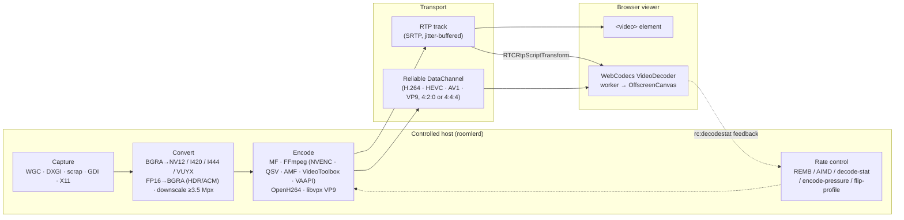

Two transport families with different latency behaviour:

- **RTP track** — standard WebRTC video. Simple and universal, but every frame
  passes the browser's jitter buffer. Up to 0.4.138, Chrome held damage-driven
  frames for 193 ms on average. Since 0.4.139 two fixes take that back:
  - the agent offers `playout-delay` 0/0 by default (FR-98 C6), so Chrome holds
    a frame for 0.1 ms;
  - each frame carries its own capture time, not the previous frame's (#2284),
    so a browser that never negotiates the extension holds frames for a few ms.

  Measured on a release, the RTP track's L4 (input to photon) is p50 37 ms with
  C6 and 52 ms without it. The cells, and the third fault found on this track
  (#2283), are in [FR-98 §9](fr/FR-98-input-to-photon-budget.md#9-field-verification-log).
- **Reliable DataChannel bitstream** — the agent sends encoded access units over
  an ordered DC; a worker feeds WebCodecs and paints an OffscreenCanvas. This
  bypasses the jitter buffer entirely and is how HEVC, AV1, VP9 and low-latency
  H.264 ship, in either chroma format.

## Codec × backend × platform

One build per OS and architecture carries **every** hardware backend FFmpeg offers
for that platform; the probe below discovers at runtime which ones the host can
open. That was decided by a measurement, not a preference — every wrapper is under
1 MB against a 35 MiB `roomlerd.exe` (ADR
[0001](adr/0001-encoder-backends-compiled-in-discovered-at-runtime.md)).

| Codec | Windows | Linux x86_64 | macOS arm64 | Notes |
|---|---|---|---|---|
| **H.264** | MF HW MFTs → MF SW MFT · FFmpeg `h264_nvenc → h264_qsv → h264_amf → h264_d3d12va → h264_vulkan` · OpenH264 | FFmpeg `h264_nvenc → h264_qsv → h264_amf → h264_vaapi → h264_vulkan` · OpenH264 | FFmpeg `h264_videotoolbox` · OpenH264 | the universal baseline; RTP or DC; 4:4:4 on NVENC (`high444p`) |
| **HEVC** | FFmpeg `hevc_nvenc → hevc_qsv → hevc_amf → hevc_d3d12va` (`hevc_vulkan` denied, #3267) · MF HEVC | FFmpeg `… → hevc_vaapi → hevc_vulkan` | FFmpeg `hevc_videotoolbox` | DC-only; 4:4:4 on NVENC (RExt), on QSV/VAAPI/Vulkan behind the denylist |
| **AV1** | FFmpeg `av1_nvenc → av1_qsv → av1_amf → av1_d3d12va → av1_vulkan` · MF AV1 | FFmpeg `… → av1_vaapi → av1_vulkan` | — (`av1_videotoolbox` is not in the registry on current SDKs) | DC-only; 4:2:0 only, every backend; fail-closed; every packet leaves with a temporal-delimiter OBU (`av1_vulkan` omits it — §Hardware frames) |
| **VP9** | FFmpeg `vp9_qsv` · libvpx | FFmpeg `vp9_qsv → vp9_vaapi` · libvpx | libvpx | 4:4:4 on QSV/VAAPI (profile 1, packed VUYX) behind the denylist; libvpx profile 1 is the software 4:4:4 cell everywhere |
| **Opus (audio)** | WASAPI loopback → Opus | PulseAudio monitor → Opus | not implemented | opt-in per session; 48 kHz stereo, 20 ms |

The cascade order is one table per codec in `encode/ffmpeg/encoder.rs`
(`HEVC_ENCODER_NAMES` …): the vendor SDKs first, then `*_videotoolbox`, then
the vendor-neutral rungs `*_vaapi → *_d3d12va → *_vulkan` (FR-78) — a name that
is not in the platform's FFmpeg registry, or whose device is absent, fails in
one line and the next rung is tried. Locked by tests
(`hw_frame_names_close_every_cascade`,
`videotoolbox_and_the_hw_frame_rungs_are_appended_never_prepended`).

| Platform | The vendored FFmpeg 9.0.1 (LGPL, `--disable-everything` + exactly the encoders the tables name; since FR-85 P4c also the software `h264` decoder and the `aac` encoder the screen recorder needs, and never an `hevc` decoder) | Linkage |
|---|---|---|
| Windows x86_64 | the ten vendor encoders (`h264/hevc/av1 × nvenc/qsv/amf` + `vp9_qsv`) + `h264/hevc/av1_d3d12va` + `h264/hevc/av1_vulkan` (sixteen), plus the `h264` decoder and the `aac` encoder, an overlay port over the pinned vcpkg baseline; D3D12 and Vulkan are dlopen'd by FFmpeg (`d3d12.dll`, `vulkan-1.dll`), so the static tree carries no import for either | static (`x64-windows-static-md`) — see [`lgpl-relink.md`](lgpl-relink.md) |
| Linux x86_64 | the same ten + `h264/hevc/av1/vp9_vaapi` + `h264/hevc/av1_vulkan` (seventeen), plus the `h264` decoder and the `aac` encoder, from source; **libva + libdrm built into the tree** and bundled with the libav* in the `.deb` (no `Depends` on the system's libva — why is under *Hardware frames*); `libvulkan.so.1` is dlopen'd, never a DT_NEEDED | shared, the agent's private lib dir via RPATH; the VA driver and the Vulkan ICD are the host's |
| macOS arm64 | `h264/hevc/av1_videotoolbox`, plus the `h264` decoder and the `aac` encoder (~3.0 MB of dylibs), built with `--disable-autodetect` so nothing Homebrew is baked in | shared dylibs in the app bundle |
| Linux arm64 | from 0.4.170 (FR-97 P7a): `h264/hevc/av1_nvenc` + `h264/hevc/av1/vp9_vaapi` + `h264/hevc/av1_vulkan` (ten), plus the `h264` decoder and the `aac` encoder, the Linux x86_64 tree built on an arm64 runner without qsv and amf (neither ships an arm64 Linux runtime); libva + libdrm in the tree, searching `/usr/lib/aarch64-linux-gnu/dri`. Where nothing opens (an Asahi Mac, a GPU-less server) the probe finds no hardware and video stays on OpenH264 + libvpx. **NVENC is proven on arm64** (FR-122, 0.4.189, an NVIDIA GB10): `h264_nvenc` and `hevc_nvenc` in 4:2:0 and 4:4:4 and `av1_nvenc`, sessions on H.264 4:4:4 and AV1, a recording in H.264 + AAC ([FR-122 §8](fr/FR-122-arm64-linux-hardware-cell.md#8-field-verification-log)); VAAPI and Vulkan on arm64 ship unproven. Before 0.4.170: no FFmpeg | shared, bundled in the `.deb` and the tarball like x86_64's |

> [!IMPORTANT]
> **NVENC needs NVIDIA driver 530.41 or newer on Linux, 570.0 on Windows.**
> FFmpeg opens NVENC only when the driver's highest NVENC API is at least the
> SDK the build was compiled against, so the header pin *is* the floor. Linux
> takes `nv-codec-headers` 12.1.14.0 (the vendor jobs' pin, the oldest FFmpeg
> 9.0.1 builds against); Windows takes 13.0.19.0 (the vcpkg baseline's
> `ffnvcodec`). Below the floor the probe advertises no NVENC cell and the
> cascade's next rung serves. The Linux trees pinned 13.1 (driver 610.00) until
> FR-122 P0c, which cost NVENC on NVIDIA's R580 long-term branch and on AWS's
> G5g image (595). Each Linux vendor job now asserts the floor in the binary it
> built ([FR-122 §3.2](fr/FR-122-arm64-linux-hardware-cell.md#32-the-nvenc-driver-floor-p0c)).

> [!NOTE]
> **In a container, NVENC also needs the driver's video libraries.** The NVIDIA
> Container Toolkit mounts `libnvidia-encode.so.1` and `libnvcuvid.so.1` only for
> the `video` driver capability (`NVIDIA_DRIVER_CAPABILITIES`; the toolkit's
> default is `compute,utility`). Without them FFmpeg cannot load NVENC, so the
> probe advertises no NVENC cell on a GPU that has one. Give the container
> `compute,utility,video` (or `all`). Where that is not yours to set, as on a
> rented GPU, the host driver's own packages at its exact version can supply the
> two libraries ([FR-122 §3.1](fr/FR-122-arm64-linux-hardware-cell.md#31-the-rig),
> found on a rented DGX Spark).

## The cell matrix a host advertises (FR-77 P1)

The probe opens **every encoder** in cascade order, not the first that works,
and for the names FFmpeg can open in 4:4:4 (`h264_nvenc`, `hevc_nvenc`,
`hevc_qsv`, `vp9_qsv`, `hevc_vaapi`, `vp9_vaapi`) the 4:4:4 form too. What
opened is the host's cell matrix, advertised in the hello as
`AgentCaps.video_cells` — `{codec, backend, chroma[], hw}` per encoder, wire
strings from `models::{VideoCodec, VideoBackend, ChromaFormat}`
(`crates/remote_control/src/models.rs`), unknown names ignored by older readers —
plus `probe_ms` and `probe_cached`.

| Rule | Why |
|---|---|
| The legacy fields (`hw_encoders`, `codecs`, `transports`, `hevc_chroma`, `vp9_chroma`) keep their exact pre-FR-77 meaning — the FIRST backend in cascade order that opens | a session still cascades in that order, and a viewer older than FR-77 reads nothing else; `data-channel-vp9-444` stays on the wire although it carries both chroma formats |
| `hw` is verified, never assumed | NVENC / AMF / VideoToolbox / VAAPI are hardware by construction; a QSV open proves hardware only on the oneVPL build (FFmpeg's internal MFX session filters `MFX_IMPL_TYPE_HARDWARE`), which `qsv_is_hardware_by_construction` detects by `av1_qsv` being registered (libvpl-only); the native MF cell reports what its cascade landed on |
| A 4:4:4 cell is **opened**, never asserted by name | the pre-FR-77 code advertised `hevc_chroma: yuv444` for any `hevc_nvenc`; now the legacy field says 4:4:4 only when that open succeeded |
| `h264_nvenc` 4:4:4 sets `profile=high444p` | `rext` is HEVC's profile and h264_nvenc rejects it at open, which would read as "cannot do 4:4:4" |
| **The denylist** = the kill switch, both chroma forms: a `name:chroma` cell on it is never opened nor advertised — by the probe AND by a session (`cells::names_420` / `names_444` are the cascade minus the list; the probe and every session constructor read them). Built-in: `hevc_qsv:yuv444, hevc_vaapi:yuv444, vp9_qsv:yuv444, vp9_vaapi:yuv444, hevc_vulkan:yuv444`, and two 4:2:0 cells. `av1_vulkan:yuv420`: its frames do not decode (dav1d fails every frame header, libaom aborts, Chrome paints garbage), reproduced with the FFmpeg CLI's own `av1_vulkan` on the same NVIDIA GPU, an FFmpeg 9.0.1 / driver defect, §Hardware frames. `hevc_vulkan:yuv420`, on Windows only: from driver 32.0.21043 AMD's `amdenc64.dll` faults on the open, in the base probe's child, which costs the host every hardware cell ([#3267](https://github.com/gjovanov/roomler-ai/issues/3267)) | each unproven 4:4:4 cell leaves the list on a field pass; CORPLAP-3's Intel runtime died on the first VUYX open. `encoder_cells_deny` (config, env `ROOMLERD_ENCODER_CELLS_DENY`, pushable through remote config; a change takes effect at the next daemon start) **replaces** the default; `none` denies nothing. Until 0.4.87 it gated only the 4:4:4 open; until 0.4.90 only the probe and the 4:4:4 list read it at all — a 4:2:0 session cascade opened a denied `hevc_vaapi` on jupiter while the hello advertised only the Vulkan cells (FR-78 P3) |
| AV1, AMF, VideoToolbox and Media Foundation are never asked for 4:4:4 | `av1_nvenc` hard-errors on it and every other AV1 backend lists 4:2:0 only; AMF has no 4:4:4 surface; VideoToolbox HEVC has only Main / Main10 / Main42210; `*_mf` takes NV12 — locked by a test against the vocabulary |

What the fleet advertised on 0.4.88 (server records, 2026-09-08; the D3D12 and
Vulkan cells are FR-78's; the arm64 row is FR-122's, on 0.4.189):

| Host | Cells | Probe |
|---|---|---|
| dev box (RTX 5090 Laptop + Radeon 610M, Windows) | `h264/openh264` · `h264/mf` · `hevc/nvenc` 4:2:0+**4:4:4** · `hevc/amf` · `hevc/d3d12` · `hevc/vulkan` · `av1/nvenc` · `av1/vulkan` · `h264/nvenc` 4:2:0+**4:4:4** · `h264/amf` · `h264/d3d12` · `h264/vulkan` · `vp9/libvpx` 4:2:0+4:4:4 | 6.1 s |
| CORPLAP-3 (Intel Meteor Lake iGPU, Windows) | `h264/openh264` · `h264/mf` · `vp9/qsv` · `hevc/d3d12` · `av1/qsv` · `h264/qsv` · `vp9/libvpx` — the Intel driver refuses FFmpeg's D3D12 H.264/AV1 configuration and has no Vulkan encode queue | 6.8 s |
| MacBook (M-series) | `h264/openh264` · `hevc/videotoolbox` · `h264/videotoolbox` · `vp9/libvpx` | 0.1 s |
| jupiter (AMD Raphael / VCN 3.1, Linux, `RADV_PERFTEST=video_encode` in the daemon's environment) | `h264/openh264` · `hevc/vaapi` · `hevc/vulkan` · `h264/vaapi` · `h264/vulkan` · `vp9/libvpx` — RADV refuses AV1 (VCN 3.1 has no AV1 encode) | 0.15 s |
| zeus (the same silicon, without the flag) | `h264/openh264` · `hevc/vaapi` · `h264/vaapi` · `vp9/libvpx` — RADV exposes Vulkan encode only under `RADV_PERFTEST=video_encode` | 0.2 s |
| the WSL sibling (RTX through WSL's libcuda) | `h264/openh264` · `hevc/nvenc` 4:2:0+4:4:4 · `av1/nvenc` · `h264/nvenc` 4:2:0+4:4:4 · `vp9/libvpx` — its four software Vulkan ICDs open and refuse | 5.9 s |
| mars (no GPU, Linux) | `h264/openh264` · `vp9/libvpx` | 0.5 s |
| a rented DGX Spark (NVIDIA GB10, arm64 Linux, driver 580; 2026-10-30) | `h264/openh264` · `hevc/nvenc` 4:2:0+4:4:4 · `av1/nvenc` · `h264/nvenc` 4:2:0+4:4:4 · `vp9/libvpx` — sessions proven on `h264/nvenc` 4:4:4 and `av1/nvenc` | 3.0 s |

The probe's cost grew with the device walk (the dev box 4.3 → 6.1 s, WSL 2.5 →
5.9 s); the cache pays it once per build, driver and hardware.

## The cell resolution — from the matrix to a session

The picker offers two independent dropdowns, **codec** and **chroma format**, and
greys every cell that cannot work with the reason. A cell is offered only when the
agent proved it, the browser can decode it, and this page has not already seen it
fail. Everything the viewer knows about cells goes through ONE derivation,
`ui/src/composables/videoCells.ts` — the codec picker and the admin codec chips
read the same functions.

A stored pick is held to the device again at connect, because the picker only greys
what a person is about to choose. A choice also becomes this browser's default for
every other device, and a per-device override outlives an agent losing a cell. The
agent answers a `preferred_transport` it does not offer by dropping to the RTP track
and telling nobody (`agents/roomlerd/src/signaling.rs:3501`), and the viewer ignores
that track while it holds a DataChannel transport
(`ui/src/composables/useRemoteControl.ts:9811`). The session reads connected, with a
hidden `<video>` playing and a black canvas, and a healthy track keeps the stall
watchdog quiet. So `transportForSession` (`ui/src/composables/videoCells.ts:437`)
runs the auto rank for that session and leaves the pick stored (#3167). H.264 keeps
its own fallback to the RTP track, which is safe only because that pick also forces
`preferredCodec: 'h264'`. HEVC, AV1 and VP9 carry no codec, so their RTP track would
take the best codec both ends list, whether or not the host can open it there.

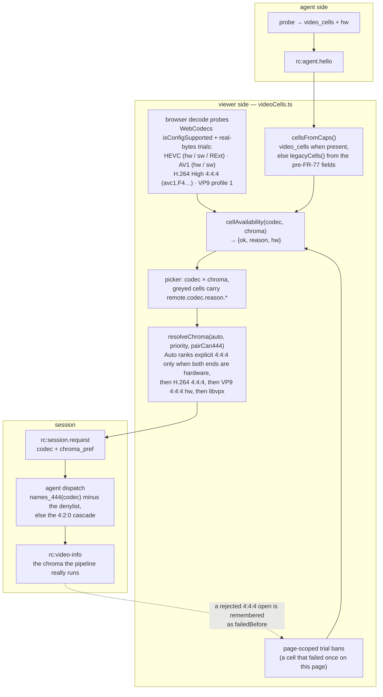

| Reason (`remote.codec.reason.*`) | What it means |
|---|---|
| `agentNo…` / `agentNoH264_444` … | the host's matrix has no such cell (the probe did not open it, or the denylist removed it) |
| `browserNo…` / `browserNoH264High444` … | WebCodecs cannot decode that codec string here (Chromium keeps one `HEVCPROFILE_REXT` for every RExt chroma form, so HEVC 4:4:4 is proven by real bytes, never by `isConfigSupported`) |
| `chroma420` | the codec has no 4:4:4 form on either end (AV1 everywhere) |
| `failedBefore` | this page already saw the cell fail — the page-scoped trial ban is the real proof a cell works |
| `av1NoHw444` | AV1 4:4:4 does not exist as a session cell |

Auto-rank, explicit 4:4:4 first: **HEVC 4:4:4** (hardware on both ends — NVIDIA and
Intel on Chrome ≥ 137) → **H.264 4:4:4** (NVENC `high444p`, software decode) →
**VP9 4:4:4 hardware** (QSV / VAAPI, behind the denylist) → **VP9 4:4:4 libvpx**,
the only rung *Sharper-on-Auto* upgrades to. A session never shares a pipeline
with the other chroma form of the same codec (`FfmpegDcCodec::pipeline_label`:
`HEVC-444`, `H264-444`, `VP9-444`), and `rc:video-info` reports the chroma the
pipeline really runs, so a rejected 4:4:4 open that fell back to 4:2:0 is never
mistaken for the cell that was asked for.

## The probe lifecycle

A capability probe is untrusted third-party code by definition — vendor drivers
and, through them, GPU firmware — so it does not run in the daemon's address
space. `encode::caps::detect()` (`agents/roomlerd/src/encode/caps.rs`) answers
from the cache when it can, and otherwise spawns `roomlerd caps-probe` two or
three times, more if a `base` child dies:

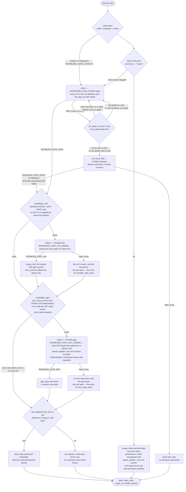

| Outcome of a child | Verdict |
|---|---|
| non-zero exit, or killed by a signal | phase base: it costs the cell it died in, not the host ([below](#a-dead-child-costs-the-cell-it-died-in)), and no hardware only when there is no cell to blame (logged at ERROR with the status) · phase 444: the 4:2:0 matrix, the last announced open named · phase gpu: every cell as before, no GPU-input form, the last announced open named |
| still running after 60 s | killed; as above, except that phase base does not confirm a hang with a second one |
| could not spawn | no answer from that phase, no retry |
| clean exit with no marked line | inside an open: as a non-zero exit (a driver that called `exit(0)`) · otherwise no answer from that phase, no retry |
| a marked line, however the child ended after it | those caps, as reported (phase base; a learning-off run needs a clean exit) |

Why two children (P3c): on the 0.4.84 roll CORPLAP-3's Intel media runtime died
with `0xc0000005` on the first `vp9_qsv` 4:4:4 open over VUYX, and with ONE child
that cost the daemon every hardware cell — `av1_qsv`, `h264_qsv`, `vp9_qsv` 4:2:0
gone for a cell no session needed. A faulting 4:4:4 open now costs only the
4:4:4 forms. The second child announces every open on stdout first
(`ROOMLER_CAPS_PROGRESS:`, line-buffered so it survives the crash) because on a
service host its stderr reaches no log.

Why a third (FR-118 P2-3): a QSV encoder that takes GPU frames
(`zero_copy`, [FR-118](fr/FR-118-gpu-resident-frames.md) §5.4) opens on a frame
pool of the capture's own D3D11 device, an open no other cell makes. The `gpu`
child makes it first and encodes two GPU frames through it. QSV's forms open
on a device of the adapter the SystemContext DXGI arm captures on, and NVENC's
(FR-118 P3) on a device of the NVIDIA adapter, where WGC's device goes.
VideoToolbox's (FR-118 P5) needs no device: the child feeds it IOSurfaces it
makes itself until a packet comes out. A
session opens that form only for an encoder the child proved
(`input_reason=unproven` otherwise), so a driver that faults on it takes down a
child, never the daemon. With `zero_copy` off there are no candidates and no
third child. The proven names (`gpu_input`) ride the cache with the caps; they
are not a wire capability.

Why a cache (P3a): the matrix probe costs 4–6 s on a Windows host with two GPUs,
paid on every daemon start for an answer that changes only when the GPU, its
driver, the OS build or the roomlerd build changes. The key:

| Key part | What it is | Why |
|---|---|---|
| **build** | crate version + the executable's length and mtime | a dev build with the same version number is a different build |
| **hardware** (`encode/hwid.rs`) | Windows: every display-class driver instance's `DriverDesc` / `DriverVersion` / `MatchingDeviceId` from the registry + the OS build and UBR. Linux: sysfs DRM ids + kernel driver per card, the NVIDIA module version, the kernel release, size + mtime of the userspace driver libraries the backends dlopen. macOS: none | NVENC, the Intel media runtime and AMF all ship inside the display driver; Media Foundation's codec set is the OS build's. macOS's probe is ~100 ms and VideoToolbox is the OS — no key, no cache |
| **knobs** | SHA-256 of every `ROOMLERD_*` knob (env + the config fallbacks the child receives) | a denylist edit or `ROOMLERD_DC_H264=0` changes the answer; hashed because an env block can carry a token |

Rules that are load-bearing: only a result with a **hardware** cell is cached (a
no-hardware answer is the cheap case, and the one a service starting before the
display driver produces); a hit takes **only** the driver-derived fields
(`hw_encoders`, `codecs`, `transports`, `hevc_chroma`, `vp9_chroma`,
`video_cells`, the vp9_qsv IDR verdict) and recomputes permissions, the
GUI-session state and every verb list; the hello then says `probe_cached: true`
with `probe_ms` = the cached probe's duration. Every miss logs its reason. A
confirmed learned deny rides the file with the caps, and a hit installs it, so
a session stays out of what the matrix leaves out. On a Windows service host the
WORKER (console session) runs the probe and owns the cache file. Measured: a hit
answers 0.5 s after `agent starting` where the probe took 3.6 s.

⚠️ **The knob half of the key makes every `ROOMLERD_*` variable a probe
trigger, including ones that have nothing to do with encoding.** Flipping a
capture flag (`ROOMLERD_PORTAL_CAPTURE`, `ROOMLERD_VIRTUAL_DESKTOP`, …) misses
the single-entry cache (`a ROOMLERD_* knob changed`) and the next start runs
the full probe — and restoring the old value is a *second* miss. Measured on
the WSL2 dev host (2026-09-25, FR-45 AC2): a fresh NVENC probe **hung** while a
software-rendering compositor rig loaded the box — `caps probe: the probe child
hung` after the 60 s bound, `env -i roomlerd caps` reproducing a 75 s stall
where the same command from a login shell took ~5 s — and the pumps then
missed the watchdog's 90 s window, so the daemon forced `exit(2)` and systemd
restarted it into the same probe. With the load stopped the identical probe
took 4.6 s. So: change knobs on an **unloaded** host, wait for `rc:agent.hello
sent`, and only then load it; tear the load down before restoring them. The
sequence is written out in [`linux-capture.md` §7](linux-capture.md#7-configuration).

Implementation notes that keep the child honest:

- The child sets `ROOMLERD_CAPS_CHILD=1`; `detect()` seeing it computes
  in-process, so nothing can recurse into an endless spawn.
- stdout is **marker-parsed, not last-line-parsed** — the daemon logs to stdout,
  so "the last line" would have been a log line on the very first run.
- The child **never `println!`s** (#2719). Every line goes through
  `child::emit`, which writes and flushes without panicking. On an update the
  supervisor terminates the worker while its probe child still runs, so the
  child's report meets a pipe whose reader is gone (`os error 232` on Windows,
  EPIPE elsewhere). `println!` panicked there, and the panic hook filed an agent
  crash on every update a stop met a probe. A closed pipe now means "the parent
  is gone": the child exits `3` (`EXIT_PARENT_GONE`) and records nothing.
- The child **ends with the worker** (#2717). On Windows it joins a
  `KILL_ON_JOB_CLOSE` job that the parent holds while it waits
  (`child::tie_to_this_process`). A worker can die mid-probe: terminated by its
  service host, crashed, or leaving at its 3 s runtime-shutdown budget without
  waiting the probe out (#2718). Untied, it would leave an orphaned
  `roomlerd.exe caps-probe` holding the binary an update is replacing, and a
  child hung in a driver would run on with nobody enforcing the 60 s bound.
  Under systemd, the unit's control-group stop already reaches the child.
- The child's **stderr is inherited on purpose**: its per-codec probe lines are
  the record of *which* codec died, and they belong in the daemon log directly
  above the verdict.
- The child does not inherit the config-fallback registry, so `child::probe()`
  exports every registered knob as a real `ROOMLERD_*` variable (precedence
  preserved), and the parent recomputes `caps.rpc` — a verb derived from CONFIG
  belongs to the parent, never the probe.
- The child prints a `ProbeReport` envelope (`{caps, vp9_qsv_idr}`); the
  vp9_qsv runtime-IDR verdict lived in the child from rc.433 to 0.4.84 and never
  reached a session.
- `ROOMLERD_HW_AUTO=0` and `ROOMLERD_ENCODER=software` do **not** skip the probe.
  Those select an encoder; the probe enumerates what to *advertise*.

### A dead child costs the cell it died in

`base` is still one process, and three vendor faults have now landed in it: Intel's
VUYX open, radeonsi's flush, and AMD's `amdenc64.dll` on `hevc_vulkan` (#3267). The
last one cost a Radeon laptop its RTX 5090's three NVENC cells and all four
DataChannel transports for 4 h 22 min, and the viewer looked healthy throughout.
So `base` announces every open (`ROOMLER_CAPS_PROGRESS:<name>:<chroma>`, and
`ROOMLER_CAPS_PROGRESS:-` once it has ended, its teardown included), and the
parent runs it again ([`run_base`](../agents/roomlerd/src/encode/caps.rs#L544)).

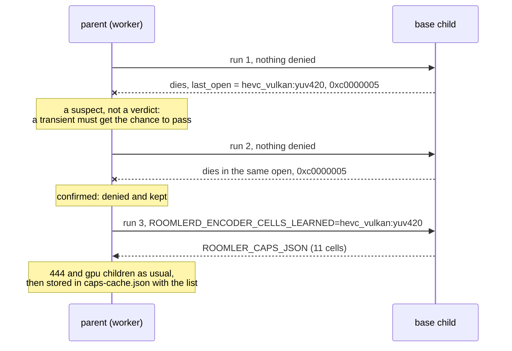

What earns a cell a place on the list:

| The child ended | With `last_open` | Next run | The deny |
|---|---|---|---|
| a fault's status, in the same cell as the run before | named | without the cell | **confirmed**: cached |
| a fault's status, first time in this cell | named | unchanged | none yet: a clean next run leaves the matrix whole |
| any other death, in the same cell as the run before (a kill, an `exit()`) | named | without the cell | this process only; the result is not cached |
| hung for 60 s | named | without the cell, no confirming run | this process only; the result is not cached |
| any death | none, or `-` | unchanged, once | none. A second one gives up: no hardware, not cached |

**Giving up** means no hardware, and not no video. When `base` is out of runs or time or
has no cell to blame, one more child (`ROOMLERD_CAPS_PHASE=software`) opens libvpx and
nothing else, because libvpx needs no driver. The host keeps `data-channel-vp9-444`
instead of falling to the RTP track, and answers like any host with no hardware
encoder. It is a child and not an open in the daemon because this is a host whose probes
have been dying. Only if that child dies as well is the answer the driver-free caps.

A **fault's status** ([`is_fault`](../agents/roomlerd/src/encode/caps.rs#L338)) is
what a driver leaves when it faults, and not what someone else leaves when they end
the process. On Windows that is a short list of exception codes a thread raises on
itself: access violation, illegal instruction, the arithmetic traps, stack overflow,
heap corruption, a fast fail, an uncaught C++ exception (`windows_fault_code`). The
list names what counts, so an NTSTATUS nobody has met cannot keep a healthy cell out
for a day, and missing a real fault costs only a re-test at the next start. And 255,
because 2 of the 7 AMD deaths read `exit code: 255` with an Application Error event
for the same fault behind each; that Windows Error Reporting's termination is the
source is a guess. On Linux and macOS it is SIGSEGV, SIGBUS, SIGILL, SIGFPE or SIGABRT,
never SIGKILL (the OOM killer, an EDR) or SIGTERM.

⚠️ **Two faults in a row are good evidence, not proof.** A GPU reset can land on both, and
so can a driver that dereferences a failed allocation on a host short of memory. So an
answer with a learned deny stands for a day where a clean one stands for a week
(`MAX_AGE_LEARNED_SECS`), and any key mismatch throws the list away with the file. The
next probe starts with nothing denied and tests the cell again. A driver update
changes the hardware fingerprint, so a vendor's fix heals with nobody acting. A new
build does the same, and so does any change to a `ROOMLERD_*` knob, which is how an
operator forces a re-test: set or clear any config key that feeds one, then restart.
The day is read at a start, so a daemon that stays up keeps its list until it restarts,
as it keeps the rest of its probe.

⚠️ **The learned list is not `encoder_cells_deny`.** That key still REPLACES the
built-in list, and still goes back to it when cleared. The learned cells add to
whichever list is in force (`cells::denied_cells`) and are never written to the config.
`none` empties the operator's list and leaves them alone. `caps_learn_deny = false` is
the way past them, and the kill switch: one child, and its death means the driver-free
caps, as before.

⚠️ **A session honours the same list, because the same fault would end the worker.**
The FFmpeg cascades read it through `cells::names_420` / `names_444`, the rebuild
through `new_preferred`. A cell learned in 4:2:0 takes its 4:4:4 form with it: the
`444` child never tested that form, and `chroma_pref` is the controller's word, which
nothing checks against the hello. Media Foundation (`h264_mf`, `hevc_mf`, `av1_mf`) and
libvpx (`vp9_libvpx`) refuse in their constructors, so the names work in
`encoder_cells_deny` too. A process the worker starts gets the list as
`ROOMLERD_ENCODER_CELLS_LEARNED` (`learned_for_child`): the probe's next child and a
recorder. A `roomlerd record` run by hand and the recording editor's `media export` do
not get it, and a fault there costs that process alone. `encoder-smoke --name` still
opens what it is told to: driving a denied cell under the harness is what it is for.

**The cost.** `base` runs at most 9 times per probe (four cells at two deaths each, and
the run that reports), and no run starts more than 90 s after the first. The worst case
is therefore 90 s plus one 60 s timeout, 150 s against 60 s before; with the 4:4:4 and GPU
children, 270 s against 180 s. Giving up adds the software child (60 s at most) and takes
those two away, so that path tops out at 210 s. It needs a host whose children each take a minute. The
probe runs before the worker connects (#2551), with the watchdog's pump gated off, so
this is time the device is offline, and only on a cache miss. Nothing reads that time as
a hang: the pump is gated off, a service manager watches for an exit and not for a
hello, and the crash-loop detector counts unclean exits. ⚠️ These bounds assume the kill
lands. A child stuck in a kernel call cannot be ended, and `run_child` then waits for it
with no bound, the device offline (#3273). Measured on the dev box
with AMD's real fault (a debug build, run by hand from Git Bash): two deaths and a report
in 7.2–7.8 s, against 3.4–3.8 s for the same probe with the cell denied from the start. A
hung child (suspended, standing in for a driver) cost 63 s, and two of them, which is
giving up, 120 s. Those deaths took 1.9–2.1 s each and left no Application Error event.
Under the service each of the same faults took
3.9–15 s (the log of 2026-11-01), so expect 15–35 s there. A healthy host pays nothing:
one run, and two more lines per open on a pipe.

**Where to see it.** The log names the cell and the status at each step, at ERROR once
denied. `roomlerd caps` prints `learned_deny:`. The hello carries it in
`AgentCaps.unavailable["encoder-cells"]` (code `learned-deny`), so a fleet read of
`agents.capabilities` sees it with no server change, and
`scripts/fr97-caps-census.sh` counts it. No viewer asks for that key, so the person at
the viewer is still told nothing.

## Selection at session time

Preference resolution: **CLI `--encoder` > env `ROOMLERD_ENCODER` >
`encoder_preference` in config.toml > `auto`**. Values: `auto` | `hardware`
(`hw`/`mf`) | `software` (`sw`/`openh264`).

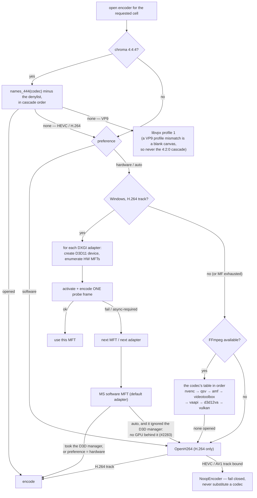

Key properties:

- **Probe, don't trust**: every candidate encoder must actually open (and, for
  the MF path, encode a frame) before it is selected — the same trial the
  startup probe runs at 480×270, so the browser is never offered a codec the
  host cannot produce.
- **Fail closed**: once a session's track is bound to `video/HEVC` or
  `video/AV1`, an encoder failure yields a null encoder rather than silently
  switching bitstreams.
- **Escape hatch**: `ROOMLERD_HW_AUTO=0` reverts `auto` to software-first
  without a rebuild; `ROOMLERD_USE_FFMPEG=0` removes the FFmpeg backends.
- **Auto does not keep the GPU-less software MFT** (#2283). When the
  default-adapter fallback also ignores the D3D manager, the session gets
  OpenH264 instead (`keeps_mf`), and the log says so. On a VM whose only
  adapter is the Basic Render Driver, that MFT held frames for ~850 ms of
  input to photon on the RTP track, with a quarter of FR-16's L4 probes never
  answered; OpenH264 on the same host measured 37 ms. The same CLSID inside
  the hardware loop, or a fallback that took the manager, may hand frames to a
  GPU and is kept, as it is under an explicit `hardware` preference. Its
  pipeline reports `backend="sw-pure"`.
- Advertised labels look like `mf-h264-hw`, `ffmpeg-hevc_nvenc`,
  `ffmpeg-hevc_vaapi`, `openh264-sw`, `libvpx-vp9-444-sw`; transports like
  `data-channel-hevc`, `data-channel-h264`.
- **Never flush an encoder that never took a frame.** `FfmpegEncoder::drop`
  sends EOF and drains only when `frame_count > 0` (reset on every rebuild, so
  it counts frames sent to *this* inner encoder). A `hevc_vaapi` that had no
  picture issued SEGVs inside `avcodec_send_frame(NULL)` on radeonsi — the probe
  child (open, then drop) died on every start of 0.4.86 on jupiter, and in a
  session the same drop runs in the daemon.

### Hardware quirks the cascade routes around

| Hardware | Behaviour |
|---|---|
| NVIDIA RTX 5090 (Blackwell) | `ActivateObject` returns `0x8000FFFF` for the MF H.264/HEVC/AV1 MFTs — FFmpeg NVENC works, MF does not; the cascade lands there. AV1 has no MF alternative and is filtered from caps by the probe |
| Intel Iris Xe | MF HW MFT is async-only; the async-unlock path handles it. FFmpeg QSV (`hevc_qsv`, `vp9_qsv`, `av1_qsv`, `h264_qsv`) proven in the field; the **packed 4:4:4 (VUYX) open kills the media runtime** (`0xc0000005`, 0.4.84) — `hevc_qsv:yuv444` and `vp9_qsv:yuv444` stay denied until a driver survives it |
| AMD Raphael iGPU (VCN 3.1, `radeonsi`) | H.264 + HEVC encode through VAAPI, 4:2:0; **no VP9 or AV1 encode** — `No usable encoding entrypoint found for profile …` is the driver saying so, and the cascade falls through; the unfed-encoder flush above was found here |
| NVIDIA idle P-states | First seconds of a session encode at ~20 ms/frame until clocks ramp — `gpu_clock.rs` pins graphics clocks via NVML for exactly the session's lifetime. ⚠️ **Above 60 fps an encoder-only load still lets the driver drop to P5, and the memory clock with it** (neo16, RTX 5090 laptop: 810 of 14 001 MHz, NVENC 4.5 → 8.5 ms a frame). FR-119 P2b-16 locks the memory clock too, and engages by itself for an NVENC session above 60 (the default; `ROOMLERD_GPU_CLOCK_PIN=0` turns it off). An SCM worker runs as the person, so it leases the pin from the SYSTEM host (`win_service::gpu_pin_relay`) |
| NVIDIA GPUs with several NVENC engines | One engine encodes a frame whole: at 2560×1600 4:4:4 HEVC that is 7–8 ms on an RTX 5090 laptop GPU, too slow for a 120 fps period with the conversion in front of it. Above 60 fps, `hevc_nvenc` and `av1_nvenc` open with `split_encode_mode=forced`, which splits each picture into horizontal strips, one per engine, encoded as slices of one picture (FR-119 P2b-10, `throughput_options`). Measured there: 7.05 ms whole, 4.47 ms in the driver's two strips, 3.45 ms in three, at the same size and PSNR. It is a tier of its own above the low-latency one, so a driver that refuses it keeps `delay=0`. `h264_nvenc` has no such mode. Knob `nvenc_split` (`auto` · `off` · 2–4); an explicit count applies only on a GPU with that many engines, and encodes the frame whole otherwise |
| Windows 11 ACM / HDR desktops | Desktop Duplication hands out FP16 scRGB frames; `fp16.rs` converts scRGB→BGRA8 sRGB so capture doesn't fall back or ship corrupt stripes |
| WSL2 | `libcuda.so.1` is a stub: `hevc_nvenc` **dlopens successfully** and then SEGVs when `cuInit(0)` fails on a box without the NVIDIA driver — contained by the child process. With the driver, NVENC works. There is no VAAPI: no `/dev/dri`, and libva refuses `/dev/dxg` |
| Apple silicon | `h264/hevc_videotoolbox` open; `av1_videotoolbox` is in the table but not in the registry on current SDKs — measured, not assumed |

### Ending a Media Foundation encoder

`IMFActivate::ActivateObject` leaves the caller to end what it made, and releasing the pointers
does not end it. An MFT left activated keeps its device and its driver's threads until the process
exits. Nothing ended them until 2026-11-01: on a laptop with an AMD and an NVIDIA GPU every encoder
open lost **72 threads and 1,210 handles**, and a session opens one per resolution change. Fourteen
opens left 896 threads inside `amdxx64.dll`, AMD's D3D11 driver, in a worker with about 80 of its
own, and only a restart freed them.

`HwMftCandidate`'s `Drop` now calls `ShutdownObject` (`encode/mf/activate.rs:90`).

- ⚠️ **Candidates end when the cascade ends, never between adapters.** Until `ShutdownObject`,
  `ActivateObject` returns the same instance, which is why the second adapter's pass takes
  microseconds. Ending one between adapters would make the next adapter build a new instance, and
  so change what wins on every host with two GPUs.
- ⚠️ **The winner's activation moves into its pipeline**, in the field declared first
  (`encode/mf/sync_pipeline.rs:105`), so the MFT ends while its transform and device are still held.
- `cargo test -p roomlerd --lib --features mf-encoder -- --ignored closed_encoder` measures it. It
  needs a host's real drivers, so no CI lane runs it. It encodes after the cascade returns, because
  the cascade's own probe runs before the losers end. With `ROOMLERD_MF_SHUTDOWN=0` it fails the way
  the old code did, which is its positive control.
- About 3 handles per open remain, unattributed, and they had not levelled off after 40 opens.

## The new cells (FR-77 P3b)

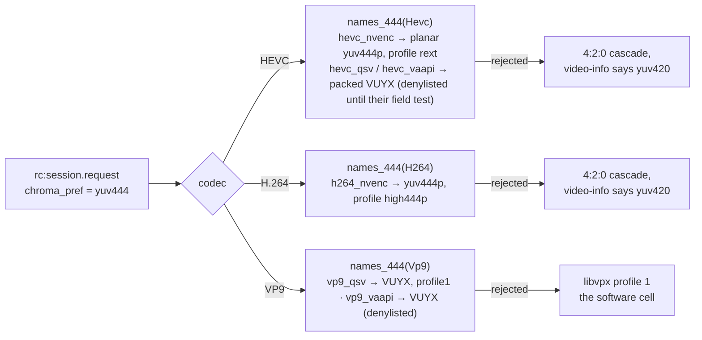

| Cell | Backend input | Browser decode | Auto-rank (explicit 4:4:4 only) |
|---|---|---|---|
| HEVC 4:4:4 | NVENC planar `yuv444p`, profile `rext`; QSV / VAAPI packed **VUYX**, profile `rext` — behind the denylist | hardware (Chrome ≥137 + NVIDIA, Intel Gen11+) | first: hardware on both ends |
| H.264 4:4:4 | NVENC planar `yuv444p`, profile `high444p` | software (`avc1.F4xxxx`, High 4:4:4 Predictive) | second |
| VP9 4:4:4 (hardware) | QSV / VAAPI packed **VUYX**, profile `profile1` — behind the denylist | software (`vp09.01`) | third |
| VP9 4:4:4 (software) | libvpx profile 1 | software | last — the only rung Sharper-on-Auto upgrades to |

**VUYX** is why the P1 probe's 4:4:4 open of `vp9_qsv` failed: FFmpeg n9's QSV
and VAAPI encoders list packed VUYX/XV30 and never planar 4:4:4. The pump keeps
dcv's BT.601 I444 planes and interleaves them into one packed plane (V, U, Y,
0xFF per pixel), so the packed path renders exactly as the planar one. The QSV
profile is set explicitly in the `base` option tier; a driver that rejects the
key falls to the defaults tier. **VP9 has no 4:2:0 fallback on a rejected 4:4:4
open** — the viewer configured its decoder for profile 1 and a VP9 profile
mismatch is a blank canvas, so the session dispatch probes the exact cell first
and runs libvpx when it cannot open. HEVC and H.264 fall back to 4:2:0 and report
the truth (`rc:video-info chroma`). The ceiling table has a chroma column:
`rate_factor_{h264,hevc,vp9}_444` (built-in 150 % on top of the codec factor for
a 4:4:4 cell; 4:2:0 is always 100).

## Hardware frames: VAAPI, D3D12, Vulkan (FR-77 P4, FR-78 P1)

NVENC, QSV and AMF open their own device behind the encoder and take software
frames. The three vendor-neutral backends take **hardware frames** from a pool
bound to a device, and `encode/ffmpeg/hwframes.rs` is the one module that owns
that for all of them — one `HwKind` per name suffix, the kind's candidate
devices opened lazily and kept for the process, one `Frames` shape, one upload.
**The open decides the device**: the encoder's whole configure-and-open runs
against the preferred device first and then the rest until one succeeds, and
the winner is remembered. Which device can run a codec is a per-codec,
per-driver fact — on the dev box Vulkan device 0 (the iGPU) has no
`VK_KHR_video_encode_queue` while the RTX does, and an RDNA2 iGPU opens HEVC
but not AV1 — so only the encoder's own open can answer it:

```mermaid
flowchart LR
    subgraph once["per kind — candidate devices, opened lazily and kept"]
        K{HwKind::of(name)} -- "_vaapi (Linux)" --> V["pinned vaapi_device,<br/>then /dev/dri/renderD128 … 135"]
        K -- "_d3d12va (Windows)" --> D["pinned d3d12_adapter,<br/>then DXGI adapters 0 … 3"]
        K -- "_vulkan (both)" --> W["pinned vulkan_device (index or name),<br/>then physical devices 0 … 3"]
        V & D & W --> O["open_on_some_device: preferred first,<br/>then the rest, until the encoder opens"]
    end
    subgraph enc["per encoder open — build_encoder"]
        F["hwframes::Frames — av_hwframe_ctx_alloc<br/>format = the kind's (VAAPI / D3D12 / VULKAN)<br/>sw_format NV12, or VUYX (VAAPI 4:4:4) / yuv444p (Vulkan 4:4:4)"] --> C[codec context: pix_fmt = the kind's,<br/>hw_frames_ctx = a ref to the pool]
    end
    subgraph frame["per frame — encode_sync"]
        S[software frame: dcv BGRA→NV12/VUYX/I444] --> U[av_hwframe_get_buffer + transfer_data<br/>+ copy_props (pts, forced I)] --> E[send_frame]
    end
    O --> F
```

D3D12 and Vulkan cost the host nothing it does not already have: FFmpeg
dlopens `d3d12.dll` / `vulkan-1.dll` / `libvulkan.so.1` itself, so a box without
a Vulkan loader or a D3D12 video driver loses those cells in one line per name
and keeps the daemon. D3D12 video encode is 4:2:0 only (NV12 / P010), so it is
never asked for 4:4:4; Vulkan HEVC lists 4:4:4 as runtime-decided and its cell
sits on the built-in denylist until a driver proves it. FFmpeg's d3d12va
encoders default to two B-frames — the pump sets `bf=0` on both new backends,
as a remote desktop cannot carry reordering delay — and the Vulkan tuning hints
(`tune=ull`, `usage=stream`) ride the tier-protected option group so a driver
that rejects them costs the knob, never the open.

### VAAPI on Linux (FR-77 P4)

| Piece | Where | Note |
|---|---|---|
| FFmpeg | the Linux vendor asset `…-minimal-vaapi.tar.xz` | `--enable-vaapi` + `h264/hevc/av1/vp9_vaapi` (14 encoders verified); a new asset NAME because the tree's load-time needs changed |
| libva + libdrm | **bundled** — built into the vendor tree (libva 2.24.1, libdrm 2.4.134, both MIT), carried by the `.deb`'s ldd-fixpoint bundler; no `Depends` | `--enable-vaapi` makes `libva.so.2` a DT_NEEDED of libavutil, a LOAD-time need of the daemon; a `Depends: libva2` holds only where apt reaches a mirror, and the updater's offline `dpkg --install` replaces the binary before the dependency failure — a daemon that cannot start on its next restart. The bundled loader looks for drivers in the distros' `dri` dirs (`driverdir`, `LIBVA_DRIVERS_PATH` overrides) |
| the VA driver | the host's (`Suggests: mesa-va-drivers, intel-media-va-driver` — suggests, because Mesa's drags LLVM onto headless servers) | libva's one coupling to a driver is the `__vaDriverInit_1_<minor>` lookup, which walks DOWN from the loader's minor: the newest libva loads every older driver; a driver newer than the bundle fails to load (no VAAPI cells, not a crash) until the next re-vendor |
| the device | `vaapi::device()` — a `OnceLock` | pinned `vaapi_device` → `/dev/dri/renderD128`…`135` that exist; every encoder, probe and rebuild in the process uses the same node |
| options | `rc_mode=VBR` on `b:v` = the cap, HRD window, `profile=rext` for HEVC 4:4:4, `async_depth=1` (tier-protected) | no `qp`/`quality` on top of the driver's VBR; a forced I picture is an IDR in `vaapi_encode` |
| cells | `*_vaapi` after the vendor names, `hw: true` by construction | `hevc_vaapi:yuv444` and `vp9_vaapi:yuv444` on the built-in denylist until a driver proves the packed 4:4:4 open |

**The positive cell is AMD.** jupiter and zeus (Raphael iGPU, VCN 3.1, Mesa's
`radeonsi` from `mesa-va-drivers` 25.2.8, Ubuntu 24.04) advertise `hevc/vaapi` +
`h264/vaapi` in a 100 ms probe, and `roomlerd encoder-smoke --codec hevc` puts real
HEVC bytes through the pump (`vaapi: device opened /dev/dri/renderD128`). Intel
(iHD) has no fleet host yet, so its VAAPI cells are exactly as probe-gated as any
other unproven backend.

**WSL2 has no VAAPI for a daemon, measured.** A WSL2 distro has no `/dev/dri`
(kernel 6.6.87, FR-45 recorded the same on 2026-08-31); its GPU device is
`/dev/dxg`, a misc-major node (10:125), and libva's DRM display refuses it
with nothing but an `fstat` — `vainfo --display drm --device /dev/dxg` says
"Failed to a DRM display for the given device" even with
`LIBVA_DRIVER_NAME=d3d12` and Mesa's `d3d12_drv_video.so` installed. The
D3D12 VA driver is reachable only through a Wayland/X11 display, which a root
daemon on a headless host does not have. So the WSL sibling is the NEGATIVE
cell: the opener logs `no render node on this host` once and the NVENC cells
stay (WSL's libcuda is real).

**Never flush an encoder that never took a frame.** The 0.4.86 roll to jupiter
opened `hevc_vaapi` in the probe and the child died with SIGSEGV on every
start, so the host advertised no hardware at all. gdb: `FfmpegEncoder::drop` →
`send_eof` → `avcodec_send_frame(NULL)` → a NULL field load inside libavcodec's
VAAPI encoder, because no picture had ever been issued (the probe opens a cell
and drops it; `encoder-smoke`, which encodes ten frames first, passed on the
same host). The flush on drop is cosmetic — the drained packets go nowhere —
so it now runs only when `frame_count > 0`. Validated on jupiter before the
release by breaking on `send_eof` under gdb and returning without it: the child
then advertised `hevc/vaapi` and `h264/vaapi` and exited normally.

**A probe proves an open; only a session proves a cell.** FR-78 P3 ran one viewer
session per new cell (CORPLAP-3, jupiter, the dev box — the denylist steering each
session onto the cell under test). Six decoded cleanly; the dev box's `av1_vulkan`
opened, encoded, reported nothing wrong, and painted garbage under Chrome's
hardware AV1 decoder — under dav1d (`localStorage roomler-rc-decode-pref=software`)
it stalled outright. `encoder-smoke --name av1_vulkan --dump <file>` and the FFmpeg
CLI's decoders attributed it in one run: the stream is `SeqHdr · 240 B of padding ·
Frame · Frame …` with **no temporal-delimiter OBU**, which the AV1 spec puts at the
start of every temporal unit, every other AV1 encoder we ship writes (`av1_nvenc`:
`TD · SeqHdr · Frame · TD · Frame …`) and Chrome's decoders require; the same bytes
with `12 00` inserted before each unit decode 10/10. `FfmpegEncoder::drain_packets`
therefore prepends the delimiter to any AV1 packet whose first OBU is not one
(`with_av1_temporal_delimiter`, for every AV1 backend). That was necessary and not
sufficient: on the repaired build the session's keyframes decode and every changed
region smears — correct keyframes, corrupt inter frames — and the FFmpeg CLI's own
`av1_vulkan` on the same GPU (testsrc2, the `ivf` muxer inserting the delimiters
itself) produces frames dav1d refuses at the header (`Error parsing frame header`,
29 of 29) and libaom aborts on. An FFmpeg 9.0.1 / NVIDIA driver defect with no
roomler code in the loop, so the cell sits on the built-in denylist
(`av1_vulkan:yuv420`) until a driver or FFmpeg release decodes. The `--dump` flag
stays: a cell whose session looks wrong is attributed offline before anyone touches
the denylist, and the raw dump of a healthy build decodes as-is.

## GPU-resident frames: the input path (FR-118)

The input path is a third dimension of a cell, beside codec × backend and
chroma: an encoder takes its frames from CPU memory, as every cell did until
FR-118, or as textures on the capture's own GPU. The GPU form is **off by
default** (`zero_copy`), and three families take it so far, all at 4:2:0:

- **QSV** (`hevc_qsv`, `av1_qsv`, `h264_qsv`) on the SystemContext DXGI arm, which is the arm every QSV host in
  the fleet captures through.
- **NVENC** (`hevc_nvenc`, `av1_nvenc`, `h264_nvenc`) on the WGC arm (FR-118 P3). On a hybrid laptop WGC's device
  moves to the NVIDIA adapter.
- **VideoToolbox** (`hevc_videotoolbox`, `h264_videotoolbox`) on macOS's display stream (FR-118 P5). The stream's
  IOSurface reaches VideoToolbox as a CVPixelBuffer over the same memory, and VideoToolbox converts the BGRA itself.

```mermaid
flowchart LR
  subgraph cpu["CPU input (every cell)"]
    A1[duplication surface] -->|"staging copy + Map<br/>(the readback, ~4 ms at 1920×1200)"| B1[BGRA in memory]
    B1 -->|dcv BGRA→NV12| C1[NV12 in memory]
    C1 -->|"send_frame: QSV copies and uploads it"| E1[QSV]
  end
  subgraph gpu["GPU input (zero_copy, a proven QSV cell)"]
    A2[duplication surface] -->|CopyResource| B2[pool texture, same device]
    B2 -->|"VideoProcessorBlt, BT.601 limited"| C2[NV12 texture]
    C2 -->|CopySubresourceRegion| D2[QSV pool slice]
    D2 -->|AV_PIX_FMT_QSV| E2[QSV]
  end
  subgraph wgc["GPU input (zero_copy, a proven NVENC cell)"]
    A3["WGC frame, its device on the NVIDIA adapter<br/>(the OS copies across from the panel's)"] -->|CopySubresourceRegion| B3[pool texture, same device]
    B3 -->|"VideoProcessorBlt, BT.601 limited"| C3[NV12 texture]
    C3 -->|CopySubresourceRegion| D3[D3D11 pool slice]
    D3 -->|AV_PIX_FMT_D3D11| E3[NVENC]
  end
  subgraph vt["GPU input (zero_copy, a proven VideoToolbox cell)"]
    A4["display stream IOSurface (BGRA)"] -->|"Frame::into_surface:<br/>the use count moves with it"| B4[IoSurfaceFrame]
    B4 -->|"CVPixelBufferCreateWithIOSurface<br/>+ the BT.601 matrix attached"| C4[CVPixelBuffer, same memory]
    C4 -->|AV_PIX_FMT_VIDEOTOOLBOX| E4[VideoToolbox<br/>converts the BGRA]
  end
```

| Piece | What it is | Where |
|---|---|---|
| the switch | `zero_copy` (`ROOMLERD_ZERO_COPY`), default off; a restart applies it. On a supervised Mac the root's value is handed to the GUI worker, which captures and encodes | `capture::zero_copy_enabled` |
| the denylist | `zero_copy_deny`, entries `name:gpu` (`none` = empty), read by the probe and at every encoder open; handed to a supervised Mac's GUI worker as the switch is. Pushable through remote config with `MANAGE_AGENTS` alone, the fleet's kill switch for a GPU-input cell ([FR-132](fr/FR-132-zero-copy-by-default.md) P1, [`remote-config.md`](remote-config.md) §6); the switch itself is not pushable | `encode::ffmpeg::gpu_hint::denied` |
| the GPU frame | `FrameData::Gpu`: a BGRA texture on the capture's device. On macOS, `FrameData::IoSurface`: the display stream's surface, its use count held until the last clone goes. A consumer that needs bytes reads either back, once | `agents/roomlerd/src/capture/gpu_frame.rs`, `agents/roomlerd/src/capture/iosurface_frame.rs` |
| the capture's adapter | the DXGI arm: the primary output's. WGC: the adapter of the first proven GPU-input cell's vendor, in the order every cascade opens backends (NVENC, QSV, AMF); with none proven, the default adapter. macOS: none, an IOSurface is not bound to a device | `capture::gpu_frame::capture_adapter` |
| the GPU input | QSV: a D3D11VA device context wrapping the capture's device, a QSV device derived from it, and a decoder-target frame pool. NVENC: the same D3D11VA context and an `AV_PIX_FMT_D3D11` NV12 pool, decoder-bound (the RTX 5090 refuses its NV12 array otherwise). VideoToolbox: no device at all; a CVPixelBuffer over the frame's IOSurface, or a pool buffer a frame in memory is copied into, as `AV_PIX_FMT_VIDEOTOOLBOX` | `agents/roomlerd/src/encode/ffmpeg/gpu_input.rs`, `agents/roomlerd/src/encode/ffmpeg/vt_input.rs` |
| the proof | the probe's `gpu` child opens each GPU form and encodes two frames through it; a session opens only a form the child proved | [The probe lifecycle](#the-probe-lifecycle) |

The session reports which form it opened and why, on the heartbeat as
`input_path` (`gpu` or `cpu`) and `input_reason`:

| `input_reason` | Meaning |
|---|---|
| `switch_off` | `zero_copy` is off |
| `cpu_frames` | the capture delivered frames in memory: another arm, an FP16 desktop, a rotated output, a fallback. Never on a Mac: VideoToolbox's GPU form takes a frame in memory too, with one copy |
| `no_gpu_cell` | this encoder or chroma takes no GPU frames yet |
| `denied` | `zero_copy_deny` names it |
| `unproven` | the probe's `gpu` child did not prove this form on this host |
| `adapter_mismatch` | the capture's device is on an adapter this backend cannot encode from: no QSV behind it, or not NVIDIA's for NVENC |
| `open_failed` | the GPU form failed to open, and the CPU form took over |

> [!WARNING]
> **A refusal never costs the picture.** The GPU form opens only on the
> capture's own device. Any refusal or failed open falls back to the CPU form,
> today's path, and a GPU frame from another device moves the encoder to that
> device.

- **The colour is the CPU path's.** The VideoProcessor converts with BT.601
  limited range, the matrix of the CPU path's conversion, so flipping the
  switch does not change the picture. In the field, on an Intel adapter,
  flat regions decode identically on both paths. On macOS VideoToolbox does
  the conversion, and it converts an unmarked BGRA buffer with BT.709, so
  every buffer carries the BT.601 matrix (the session's colour properties
  only tag the stream). Measured on an M5 Pro, the test bars then decode
  within 2 code values of the CPU path in every plane, against 21 unmarked
  ([FR-118 §5.8](fr/FR-118-gpu-resident-frames.md#58-p5--videotoolbox-takes-the-iosurface-as-built-2026-10-29)).
- **Measured** ([FR-118 §9.3](fr/FR-118-gpu-resident-frames.md#93-ac3s-pairs-2026-10-28),
  `av1_qsv` at 1920×1200 and 60 fps on a moving test pattern, 20-minute legs
  on, off, on): capture + encode fell from 14.70 to 12.30 ms per frame, and the
  worker's CPU from 15.9 to 10.6 ms per encoded frame, at the same bytes. The
  readback leaves the capture stage. `send_frame` grows by 1.9 ms, because it
  now waits for the GPU's conversion before QSV reads the surface. The pattern
  decodes identically on both paths.
- **Measured on a 2880×1800 laptop**
  ([FR-118 §9.10](fr/FR-118-gpu-resident-frames.md#910-ac4-the-slow-laptop-at-60-fps-2026-10-30),
  `av1_qsv` with 60 fps asked, the same pattern, the same arm): the encoded
  rate rose from 38 fps to the 60 fps target. With the switch off, the
  capture thread's 7.9 ms readback runs in series with a 17 ms encode stage,
  so a frame took 25 ms. With it on, a frame takes 16.61 ms, the period at
  60 fps. QSV's own `send_frame`, about 16 ms a frame on both paths, is what
  bounds this host now. The worker's CPU fell from 15.93 to 3.88 ms per
  encoded frame.
- **Measured on the WGC arm with NVENC**
  ([FR-118 §9.7](fr/FR-118-gpu-resident-frames.md#97-ac7-nvenc-on-the-wgc-arm-2026-10-29),
  `av1_nvenc` at 2560×1600 and 60 fps on the same pattern, a hybrid laptop with
  WGC's device on the RTX 5090, 20-minute legs on, off, on): readback + encode
  fell from 18.26 to 5.14 and 5.23 ms per frame, and the worker's CPU from 9.64
  to 3.18 and 3.09 ms per encoded frame. Here `send_frame` shrinks as well
  (11.05 → 5.1 ms), because NVENC no longer copies the frame to the GPU itself.
  WGC reads back off the pump's clock, so on this arm the comparison is
  readback + encode, not capture + encode. The pattern decodes identically on
  both paths.
- **Measured on macOS with VideoToolbox**
  ([FR-118 §9.9](fr/FR-118-gpu-resident-frames.md#99-ac7-videotoolbox-on-the-macbook-2026-10-29),
  `hevc_videotoolbox` at 3024×1964 on an M5 Pro, the same pattern, 20-minute
  legs on, off, on): the encode stage fell from 4.18 to 0.12 ms per frame,
  because the CPU conversion and FFmpeg's copy into VideoToolbox's buffer are
  gone, and the worker's CPU from 14.58 to 2.55 and 2.60 ms per encoded frame
  (126 % of a core to 22 %). The frame rate is the same on both paths (88 fps),
  so the surfaces the capture holds until VideoToolbox is done with them, out
  of the display stream's queue of 3, cost no frames. The scrap arm's capture
  stage waits for the stream's next frame, so capture + encode is the frame
  period on both paths, and the comparison is the encode stage and the CPU.
  The pattern decodes within 2 code values of the CPU path.
- **WGC across adapters.** On a hybrid laptop whose panel is driven by the
  iGPU, WGC's device and the dGPU's encoder sit on different adapters. Measured
  on such a laptop
  ([FR-118 §9.4](fr/FR-118-gpu-resident-frames.md#94-wgc-across-adapters-for-p3-2026-10-28)):
  giving WGC's device the encoder's adapter lets the OS copy each frame across
  for 0.3–0.6 ms at the median, with no frame lost and no CPU spent. So that is
  the adapter P3 uses, and NVENC takes the frame on its own GPU
  ([FR-118 §5.6](fr/FR-118-gpu-resident-frames.md#56-p3--the-wgc-arm-hands-nvenc-its-frames-as-built-2026-10-28)).
- **One vendor per capture.** WGC's adapter is chosen once, from the proven
  forms, because a capture opens before the session's encoder exists. On a host
  with both NVENC and QSV, a codec NVENC lacks opens on QSV on the other adapter
  and reads `adapter_mismatch`: CPU frames, the picture unchanged.
- **Field-verified and released:** the QSV cell on the DXGI arm (0.4.181,
  [FR-118 §9.3](fr/FR-118-gpu-resident-frames.md#93-ac3s-pairs-2026-10-28);
  at 2880×1800 on 0.4.187,
  [§9.10](fr/FR-118-gpu-resident-frames.md#910-ac4-the-slow-laptop-at-60-fps-2026-10-30)),
  the NVENC cell on the WGC arm (0.4.183,
  [FR-118 §9.7](fr/FR-118-gpu-resident-frames.md#97-ac7-nvenc-on-the-wgc-arm-2026-10-29))
  and the VideoToolbox cells on macOS (0.4.187,
  [FR-118 §9.9](fr/FR-118-gpu-resident-frames.md#99-ac7-videotoolbox-on-the-macbook-2026-10-29);
  as built:
  [§5.8](fr/FR-118-gpu-resident-frames.md#58-p5--videotoolbox-takes-the-iosurface-as-built-2026-10-29)).
  On a Mac `input_path=gpu` means VideoToolbox converts the BGRA, for a frame
  in memory as well (the 2× CPU downscale's), which is copied once into a pool
  buffer first.
- **Not built:** AMF — the measurement above
  ([FR-118 §9.4](fr/FR-118-gpu-resident-frames.md#94-wgc-across-adapters-for-p3-2026-10-28))
  made its route unnecessary on the hybrid host, so an AMD-only host's AMF cells
  stay on CPU frames until one needs them — and VAAPI (Linux), deferred with its
  measurement: its conversion and upload are 1.2 ms of a 4.1 ms encode stage, on
  the one 1600×900 virtual desktop that runs it (FR-118 open decision 6).

## Colour: one conversion, and the description that names it (FR-130)

Every converter in the agent produces **BT.601 YUV at limited range**: the CPU converters
(`agents/roomlerd/src/encode/color.rs`), the D3D11 VideoProcessor of the GPU input path (above), and
VideoToolbox, whose input is marked with the BT.601 matrix (FR-118 P5). Until
[FR-130](fr/FR-130-colours-decode-true.md) no encoder said so. Chrome decodes an HD picture that says
nothing as BT.709, so the greys came out exact and every saturated colour shifted: magenta 191/0/191
arrived as 205/30/197 (#3049).

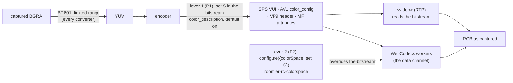

**The description** is FR-130's set S, defined once (`agents/roomlerd/src/encode/color_desc.rs:82`):
- the SMPTE 170M matrix (BT.601's coefficients, H.273 code 6);
- limited range;
- the BT.709 primaries and sRGB transfer of the desktop the pixels came from.

The matrix and the range are what every converter produces, and a compile-time assertion keeps them that
way. The primaries and the transfer describe the content. In Chrome, sets A (SMPTE 170M for all three), B
(BT.709 primaries and transfer) and S decode identically. S is the truthful one for a player that
colour-manages by primaries and transfer (FR-130 §2.5).

| Family | Where it is written | What the bitstream carries (read on neo16 in P1, and in the field in P3) |
|---|---|---|
| FFmpeg, every backend | the codec context's four fields in `build_encoder` (`agents/roomlerd/src/encode/ffmpeg/encoder.rs:1912`), before the open, for every cell, rebuild, probe, recording and GPU form | NVENC, D3D12 and Vulkan: set S exactly (H.264, HEVC and AV1; NVENC 4:4:4 too). QSV (AV1, H.264) and VideoToolbox (HEVC, H.264): set S, as Chrome's decoder reads it in the field when it is told nothing. `hevc_amf`: S's values, with the matrix under code 5 (BT.470 BG, the same coefficients). `h264_amf`: matrix 2 (unspecified), AMD's runtime's choice. `vp9_qsv`, `vp9_vaapi`: nothing, because FFmpeg 9.0.1 cannot tag VP9 there. VAAPI: not yet read |
| Media Foundation | `MF_MT_YUV_MATRIX`, `MF_MT_VIDEO_NOMINAL_RANGE`, `MF_MT_VIDEO_PRIMARIES` and `MF_MT_TRANSFER_FUNCTION` on both media types (`agents/roomlerd/src/encode/mf/sync_pipeline.rs:619`), and again on the renegotiated output type | Microsoft's H.264 and HEVC encoders ignore the attributes and write no description. NVIDIA's and AMD's MF encoders did not open on neo16, so they are unread |
| openh264, live | the SPS VUI (`agents/roomlerd/src/encode/openh264_backend.rs:116`) | set S |
| libvpx VP9 | `VP9E_SET_COLOR_SPACE` and `VP9E_SET_COLOR_RANGE` (`agents/roomlerd/src/encode/libvpx.rs:454`) | SMPTE 170M at studio range. VP9's header has no primaries or transfer field, and Chrome's WebCodecs ignores its colour space anyway |
| openh264, recording | its own VUI and the MP4 `colr` box, unchanged since FR-85 | SMPTE 170M at limited range |

A vendor runtime that refuses the description opens the encoder without it rather than failing the open.
While the switch is on, the hello says `color-described` (`agents/roomlerd/src/encode/caps.rs:2263`).

**Which lever reaches which path:**

| Viewer path | Decodes true through | Notes |
|---|---|---|
| Data channel, VP9 (4:2:0 and 4:4:4) | lever 2 only | Chrome's WebCodecs ignores VP9's in-band colour space (FR-130 §2.5) |
| Data channel, H.264, HEVC and AV1 | lever 2, and lever 1 where the encoder writes it | either alone decodes true, and together they agree |
| RTP `<video>` | lever 1 only | lever 2 cannot reach it. Microsoft's MF H.264 and `h264_amf` still decode as BT.709 here (FR-130 open decision 6: accepted for now) |
| a recording | lever 1 (FFmpeg-encoded) or the recorder's own openh264 VUI | the MP4's `colr` box says BT.601 limited whatever the switch says, and Chrome's `<video>` reads it: a recording made with the switch off plays true too (FR-130 §8). Lever 1 makes the elementary stream describe itself |

Read in the field on agent 0.4.188 ([FR-130 §8](fr/FR-130-colours-decode-true.md#8-field-verification-log)):
lever 1 alone decodes `<video>` true from live openh264, and VP9 on the data channel decodes true through lever 2
only, with or without the description in its header. From NVENC, QSV and VideoToolbox, H.264, HEVC and AV1 decode
true on the data channel from the encoder's own description alone (read on blit), and HEVC and AV1 also with both
levers, on blit and FSR. H.264 on `<video>` comes from the RTP track's own
cascade, Media Foundation and then openh264, never from FFmpeg. From openh264 it decodes true; from Microsoft's
software MF it still shifts (open decision 6).

**The switches.**
- `color_description` turns lever 1 off on a device (*Configuration*, below). Since FR-130 P1b it can be
  pushed through remote config ([remote-config.md](remote-config.md)). A push lands at the device's next
  connect and applies at the restart after that.
- `roomler-rc-colorspace=off` turns lever 2 off in one browser
  ([remote-control.md §18.6.2](remote-control.md#1862-the-decoder-is-told-the-colour-space-fr-130-p2)).

⚠️ A colour-managed capture is a different effect. On a wide-gamut panel the compositor hands the capture
pixels that already differ from the page's CSS, and both input paths capture the same pixels. Compare a
decoded picture with the pixels as captured (`roomlerd capture-smoke --dump`, a P6 PPM), not with the
source's CSS values.

## Configuration

| Key (config.toml / `roomler config set`) | Env | Default | What |
|---|---|---|---|
| `encoder_preference` | `ROOMLERD_ENCODER` (CLI `--encoder` wins) | `auto` | `auto` · `hardware` · `software` |
| `encoder_cells_deny` | `ROOMLERD_ENCODER_CELLS_DENY` | the built-in list | `name:chroma` cells never opened nor advertised; `none` = deny nothing; a cell the probe learned stays denied on top of it; pushable through remote config (`MANAGE_AGENTS`), `needs_restart`. On a supervised Mac the session's encoders open in the GUI worker, which reads the person's config, so the root's effective value is handed to it at spawn (FR-43, `WORKER_ENV_FORWARD`, from 0.4.155); before that a root-side deny bound the probe and the hello but not the worker's sessions |
| `caps_cache` | `ROOMLERD_CAPS_CACHE` | on | the probe cache (read and write) |
| `caps_learn_deny` | `ROOMLERD_CAPS_LEARN_DENY` | on | a dead `base` child costs the cell it died in ([above](#a-dead-child-costs-the-cell-it-died-in)); off = one child, and its death means no hardware. A change is a knob change, so the next start re-probes. Not pushable through remote config |
| `zero_copy` | `ROOMLERD_ZERO_COPY` | off | GPU-resident frames: the SystemContext DXGI arm and the WGC arm keep frames on the GPU, and a proven QSV or NVENC cell takes them; on macOS the display stream's IOSurfaces go to a proven VideoToolbox cell ([above](#gpu-resident-frames-the-input-path-fr-118)). On a supervised Mac the root's value is handed to the GUI worker at spawn (`WORKER_ENV_FORWARD`, from FR-118 P5) |
| `zero_copy_deny` | `ROOMLERD_ZERO_COPY_DENY` | unset | `name:gpu` GPU-input forms never opened, by the probe or a session; `none` = deny nothing. Handed to a supervised Mac's GUI worker as `zero_copy` is. Pushable through remote config (`MANAGE_AGENTS`), `needs_restart`, passed on unread like the other denylists; a blank push clears it (FR-132 P1, [remote-config.md](remote-config.md)). `zero_copy` itself is not pushable |
| `color_description` | `ROOMLERD_COLOR_DESCRIPTION` | on | every encoder writes the colour description its input was converted with (BT.601 matrix, BT.709 primaries, sRGB transfer, limited range: `encode::color_desc::DESCRIPTION`, [FR-130](fr/FR-130-colours-decode-true.md)), and the hello says `color-described`; `false` writes the undescribed stream of earlier agents. Read at every encoder open, so a restart applies it; the probe and recorder children, a hand-run `roomlerd record`, `encoder-smoke` and the recording editor's `media export` follow it (the export reads the config file only where the person running it can read it), and a supervised Mac's GUI worker gets the root's value (`WORKER_ENV_FORWARD`). Pushable through remote config (`MANAGE_AGENTS`), `needs_restart`: a push of `off` or `on` sets it, and a blank one clears it back to on (FR-130 P1b, [remote-config.md](remote-config.md)). Not every encoder can carry it: `vp9_qsv` and `vp9_vaapi` (FFmpeg writes none), Microsoft's MF encoders (they ignore the attributes), and `h264_amf`'s matrix (AMD's H.264 runtime writes 2) |
| `vaapi_device` | `ROOMLERD_VAAPI_DEVICE` | unset | pin the render node; unset = `/dev/dri/renderD128`…`135` in order |
| `d3d12_adapter` | `ROOMLERD_D3D12_ADAPTER` | unset | pin the DXGI adapter index for D3D12 video encode (Windows); unset = adapters `0`…`3` in order |
| `vulkan_device` | `ROOMLERD_VULKAN_DEVICE` | unset | pin the Vulkan physical device by index or name; unset = the loader's default |
| `rate_factor_{h264,hevc,vp9}_444` | `ROOMLERD_RATE_FACTOR_<CODEC>_444` | 150 | the 4:4:4 ceiling factor (%), 50–400 |
| — | `ROOMLERD_HW_AUTO=0` | — | `auto` becomes software-first |
| — | `ROOMLERD_MF_SHUTDOWN=0` | — | a kill switch, not a setting: Media Foundation encoders are released without being ended, which [leaks their threads](#ending-a-media-foundation-encoder) |
| — | `ROOMLERD_USE_FFMPEG=0` | — | no FFmpeg backends at all |
| — | `ROOMLERD_DC_H264=0` | — | no H.264-over-DataChannel advertisement (its cells are then not probed either) |
| — | `LIBVA_DRIVERS_PATH` | the distros' `dri` dirs | where the bundled libva looks for the host's VA driver |

## Capture backends

Cascade (first that works wins): synthetic (CI, env-gated) → **SystemContext**
(service worker on Windows — adapter-bound DXGI that picks the adapter *owning the
primary output*, fixing Optimus hybrid GPUs, with a GDI `BitBlt` fallback after
three consecutive hard errors) → **Windows.Graphics.Capture** (hardware cursor,
dirty regions on Win11) → **DRM/KMS** (Linux, opt-in `ROOMLERD_DRM_CAPTURE=1` —
the scanout plane below the compositor, FR-36) → **the desktop portal** (Linux,
opt-in `ROOMLERD_PORTAL_CAPTURE=1` — a privilege-dropped `portal-helper` in the
user's session feeding PipeWire frames over a pipe, FR-45; with
`ROOMLERD_MUTTER_CAPTURE=1` the same helper takes them from
`org.gnome.Mutter.ScreenCast` instead, unattended; a per-user install in its own
Wayland session with no key set switches mutter, else the portal, on by itself,
FR-93 P2) → **scrap** (DXGI duplication
/ X11 XShm + XDamage / CoreGraphics) → noop carrying the reason (FR-80). The
Linux arms, their selection order and the **attended-only** rule of the portal
are [`linux-capture.md`](linux-capture.md). A `DownscalePolicy` box-filters very
large desktops (>~3.5 Mpx) before encode. Cursor shapes ride a dedicated channel
and render viewer-side.

With multiple concurrent viewers of one host, DC sessions with an identical
profile (transport × codec × chroma) **share one capture + one encoder**
(`media_share.rs`) — followers tap the owner's stream instead of doubling GPU
cost and DXGI duplication seats.

## Rate control

Two independent regimes:

**RTP track** — standard congestion feedback: RTCP **REMB** × 0.85 safety factor
with ±15 % hysteresis, floored at the minimum bitrate.

**DataChannel paths** — no REMB exists, so four cooperating controllers
(`encode/{aimd,viewer_rate,encode_pressure,rate_profile}.rs`):

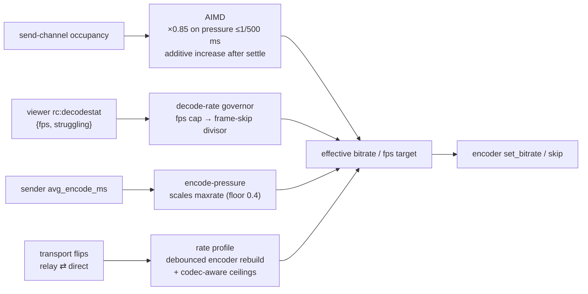

- Bitrate clamps: 1.5–40 Mbps; initial target ≈ `w·h·fps·0.20` bits.
- Relayed (TURN) sessions are capped (~3 Mbps, 1280 px long edge) **unless** the
  relay is loopback/mesh-local — the agent hosts its own loopback TURN server, so
  "relayed" via localhost stays uncapped.
- The viewer's priority dial (balanced / sharper / smoother) trades resolution
  caps against fluidity; H.264 gets a ~150 % bitrate ceiling relative to
  HEVC/AV1 plus a sharper CQ bias to compensate for the older codec; a 4:4:4
  cell gets its chroma factor on top.
- A confirmed relay⇄direct transport flip rebuilds capture+encoder on a debounce
  (2 consecutive confirmations, 60 s cooldown) so the profile matches the path.
  The full picture is [`rate-control.md`](rate-control.md).
- How a backend takes a bitrate move (`resolve_rate_mode`): NVENC in place
  (the FR-62 patch removes the IDR it used to force), QSV in place behind the
  `inplace_rate` flag, everything else — AMF, VideoToolbox, VAAPI, D3D12,
  Vulkan — **rebuilds** the encoder on a coarsened ladder. D3D12 and Vulkan are
  measured (FR-78 P2, the A0 ladder on the dev box): every rung forced an IDR,
  42–77 ms per apply. `encoder-smoke --reconfigure-sweep --name <encoder>` is
  the read for any host. The per-backend cost table, the counters and the sweep's
  verdict are the next section.

### A rate move, per backend (FR-62)

What a rate move costs decided the shape of the rate-control code: nine of its
heuristics exist only to ration that cost
([FR-62](fr/FR-62-encoder-rate-changes-without-an-idr.md)). The pump hands every
AIMD target to `FfmpegEncoder::set_bitrate`
(`agents/roomlerd/src/encode/ffmpeg/encoder.rs:3000`), which snaps it to the
ladder first (`encode/aimd.rs:297` — 100 k … 25 M, `coarsen_bitrate` at `:317`)
and returns when the rung is the one already running. Only a rung crossing reaches
the backend's arm, resolved once at open by `resolve_rate_mode` (`encoder.rs:869`).

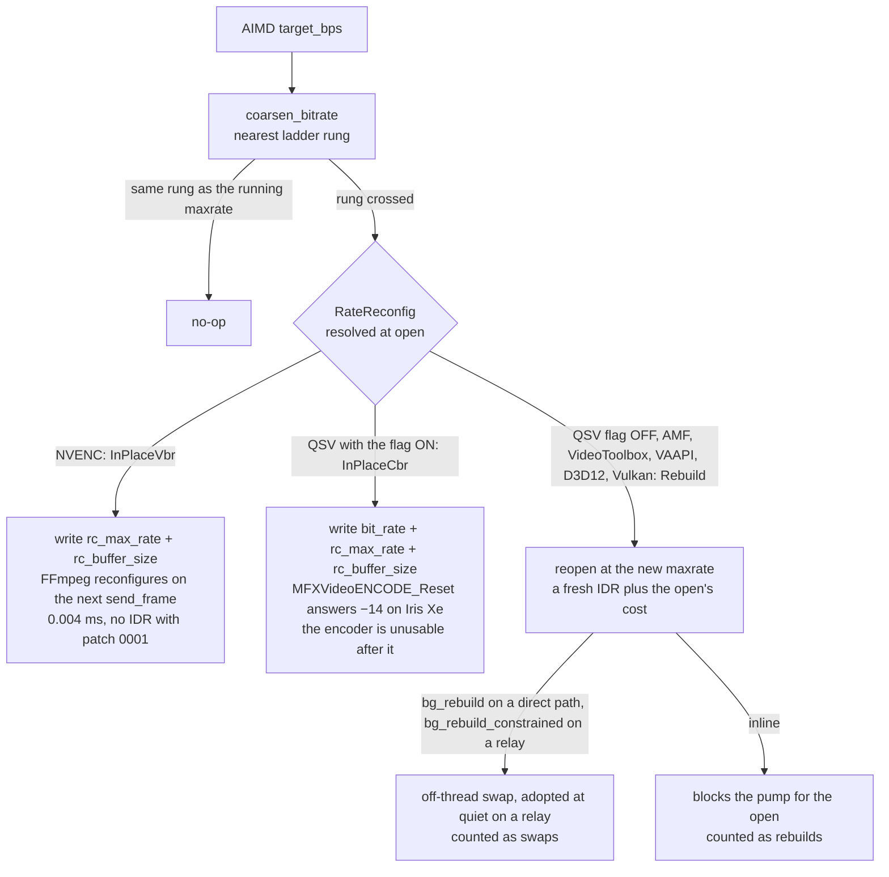

Measured with the sweep described below (20 rate changes 6 M → 200 k → 6 M at
1280×800, 30 frames a rung, `set_ms` the apply alone):

| Backend (host) | Arm | Rate-caused IDRs | Apply | Read |
|---|---|---|---|---|
| `hevc_nvenc` (RTX 5090 Laptop) | in place, unpatched FFmpeg | **20/20** | 0.001–0.008 ms | 0.4.50, 2026-09-02 (#1242) |
| `hevc_nvenc` (the same GPU) | in place, patch 0001 | **0/20**, default and constrained HRD windows alike | 0.004 ms | a patched 0.4.51 build, 2026-09-02; re-read on the released **0.4.187**, 2026-10-29 |
| `hevc_qsv` (Iris Xe) | rebuild, flag OFF | 20/20 | 340–390 ms above 1.5 M, **1.3–2.2 s at or below 1 M** | 0.4.51, 2026-09-02 |
| `hevc_qsv` (Iris Xe) | in place, flag ON | — | `MFX_ERR_INCOMPATIBLE_VIDEO_PARAM`, both `low_power` modes, with and without the buffer write | 0.4.51 and 0.4.62 |
| `hevc_amf` (Radeon 610M) | rebuild | **20/20** | **41–55 ms** | **0.4.187, 2026-10-29** — the 0.4.187 harness filed every one as periodic (below); the corrected harness reads `total_rate_idr: 20`, `pass: false` |
| `hevc_d3d12va`, `hevc_vulkan` (the dev box) | rebuild | 20/20 | 42–77 ms | FR-78 P2 |
| `*_vaapi` | rebuild, by construction | — | unmeasured | — |
| `hevc_videotoolbox` | rebuild | unmeasured | unmeasured | A3's open decision: patch 0002, or a rebuild at settle |

So the two rebuild families are not one: QSV's rebuild is a multi-second stall at
the rates a slow link runs, while AMF, D3D12 and Vulkan rebuild in 40–80 ms and pay
only the IDR. The rationing a backend needs follows from its row, which is why A4
retires heuristics per backend rather than deleting them.

⚠️ **Above the ladder the controller moves nothing.** The top rung is 25 Mbps. A
direct `av1_nvenc` session at 144 fps on the dev box (0.4.186, 2026-10-29) climbed
`target_bps` 34 → 65 Mbps in eight AIMD steps while `rate_moves` stayed 0: every step
coarsened to the top rung and `set_bitrate` returned. Until its first rung crossing the
encoder runs at the maxrate it opened with, and after that at the rung, never at the target.

**What the heartbeat says** (`FFmpeg DC pump heartbeat`, `peer.rs:9819-9852`):

| Field | Meaning |
|---|---|
| `inplace_rate` | `supports_dynamic_bitrate()`: the backend applies in place (NVENC always, QSV only with the flag) |
| `rate_moves` | in-place writes |
| `rebuilds` | synchronous reopens, the inline arm |
| `swaps` | background-rebuilt encoders adopted. Read it beside the two above: on a direct QSV session every rate move lands here and only here (FR-65) |
| `dims_swaps` | reopens for a resolution change (FR-70 M2) |
| `idr_count` | every keyframe the encoder emitted, including one per frame while the DC is not open yet (`dc_unopen_drops`; a relayed session on 2026-10-31 started at 18), so baseline it at the first heartbeat. To isolate the rate-caused ones, read it per window against `dims_swaps`, the session's `keyframe_requests` (on `rc:session.stats`; `PLI/FIR → forcing keyframe`, `peer.rs:840`, is the RTP path's line) and `frames_dropped_backpressure`, because a drop burst adds a resync IDR of its own (FR-62 AC3's read) |
| `reconfig_forces_idr` | whether the pump rations a move as an IDR: `false` on patched NVENC, `true` for QSV-CBR and every rebuild. `ROOMLERD_ENCODER_NVENC_ASSUME_IDR=1` flips NVENC back |

**The read for any host** — the FR-62 A0 sweep (`app.rs:6296`):

```
roomlerd encoder-smoke --reconfigure-sweep --codec hevc --encoder hardware [--constrained] [--json]
roomlerd encoder-smoke --reconfigure-sweep --name hevc_amf --codec hevc --json   # a backend the cascade outranks
```

Per rung it prints `set_ms`, `rate_idr`, `periodic_idr`, `mean_bytes`, the
bytes-per-frame `ratio` against `target ÷ fps ÷ 8`, `first3_max` and
`trailing_mean`; `--json` emits one `ROOMLER_A0_JSON:{…}` line. Two rules the first
reads taught it:

- **The rate change is charged with the keyframe on the rung's first output frame**
  (`sweep_attribute_idrs`, `app.rs:6557`), not on frame 0. AMF answers the frame that
  fed the rebuilt encoder one call later, so the frame-0 rule filed its rebuild IDR as
  "periodic" on all 20 rungs of the Radeon 610M read and reported `total_rate_idr: 0`
  for a backend that rebuilds on every move.
- **The verdict's basis is per backend** (`sweep_verdict`, `app.rs:6586`). Every
  backend must show no rate-caused IDR and an apply under 5 ms. Only QSV, which runs
  CBR (`select_rc_mode` takes the CBR branch because the session opens with
  `rc_max_rate == bit_rate`), is also gated on the ratio (±25 %) and the burst
  (≤ 2×): a quality-driven backend sits under its cap on compressible content, so the
  RTX read printed `pass: false` on a 0.985 ratio deviation with 0/20 IDRs and a
  0.004 ms apply. The JSON names the basis (`"basis":"idr+apply"` or
  `"idr+apply+tracking"`).

**The patch and its gate.** `.github/ffmpeg-patches/0001-nvenc-no-idr-on-bitrate-reconfig.patch`
drops `resetEncoder = forceIDR = 1` from `nvenc.c`'s bitrate-only reconfigure.
`vendor-ffmpeg-windows.yml` applies it to the Windows and both Linux assets and
writes `ROOMLER-PATCHES.txt` (sha256 per patch) into each; `release-agent.yml`
refuses to tag when an asset's manifest differs from the committed patches
(`.github/workflows/release-agent.yml:449-471`, `:1172` for arm64). The pump reads
one const, `NVENC_RECONFIG_FORCES_IDR` (`encoder.rs:893`), so the binary and the
FFmpeg it links cannot disagree. The macOS builder carries no patch today.

**Switches, and when each retires:**

| Switch | Default | What it does | Retires when |
|---|---|---|---|
| `encoder_inplace_rate` / `ROOMLERD_ENCODER_INPLACE_RATE` (`encode/mod.rs:342`) | off | ON: QSV applies in place (measured broken on Iris Xe) and NVENC sizes its buffer to the open's window (`inplace_rate_bufsize`, `:355`). OFF is the pre-A1 behaviour, pinned by `encode::tests::inplace_rate_off_writes_the_pre_a1_one_times_window` and `encoder::tests::rate_mode_resolves_per_backend_and_flag` | QSV has an in-place path (patch 0004) or the arm is dropped |
| `ROOMLERD_ENCODER_NVENC_ASSUME_IDR` (`:371`) | off | reverts NVENC to the IDR-rationing pump path | a release of constrained NVENC heartbeats with `idr_count` flat across `rate_moves` |
| `bg_rebuild_constrained` (`:515`) | on | a constrained session's rebuild runs off-thread (#1254), adopted at quiet | never while a rebuild backend exists |

**Open**: QSV's `mfxExtEncoderResetOption` (patch 0004, an FFmpeg-level change),
VideoToolbox's A0 on a Mac, and A4's per-backend retirements — NVENC can shed its
rationing, QSV keeps `coarsen_bitrate`, and AMF, D3D12 and Vulkan keep it for the IDR.

Every rate-control switch, with the evidence that retires it and the phase that
deletes it, is in the registry:
[`rate-control.md` § Kill switches](rate-control.md#kill-switches-and-when-each-retires--the-registry-fr-62-ac4).

## Software encoders: the clock and 60 fps (FR-112)

A host with no hardware encoder (an Asahi Mac, a Linux box without VAAPI) encodes in software: libvpx for VP9
4:4:4 on the DataChannel, OpenH264 on the RTP track. Until FR-112 both were pinned at 30 fps, and on Apple
Silicon even 30 was out of reach. The constant was not the limit. **The scheduler was**: Linux's energy-aware
scheduling gives a thread that works a third of every frame period a low clock on an efficiency core, until its
work fills the period.

| Live, the Asahi M2 Pro (2048×1080) | 0.4.141 | with the clock (P1) | + the tier (P2) |
|---|---|---|---|
| OpenH264 encode, 30 fps target | 16.1 ms | **5.2 ms** | — |
| VP9-444 over the DataChannel | 27 fps, 3.5 cores | — | **56.3 fps**, 1.6 cores |
| H.264 over RTP | 28.7 fps | — | **56.2 fps** |
| a still screen, VP9-444 | 44 % of a core | 13 % | 13 % |

The same OpenH264 frame costs 6 ms back to back and 16–20 ms at a 30 fps cadence, even pinned to the
performance cores: per-frame time tracks the idle gap. A clocked-down core is slow, not idle, so the clock also
**lowers** the CPU time a session costs.

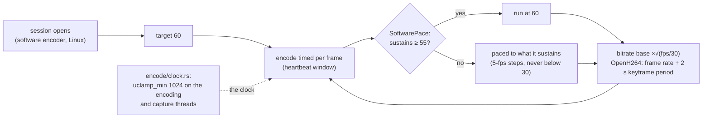

- **The encoder asks for its clock** (P1, `encode/clock.rs:83`). On Linux the encoder thread, OpenH264's worker
  and the DRM capture worker each set their own utilisation clamp (`sched_setattr`, `SCHED_FLAG_UTIL_CLAMP_MIN`,
  `uclamp_min` 1024, `encode/clock.rs:50`), keeping their policy and priority. A clamp counts only while the
  thread is runnable, and threads it starts afterwards inherit it: libvpx's workers, and Mesa's shader-cache
  thread from the capture worker's EGL. Kill switch: `ROOMLERD_ENCODER_CLOCK=0`.
  - ⚠️ **Not the async runtime.** Clamping every daemon thread was measured and added nothing (56.3 fps either
    way), and a clamped runtime would clock up every timer the daemon wakes for, with no session open.
  - macOS and Windows have requests of their own, opt-in until each is measured on its own hardware
    ([below](#the-clock-on-macos-and-windows-fr-112-p3)).
- **Software paths target 60, paced to what they sustain** (P2). `SoftwarePace` (`encode/encode_pressure.rs:242`)
  runs FR-1's `FpsPace` over its own encode EWMA. It is its own EWMA so that `ROOMLERD_ENCODE_PRESSURE=0`, the
  hardware path's switch, cannot turn the software pace off as a side effect. The pace is never below 30
  (`SW_PACE_FLOOR_FPS`, `encode/mod.rs:845`), so a host that cannot sustain 30 runs exactly as it did before.
  The RTP pump starts at 60 under the tier (`target_fps_with_tier`, `peer.rs:123`). The auto-fps-cap that drops
  a software encoder to 30 applies only where the tier is off: Windows and macOS by default, where the WGC
  readback it was written for lives.
  - ⚠️ **On by default on Linux only** (`sw_fps_60_enabled`, `encode/mod.rs:829`). On a host whose clock was
    never the limit, 60 frames cost twice the CPU of 30, and an attended desktop pays for it, so Windows and
    macOS opt in with `ROOMLERD_SW_FPS_60=1` until P3's numbers decide it per OS. `ROOMLERD_SW_FPS_60=0` gives
    back 30 everywhere.
  - ⚠️ **A step up waits for headroom** (P2d, `SW_PACE_UP_MARGIN_FPS`, `encode/encode_pressure.rs:255`).
    `FpsPace` was meant to hold an engaged pace until the estimate moved a full step, but it compared two 5-fps
    steps, which always differ by at least a whole step, so on 0.4.142 a pace on a step boundary moved every
    window the estimate crossed it. The software pace steps down at once and up only when the encoder clears the higher step by
    2.5 fps; `ROOMLERD_SW_PACE_UP_MARGIN=0` gives back 0.4.142's pace. A unit test replays the field trace that
    found it, window for window. The hardware pace keeps margin 0 until it is measured on hardware
    ([#2432](https://github.com/gjovanov/roomler-ai/issues/2432)).
- **The bitrate base follows the rate the pump runs at**, by √(fps/30) (`bitrate_base_for_fps`,
  `encode/mod.rs:814`): exactly the old figure at 30, ×1.41 at 60. A linear ×2 bought nothing when it was
  measured.

### The clock on macOS and Windows (FR-112 P3)

Linux's clamp has no counterpart elsewhere, so each OS has a request of its own. Both are written and neither has
been measured, so they ask for nothing unless `ROOMLERD_ENCODER_CLOCK=1` (`DEFAULT_ON`, `encode/clock.rs:56`) until
that OS's own hardware has answered ([#2430](https://github.com/gjovanov/roomler-ai/issues/2430)). The 60 fps
tier's default follows the same numbers.

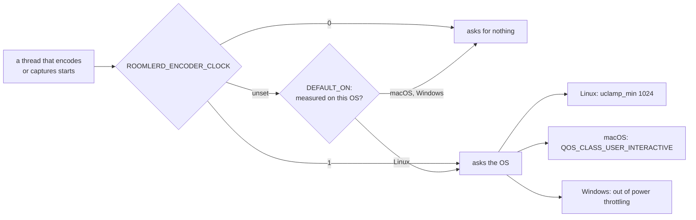

| | Linux | macOS | Windows |
|---|---|---|---|
| The request | `uclamp_min` 1024 | the QoS class `QOS_CLASS_USER_INTERACTIVE`, `pthread_set_qos_class_self_np` (`encode/clock.rs:218`) | Microsoft's "HighQoS": `SetThreadInformation(ThreadPowerThrottling)`, `ControlMask` execution speed, `StateMask` 0 (`encode/clock.rs:276`) |
| Who asks | the encoder thread, OpenH264's worker, the DRM capture worker | the encoder thread, OpenH264's worker, the capture worker (`capture/scrap_backend.rs:154`) | the encoder thread, OpenH264's worker |
| Threads it starts | inherit it | **do not** | **do not** |
| `ROOMLERD_ENCODER_CLOCK` unset | asks | does not ask | does not ask |
| The bench's `clock=` | `clamped` | `qos-user-interactive` | `unthrottled` |
| A refusal | no `CONFIG_UCLAMP_TASK`, or a cgroup limit | `EPERM`, only for a thread that left the QoS system through `pthread_setschedparam`, which the daemon never calls | logged with its `GetLastError` |

- ⚠️ **Not inherited, so libvpx's workers are outside the request.** `pthread_create` starts a thread at
  `QOS_CLASS_DEFAULT` whatever its creator runs at (`sys/qos.h`). On Windows a thread started after the request
  reads `ControlMask` 0, with the system in charge again; Microsoft documents neither that read nor the
  inheritance, so the unit tests in `encode/clock.rs` record what each OS does, on a real Mac and a real Windows.
  OpenH264 encodes one slice on its one worker, so an H.264 frame is wholly covered. If VP9-444 measures short
  with the request on, its workers need a request of their own.
- ⚠️ **On Windows, record the power source.** Microsoft's [Quality of Service](https://learn.microsoft.com/en-us/windows/win32/procthread/quality-of-service)
  table gives background services the Utility level and hidden windows the Low level, and describes both as
  slowed "on battery". It does not say what they do on AC. Only EcoQoS is "always". A flat read on AC therefore
  says nothing about the same laptop on battery.
- **macOS's job type is a separate lever.** The daemon's launchd job has run `ProcessType = Interactive` since
  FR-119 P2b-9, which took every thread out of the utility band. The QoS class asks for more than that, for the
  threads on a frame's path. Apple's headers warn that `QOS_CLASS_USER_INTERACTIVE` "is not an energy-efficient
  QOS class to use for large tasks", which is one more reason it is measured first.
- **Measure first**, as FR-112 §2 did: the same frame back to back and at a 30 fps cadence, on the host itself.

  ```bash
  roomlerd encoder-smoke --encoder software --bench --bench-cells rtp:h264 --bench-sizes 1920x1080 --bench-frames 150
  roomlerd encoder-smoke --encoder software --bench --bench-cells rtp:h264 --bench-sizes 1920x1080 --bench-frames 150 --bench-paced
  ```

  A paced row well above its back-to-back twin is the trap. ⚠️ A flat row speaks for its own size only, so read a
  size that leaves the thread mostly idle: on the same Mac a 1920×1080 frame doubles at a 30 fps cadence and a
  3024×1964 frame does not move. ⚠️ Compare rows at one `--bench-fps` only: at 60 a frame carries half the motion, so
  it costs less whatever the clock does. ⚠️ Run one size per process: on a Windows laptop an H.264 row that followed
  a VP9-444 row at a smaller size read about twice as slow on any core, for a reason not yet found.

  `ROOMLERD_ENCODER_CLOCK=1` in front of the same two lines gives the other arm (on Windows,
  `$env:ROOMLERD_ENCODER_CLOCK='1'` first). Each is a one-shot process, so no daemon restarts, and a release carries
  both arms, so no test binary has to reach the host. Through `roomler exec` on a Mac, call
  `/usr/local/bin/roomlerd`: exec's `PATH` does not hold it.
- **macOS, before the request.** MacBook-1 (Apple M5 Pro, AC, 0.4.190) has the trap in a milder form. A 1080p frame
  goes from about 3.1 ms back to back to about 6.4 ms at a 30 fps cadence on H.264 and VP9-444. At a 60 fps cadence
  every row still fits its 16.7 ms, so here it costs about 3 ms of latency and no frames.
- **Windows, before the request.** On AC the gap is smaller again, and it is not core placement. At 1280×720 and a
  30 fps cadence H.264 goes from 3.3 to 4.6 ms on a hybrid laptop and from 3.8 to 4.0 ms on a desktop, and VP9-444
  from 3.7 to 6.8 ms and from 4.5 to 6.0 ms. At 1080p no p50 rises by more than about 10 %. The laptop's free-running
  rows match the same rows pinned to its fast cores, so nothing parks the encoder on its slow cores on AC. A laptop
  on battery is the case Microsoft documents, and it is not measured yet.
- **What is owed:** what each request does, a laptop on battery, and a live session. Both before halves are in
  [FR-112 §9](fr/FR-112-software-encoding-at-60-fps.md#9-field-verification-log).

### OpenH264's runtime settings (FR-112 P2b)

Three facts about OpenH264 that the RTP pump now respects, the first two older than FR-112 and true of every
release before it:

| Fact | What went wrong | Now |
|---|---|---|
| The `openh264` crate creates the C encoder's state at the **first encode**, and `SetOption` before that answers `cmInitExpected` (4) | every session's first `set_bitrate` (the quality-derived target) was refused, recorded as applied, and never retried | early settings wait for the first frame (`Settings`, `encode/openh264_backend.rs:322`) |
| The crate sets layer 0's **max** bitrate to the construction bitrate, and OpenH264 refuses a target above the max (`cmInitParaError`) | no runtime raise past the construction figure ever took: not Quality=High, not REMB recovering | the max moves with the target: raised first, lowered after (`apply_runtime_bitrate`, `:216`) |
| OpenH264 budgets each frame's bits from its **frame rate**, and its keyframe period is counted in frames | at 60 fps a 30 fps budget per frame, and the 60-frame period put a keyframe every second | `set_frame_rate` hands it the rate the pump runs at, and the period follows to keep 2 s (`IDR_EVERY_S`, `:59`) |

The keyframe period was caught by CI: `tests/l4_latency.rs`'s replay cell assumes nothing but a replayed PLI cuts
a keyframe inside its answer window, and a keyframe a second did.

⚠️ **One slice stays.** Size-limited slices with threads measured 1.7× faster on an x86-64 laptop and **2.2×
slower** on the Asahi host, where openh264-sys2 builds no assembly either (it ships NASM for x86 only). Measure on
the host before changing it (FR-112 §2).

## Building the FFmpeg backend locally on Windows (FR-77 P0)

The `ffmpeg-encoder` feature links the **vendored** FFmpeg (static-md, LGPL,
minimal) — the same zip `release-agent.yml` fetches — so a local build must stage
that tree, not a system FFmpeg. `scripts/dev-ffmpeg-windows.ps1` does what the
workflow's "Fetch vendored FFmpeg" step does, on a dev box:

```powershell
pwsh scripts/dev-ffmpeg-windows.ps1          # download + verify + stage under C:\ffmpeg-pin, once
# in a vcvars64 / "x64 Native Tools" shell (bindgen wants MSVC's stdint.h):
Invoke-Expression (pwsh scripts/dev-ffmpeg-windows.ps1 -Env | Out-String)
cargo build -p roomlerd --release --features "full-hw,vp9-444,system-context,ffmpeg-encoder,overlay-l3,overlay-netstack,ssh-server"
.\target\release\roomlerd.exe encoder-smoke --encoder hardware --codec hevc
```

It stages FFmpeg under `C:\ffmpeg-pin\installed\x64-windows-static-md` and libvpx
next to it, rewrites the `.pc` prefixes, and provides `pkg-config.exe` (vcpkg's
`pkgconf` **with its `pkgconf-N.dll`**, renamed — what CI does). Three things the
first run on the dev box taught, all encoded in the script: the env must carry
`CMAKE_POLICY_VERSION_MINIMUM=3.5` (audiopus_sys' bundled libopus under CMake ≥ 3.31)
and `LIBCLANG_PATH` (bindgen); and **`FFMPEG_DIR` must stay unset** — with it,
`ffmpeg-sys-next` skips pkg-config and the `.pc`'s `-lvpl -ladvapi32 -lole32` never
reach the linker (LNK1120 with every `MFX*` symbol unresolved). The recipe needs
`ffmpeg-next ≥ 9.0`: the 8.1 crate does not link `vpl.lib` from the static tree on
native Windows at all, which is why the WSL route used to be the only proven one.
Measured on the dev box (RTX 5090 Laptop + Radeon 610M, 2026-09-07): incremental
build 3 min, `encoder-smoke --codec hevc` → `hevc_nvenc` PASS, the probe advertises the
same set as the shipped build. `-FfmpegRelease` / `-FfmpegAsset` pin any
published vendored build, which is also the rollback recipe. The FFmpeg **command
line** for experiments is a different thing: `winget install Gyan.FFmpeg` (a GPL full
build, never shipped) gives `ffmpeg -encoders` for a quick look at what a box's
drivers expose.

On Linux the same recipe is the release lane's: extract the `-minimal-vaapi-vulkan-h264dec-aac`
asset, rewrite the `.pc` prefixes, set `FFMPEG_DIR` / `PKG_CONFIG_PATH` /
`LD_LIBRARY_PATH` at the tree, and build with `--features ffmpeg-encoder,vp9-444`.
To drive one backend past the cascade on any host — a cell the vendor SDK
outranks there — `roomlerd encoder-smoke --name hevc_vulkan` (real bytes) and
`--reconfigure-sweep --name hevc_vulkan --codec hevc` (the FR-62 ladder) open
exactly that encoder, the same open the capability probe runs.
The Linux-only code (`encode/ffmpeg/vaapi.rs`) is linted by nothing on Windows —
run `cargo clippy … --all-targets -- -D warnings` under WSL before pushing it.

## Viewer decode paths

The browser probes per-codec **software and hardware** decode support and exposes
the render paths documented in [ui.md](ui.md#the-remote-desktop-viewer-useremotecontrolts):
classic `<video>`, WebCodecs-over-RTP (`RTCRtpScriptTransform`), and the DC worker
paths (`rc-webcodecs-worker`, `rc-hevc-worker`, `rc-vp9-444-worker`). Per-hop
timings (forward / decode / paint) are instrumented by `rc-hop-stats` and shown in
the opt-in diagnostics HUD. Decoder stats flow back to the agent and close the
rate-control loop.

## Input & audio (the non-video channels)

- **Input injection**: enigo (SendInput / XTest+uinput / CGEventPost) for the
  interactive session; a dedicated SystemContext backend injects from a
  `SetThreadDesktop`-bound thread for lock screen / UAC / pre-logon on Windows;
  keyboard-layout auto-switch matches the viewer's layout.
- **Audio**: opt-in per session — WASAPI loopback (Windows) or PulseAudio monitor
  (Linux) → Opus 48 kHz stereo in 20 ms packets on a sendonly track. macOS capture
  is not implemented.

## Appendix — why VP9 4:4:4 uses raw libvpx FFI

The `vpx-encode 0.6` wrapper hardcoded I420 (profile 0 = 4:2:0) and exposed
neither `g_profile` nor runtime bitrate — profile-1 bytes were unreachable, and
the default `g_lag_in_frames` (~25 buffered frames) meant no packets emerged on
first encode. `encode/libvpx.rs` therefore binds `env-libvpx-sys` directly:

- `vpx_codec_enc_config_default` then override `g_profile=1`,
  `g_lag_in_frames=0` (zero-latency), 8-bit depth, CBR, `kf_max_dist=240`;
- controls tuned for screen content: `VP8E_SET_CPUUSED` (speed),
  `VP9E_SET_TUNE_CONTENT=SCREEN`, `AQ_MODE=0`, `TILE_COLUMNS=2`,
  `FRAME_PARALLEL_DECODING=1`, `STATIC_THRESHOLD=100`, `NOISE_SENSITIVITY=0`;
- per-frame `vpx_image_t` built manually with three plane pointers
  (`VPX_IMG_FMT_I444`, zero chroma shift), `VPX_EFLAG_FORCE_KF` on the first
  frame and on keyframe requests, drained via `vpx_codec_get_cx_data`;
- runtime bitrate by mutating `rc_target_bitrate` +
  `vpx_codec_enc_config_set` (a no-op in the old wrapper);
- **FR-74 P3 — a worst-quality cap on direct transports**: `rc_max_quantizer`
  16 (q-index 64) via `Vp9Encoder::set_max_quantizer`, applied at encoder open
  and re-applied on every transport flip (relay keeps libvpx's 63). libvpx's
  one-pass CBR + screen tune treats every mouse-wheel notch of a text scroll as
  a scene change, resets q to 255 and walks it back ~7 q-index per frame, so a
  choppy scroll was rendered at the worst quality while spending a fifth of its
  target (measured offline against the real encoder, four rounds; spec §P3).
  The cap holds the notch frames at q 64; the steady scroll still refines to
  q 0 inside the budget and idle stays lossless. Env
  `ROOMLERD_VP9_DIRECT_MAX_Q` (63 = pre-P3).

Bindgen (`vp9-444-bindgen` feature) generates bindings against system headers on
Linux/macOS; Windows links the vendored prebuilt libvpx.
