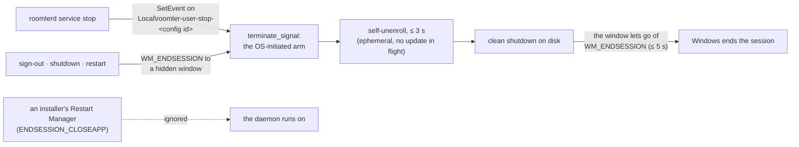

# Ephemeral nodes — devices that remove themselves

**FR-51** ([#1095](https://github.com/gjovanov/roomler-ai/issues/1095), spec:
[`docs/fr/FR-51-ephemeral-nodes.md`](fr/FR-51-ephemeral-nodes.md)). The roomler
answer to Tailscale's ephemeral nodes: a device that joins an org **knowing in
advance that it is temporary**, and then removes itself — device row, overlay
lease, address, MagicDNS name — shortly after it stops. For CI runners,
containers, autoscaled workers, preview environments: anywhere the device set
turns over faster than a human can curate it.

## The lifecycle

```
admin mints an EPHEMERAL ENROLLMENT KEY  (reusable, capped, revocable, audited)
        │
        ▼
roomlerd enroll --server … --token <key> --name runner-1 --ephemeral
        │   random machine fingerprint → a NEW device row, ephemeral: true
        ▼
roomlerd run          … the device works like any other …
        │
        ├── clean stop
        │     • Unix: SIGTERM / SIGINT (e.g. `docker stop`, `systemctl stop`)
        │     • Windows SCM service: SCM Stop / Preshutdown — the service host
        │       signals the worker's stop event and waits (#1683)
        │       (an update's OWN service stop is not a leave — the device
        │        stays enrolled; see below)
        │     • Windows per-user install (the Scheduled Task): `roomlerd service
        │       stop`, sign-out, shutdown (FR-97 P4d; see below)
        │       → the daemon calls POST /api/agent/self/unenroll
        │       → removed within seconds
        │
        └── unclean stop (SIGKILL, `schtasks /End`, power loss, network
            partition, a Windows worker that did not exit inside the host's
            graceful-stop budget, or a per-user daemon past its 5 s at sign-out)
                → the server-side reaper removes it once it has been
                  silent past its TTL (default 15 min, 60 s floor)
```

Removal is **final and complete**: the device row is hard-deleted (not
tombstoned), the overlay address returns to the org's pool, the MagicDNS name
frees, and peers receive a netmap delta. **A restart is a NEW device** — a
fresh random fingerprint, a fresh address, a fresh name. Nothing persists
across a cycle; that is the contract, not a limitation.

## Switches — everything defaults OFF

| switch | where | default | what it gates |
|---|---|---|---|
| `ephemeral_keys_enabled` | org settings (`PUT /api/tenant/{tid}/ephemeral-key-settings`, or Settings → "Ephemeral enrollment keys") | **off** | whether keys can be minted — and whether any existing key still works (the gate is re-checked on every use, so flipping it off is an org-wide revocation that burns nothing) |
| `rc.ephemeral_reaper_enabled` | server config (`ROOMLER__RC__EPHEMERAL_REAPER_ENABLED`) | **false** | the reaper task — off means zero queries, zero deletes, deployment-wide |
| `rc.ephemeral_default_ttl_secs` | server config | 900 | the inactivity deadline for devices whose key set no override |
| `rc.ephemeral_reap_interval_secs` | server config | 60 | reap cycle cadence (cluster-singleton per cycle) |

Even with the reaper on, the predicate (`ephemeral: true`) structurally cannot
match a device that did not enroll ephemeral — every pre-FR-51 row deserialises
permanent, and nothing after enrollment can flip a device in either direction.

## Ephemeral enrollment keys

The single-use enrollment token (10 minutes, once, minted by a human) is
deliberately unusable for autoscaling, so ephemeral devices enroll with a
**second credential kind**: a reusable key. A reusable key is a standing
credential that mints device identities inside your org — treat it like any
other CI secret. Four controls make it acceptable, and they are all structural:

1. **Use ceiling** — `max_uses` (default 100, cap 10 000), claimed atomically:
   racing replicas cannot overshoot it.
2. **Absolute expiry** — default 30 days, cap 90; enforced on the server row
   as well as inside the credential.
3. **Revocability** — `DELETE /api/tenant/{tid}/agent/enroll-key/{id}` (or the
   Devices page). Takes effect on the very next use. Expiry alone would mean a
   leaked key can only be waited out; revocation means it can be *stopped*.
4. **Per-use audit** — every enrollment writes an `enrollment_key_uses` row
   (90-day TTL) that also records the device's *removal* (when, and by which
   path), so "which key created this device, and where did it go" stays
   answerable **after** the device row is gone.

Mint: `POST /api/tenant/{tid}/agent/enroll-key` (needs `MANAGE_AGENTS`; the
org switch needs `MANAGE_TENANT` — deciding the credential class exists is an
org-owner decision, minting within it is fleet administration). The response's
`key` is shown **exactly once** and is not stored; the list can never return it.

The ephemeral property **rides the credential, never the request body**: a
device cannot declare itself permanent (and evade the reaper), and a permanent
device cannot be flipped ephemeral (and be scheduled for silent deletion) by
anything the host says.

## The CI / container recipe

One key in the secret store; each job or replica enrolls itself and cleans up
after itself:

```bash
# entrypoint.sh — each replica is its own device
roomlerd enroll \
  --server https://roomler.ai \
  --token  "$ROOMLER_EPHEMERAL_KEY" \
  --name   "runner-${HOSTNAME}" \
  --ephemeral
exec roomlerd run
```

- `--ephemeral` mints a **random** machine fingerprint. Without it, N replicas
  of one image share hostname+OS+arch+path, derive the SAME fingerprint, and
  the server refuses the collision (an ephemeral enrollment never revives or
  takes over an existing row — a key holder posting a real device's
  machine_id gets a final 409).
- `--ephemeral` **refuses if a config already exists** at the target path.
  Containers get a fresh filesystem for free; on a real host, point `--config`
  at an empty path.
- With a **standard** token, `--ephemeral` warns loudly and the device enrolls
  PERMANENT (under a random fingerprint) — the credential decides, and the
  config records the server's answer.
- `docker stop` sends SIGTERM → the daemon de-enrolls within seconds. The
  auto-updater's internal restart does **not** de-enroll (that would delete
  the device on every update).
- **On the Windows SCM service** the stop arrives as SCM Stop / Preshutdown, not
  a signal, and the service host stops its worker with `TerminateProcess` — a
  hard kill the worker never sees. So the host first **signals a named stop
  event** and waits a bounded time (`WORKER_GRACEFUL_STOP_BUDGET`, 8 s) for the
  worker to self-unenroll and mark a clean shutdown, and only then falls back to
  `TerminateProcess`. The event's DACL lets **only SYSTEM signal** it, so an
  unprivileged local user cannot stop (or unenroll) a SYSTEM worker. Before
  #1683 the hard kill was the only path and a Windows-service ephemeral device
  always waited out the reaper's TTL. Mechanism: `docs/remote-control.md`
  (service host) and `agents/roomlerd/src/win_service/stop_event.rs`.
- **A per-user Windows install** (the perUser MSI's Scheduled Task) has no
  service host to ask it, so it holds a stop channel of its own and listens for
  the session's end: [below](#a-per-user-windows-install-fr-97-p4d).
- **An update's own service stop never unenrolls.** The MSI stops the service
  while it replaces the binary — by then the worker that spawned the installer
  has already exited 0 and the SCM host has respawned a fresh one, which receives
  that stop as an OS-initiated stop, indistinguishable from `sc stop`. So the
  self-unenroll is gated on "no update in flight"
  (`updater::should_self_unenroll`, platform-neutral): an installer spawned
  within the last `UPDATE_STOP_WINDOW` (10 min — the `update-attempt` marker that
  `spawn_installer_with_watch` touches, rollbacks included) keeps the device
  enrolled and logs why. An operator stop inside that window leaves the row to
  the reaper — which is what every Windows-service stop did before #1683.
- `roomler status` on an ephemeral device says so
  (`ephemeral   yes — removes itself after inactivity, or on clean stop`).

## A per-user Windows install (FR-97 P4d)

The perUser MSI runs the daemon from a Scheduled Task, as the person signed in.
No service host stands in front of it, so before P4d nothing ever told it that
it was stopping: `schtasks /End` is a `TerminateProcess`, and sign-out and
shutdown end it with the rest of the session. An ephemeral device installed that
way always waited out the reaper. Two channels now carry a clean stop to it,
into the same `os_initiated_stop` arm a Unix SIGTERM takes:



| What ends the per-user daemon | Before P4d | Since P4d |
|---|---|---|
| `roomlerd service stop` | (no such command) | A clean stop: an ephemeral device unenrolls. It waits up to 15 s for the daemon to leave, then falls back to `schtasks /End` |
| Sign-out, shutdown, restart | Killed with the session; the reaper collects an ephemeral device | A clean stop, which the window holds the session's end for, at most 5 s (`SESSION_END_BUDGET`) |
| An installer's Restart Manager (`ENDSESSION_CLOSEAPP`) | — | Ignored: never a leave |
| `roomlerd service stop` from an SSH login (session 0) | (no such command) | A hard stop (`schtasks /End`), and it says why: the person's event lives in their own session, which session 0 cannot see |
| `schtasks /End`, Task Manager's End task, `taskkill /F` | A hard kill; the reaper | The same |
| `taskkill` without `/F` (`WM_CLOSE`) | Refused: "can only be terminated forcefully" | In the person's session, taskkill reports that it sent the signal, and the daemon keeps running. Use `roomlerd service stop` |
| An auto-update | The internal arm: stays enrolled | The same |

- **Which daemon.** The event is keyed by the config's instance id, the
  fingerprint the single-instance lock already uses
  ([`instance_lock.rs:92`](../agents/roomlerd/src/instance_lock.rs#L92)). So
  `service stop` reaches the daemon of the config it resolved, and no other.
  `Local\` keeps the event in the person's own session, and its default DACL
  lets that person and SYSTEM signal it, which Task Manager already allows them.
- **Why a window.** A console program hears `CTRL_LOGOFF_EVENT` only until it
  loads `user32.dll`, and the daemon loads it for capture and input. Windows
  tells such a process through `WM_QUERYENDSESSION` and `WM_ENDSESSION`, sent to
  its top-level windows, so a hidden one listens
  ([`session_end.rs`](../agents/roomlerd/src/win_service/session_end.rs)). A
  message-only window would hear nothing: the session's end is a broadcast.
  `WM_QUERYENDSESSION` is answered yes and never acted on, because another
  program can still cancel the end. Only `WM_ENDSESSION` with `wParam` TRUE
  stops the daemon.
- **Why Restart Manager is ignored.** An installer that finds the daemon's files
  in use asks it to close with `ENDSESSION_CLOSEAPP`. Read as a leave, a manual
  MSI upgrade would delete an ephemeral device, the trap #1683 closed for the
  service. The auto-updater's own stop is the internal arm, which never
  unenrolls.
- **`service uninstall` does not stop the daemon, on purpose.** On a major
  upgrade, Windows Installer runs the old product's uninstall, which runs
  `service uninstall` from the outgoing binary (`UnregisterAutostart` in
  `wix/main.wxs`). A stop there would unenroll an ephemeral device on every
  manual upgrade.
- **A daemon started while the last one is leaving** never takes that one's
  event, which may already be signaled: it would stop the moment it started. It
  takes the name as soon as the old daemon is gone.
- Kill switch: `ROOMLERD_SESSION_END=0` makes no window, and a sign-out ends the
  daemon unannounced again. `service stop` needs none: it acts only when asked.

## Quota

An ephemeral device consumes a `max_devices` slot **while it exists** — the
reaper is what gives slots back. Until it runs, yesterday's runners are
today's quota, which is why the reap deadline defaults short (15 min) and why
the TTL floor is 60 s (a network blip or a pod roll must not read as "the
device left").

## What this is deliberately NOT

- **Not a stateless daemon.** `roomlerd` persists its config (WG key, SSH host
  key); Tailscale's `--state=mem:` has no roomler equivalent. The
  refuse-if-config-exists guard plus a container's fresh filesystem covers the
  motivating case without one.
- **Not tunnel clients (yet).** `tunnel_clients` rows stay permanent: the
  ephemeral credential is its own JWT audience, and the tunnel enrollment
  deliberately refuses foreign audiences — extending ephemerality there means
  a second credential kind, built when a consumer exists (FR-51 §7 decision 5,
  recorded on the issue).
- **Not a ban mechanism.** Removal frees the identity; the binary can enroll
  again (as a new device) with any valid credential, exactly like an evict.
- **Not exempt from ACLs, consent, or any gate.** An ephemeral device is an
  ordinary device until it vanishes.

## Operational notes

- The reaper is a **cluster singleton** per cycle (Redis `NX` claim, the
  presence sweep's shape) and **aborts the cycle if the presence directory is
  unreachable** — an unreadable directory must not let one pod reap agents
  that are alive on another.
- A reaped-but-still-running device (unclean-stop survivor, network partition)
  hears **401** on its next control-plane call — its credential died with the
  row — and its self-unenroll treats 401/404 as "already gone".
- Every reap logs
  `ephemeral device reaped` with tenant, device, silence and TTL; every
  self-removal logs `ephemeral device unenrolled itself`. The lifecycle also
  lands on the key's use-row (`removed_at` + `removal`:
  `ephemeral_expired` / `ephemeral_self_unenroll` / `agent_delete`).
- The device grid badges ephemeral devices; the vanishing must never be a
  surprise.
