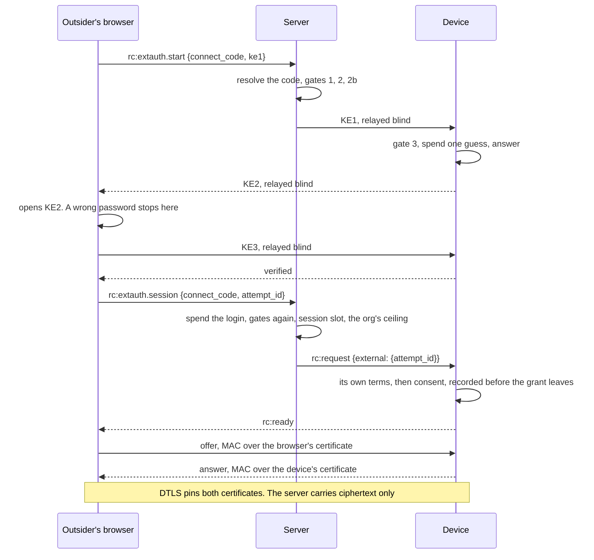
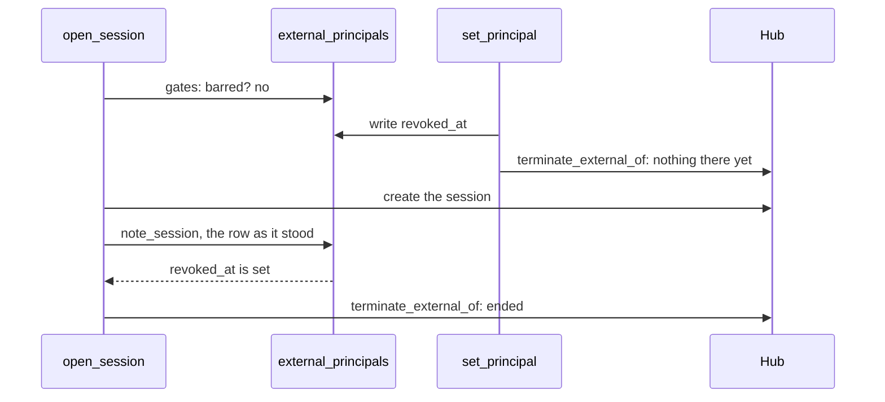

# External access

Someone **outside an organization** views and controls one of its devices, on a
**connect code** and a **password the device holds**. The server relays the login
and cannot use it. This is how that works once it is running, and what the org sees
of it. The design, the threat model and every field run are in
[FR-52](fr/FR-52-cross-org-remote-access.md). Status lives there too.

| You want to | Read |
|---|---|
| Let someone in | [§7](#7-operating-it) |
| Find out who came in | [§4](#4-who-came-in-and-who-hears-of-it) |
| Stop someone | [§5](#5-stopping-someone) |
| Change the login or the session | FR-52 §4 and §4c first. The parameters are a wire surface |

## 1. The gates

Each gate has a different owner, each is closed by default, and every decision is
written down. An earlier refusal means the later gates are never consulted.

| # | Gate | Owner | Where it lives | Set with |
|---|---|---|---|---|
| 1 | The org's switch | org admin | `TenantSettings.external_rc_enabled` | `PUT …/external-access`, `MANAGE_TENANT` |
| 2 | The device's approval, with a permission ceiling and an optional expiry | org admin | `Agent.external_access_policy` | `PUT …/agent/{aid}/external-access-policy`. `MANAGE_AGENTS` + `REMOTE_CONTROL` to grant, `MANAGE_AGENTS` alone to clear |
| 2b | This person's standing on this device | org admin | `external_principals.revoked_at` | `PUT …/agent/{aid}/external-principals/{user_id}`, the same split |
| 3 | The device's opt-in | device owner | `external_access_enabled` in the device's own config, read at every knock | `roomler config set`, console user only |
| 4 | The password | the outsider proves it, the device checks it | an OPAQUE record on the device, and nowhere else | `roomler rc password set`, on the device |
| 5 | Consent | whoever is at the machine | `external_consent_mode`, floored by `auto_grant_session` | device config. Defaults to a prompt titled "from OUTSIDE your organization" |

Gates 1, 2 and 2b are the server's. **They do not survive a compromised server.**
Gates 3 and 4 do, because the device reads them from its own file. The `external_*`
keys are absent from `DesiredConfig`, and a push naming one is refused and audited,
so the server cannot open them.

## 2. One session

⚠️ **A guess is spent when KE2 leaves the device**, never when KE3 fails. The client
learns a password is wrong from KE2 alone and stops, so a wrong guess leaves no row
and no failure anywhere (FR-52 §4b). The device's budget is 5 free, then 30 s doubling
to a 1 h cap over a 24 h window. It is the device's, and a server cannot refund it.

⚠️ **A verified login is worth one session and one offer.** A reconnect costs a login
(FR-52 decision 10).

An outsider never holds `RECORD` or `PRIVACY`, at the Hub or on the device, whatever a
ceiling says, and a frame naming a `local_relay` is refused and logged.

## 3. What each side is told

The outsider gets one coarse word. The org's log gets the reason.

| What happened | The outsider reads | `external_rc_audit` reads |
|---|---|---|
| No such code | `unavailable` | nothing: there is no org to tell |
| Gate 1 off, or gate 2 closed or expired | `unavailable` | `login_refused: unavailable`, and `login_detail` names the gate |
| The device is offline | `unavailable` | `login_detail`: the device is offline |
| An admin barred this person | `unavailable` | `login_detail`: "an admin of the org barred this person from the device" |
| Gate 3 off, or no password set | `unavailable`, from the device | `login_refused: unavailable` |
| Too many guesses | `throttled`, with `retry_after_secs` | `login_refused: throttled` |
| No free session slot | `session_limit`, naming the session that holds it | `login_refused: session_limit` |
| A login that is not theirs, or was spent | `unknown_attempt` | nothing |

Every answer given without the device leaves at `ANSWER_FLOOR`, 300 ms after the knock
(`crates/modules/remote/src/extauth.rs:91`), from one place, `at_floor`
(`extauth.rs:374`), after its arm has ended. So a closed org's code cannot be told from
one that does not exist, by the bytes or by the clock. FR-52 §5 and §12 have the
measurement and what it does not cover.

The log (`GET …/external-rc-audit`, `VIEW_REMOTE_AUDIT`, 90 d TTL) is decisions, not a
session record. Its `actor` is a name the outsider chose.

## 4. Who came in, and who hears of it

`external_principals` holds one row per person per device, with no TTL. It exists
because the log forgets at 90 days, and "this person's first session ever" read off
the log would come round every quarter. It is per device because the password is the
device's, so proving a second device's password is a new fact.

**A session makes the row, and nothing else can.** The list joins `users` for a name,
so a route that could make a row for any id would read any account's name to any org
admin. A `PUT` for someone with no row is a 404.

`note_session` (`crates/services/src/dao/external_principal.rs:35`) is one
`find_one_and_update`, upsert, returning the row as it stood. `None` means this is
their first, and the unique `{agent_id, user_id}` index arbitrates two firsts on two
pods. It runs behind the session, in `session_opened`
(`crates/modules/remote/src/extauth.rs:1378`), so a failure here never costs the session.

| Notice | Fires when | How often |
|---|---|---|
| **First session** | A person asks for their first session on a device. They have proved the password by then. The device may still refuse them | Once per person per device, ever |
| **Guessing** | The device answers `throttled`. It is the first the server sees of any wrong guess | Once per device per `GUESSING_NOTICE_EVERY`, 6 h, per pod. A roll forgets, and costs one extra notice |

Both go in the app and by web push to whoever holds `MANAGE_AGENTS`, and to the device's
owner while they are a member (`people_to_tell`,
`crates/modules/remote/src/extauth_notice.rs:51`). Nobody is told about themselves. There
is no email. The person at the machine has the prompt, which is the first line of
defence; a notice is for the people who were not there.

⚠️ `actor` is a stranger's text, and "Alice from IT" is the classic support scam. A
notice quotes it on one line, bounded, and words it as a claim (`quoted`,
`extauth_notice.rs:35`). The people list shows the account id's tail beside it, because
two accounts can carry one name.

## 5. Stopping someone

| You do | It stops | It does not stop |
|---|---|---|
| **Bar** the person, on the audit page | This account on this device, from its next step. **It ends their external session** | Anyone with the password on another account. A compromised server |
| **Change the password** on the device | Every login with the old one, whoever tries it, whatever the server says | A session already open |
| **Rotate the connect code** | Everyone holding the old code, at once | Anyone you give the new one to. A session already open |
| **Turn gate 3 off** on the device | Every new login, read at the next knock, whatever the server says | A session already open |
| Withdraw gate 2, or turn gate 1 off | Every new login on that device, or in that org | A session already open |

⚠️ **Of the server's levers, only a bar ends a session already open**: `set_enabled`,
`set_policy` and `rotate_connect_code` end nothing. If someone is in and must be out now,
bar them, then change the password. A guess still in progress is ended by rotating the
code, which is what the guessing notice tells people to do.

A bar reads in `gates` (`extauth.rs:396`), so it holds at `start`, at `finish` and at
`session`, and a login in flight dies with the rest. ⚠️ `standing` (`extauth.rs:447`)
opens only on an answer it has seen: a read that fails refuses.

`terminate_external_of` (`crates/modules/fleet/src/hub.rs:2537`) ends what the person
opened **through an external login**. A session the same account holds as a member came
through the other door, with gates of its own, and it stands (`LiveSession.external`).

**Two things have to meet: the bar and the session.** They can cross.

A bar written after that read finds the session in the Hub, so there is no gap, and no
read was added to do it. A repeat `PUT` writes nothing and adds no log row, and it still
ends the session, because the first may have raced one.

**Across pods**, `set_principal` also publishes `terminate_external` on the control lane
(`crates/modules/fleet/src/ctrl.rs:127`), and the pod holding the session applies it. The
envelope names the tenant, and `terminate_external_of` checks it, so a mismatched one
ends nothing. ⚠️ With Redis down that event never arrives: a session on the other pod
keeps running, while every new login is still refused, because the row is in Mongo.

Nobody can be barred **before** their first session, because there is no row (§4). The
code and the password cover that case.

## 6. What it costs, and who pays

| | Charged to | How |
|---|---|---|
| Session slots | The org the session is **for**: the one the outsider named on `/connect` and belongs to, else their only org, else the account itself at Free's one session. No paid org is needed | `charge_scope` (`extauth.rs:990`), FR-115 O6 + O7. With slots off, or Redis unable to answer, the session runs uncounted, never refused on a guess |
| Relay bytes | The **device's** org, on both legs | The Hub issues the TURN credentials under the session's org, and the viewer takes the ones `rc:ready` carries before its first gathering (FR-52 F3). A frame with no usable server leaves the pre-fetch in place: connecting uncharged beats not connecting. A session that ends direct books none of its direct bytes, and about 380 KB for what ICE spent on relays first (FR-52, decision 17) |

## 7. Operating it

**To let someone in:**

1. Org admin: turn on *External access* for the org, and approve the device, choosing a
   ceiling. The device must be on a build that advertises `external-session`.
2. At the device, as the console user: `roomler config set external_access_enabled true`,
   then `roomler rc password set`. The password is typed there and never crosses a
   network. The dashboard can show *set / not set* and can clear it, and can never set it.
3. Give the person the connect code (`XXXX-XXXX-XXXX`) and the password.
4. They sign in to any account, open `/connect`, and enter both. The account needs no org.

**To see what happened:** *Audit → External access* (`/tenant/{id}/audit/external`),
`VIEW_REMOTE_AUDIT`. People from outside sit above the log. Bar and Let back appear for
those who may use them.

**When a notice arrives:** if you know the person, there is nothing to do. If you do not,
bar them and change the password on the device. For guessing, rotate the connect code.

## 8. Where the code is

| What | Where |
|---|---|
| The gates, the login relay, the session step | `crates/modules/remote/src/extauth.rs`: `gates` `:396`, `start` `:593`, `finish` `:775`, `open_session` `:1082` |
| What follows a session | `session_opened`, `extauth.rs:1378` |
| The notices | `crates/modules/remote/src/extauth_notice.rs` |
| Gates 1 and 2, the code, the log, the people | `crates/modules/fleet/src/external_access.rs`: `decide_revocation` `:138`, `audit` `:705`, `principals` `:740`, `set_principal` `:806` |
| Ending a person's sessions | `crates/modules/fleet/src/hub.rs:2537`, `ctrl.rs:127` |
| The two collections | `crates/remote_control/src/models.rs:4532`, `:4607`; indexes `crates/modules/fleet/src/lib.rs:773`, `:786` |
| The device's half | `agents/roomlerd/src/extauth.rs`, `agents/roomlerd/src/external_logins.rs` |
| The page | `ui/src/views/remote/ConnectView.vue`, `ui/src/composables/useExternalLogin.ts` |
| The audit page | `ui/src/components/admin/ExternalAuditSection.vue`, `ExternalPeopleCard.vue`, `ui/src/utils/externalAudit.ts` |
| The proofs | `crates/tests/src/extauth_tests.rs`, `crates/tests/src/external_access_tests.rs`, `ui/src/__tests__/composables/useExternalLogin.spec.ts` |

Related: [remote-control.md](remote-control.md) · [security-baseline.md](security-baseline.md)
· [relay-cost-metering.md](relay-cost-metering.md) · [remote-config.md](remote-config.md).
