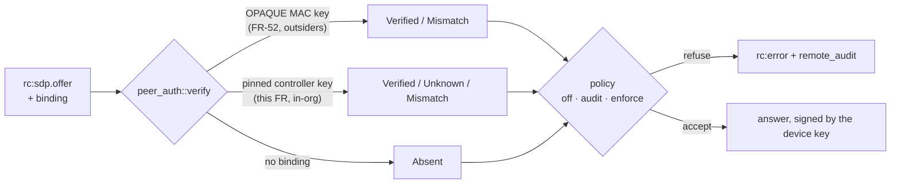

# FR-100: Controller identity — a stolen login or a hostile signalling plane can neither open nor sit inside a session to a pinned device

**Issue:** [#2092](https://github.com/gjovanov/roomler-ai/issues/2092) · **Status:** in progress —
P1a and P1b shipped in 0.4.145 (#2509, #2517): each enrollment's device key, and the device's signature over its answer when the offer asks. P2a merged (#2539): the viewer asks, verifies before applying the answer, and pins the device key. P1c built: the device judges the browser behind every offer, and the hub records the verdict. P2b built: the browser signs its offer with a key of its own · **Owner:** the agent (the verifier, the pins), the viewer (the browser key), the hub (plumbing
only) · **Anchors:** master `e8510d506` (re-derived 2026-10-19 for P1) · **Program:**
[StarDesk teardown](../plans/stardesk-teardown-program.md), wave 1 · **Builds on:**
[FR-52](FR-52-cross-org-remote-access.md) (its `extauth_mac` binding, merged 2026-10-18),
[FR-27](FR-27-consent-surfaces-and-desktop-companion.md) (the PromptSurface), [multi-org](../multi-org.md)

## 1. Goal

Tie each remote-desktop session's DTLS keys to identities that the **device** can check without trusting
the server. Then none of these can open a session to a device that pins its controllers, or sit unnoticed
in the middle of one:

- someone holding a stolen login cookie in another browser;
- someone holding the server's JWT secret;
- a hostile hub, Redis or load balancer;
- a TLS-inspecting middlebox on the **device's** network leg.

StarDesk claims "mutual authentication", "certificate pinning" and a "zero-knowledge design". Roomler's
consent model is far stronger than StarDesk's, but on master the session keys are bound to nothing the
device can verify (§2).

### What this does not defeat, said up front

Whoever serves the viewer's JavaScript can make the real browser key sign anything, and can make the page
show anything. That includes a TLS-inspecting middlebox on the **controller's** leg, because it can rewrite
the script too. Defeating that needs a controller whose code the server does not deliver, or code
transparency for the viewer. Both are follow-ups (§8). This FR does not pretend otherwise.

## 2. Evidence (master `e8510d506`)

| What | Where | Consequence |
|---|---|---|
| The agent mints a fresh ECDSA P-256 certificate per peer connection | `agents/roomlerd/src/peer.rs` L466 (`SettingEngine`), L516 (`RTCConfiguration`, no `certificates`); `crates/vendored/webrtc/src/api/mod.rs` L93–95 | Ephemeral keys, good. But nothing long-lived to pin |
| The browser does the same | `ui/src/composables/useRemoteControl.ts` L8681 | The same |
| Mutual DTLS, with each side's cert checked against the **SDP** fingerprint | `crates/vendored/webrtc/src/dtls_transport/mod.rs` L363–364 (`RequireAnyClientCert`, `insecure_skip_verify`), L461 → L550 (`validate_fingerprint`) | The SDP is the only thing that says whose key is whose |
| The hub forwards the SDP string and **rebuilds** the frame around it | `crates/modules/fleet/src/hub.rs` L2006 (`forward_offer`), L2073 (`ServerMsg::SdpOffer`), L2112 (`ServerMsg::SdpAnswer`) | Whoever controls the hub can swap a fingerprint. Any new field must be carried through it explicitly |
| Signalling TLS deliberately has no pinning | `Cargo.toml` L319 (`tokio-tungstenite` with `rustls-tls-native-roots`, so a corporate inspection root works) | Pinning the server would break the corporate laptops in the acceptance bar |
| FR-52 already binds the transport to a login, for **outsiders** | #1628 (`5cf434916`, merged 2026-10-18): `extauth_mac` on `rc:sdp.offer` and `rc:sdp.answer`, a MAC under the OPAQUE login key; "the device decides" | The binding exists for outsiders; in-org sessions have nothing |
| Consent is asked **before** the offer exists | the viewer calls `createOffer` only on `rc:ready` (`useRemoteControl.ts` L7931–7982) | A code shown in the consent prompt cannot include the controller's fingerprint unless it is committed earlier |
| A device's keys must differ per org | `docs/multi-org.md` L86–90 (a copied WG key would let two orgs correlate the device) | One identity key per enrollment |

## 3. Design

### 3a. Keys

- **The device key.** An ECDSA P-256 key generated **on the device**, one per org enrollment. It lives in
  its own file in the hardened machine-global state directory, **never in `config.toml`**, which has several
  writers. Only the public half leaves the device: it is registered in the hello, and the device page shows
  its fingerprint.
- **The controller key.** A WebCrypto **non-extractable** ECDSA P-256 key in IndexedDB, per origin and user,
  registered with the server as "this browser" with a label the user can read.
- **P-256 on both sides.** WebCrypto supports it everywhere; the agent uses RustCrypto `p256`.

### 3b. What is signed

| Message | Signed by | Covers |
|---|---|---|
| `rc:sdp.offer` (P2) | the controller key | the transcript with role `offer`: the label, the role, the session, agent and user ids, the offer's DTLS fingerprint, an EMPTY answer fingerprint (none exists yet), the nonce |
| `rc:sdp.answer` (P1b) | the device key | the transcript with role `answer`: the same fields, with the answer's DTLS fingerprint, over the nonce the offer carried |

One byte layout for both ([`peer_auth_transcript`, `signaling.rs:262`](../../crates/remote_control/src/signaling.rs#L262)): the label `roomler-peer-auth-v1`, then each field as `u16be(len) ‖ bytes`, FR-52's MAC framing. The role keeps one side's signature from being replayed as the other's. The signature is ECDSA P-256 over SHA-256, the fixed 64-byte `r ‖ s` that WebCrypto verifies. Rust and the viewer are held to one known answer (166 bytes, SHA-256 `9e9736b2…`), computed outside both.

webrtc-rs already refuses a DTLS peer whose certificate does not match the SDP fingerprint (L461). Signing
the fingerprint closes the chain: the only DTLS peer the device will complete a handshake with is one
holding a key the device pins.

### 3c. One verifier seam, shared with FR-52

One function, two key sources. FR-52's `extauth_mac` stays wire-compatible. Whichever FR lands first
defines the seam; the other plugs in.

### 3d. Plumbing, and the old-server case

- **Every new field goes through the hub,** because the hub rebuilds the offer and answer frames. FR-52's
  branch did exactly this for `extauth_mac`.
- **An old server drops the field silently,** so the device would see `Absent`. The server therefore
  advertises `peer-auth` to the agent. Under enforce, a server without it gets a **distinct** refusal,
  `server_lacks_peer_auth`, not a mismatch that would read as an attack.
- **The agent advertises `peer-auth` in `AgentCaps.rpc`.** Equality match; unknown verbs ignored.

### 3e. Pins and policy

- **`peer_auth = off | audit | enforce`,** device-owned, default **audit**: verify, record, refuse nothing.
- **An unknown controller key under enforce** asks the person at the device through the PromptSurface
  (`agents/roomlerd/src/consent.rs` L211): "New browser 'Chrome on MacBook' for <user> — once / always /
  deny". The key is shown as a short emoji fingerprint. An unattended device follows
  `unknown_controller = deny | allow`.
- **The browser pins the device key on first use** and shows an interstitial on a change. The server's copy
  is a hint, never an authority. Built in P2a: a change stops the attempt with both fingerprints, and only
  the person's click trusts the new key. ⚠️ Until P3, an **unsigned** answer still proceeds (marked
  **Unverified**), so an attacker in the signalling path who strips the nonce or the signature downgrades
  the session instead of being refused. Refusing an unsigned answer from a pinned device belongs with
  `enforce`.
- ⚠️ **Never self-wedge.** `roomler rc pins list | reset` works locally, and enforce is never a default. A
  misfiring pin must cost a prompt, not the operator's access to their own machine.

### 3f. The short authentication string

A 4-emoji / 6-digit code from a hash of (domain tag, both fingerprints, session id), for attended support
calls: the person reads it, the controller compares.

Because consent comes before the offer, v1 shows the code on the host's **session banner** and in the
viewer once DTLS is up. Showing it **in** the consent prompt needs the viewer to generate its
`RTCCertificate` before the request and commit its fingerprint there; that is a later phase. Rust and
TypeScript read **one shared test-vector file**, so the two sides cannot drift.

### 3g. The device checks the browser (P1c built, P2b next)

P2a protects the viewer: the browser knows it reached the device. The other direction needs the browser to
sign and the device to check. One rule orders everything below: **flipping a device to `enforce` must not
lock anyone out of an unattended device.** Decision 3 made an unknown key on an unattended device a `deny`,
so by the time a device is flipped it must already know the browsers people use on it.

| Piece | Design | Why |
|---|---|---|
| The controller key (P2b) | WebCrypto ECDSA P-256, `extractable: false`, kept in IndexedDB per (origin, user). Its public half travels in the offer in the device key's shape (standard base64 of the 65-byte point) | A non-extractable key can be used while the page runs, never read out afterwards |
| The signed offer (P2b; read since P1c) | `peer_auth` on `rc:sdp.offer` carries `key` and `sig`, over the transcript with role `offer`, an **empty** answer fingerprint (none exists yet) and the same nonce. Both optional: an older device skips them, an older viewer never sends them | One transcript layout for both directions; the role keeps one side's signature from being replayed as the other's |
| The device's verdict (P1c) | Taken in the daemon, where the offer is already noted, ahead of any delegation: no `key`/`sig` gives `absent`; a signature that does not verify over this session (or an offer naming no single certificate) gives `mismatch`; verified and remembered for this user, `verified`; verified and new, `unknown`. An outsider's session reports `verified`: FR-52 admitted it on a MAC the device checked, and refuses a bad one before it gets here | The daemon is the one process that holds the request's controller and sees every offer, delegated to a GUI worker or not |
| Pins under `audit` (P1c) | An `unknown` key is **remembered** (trust on first use) and recorded, in `<config dir>/peer-auth/<tenant>.controllers.json` beside the device key, with its protections. Bounded: 16 keys per user (the oldest goes first) and 256 users. A file this build cannot read is started over (it is only a cache of first sightings); a newer version is left alone, and nothing is remembered on top of it | A week of `audit` pins every browser people actually use. Flipping to `enforce` then asks only about browsers the device has never seen, and on an unattended device that answer is `deny` |
| The policy (P1c) | `peer_auth = off · audit`, device-owned, live, default `audit`, never in `DesiredConfig` (a test fails if one appears), and set over the LocalAPI by the person at the console only. ⚠️ `enforce` is **refused by name** at `config set` until P3: before the controller key and the prompts exist it would refuse every in-org session, which is a self-wedge. A word the file holds that this build does not know reads as `audit`. `off` neither checks nor remembers nor records. The device signs its answers under every policy (that protects the browser and costs nothing), and FR-52's MAC stays enforced whatever this says | A device's trust decisions are its owner's, never the server's |
| The record (P1c) | The verdict goes up on the answer (`peer_auth_verdict`, beside `peer_auth`, so a session whose offer did not ask is recorded as `absent` too). It is a **string** on the wire, never an enum, so a newer device's word cannot fail an older server's frame. The hub records it as a **field** on the session's `session_started` audit row, never a new variant: with no verdict the row is byte-identical to an older pod's, and an older pod's unit variant skips the field. A word the server does not know is not recorded. ⚠️ It is the **device's word** on the server's row, the one exception to `remote_audit` holding only the server's own decisions: the hub checks the word, never the judgement, and a compromised device can misreport only its own trust decision | AC4's fleet week is counted over `remote_audit`, so every session's verdict must land there; AC4 counts false alarms, not attackers |
| Plumbing (P1c, P2b) | The cross-pod relay forwards raw `rc:*` frames and parses them on the owner pod, and the agent's answer reaches its own pod directly, so new optional fields need no relay code. The hub's `forward_offer` / `forward_answer` carry them explicitly, as for `extauth_mac` | A field the hub dropped would read as `absent` for every session |
| The server's flag (moved to P3) | The hub's own `peer-auth` flag on `rc:request`, so that under `enforce` an older server that drops the binding reads as `server_lacks_peer_auth`, never as a mismatch | Under `audit` it could never be recorded anywhere it matters: a session's request and answer pass through one owner pod, so a server new enough to record the verdict is new enough to relay the binding. It is a refusal reason, and only `enforce` refuses |
| Labels and revocation (moved to P3) | A browser's label ("Chrome on MacBook"), its registration with the server, and a revocation list arrive with the prompts that show them | Under `audit` nothing asks a person anything, so none of them is needed yet |

**Order.** Each side ignores what it does not know, so either ships first. Until P2b reaches the viewer,
every in-org verdict reads `absent`, which is itself the baseline the fleet week compares against. P1c is
device code and rides the next agent release; P2b is viewer code and rides a promote.

## 4. Phases

| P | Scope | Kill switch | Status |
|---|---|---|---|
| P0 | This spec and the claim. The **red test**: on a throwaway loopback stack, a test-only signalling build substitutes the offer's fingerprint, and today's agent accepts it | docs only | spec merged (#2095); the red run is owed, and is AC1's first half |
| P1a | **The device key.** One ECDSA P-256 key per org enrollment, made on the device at its first hello and kept in its own file beside the config (`peer-auth/<tenant>.json`, the config's protection; never `config.toml`). Only the public half leaves: `peer_auth_key` on the hello (an uncompressed point, standard base64), stored on the agent row only in that one shape, and shown on the device list with its fingerprint (the first 10 bytes of its SHA-256, the one definition every later surface shows). A key that cannot be kept on disk is never offered: a per-boot key would break every pin at every restart. A config path with no directory gets none. | nothing pins it before P2 | **shipped** (#2509 `e0ee0c4ba`) |
| P1b | **The wire and the device's signature.** Reordered ahead of the seam on 2026-10-19: the seam's verdicts mean nothing until there are signatures to verify, and the device's signature with the browser's pin (P2) is the first end-to-end protection. `peer-auth` in `AgentCaps.rpc`, in every build. A `peer_auth` binding on `rc:sdp.offer` (the browser's nonce; P2 adds its key and signature) and on `rc:sdp.answer` (the device's signature and the key that made it), relayed verbatim by the hub as `extauth_mac` is. The daemon signs the answer at the two places one leaves it ([`sign_answer`, `peer_auth.rs:265`](../../agents/roomlerd/src/peer_auth.rs#L265): its own offer handler, and a GUI worker's answer relayed up), against what it noted from the request and the offer, so a worker never holds the key. An offer that does not ask is answered exactly as before. `sdp_dtls_fingerprint` moved to the wire crate, unchanged, so the device's signature and FR-52's MAC share one normalisation. | none needed: the device signs only when an offer asks, and no browser asks before P2 | **shipped** (#2517 `4896b1af2`, in 0.4.145) |
| P1c | **The device judges the browser, and the hub records it** (§3g). The daemon judges every in-org offer as it notes it ([`judge_offer`, `peer_auth.rs:220`](../../agents/roomlerd/src/peer_auth.rs#L220)): `absent` · `unknown` · `verified` · `mismatch`, remembering each new browser key per user beside the device key (trust on first use, bounded). An outsider's session reports `verified` from FR-52's MAC. `peer_auth = off · audit`: device-owned, live, default `audit`, console-only over the LocalAPI, never pushable, and `enforce` refused by name until P3. The verdict rides the answer as a string and lands as a field on the session's `session_started` audit row ([`forward_answer`, `hub.rs:2204`](../../crates/modules/fleet/src/hub.rs#L2204)), readable by an older pod both ways. The server's own `peer-auth` flag moved to P3, the only phase that refuses. Until P2b every in-org session reads `absent` | `peer_auth = off`, per device | **built** |
| P2a | **The browser checks the device.** Split from P2 on 2026-10-19: it protects the viewer on its own, with nothing new on the device. When the device advertises `peer-auth` and its row carries a key, an in-org session's offer carries a fresh 16-byte nonce, and the viewer verifies the answer's signature over this session's transcript **before** `setRemoteDescription` ([`judgePeerAuth`, `peerAuth.ts:267`](../../ui/src/utils/peerAuth.ts#L267)). The key is pinned on first use, per (user, device), in the browser's `localStorage`. A different key, or a signature that does not verify, ends the attempt before any media or input flows; a changed key is trusted only by the person's click, which pins that one key. An unsigned answer proceeds with an **Unverified** toolbar chip, because a pod from before the field existed drops it mid-roll. A page with no `crypto.subtle` (a non-secure origin) does not ask. Design and the verdict table: [`docs/remote-control.md` §11.4a](../remote-control.md#114a-the-device-and-the-browser-prove-who-they-are-fr-100-p1p2b) | `localStorage['roomler.peerAuth.ask'] = 'off'`, per browser | **merged** (#2539 `9c7dca6ed`); the field red is recorded (§9 row 5), the green follows a promote |
| P2b | **The browser signs its offer** (§3g). Its own key: WebCrypto ECDSA P-256, the private half non-extractable, made on first use and kept in IndexedDB per user ([`controllerKeyFor`, `peerAuth.ts:416`](../../ui/src/utils/peerAuth.ts#L416)), loading from the moment the request goes out. The offer that asks (P2a) now also carries `key` and `sig` over the transcript with role `offer` and an empty answer fingerprint ([`offerAsk`, `peerAuth.ts:506`](../../ui/src/utils/peerAuth.ts#L506)); Rust and the viewer are held to one known answer for it (149 bytes, SHA-256 `3c3da018…`), computed outside both, and the device verifies such offers end to end (P1c's integration test). A browser that cannot keep a key (no IndexedDB, a store that hangs past 1.5 s) asks unsigned, which the device reads as `absent`: a key made per page would reach it as a new browser every visit. Needs P1c's hub, which relays the two fields | the viewer's kill switch (`roomler.peerAuth.ask`); `peer_auth = off` on the device | **built** |
| P3 | `enforce`: the PromptSurface approval, `unknown_controller`, `roomler rc pins`; the server's own `peer-auth` flag on `rc:request` (moved from P1c); a browser's label, registration and revocation (moved from P2) | `peer_auth = audit` (the default) | — |
| P4 | The short authentication string on the banner and in the viewer | the viewer toggle | — |
| P5 | Docs and the field table | — | — |

## 5. Acceptance criteria

- [ ] **AC1 (red, then green):** on the throwaway stack, an offer whose fingerprint was substituted after
  signing is **accepted** by the deployed agent (red). It is refused under enforce and recorded under
  audit, with the reason in `remote_audit`.
- [ ] **AC2:** an integration test in `crates/tests` drives a substituted-fingerprint offer through the real
  hub: refused under enforce, accepted and audited under audit, ignored under off.
- [ ] **AC3:** a login used from a browser whose key the device has never seen gets the PromptSurface
  approval under enforce. On an unattended device it gets `unknown_controller`'s answer, audited.
- [ ] **AC4 (no false alarms):** a week of the whole fleet in **audit** mode records zero mismatches on real
  sessions. It is counted over `remote_audit` for every session in the window, not over an exec sweep.
- [ ] **AC5:** an old server (no `peer-auth`) under enforce yields `server_lacks_peer_auth`, never a
  mismatch.
- [ ] **AC6:** the Rust and TypeScript implementations agree on the shared transcript and SAS vectors. On an
  attended vmtest session, the code read at the host matches the viewer's.
- [x] **AC7:** one device enrolled in two orgs presents two different device keys. Field-verified on 0.4.145
  (§9 row 4): two key files on the device, and two different fingerprints on its two rows.
- [ ] **AC8:** **Docs:** `docs/remote-control.md` gains the binding: a mermaid sequence of the signed offer
  and answer, the policy table, the threat model including what it does not defeat, and the pin
  commands. `docs/security-baseline.md` gains the control. Linked from `docs/README.md`.

## 6. Decisions

**All four were decided by the operator on 2026-10-14, as recommended.** Each entry keeps what was
weighed.

1. **FR-52 first, or extract its primitive?** FR-52's P1–P4 sit on open PRs (#1197, #1563, #1628).
   Recommended: land FR-52, then generalise its check here. **Decided: land FR-52 first.**
2. **When to flip enforce.** Recommended: per device, by the owner, after AC4. Never fleet-wide by default.
   **Decided: as recommended.**
3. **The unattended default for an unknown controller.** Recommended: `deny` under enforce. An unattended
   device that cannot ask anyone should not let a new key in. **Decided: `deny`.**
4. **Break-glass.** May an ADMINISTRATOR break-glass session pass an unknown key under enforce? Recommended:
   the owner's floor decides, as `strictest_of` does for consent. **Decided: as recommended.**

## 7. Threat model, in one table

| Attacker | Before | After (enforce, device pinned) |
|---|---|---|
| Stolen cookie, another browser | full control, subject to consent | an approval prompt or `deny`; audited |
| Stolen JWT secret | can mint any user's token | the same as above: no controller key |
| Hostile hub, Redis or LB | can swap fingerprints, sees nothing yet can MITM | swap detected: refused |
| TLS inspection on the device's leg | can rewrite the agent's signalling | detected: refused |
| TLS inspection on the controller's leg, or a hostile origin serving the viewer | can MITM | **not defeated**: it runs the viewer's code |

## 8. Out of scope

- A native controller, or code transparency for the viewer (the last row of §7).
- 2FA / WebAuthn for user login, and user-session revocation (open Known Issues, separate FRs).
- DTLS 1.3 (webrtc-dtls 0.11 is 1.2 only).

## 9. Field-verification log

| # | Date | Cell | Result |
|---|---|---|---|
| 1 | 2026-10-19 | P1a, device side, on the published 0.4.145: Ubuntu (systemd, root) and Win11 (SYSTEM) | **Pass.** Linux: `/etc/roomler/peer-auth` 0700 root, the key file 0600 root (247 B). Windows: the file's ACL is SYSTEM and Administrators only. "made this enrollment's device key" logged once; sessions unchanged ([#2092](https://github.com/gjovanov/roomler-ai/issues/2092#issuecomment-6268118628)) |
| 2 | 2026-10-19 | P1a, server side, prod `hosted-20261019-dd59ede` (promoted 16:16:49Z) | **Pass.** A 0.4.145 row carries `peer_auth_key` and `peer_auth_fingerprint`; a 0.4.143 row carries neither; 19 of 20 live 0.4.145 rows were keyed. The 20th, an offline device, last said hello at 13:52Z, before the roll, so no server that stores the field had heard from it; it is keyed at its next hello ([#2092](https://github.com/gjovanov/roomler-ai/issues/2092#issuecomment-6272860204)). The red holds by construction: no server before the roll stored the field ([#2092](https://github.com/gjovanov/roomler-ai/issues/2092#issuecomment-6271891415)) |
| 3 | 2026-10-19 | P1b, prod `hosted-20261019-dd59ede`, the agent-e2e lane with three 0.4.145 agents | **No regression.** The remote-session suite passed 7/7 through #2517's relay. This is not a signature crossing it: no browser asked before P2a ([#2092](https://github.com/gjovanov/roomler-ai/issues/2092#issuecomment-6271945686)) |
| 4 | 2026-10-19 | AC7: a Windows 11 laptop on 0.4.145, a per-user daemon enrolled in two orgs | **Pass.** Two key files in the daemon's config dir, one per tenant (247 B each; names read, never contents), and two different fingerprints on the device's two rows (`7bca a4ce …` and `848b 1b21 …`). The red holds by construction: before 0.4.145 no row carried a key ([#2092](https://github.com/gjovanov/roomler-ai/issues/2092#issuecomment-6272581699)) |
| 5 | 2026-10-19 | P2a **red**, prod `hosted-20261019-dd59ede` (before #2539): the production viewer from Playwright on mars → a fresh vmtest Ubuntu system cell on 0.4.145 | **Red, as expected.** The viewer's `/ws` was routed through `page.routeWebSocket`, with `RTCPeerConnection` wrapped to log every `setRemoteDescription`. The control arm connected, unasked and unsigned. In the `forged` arm, each answer's fingerprint was rewritten on the signalling leg, and **13 of 13 forged answers were applied** in 75 s, each followed by a DTLS failure and a silent retry, with no refusal and no reason ([#2092](https://github.com/gjovanov/roomler-ai/issues/2092#issuecomment-6272786441)). The green is owed after #2539's promote, with the same spec plus a pin-rewrite arm |
| 6 | 2026-10-19 | P2a **green**, prod `hosted-20261019-e46da07` (promoted 21:57Z; carries P2a, P1c's hub and P2b): the same spec and method → a fresh vmtest Ubuntu system cell on 0.4.145 | **Green, with one bug found.** `plain`: the offer asked and was browser-signed (P2b), the answer device-signed, verified, applied and connected (TTFF 595 ms; the red's was 638 ms), toolbar **Verified**, one pin. `forged`: refused as `bad-signature` with **no `setRemoteDescription` at all**, one attempt (the red applied 13/13). `pin`: `key-changed`, both fingerprints in the message. ⚠️ The **Trust the new key and connect** button never appeared: the server's echo of the refusal's `rc:terminate` turned the error into a plain close. Fixed by the pure `terminateAction` (a session this page already failed keeps its error); the trust click is re-checked after its promote. `twice`: both offers signed by the browser's one key, both answers verified; the device recorded **no verdict**, which is P1c's red (a 0.4.145 device judges nothing). Supporting evidence: roomler-ai-94's agent-e2e suite, 7/7 on the same image, 12 sessions signed and verified ([#2092](https://github.com/gjovanov/roomler-ai/issues/2092#issuecomment-6278930795)) |
| 7 | 2026-10-19 | P1c **green**, prod `hosted-20261019-e46da07`, agent **0.4.146** (published 23:21:28Z): the same cell and method → a fresh vmtest Ubuntu system cell, this time on the published agent | **Green.** `twice`: session 1 recorded **`unknown`** (first sighting of this browser's key, for this user); session 2, same key, recorded **`verified`**. `plain` on a fresh browser context afterward recorded `unknown` again, confirming the verdict is keyed per (user, device, browser key). `forged` (answer rewritten) recorded `mismatch`, as before. A new `offer-forged` arm (the **offer's** fingerprint rewritten after the browser signed it) also recorded `mismatch`, and the browser independently refused as `bad-signature`: the two sides disagree because the device signs over the forged offer fingerprint while the browser verifies against the one it actually sent. This closes row 6's red (a 0.4.145 device recorded nothing). ⚠️ Not AC1 closure: today's `mismatch` is recorded under `audit`, never refused server-side; what stops `offer-forged` and `forged` is the **browser's** check, not yet the device's policy. AC1 needs `enforce` (P3) ([#2092](https://github.com/gjovanov/roomler-ai/issues/2092#issuecomment-6285919716)) |

## 10. Related

- [FR-52](FR-52-cross-org-remote-access.md): the `extauth_mac` binding for outsiders.
- [FR-27](FR-27-consent-surfaces-and-desktop-companion.md): the PromptSurface.
- [FR-101](FR-101-rc-session-hygiene.md): the transport hardening that ships beside this.
- The program: [`docs/plans/stardesk-teardown-program.md`](../plans/stardesk-teardown-program.md).
