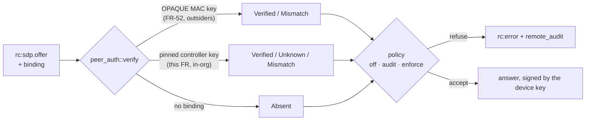

# FR-100: Controller identity — a stolen login or a hostile signalling plane can neither open nor sit inside a session to a pinned device

**Issue:** [#2092](https://github.com/gjovanov/roomler-ai/issues/2092) · **Status:** proposed 2026-10-13 —
spec and claim · **Owner:** the agent (the verifier, the pins), the viewer (the browser key), the hub (plumbing
only) · **Anchors:** master `c2e79221b` · **Program:**
[StarDesk teardown](../plans/stardesk-teardown-program.md), wave 1 · **Builds on:**
[FR-52](FR-52-cross-org-remote-access.md) (its `extauth_mac` binding, open PR #1628),
[FR-27](FR-27-consent-surfaces-and-desktop-companion.md) (the PromptSurface), [multi-org](../multi-org.md)

## 1. Goal

Tie each remote-desktop session's DTLS keys to identities that the **device** can check without trusting
the server. Then none of these can open a session to a device that pins its controllers, or sit unnoticed
in the middle of one:

- someone holding a stolen login cookie in another browser;
- someone holding the server's JWT secret;
- a hostile hub, Redis or load balancer;
- a TLS-inspecting middlebox on the **device's** network leg.

StarDesk claims "mutual authentication", "certificate pinning" and a "zero-knowledge design". Roomler's
consent model is far stronger than StarDesk's, but on master the session keys are bound to nothing the
device can verify (§2).

### What this does not defeat, said up front

Whoever serves the viewer's JavaScript can make the real browser key sign anything, and can make the page
show anything. That includes a TLS-inspecting middlebox on the **controller's** leg, because it can rewrite
the script too. Defeating that needs a controller whose code the server does not deliver, or code
transparency for the viewer. Both are follow-ups (§8). This FR does not pretend otherwise.

## 2. Evidence (master `c2e79221b`)

| What | Where | Consequence |
|---|---|---|
| The agent mints a fresh ECDSA P-256 certificate per peer connection | `agents/roomlerd/src/peer.rs` L369 (`SettingEngine`), L407 (`RTCConfiguration`, no `certificates`); `crates/vendored/webrtc/src/api/mod.rs` L93–95 | Ephemeral keys, good. But nothing long-lived to pin |
| The browser does the same | `ui/src/composables/useRemoteControl.ts` L7862 | The same |
| Mutual DTLS, with each side's cert checked against the **SDP** fingerprint | `crates/vendored/webrtc/src/dtls_transport/mod.rs` L361–362 (`RequireAnyClientCert`, `insecure_skip_verify`), L459 → L548 (`validate_fingerprint`) | The SDP is the only thing that says whose key is whose |
| The hub forwards the SDP string and **rebuilds** the frame around it | `crates/modules/fleet/src/hub.rs` L1391 (`forward_offer`), L1450 (`ServerMsg::SdpOffer`), L1479 (`ServerMsg::SdpAnswer`) | Whoever controls the hub can swap a fingerprint. Any new field must be carried through it explicitly |
| Signalling TLS deliberately has no pinning | `agents/roomlerd/Cargo.toml` L285–293 (native roots, so a corporate inspection root works) | Pinning the server would break the corporate laptops in the acceptance bar |
| FR-52 already binds the transport to a login, for **outsiders** | open PR #1628 (branch `fr52-p4`): `extauth_mac` on `rc:sdp.offer` and `rc:sdp.answer`, a MAC under the OPAQUE login key; "the device decides" | The verifier seam exists in a branch; in-org sessions have nothing |
| Consent is asked **before** the offer exists | the viewer calls `createOffer` only on `rc:ready` (`useRemoteControl.ts` L7201–7231) | A code shown in the consent prompt cannot include the controller's fingerprint unless it is committed earlier |
| A device's keys must differ per org | `docs/multi-org.md` L86–90 (a copied WG key would let two orgs correlate the device) | One identity key per enrollment |

## 3. Design

### 3a. Keys

- **The device key.** An ECDSA P-256 key generated **on the device**, one per org enrollment. It lives in
  its own file in the hardened machine-global state directory, **never in `config.toml`**, which has several
  writers. Only the public half leaves the device: it is registered in the hello, and the device page shows
  its fingerprint.
- **The controller key.** A WebCrypto **non-extractable** ECDSA P-256 key in IndexedDB, per origin and user,
  registered with the server as "this browser" with a label the user can read.
- **P-256 on both sides.** WebCrypto supports it everywhere; the agent uses RustCrypto `p256`.

### 3b. What is signed

| Message | Signed by | Covers |
|---|---|---|
| `rc:sdp.offer` | the controller key | domain tag, session id, agent id, user id, the offer's DTLS fingerprint, a nonce |
| `rc:sdp.answer` | the device key | domain tag, session id, both DTLS fingerprints, the controller's nonce |

webrtc-rs already refuses a DTLS peer whose certificate does not match the SDP fingerprint (L459). Signing
the fingerprint closes the chain: the only DTLS peer the device will complete a handshake with is one
holding a key the device pins.

### 3c. One verifier seam, shared with FR-52

One function, two key sources. FR-52's `extauth_mac` stays wire-compatible. Whichever FR lands first
defines the seam; the other plugs in.

### 3d. Plumbing, and the old-server case

- **Every new field goes through the hub,** because the hub rebuilds the offer and answer frames. FR-52's
  branch did exactly this for `extauth_mac`.
- **An old server drops the field silently,** so the device would see `Absent`. The server therefore
  advertises `peer-auth` to the agent. Under enforce, a server without it gets a **distinct** refusal,
  `server_lacks_peer_auth`, not a mismatch that would read as an attack.
- **The agent advertises `peer-auth` in `AgentCaps.rpc`.** Equality match; unknown verbs ignored.

### 3e. Pins and policy

- **`peer_auth = off | audit | enforce`,** device-owned, default **audit**: verify, record, refuse nothing.
- **An unknown controller key under enforce** asks the person at the device through the PromptSurface
  (`agents/roomlerd/src/consent.rs` L211): "New browser 'Chrome on MacBook' for <user> — once / always /
  deny". The key is shown as a short emoji fingerprint. An unattended device follows
  `unknown_controller = deny | allow`.
- **The browser pins the device key on first use** and shows an interstitial on a change. The server's copy
  is a hint, never an authority.
- ⚠️ **Never self-wedge.** `roomler rc pins list | reset` works locally, and enforce is never a default. A
  misfiring pin must cost a prompt, not the operator's access to their own machine.

### 3f. The short authentication string

A 4-emoji / 6-digit code from a hash of (domain tag, both fingerprints, session id), for attended support
calls: the person reads it, the controller compares.

Because consent comes before the offer, v1 shows the code on the host's **session banner** and in the
viewer once DTLS is up. Showing it **in** the consent prompt needs the viewer to generate its
`RTCCertificate` before the request and commit its fingerprint there; that is a later phase. Rust and
TypeScript read **one shared test-vector file**, so the two sides cannot drift.

## 4. Phases

| P | Scope | Kill switch | Status |
|---|---|---|---|
| P0 | This spec and the claim. The **red test**: on a throwaway loopback stack, a test-only signalling build substitutes the offer's fingerprint, and today's agent accepts it | docs only | this PR |
| P1 | The verifier seam (with FR-52), the device key, `AgentCaps.rpc` `peer-auth`, hub plumbing, `audit` mode | `peer_auth=off` | — |
| P2 | The controller key, its registration, the signed offer; the browser's pin of the device key | viewer knob; `peer_auth=off` | — |
| P3 | `enforce`: the PromptSurface approval, `unknown_controller`, `roomler rc pins` | `peer_auth=audit` (default) | — |
| P4 | The short authentication string on the banner and in the viewer | the viewer toggle | — |
| P5 | Docs and the field table | — | — |

## 5. Acceptance criteria

- [ ] **AC1 (red, then green):** on the throwaway stack, an offer whose fingerprint was substituted after
  signing is **accepted** by the deployed agent (red). It is refused under enforce and recorded under
  audit, with the reason in `remote_audit`.
- [ ] **AC2:** an integration test in `crates/tests` drives a substituted-fingerprint offer through the real
  hub: refused under enforce, accepted and audited under audit, ignored under off.
- [ ] **AC3:** a login used from a browser whose key the device has never seen gets the PromptSurface
  approval under enforce. On an unattended device it gets `unknown_controller`'s answer, audited.
- [ ] **AC4 (no false alarms):** a week of the whole fleet in **audit** mode records zero mismatches on real
  sessions. It is counted over `remote_audit` for every session in the window, not over an exec sweep.
- [ ] **AC5:** an old server (no `peer-auth`) under enforce yields `server_lacks_peer_auth`, never a
  mismatch.
- [ ] **AC6:** the Rust and TypeScript implementations agree on the shared transcript and SAS vectors. On an
  attended vmtest session, the code read at the host matches the viewer's.
- [ ] **AC7:** one device enrolled in two orgs presents two different device keys.
- [ ] **AC8:** **Docs:** `docs/remote-control.md` gains the binding: a mermaid sequence of the signed offer
  and answer, the policy table, the threat model including what it does not defeat, and the pin
  commands. `docs/security-baseline.md` gains the control. Linked from `docs/README.md`.

## 6. Decisions

**All four were decided by the operator on 2026-10-14, as recommended.** Each entry keeps what was
weighed.

1. **FR-52 first, or extract its primitive?** FR-52's P1–P4 sit on open PRs (#1197, #1563, #1628).
   Recommended: land FR-52, then generalise its check here. **Decided: land FR-52 first.**
2. **When to flip enforce.** Recommended: per device, by the owner, after AC4. Never fleet-wide by default.
   **Decided: as recommended.**
3. **The unattended default for an unknown controller.** Recommended: `deny` under enforce. An unattended
   device that cannot ask anyone should not let a new key in. **Decided: `deny`.**
4. **Break-glass.** May an ADMINISTRATOR break-glass session pass an unknown key under enforce? Recommended:
   the owner's floor decides, as `strictest_of` does for consent. **Decided: as recommended.**

## 7. Threat model, in one table

| Attacker | Before | After (enforce, device pinned) |
|---|---|---|
| Stolen cookie, another browser | full control, subject to consent | an approval prompt or `deny`; audited |
| Stolen JWT secret | can mint any user's token | the same as above: no controller key |
| Hostile hub, Redis or LB | can swap fingerprints, sees nothing yet can MITM | swap detected: refused |
| TLS inspection on the device's leg | can rewrite the agent's signalling | detected: refused |
| TLS inspection on the controller's leg, or a hostile origin serving the viewer | can MITM | **not defeated**: it runs the viewer's code |

## 8. Out of scope

- A native controller, or code transparency for the viewer (the last row of §7).
- 2FA / WebAuthn for user login, and user-session revocation (open Known Issues, separate FRs).
- DTLS 1.3 (webrtc-dtls 0.11 is 1.2 only).

## 9. Field-verification log

| # | Date | Cell | Result |
|---|---|---|---|
| — | — | — | — |

## 10. Related

- [FR-52](FR-52-cross-org-remote-access.md): the `extauth_mac` binding for outsiders.
- [FR-27](FR-27-consent-surfaces-and-desktop-companion.md): the PromptSurface.
- [FR-101](FR-101-rc-session-hygiene.md): the transport hardening that ships beside this.
- The program: [`docs/plans/stardesk-teardown-program.md`](../plans/stardesk-teardown-program.md).
