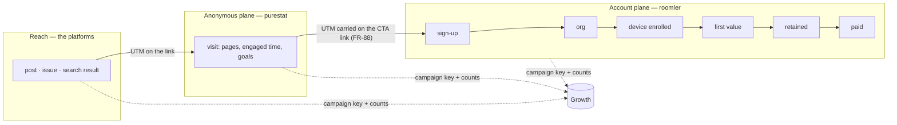

# FR-102: Growth observability — from a post to a paying org, joined by the campaign and never by the person

**Issue:** [#2127](https://github.com/gjovanov/roomler-ai/issues/2127) · **Status:** in progress — claimed
2026-10-13 (#2128); P1a live (promoted with `hosted-20261014-fbc8f22`), AC1 field-verified; purestat PS0a +
PS1 live as v0.1.8 since 2026-10-13 23:36Z, AC2 field-verified; P1b–c (#2172) and the daily digest P1d
(#2175) live since 2026-10-14 07:33Z (`hosted-20261014-cc63c4d`), AC23 field-verified · **Owner:** web / public site + saas + fleet (install) + purestat · **Anchors:** master `106bd2704`,
[purestat](https://github.com/gjovanov/purestat) `9e04332` · **Builds on:**
[FR-88](FR-88-promotion-attribution-and-site-video.md) (attribution, the activation view),
[FR-91](FR-91-scheduled-blog-publishing.md) (the blog lane; P3, the organic carry),
[FR-87](FR-87-blog-and-google-indexing.md) (the blog, Search Console),
[FR-58](FR-58-newsletter-sending.md) / [FR-39](FR-39-launch-readiness.md) (the newsletter and its no-tracking
promise), [FR-20](FR-20-per-tenant-relay-cost-metering.md) (cost per org),
[FR-32](FR-32-plan-limit-enforcement.md) (quota collisions), [FR-22](FR-22-time-to-first-frame.md) (the connect
timeline), [FR-69](FR-69-modular-monolith.md) (where code goes), and the `/observability` program (`stats_*`)

## 1. Goal

The operator asks five questions, and the system answers almost none of them with a number it can defend:

1. **Blog**: which posts are read, how far, and where their readers came from.
2. **Newsletter**: who subscribed, confirmed and left, and whether issue X was delivered and brought anyone.
3. **Social**: what a post on YouTube, X, LinkedIn, Facebook or TikTok produced beyond its own likes:
   visits, sign-ups, devices, payment.
4. **Product**: which orgs are created; which devices get installed, and how (the wizard, an installer,
   the PowerShell or bash one-liner); where an install stalls; who uses remote desktop, and for how long,
   per org.
5. **Revenue**: which orgs pay, since when, how much, and which campaign brought them.

Five more matter to a business and nobody asked for them yet (§3m): one north-star number, activation and
first-value definitions, cohort retention, time to value, and the coverage of every number shown. The
system also needs to know who keeps hitting the free plan's limits, what each org costs to serve, and
whether the people who use the product are satisfied.

This FR:

- (a) makes the inputs trustworthy, because today they are not (§2a);
- (b) builds one end-to-end funnel in `/observability` → **Growth** that joins the anonymous web plane
  (purestat) and the account plane (roomler) **by the campaign key and by counts, never by a person**;
- (c) fills the account plane's gaps: install method, token issuance, billing history, per-org activity
  history, newsletter delivery, satisfaction;
- (d) gives purestat the generic features this needs (working API keys, conversions, campaigns,
  engagement, funnels, journeys, OAuth sign-in), tracked in purestat's own repository (§3n);
- (e) feeds the results back to the people and the Claude sessions that run promotion: a **daily digest**
  (operator, 2026-10-13), a results feed, alerts.

**Principles** (the part not to re-litigate):

1. **Two planes, one key.** The anonymous plane (purestat: visits, pages, goals; cookie-free, a daily
   rotating hash, no person) and the account plane (roomler: accounts, orgs, devices, sessions, invoices)
   meet only at the campaign key `(source, medium, campaign, content)` and at counts. A purestat visitor is
   never joined to an account, and an account never gets a visitor id.
2. **Carry, don't store** (FR-88 §3a): nothing about attribution is written to a visitor's device.
3. **Derive before you collect.** Whatever the server can compute from records it already keeps to
   operate, it computes. A new collection point names the question it answers.
4. **Measured, not measured, and zero are three cells** (the cost view's rule, `crates/api/src/routes/cost.rs:9-21`).
   A source that is down, unset or unbuilt renders `null` with a reason, never `0`.
5. **Every rate carries its n.** Below n = 30 the UI shows counts and hides the percentage.
6. **Self-hosted never phones home** (`docs/business-model.md` §6 rule 1, `LICENSING.md:20-23`). Nothing
   here sends data from a self-hosted deployment or counts one. What runs on a self-hosted server (its own
   funnel, its own fetch counters) stays on that server, and every integration that talks to the outside
   world is in `saas`, which no self-host profile compiles (§3o).
7. **Aggregates may outlive rows; rows never outlive their owner.** Frozen daily totals carry no person;
   per-org and per-person rows are deleted with the org or the person.

## 2. Evidence

### 2a. Measured in production, 2026-10-13 (read-only ClickHouse and Mongo queries)

purestat's `roomler.ai` site (`site_id` from the site's ObjectId), production `hosted-20261013-c6bcdb2`
(`/health` 0.4.132), purestat v0.1.6. Account counts are in the private annex, not here.

| What | Measured | Consequence |
|---|---|---|
| Events of the last **90 days**, by page hostname | 34,857 from `roomler.ai`; **25,780 from loopback and private hosts** (localhost, 127.0.0.1, RFC 1918); 321 from 4 other domains | **42 % of the site's data is test runs and forks.** The tracker has no localhost skip, and ingest compares no hostname (§2b) |
| `pageview` rows, last **30 days** | 16,367 in total, of which **2,500 come from `roomler.ai`** (537 visitors) and 13,777 from loopback | before the next bug, every pageview count on the dashboard is ~6.5× the real one |
| `engagement` rows, last 30 days | 4,236 (3,429 of them on `roomler.ai`) | the Stats API counts every row as a pageview (§2b): on the real host, engagement beacons **outnumber** the real pageviews |
| `signup` goal, last 30 days | 41 events: **39 from loopback**, 1 from a fork's domain, **1 from `roomler.ai`** | the conversion the promotion program is judged on is ~95 % test traffic, and nothing computes conversions from it anyway (§2b) |
| `utm_source` / `utm_medium` values, last 30 days | `youtub` (sic), an empty medium, a `check`/`roll` pair; 26 rows whose campaign is off the `yyyymmdd-slug` scheme | the campaign key is validated at neither end |
| Referrer sources, last 30 days | `roomler.ai` itself is the **second** source (self-referrals); two third-party fork domains appear | purestat#1 item 4; forks beacon as `roomler.ai` |
| Blog `engagement` durations | a **mean** of 1,995 s on one post | the beacon includes time in a hidden tab, and a mean of that is not "read time" |
| Accounts created in the last 30 days | **none carries `signup_attribution`** (the count is in the annex) | FR-88's chain has produced no attributed account yet, and whether it would have is unverified in the field (FR-88 AC2/AC3 are unticked) |

### 2b. Read from code (master `106bd2704`, purestat `9e04332`)

| What | Where | Consequence |
|---|---|---|
| The SPA and every static page load purestat unconditionally, with `data-domain="roomler.ai"` | `ui/index.html:51`; `ui/docs/site.ts:205-208` → `ui/docs/theme/shell.ts:148-149` | every self-hosted install and every fork beacons as `roomler.ai`, contrary to `LICENSING.md:20-23` |
| The activation view has no caller | `GET /api/admin/stats/attribution` (`crates/api/src/routes/attribution.rs:112`, mounted `crates/api/src/lib.rs:297`); no reference in `ui/src` | FR-88's activation numbers exist and nobody sees them |
| Organic sign-ups carry nothing | `ui/docs/theme/attribution.js:87` returns when the landing URL has no campaign parameter | a reader of a post who arrives from search and signs up records no `landing_path` (FR-91 P3, unbuilt) |
| purestat's API keys are minted but never checked | keys created `crates/api/src/routes/api_key.rs:63-69`; the only extractor is the JWT one (`crates/api/src/extractors/auth.rs:33-44`); `ApiKeyDao::find_by_hash` has no caller | nothing can read purestat by API key; FR-88 §2 assumed it could |
| purestat counts every row as a pageview | `count() as pageviews FROM events` with no `event_name` predicate (`crates/services/src/analytics/query.rs:107`) | engagement beacons and goals inflate pageviews |
| purestat ingest takes the client IP from the **left-most** `X-Forwarded-For` entry; the limiter takes the right-most public one | `crates/api/src/routes/event.rs:50-54` vs `crates/api/src/rate_limit.rs:83-103` | a client can choose its own visitor hash |
| purestat stores `allowed_hostnames` and reads it nowhere; goals are rows that no query reads | `crates/db/src/mongo/models/site.rs:5-19`; `crates/db/src/mongo/models/goal.rs:4-22` | no hostname filter, and no conversion rate |
| Enrollment-token issuance is not recorded | `crates/modules/fleet/src/agent.rs:53` mints a 600 s JWT and writes nothing; the burn lives in `used_tokens` for 1 h (`crates/db/src/indexes.rs:261`) | "issued → redeemed" cannot be computed |
| The installer proxy and the script routes count nothing | `crates/modules/fleet/src/agent_release.rs:245-300`, `setup_release.rs:107, 279, 290` | yet every request carries a telling User-Agent: `roomler-setup/<ver>` (`agents/roomler-setup/src/proxy.rs:21`), curl, PowerShell, a browser, `roomlerd/<ver>` (the updater) |
| The enroll request is five fields | `crates/modules/fleet/src/agent.rs:82-88`; agent side `crates/agent-core/src/enrollment.rs:17-22` | no install method or scope, on the request or the agent row |
| The wizard reports nothing | steps `welcome → server → token → install → done` (`agents/roomler-setup/src/front/app.js:32`); progress goes to an in-process channel and logs to stderr (`agents/roomler-setup/src/main.rs:47-54`) | a stalled or cancelled install is invisible |
| No product-event history | org creation leaves a `tracing::info!` (`crates/services/src/dao/tenant.rs:185`); invite acceptance only bumps `use_count` (`crates/api/src/routes/invite.rs:233`) | — |
| Audit-shaped sources expire at 90 days | `tunnel_audit` (`crates/modules/network/src/lib.rs:719-725`), `ssh_audit`, `exec_audit`, `remote_audit`; `remote_sessions` has **no** TTL (`crates/modules/remote/src/lib.rs:153-161`), `call_sessions` 730 d (`crates/modules/conference/src/lib.rs:208-216`), `stats_events` 730 d (`crates/db/src/indexes.rs:371-375`) | a cohort chart longer than 90 days cannot see tunnel or SSH use. `docs/data-model.md:46, 96, 131-132` state other TTLs and are stale |
| Revenue is a list-price estimate | `crates/api/src/routes/cost.rs:22-30`; `BillingInfo` keeps ids and a status (`crates/db/src/models/tenant.rs:224-232`); `invoice.paid` falls into "Unhandled Stripe webhook event" (`crates/services/src/stripe.rs:621`) | no billed amount, no plan history, no "paying since" |
| Quota collisions are log lines | `services::quota` `tracing::warn!` (`crates/modules/saas/src/plan_compliance.rs:17-19`) | the business model's "best upgrade-intent signal" (`docs/business-model.md` §5) is not counted |
| Newsletter `sent` means "accepted by SendGrid" | `crates/db/src/models/newsletter_send.rs:16-47`; the footer promises "No tracking pixels — the only per-recipient thing in this email is your unsubscribe link" (`crates/services/src/newsletter.rs:178`) | delivery and bounces are unknown, and §3h must keep that promise |
| Nothing asks a user how it went | no rating or feedback surface; `remote_sessions.stats` keeps bytes, fps and RTT, not the carrier (`crates/remote_control/src/models.rs:3845-3860`); time to first frame lives 7 days in `agent_logs` (FR-22) | satisfaction is not measured at all |
| The agent updater asks `roomler.ai` by default | `agents/roomlerd/src/updater.rs:37` (`DEFAULT_PROXY_URL`), UA `roomlerd/<ver>` (`:1068`) | self-hosted agents reach our endpoint; §3e makes sure this is never counted |
| The promotion pipeline (private, out of scope) | metrics are collected for three of its six platforms; nothing reads web analytics back; no weekly report has been produced; its campaign ids carry the calendar slot's date, not the publish date | the join this FR builds is the missing half of the pipeline's own north star |
| purestat's OAuth is half-built | two of five providers answer the callback and the SPA has no button (`crates/api/src/routes/oauth.rs`) | PS6 finishes it; PS0 switches it off until then |

## 3. Design

### 3a. Two planes, one key



- **First touch is the record.** An account's acquisition is its `signup_attribution` (FR-88): the UTM it
  arrived with, or for an organic arrival the `landing_path` and `referrer_host` (FR-91 P3), plus the
  optional self-reported answer. An org inherits its owner's.
- **Two funnels, named apart.** The *visit funnel* (purestat, PS4) runs inside one visit: landing → page →
  goal. The *account funnel* (§3d) runs across days: sign-up → paid. Neither is computed from the other's
  rows.
- **The join is by key, then by count.** One row of the Campaigns table, say campaign
  `20261019-ssh-without-port-forwar` on LinkedIn, is two queries keyed alike. purestat gives its visitors
  and `signup` goals; roomler gives its accounts, activated orgs and payers.

### 3b. The campaign key: one taxonomy, checked at both ends

| Key | Values | Notes |
|---|---|---|
| `utm_source` | `youtube` `tiktok` `x` `linkedin` `facebook` `reddit` `hn` `devto` `hashnode` `medium` `github` `newsletter` `blog`; `instagram` (retired, kept for history) | the platform, never the account |
| `utm_medium` | `video` `post` `carousel` `comment` `community` `bio` `article` `email` | the format |
| `utm_campaign` | a post id `yyyymmdd-slug` (≤ 32), `profile` (bio links), `nl-<issue slug>` (§3h) | — |
| `utm_content` | `[a-z0-9-]{1,32}`: the account or the placement (a page id, `desc-top`, `endscreen`) | optional |

- **One table**, `crates/core/src/campaign.rs`. The server normalises at ingress (`attribution::sanitize`,
  `crates/core/src/attribution.rs:139`): lowercase, then aliases (`twitter`→`x`, `fb`→`facebook`,
  `yt`/`youtub`→`youtube`, `li`→`linkedin`, `ig`→`instagram`). An unknown source is **kept verbatim** and
  grouped under `other`, so a new channel shows up before it has a name. The private pipeline's link linter
  checks against a pinned copy of the same table.
- **Organic channels** come from `referrer_host` through one table: *search* (google.*, bing.com,
  duckduckgo.com, ecosia.org, yandex.*), *AI assistants* (chatgpt.com, chat.openai.com, perplexity.ai,
  gemini.google.com, copilot.microsoft.com, claude.ai), *social* (t.co, x.com, linkedin.com, lnkd.in,
  facebook.com, l.facebook.com, youtube.com, tiktok.com, reddit.com), *community* (news.ycombinator.com,
  lobste.rs, dev.to, hashnode.com, medium.com), *code* (github.com), *self* (`roomler.ai`: navigation, never
  a source), *direct*.
- ⚠️ **Time comes from the post, not from its id.** A campaign is placed on the timeline by the post's
  `published_at` (§3j). The pipeline's ids carry the calendar slot's date, which drifts when a slot moves.

### 3c. Trustworthy inputs (P1, PS0)

1. **Hosted-only analytics.** `ui/index.html` loses its static tag. A first-party loader, same origin so the
   CSP stays as it is, injects the tracker only when `location.hostname` is in `ANALYTICS.hosts` (default
   `['roomler.ai']`). The static shell uses the same loader. A self-hosted deployment, a fork, and a
   `localhost` dev server make **zero** requests to purestat.ai. The site keeps its kill switch
   (`ANALYTICS = null`).
2. **Test traffic stops at the source** (PS0). The tracker skips `localhost`, loopback, private ranges,
   `file:`, `navigator.webdriver`, and a `purestat_ignore` flag that the operator sets once in each browser
   used for promotion. Ingest drops events whose page host is not in the site's `allowed_hostnames`. A test
   that forgets to abort purestat can no longer fake a campaign, so the rule in today's runbooks becomes a
   property of the system.
3. **History is read through the same rule.** Queries over existing rows apply the hostname allowlist.
   Nothing is deleted to make history match.
4. **Internal orgs and people.** A platform-admin exclusion list (`growth_exclusions`: tenant and user ids,
   each with a reason) applies to every Growth number. It is seeded with the platform admins, the orgs they
   own, and the test orgs found by a one-off sweep. "Include internal" shows the raw totals.
5. **Pageviews are pageviews** (PS0): every purestat count of views filters `event_name = 'pageview'`.
6. **One client-IP rule** (PS0): ingest derives the client IP exactly as the limiter does.
7. **Coverage is a number.** The Growth page reports **tracker coverage**: purestat's `signup` goals divided
   by the server's sign-ups in the same window, both after exclusions. Blockers, OAuth hops and failed
   scripts all show up as coverage below 1, and coverage is never assumed to be 1.
8. **Not proxied** (D7). purestat stays on purestat.ai, not behind a first-party path. Getting past
   blockers is a decision with a coverage number in front of it, not a default.

### 3d. The account funnel (P2)

| Step | Definition | Source | Window |
|---|---|---|---|
| Sign-up | a user created by any provider, not excluded | `users.created_at` | — |
| Org created | an org owned by that user | `tenants.{owner_id, created_at}` | 7 d from sign-up |
| **Activated** | the org enrolled ≥ 1 device | `agents.{tenant_id, created_at}`, tombstones included | 7 d from org creation |
| **First value** | the org's first remote-desktop session that reached Active and lasted ≥ 30 s, call with ≥ 2 participants, tunnel flow, or SSH session | `remote_sessions`, `call_sessions`, `growth_org_daily` | 14 d from org creation |
| Active week | ≥ 1 value event in the ISO week | `growth_org_daily` | — |
| Retained W1/W4/W12 | active in week k after creation | `growth_org_daily` | — |
| Paid | the org's first paid invoice with an amount above 0 | `billing_events` (§3g) | — |

- **Grain.** Acquisition belongs to the user; value belongs to the org. FR-88's view stays user-grained
  (any org the person belongs to) until its D4 is settled (D3 here).
- **`pending` and `settled` on every windowed step**, as in FR-88 §3c: a rate's denominator counts only
  cohorts whose window has closed.
- **Time to value.** Median and p75, with n: sign-up → first device, and sign-up → first value.
- **North star** (D2): **weekly active orgs** (WAO), the orgs with a value event in the week, internal
  excluded. The promotion program's own north star, activated sign-ups attributed to social, is a filter of
  the same funnel.
- **`growth_org_daily`**: one row per org per day with any activity. `_id = "{tenant}:{yyyy-mm-dd}"`, an
  idempotent upsert written by a singleton nightly job (Redis `try_claim`, as the stats rollup does,
  `crates/api/src/stats_rollup.rs:3-26`), which recomputes the last 3 days. Fields: `rc_sessions,
  rc_session_minutes, rc_controllers, calls, call_participant_minutes, tunnel_flows, ssh_sessions,
  exec_runs, devices_online, members_active, value`. Retained 25 months (D8) and deleted with the org. It
  exists because four of its sources expire at 90 days, and retention needs a year.
- **Endpoints** (platform admin, 404 otherwise, host-owned like FR-88's view): `GET /api/admin/growth/funnel?since&until&by=source|medium|campaign|content|channel|self_reported|landing_path&include_internal`,
  `GET …/growth/cohorts?unit=week`, `GET …/growth/orgs`, and `GET …/growth/org/{tenant_id}/timeline` (one
  org's milestones from sign-up to its last invoice: the trace view). A step whose module is unmounted
  answers `null` with the module's name.
- **UI**: `/observability/growth`, same gate, with **Overview** (WAO, the funnel, time to value, coverage),
  **Orgs** and **Cohorts**. FR-88's attribution view gets its first caller here.

### 3e. The install trace (P3)

```mermaid
sequenceDiagram
    participant A as Admin (SPA)
    participant S as roomler.ai
    participant H as Host being installed
    A->>S: POST …/agent/enroll-token
    S->>S: enroll_token_issued {jti, tenant, issued_by, issued_at}
    H->>S: GET install.sh · install.ps1 · installer (UA: curl · PowerShell · roomler-setup · browser)
    S->>S: growth_daily +1 {asset, client class, os} — no UA, no IP stored
    H->>S: POST /api/agent/enroll {…, install: {method, scope}}
    S->>S: agents.install; enroll_token_issued.redeemed_at
    H->>S: WS hello → stats_events presence=online (first online)
    A->>S: first remote-desktop session → remote_sessions
```

1. **Issuance is recorded**: `enroll_token_issued {_id: jti, tenant_id, issued_by, issued_at, kind:
   standard|key, redeemed_at, agent_id}`, keyed by the jti and never holding the token. It is updated where
   the jti is already burned (`crates/modules/fleet/src/agent.rs:187-199`) and kept for 90 days. Daily
   counts are frozen into `growth_daily`.
2. **Fetches are counted by client class.** The installer proxy, `latest-release` and the two script routes
   increment `growth_daily {asset, client, os}`, with client one of `wizard` (`roomler-setup/`),
   `script-sh` (curl, wget), `script-ps1` (PowerShell), `browser`, `other`. Neither the raw User-Agent nor
   the IP is stored.
   ⚠️ **`roomlerd/` is never counted.** It is the updater, and by default it asks `roomler.ai` from
   self-hosted devices as well (`agents/roomlerd/src/updater.rs:37`). Counting it would be exactly the
   self-host telemetry the product promises not to collect.
3. **The enroll says how.** `EnrollRequest` gains `install: Option<InstallInfo { method, scope }>`, additive
   and `#[serde(default)]`; an agent from before this change records `unknown`. `method` is one of `wizard`,
   `script-sh`, `script-ps1`, `msi`, `deb`, `pkg`, `manual`, `container`, `other`; `scope` is one of
   `system`, `per-user`, `attended`, `unknown`. The served scripts pass `--install-method`, the wizard sets
   it in-process (`agents/roomler-setup/src/orchestrator_agent.rs:488-494`), and a hand-typed
   `roomlerd enroll` is `manual`. Stored once on the agent row as `install`.
   *(P3 as built: the scripts set `ROOMLER_INSTALL_METHOD` / `ROOMLER_INSTALL_SCOPE`, the flag's env
   fallbacks, rather than the flag itself — a served script installs whatever release is current, and a
   daemon from before the flag existed would refuse an argument it does not know, failing every scripted
   install until the next agent release; an older daemon ignores the variables. The scope follows what
   the script installs: `system` for `--system` and the macOS root half, `per-user` otherwise;
   `install.ps1` maps `daemon-system` → `system`, `daemon-user` → `per-user`, `daemon-machine` →
   `attended`, and the wizard maps its roles the same way. A re-enroll sends nothing and the row keeps
   its recorded install.)*
4. **First online** is `min(stats_events.ts)` with `presence = online` per agent. **First session** comes
   from `remote_sessions`.
5. **Wizard diagnostics are opt-in** (D4, P3b). A checkbox on the Welcome page, **unticked by default**,
   reads "Send anonymous setup diagnostics to `<server>`". When it is ticked, the wizard sends one
   `POST /api/setup/diagnostics` per step boundary: `{run, step, outcome: ok|failed|cancelled, elapsed_ms,
   error_code, os, wizard_version}`. `run` is random and lives in memory for that run only. It also rides
   the enroll (`install.run`), so a ticked run joins its device. The diagnostics go to the server being
   enrolled into, so a self-hosted server gets its own and roomler.ai never hears of them. Unticked, the
   wizard sends **zero** requests.
   Why opt-in: EDPB Guidelines 2/2023 read ePrivacy Art. 5(3) as covering what an installed program sends
   from the terminal for a purpose the user did not ask for.
6. **The Install panel** shows, per method and OS: fetches (approximate, by class), tokens issued, devices
   enrolled, issued → redeemed, enrolled → online within 1 h, → first session within 24 h, and wizard steps
   reached (opted-in runs only, labelled with their n).
   ⚠️ A fetch counter cannot tell a hosted user from a self-hoster who downloads our build to enroll
   elsewhere, so fetch → enroll is a **lower bound**.

### 3f. Usage, quality and satisfaction (P2, P9)

- **Usage** per org comes from `growth_org_daily` (P2).
- **Quality** per day and per agent version (P9):
  - sessions that reached Active against those that failed, by `end_reason`;
  - median duration, `stats.peak_fps`, `stats.avg_rtt_ms`;
  - FR-22's time to first frame, as p50/p90 frozen nightly from `agent_logs` before its 7-day horizon;
  - crashes per 100 device-days from `agent_crashes`.
- **The carrier on an RC session.** Direct, TURN or DERP is recorded when the session reaches Active; the
  agent already knows it. This is remote-desktop code: it is held to the repo's §3 bar and proven on the
  fleet, as any carrier change is.
- **Asked, not inferred** (D10). After a session of 30 s or longer, the viewer offers 👍 / 👎 with optional
  reason chips: *lag*, *picture*, *input*, *couldn't connect*, *other*. It appears at most once a day per
  person, can be dismissed, and never blocks. Stored as `session_feedback {session_id, tenant_id, user_id,
  rating, reasons, ts}` for 25 months and deleted with the user. There is no free text in v1, because free
  text is where personal data hides.

### 3g. Revenue (P4)

- **`billing_events`, from Stripe webhooks.** The handled set grows to `customer.subscription.created`,
  `customer.subscription.updated`, `customer.subscription.deleted`, `invoice.paid`,
  `invoice.payment_failed` and `customer.subscription.trial_will_end`. Each row is `{tenant_id, kind, plan,
  seats, amount_cents, currency, period_start, period_end, stripe_id, ts}`, and the amounts come from the
  invoice: billed revenue, not list price. Rows are deduplicated by the existing `stripe_events`. A one-off,
  operator-run backfill reads Stripe's invoice list.
- **Derived from it**:
  - paying orgs;
  - billed MRR, normalised to a month;
  - new, expansion, contraction and churned MRR per month;
  - trial → paid;
  - `paid_since`;
  - all of these by the owner's acquisition channel.
- **Upgrade intent.** A quota collision becomes a counter, `growth_daily {source: quota, metric: collision,
  dims: {tenant, limit}}`, beside the existing warn line: these are the orgs that keep hitting the ceiling.
- **Cost to serve** (FR-20 P5) sits beside billed revenue, giving margin per org. The list-price MRR column
  stays, labelled as such, for orgs with no invoice yet.
- **Monthly totals are frozen** into `growth_daily`, so deleting an org does not rewrite last year's MRR.

### 3h. The newsletter (P5)

- **The list over time.** New, confirmed and unsubscribed per day, by `source`, from timestamps the list
  already keeps (`crates/db/src/models/subscriber.rs:21-63`).
- **Delivery** (D6). SendGrid's Event Webhook, signed and verified against SendGrid's public key (anything
  else is refused), records `delivered`, `bounce`, `dropped` and `spamreport` on the send row. A hard
  bounce or a spam report suppresses the address. SendGrid's open and click tracking stay **off**: a check
  at startup reads both settings and logs loudly if either is on.
- **Visits per issue** (D5). An issue's links carry `utm_source=newsletter&utm_medium=email&utm_campaign=nl-<slug>`,
  identical for every recipient. The footer's promise stays literally true: the only per-recipient thing
  in the email is the unsubscribe link. `docs/newsletter.md`'s "no open/click analytics" becomes "nothing
  per reader".
- **Unsubscribes per issue.** Issue X's unsubscribe link adds `i=<slug>`, the same for everyone, and the
  click is recorded as `subscribers.unsubscribed_via`.
- **The per-issue table**: recipients, accepted, delivered, bounced, complaints, unsubscribed via the
  issue, visits (purestat, by campaign), sign-ups (`signup_attribution.campaign`).

### 3i. The web plane in Growth (P6, after PS1)

- A `saas` job pulls purestat's breakdowns for each closed day, by the campaign key and by path, into
  `growth_daily` (`source: purestat`). It uses an API key scoped to the `roomler.ai` site
  (`ROOMLER__GROWTH__PURESTAT_*`, from a Secret).
- **The contract PS1 implements**, which is everything roomler needs from purestat:
  - API-key auth;
  - breakdowns by up to four dimensions;
  - metrics: visitors, visits, pageviews (pageviews only), engaged visits, bounce rate, visit duration;
  - per-goal conversions as unique visitors, per row;
  - a daily interval, at least 1,000 rows with paging, and the hostname allowlist applied.
- **The Campaigns table**, per key: reach (§3j), visitors, engaged visitors and goal conversions, then from
  the account plane sign-ups, orgs, activated, first value and paid. A purestat outage or a revoked key
  renders "not measured", never 0.
  *(P6 as built: the table queries purestat **live** for the exact range — unique visitors do not add
  across days, so a sum of the frozen daily rows could not answer a range — by exactly the UTM dimensions
  of the requested depth (`by=source|medium|campaign|content`), and joins the funnel's account plane in
  code by `CampaignKey::normalized`, the cleaning a sign-up gets at ingress. purestat's v1 contract has no
  engaged-visitor metric, so engagement is `reads` (pageviews visible ≥ 30 s). The daily pull keeps the
  last 7 closed days re-pulled once per cycle (01:00 UTC) and freezes older ones; each day's state is a
  `growth_pulls` row, so "not pulled" and "failed" are never read as 0. Detail:
  [growth-observability.md](../growth-observability.md).)*

### 3j. Social reach (P8)

- **The pipeline pushes what it already records.** The private promotion pipeline is out of scope, but it
  pushes two things:
  - posts: `{platform, account, format, platform_id, url, published_at, campaign key}`;
  - metric snapshots: `{platform, platform_id, snapshot: T+1d|T+7d|T+28d, taken_at, metrics: {raw name:
    value}}`.
  They go to `POST /api/admin/growth/ingest/{posts|snapshots}` with the ingest key (D12). Writes are
  idempotent on `(platform, platform_id)` and `(platform, platform_id, snapshot)`. Raw metric names are
  kept, because a metric is only comparable to itself. Unknown platforms and any post text are refused.
- **Push, not pull** (D11). The collector runs where its credentials live, today a scheduled task on the
  operator's machine and later the in-cluster app, and it needs nothing to be reachable.
- **The Channels table**, per platform and per post: reach as the platform defines it, then visitors →
  sign-ups → activated → paid by the post's key. A platform with no collector (LinkedIn and X today) reads
  "not measured".
- **Spend.** An optional `cost_cents` per post (an X post with a link is billed per post) gives cost per
  visitor and per sign-up.
  *(P8 as built: the posts and snapshots are core-level collections (`growth_posts`,
  `growth_post_snapshots`) written by `saas`'s ingest routes through the core DAO, so the host's views keep
  showing what was pushed on a server that stops mounting `saas`. The ingest key (`growth_keys`, kind
  `ingest`, `rgi_…`) is stored as a SHA-256 and a display prefix; every way of not holding a live one is the
  empty 404 of an absent path, decided before the body is read. The body's shape is closed: a field whose
  name looks like copy is `post_text_refused`, any other stranger `unknown_field`. A snapshot is written
  once (the first push's numbers stay); a snapshot for a post never pushed is refused. A platform's reach
  is summed per snapshot age, never across ages. Detail and the pushers' API:
  [growth-observability.md](../growth-observability.md).)*

### 3k. Content and search (P7, engagement after PS3)

- **A read** is a pageview with ≥ 30 s of visible, focused time or ≥ 75 % scroll depth (PS3). Read time is
  reported as a median, never as a mean of raw durations.
- **Search Console and Bing Webmaster**, pulled daily into `growth_daily`, per page × query × day: clicks,
  impressions, CTR and position. Search Console is read through a service account added to
  `sc-domain:roomler.ai` as a restricted user; Bing through an API key. URL Inspection adds each post's
  index status and last crawl, within its 2,000-a-day quota.
- **The Content table**, per article:
  - published date, visitors, reads, median read time, top channels;
  - search impressions, clicks, CTR and position (7 d and 28 d), and whether the post is indexed;
  - sign-ups whose `landing_path` is the post (needs FR-91 P3).
- **GitHub.**
  - Public counters need no token: stars, forks, and release-asset downloads per day (cumulative counters,
    differenced).
  - Repository traffic is optional: views, clones and referrers, read with a read-only token. GitHub keeps
    only 14 days of it, so it is pulled daily.

### 3l. The daily digest (P1d), the results feed and alerts (P10)

**The daily digest.** The operator asked for it on 2026-10-13: "a daily digest job that reports on the
mentioned metrics". A host job (`crates/api/src/growth/digest.rs`) reports every closed UTC day. It
computes the day, stores it, and emails it to the platform admins.

- **When.** At `ROOMLER__GROWTH__DIGEST_HOUR_UTC` (default 6), for the UTC day before. purestat closes a
  session 30 minutes after its last event, so by 06:00 the day is complete on both planes.
- **Once, with two pods.** A run first inserts `growth_digests {_id: "yyyy-mm-dd", status: computing}`.
  The unique `_id` decides which pod computes and sends; the other stops. This is the claim-first shape of
  the newsletter's send ledger (FR-58). `status` then moves to `sent`, to `stored` (no recipients, or email
  off), or to `failed` with the error. The next run retries a `failed` day or a stale `computing` one, and
  never sends a `sent` day again.
- **Sections.** Each answers a question from §1. A section whose source is not built yet says "not
  measured — arrives with Pn" and never shows 0.

| Section | Reports | Source | Available |
|---|---|---|---|
| Headline | sign-ups, orgs created, devices enrolled, active orgs over the trailing 7 days (a preview of WAO), coverage | §3c, §3d | P1d; coverage after PS1 |
| Sign-ups | each sign-up: provider, campaign key or landing path, self-reported answer, never the address; above 20 a day, aggregated by source | `users` | P1d |
| Orgs and devices | orgs created; devices enrolled by OS (by install method from P3); the orgs that enrolled their first device | `tenants`, `agents` | P1d |
| Usage | remote-desktop sessions and session-minutes, calls and participant-minutes, active orgs; the top 10 orgs by remote-desktop minutes | `remote_sessions`, `call_sessions` | P1d |
| Website | visitors, visits and pageviews on the site's own hostnames; top channels, sources and pages | purestat's v1 query | after PS1 |
| Blog | each post viewed that day: visitors, pageviews, reads (≥ 30 s), median read time, top sources | purestat's v1 query | after PS1 (read time exact after PS0a) |
| Campaigns | per `utm_source` / `utm_medium` / `utm_campaign`: visitors and goal conversions from purestat, sign-ups from roomler | purestat + `users` | after PS1 |
| Newsletter | new, confirmed and unsubscribed subscribers; each issue sent that day, accepted (delivered and bounced from P5) | `subscribers`, `newsletter_sends` | P1d |
| Revenue | orgs by plan and subscription status; the list-price MRR, labelled an estimate (`crates/api/src/routes/cost.rs:22-30`) | `tenants` | P1d; billed from P4 |
| Quality | sessions that ended on a failure reason; agent crashes by version | `remote_sessions`, `agent_crashes` | P1d; rating and TTFF from P9 |
| Install | fetches by client class; tokens issued → redeemed | §3e | P3 |
| Social reach | each platform's own numbers per post | the pipeline's push | P8 |
| Search | clicks, impressions, top queries and pages | Search Console, Bing | P7 |

- **Small numbers stay honest.** Below n = 30 the digest shows counts, not percentages. Each count of the
  day sits beside its trailing 7-day and 28-day totals, so a quiet day is read against a baseline, not
  alone. Internal orgs and people are excluded (§3c.4), and the footer says how many were left out, so
  nothing vanishes silently.
- **Delivery.**
  - An email to the platform admins' addresses. `users.email` holds only proven addresses, and
    `ROOMLER__GROWTH__DIGEST_TO` overrides it. The HTML and plain-text bodies are rendered from the stored
    JSON and sent through the existing email service.
  - `GET /api/admin/growth/digest?day=` (the latest when the day is omitted) and
    `GET /api/admin/growth/digests?since=`, for platform admins and, from P10, the read key.
  - A Digest view on `/observability/growth`.
  - `POST /api/admin/growth/digest/run?day=&send=false` recomputes a day, for a backfill or a test, without
    mailing it.
- **Switches.** `ROOMLER__GROWTH__DIGEST_ENABLED` defaults to **off**, so a self-hosted server never starts
  mailing its admins a report they did not ask for; the hosted configuration turns it on. Without
  purestat's key, the web sections read "not measured".
- ⚠️ A digest lands in mailboxes, which keep it longer than any collection here. It names orgs, as
  `/observability` does, and never a person's address, name or IP. `growth_digests` keeps 25 months.

**The results feed** (P10).

- **`GET /api/admin/growth/*`** answers the platform-admin JWT and a read key (D12). The read key works on
  GET only and on growth routes only, and is answered with 404 everywhere else. It is stored hashed in
  config, and each use is logged at `info` without the key.
- The promotion pipeline and the sessions that run it read the stored digests through it, instead of
  querying databases by hand.
- **A weekly roll-up.** On Mondays the digest adds the week's totals, the funnel, and from P2 the cohort
  lines.

**Alerts** (P10).

- **Alerts.** Each rule has an n floor, and `ROOMLER__GROWTH__ALERTS` switches all of them off. They show
  as a `growth_alerts` row on the Growth page and go out by email:
  - no sign-up for 72 h while the 28-day median is ≥ 1 a day;
  - ≥ 3 tokens issued in 48 h and none redeemed;
  - a method's enroll success below half its 28-day rate (n ≥ 10);
  - coverage below 0.3 for 7 days;
  - a purestat, Search Console or GitHub pull failing two days running;
  - an issue's hard bounces above 5 %.

### 3m. The measures, and what each is for

| Measure | Question it answers | Where |
|---|---|---|
| Weekly active orgs (north star) | is the product used, week over week, by orgs that are not us? | Overview |
| Activation (≤ 7 d) and first value (≤ 14 d) | did a sign-up reach the point of the product, and how fast? | Overview, Orgs |
| Cohort retention W1 / W4 / W12 | do orgs from week X still use it later, and does that differ by channel? | Cohorts |
| Time to value | how long from sign-up to the first device and the first session | Overview |
| Coverage | what share of the server's conversions the browser saw | Overview |
| Leading indicators: reach, engaged reads, search impressions, install fetches | what moves before sign-ups do; at low volume, the only numbers big enough to steer by | Channels, Content, Install |
| Upgrade intent (quota collisions) | who pushes against the free plan's limits | Revenue |
| Unit economics (cost to serve vs billed revenue) | does an org pay for what it costs? | Revenue |
| Self-reported source | the share no link can see: a URL said aloud, a chat, a colleague | Overview |
| Channel grouping, incl. AI assistants | how much arrives from search vs AI answers vs social vs code hosts | Channels |

### 3n. purestat (PS0–PS7, tracked in `gjovanov/purestat`)

| PS | What | Needed by |
|---|---|---|
| PS0 | **Trust.** *PS0a, the code*: the hostname allowlist (the site's domain, `www.` + domain, and `allowed_hostnames`) applied at ingest **and on every read**, which also keeps apart sites whose ClickHouse ids coincide; new sites get an id no other site can share; the tracker skips localhost, private hosts, webdriver and `purestat_ignore`; pageviews count `pageview` rows only; the entry/exit dimensions read `sessions`; one client-IP rule; a basic bot list; engagement counts visible time only; the unfinished OAuth routes switched off; docs that match the code. *PS0b, the infrastructure*: a nightly ClickHouse backup to object storage; deleting a site deletes its ClickHouse rows (needs the admin user) | everything |
| PS1 | **API keys work** (`X-API-Key`, site-scoped, `stats:read`), and a v1 query to the §3i contract | P6 |
| PS2 | **Goals and campaigns in the UI**: conversions and conversion rate per goal, the UTM report with drill-down, more than 10 rows, a filter control, channel grouping (§3b), period comparison | the operator |
| PS3 | **Engagement**: scroll depth, read rate and median time per page in the UI (visible-time duration lands in PS0a); outbound-link and file-download events behind script attributes | P7 |
| PS4 | **Funnels**: 2–8 ordered steps (a page pattern or a goal) within a visit, ClickHouse `windowFunnel`, drop-off per step, by source and campaign | the operator |
| PS5 | **Journeys**: next-page transitions from an entry page, and paths into a goal (a Sankey); paths seen by fewer than 5 visitors fold into "other" | the operator |
| PS6 | **OAuth sign-in** with Google and GitHub, to the rules roomler-ai's OAuth already follows (`docs/security-baseline.md`): a CSRF state and PKCE; linking by email only when the provider vouches for the address (Google `verified_email`; GitHub `/user/emails`, primary and verified); OAuth-created accounts verified; no credential in a URL; buttons in the SPA | the operator |
| PS7 | Weekly email report, traffic-spike alert, shared read-only links | later |

### 3o. Where the code goes (FR-69)

The shape is the one `stats_*` already has. The collections are core-level and written through the core
DAO by whichever module owns the fact (`stats_usage` is written by `network` and `conference`), and
cross-module jobs run in the host (`crates/api/src/stats_rollup.rs`).

- **Host** (`crates/api/src/growth/`): the views (funnel, cohorts, orgs, timeline, campaigns, content,
  install, revenue, newsletter, quality); the nightly job that writes `growth_org_daily` and freezes daily
  totals; the digest and alerts. A source whose module is unmounted answers `null` with the module's name.
- **Core** (`crates/services/src/dao/growth.rs`, indexes in core's plan beside `stats_*`): `growth_daily`,
  `growth_org_daily`, `growth_exclusions`, `growth_alerts`.
- **`saas`** (hosted-only, never in a self-host profile): what exists only for the hosted business. That is
  the purestat, Search Console, Bing and GitHub pullers; the promotion pipeline's ingest routes; the
  SendGrid webhook; `billing_events` and the wider Stripe handling. A self-hosted server compiles none of
  it, so nothing leaves the server and nothing arrives.
- **`fleet`**: `enroll_token_issued`, the fetch counters, `setup_diagnostics`, and the enroll's `install`.
  A self-hosted server keeps its own and sends them nowhere. The agent half is MPL-2.0
  (`crates/agent-core`, `agents/roomlerd`, the scripts, the wizard).
- **`remote`**: `session_feedback` and the session carrier.
- Module collections keep their index sets in the module (FR-69 rule 3). New routes change the composition
  baseline, so it is re-recorded with `COMPOSITION_UPDATE=1` and a commit message that says why.

| Collection | Owner | Shape | Kept | Written by |
|---|---|---|---|---|
| `growth_daily` | core | `_id = "<source>:<metric>:<dims>:<day>"`, `{day, source, metric, dims, value}`; upserted, frozen after 7 days | indefinitely; rows with a `tenant` dimension go with the org | the pullers, the ingest routes, fetch counters, quota collisions, the host's freeze |
| `growth_org_daily` | core | `_id = "<tenant>:<day>"`, the §3d fields | 25 months; with the org | the host's nightly job |
| `growth_exclusions` | core | `{kind: tenant\|user, id, reason, by, at}` | until removed | platform admins |
| `growth_alerts` | core | `{rule, fired_at, detail, cleared_at}` | 90 days | the host's alert job |
| `growth_digests` | core | `_id = "yyyy-mm-dd"`, `{status, computed_at, sent_at, recipients, sections}` | 25 months | the host's digest job |
| `growth_keys` | core | `{kind: ingest, label, prefix, hash, created_by, created_at, revoked_at, last_used_at}` — the key's SHA-256 and a display prefix, never the key (D12, P8) | until deleted; revoked rows stay | platform admins (host routes) |
| `growth_posts` | core | `{platform, platform_id, account, format, url, published_at, key, cost_cents}`, unique `(platform, platform_id)`; no post text (P8) | indefinitely (our own content) | `saas`'s ingest route |
| `growth_post_snapshots` | core | `{platform, platform_id, snapshot: T+1d\|T+7d\|T+28d, taken_at, metrics {raw: number}}`, unique `(platform, platform_id, snapshot)`, written once (P8) | indefinitely | `saas`'s ingest route |
| `growth_pulls` | core | `_id = "<source>:<day>"`, `{source, day, status: ok\|failed, pulled_at, attempted_at, attempts, rows, error, missing_goal, truncated}` — whether a puller's day exists, so "not pulled" and "failed" are never read as 0 (P6) | indefinitely, like the rows it describes | the pullers (`saas`'s purestat puller from P6) |
| `billing_events` | `saas` | §3g | with the org | the Stripe webhook |
| `enroll_token_issued` | `fleet` | `_id = jti`, §3e | 90 days | token issuance, the enroll |
| `setup_diagnostics` | `fleet` | `{run, step, outcome, elapsed_ms, error_code, os, wizard_version, ts}` | 90 days | the wizard, opt-in |
| `agents.install` | `fleet` | `{method, scope, run}` | with the agent row | the enroll |
| `session_feedback` | `remote` | §3f | 25 months; with the user | the viewer |
| `subscribers.unsubscribed_via`, `newsletter_sends.delivery` | `saas` | fields on existing collections | as FR-58 | the unsubscribe route, the SendGrid webhook |

### 3p. Privacy, retention, and the policy

| Data | Where | Kept | Deleted with | Notice |
|---|---|---|---|---|
| visits, pages, goals, engagement | purestat ClickHouse | 2 years (its TTL) | — (no person) | policy §2.15 |
| `signup_attribution` | `users` | with the account | the account | §2.16 (FR-88) |
| daily totals | `growth_daily` | indefinitely | rows with a `tenant` dimension: the org | new §2.18 |
| per-org activity | `growth_org_daily` | 25 months | the org | new §2.18 |
| install method, token issuance | `agents.install`, `enroll_token_issued` | with the agent row; 90 days | the agent; — | new §2.18 |
| wizard diagnostics (opt-in) | `setup_diagnostics` | 90 days, then daily counts | — (a per-run random id only) | the wizard's own text, §2.18 |
| invoices and plan changes | `billing_events` | with the org (Stripe is the record) | the org | §2.12 |
| session ratings | `session_feedback` | 25 months | the user | new §2.18 |
| delivery status | `newsletter_sends` | as FR-58 | the subscriber | newsletter section |
| social, search, GitHub | `growth_daily`; social posts and their metric snapshots in `growth_posts` / `growth_post_snapshots` (P8: ids, URLs, numbers and the campaign key — never post text) | indefinitely | — (aggregates about our own content) | — |
| daily digests | `growth_digests`; the platform admins' mailboxes | 25 months | — (org names, never a person) | new §2.18 |

The privacy policy (`ui/src/views/legal/PrivacyPolicyView.vue`) gains §2.18, product analytics (purpose:
improving the product and knowing which channels bring its users; basis Art. 6(1)(f); the retention
above). §2.15 is brought up to what purestat stores now (no query string, no fragment, engagement time, and
hosted only). §7's retention list grows, and `docs/data-model.md`'s stale TTLs are corrected.

## 4. Phases

| P | What | Kill switch | Status |
|---|---|---|---|
| P0 | claim: issue, this spec, the ledger row; a private annex with the 2026-10-13 baseline | docs only | **merged** #2128 `9b5c41b4b` |
| P1 | §3c on our side: the hosted-only loader, the exclusion list, the taxonomy and its normalisation, the coverage figure | `ANALYTICS = null`; an empty exclusion list | P1a (the loader) **live** via `hosted-20261014-fbc8f22`; P1b–c (taxonomy, exclusions) **merged** #2172 `1a70f3bb8`; the coverage figure lands with the digest's headline |
| PS0a | §3n PS0, the code, in purestat | per item | **live** 2026-10-13 23:36Z: purestat v0.1.8 (gjovanov/purestat#13, build fix #14; purestat-deploy#9) |
| PS0b | §3n PS0, the infrastructure, in purestat-deploy | — | — |
| P1d | §3l: the daily digest (the job, `growth_digests`, the email, the JSON routes, the Digest view); every section not yet built says which phase brings it | `ROOMLER__GROWTH__DIGEST_ENABLED=false` (the default) | **live** since 2026-10-14 07:33Z (`hosted-20261014-cc63c4d`, with roomler-ai-deploy#29's config and purestat key); the first digest (2026-10-13) was mailed at 07:35Z |
| P2 | §3d: definitions, `growth_org_daily`, the funnel/cohorts/orgs/timeline endpoints, the Growth page (Overview, Orgs, Cohorts) | `ROOMLER__GROWTH__ENABLED=false` (the routes answer 404) | — |
| P3 | §3e 1–4 and 6: issuance record, fetch counters, the enroll's `install` (server, agent, scripts, wizard), the Install panel | counters off by config; the agent sends `install` only when it is set | — |
| P3b | §3e 5: the wizard's opt-in diagnostics, after D4 | the checkbox; `ROOMLER__GROWTH__SETUP_DIAGNOSTICS=false` | — |
| P4 | §3g: `billing_events` and the backfill, MRR movements, quota collisions, margin | the new webhook kinds are additive; the panel | — |
| P5 | §3h: the list over time, SendGrid events (D6), per-issue tags (D5), the per-issue table | the webhook route off; tags off in the sender | — |
| PS1 | §3n PS1 in purestat | — | **live** with PS0a in v0.1.8; no key minted for roomler.ai yet |
| P6 | §3i: the purestat puller, the Campaigns table with coverage | no key ⇒ "not measured" | PR #2229 — the puller (`saas`), `growth_pulls`, `GET …/growth/campaigns`, the Campaigns tab |
| PS3 | §3n PS3 in purestat | a tracker attribute | — |
| P7 | §3k: the Search Console, Bing and GitHub pullers, the Content table | no credential ⇒ "not measured" | — |
| P8 | §3j: the ingest routes, the Channels table, spend | no ingest key ⇒ 404 | PR #2237 — the ingest key, `…/ingest/{posts,snapshots}` (`saas`), `growth_posts` / `growth_post_snapshots`, `GET …/growth/channels`, the Campaigns reach column, the Channels tab |
| P9 | §3f: session outcomes, the frozen time-to-first-frame, crashes per version, the session carrier, the rating | `ROOMLER__GROWTH__FEEDBACK=false` hides the prompt | — |
| P10 | §3l: the read key, the weekly roll-up, alerts | `ROOMLER__GROWTH__ALERTS=false` | — |
| PS2, PS4–PS7 | §3n in purestat | per feature | — |
| P11 | docs: `docs/growth-observability.md`, which also covers the existing `/observability` (no page describes it today); the `docs/data-model.md` TTL fixes; the privacy policy; the `docs/README.md` row | — | — |

**Order.** P1, PS0a, PS1 and P1d come first. The first three make today's wrong numbers right and
readable, and the digest puts them in front of the operator every morning. P2 and P3 come next: they
depend on nothing outside this repo. Then P6 and the rest, by value. At today's volume the leading
indicators (P6, P7, P8) say more than the account funnel can, so they are not postponed behind P4/P5.

## 5. Acceptance criteria

- [x] **AC1 (P1):** a self-hosted build served on a host outside `ANALYTICS.hosts`, and one on `localhost`,
  makes no request to purestat.ai from the SPA, a docs page, a blog post or `/links/` (network log of all
  four). Production loads the tracker (control). Shown failing on today's build first.
  *(Local red/green 2026-10-13; production control 2026-10-14 on `hosted-20261014-fbc8f22`: one tracker
  request per page on `/`, `/login`, `/docs/`, `/blog/`, `/links/`, every one aborted. §8. ⚠️ The blog lane
  still serves the old direct tag until the promotion pipeline rebuilds it with the current generator.)*
- [x] **AC2 (PS0):** purestat ingest refuses an event whose page host is outside the site's allowed hostnames,
  and one from `localhost`; an event from `roomler.ai` is stored (control). Shown failing on v0.1.6 first.
  *(Field, production: v0.1.6 stored a `localhost` probe (23:34Z); v0.1.8 dropped one (23:36Z) and a
  `fork.example.net` one, and stored a `roomler.ai` one (00:08Z). §8.)*
- [ ] **AC3 (PS0):** for a fixed closed day, purestat's reported pageviews equal the `pageview` rows on
  allowed hostnames; on v0.1.6 they include `engagement` rows (red run recorded).
- [ ] **AC4 (P1):** an org or user on the exclusion list is absent from every Growth number and present with
  `include_internal=true` (integration test, and a production spot check).
- [ ] **AC5 (P1):** a sign-up through `utm_source=YouTub&utm_medium=Video` stores `youtube` / `video`; an unknown
  source is stored verbatim and grouped under `other`.
- [ ] **AC6 (P2):** on a seeded database the funnel endpoint returns the exact count for every step,
  `pending` / `settled` per window, and `null` for a step whose module is unmounted (an integration test
  per profile).
- [ ] **AC7 (P2):** on production, the funnel's sign-ups and activated orgs for a closed past week equal a
  hand count from Mongo (field log).
- [ ] **AC8 (P2):** `growth_org_daily` for a day older than 90 days still shows tunnel and SSH use after the
  audit rows expired; an org's rows are gone after the org is deleted.
- [ ] **AC9 (P3):** a vmtest install by `install.sh`, by `install.ps1`, by the wizard and by a hand-typed
  `roomlerd enroll` records that `install.method` on the agent row; an agent from before P3 records
  `unknown` (control).
- [ ] **AC10 (P3):** the proxy counts a wizard, a curl and a PowerShell fetch under their classes, stores no
  User-Agent and no IP (document check), and does not count a `roomlerd/` request (control).
- [ ] **AC11 (P3):** an issued token appears with `issued_at`; after the enroll it carries `redeemed_at` and
  `agent_id`; an expired token stays unredeemed; the token string is never stored.
- [ ] **AC12 (P3b):** unticked, the wizard sends zero diagnostics requests through a full install (proxy
  capture); ticked, it sends one per step with exactly the documented fields.
- [ ] **AC13 (P4):** a Stripe test-mode lifecycle (subscribe → invoice paid → seat change → cancel) writes
  `billing_events` with the invoice amounts, and the panel's MRR equals the test invoices, not the list
  price (control: a coupon makes the two differ).
- [ ] **AC14 (P5):** the webhook refuses a bad signature (control) and records `delivered` and `bounce` for
  a test send with one forced bounce; that address is suppressed at the next send; SendGrid's open and
  click tracking read off.
- [ ] **AC15 (P5):** in a rendered issue, every link except the unsubscribe link is byte-identical for two
  recipients (the footer's promise, as a test).
- [ ] **AC16 (P6):** the Campaigns table's visitors for a closed day equal purestat's own number for the
  same filter; with the key revoked the cells read "not measured" (control).
- [ ] **AC17 (P7):** for one post and one closed week, clicks and impressions equal Search Console's UI for
  the same page and dates.
- [ ] **AC18 (P8):** a snapshot pushed twice is stored once; an unknown platform and a body carrying post
  text are refused; a wrong ingest key gets 404.
- [ ] **AC19 (P9):** the rating prompt appears at most once per user per day and never after a session
  shorter than 30 s, and dismissing it changes nothing else in the viewer (Playwright).
- [ ] **AC20 (P10):** the read key returns the same numbers as the UI for the same range, and 404 on any
  non-GET or non-growth route.
- [ ] **AC21 (privacy):** the privacy policy names every new data item with its purpose and retention, and
  nothing new is written to a visitor's device (FR-88 AC4's Playwright check over `/`, a docs page, a post,
  `/links/` and `/register`).
- [ ] **AC22 (docs):** `docs/growth-observability.md` with mermaid diagrams (the two planes, the install
  trace, the funnel definitions) and the `/observability` page as a whole, linked from `docs/README.md`;
  `docs/data-model.md`'s TTLs corrected.
- [x] **AC23 (P1d):** with two pods racing, the digest of a closed day is stored once and mailed once
  (integration test: two concurrent runs, one insert, one send). Its sign-up, org, device, session and
  newsletter counts equal a hand count from Mongo for the same day (field log). Without a purestat key,
  the website, blog and campaign sections read "not measured", never 0 (control). Neither the stored JSON
  nor the email carries an email address, a person's name or an IP (test).
  *(CI: the integration suite on #2175. Field, production 2026-10-14: the 2026-10-13 digest was stored and
  mailed once, `attempts: 1`, with both pods running; its counts equal the hand counts; its stored
  sections carry no `@`. §8.)*

## 6. Open decisions (defaults in bold)

**Operator, 2026-10-13, "yes proceed": the defaults below stand.** The same answer added the daily digest
(§3l, P1d).

1. **Where the funnel lives.** **`/observability` → Growth, with purestat as the web plane**; or purestat as
   the hub (the account counts pushed into it); or the promotion app.
2. **The north star.** **Weekly active orgs with a value event**; or activated sign-ups (the promotion
   program's own).
3. **The definitions.** Activation **≤ 7 days to the first device**, first value **≤ 14 days, with the four
   events of §3d**; and FR-88's D4 (which org a sign-up is credited to).
4. **Wizard diagnostics.** **Opt-in, unticked**; or on by default with a notice; or none.
5. **Per-issue link tags in the newsletter.** **Yes, identical for every recipient**: this changes FR-39's
   wording and keeps the footer's promise.
6. **SendGrid delivery events.** **Yes, for delivery, bounces and spam reports**; opens and clicks never.
7. **A first-party path for purestat to get past blockers.** **No; measure coverage first.**
8. **Retention of per-org history.** **25 months.**
9. **Exclusions.** **An explicit list seeded with the platform admins and their orgs, plus a one-off sweep
   for test orgs.**
10. **Satisfaction.** **A thumbs rating after a session now; NPS later.**
11. **Social metrics.** **Pushed by the pipeline**; or pulled from an export.
12. **Machine access.** **Hashed read and ingest keys scoped to the growth routes**; or a platform-admin
    token.
13. **purestat's OAuth providers.** **Google and GitHub first**, with the apps registered under the
    operator's own account (private annex).

## 7. Out of scope

- **Anything that follows a person:** joining a purestat visitor to an account, user ids in purestat,
  cookies or storage for analytics, fingerprinting, session replay, heatmaps, cross-device identity.
- **Ads, pixels, retargeting,** and any third-party tracker.
- **Telemetry from self-hosted deployments, or counting them.** That includes the updater's default update
  check, which §3e deliberately does not count. Whether that default should change is a separate question.
- **Multi-touch attribution.** First touch plus the self-reported answer is enough at this volume, and
  FR-88 excluded it too.
- **A/B testing.** Detecting a 20 % lift on a 5 % conversion rate needs about 7,500 visitors per arm.
  Revisit when weekly traffic gets there.
- **A CRM or sales pipeline.** There is none until there are leads; until then, a lead log in the private
  repository.
- **The channel program**: what is posted, where and when. It is private, per FR-39 and FR-88.
- **Companion telemetry.** Its adoption is already visible as devices that report a `companion_version`.
- **purestat's own roadmap** beyond PS0–PS7 (its issue #1), and its open infrastructure items (#12),
  except the backup in PS0.

## 8. Field-verification log

| Date | Build | What was checked | Result |
|---|---|---|---|
| 2026-10-13 | production `hosted-20261013-c6bcdb2` (`/health` 0.4.132); purestat v0.1.6 | the §2a baseline: read-only ClickHouse queries on the `roomler.ai` site (90 d and 30 d, by hostname class, event name, UTM values, referrer source, engagement) and read-only Mongo counts | as §2a; the account counts are in the private annex. This is the "before" for AC2, AC3 and the coverage figure |
| 2026-10-14 | purestat v0.1.6 | before PS0a: every purestat site's domain and `allowed_hostnames` against the hostnames its events carried in 30 days (read-only) | the default allowlist (the domain plus `www.`) covers every legitimate hostname of all five sites, and `allowed_hostnames` is empty everywhere, so PS0a drops only loopback, private hosts and other domains. The same query found sites whose derived ClickHouse ids coincide (detail in the private annex): the read-side allowlist keeps them apart without moving a row |
| 2026-10-13 | master + P1a (#2143), a local static build served on `localhost` and as `https://roomler.ai` (a local TLS server); Playwright with every purestat request aborted before it left the box | AC1, local half | master's build attempts 1 purestat request per page on the SPA, the homepage, a docs page, a post and `/links/`; P1a's build attempts 0 on all five on `localhost`. As `https://roomler.ai`, it attempts 0 under Playwright's real `navigator.webdriver` and 1 per page with it spoofed false, so each of the three conditions holds in a real browser. The production control waits for the promote |
| 2026-10-13/14 | purestat v0.1.6 → v0.1.8 (production; purestat-deploy#9, rolled 23:36Z) | AC2: probes posted to production ingest, then read back from ClickHouse | **red** on v0.1.6: a `pageview` with page address `http://localhost:5173/…` was stored (23:34Z). **green** on v0.1.8: the same probe answered 202 and stored nothing (23:36Z), as did one from `https://fork.example.net/…` (00:08Z); the control, a `pageview` on `https://roomler.ai/fr102-ps0a-positive-control`, was stored (00:08Z). Also on v0.1.8: `/api/health` 200, `/api/oauth/google` 404, `POST /api/v1/query` without a key 401. The backend image passed the integration suite against itself before the roll (44/44). Between the roll and the control, ingest saw no real traffic (the host nginx logged only an AhrefsBot hit before the roll and the probes), so the quiet half hour was traffic, not a fault |
| 2026-10-14 | production `hosted-20261014-fbc8f22` (P1a promoted by another session's 00:28Z promote) | AC1, the production control: Playwright on `https://roomler.ai`, every purestat request aborted before it left, `navigator.webdriver` spoofed false, then left true | **green**: with webdriver false, 1 tracker request per page on `/`, `/login`, `/docs/`, `/blog/` and `/links/`; with webdriver true, 0 on `/`, `/login`, `/docs/` and `/links/`. ⚠️ `/blog/` still made 1: the blog lane (release `20261013T144949Z`) was built before P1a by the promotion pipeline's copy of the generator and serves the old direct tag, so it lacks the WebDriver exclusion until it is rebuilt. The served SPA carries no purestat tag, and docs pages carry the loader with `data-hosts="roomler.ai,www.roomler.ai"` |
| 2026-10-14 | purestat v0.1.8, production | the purestat key for roomler2: minted with only its hash stored, tested, and sealed (roomler-ai-deploy#29) | a `POST /api/v1/query` for 2026-10-13 with the key: 200, **44 visitors / 241 pageviews**, scoped to `roomler.ai` + `www.roomler.ai` (the same day on the v0.1.6 dashboard path counted loopback and engagement rows too). A first key, whose seal failed, was revoked. The secret unsealed in the cluster at the expected length; the digest's switch is on in `roomler2-config` and takes effect at the next promote |
| 2026-10-14 | production `hosted-20261014-cc63c4d` (another session's 07:23Z promote; the digest config was already merged) | AC23 + the digest's first day: `growth_digests`, read-only Mongo hand counts for 2026-10-13, and the roll's own health | **green**. The pods started 07:33Z and the 2026-10-13 digest was computed and mailed at 07:35:24Z: `status: sent`, `attempts: 1`, `recipients: 2`, one row with both pods running. Digest against hand count: sign-ups 0 = 0, orgs 0 = 0, devices 1 = 1, remote-desktop sessions started 94 = 94, newsletter 0/0/0 = 0/0/0. It excluded 2 users and 6 orgs, and the stored sections contain no `@`. The website section came from purestat (44 visitors, 77 visits, 241 pageviews) and the blog section listed posts with read times. ⚠️ **Campaigns read "not measured: HTTP 400 unknown goal signup"**: the roomler.ai purestat site had no goals at all, so FR-88's four goals had never had definitions to count against. The four (`signup`, `subscribe`, `install-copy`, `github-outbound`, `custom_event`) were created the same morning, and the next digest carries campaign conversions. Fleet after the roll: 32 agents online (29 before), both pods 0 restarts |

## 9. Related

- [FR-88](FR-88-promotion-attribution-and-site-video.md) (#1790): attribution, the activation view, the four
  goals, the link hub.
- [FR-91](FR-91-scheduled-blog-publishing.md) (#1880): the blog lane and the organic carry (P3).
- [FR-87](FR-87-blog-and-google-indexing.md) (#1776): the blog, Search Console, IndexNow.
- [FR-58](FR-58-newsletter-sending.md), [FR-39](FR-39-launch-readiness.md): the newsletter and its promise.
- [FR-20](FR-20-per-tenant-relay-cost-metering.md), [FR-32](FR-32-plan-limit-enforcement.md): cost per org,
  quota collisions; `docs/business-model.md`.
- [FR-22](FR-22-time-to-first-frame.md): the connect timeline behind time to first frame.
- [FR-69](FR-69-modular-monolith.md): the host-owned view and module boundaries.
- purestat [#1](https://github.com/gjovanov/purestat/issues/1) (analytics quality), [#12](https://github.com/gjovanov/purestat/issues/12).
