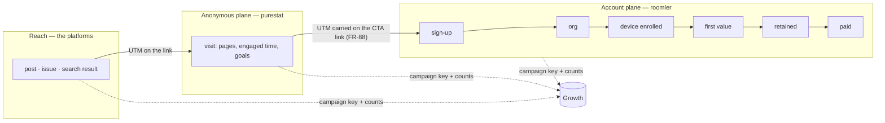

# FR-102: Growth observability — from a post to a paying org, joined by the campaign and never by the person

**Issue:** [#2127](https://github.com/gjovanov/roomler-ai/issues/2127) · **Status:** in progress — claimed
2026-10-13 (#2128); P1a live (promoted with `hosted-20261014-fbc8f22`), AC1 field-verified; purestat PS0a +
PS1 live as v0.1.8 since 2026-10-13 23:36Z, AC2 field-verified; P1b–c (#2172) and the daily digest P1d
(#2175) live since 2026-10-14 07:33Z (`hosted-20261014-cc63c4d`), AC23 field-verified · **Owner:** web / public site + saas + fleet (install) + purestat · **Anchors:** master `106bd2704`,
[purestat](https://github.com/gjovanov/purestat) `9e04332` · **Builds on:**
[FR-88](FR-88-promotion-attribution-and-site-video.md) (attribution, the activation view),
[FR-91](FR-91-scheduled-blog-publishing.md) (the blog lane; P3, the organic carry),
[FR-87](FR-87-blog-and-google-indexing.md) (the blog, Search Console),
[FR-58](FR-58-newsletter-sending.md) / [FR-39](FR-39-launch-readiness.md) (the newsletter and its no-tracking
promise), [FR-20](FR-20-per-tenant-relay-cost-metering.md) (cost per org),
[FR-32](FR-32-plan-limit-enforcement.md) (quota collisions), [FR-22](FR-22-time-to-first-frame.md) (the connect
timeline), [FR-69](FR-69-modular-monolith.md) (where code goes), and the `/observability` program (`stats_*`)

## 1. Goal

The operator asks five questions, and the system answers almost none of them with a number it can defend:

1. **Blog**: which posts are read, how far, and where their readers came from.
2. **Newsletter**: who subscribed, confirmed and left, and whether issue X was delivered and brought anyone.
3. **Social**: what a post on YouTube, X, LinkedIn, Facebook or TikTok produced beyond its own likes:
   visits, sign-ups, devices, payment.
4. **Product**: which orgs are created; which devices get installed, and how (the wizard, an installer,
   the PowerShell or bash one-liner); where an install stalls; who uses remote desktop, and for how long,
   per org.
5. **Revenue**: which orgs pay, since when, how much, and which campaign brought them.

Five more matter to a business and nobody asked for them yet (§3m): one north-star number, activation and
first-value definitions, cohort retention, time to value, and the coverage of every number shown. The
system also needs to know who keeps hitting the free plan's limits, what each org costs to serve, and
whether the people who use the product are satisfied.

This FR:

- (a) makes the inputs trustworthy, because today they are not (§2a);
- (b) builds one end-to-end funnel in `/observability` → **Growth** that joins the anonymous web plane
  (purestat) and the account plane (roomler) **by the campaign key and by counts, never by a person**;
- (c) fills the account plane's gaps: install method, token issuance, billing history, per-org activity
  history, newsletter delivery, satisfaction;
- (d) gives purestat the generic features this needs (working API keys, conversions, campaigns,
  engagement, funnels, journeys, OAuth sign-in), tracked in purestat's own repository (§3n);
- (e) feeds the results back to the people and the Claude sessions that run promotion: a **daily digest**
  (operator, 2026-10-13), a results feed, alerts.

**Principles** (the part not to re-litigate):

1. **Two planes, one key.** The anonymous plane (purestat: visits, pages, goals; cookie-free, a daily
   rotating hash, no person) and the account plane (roomler: accounts, orgs, devices, sessions, invoices)
   meet only at the campaign key `(source, medium, campaign, content)` and at counts. A purestat visitor is
   never joined to an account, and an account never gets a visitor id.
2. **Carry, don't store** (FR-88 §3a): nothing about attribution is written to a visitor's device.
3. **Derive before you collect.** Whatever the server can compute from records it already keeps to
   operate, it computes. A new collection point names the question it answers.
4. **Measured, not measured, and zero are three cells** (the cost view's rule, `crates/api/src/routes/cost.rs:9-21`).
   A source that is down, unset or unbuilt renders `null` with a reason, never `0`.
5. **Every rate carries its n.** Below n = 30 the UI shows counts and hides the percentage.
6. **Self-hosted never phones home** (`docs/business-model.md` §6 rule 1, `LICENSING.md:20-23`). Nothing
   here sends data from a self-hosted deployment or counts one. What runs on a self-hosted server (its own
   funnel, its own fetch counters) stays on that server, and every integration that talks to the outside
   world is in `saas`, which no self-host profile compiles (§3o).
7. **Aggregates may outlive rows; rows never outlive their owner.** Frozen daily totals carry no person;
   per-org and per-person rows are deleted with the org or the person.

## 2. Evidence

### 2a. Measured in production, 2026-10-13 (read-only ClickHouse and Mongo queries)

purestat's `roomler.ai` site (`site_id` from the site's ObjectId), production `hosted-20261013-c6bcdb2`
(`/health` 0.4.132), purestat v0.1.6. Account counts are in the private annex, not here.

| What | Measured | Consequence |
|---|---|---|
| Events of the last **90 days**, by page hostname | 34,857 from `roomler.ai`; **25,780 from loopback and private hosts** (localhost, 127.0.0.1, RFC 1918); 321 from 4 other domains | **42 % of the site's data is test runs and forks.** The tracker has no localhost skip, and ingest compares no hostname (§2b) |
| `pageview` rows, last **30 days** | 16,367 in total, of which **2,500 come from `roomler.ai`** (537 visitors) and 13,777 from loopback | before the next bug, every pageview count on the dashboard is ~6.5× the real one |
| `engagement` rows, last 30 days | 4,236 (3,429 of them on `roomler.ai`) | the Stats API counts every row as a pageview (§2b): on the real host, engagement beacons **outnumber** the real pageviews |
| `signup` goal, last 30 days | 41 events: **39 from loopback**, 1 from a fork's domain, **1 from `roomler.ai`** | the conversion the promotion program is judged on is ~95 % test traffic, and nothing computes conversions from it anyway (§2b) |
| `utm_source` / `utm_medium` values, last 30 days | `youtub` (sic), an empty medium, a `check`/`roll` pair; 26 rows whose campaign is off the `yyyymmdd-slug` scheme | the campaign key is validated at neither end |
| Referrer sources, last 30 days | `roomler.ai` itself is the **second** source (self-referrals); two third-party fork domains appear | purestat#1 item 4; forks beacon as `roomler.ai` |
| Blog `engagement` durations | a **mean** of 1,995 s on one post | the beacon includes time in a hidden tab, and a mean of that is not "read time" |
| Accounts created in the last 30 days | **none carries `signup_attribution`** (the count is in the annex) | FR-88's chain has produced no attributed account yet, and whether it would have is unverified in the field (FR-88 AC2/AC3 are unticked) |

### 2b. Read from code (master `106bd2704`, purestat `9e04332`)

| What | Where | Consequence |
|---|---|---|
| The SPA and every static page load purestat unconditionally, with `data-domain="roomler.ai"` | `ui/index.html:51`; `ui/docs/site.ts:205-208` → `ui/docs/theme/shell.ts:148-149` | every self-hosted install and every fork beacons as `roomler.ai`, contrary to `LICENSING.md:20-23` |
| The activation view has no caller | `GET /api/admin/stats/attribution` (`crates/api/src/routes/attribution.rs:112`, mounted `crates/api/src/lib.rs:297`); no reference in `ui/src` | FR-88's activation numbers exist and nobody sees them |
| Organic sign-ups carry nothing | `ui/docs/theme/attribution.js:87` returns when the landing URL has no campaign parameter | a reader of a post who arrives from search and signs up records no `landing_path` (FR-91 P3, unbuilt) |
| purestat's API keys are minted but never checked | keys created `crates/api/src/routes/api_key.rs:63-69`; the only extractor is the JWT one (`crates/api/src/extractors/auth.rs:33-44`); `ApiKeyDao::find_by_hash` has no caller | nothing can read purestat by API key; FR-88 §2 assumed it could |
| purestat counts every row as a pageview | `count() as pageviews FROM events` with no `event_name` predicate (`crates/services/src/analytics/query.rs:107`) | engagement beacons and goals inflate pageviews |
| purestat ingest takes the client IP from the **left-most** `X-Forwarded-For` entry; the limiter takes the right-most public one | `crates/api/src/routes/event.rs:50-54` vs `crates/api/src/rate_limit.rs:83-103` | a client can choose its own visitor hash |
| purestat stores `allowed_hostnames` and reads it nowhere; goals are rows that no query reads | `crates/db/src/mongo/models/site.rs:5-19`; `crates/db/src/mongo/models/goal.rs:4-22` | no hostname filter, and no conversion rate |
| Enrollment-token issuance is not recorded | `crates/modules/fleet/src/agent.rs:53` mints a 600 s JWT and writes nothing; the burn lives in `used_tokens` for 1 h (`crates/db/src/indexes.rs:261`) | "issued → redeemed" cannot be computed |
| The installer proxy and the script routes count nothing | `crates/modules/fleet/src/agent_release.rs:245-300`, `setup_release.rs:107, 279, 290` | yet every request carries a telling User-Agent: `roomler-setup/<ver>` (`agents/roomler-setup/src/proxy.rs:21`), curl, PowerShell, a browser, `roomlerd/<ver>` (the updater) |
| The enroll request is five fields | `crates/modules/fleet/src/agent.rs:82-88`; agent side `crates/agent-core/src/enrollment.rs:17-22` | no install method or scope, on the request or the agent row |
| The wizard reports nothing | steps `welcome → server → token → install → done` (`agents/roomler-setup/src/front/app.js:32`); progress goes to an in-process channel and logs to stderr (`agents/roomler-setup/src/main.rs:47-54`) | a stalled or cancelled install is invisible |
| No product-event history | org creation leaves a `tracing::info!` (`crates/services/src/dao/tenant.rs:185`); invite acceptance only bumps `use_count` (`crates/api/src/routes/invite.rs:233`) | — |
| Audit-shaped sources expire at 90 days | `tunnel_audit` (`crates/modules/network/src/lib.rs:719-725`), `ssh_audit`, `exec_audit`, `remote_audit`; `remote_sessions` has **no** TTL (`crates/modules/remote/src/lib.rs:159-161`), `call_sessions` 730 d (`crates/modules/conference/src/lib.rs:208-216`), `stats_events` 730 d (`crates/db/src/indexes.rs:371-375`) | a cohort chart longer than 90 days cannot see tunnel or SSH use. `docs/data-model.md:46, 96, 131-132` state other TTLs and are stale |
| Revenue is a list-price estimate | `crates/api/src/routes/cost.rs:22-30`; `BillingInfo` keeps ids and a status (`crates/db/src/models/tenant.rs:243-232`); `invoice.paid` falls into "Unhandled Stripe webhook event" (`crates/services/src/stripe.rs:621`) | no billed amount, no plan history, no "paying since" |
| Quota collisions are log lines | `services::quota` `tracing::warn!` (`crates/modules/saas/src/plan_compliance.rs:17-19`) | the business model's "best upgrade-intent signal" (`docs/business-model.md` §5) is not counted |
| Newsletter `sent` means "accepted by SendGrid" | `crates/db/src/models/newsletter_send.rs:16-47`; the footer promises "No tracking pixels — the only per-recipient thing in this email is your unsubscribe link" (`crates/services/src/newsletter.rs:178`) | delivery and bounces are unknown, and §3h must keep that promise |
| Nothing asks a user how it went | no rating or feedback surface; `remote_sessions.stats` keeps bytes, fps and RTT, not the carrier (`crates/remote_control/src/models.rs:4670-4024`); time to first frame lives 7 days in `agent_logs` (FR-22) | satisfaction is not measured at all |
| The agent updater asks `roomler.ai` by default | `agents/roomlerd/src/updater.rs:37` (`DEFAULT_PROXY_URL`), UA `roomlerd/<ver>` (`:1068`) | self-hosted agents reach our endpoint; §3e makes sure this is never counted |
| The promotion pipeline (private, out of scope) | metrics are collected for three of its six platforms; nothing reads web analytics back; no weekly report has been produced; its campaign ids carry the calendar slot's date, not the publish date | the join this FR builds is the missing half of the pipeline's own north star |
| purestat's OAuth is half-built | two of five providers answer the callback and the SPA has no button (`crates/api/src/routes/oauth.rs`) | PS6 finishes it; PS0 switches it off until then |

## 3. Design

### 3a. Two planes, one key



- **First touch is the record.** An account's acquisition is its `signup_attribution` (FR-88): the UTM it
  arrived with, or for an organic arrival the `landing_path` and `referrer_host` (FR-91 P3), plus the
  optional self-reported answer. An org inherits its owner's.
- **Two funnels, named apart.** The *visit funnel* (purestat, PS4) runs inside one visit: landing → page →
  goal. The *account funnel* (§3d) runs across days: sign-up → paid. Neither is computed from the other's
  rows.
- **The join is by key, then by count.** One row of the Campaigns table, say campaign
  `20261019-ssh-without-port-forwar` on LinkedIn, is two queries keyed alike. purestat gives its visitors
  and `signup` goals; roomler gives its accounts, activated orgs and payers.

### 3b. The campaign key: one taxonomy, checked at both ends

| Key | Values | Notes |
|---|---|---|
| `utm_source` | `youtube` `tiktok` `x` `linkedin` `facebook` `reddit` `hn` `devto` `hashnode` `medium` `github` `newsletter` `blog`; `instagram` (retired, kept for history) | the platform, never the account |
| `utm_medium` | `video` `post` `carousel` `comment` `community` `bio` `article` `email` | the format |
| `utm_campaign` | a post id `yyyymmdd-slug` (≤ 32), `profile` (bio links), `nl-<issue slug>` (§3h) | — |
| `utm_content` | `[a-z0-9-]{1,32}`: the account or the placement (a page id, `desc-top`, `endscreen`) | optional |

- **One table**, `crates/core/src/campaign.rs`. The server normalises at ingress (`attribution::sanitize`,
  `crates/core/src/attribution.rs:139`): lowercase, then aliases (`twitter`→`x`, `fb`→`facebook`,
  `yt`/`youtub`→`youtube`, `li`→`linkedin`, `ig`→`instagram`). An unknown source is **kept verbatim** and
  grouped under `other`, so a new channel shows up before it has a name. The private pipeline's link linter
  checks against a pinned copy of the same table.
- **Organic channels** come from `referrer_host` through one table: *search* (google.*, bing.com,
  duckduckgo.com, ecosia.org, yandex.*), *AI assistants* (chatgpt.com, chat.openai.com, perplexity.ai,
  gemini.google.com, copilot.microsoft.com, claude.ai), *social* (t.co, x.com, linkedin.com, lnkd.in,
  facebook.com, l.facebook.com, youtube.com, tiktok.com, reddit.com), *community* (news.ycombinator.com,
  lobste.rs, dev.to, hashnode.com, medium.com), *code* (github.com), *self* (`roomler.ai`: navigation, never
  a source), *direct*.
- ⚠️ **Time comes from the post, not from its id.** A campaign is placed on the timeline by the post's
  `published_at` (§3j). The pipeline's ids carry the calendar slot's date, which drifts when a slot moves.

### 3c. Trustworthy inputs (P1, PS0)

1. **Hosted-only analytics.** `ui/index.html` loses its static tag. A first-party loader, same origin so the
   CSP stays as it is, injects the tracker only when `location.hostname` is in `ANALYTICS.hosts` (default
   `['roomler.ai']`). The static shell uses the same loader. A self-hosted deployment, a fork, and a
   `localhost` dev server make **zero** requests to purestat.ai. The site keeps its kill switch
   (`ANALYTICS = null`).
2. **Test traffic stops at the source** (PS0). The tracker skips `localhost`, loopback, private ranges,
   `file:`, `navigator.webdriver`, and a `purestat_ignore` flag that the operator sets once in each browser
   used for promotion. Ingest drops events whose page host is not in the site's `allowed_hostnames`. A test
   that forgets to abort purestat can no longer fake a campaign, so the rule in today's runbooks becomes a
   property of the system.
3. **History is read through the same rule.** Queries over existing rows apply the hostname allowlist.
   Nothing is deleted to make history match.
4. **Internal orgs and people.** A platform-admin exclusion list (`growth_exclusions`: tenant and user ids,
   each with a reason) applies to every Growth number. It is seeded with the platform admins, the orgs they
   own, and the test orgs found by a one-off sweep. "Include internal" shows the raw totals.
5. **Pageviews are pageviews** (PS0): every purestat count of views filters `event_name = 'pageview'`.
6. **One client-IP rule** (PS0): ingest derives the client IP exactly as the limiter does.
7. **Coverage is a number.** The Growth page reports **tracker coverage**: purestat's `signup` goals divided
   by the server's sign-ups in the same window, both after exclusions. Blockers, OAuth hops and failed
   scripts all show up as coverage below 1, and coverage is never assumed to be 1.
8. **Not proxied** (D7). purestat stays on purestat.ai, not behind a first-party path. Getting past
   blockers is a decision with a coverage number in front of it, not a default.

### 3d. The account funnel (P2)

| Step | Definition | Source | Window |
|---|---|---|---|
| Sign-up | a user created by any provider, not excluded | `users.created_at` | — |
| Org created | an org owned by that user | `tenants.{owner_id, created_at}` | 7 d from sign-up |
| **Activated** | the org enrolled ≥ 1 device | `agents.{tenant_id, created_at}`, tombstones included | 7 d from org creation |
| **First value** | the org's first remote-desktop session that reached Active and lasted ≥ 30 s, call with ≥ 2 participants, tunnel flow, or SSH session | `remote_sessions`, `call_sessions`, `growth_org_daily` | 14 d from org creation |
| Active week | ≥ 1 value event in the ISO week | `growth_org_daily` | — |
| Retained W1/W4/W12 | active in week k after creation | `growth_org_daily` | — |
| Paid | the org's first paid invoice with an amount above 0 | `billing_events` (§3g) | — |

- **Grain.** Acquisition belongs to the user; value belongs to the org. FR-88's view stays user-grained
  (any org the person belongs to) until its D4 is settled (D3 here).
- **`pending` and `settled` on every windowed step**, as in FR-88 §3c: a rate's denominator counts only
  cohorts whose window has closed.
- **Time to value.** Median and p75, with n: sign-up → first device, and sign-up → first value.
- **North star** (D2): **weekly active orgs** (WAO), the orgs with a value event in the week, internal
  excluded. The promotion program's own north star, activated sign-ups attributed to social, is a filter of
  the same funnel.
- **`growth_org_daily`**: one row per org per day with any activity. `_id = "{tenant}:{yyyy-mm-dd}"`, an
  idempotent upsert written by a singleton nightly job (Redis `try_claim`, as the stats rollup does,
  `crates/api/src/stats_rollup.rs:3-26`), which recomputes the last 3 days. Fields: `rc_sessions,
  rc_session_minutes, rc_controllers, calls, call_participant_minutes, tunnel_flows, ssh_sessions,
  exec_runs, devices_online, members_active, value`. Retained 25 months (D8) and deleted with the org. It
  exists because four of its sources expire at 90 days, and retention needs a year.
- **Endpoints** (platform admin, 404 otherwise, host-owned like FR-88's view): `GET /api/admin/growth/funnel?since&until&by=source|medium|campaign|content|channel|self_reported|landing_path&include_internal`,
  `GET …/growth/cohorts?unit=week`, `GET …/growth/orgs`, and `GET …/growth/org/{tenant_id}/timeline` (one
  org's milestones from sign-up to its last invoice: the trace view). A step whose module is unmounted
  answers `null` with the module's name.
- **UI**: `/observability/growth`, same gate, with **Overview** (WAO, the funnel, time to value, coverage),
  **Orgs** and **Cohorts**. FR-88's attribution view gets its first caller here.

### 3e. The install trace (P3)

```mermaid
sequenceDiagram
    participant A as Admin (SPA)
    participant S as roomler.ai
    participant H as Host being installed
    A->>S: POST …/agent/enroll-token
    S->>S: enroll_token_issued {jti, tenant, issued_by, issued_at}
    H->>S: GET install.sh · install.ps1 · installer (UA: curl · PowerShell · roomler-setup · browser)
    S->>S: growth_daily +1 {asset, client class, os} — no UA, no IP stored
    H->>S: POST /api/agent/enroll {…, install: {method, scope}}
    S->>S: agents.install; enroll_token_issued.redeemed_at
    H->>S: WS hello → stats_events presence=online (first online)
    A->>S: first remote-desktop session → remote_sessions
```

1. **Issuance is recorded**: `enroll_token_issued {_id: jti, tenant_id, issued_by, issued_at, kind:
   standard|key, redeemed_at, agent_id}`, keyed by the jti and never holding the token. It is updated where
   the jti is already burned (`crates/modules/fleet/src/agent.rs:187-199`) and kept for 90 days. Daily
   counts are frozen into `growth_daily`.
2. **Fetches are counted by client class.** The installer proxy, `latest-release` and the two script routes
   increment `growth_daily {asset, client, os}`, with client one of `wizard` (`roomler-setup/`),
   `script-sh` (curl, wget), `script-ps1` (PowerShell), `browser`, `other`. Neither the raw User-Agent nor
   the IP is stored.
   ⚠️ **`roomlerd/` is never counted.** It is the updater, and by default it asks `roomler.ai` from
   self-hosted devices as well (`agents/roomlerd/src/updater.rs:37`). Counting it would be exactly the
   self-host telemetry the product promises not to collect.
   *(P3c as built: a fetch carries no tenant, so the exclusion list (§3c.4) cannot remove the lab's own
   installs, and on 2026-10-16 they were most of the counts (§8). The operator names the internal source
   networks instead, `ROOMLER__GROWTH__INTERNAL_NETWORKS` (comma-separated CIDRs or bare addresses, default
   empty, so nothing changes until it is set). A counted fetch whose client address falls inside is
   counted under the class `internal` instead of its own, keeping its asset and OS. The updater rule comes
   first: a `roomlerd/` fetch from the lab is still not counted at all. The address is the per-IP limiter's
   (`roomler_core::client_ip`, moved there from the api crate so `fleet` reads it the same way): the
   `X-Forwarded-For` entry just left of our one trusted hop's own address, the client that hop recorded,
   else the socket peer. A client therefore cannot seed its way into the lab or out of it, and `X-Real-IP`
   is never read. ⚠️ That holds while `app.rate_limit_trusted_hops` matches the proxies in front of the
   server. A self-hosted image exposed directly lets a client choose its address, for the rate limiter and
   for this count alike. The address is compared in memory and dropped, so the row stays
   `{asset, client, os}` and a count. The digest leaves the `internal` rows out of the fetch table and
   reports them as `install.internal_fetches`. That line reads "not measured", never a 0, in three
   cases: no network is configured and the 28 days hold no internal row; no entry is usable; or the
   install counters are off (then the fetch table is "not measured" too). An entry it cannot use is warned
   about once at boot with its reason, and skipped. Refused are: not an address, host bits set
   (`94.130.141.98/24` is refused, not widened to the /24), and a prefix shorter than /8 (IPv4) or /16
   (IPv6). The networks in effect are logged as CIDRs.)*
3. **The enroll says how.** `EnrollRequest` gains `install: Option<InstallInfo { method, scope }>`, additive
   and `#[serde(default)]`; an agent from before this change records `unknown`. `method` is one of `wizard`,
   `script-sh`, `script-ps1`, `msi`, `deb`, `pkg`, `manual`, `container`, `other`; `scope` is one of
   `system`, `per-user`, `attended`, `unknown`. The served scripts pass `--install-method`, the wizard sets
   it in-process (`agents/roomler-setup/src/orchestrator_agent.rs:488-494`), and a hand-typed
   `roomlerd enroll` is `manual`. Stored once on the agent row as `install`.
   *(P3 as built: the scripts set `ROOMLER_INSTALL_METHOD` / `ROOMLER_INSTALL_SCOPE`, the flag's env
   fallbacks, rather than the flag itself — a served script installs whatever release is current, and a
   daemon from before the flag existed would refuse an argument it does not know, failing every scripted
   install until the next agent release; an older daemon ignores the variables. The scope follows what
   the script installs: `system` for `--system` and the macOS root half, `per-user` otherwise;
   `install.ps1` maps `daemon-system` → `system`, `daemon-user` → `per-user`, `daemon-machine` →
   `attended`, and the wizard maps its roles the same way. A re-enroll sends nothing and the row keeps
   its recorded install.)*
4. **First online** is `min(stats_events.ts)` with `presence = online` per agent. **First session** comes
   from `remote_sessions`.
5. **Wizard diagnostics are opt-in** (D4, P3b). A checkbox on the Welcome page, **unticked by default**,
   reads "Send anonymous setup diagnostics to `<server>`". When it is ticked, the wizard sends one
   `POST /api/setup/diagnostics` per step boundary: `{run, step, outcome: ok|failed|cancelled, elapsed_ms,
   error_code, os, wizard_version}`. `run` is random and lives in memory for that run only. It also rides
   the enroll (`install.run`), so a ticked run joins its device. The diagnostics go to the server being
   enrolled into, so a self-hosted server gets its own and roomler.ai never hears of them. Unticked, the
   wizard sends **zero** requests.
   Why opt-in: EDPB Guidelines 2/2023 read ePrivacy Art. 5(3) as covering what an installed program sends
   from the terminal for a purpose the user did not ask for.
   *(P3b as built: the record is one shared wire type
   (`roomler_ai_remote_control::setup_diagnostics`) with fixed vocabularies for `step`, `outcome` and
   `error_code` that the server validates field by field — a refusal is a 422 with a code and stores
   nothing — and the handler reads the body and nothing else about the request, so no IP and no
   User-Agent can reach a row. The pages' boundaries happen before the wizard knows the server, so the
   Rust recorder buffers them and flushes when `cmd_install` names it; a run cancelled before then sends
   nothing anywhere. A run writes at most 48 rows. `growth.setup_diagnostics` (default on, for
   `install_counters`'s reason) is the server's switch: off, the route is the empty 404 of an absent
   path. The rows live 90 days; the nightly org-day job freezes distinct runs per `(step, outcome, os)`
   per closed day into `growth_daily` as `install:wizard_step`, and the digest reads the rows for its
   windows. The kill switch on the wizard's side is the box itself.
   `docs/growth-observability.md`, "The wizard's opt-in diagnostics".)*
6. **The Install panel** shows, per method and OS: fetches (approximate, by class), tokens issued, devices
   enrolled, issued → redeemed, enrolled → online within 1 h, → first session within 24 h, and wizard steps
   reached (opted-in runs only, labelled with their n).
   ⚠️ A fetch counter cannot tell a hosted user from a self-hoster who downloads our build to enroll
   elsewhere, so fetch → enroll is a **lower bound**.

### 3f. Usage, quality and satisfaction (P2, P9)

- **Usage** per org comes from `growth_org_daily` (P2).
- **Quality** per day and per agent version (P9):
  - sessions that reached Active against those that failed, by `end_reason`;
  - median duration, `stats.peak_fps`, `stats.avg_rtt_ms`;
  - FR-22's time to first frame, as p50/p90 frozen nightly from `agent_logs` before its 7-day horizon;
  - crashes per 100 device-days from `agent_crashes`.
  *(P9a as built — server only, no remote-control code path touched: a nightly freeze under the
  org-day fold's claim writes `growth_quality_daily`, one row per `(day, scope, agent_version)`,
  from `remote_sessions` (sessions **requested** that day: reached Active / never / pending, by
  `end_reason`; duration, `stats.peak_fps`, `stats.avg_rtt_ms` as exact p50/p90 plus a histogram),
  the browser's `rc.connect` records in `agent_logs` (TTFF over foreground, first-attempt paints —
  FR-22's own filter — measured only while every record of the day still exists), `agent_crashes`
  (by the payload's `agentVersion`) and `stats_machine_1d` (device-days). The version a device ran
  comes from its own log batches that day, else its device row. Both scopes (`external` with the
  exclusion set, `all`) are frozen; an absent part is not measured, never 0; a rate from n = 30.
  Read by `GET …/growth/quality`, the Quality tab, the digest's `quality` section (the day's TTFF
  and per-version table; the outcome counts and distributions live) and the weekly roll-up.
  Detail: [growth-observability.md](../growth-observability.md#remote-desktop-quality-from-what-is-recorded-p9a).)*
- **The carrier on an RC session.** Direct, TURN or DERP is recorded when the session reaches Active; the
  agent already knows it. This is remote-desktop code: it is held to the repo's §3 bar and proven on the
  fleet, as any carrier change is.
  *(P9c as built — record, never decide: once the peer reaches Connected the agent reads the nominated ICE
  pair and, when it rides the overlay, the overlay runtime's own carrier for the peer (the LocalAPI lookup
  the bitrate probe already makes), and records `direct` · `turn` · `turn_local` · `overlay_direct` ·
  `overlay_turn` · `derp` · `org_relay` · `unknown` (`roomlerd::session_carrier`, a pure mapping tested for
  every kind). ⚠️ A relay kind the build does not know, an older daemon, a tunnel/blocked/offline peer, or
  nothing learned is **`unknown`, never `direct`** — the `is_direct()` trap CLAUDE.md warns of, closed. Read
  once after a 2 s settle (Chrome renominates relay→direct a moment after Connected), then additive on every
  `rc:session.stats` (`#[serde(default)]`): an older server ignores it, absent is unknown. Stored on
  `remote_sessions.carrier` beside `stats`, only when the value is a short code; the P9a freeze splits the
  day's Active sessions by carrier (`sessions.by_carrier`) and the Quality tab and weekly roll-up show it.
  Needs agent 0.4.140 to field-prove. Detail:
  [growth-observability.md](../growth-observability.md#remote-desktop-quality-from-what-is-recorded-p9a).)*
- **Asked, not inferred** (D10). After a session of 30 s or longer, the viewer offers 👍 / 👎 with optional
  reason chips: *lag*, *picture*, *input*, *couldn't connect*, *other*. It appears at most once a day per
  person, can be dismissed, and never blocks. Stored as `session_feedback {session_id, tenant_id, user_id,
  rating, reasons, ts}` for 25 months and deleted with the user. There is no free text in v1, because free
  text is where personal data hides.
  *(P9b as built — viewer code, no remote-control data path touched: the 30 s run from the viewer's
  **request** to the attempt's terminal phase (`closed` / `error`; a reconnect inside the attempt is the
  same attempt), so a connect given up after 35 s is asked about too — "couldn't connect" is a chip. The
  prompt is inline in the viewer's ended state, never a dialog, takes no focus, and every gate fails toward
  not prompting: the server's `features.session_feedback` must have been read as `true`, a session id and
  a request time must exist, the browser's storage must be able to record the day (private windows get
  no prompt), and the UTC day is recorded **when the prompt is shown**, so a dismissal counts. The server
  (`POST /api/tenant/{tid}/session/{sid}/feedback`, `remote`) resolves the session within the org, accepts
  only its controller or a watcher, refuses a post sooner than 30 s after the request, validates the thumb
  and the chips against the vocabulary with `deny_unknown_fields` (a comment key fails the parse), stores
  one per session **per person** (unique `(session_id, user_id)` — the controller and each watcher rate once
  each; the digest counts answers, not sessions), and answers the empty 404 while
  `ROOMLER__GROWTH__FEEDBACK=false`.
  `agent_id` is denormalised from the session row; `SessionFeedbackDao::purge_user` is the seam an account
  deletion calls (none exists yet; the 25-month TTL bounds the rows). The digest's `quality.ratings` counts
  thumbs per window and reasons over 28 days, exclusions applied to the org and the person. Detail:
  [growth-observability.md](../growth-observability.md#the-post-session-rating-p9b).)*

### 3g. Revenue (P4)

- **`billing_events`, from Stripe webhooks.** The handled set grows to `customer.subscription.created`,
  `customer.subscription.updated`, `customer.subscription.deleted`, `invoice.paid`,
  `invoice.payment_failed` and `customer.subscription.trial_will_end`. Each row is `{tenant_id, kind, plan,
  seats, amount_cents, currency, period_start, period_end, stripe_id, ts}`, and the amounts come from the
  invoice: billed revenue, not list price. Rows are deduplicated by the existing `stripe_events`. A one-off,
  operator-run backfill reads Stripe's invoice list.
- **Derived from it**:
  - paying orgs;
  - billed MRR, normalised to a month;
  - new, expansion, contraction and churned MRR per month;
  - trial → paid;
  - `paid_since`;
  - all of these by the owner's acquisition channel.
- **Upgrade intent.** A quota collision becomes a counter, `growth_daily {source: quota, metric: collision,
  dims: {tenant, limit}}`, beside the existing warn line: these are the orgs that keep hitting the ceiling.
- **Cost to serve** (FR-20 P5) sits beside billed revenue, giving margin per org. The list-price MRR column
  stays, labelled as such, for orgs with no invoice yet.
- **Monthly totals are frozen** into `growth_daily`, so deleting an org does not rewrite last year's MRR.
  *(P4 as built: `billing_events` lives in `saas` (its index set there — sparse-unique `event_id`, unique
  `(kind, stripe_id)` partial on `invoice_paid`, `(tenant_id, ts)`, `(kind, ts)`), written through
  `roomler_ai_services::dao::billing_event` by the Stripe webhook and the backfill. Beyond §3g's fields a
  row keeps `recurring_cents` (the subscription lines that are not prorations, after discounts — the MRR
  basis), `interval_months`, `subscription_id`, `status`, `reason`, `cancel_at_period_end`, `event_id`,
  `source` (`webhook`·`backfill`); a subscription event's amount is `null`, never 0. Both Stripe API shapes
  in the field are read (classic, and 2025-03-31's `parent.*`). The org comes from the `tenant_id` the
  checkout now also stamps on the subscription's metadata, else the org's stored customer / subscription
  id; an object naming no org is logged and not recorded. A processing failure un-marks `stripe_events`
  so Stripe's retry is processed. **Billed MRR** at t is the recurring part of the org's newest paid
  invoice whose period covers t, ÷ its interval in months, 0 after a deletion — so a seat change moves
  MRR when an invoice bills it (the proration between is cash). Months are per currency; a month before
  the first billing row is `on_record: false` (not measured) and never frozen; the nightly org-daily job
  freezes each closed month 3 days after it ends (`growth_daily {source: billing}`, `growth_pulls
  billing:YYYY-MM-01`), internal orgs left out; the backfill (`POST /api/admin/growth/billing/backfill`,
  `saas`, platform admins) reads Stripe's paid invoices once, refreezes the months it touched and leaves
  a `billing_backfill` marker. Quota collisions go through `roomler_core::quota` at all thirteen call
  sites (counted in `warn` and `enforce` alike, nothing with `growth.enabled = false`). The funnel's
  `paid` hangs off the org step (no window: "paid so far"). View: `GET /api/admin/growth/revenue`, the
  Revenue tab; the digest's revenue section gains `billed` and `upgrade_intent`.)*

### 3h. The newsletter (P5)

- **The list over time.** New, confirmed and unsubscribed per day, by `source`, from timestamps the list
  already keeps (`crates/db/src/models/subscriber.rs:21-63`).
- **Delivery** (D6). SendGrid's Event Webhook, signed and verified against SendGrid's public key (anything
  else is refused), records `delivered`, `bounce`, `dropped` and `spamreport` on the send row. A hard
  bounce or a spam report suppresses the address. SendGrid's open and click tracking stay **off**: a check
  at startup reads both settings and logs loudly if either is on.
- **Visits per issue** (D5). An issue's links carry `utm_source=newsletter&utm_medium=email&utm_campaign=nl-<slug>`,
  identical for every recipient. The footer's promise stays literally true: the only per-recipient thing
  in the email is the unsubscribe link. `docs/newsletter.md`'s "no open/click analytics" becomes "nothing
  per reader".
- **Unsubscribes per issue.** Issue X's unsubscribe link adds `i=<slug>`, the same for everyone, and the
  click is recorded as `subscribers.unsubscribed_via`.
- **The per-issue table**: recipients, accepted, delivered, bounced, complaints, unsubscribed via the
  issue, visits (purestat, by campaign), sign-ups (`signup_attribution.campaign`).
  *(P5 as built: the webhook is `POST /api/sendgrid/webhook` in `saas`, outside the governor; the
  key is `ROOMLER__NEWSLETTER__EVENT_WEBHOOK_PUBLIC_KEY` (SendGrid's base64 DER key or PEM) and
  without a usable one the route is the empty 404. A missing header, a timestamp outside 25 h back /
  5 min ahead, or a signature that does not verify is 401 **before the body is parsed**. Events are
  matched by ONE SendGrid custom arg, `nl_issue = <slug>` — the same for every recipient — and the
  recipient's address; only `delivered`, `bounce`, `dropped` and `spamreport` are written, each time
  as a `$min` (a replay writes nothing); a bounce of `type: bounce` or a spam report sets
  `subscribers.suppressed_at`, which the fan-out's per-recipient re-check honours (the row reads
  `suppressed`) until fresh consent. Every newsletter message also switches SendGrid's open, click,
  subscription and Google Analytics tracking off in the request itself, and the startup check WARNs
  when the account's open or click tracking is on or cannot be read. The tags go on http(s) links
  to `roomler.ai`, `www.roomler.ai` and `app.frontend_url`'s host only; third-party links stay as
  written; `newsletter.link_tags = false` is the sender's kill switch. The issue is stamped with
  `campaign` and `delivery_events` when the fan-out starts, so an untagged or unrecorded issue
  reads "not measured", never 0. A **test issue** (`audience`: 1–20 addresses, fixed with the
  draft) goes only to the confirmed subscribers among them — what AC14's field run uses instead of
  mailing the list. The table is `GET /api/admin/growth/newsletter` (90 closed days by
  default), the Newsletter tab, and the digest's `newsletter.delivery`. Detail:
  [growth-observability.md](../growth-observability.md#the-newsletter-delivery-per-issue-tags-and-unsubscribes-p5).)*

### 3i. The web plane in Growth (P6, after PS1)

- A `saas` job pulls purestat's breakdowns for each closed day, by the campaign key and by path, into
  `growth_daily` (`source: purestat`). It uses an API key scoped to the `roomler.ai` site
  (`ROOMLER__GROWTH__PURESTAT_*`, from a Secret).
- **The contract PS1 implements**, which is everything roomler needs from purestat:
  - API-key auth;
  - breakdowns by up to four dimensions;
  - metrics: visitors, visits, pageviews (pageviews only), engaged visits, bounce rate, visit duration;
  - per-goal conversions as unique visitors, per row;
  - a daily interval, at least 1,000 rows with paging, and the hostname allowlist applied.
- **The Campaigns table**, per key: reach (§3j), visitors, engaged visitors and goal conversions, then from
  the account plane sign-ups, orgs, activated, first value and paid. A purestat outage or a revoked key
  renders "not measured", never 0.
  *(P6 as built: the table queries purestat **live** for the exact range — unique visitors do not add
  across days, so a sum of the frozen daily rows could not answer a range — by exactly the UTM dimensions
  of the requested depth (`by=source|medium|campaign|content`), and joins the funnel's account plane in
  code by `CampaignKey::normalized`, the cleaning a sign-up gets at ingress. purestat's v1 contract has no
  engaged-visitor metric, so engagement is `reads` (pageviews visible ≥ 30 s). The daily pull keeps the
  last 7 closed days re-pulled once per cycle (01:00 UTC) and freezes older ones; each day's state is a
  `growth_pulls` row, so "not pulled" and "failed" are never read as 0. Detail:
  [growth-observability.md](../growth-observability.md).)*

### 3j. Social reach (P8)

- **The pipeline pushes what it already records.** The private promotion pipeline is out of scope, but it
  pushes two things:
  - posts: `{platform, account, format, platform_id, url, published_at, campaign key}`;
  - metric snapshots: `{platform, platform_id, snapshot: T+1d|T+7d|T+28d, taken_at, metrics: {raw name:
    value}}`.
  They go to `POST /api/admin/growth/ingest/{posts|snapshots}` with the ingest key (D12). Writes are
  idempotent on `(platform, platform_id)` and `(platform, platform_id, snapshot)`. Raw metric names are
  kept, because a metric is only comparable to itself. Unknown platforms and any post text are refused.
- **Push, not pull** (D11). The collector runs where its credentials live, today a scheduled task on the
  operator's machine and later the in-cluster app, and it needs nothing to be reachable.
- **The Channels table**, per platform and per post: reach as the platform defines it, then visitors →
  sign-ups → activated → paid by the post's key. A platform with no collector (LinkedIn and X today) reads
  "not measured".
- **Spend.** An optional `cost_cents` per post (an X post with a link is billed per post) gives cost per
  visitor and per sign-up.
  *(P8 as built: the posts and snapshots are core-level collections (`growth_posts`,
  `growth_post_snapshots`) written by `saas`'s ingest routes through the core DAO, so the host's views keep
  showing what was pushed on a server that stops mounting `saas`. The ingest key (`growth_keys`, kind
  `ingest`, `rgi_…`) is stored as a SHA-256 and a display prefix; every way of not holding a live one is the
  empty 404 of an absent path, decided before the body is read. The body's shape is closed: a field whose
  name looks like copy is `post_text_refused`, any other stranger `unknown_field`. A snapshot is written
  once (the first push's numbers stay); a snapshot for a post never pushed is refused. A platform's reach
  is summed per snapshot age, never across ages. Detail and the pushers' API:
  [growth-observability.md](../growth-observability.md).)*

### 3k. Content and search (P7, engagement after PS3)

- **A read** is a pageview with ≥ 30 s of visible, focused time or ≥ 75 % scroll depth (PS3). Read time is
  reported as a median, never as a mean of raw durations.
- **Search Console and Bing Webmaster**, pulled daily into `growth_daily`, per page × query × day: clicks,
  impressions, CTR and position. Search Console is read through a service account added to
  `sc-domain:roomler.ai` as a restricted user; Bing through an API key. URL Inspection adds each post's
  index status and last crawl, within its 2,000-a-day quota.
  *(P7b as built — three `saas` pullers on P6's pattern, each "not measured" without its credential and
  saying so once. **Search Console** (`saas::search_pull`, `saas::search_console`): the service account's
  RS256 assertion (`webmasters.readonly`, which caps the token at read-only whatever the account's role)
  exchanged for a cached token. Only **final** days are stored: each cycle asks the `date` breakdown with
  `dataState: all`, and a day from its `metadata.firstIncompleteDate` on stays due with nothing stored,
  never a partial day read as whole; when Google omits that date the Pacific day still running stays due
  all the same. A final day holds four breakdowns — `site` (the property's totals),
  `page` (per-page totals with the anonymised queries), `query`, `page_query` — as `clicks`, `impressions`
  and `position_x100` (the position weighted by impressions, so any set of rows averages as Google does); CTR
  is derived. The first cycle fills the last 30 closed days; a day younger than 5 is re-pulled once per cycle,
  then frozen. Its days are Google's (Pacific). **The blog's posts** (`saas::content_pull`, `growth_content`,
  `saas`'s index set): the site's own Atom feed once a day, `_id` the post's path; a post that leaves the
  feed is kept `in_feed: false`, and only a feed can say so — a 404, a redirect, a non-https URL or an
  answer that is not an Atom feed is a failed read that changes nothing. With the same key, each post's
  URL Inspection verdict, coverage state and last crawl (at most 200 a day), `inspected_at` the time the
  verdict was read; a failed attempt keeps them and records the error, a timeout is one post's failure
  until three come in a row, and a post inspected in the cycle is not asked again on a retry.
  ⚠️ Google's own permission table gives a *Restricted* user "fetch only"
  on URL Inspection, and community reports say the API needs *Full*: with a Restricted account the search
  numbers arrive and the index column records `forbidden (403)` on every post — never a 0 — until the
  account is raised to Full. **Bing** (`saas::bing_pull`): Bing answers per DAY only for the site's totals
  (`GetRankAndTrafficStats` → `source: bing`) and per WEEKLY bucket for queries and pages
  (`GetQueryStats`, `GetPageStats` → `source: bing_weekly`), the whole history on every call; both are
  stored at Bing's own grain under Bing's (Pacific) dates and labelled as such, the recent part rewritten
  and the rest frozen. A Bing query's text is stored only from 10 impressions in its bucket (§3p). Bing's
  key rides the query string, so no redirect is followed. Bing exposes no index status. Every puller reads
  its answers with a size ceiling. Detail:
  [growth-observability.md](../growth-observability.md#search-search-console-bing-and-the-blogs-posts-p7b).)*
- **The Content table**, per article:
  - published date, visitors, reads, median read time, top channels;
  - search impressions, clicks, CTR and position (7 d and 28 d), and whether the post is indexed;
  - sign-ups whose `landing_path` is the post (needs FR-91 P3).
  *(P7c as built — `GET /api/admin/growth/content?since&until&include_internal` (host, platform admins and
  the read key) and the Content tab. One row per post of `growth_content`. The web cells are purestat **live**
  for the range (visitors, reads with a read share from 30 pageviews, median read time, the top three
  channels from `path × referrer_host`), never a sum of daily rows. The Google cells come from the stored
  `page` breakdown matched by path, so the anonymised queries count. They cover the 7 and 28 days ending on
  the newest final day pulled on or before `until` (`google_through`), with CTR and position only from 30
  impressions, and the top five queries from `page_query`; `google_days` says how many final days of each
  window were pulled, so an unpulled day is not read as 0. A post is its path without the trailing slash:
  the rows of `/blog/a` and `/blog/a/` add up. The index column is the URL Inspection verdict, dated by
  when that verdict was read, not by a later failed attempt.
  Sign-ups are `users.signup_attribution.landing_path` equal to the post's path, the exclusion set
  applied. ⚠️ That field exists but the site writes it only on a campaign link's journey (FR-88's carry);
  organic arrivals carry none until FR-91 P3, so the cell is a lower bound and the tab says so in text.
  Each column is `not_measured` with its reason, never 0. Detail:
  [growth-observability.md](../growth-observability.md#the-content-table-and-the-search-section-p7c).)*
- **GitHub.**
  - Public counters need no token: stars, forks, and release-asset downloads per day (cumulative counters,
    differenced).
  - Repository traffic is optional: views, clones and referrers, read with a read-only token. GitHub keeps
    only 14 days of it, so it is pulled daily.
  *(P7a as built — `saas::github_pull`, the P6 puller's pattern: one `growth_pulls` row per (source, day),
  `$set` on each row's own `_id`, the Redis claim per tick, a failure recorded per day with its reason and
  never a 0. The counters are stored as one cumulative SNAPSHOT per closed UTC day (`growth_daily {source:
  github}`, `by: repo` stars / forks / watchers / downloads / helper_downloads, `by: release` (with its
  `kind`) and `by: flavour` downloads — a flavour is the asset name without its version), read between 01:00
  and 07:00 the next day. The product's releases (`agent-v`, `setup-v`, `tunnel-v`, `tunnel-wizard-v`) are
  counted apart from the helpers our own CI downloads (vendored builds, caches), which held 8,032 of the
  16,740 downloads when read live on 2026-10-17. Signature and checksum sidecars (`.asc`, `.sha256`) are
  not counted: the updater fetches one beside every package. The first
  good read stands, and a day not read inside that window has no snapshot. The counters never carry the
  token, so a bad token cannot cost a snapshot; they read from GitHub's 60 unauthenticated requests an hour,
  which the releases cache also uses, so the listing (at most 30 pages) stops before the hour's last 10
  and the next tick retries. A listing past 30 pages is stored as `truncated`, and the readers treat its
  downloads as a lower bound. The readers (`growth::github`)
  difference two snapshots: a delta whose earlier snapshot is missing is `null`, never 0 and never split
  across the gap, and downloads are differenced per release — a release whose total went down (an asset
  re-uploaded, as CI's `seed-cache` is on every seed save) counts nothing that day, an under-count rather
  than the over-count of reading its new total as new downloads. Traffic
  (`source: github_traffic`) needs `ROOMLER__GROWTH__GITHUB_TOKEN`: the per-day views and clones are
  re-pulled for the last 13 closed days and frozen after, and the referrers, which GitHub answers only as a
  14-day top-10 ranking, are stored under the closed day they were read after. ⚠️ GitHub's download counts
  include every agent self-update, hosted and self-hosted alike, because the updater downloads from GitHub
  directly: they measure distribution, not installs, and nothing tells one deployment from another. Clones
  are mostly CI's `actions/checkout`, not people, and the email labels them so.
  Shown as the digest's `github` section and the weekly roll-up's. Detail:
  [growth-observability.md](../growth-observability.md#github-the-repositorys-counters-and-traffic-p7a).)*

### 3l. The daily digest (P1d), the results feed and alerts (P10)

**The daily digest.** The operator asked for it on 2026-10-13: "a daily digest job that reports on the
mentioned metrics". A host job (`crates/api/src/growth/digest.rs`) reports every closed UTC day. It
computes the day, stores it, and emails it to the platform admins.

- **When.** At `ROOMLER__GROWTH__DIGEST_HOUR_UTC` (default 6), for the UTC day before. purestat closes a
  session 30 minutes after its last event, so by 06:00 the day is complete on both planes.
- **Once, with two pods.** A run first inserts `growth_digests {_id: "yyyy-mm-dd", status: computing}`.
  The unique `_id` decides which pod computes and sends; the other stops. This is the claim-first shape of
  the newsletter's send ledger (FR-58). `status` then moves to `sent`, to `stored` (no recipients, or email
  off), or to `failed` with the error. The next run retries a `failed` day or a stale `computing` one, and
  never sends a `sent` day again.
- **Sections.** Each answers a question from §1. A section whose source is not built yet says "not
  measured — arrives with Pn" and never shows 0.

| Section | Reports | Source | Available |
|---|---|---|---|
| Headline | sign-ups, orgs created, devices enrolled, active orgs over the trailing 7 days (a preview of WAO), coverage | §3c, §3d | P1d; coverage after PS1 |
| Sign-ups | each sign-up: provider, campaign key or landing path, self-reported answer, never the address; above 20 a day, aggregated by source | `users` | P1d |
| Orgs and devices | orgs created; devices enrolled by OS (by install method from P3); the orgs that enrolled their first device | `tenants`, `agents` | P1d |
| Usage | remote-desktop sessions and session-minutes, calls and participant-minutes, active orgs; the top 10 orgs by remote-desktop minutes | `remote_sessions`, `call_sessions` | P1d |
| Website | visitors, visits and pageviews on the site's own hostnames; top channels, sources and pages | purestat's v1 query | after PS1 |
| Blog | each post viewed that day: visitors, pageviews, reads (≥ 30 s), median read time, top sources | purestat's v1 query | after PS1 (read time exact after PS0a) |
| Campaigns | per `utm_source` / `utm_medium` / `utm_campaign`: visitors and goal conversions from purestat, sign-ups from roomler | purestat + `users` | after PS1 |
| Newsletter | new, confirmed and unsubscribed subscribers; each issue sent that day, accepted (delivered and bounced from P5) | `subscribers`, `newsletter_sends` | P1d |
| Revenue | orgs by plan and subscription status; the list-price MRR, labelled an estimate (`crates/api/src/routes/cost.rs:22-30`) | `tenants` | P1d; billed from P4 |
| Quality | sessions requested → reached Active / never, by `end_reason` (and the ended ones by class); duration, peak frame rate and RTT as p50/p90 with n; FR-22's time to first frame p50/p90 (the day exact, 7d/28d estimated from the frozen histograms); agent crashes by version and per 100 device-days; the day by agent version | `remote_sessions`, `agent_crashes`, `stats_machine_1d`, `growth_quality_daily` | P1d; TTFF, the rates and the versions P9a; the rating P9b |
| Install | fetches by client class; tokens issued → redeemed | §3e | P3 |
| Social reach | each platform's own numbers per post | the pipeline's push | P8 |
| Search | clicks, impressions, top queries and pages | Search Console, Bing | P7 (P7c: Google through its newest final day, Bing at its own grain, each `not_measured` without its key) |

- **Small numbers stay honest.** Below n = 30 the digest shows counts, not percentages. Each count of the
  day sits beside its trailing 7-day and 28-day totals, so a quiet day is read against a baseline, not
  alone. Internal orgs and people are excluded (§3c.4), and the footer says how many were left out, so
  nothing vanishes silently.
- **Delivery.**
  - An email to the platform admins' addresses. `users.email` holds only proven addresses, and
    `ROOMLER__GROWTH__DIGEST_TO` overrides it. The HTML and plain-text bodies are rendered from the stored
    JSON and sent through the existing email service.
  - `GET /api/admin/growth/digest?day=` (the latest when the day is omitted) and
    `GET /api/admin/growth/digests?since=`, for platform admins and, from P10, the read key.
  - A Digest view on `/observability/growth`.
  - `POST /api/admin/growth/digest/run?day=&send=false` recomputes a day, for a backfill or a test, without
    mailing it.
- **Switches.** `ROOMLER__GROWTH__DIGEST_ENABLED` defaults to **off**, so a self-hosted server never starts
  mailing its admins a report they did not ask for; the hosted configuration turns it on. Without
  purestat's key, the web sections read "not measured".
- ⚠️ A digest lands in mailboxes, which keep it longer than any collection here. It names orgs, as
  `/observability` does, and never a person's address, name or IP. `growth_digests` keeps 25 months.

**The results feed** (P10).

- **`GET /api/admin/growth/*`** answers the platform-admin JWT and a read key (D12). The read key works on
  GET only and on growth routes only, and is answered with 404 everywhere else. It is stored hashed in
  config, and each use is logged at `info` without the key.
- The promotion pipeline and the sessions that run it read the stored digests through it, instead of
  querying databases by hand.
- **A weekly roll-up.** On Mondays the digest adds the week's totals, the funnel, and from P2 the cohort
  lines.
  *(P10 as built: the read key is a second kind of the P8 machine key (`growth_keys`, kind `read`,
  `rgr_…`, only its SHA-256 stored), minted where the ingest key is. One rule, in two halves —
  `read_key_gate`, a layer on the whole `/api/admin/growth` router, and the `GrowthAuth` extractor every
  GET view names: a live read key on a GET of a data route opens exactly what a platform admin's session
  gets there; every non-GET, the admin surface (`/keys`, `/exclusions`, session-only even on GET), an
  ingest key, a malformed, unknown or revoked key and `growth.enabled = false` are the empty 404; each
  use is logged with the key's prefix and the path, never the key. The weekly roll-up is its own job and
  collection (`growth_weekly`, `_id = "YYYY-Www"`) on the digest's claim through a `Report` seam —
  `finish` is one engine for both — computed once the clock passes Monday `digest_hour_utc` for the last
  closed ISO week, never older; it stores the week's headline against the week before and the mean of the
  four before, and the funnel by source, the cohort lines and WAO series, the Campaigns table by source,
  the Channels table, the newsletter and the alerts, each through the route's own `compute`; opt-in
  `ROOMLER__GROWTH__WEEKLY_ENABLED`, recipients the digest's. Routes `GET …/weekly?week=`, `GET
  …/weeklies`, `POST …/weekly/run?week=&send=`. Detail:
  [growth-observability.md](../growth-observability.md#the-read-key-the-weekly-roll-up-and-alerts-p10).)*

**Alerts** (P10).

- **Alerts.** Each rule has an n floor, and `ROOMLER__GROWTH__ALERTS` switches all of them off. They show
  as a `growth_alerts` row on the Growth page and go out by email:
  - no sign-up for 72 h while the 28-day median is ≥ 1 a day;
  - ≥ 3 tokens issued in 48 h and none redeemed;
  - a method's enroll success below half its 28-day rate (n ≥ 10);
  - coverage below 0.3 for 7 days;
  - a purestat, Search Console or GitHub pull failing two days running;
  - an issue's hard bounces above 5 %.
  *(P10 as built — a smaller, documented set, each with its n floor, evaluated hourly by a host job: the
  daily digest failed, stalled or did not run for the latest due day; a source "not measured" two
  consecutive days while configured — the digest's purestat read, the `saas` purestat puller's
  `growth_pulls`, SendGrid delivery once the webhook key is set, and (since 2026-10-18, #2460) every
  other configured `saas` puller failing two days running — Search Console, URL Inspection, the content
  feed, GitHub's counters and its traffic, Bing — read on the clock: the puller still tries (an attempt
  within 26 h) and nothing it pulled has succeeded in 48 h (`pull_failing`,
  `crates/api/src/growth/alerts.rs:425`); and a spike or drop of sign-ups and of the purestat puller's
  daily visitors against the trailing 28 days, only at a baseline n ≥ 30 (`> mean + 3√mean` and `≥ 2×`
  for a spike, `< mean − 3√mean` for a drop). An alert opens once — `growth_alerts` holds at most one
  open row per `(rule, key)` through a partial unique index, which is also the arbiter between two pods
  — clears itself when the condition goes away, and mails the digest's recipients at most once per rule
  and key per day (a compare-and-set on the row's `mailed_on`). It shows in `GET …/alerts`, the Alerts
  panel on the Growth page, the daily digest's `alerts` section and the weekly roll-up; `POST
  …/alerts/evaluate?dry_run=` runs the rules on demand. The remaining rules of the list above — the
  72-hour silence, tokens issued and never redeemed, a method's enroll rate, coverage, an issue's hard
  bounces — are not built; the first needs a volume the baseline cannot yet carry.)*

### 3m. The measures, and what each is for

| Measure | Question it answers | Where |
|---|---|---|
| Weekly active orgs (north star) | is the product used, week over week, by orgs that are not us? | Overview |
| Activation (≤ 7 d) and first value (≤ 14 d) | did a sign-up reach the point of the product, and how fast? | Overview, Orgs |
| Cohort retention W1 / W4 / W12 | do orgs from week X still use it later, and does that differ by channel? | Cohorts |
| Time to value | how long from sign-up to the first device and the first session | Overview |
| Coverage | what share of the server's conversions the browser saw | Overview |
| Leading indicators: reach, engaged reads, search impressions, install fetches | what moves before sign-ups do; at low volume, the only numbers big enough to steer by | Channels, Content, Install |
| Upgrade intent (quota collisions) | who pushes against the free plan's limits | Revenue |
| Unit economics (cost to serve vs billed revenue) | does an org pay for what it costs? | Revenue |
| Self-reported source | the share no link can see: a URL said aloud, a chat, a colleague | Overview |
| Channel grouping, incl. AI assistants | how much arrives from search vs AI answers vs social vs code hosts | Channels |

### 3n. purestat (PS0–PS7, tracked in `gjovanov/purestat`)

| PS | What | Needed by |
|---|---|---|
| PS0 | **Trust.** *PS0a, the code*: the hostname allowlist (the site's domain, `www.` + domain, and `allowed_hostnames`) applied at ingest **and on every read**, which also keeps apart sites whose ClickHouse ids coincide; new sites get an id no other site can share; the tracker skips localhost, private hosts, webdriver and `purestat_ignore`; pageviews count `pageview` rows only; the entry/exit dimensions read `sessions`; one client-IP rule; a basic bot list; engagement counts visible time only; the unfinished OAuth routes switched off; docs that match the code. *PS0b, the infrastructure*: a nightly ClickHouse backup to object storage; deleting a site deletes its ClickHouse rows (needs the admin user) | everything |
| PS1 | **API keys work** (`X-API-Key`, site-scoped, `stats:read`), and a v1 query to the §3i contract | P6 |
| PS2 | **Goals and campaigns in the UI**: conversions and conversion rate per goal, the UTM report with drill-down, more than 10 rows, a filter control, channel grouping (§3b), period comparison | the operator |
| PS3 | **Engagement**: scroll depth, read rate and median time per page in the UI (visible-time duration lands in PS0a); outbound-link and file-download events behind script attributes | P7 |
| PS4 | **Funnels**: 2–8 ordered steps (a page pattern or a goal) within a visit, ClickHouse `windowFunnel`, drop-off per step, by source and campaign | the operator |
| PS5 | **Journeys**: next-page transitions from an entry page, and paths into a goal (a Sankey); paths seen by fewer than 5 visitors fold into "other" | the operator |
| PS6 | **OAuth sign-in** with Google and GitHub, to the rules roomler-ai's OAuth already follows (`docs/security-baseline.md`): a CSRF state and PKCE; linking by email only when the provider vouches for the address (Google `verified_email`; GitHub `/user/emails`, primary and verified); OAuth-created accounts verified; no credential in a URL; buttons in the SPA | the operator |
| PS7 | Weekly email report, traffic-spike alert, shared read-only links | later |

### 3o. Where the code goes (FR-69)

The shape is the one `stats_*` already has. The collections are core-level and written through the core
DAO by whichever module owns the fact (`stats_usage` is written by `network` and `conference`), and
cross-module jobs run in the host (`crates/api/src/stats_rollup.rs`).

- **Host** (`crates/api/src/growth/`): the views (funnel, cohorts, orgs, timeline, campaigns, content,
  install, revenue, newsletter, quality); the nightly job that writes `growth_org_daily` and freezes daily
  totals and the quality rows; the digest and alerts. A source whose module is unmounted answers `null`
  with the module's name.
- **Core** (`crates/services/src/dao/growth.rs`, indexes in core's plan beside `stats_*`): `growth_daily`,
  `growth_org_daily`, `growth_exclusions`, `growth_alerts`, `growth_quality_daily` (P9a,
  `dao/growth_quality.rs`).
- **`saas`** (hosted-only, never in a self-host profile): what exists only for the hosted business. That is
  the purestat, Search Console, Bing and GitHub pullers; the promotion pipeline's ingest routes; the
  SendGrid webhook; `billing_events` and the wider Stripe handling. A self-hosted server compiles none of
  it, so nothing leaves the server and nothing arrives.
- **`fleet`**: `enroll_token_issued`, the fetch counters, `setup_diagnostics`, and the enroll's `install`.
  A self-hosted server keeps its own and sends them nowhere. The agent half is MPL-2.0
  (`crates/agent-core`, `agents/roomlerd`, the scripts, the wizard).
- **`remote`**: `session_feedback` and the session carrier.
- Module collections keep their index sets in the module (FR-69 rule 3). New routes change the composition
  baseline, so it is re-recorded with `COMPOSITION_UPDATE=1` and a commit message that says why.

| Collection | Owner | Shape | Kept | Written by |
|---|---|---|---|---|
| `growth_daily` | core | `_id = "<source>:<metric>:<dims>:<day>"`, `{day, source, metric, dims, value}`; upserted, frozen after 7 days | indefinitely; rows with a `tenant` dimension go with the org | the pullers, the ingest routes, fetch counters, quota collisions, the host's freeze |
| `growth_org_daily` | core | `_id = "<tenant>:<day>"`, the §3d fields | 25 months; with the org | the host's nightly job |
| `growth_exclusions` | core | `{kind: tenant\|user, id, reason, by, at}` | until removed | platform admins |
| `growth_alerts` | core | `{rule, key, fired_at, detail, cleared_at, mailed_on}` — `cleared_at` an explicit `null` while open; at most one open row per `(rule, key)` (a partial unique index, P10) | 90 days | the host's alert job |
| `growth_digests` | core | `_id = "yyyy-mm-dd"`, `{status, computed_at, sent_at, recipients, sections}` | 25 months | the host's digest job |
| `growth_weekly` | core | `_id = "YYYY-Www"` (the ISO week), the digest's row shape and claim; `sections` the week's headline against the weeks before and the reports computed for that week (P10) | 25 months | the host's weekly job |
| `growth_quality_daily` | core | `_id = "<day>:<scope>:<agent_version>"`, `{day, day_start, scope: external \| all, agent_version, sessions {requested, reached_active, not_reached, pending, by_end_reason, duration_ms, peak_fps, avg_rtt_ms}, ttff {dist, hidden, later_attempts, outcomes}, crashes, device_days, computed_at}` — each distribution the day's exact p50/p90 plus a histogram over fixed edges; `agent_version` a release, `unknown` or `*` for every version; an absent part is **not measured** (P9a) | indefinitely (no org, no person) | the host's nightly freeze, under the org-day fold's claim; `POST …/quality/backfill` |
| `growth_keys` | core | `{kind: ingest \| read, label, prefix, hash, created_by, created_at, revoked_at, last_used_at}` — the key's SHA-256 and a display prefix, never the key (D12, P8; the `read` kind P10) | until deleted; revoked rows stay | platform admins (host routes) |
| `growth_posts` | core | `{platform, platform_id, account, format, url, published_at, key, cost_cents}`, unique `(platform, platform_id)`; no post text (P8) | indefinitely (our own content) | `saas`'s ingest route |
| `growth_post_snapshots` | core | `{platform, platform_id, snapshot: T+1d\|T+7d\|T+28d, taken_at, metrics {raw: number}}`, unique `(platform, platform_id, snapshot)`, written once (P8) | indefinitely | `saas`'s ingest route |
| `growth_pulls` | core | `_id = "<source>:<day>"`, `{source, day, status: ok\|failed, pulled_at, attempted_at, attempts, rows, error, missing_goal, truncated}` — whether a puller's day exists, so "not pulled" and "failed" are never read as 0 (P6) | indefinitely, like the rows it describes | the pullers (`saas`'s purestat puller from P6; its GitHub puller from P7a, `github:` and `github_traffic:`) |
| `billing_events` | `saas` | §3g, plus `recurring_cents`, `interval_months`, `subscription_id`, `status`, `reason`, `cancel_at_period_end`, `event_id` (sparse-unique), `source: webhook\|backfill`; unique `(kind, stripe_id)` for paid invoices (P4) | with the org (`purge_tenant`); the monthly totals frozen into `growth_daily` stay | the Stripe webhook, the operator's backfill |
| `growth_content` | `saas` | `_id` = the post's path, `{url, title, published_at, updated_at, first_seen_at, last_seen_at, in_feed, inspection {verdict, coverage_state, indexing_state, page_fetch_state, robots_txt_state, last_crawl_time, google_canonical, inspected_at, error}}` — the blog's own feed, and Google's URL Inspection of each post (P7b) | indefinitely (our own content, no person); a post that leaves the feed is kept `in_feed: false` | `saas`'s content puller |
| `enroll_token_issued` | `fleet` | `_id = jti`, §3e | 90 days | token issuance, the enroll |
| `setup_diagnostics` | `fleet` | `{run, step, outcome, elapsed_ms, error_code, os, wizard_version, ts}` | 90 days | the wizard, opt-in |
| `agents.install` | `fleet` | `{method, scope, run}` | with the agent row | the enroll |
| `session_feedback` | `remote` | §3f: `{session_id, tenant_id, user_id, agent_id, rating: up \| down, reasons: [codes], ts}` — unique `(session_id, user_id)` (one per session per person), codes from the fixed vocabulary, no text (P9b) | 25 months (TTL on `ts`); with the user (`SessionFeedbackDao::purge_user`) | the viewer, through `POST …/session/{sid}/feedback` |
| `subscribers.unsubscribed_via`, `newsletter_sends.delivery` | `saas` | fields on existing collections; P5 adds `subscribers.suppressed_at` / `suppressed_reason` and `newsletter_issues.campaign` / `delivery_events` | as FR-58 | the unsubscribe route, the SendGrid webhook, the fan-out (P5) |

### 3p. Privacy, retention, and the policy

| Data | Where | Kept | Deleted with | Notice |
|---|---|---|---|---|
| visits, pages, goals, engagement | purestat ClickHouse | 2 years (its TTL) | — (no person) | policy §2.15 |
| `signup_attribution` | `users` | with the account | the account | §2.16 (FR-88) |
| daily totals | `growth_daily` | indefinitely | rows with a `tenant` dimension: the org | new §2.18 |
| per-org activity | `growth_org_daily` | 25 months | the org | new §2.18 |
| install method, token issuance | `agents.install`, `enroll_token_issued` | with the agent row; 90 days | the agent; — | new §2.18 |
| wizard diagnostics (opt-in) | `setup_diagnostics` | 90 days, then daily counts | — (a per-run random id only) | the wizard's own text, §2.18 |
| invoices and plan changes | `billing_events` | with the org (Stripe is the record) | the org | §2.12 |
| session ratings | `session_feedback` | 25 months | the user | new §2.18 |
| delivery status | `newsletter_sends` | as FR-58 | the subscriber | newsletter section (P5: §2.14 and §7 name it) |
| social, search, GitHub | `growth_daily`; social posts and their metric snapshots in `growth_posts` / `growth_post_snapshots` (P8: ids, URLs, numbers and the campaign key — never post text); the blog's posts and their index status in `growth_content` (P7b) | indefinitely | — (aggregates about our own content: search queries are Google's and Bing's aggregates. Google already drops the rare, possibly identifying ones; Bing documents no such threshold, so a Bing query's text is stored only from 10 impressions in its weekly bucket — `bing_pull::QUERY_MIN_IMPRESSIONS` — and the rest live on only in the site's daily totals. GitHub's referrers are site names) | — |
| daily digests | `growth_digests`; the platform admins' mailboxes | 25 months | — (org names, never a person) | new §2.18 |
| remote-desktop quality per day and agent version (P9a) | `growth_quality_daily` | indefinitely | — (counts and percentiles about the product; no org, no device, no person) | new §2.18 |

The privacy policy (`ui/src/views/legal/PrivacyPolicyView.vue`) gains §2.18, product analytics (purpose:
improving the product and knowing which channels bring its users; basis Art. 6(1)(f); the retention
above). §2.15 is brought up to what purestat stores now (no query string, no fragment, engagement time, and
hosted only). §7's retention list grows, and `docs/data-model.md`'s stale TTLs are corrected.

## 4. Phases

| P | What | Kill switch | Status |
|---|---|---|---|
| P0 | claim: issue, this spec, the ledger row; a private annex with the 2026-10-13 baseline | docs only | **merged** #2128 `9b5c41b4b` |
| P1 | §3c on our side: the hosted-only loader, the exclusion list, the taxonomy and its normalisation, the coverage figure | `ANALYTICS = null`; an empty exclusion list | P1a (the loader) **live** via `hosted-20261014-fbc8f22`; P1b–c (taxonomy, exclusions) **merged** #2172 `1a70f3bb8`; the coverage figure lands with the digest's headline |
| PS0a | §3n PS0, the code, in purestat | per item | **live** 2026-10-13 23:36Z: purestat v0.1.8 (gjovanov/purestat#13, build fix #14; purestat-deploy#9) |
| PS0b | §3n PS0, the infrastructure, in purestat-deploy | the backup CronJob's `suspend`; the app user's `ALTER DELETE` grant | **live** 2026-10-17. **The nightly backup** (purestat-deploy#15 `1786c562`): ClickHouse `BACKUP DATABASE … TO S3` and a `mongodump` archive go to the cluster's own MinIO (bucket `purestat-backups`, 14-day expiry) at 02:30 UTC. Each half runs as a user that can do only that, and the S3 secret never reaches a log. This is the operator's decision: **in-cluster**, so it guards against a bad migration or a drop, not against losing MinIO's node. **Deleting a site deletes its ClickHouse rows** (purestat#21 `4748a3f6`, v0.1.12, rolled by purestat-deploy#16 `18bb9b27`). A site whose id is its own loses every row with it. A site that shares an id with a pre-PS0a site loses only what its own hostnames account for. The route also drops the site's buffered events and live visits, then deletes a second time. Field-verified (§8): the first backup and both restore drills matched live exactly; the deletion was red on v0.1.11's image and green on v0.1.12, late visits included |
| P1d | §3l: the daily digest (the job, `growth_digests`, the email, the JSON routes, the Digest view); every section not yet built says which phase brings it | `ROOMLER__GROWTH__DIGEST_ENABLED=false` (the default) | **live** since 2026-10-14 07:33Z (`hosted-20261014-cc63c4d`, with roomler-ai-deploy#29's config and purestat key); the first digest (2026-10-13) was mailed at 07:35Z |
| P2 | §3d: definitions, `growth_org_daily`, the funnel/cohorts/orgs/timeline endpoints, the Growth page (Overview, Orgs, Cohorts) | `ROOMLER__GROWTH__ENABLED=false` (the routes answer 404) | **live** 2026-10-15 00:10Z (`hosted-20261014-831ebcf`): #2215 `193848ff0`. AC6 by the integration lane; AC7 field-verified 2026-10-15 (§8); AC8 needs a day older than 90 days |
| P3 | §3e 1–4 and 6: issuance record, fetch counters, the enroll's `install` (server, agent, scripts, wizard), the Install panel | counters off by config; the agent sends `install` only when it is set | **server half live** 2026-10-15 00:10Z (`hosted-20261014-831ebcf`): #2217 `36f871029`; AC10 + AC11 field-verified (§8). The agent half (`roomlerd enroll` flags/env, the scripts, the wizard, the companion) **released** in agent 0.4.137 (2026-10-15 11:51Z); AC9 field-verified on vmtest (§8) |
| P3b | §3e 5: the wizard's opt-in diagnostics, after D4 | the checkbox; `ROOMLER__GROWTH__SETUP_DIAGNOSTICS=false` | **live** 2026-10-16 10:17Z (`hosted-20261016-d11fe94`), with the wizard half released in setup 0.4.139 (10:37Z): #2289 `abc0ac20c`. AC12 field-verified (§8). Covers the Welcome-page box (unticked, memory only), one record per step boundary buffered until `cmd_install` names the server, `POST /api/setup/diagnostics` (`fleet`; validated field by field, no IP, no UA, ≤ 48 rows per run), `setup_diagnostics` (90 d) with the nightly freeze into `growth_daily`, the digest's `wizard_steps`, the docs |
| P3c | §3e 2: the lab's own fetches stop inflating the install counters (§8, 2026-10-16) — the operator's internal networks, by the limiter's client-address rule, counted as `internal` | `ROOMLER__GROWTH__INTERNAL_NETWORKS` empty (the default): nothing changes | **in PR #2378** (2026-10-17): `growth.internal_networks`; `roomler_core::client_ip` (the one client-address rule, moved from the api crate); `client: internal` in place of the class; the digest's `install.internal_fetches` beside a table that leaves those rows out; the integration tests (inside, outside, a seeded header, the updater, no address in any row) and the docs. No AC is ticked by it. **Live** 2026-10-17 19:27Z (`hosted-20261017-76f83fe`) with the operator's five CIDRs (deploy#38). The 2026-10-17 digest reports 15 internal fetches on their own line, and an outside fetch counted under its class, so AC24 is ticked (§8) |
| P4 | §3g: `billing_events` and the backfill, MRR movements, quota collisions, margin | the new webhook kinds are additive (unselect them on the Stripe endpoint and nothing new is recorded); `growth.enabled = false` hides the view and stops the collision counter | **live** 2026-10-15 21:33Z (`hosted-20261015-410376a`): #2246 `d44c614cd`, plus the same-second ordering fix in #2261. The six kinds were selected on the Stripe endpoint, and the backfill was run, on 2026-10-17 (§8). The run recorded nothing, since Stripe's one paid invoice names no org here, and that showed the not-measured reason was a fixed "has not run"; #2422 makes it read the run's ledger row. AC13 is green: a Stripe test-mode lifecycle against a local server (§8). Covers `billing_events` (`saas`) from the six Stripe kinds, `POST …/growth/billing/backfill`, quota collisions through `roomler_core::quota`, the monthly freeze, `GET …/growth/revenue`, the Revenue tab, the funnel's `paid`, the digest's billed section |
| P5 | §3h: the list over time, SendGrid events (D6), per-issue tags (D5), the per-issue table | the webhook route off (no `ROOMLER__NEWSLETTER__EVENT_WEBHOOK_PUBLIC_KEY`); tags off in the sender (`ROOMLER__NEWSLETTER__LINK_TAGS=false`) | **live** 2026-10-15 17:29Z (`hosted-20261015-3df732f`): #2244 `4e26327a0` — `POST /api/sendgrid/webhook` (`saas`), the per-issue tags and `i=`, `GET …/growth/newsletter`, the Newsletter tab, the digest's delivery. The signed Event Webhook was created and its key sealed on 2026-10-17 (deploy#40, §8): the route verifies (401 unsigned or forged, 200 for SendGrid's signed test), and the account's open and click tracking are off. AC14 is green: the test send bounced once and the next send suppressed that address; the boot check reads the account's tracking off on `hosted-20261017-21ec316` (§8) |
| PS1 | §3n PS1 in purestat | — | **live** with PS0a in v0.1.8; the roomler.ai key minted 2026-10-14 (only its hash stored; sealed into `roomler2-secret`, roomler-ai-deploy#29) |
| P6 | §3i: the purestat puller, the Campaigns table with coverage | no key ⇒ "not measured" | **live** 2026-10-15 01:23Z (`hosted-20261015-cb26a2f`): #2229 `fb7e45831` — the puller (`saas`), `growth_pulls`, `GET …/growth/campaigns`, the Campaigns tab. The puller's first cycle and AC16 field-verified (§8) |
| PS3 | §3n PS3 in purestat | a tracker attribute | **live** 2026-10-14 23:02Z: purestat v0.1.9 (gjovanov/purestat#18) — read rate, scroll depth, opt-in link/download events |
| P7 | §3k: the Search Console, Bing and GitHub pullers, the Content table | no credential ⇒ "not measured" | **P7a (GitHub) in PR #2381** (2026-10-17): the `saas` GitHub puller (public counters as daily cumulative snapshots, no token; traffic with `ROOMLER__GROWTH__GITHUB_TOKEN`), `growth::github` (snapshots differenced, a gap read as `null`), the digest's and the weekly's `github` section, `crates/tests/src/growth_github_tests.rs` against a fake GitHub, the docs. No route, no index, no collection: the composition baseline is unchanged. The field read of the first snapshot against `api.github.com` is done (2026-10-18): the counters and 13 days of traffic are identical to GitHub's own (§8). **P7b (the search pullers) in PR #2385**, stacked on P7a: Search Console per final day through a service account (`ROOMLER__GROWTH__SEARCH_CONSOLE_KEY`), the blog's feed and URL Inspection into `growth_content` (a new `saas` collection; the composition baseline re-recorded for its index), Bing at its own grain (`ROOMLER__GROWTH__BING_API_KEY`), `crates/tests/src/growth_search_tests.rs` against fakes of Google, Bing and the feed. The Search Console key and the GitHub traffic token were sealed on 2026-10-17 (deploy#39), and AC17 is green (§8). Bing's API key was sealed the same day (deploy#41; decision 16). **P7c (the Content table, the digest's Search section) in PR #2386**, stacked on P7b: `GET …/growth/content` (a new route; the composition baseline re-recorded) and the Content tab, `growth::search` (Google through its newest final day, Bing at its own grain) as the digest's and the weekly's `search` section, the email's Search block. AC17 is read in the Content table once the credential exists — not ticked. §3l's "Search Console or GitHub pull failing two days running" alert is **built** (2026-10-18), for every `saas` puller. `source_not_measured` takes a key per puller (`search_console_pull`, `url_inspection_pull`, `content_pull`, `github_pull`, `github_traffic_pull`, `bing_pull`). Its check is read on the clock: the puller still tries, and nothing it pulled has succeeded in 48 h (`pull_failing`, `crates/api/src/growth/alerts.rs`). Beside the alert, a failing pull keeps the newest good day on show, each reader labelling it with its own date (GitHub's `counters.at`, Google's `through`, Bing's `pulled`), and turns "not measured" only once its lookback holds no good day (7, 14 and 4 days); the error is on that day's `growth_pulls` row. Bing's reader checks its pull rows since the review of #2386 — before, a failing Bing pull kept old rows shown as measured |
| P8 | §3j: the ingest routes, the Channels table, spend | no ingest key ⇒ 404 | **live** 2026-10-15 01:23Z (`hosted-20261015-cb26a2f`): #2237 `a7b56f5df`, AC18 field-verified (§8) — the ingest key, `…/ingest/{posts,snapshots}` (`saas`), `growth_posts` / `growth_post_snapshots`, `GET …/growth/channels`, the Campaigns reach column, the Channels tab. **The pipeline pushes** since 2026-10-15 22:02Z (the promotion repo's `tools/metrics/push.ts`, run by its hourly metrics task): 69 posts and 42 snapshots on the first run (§8). X and LinkedIn posts carry no reach yet: the promotion repo has no collector for either (LinkedIn's API grant is pending; X bills every read) |
| P9 | §3f: session outcomes, the frozen time-to-first-frame, crashes per version, the session carrier, the rating | `ROOMLER__GROWTH__FEEDBACK=false` hides the prompt; P9a has no switch of its own — it runs under the org-day fold (`growth.enabled`) | **P9a merged** #2305 `955fcee82` (server only; live with the next promote): `growth_quality_daily` frozen nightly from `remote_sessions`, `agent_logs` (FR-22's TTFF before its 7-day horizon, the version a device ran), `agent_crashes` (`agentVersion` — P1d had read `agent_version`, which no production row has, so every crash was `unknown`) and `stats_machine_1d`; `GET …/growth/quality` + `POST …/quality/backfill`; the Quality tab; the digest's and weekly's quality sections. **Live** 2026-10-16 11:08Z (`hosted-20261016-32a9095`); the hand count of 2026-10-15 matched every frozen figure (§8). **P9b in PR #2310** (viewer + `remote`): the rating prompt in the viewer's ended state (30 s from the request, once a UTC day per browser, dismissible, no focus, no text), `session_feedback` with its route and index set, `features.session_feedback` on `/api/capabilities`, the digest's `quality.ratings`, the privacy policy's text, AC19 as `ui/e2e/remote-session-rating.spec.ts` (✅ on production 2026-10-17 against a vmtest guest, once the spec signed in with the session cookie; owed: its run in the pod lane). **P9c in PR #2332** (agent + wire + server): the carrier recorded once a session reaches Active (`direct` · `turn` · `turn_local` · `overlay_direct` · `overlay_turn` · `derp` · `org_relay` · `unknown` — never direct for an unknown tier), additive on `rc:session.stats`, stored on `remote_sessions.carrier`, split by the P9a freeze and shown in the Quality tab and weekly; the ICE/relay→carrier mapping unit-tested for every kind. The pre-P9c control held (§8). Field reads by 2026-10-18: `direct` (266 Active sessions) and `turn` (15) are read on production. The overlay carriers (`overlay_direct`, `overlay_turn`, `org_relay`, `derp`) have not occurred: they need a controller viewing over the mesh, and stay owed (§8). No route, no index, no wire-variant change — the composition baseline is unchanged. **P9d in PR #2368** (agent only, no wire or server change): P9c carried the carrier to the server ONLY on the free-running 30 s heartbeat tick (and in the end-of-session sample, which lands only on the device-ended path — a controller-ended session's is dropped once `ended_at` is set), so a session whose Active span held no tick after the observation (~2.5–6 s after Connected) recorded none — a bias toward short sessions, which the 0.4.140 field read confirmed (§8). The observation now signals the signalling loop (`agents/roomlerd/src/peer.rs:944`) the moment it lands and the loop sends one `rc:session.stats` at once (`agents/roomlerd/src/signaling.rs:2203`), through one shared helper the 30 s tick calls too (`send_one_session_stats`, `signaling.rs:6470`); an `unknown` carrier signals too. The review's finding, fixed in the same PR: both sends had written up the loop's own WS, which on a supervised Mac (FR-43) is the GUI worker's own enrollment, while a delegated session's row carries the daemon's `agent_id` — `merge_live_stats` matched nothing and dropped the sample, with the FR-101 file notes it had taken. Now `AgentPeer` keeps the sender it was built with (`peer.rs:285`, the FR-43 seam) and the helper `try_send`s on it (never an await: the loop that queues is the loop that drains), so an own session's sample rides the loop's outbound queue to the WS and a delegated one rides the delegation channel under the daemon's identity; a full or closed queue skips the round, hands the notes back, and the next tick retries, one peer's failure never stopping the others. Unit tests: a sample leaves through the peer's own sender with its carrier, and a full or closed sender restores the notes (`signaling.rs:6885`, `:6925`); red→green regression test (`crates/tests/src/session_carrier_tests.rs:382`, a real agent to Connected, held under 30 s, its controller kept off overlay addresses so a dev box reads `direct` as CI does). A session that ends before the observation lands still records `unknown` (a pair was nominated; the settle read never ran). ⚠️ Pre-existing follow-up, out of scope: the device-ended last sample (FR-101 P3, `signaling.rs:2306`) stays on the direct write ahead of its terminate and still uses `delegated_out` connection-wide, so a worker's OWN session's last sample is misrouted on a supervised Mac; a fix needs the terminate on the same queue or a per-session delegation marker. Released in agent 0.4.142 (2026-10-17 20:56Z), and the short-session field read is green (§8) |
| P10 | §3l: the read key, the weekly roll-up, alerts | `ROOMLER__GROWTH__ALERTS=false` and `ROOMLER__GROWTH__WEEKLY_ENABLED=false` (the defaults); a read key revoked is a 404 | **live** 2026-10-16 06:11Z (`hosted-20261016-c61bf32`): #2261 `c61bf3243`. Covers the `read` key kind and the gate every growth GET passes, `growth_weekly` and its Monday job, `growth_alerts` and the hourly rules, the Alerts panel and the Weekly tab, and the digest's `alerts` section. AC20 field-verified (§8). Both switches are on for roomler.ai since roomler-ai-deploy#33, in effect from the 10-16 10:17Z roll. **The first scheduled roll-up**, 2026-W41, was computed and mailed once at 10:20:43Z with both pods running (§8). The alert rules run with nothing open. A red→green `digest_missing` has no natural occasion yet and stays owed |
| PS2, PS4–PS7 | §3n in purestat | per feature | PS2 **live** 2026-10-14 23:02Z (purestat v0.1.9, gjovanov/purestat#17); PS4 + PS5 **live** 23:21Z (v0.1.10, #15, #19); PS6 **live** 2026-10-15: the code in v0.1.9 (#16), switched on by purestat-deploy#12, and given real Google/GitHub client credentials by #13 (production's had been sealed empty since 2026-04-23); a real Google sign-in verified (§8); v0.1.11 2026-10-15: the sidebar's org picker after a direct page load (#20, purestat-deploy#14; red/green §8); PS7 — |
| P11 | docs: `docs/growth-observability.md`, which also covers the existing `/observability` (no page describes it today); the `docs/data-model.md` TTL fixes; the privacy policy; the `docs/README.md` row | — | — |

**Order.** P1, PS0a, PS1 and P1d come first. The first three make today's wrong numbers right and
readable, and the digest puts them in front of the operator every morning. P2 and P3 come next: they
depend on nothing outside this repo. Then P6 and the rest, by value. At today's volume the leading
indicators (P6, P7, P8) say more than the account funnel can, so they are not postponed behind P4/P5.

## 5. Acceptance criteria

- [x] **AC1 (P1):** a self-hosted build served on a host outside `ANALYTICS.hosts`, and one on `localhost`,
  makes no request to purestat.ai from the SPA, a docs page, a blog post or `/links/` (network log of all
  four). Production loads the tracker (control). Shown failing on today's build first.
  *(Local red/green 2026-10-13; production control 2026-10-14 on `hosted-20261014-fbc8f22`: one tracker
  request per page on `/`, `/login`, `/docs/`, `/blog/`, `/links/`, every one aborted. §8. ⚠️ The blog lane
  still serves the old direct tag until the promotion pipeline rebuilds it with the current generator.)*
- [x] **AC2 (PS0):** purestat ingest refuses an event whose page host is outside the site's allowed hostnames,
  and one from `localhost`; an event from `roomler.ai` is stored (control). Shown failing on v0.1.6 first.
  *(Field, production: v0.1.6 stored a `localhost` probe (23:34Z); v0.1.8 dropped one (23:36Z) and a
  `fork.example.net` one, and stored a `roomler.ai` one (00:08Z). §8.)*
- [x] **AC3 (PS0):** for a fixed closed day, purestat's reported pageviews equal the `pageview` rows on
  allowed hostnames; on v0.1.6 they include `engagement` rows (red run recorded).
  *(Red: §2 on v0.1.6 (2026-10-13), where the Stats API counted every row as a pageview: `count()` with
  no `event_name` predicate. Green 2026-10-15 on v0.1.10: purestat's v1 answers, as the puller stored them
  untruncated, were 240 / 241 / 71 for 10-12 / 10-13 / 10-14. ClickHouse's `pageview` rows on `roomler.ai`
  + `www.` for those days were also 240 / 241 / 71, against 905 / 946 / 203 rows of every kind and host.
  The digests for 10-13 and 10-14 read 241 and 71. §8.)*
- [x] **AC4 (P1):** an org or user on the exclusion list is absent from every Growth number and present with
  `include_internal=true` (integration test, and a production spot check).
  *(Integration: `growth_digest_tests::include_internal_shows_the_raw_totals_and_stores_nothing`, plus the
  Campaigns and Revenue variants. Production 2026-10-16, read with the read key: the 10-14 digest preview
  excluded 2 users and 8 orgs, with 0 RC sessions started, 0 devices and 0 active orgs. With
  `include_internal=true` it excluded nothing and showed 187 sessions, 10 devices and 2 active orgs. The orgs
  table had 68 rows by default and 76 with the flag: exactly the 8 excluded orgs. §8.)*
- [x] **AC5 (P1):** a sign-up through `utm_source=YouTub&utm_medium=Video` stores `youtube` / `video`; an unknown
  source is stored verbatim and grouped under `other`.
  *(Red: in the 2026-10-13 baseline, before P1, no account created in the previous 30 days carried any
  attribution (§2a). Three tries on 2026-10-18 through "Continue with Google" (12:00Z, 14:24Z, 19:17Z) signed
  in the operator's existing account, so nothing was recorded, which is correct: attribution is stored only
  when an account is created. Green on production `hosted-20261018-dc258ce`, through the email form. At
  19:54:42Z a sign-up from `utm_source=YouTub&utm_medium=Video&utm_campaign=fr102-ac5` stored `source:
  youtube`, `medium: video`. At 19:55:54Z one from `utm_source=fr102-ac5-unknown&utm_medium=test` stored
  `fr102-ac5-unknown` verbatim. The Campaigns view for the day, read with the read key, groups the first
  under `youtube` and the second under `other`, by campaign and by source alike. Each row shows 1 sign-up
  beside purestat's 1 visitor and 1 `signup` goal. Both accounts were then added to the growth exclusions:
  the default view no longer counts them, and `include_internal=true` still does. §8.)*
- [x] **AC6 (P2):** on a seeded database the funnel endpoint returns the exact count for every step,
  `pending` / `settled` per window, and `null` for a step whose module is unmounted (an integration test
  per profile).
  *(An integration-test criterion. The integration lane, run 38782665216 on `d44c614cd` (693 passed, 0
  failed), includes `growth_funnel_tests::the_funnel_counts_each_step_with_pending_and_settled`: exact
  counts per step, with one settled cohort and one still open. It also includes
  `::unmounted_steps_are_null_with_the_module_named`: `fleet` unmounted, and the step reads `null` naming its
  module.)*
- [x] **AC7 (P2):** on production, the funnel's sign-ups and activated orgs for a closed past week equal a
  hand count from Mongo (field log).
  *(2026-10-15 on `hosted-20261015-cb26a2f`, a platform-admin read from the operator's own session: closed
  week 2026-08-31 … 09-06, the funnel's sign-ups 4, orgs created ≤ 7 d 2, activated ≤ 7 d 0, each equal to
  the Mongo hand count under the same exclusions. ⚠️ The funnel's `until` is exclusive while the Campaigns
  route's is inclusive — a follow-up. §8.)*
- [ ] **AC8 (P2):** `growth_org_daily` for a day older than 90 days still shows tunnel and SSH use after the
  audit rows expired; an org's rows are gone after the org is deleted.
  *(Partly verified, not yet ticked.
  **Tunnel, in the field (2026-10-17, production, read-only):** P2's backfill reached 2026-07-17. That day
  one org's row reads `tunnel_flows=2`, and `tunnel_audit` holds **0** rows for it: its oldest row is from
  07-22. The raw source has lost that use; only the frozen row still reports it.
  **SSH:** `ssh_audit` begins 2026-08-21, so no SSH day is older than 90 days yet. It becomes field-checkable
  from about 2026-11-20.
  **Deletion:** no org hard-delete path exists (`purge_tenant` has no caller by design), so this half is the
  integration test `org_daily_outlives_the_audit_rows_and_dies_with_the_org` until one does. That test also
  covers the SSH half. §8.)*
- [x] **AC9 (P3):** a vmtest install by `install.sh`, by `install.ps1`, by the wizard and by a hand-typed
  `roomlerd enroll` records that `install.method` on the agent row; an agent from before P3 records
  `unknown` (control).
  *(2026-10-15 on agent 0.4.137, vmtest org, production: the served `install.sh --role daemon --system`
  on Ubuntu recorded `{script-sh, system}` (17:54Z); the wizard on Win11 `{wizard, per-user}` (17:57Z); the
  served `install.ps1 -Role daemon-system` on Win11 `{script-ps1, system}` (18:16Z); the lane's own
  hand-typed `roomlerd enroll` on the same Win11 guest `{manual, unknown}`, read while live. Control: a
  0.4.136 agent enrolled at 10:55Z, after P3's server half was live, recorded `{unknown, unknown}`. §8.)*
- [x] **AC10 (P3):** the proxy counts a wizard, a curl and a PowerShell fetch under their classes, stores no
  User-Agent and no IP (document check), and does not count a `roomlerd/` request (control).
  *(Red 2026-10-14 23:54Z on `hosted-20261014-b4e2263`: the four fetches stored nothing. Green 2026-10-15
  00:11Z on `hosted-20261014-831ebcf`: one row each for `install.sh`/`script-sh`, `install.ps1`/`script-ps1`/
  `windows` and `setup-latest-release`/`wizard`; none for `roomlerd/`; no UA-like text and no IPv4 in any
  row. §8.)*
- [x] **AC11 (P3):** an issued token appears with `issued_at`; after the enroll it carries `redeemed_at` and
  `agent_id`; an expired token stays unredeemed; the token string is never stored.
  *(2026-10-15 on `hosted-20261014-831ebcf`, vmtest org: minted 00:11:59Z with `issued_at` and nulls,
  redeemed 00:12:00Z with `redeemed_at` and the device's `agent_id`; a token minted 00:29:20Z and presented
  after expiry got 401 `Token expired` and its row stayed unredeemed; no row holds a token string. Red: the
  ledger did not exist on `b4e2263`. §8.)*
- [x] **AC12 (P3b):** unticked, the wizard sends zero diagnostics requests through a full install (proxy
  capture); ticked, it sends one per step with exactly the documented fields.
  *(2026-10-16, on the released wizard (setup 0.4.139) against production, with two vmtest Win11 wizard
  cells, each passing 7/7. The capture point is the server itself: every well-formed record is stored, and
  the wizard builds only well-formed ones. **Unticked:** 0 `setup_diagnostics` rows during the run, and the
  device's `install` has no `run`. **Ticked:** 15 rows of one run, each with exactly `run, step, outcome,
  elapsed_ms, error_code, os, wizard_version` plus the server's `ts`. One record per step boundary: welcome
  ×4 → server → token → welcome → preflight → resolve → download → verify → msi → enroll → companion →
  done. The repeated `welcome` is the harness's probe re-entering the page. The device's `install.run` equals
  the records' run. Red: no wizard before 0.4.139 had the box. §8.)*
- [x] **AC13 (P4):** a Stripe test-mode lifecycle (subscribe → invoice paid → seat change → cancel) writes
  `billing_events` with the invoice amounts, and the panel's MRR equals the test invoices, not the list
  price (control: a coupon makes the two differ).
  *(2026-10-17, 22:17–22:21Z, in Stripe TEST mode against a local server. The server ran #2422's tree in
  the integration harness, with test keys, test prices at the list prices (Pro €8 and Business €16 per seat
  a month) and a 20 % forever coupon. The Stripe CLI 1.54.0 fed it real test-mode events, rendered at API
  version 2020-03-02, the classic shape production gets. A test clock started on 2026-07-01:
  subscribe 3 seats with the coupon (paid 1,920); a seat change to 5 on 07-15 with `always_invoice` (a
  proration invoice of 702); the renewal on 08-01 (3,200); cancel at the period's end; deleted on 09-01.
  All 8 events answered 200. The 8 `billing_events` rows carry the invoice amounts, with recurring parts
  of 1,920 and 3,200 and none on the proration. The panel read, month by month: July MRR 1,920, all of
  it new, with 2,622 billed, because the proration is cash, not MRR; August MRR 3,200, 1,280 of it
  expansion; September 0, with 3,200 churned. Control: the org was put on Pro in the local database, which is what a checkout writes, and given a live
  3-seat subscription with the coupon. Its row then read billed MRR 1,920 beside the list-price estimate of
  2,400, so the coupon makes the two differ. The re-subscription counted as October's new MRR. The test
  clock, its customer and the control subscription were deleted afterwards. §8.)*
- [x] **AC14 (P5):** the webhook refuses a bad signature (control) and records `delivered` and `bounce` for
  a test send with one forced bounce; that address is suppressed at the next send; SendGrid's open and
  click tracking read off.
  *(Production, 2026-10-17 and 18, with deploy#40's key. Control: an unsigned POST and a forged signature
  were refused 401 at 21:29:54Z and 21:29:55Z, the forged body never parsed. The send: test issue
  `fr102-ac14-test-a` (operator-approved; audience: the operator's two addresses and
  `fr102-bounce-…@roomler.ai`, a mailbox that does not exist) recorded `delivered` for both own addresses.
  The third hard-bounced ("550 5.1.1 The email account that you tried to reach does not exist"), which
  suppressed it at 21:57:10Z. The next send: `fr102-ac14-test-b`, same audience, sent 2 and suppressed 1.
  That address's ledger row reads `suppressed`, and no message went to it. Tracking: the account's open
  and click tracking were set off, including the "plain text emails" click option. Both pods' boot check on
  `hosted-20261017-21ec316` then read "SendGrid open and click tracking are off (FR-102 D6)", at 00:16:46Z
  and 00:17:05Z. The red is the 21:26Z boot's WARN, `open_tracking=false click_tracking=true`. §8.)*
- [x] **AC15 (P5):** in a rendered issue, every link except the unsubscribe link is byte-identical for two
  recipients (the footer's promise, as a test).
  *(A test criterion. Master CI run 39014055189 on `bfc38e95a`, job "Rust unit tests (server + crates)",
  2026-10-17 07:55Z:
  `newsletter_send::tests::every_link_but_the_unsubscribe_link_is_byte_identical_for_two_recipients ... ok`.
  The test renders one issue once, exactly as `run_send` does, and composes it for two recipients. It
  asserts that exactly one link differs: the unsubscribe link, which names the issue for both. With that
  link taken out, the two bodies are the same bytes. The links to this site carry the issue's tags and no
  other link does. The headers and custom args carry nothing per recipient. Any per-recipient link fails
  it.)*
- [x] **AC16 (P6):** the Campaigns table's visitors for a closed day equal purestat's own number for the
  same filter; with the key revoked the cells read "not measured" (control).
  *(2026-10-15 on `hosted-20261015-cb26a2f`: for 2026-10-13 by `content`, the row `{linkedin, post,
  20261016-self-host-88s, 113164322}` read 3 visitors / 3 visits / 5 pageviews, and purestat's v1 query with
  the same four `utm_*` filters gave 3 / 3 / 5; the totals were the 10-13 digest's 44 / 77 / 241. Control:
  with the key revoked for about 30 s the view answered `not_measured: "purestat unreachable: unauthorized
  (401)"`, never 0, and it recovered as soon as the key was restored. §8.)*
- [x] **AC17 (P7):** for one post and one closed week, clicks and impressions equal Search Console's UI for
  the same page and dates.
  *(Red 2026-10-17 19:37Z on `hosted-20261017-76f83fe`, before any key: the Content view's every Google cell
  read "not measured (no Search Console key configured)". Green at 20:15Z, after deploy#39 sealed the key
  (restart 20:09Z): the first search tick stored 28 days, all `ok`. For the closed week 2026-10-05 … 10-11,
  what was stored `by: page` equals Search Console's UI (Performance → Pages, the same dates). The post
  `/blog/self-hosted-teamviewer-alternative/` holds 2 clicks and 13 impressions, against the UI's 2 and 13.
  The site holds 5 and 78, the UI 5 and 78. The home page holds 3 and 25, the UI 3 and 25. The post's
  `page_query` rows hold only 3 impressions. That is Google's anonymised-query undercount, and it is why
  the page breakdown exists.)*
- [x] **AC18 (P8):** a snapshot pushed twice is stored once; an unknown platform and a body carrying post
  text are refused; a wrong ingest key gets 404.
  *(Red 2026-10-15 01:22Z on `hosted-20261014-831ebcf`: a well-formed key and snapshot got 404 and none of
  the collections existed. Green 02:13Z on `hosted-20261015-cb26a2f`: the same snapshot twice answered 201
  `created` then 200 `duplicate` with one row stored; `platform: mastodon` got 422 `unknown_platform`; a
  post carrying a `caption` got 422 `post_text_refused` and stored nothing; a wrong key, a nonexistent path
  and the revoked key got the same empty 404. The test key was minted by direct insert (hash only), then
  revoked, and its rows deleted. §8.)*
- [x] **AC19 (P9):** the rating prompt appears at most once per user per day and never after a session
  shorter than 30 s, and dismissing it changes nothing else in the viewer (Playwright).
  *(2026-10-17 08:01–08:03Z on production `hosted-20261017-57519de`. The spec ran from mars in the pinned
  Playwright container, one pass with no retries, against a kept vmtest Ubuntu guest on agent 0.4.140:
  `remote-session-rating.spec.ts` passed in 1.9 min. The server holds its four sessions at 3 s, 33 s, 33 s
  and 34 s from request to end. `session_feedback` holds exactly one row, on the fourth session: `down`,
  `["lag"]`, by the controller, codes only. The dismissed prompt and the same-day repeat stored nothing.
  Red: the spec as P9b merged it seeded `localStorage` tokens, which have done nothing since sessions became
  cookie-only (#680/#690). Run once against the same server, it failed at the login form, so it could never
  have passed. It now signs in through each context's own cookie jar. Still owed: its run in the pod lane,
  which needs the agent-e2e harness. On 2026-10-18 the nightly listed it but skipped it, like the other
  agent-e2e specs: the lane sets no `E2E_AGENT_E2E_TENANT_ID`. §8.)*
- [x] **AC20 (P10):** the read key returns the same numbers as the UI for the same range, and 404 on any
  non-GET or non-growth route.
  *(Production 2026-10-16 on `hosted-20261016-c61bf32`, with a minted read key (only its hash on the server)
  and the platform admin's own session. Eight views gave both credentials the same status, byte length and
  SHA-256 of their canonical JSON: the funnel, a stored digest, Campaigns, Channels, Orgs, Alerts, and the
  digest preview with and without `include_internal`. With the key, every non-GET, the admin surface
  (`/keys`, `/exclusions`) and an unknown growth path got the same empty 404.
  ⚠️ **Worded more precisely as built:** the gate covers `/api/admin/growth`, so a route outside it never
  sees the key as a credential and answers the anonymous **401** (`/api/auth/me` did). That is refused, not
  opened, which is the criterion's point, but it is not a 404; the "non-growth route" clause means a growth
  path that is not a GET data view. No red run: before P10 the `read` kind did not exist. §8.)*
- [x] **AC21 (privacy):** the privacy policy names every new data item with its purpose and retention, and
  nothing new is written to a visitor's device (FR-88 AC4's Playwright check over `/`, a docs page, a post,
  `/links/` and `/register`).
  *(2026-10-17 on production `hosted-20261017-5f14468` (#2357, promoted 08:14Z), checked in a real browser
  from mars with every purestat request aborted.
  **The policy.** The rendered `/privacy` names every new item with its purpose and retention:
  - the install method (§2.8);
  - a session's path kind and quality (§2.9);
  - the wizard's opt-in diagnostics and the session rating (§2.15);
  - in §7, the 90-day audit trail apart from the session record (25 months, decision 14), the
    enrollment-token ledger (90 days), setup diagnostics (90 days) and the rating (25 months);
  - the newsletter's delivery record and a workspace's billing events, each kept with what it belongs to.

  Red at 07:53Z on `57519de`: the old line ("Access and audit records — remote sessions, …") and neither new
  statement. Green at 08:24Z. Production enforces every number: its TTL indexes read `remote_sessions` and
  `session_feedback` 750 d, `setup_diagnostics` and `enroll_token_issued` 90 d, `remote_audit`, `exec_audit`,
  `ssh_audit` and `ssh_activity` 90 d, and `growth_org_daily` 750 d.
  **The device.** `/`, `/docs/`, a post, `/links/` and `/register`, with four `utm_*` values on the URL, in a
  fresh context: no cookie and no `localStorage` or `sessionStorage` entry, on both runs.
  "Deleted with your account" is a manual erasure today. No account or org hard-delete path exists;
  `purge_user` and `purge_tenant` are the seams one will call, and the TTLs bound the rows meanwhile.
  ⚠️ The same cross-check found a mismatch older than FR-102: §7 says crash reports go after "typically 7
  days", but `agent_crashes` has a 90-day TTL. That was settled by decision 15: 30 days, live
  2026-10-17 12:46Z (#2372). §8.)*
- [x] **AC22 (docs):** `docs/growth-observability.md` with mermaid diagrams (the two planes, the install
  trace, the funnel definitions) and the `/observability` page as a whole, linked from `docs/README.md`;
  `docs/data-model.md`'s TTLs corrected.
  *(2026-10-17: the growth doc carries 16 mermaid diagrams, including the two planes, the install trace
  and the account funnel, and a section per phase from P1 to P10. Its "/observability page as a whole"
  section lists every tab, the Growth tabs included. It is indexed in `docs/README.md`. Every growth
  collection's retention in `docs/data-model.md` matches its index in the code. That check found
  `remote_sessions` with no TTL while the privacy policy claimed 90 days, settled by decision 14.
  P7's sections come with P7.)*
- [x] **AC23 (P1d):** with two pods racing, the digest of a closed day is stored once and mailed once
  (integration test: two concurrent runs, one insert, one send). Its sign-up, org, device, session and
  newsletter counts equal a hand count from Mongo for the same day (field log). Without a purestat key,
  the website, blog and campaign sections read "not measured", never 0 (control). Neither the stored JSON
  nor the email carries an email address, a person's name or an IP (test).
  *(CI: the integration suite on #2175. Field, production 2026-10-14: the 2026-10-13 digest was stored and
  mailed once, `attempts: 1`, with both pods running; its counts equal the hand counts; its stored
  sections carry no `@`. §8.)*
- [x] **AC24 (P3c):** with the lab's egress networks configured (taken from the edge's access log), a
  vmtest install's fetches count as `internal`, an outside fetch counts under its class, the digest reports
  the internal count on its own line, and no `growth_daily` row carries an address. Red first: on the
  deploy before P3c, or with the setting empty, the same lab fetch counts under its class.
  *(Red: before P3c's roll at 2026-10-17 19:27Z, the lab's fetches counted under their classes, 34
  `agent-latest-release/script-sh` and 14 `installer-permachine/script-ps1` that day. Green on
  `hosted-20261017-76f83fe` with deploy#38's five networks: a fetch of `install.sh` from zeus at 19:39:36Z
  counted under `{install.sh, internal}`. An outside fetch from a GitHub-hosted runner at 22:09:22Z counted
  under its classes, with `script-sh` 2 → 3 and `other` → 1 while `internal` stayed at 1. The 2026-10-17
  digest, mailed once at 06:08:46Z, reports `install.internal_fetches` 15 (7d 15 · 28d 15) on its own line,
  "Fetches from internal networks (not in the table)", beside the 24 class rows. No `install` row carries an
  address-like value. §8.)*

## 6. Open decisions (defaults in bold)

**Operator, 2026-10-13, "yes proceed": the defaults below stand.** The same answer added the daily digest
(§3l, P1d).

1. **Where the funnel lives.** **`/observability` → Growth, with purestat as the web plane**; or purestat as
   the hub (the account counts pushed into it); or the promotion app.
2. **The north star.** **Weekly active orgs with a value event**; or activated sign-ups (the promotion
   program's own).
3. **The definitions.** Activation **≤ 7 days to the first device**, first value **≤ 14 days, with the four
   events of §3d**; and FR-88's D4 (which org a sign-up is credited to).
4. **Wizard diagnostics.** **Opt-in, unticked**; or on by default with a notice; or none.
5. **Per-issue link tags in the newsletter.** **Yes, identical for every recipient**: this changes FR-39's
   wording and keeps the footer's promise.
6. **SendGrid delivery events.** **Yes, for delivery, bounces and spam reports**; opens and clicks never.
7. **A first-party path for purestat to get past blockers.** **No; measure coverage first.**
8. **Retention of per-org history.** **25 months.**
9. **Exclusions.** **An explicit list seeded with the platform admins and their orgs, plus a one-off sweep
   for test orgs.**
10. **Satisfaction.** **A thumbs rating after a session now; NPS later.**
11. **Social metrics.** **Pushed by the pipeline**; or pulled from an export.
12. **Machine access.** **Hashed read and ingest keys scoped to the growth routes**; or a platform-admin
    token.
13. **purestat's OAuth providers.** **Google and GitHub first**, with the apps registered under the
    operator's own account (private annex).
14. **Remote-session record retention** (operator, 2026-10-17). It came up while checking AC21: the
    privacy policy's §7 promised that remote-session records are deleted after 90 days, but only the
    audit trail (`remote_audit`) had that TTL, and `remote_sessions` was kept with no bound. **Decided:
    25 months**, as a TTL on `created_at`, with the policy corrected to say so. Nothing was older than
    25 months at the time, so nothing was deleted at rollout. The long-term numbers stay in
    `growth_org_daily` and `growth_quality_daily`.
15. **Crash-report retention** (operator, 2026-10-17). AC21's check of every production TTL index against
    the policy's §7 found one more mismatch, older than FR-102. The policy said crash reports go after
    "typically 7 days", but `agent_crashes` had a deliberate 90-day TTL. A report names the device's
    hostname and carries a log tail. **Decided: 30 days**, as the TTL on `reported_at`, with the policy
    saying so. When decided, 1,529 of the 1,678 reports were older than 30 days (the oldest from
    2026-07-19), so the rollout would delete them. It did. At 12:46Z the first new pod's boot rebuilt
    `agent_crashes`' two indexes, and only that collection's (error 85, the existing conflict handler).
    By 12:48Z 149 reports remained, none older than 30 days. Every
    reader fits inside 30 days: the digest's 28-day window, P9a's nightly freeze of one closed day, and the
    per-device list of the last 50. The per-version counts stay in `growth_quality_daily`. The other
    options were the policy saying 90 days, or a 7-day TTL, which would have deleted 1,646.
16. **Bing's credential** (operator, 2026-10-17; raised by P7b). Bing's API key has no scope: one key
    per Bing user opens every method of the API on every site that user verified, writes included
    (`AddBlockedUrl`, `RemoveSite`, `AddSiteRoles`). The alternative was Bing's OAuth with its
    read-only `webmaster.read` scope, which needs a one-time interactive consent and a stored refresh
    token (not built). **Decided: the API key, as P7 built it.** The operator signed Bing Webmaster
    Tools in for it, and was offered the OAuth route and did not take it. The account verifies one
    site, `https://roomler.ai/`, so the key's write reach is that one site. The key is held only in
    `roomler2-secret` (deploy#41). To rotate it, use Re-generate on the same Settings → API access page,
    then reseal.

## 7. Out of scope

- **Anything that follows a person:** joining a purestat visitor to an account, user ids in purestat,
  cookies or storage for analytics, fingerprinting, session replay, heatmaps, cross-device identity.
- **Ads, pixels, retargeting,** and any third-party tracker.
- **Telemetry from self-hosted deployments, or counting them.** That includes the updater's default update
  check, which §3e deliberately does not count. Whether that default should change is a separate question.
- **Multi-touch attribution.** First touch plus the self-reported answer is enough at this volume, and
  FR-88 excluded it too.
- **A/B testing.** Detecting a 20 % lift on a 5 % conversion rate needs about 7,500 visitors per arm.
  Revisit when weekly traffic gets there.
- **A CRM or sales pipeline.** There is none until there are leads; until then, a lead log in the private
  repository.
- **The channel program**: what is posted, where and when. It is private, per FR-39 and FR-88.
- **Companion telemetry.** Its adoption is already visible as devices that report a `companion_version`.
- **purestat's own roadmap** beyond PS0–PS7 (its issue #1), and its open infrastructure items (#12),
  except the backup in PS0.

## 8. Field-verification log

| Date | Build | What was checked | Result |
|---|---|---|---|
| 2026-10-13 | production `hosted-20261013-c6bcdb2` (`/health` 0.4.132); purestat v0.1.6 | the §2a baseline: read-only ClickHouse queries on the `roomler.ai` site (90 d and 30 d, by hostname class, event name, UTM values, referrer source, engagement) and read-only Mongo counts | as §2a; the account counts are in the private annex. This is the "before" for AC2, AC3 and the coverage figure |
| 2026-10-14 | purestat v0.1.6 | before PS0a: every purestat site's domain and `allowed_hostnames` against the hostnames its events carried in 30 days (read-only) | the default allowlist (the domain plus `www.`) covers every legitimate hostname of all five sites, and `allowed_hostnames` is empty everywhere, so PS0a drops only loopback, private hosts and other domains. The same query found sites whose derived ClickHouse ids coincide (detail in the private annex): the read-side allowlist keeps them apart without moving a row |
| 2026-10-13 | master + P1a (#2143), a local static build served on `localhost` and as `https://roomler.ai` (a local TLS server); Playwright with every purestat request aborted before it left the box | AC1, local half | master's build attempts 1 purestat request per page on the SPA, the homepage, a docs page, a post and `/links/`; P1a's build attempts 0 on all five on `localhost`. As `https://roomler.ai`, it attempts 0 under Playwright's real `navigator.webdriver` and 1 per page with it spoofed false, so each of the three conditions holds in a real browser. The production control waits for the promote |
| 2026-10-13/14 | purestat v0.1.6 → v0.1.8 (production; purestat-deploy#9, rolled 23:36Z) | AC2: probes posted to production ingest, then read back from ClickHouse | **red** on v0.1.6: a `pageview` with page address `http://localhost:5173/…` was stored (23:34Z). **green** on v0.1.8: the same probe answered 202 and stored nothing (23:36Z), as did one from `https://fork.example.net/…` (00:08Z); the control, a `pageview` on `https://roomler.ai/fr102-ps0a-positive-control`, was stored (00:08Z). Also on v0.1.8: `/api/health` 200, `/api/oauth/google` 404, `POST /api/v1/query` without a key 401. The backend image passed the integration suite against itself before the roll (44/44). Between the roll and the control, ingest saw no real traffic (the host nginx logged only an AhrefsBot hit before the roll and the probes), so the quiet half hour was traffic, not a fault |
| 2026-10-14 | production `hosted-20261014-fbc8f22` (P1a promoted by another session's 00:28Z promote) | AC1, the production control: Playwright on `https://roomler.ai`, every purestat request aborted before it left, `navigator.webdriver` spoofed false, then left true | **green**: with webdriver false, 1 tracker request per page on `/`, `/login`, `/docs/`, `/blog/` and `/links/`; with webdriver true, 0 on `/`, `/login`, `/docs/` and `/links/`. ⚠️ `/blog/` still made 1: the blog lane (release `20261013T144949Z`) was built before P1a by the promotion pipeline's copy of the generator and serves the old direct tag, so it lacks the WebDriver exclusion until it is rebuilt. The served SPA carries no purestat tag, and docs pages carry the loader with `data-hosts="roomler.ai,www.roomler.ai"` |
| 2026-10-14 | purestat v0.1.8, production | the purestat key for roomler2: minted with only its hash stored, tested, and sealed (roomler-ai-deploy#29) | a `POST /api/v1/query` for 2026-10-13 with the key: 200, **44 visitors / 241 pageviews**, scoped to `roomler.ai` + `www.roomler.ai` (the same day on the v0.1.6 dashboard path counted loopback and engagement rows too). A first key, whose seal failed, was revoked. The secret unsealed in the cluster at the expected length; the digest's switch is on in `roomler2-config` and takes effect at the next promote |
| 2026-10-14 | production `hosted-20261014-cc63c4d` (another session's 07:23Z promote; the digest config was already merged) | AC23 + the digest's first day: `growth_digests`, read-only Mongo hand counts for 2026-10-13, and the roll's own health | **green**. The pods started 07:33Z and the 2026-10-13 digest was computed and mailed at 07:35:24Z: `status: sent`, `attempts: 1`, `recipients: 2`, one row with both pods running. Digest against hand count: sign-ups 0 = 0, orgs 0 = 0, devices 1 = 1, remote-desktop sessions started 94 = 94, newsletter 0/0/0 = 0/0/0. It excluded 2 users and 6 orgs, and the stored sections contain no `@`. The website section came from purestat (44 visitors, 77 visits, 241 pageviews) and the blog section listed posts with read times. ⚠️ **Campaigns read "not measured: HTTP 400 unknown goal signup"**: the roomler.ai purestat site had no goals at all, so FR-88's four goals had never had definitions to count against. The four (`signup`, `subscribe`, `install-copy`, `github-outbound`, `custom_event`) were created the same morning, and the next digest carries campaign conversions. Fleet after the roll: 32 agents online (29 before), both pods 0 restarts |
| 2026-10-14 23:02–23:21Z | purestat v0.1.9 (PS2 + PS3 + PS6; purestat-deploy#10) and v0.1.10 (PS4 + PS5; #11), production | the v1 query against the 10-13 digest; the new dimensions; ingest after the roll; the new routes unauthenticated | **green**. The v1 totals for 2026-10-13 equal that day's digest exactly (44 visitors / 77 visits / 241 pageviews). The `channel` dimension answers (direct 42, search 2, self 1), and rows carry `conversion_rates`. A labelled probe pageview (`/fr102-ps019-ingest-probe`) reached ClickHouse in about 30 s after a quiet post-roll window. The funnel and journey routes answer 401 unauthenticated (an unknown route answers 404). No backend errors. Prod ClickHouse is 24.10.2.80, which `windowFunnel` `strict_once` needs. The signed-in UI check is owed: the browser extension was disconnected. PS6: `PURESTAT__OAUTH__ENABLED=true` (#12), but production's Google/GitHub client id and secret are empty, so `/api/auth/providers` is `[]` until the apps are registered. ⚠️ A ConfigMap change needs a **pod delete**: `rollout restart` was undone by ArgoCD selfHeal. |
| 2026-10-14 23:54Z → 2026-10-15 00:41Z | red on `hosted-20261014-b4e2263`, green on `hosted-20261014-831ebcf` (P2 + P3, promoted 00:10Z) | AC10 and AC11 (P3's server half), and the install claim on the device row | **green**. AC10: the same four fetches stored nothing on the old image. On the new one they stored one row per counted class and none for `roomlerd/`, with no UA and no IP in any row. AC11: a vmtest-org token was on record at mint, then redeemed with the device's `agent_id`. The device row carries `install {manual, unknown}` as sent. An expired token got 401 and stayed unredeemed. No token string is stored. Probe devices removed. **D9's test-org sweep had not been done:** the vmtest lane's two orgs (800 of ~1,650 RC sessions and 23 of 37 enrollments in 30 days) are now explicit exclusions. |
| 2026-10-15 01:22Z → 02:15Z | red on `hosted-20261014-831ebcf`, green on `hosted-20261015-cb26a2f` (P6 + P8, promoted 01:23Z) | AC18 (P8's ingest routes) and the P6 puller's first cycle | **green**. AC18 as ticked: 404 and no collections before; after, a snapshot pushed twice is stored once, an unknown platform and a body carrying a caption are refused 422, and a wrong key, an unknown path and the revoked key get the same empty 404. The test key existed only as a hash and was revoked, and its rows deleted. The puller's first cycle ran at 01:27:25Z, about 4 minutes after the first new pod booted: `pulled=7 failed=0 rows_written=689`, seven `ok` rows in `growth_pulls` (10-08 … 10-14), and `growth_daily` rows by campaign key and by path (for example `{linkedin, post, 20261016-self-host-88s, …}` = 3 visitors on 10-13) |
| 2026-10-15 09:20Z | production `hosted-20261015-cb26a2f` | the 2026-10-14 digest, the first with goals defined and with the vmtest orgs excluded: `growth_digests`, then read-only Mongo hand counts | **green**. Computed and mailed once at 06:05:25Z: `status: sent`, `attempts: 1`, `recipients: 2`, 13 sections, no `@` anywhere. It excluded 2 users and 8 orgs (6 owned by the platform admins, plus the two vmtest orgs). Against the hand counts: sign-ups 0 = 0, orgs 0 = 0, devices 0 = 0, remote-desktop sessions started 0 = 0, and 146 vmtest sessions that day were no longer counted. **The campaigns section was measured** this time, with visitors, pageviews and per-goal conversions per campaign key. The install section showed empty fetch and token counts (P3's counters had been live only since 00:10Z on 10-15), and the social section said "no posts pushed in the last 28 days" |
| 2026-10-15 14:40–17:30Z | production `hosted-20261015-cb26a2f`; purestat v0.1.10 (+ purestat-deploy#13) | AC7 and AC16, as platform-admin reads from the operator's own browser session (read-only); PS6 with real provider apps; purestat's signed-in UI | **green**. AC7: for the week 2026-08-31 … 09-06, the funnel read 4 sign-ups, 2 orgs created and 0 activated within 7 days. That equals the Mongo hand count under the same exclusions. AC16: for 2026-10-13 by `content`, one row read 3 / 3 / 5 against purestat's own 3 / 3 / 5, and the totals matched the digest's 44 / 77 / 241. In the control, the key was revoked for about 30 s and the view read `not_measured (401)`, never 0. It recovered as soon as the key was restored, so the failure is not cached. ⚠️ The funnel's `until` is exclusive and the Campaigns route's is inclusive, so two growth routes read one parameter differently (follow-up). PS6: the existing Google client and GitHub OAuth app already carried production's exact callbacks, so they were reused with one new secret each. Each secret went from the console's Copy button into the OS credential store, then through stdin into `kubeseal`, and was never displayed. `GET /api/auth/providers` now answers `["google","github"]`, and both start routes answer 303 with `state`, `code_challenge_method=S256` and a `__Host-` cookie that is `HttpOnly; Secure; SameSite=Lax`. A real Google sign-in landed on `/orgs` with no token in any URL, and created a verified account that has no password. Signed in, the dashboard showed period comparison, the filter control, the Channels tab and the UTM tabs with a goal selector; Funnels showed its empty state; Journeys drew a Sankey from `/` with paths under 5 visitors folded into "Other" |
| 2026-10-15 10:55Z → 18:16Z | production (`hosted-20261015-cb26a2f`, then `-3df732f` from 17:29Z; the served scripts come from the server); agent 0.4.136 (control), then 0.4.137 (released 11:51Z) on vmtest guests, run from a private workspace (no issues filed, the shared `LATEST` untouched) | AC9: the `install` each enroll path records on the agent row, read from Mongo | **green**. The lanes enroll by hand (`--no-enroll`, then their own `roomlerd enroll --ephemeral`), so a lane alone proves only `manual`, and the wizard cell proves `wizard`. For the two scripts, a kept guest of each lane dropped the lane's enrollment and re-ran the served script with a fresh standard token, so the script itself enrolled. Results: Ubuntu `install.sh --role daemon --system` recorded `{script-sh, system}` (17:54Z); the Win11 wizard (PASS 7/7) recorded `{wizard, per-user}` (17:57Z); Win11 `install.ps1 -Role daemon-system` recorded `{script-ps1, system}` (18:16Z; the served script carries `ROOMLER_INSTALL_METHOD`, and the lane's own cell passed 18/20 with two expected WARNs); the same guest's hand-typed `roomlerd enroll` recorded `{manual, unknown}`, read while live, because an ephemeral row is hard-deleted when its daemon stops. Every row was on 0.4.137 and each probe device was removed. Control: a 0.4.136 agent that enrolled at 10:55Z, after the server half was live, recorded `{unknown, unknown}`. Of the six rows created since 00:10Z, the only other `unknown` is a Windows device that enrolled at 09:59Z, before 0.4.137 existed, and has updated since; a re-enroll or a pushed org join also records `unknown` by design |
| 2026-10-15 21:33Z | production `hosted-20261015-410376a` (P4 and the 0.4.138 bump) | P4's roll | Pods Ready with 0 restarts. `/health` reported 0.4.138 with all seven modules. `billing_events` exists with its index plan. Of the 18 agents connected when the roll began, all 18 reconnected (the last presence before the roll against `online` events after it). The overlay path held across the roll. No RC session was run: nothing on the server side of this roll touches remote control |
| 2026-10-15 21:48Z | purestat v0.1.10 → v0.1.11 (UI only) | AC3; the org picker | AC3 as ticked. The org picker after a direct page load was **red** on v0.1.10 (a 24-character id and an empty list) and **green** on v0.1.11 (the name, with the org in the list) |
| 2026-10-15 22:02Z | production; the promotion repo `80a04bd` | P8's pipeline side: the promotion ledger pushed to the ingest | 69 posts and 42 snapshots (32 T+1d, 10 T+7d) were created and 4 skipped: Reddit, and three Facebook snapshots with nothing numeric. A second run sends nothing. The hourly task's first run (22:07Z) pushed its one new snapshot. Stored posts carry ids, the URL, times, our handle and the campaign key, with no copy. The ingest key exists only as a hash on the server and in the dev box's Credential Manager |
| 2026-10-16 06:00Z | production `hosted-20261015-a70d11b` (another session's 23:48Z promote) | the 2026-10-15 digest | Mailed once at 06:00:39Z (`attempts: 1`, 2 recipients), all 13 sections, no `@`. Hand counts after exclusions match it: sign-ups, orgs, devices and RC sessions are all 0, and the 65 vmtest sessions are excluded. Campaigns are measured, including the new YouTube long-form `20261015-lf-teamviewer-alt` (14 visitors). Social lists the pushed posts per platform and the day's TikTok snapshot. Billed revenue honestly reads "no billing event on record yet". ⚠️ The install fetch counts are mostly the vmtest lab's own installs: a fetch carries no tenant, so the exclusions cannot remove it (follow-up: exclude by source network) |
| 2026-10-16 06:11–06:50Z | production `hosted-20261016-c61bf32` (P10) | P10's roll; AC20; AC4's production half | AC20 and AC4 as ticked. The roll: pods Ready with 0 restarts and `/health` fine. Of 21 agents connected when it began, only 10 wrote an `offline`/`online` presence pair (the previous rolls wrote about 23 each). All 11 others answered `roomler exec` (cluster hosts, Windows, macOS, WSL), so they were on the new pods' hubs. ⚠️ Presence events are not proof of a reconnect; an exec is |
| 2026-10-16 10:17–10:22Z | production `hosted-20261016-d11fe94` (the 0.4.139 release commit; P3b's server half; P10's weekly + alerts switched on by roomler-ai-deploy#33) | the roll; P3b's route; the first weekly roll-up; the alert switch | Pods Ready with 0 restarts, `/health` 0.4.139, and 22 of 22 agents connected at the roll reconnected. `POST /api/setup/diagnostics {}` got 422 and a malformed `run` got 422 `invalid_run`, nothing stored; `GET` got 405. **2026-W41** (10-05 → 10-11) was computed and mailed **once** at 10:20:43Z with both pods running (`attempts: 1`, 2 recipients, the digest's exclusions). `GET …/alerts` read `enabled: true` with all four rules and nothing open |
| 2026-10-16 10:39–10:46Z | setup 0.4.139 (published 10:37Z) against production; two vmtest Win11 wizard cells from a private workspace | AC12 | AC12 as ticked. Both cells passed 7/7. Unticked: 0 rows, and no `install.run`. Ticked: 15 rows of one run with exactly the seven documented keys, and the device's `install.run` equal to the run |
| 2026-10-16 11:08–11:14Z | production `hosted-20261016-32a9095` (P9a) | P9a's roll, its backfill, and the hand count of a closed day | Pods Ready with 0 restarts; 24 of 24 agents connected at the roll reconnected. The admin backfill froze 10-09 … 10-15 at once (71 rows), before `agent_logs`' 7-day TTL took those days' time to first frame. For 2026-10-15, scope `all`, every frozen figure equals the hand count from the raw collections: sessions requested / reached Active / never / pending 144 / 122 / 22 / 0, each `end_reason` bucket, TTFF n 58 with p50 523 ms and p90 7,186 ms, and 1 crash. The `external` scope read 0 sessions, because every session that day was in an excluded org. The hand count's own first pass disagreed on TTFF and crashes: it filtered on `event` instead of `outcome`, and on `created_at`, which `agent_crashes` does not have. In the digests, the 2026-10-15 one (computed before the roll) reads the per-version table as "arrives with P9a"; the 2026-10-16 one names `0.4.139`. Neither day had a crash in the digest's scope, so no crash version was there to name |
| 2026-10-17 06:53Z | production `hosted-20261017-57519de` (P9c's server half; agent 0.4.140 released 05:33Z) | the roll | Pods Ready with 0 restarts, `/health` 0.4.140, and 24 of 24 agents connected at the roll reconnected |
| 2026-10-17 06:54–07:33Z | production `hosted-20261017-57519de` (agent 0.4.140 rolled; `/health` live 06:53:52Z); read-only Mongo | P9c's carrier on `remote_sessions` for the sessions since the roll, read by duration — the motivation for P9d | **The bug, in the field.** Every Active session read as one line, and short ones overwhelmingly carried no carrier. One Windows agent on 0.4.140 throughout — it recorded `direct` at 07:07:47 and agents do not downgrade — recorded `direct` on its 23 s and 20 s sessions but **nothing on three of its four 13 s sessions**; a Linux agent's 23 s session recorded `direct`; a 6 s session recorded nothing; two ephemeral sessions (5 s and ~38 s) left no row to read. With a uniformly random tick phase P(recorded) ≈ (D − ~2.5 s) / 30 s, so the gap falls on exactly the short, abandoned sessions the carrier split exists to diagnose ("relay sessions end quickly" would be invisible). **Control (pre-P9c):** an agent still on 0.4.139 recorded no carrier on a session opened after the server half went live — correct, because 0.4.139 has no observation code at all. The fix is P9d (PR #2368); a release carries no observation downgrade, so this read is the red the released fix must turn green — field read owed after the next agent release |
| 2026-10-17 08:01–08:04Z | production `hosted-20261017-57519de`; a kept vmtest Ubuntu guest (`ubuntu/script/system`, agent 0.4.140, Wayland; its cell passed 8 of 9 with the usual reverse-ping WARN) from a private workspace | AC19 | **green**. The spec, fixed to sign in through each context's cookie jar and to pick the guest by exact name, ran from mars in the pinned Playwright container, one pass with no retries: 1 passed in 1.9 min. On the server: four sessions of 3 s, 33 s, 33 s and 34 s from request to end, all `controller_hangup`, and exactly one `session_feedback` row, on the fourth (`down`, `["lag"]`, by the controller, keys `session_id, tenant_id, user_id, agent_id, rating, reasons, ts`). **Red**: the spec as merged, run once against the same server, failed at `connectButton(...).toBeVisible()`. Its page snapshot was the login form, because seeding `localStorage` tokens has done nothing since sessions became cookie-only. The guest was shut down cleanly, so its ephemeral row unenrolled itself, then destroyed by name. ⚠️ The rating sits in an excluded org, so the digest's `quality.ratings` cannot count it; only an `include_internal` preview of 2026-10-17 can |
| 2026-10-17 08:14–08:26Z | production `hosted-20261017-5f14468` (#2357, the 25-month session record and the policy) | the roll; the TTL; AC21 | **green**. Pods Ready with 0 restarts, `/health` 0.4.140 with all seven modules, and 24 of 24 agents connected at the roll reconnected. `remote_sessions` now has `created_at_1` with `expireAfterSeconds` 64,800,000 (750 days); before the roll it had no TTL index. It holds 8,570 rows, the oldest from 2026-08-04, so nothing was deleted. AC21 is green as ticked. Listing every production TTL index against §7 found one mismatch, older than FR-102: crash reports at 90 days, where the policy says "typically 7" |
| 2026-10-17 09:05Z | production `hosted-20261017-5f14468`, read-only | AC8's field half | **Tunnel half green; not ticked.** `growth_org_daily` holds 306 rows, the oldest for 2026-07-17 (P2's 10-15 backfill went the full 90 days back). One day is older than 90 days and shows use: 2026-07-17, one org, `tunnel_flows=2`, with **0** `tunnel_audit` rows left for that org and day. The oldest surviving audit row is from 07-22. The raw source has lost that use, and only the frozen row still reports it. The SSH half has no field instance yet (`ssh_audit` begins 08-21). The deletion half has no product path |
| 2026-10-17 11:02Z | **not production**: P7a's puller (`github_pull::run_once`) run once from the dev box against `api.github.com`, before any promote | the real repository against the parser | Stars 6, forks 1 and watchers 0 equal `GET /repos/gjovanov/roomler-ai` read the same minute. 639 releases had downloads, on 7 pages (inside the 10-page bound), for 16,740 downloads in all. The per-release listing read at 11:05Z (16,742 by then) put **8,032 of them in helper releases our own CI downloads** (`vendored-ffmpeg` 5,944, `vendored-libvpx` 1,944, `seed-cache` 144), which is why P7a counts the product's releases apart (`helper_downloads`). The production read of the first snapshot stays owed after the promote |
| 2026-10-17 12:45–12:48Z | production `hosted-20261017-30356ee` (promoted 12:45Z; carries #2372) | decision 15 live: the crash-report TTL and the policy | **green.** Both pods are on the new image, Ready, 0 restarts; `/health` 0.4.141. The first pod's boot logged `Index conflict detected … collection="agent_crashes"`, then `Indexes recreated after conflict resolution`, for that collection only. The second pod found the index already built. `reported_at_1` is now `expireAfterSeconds` 2,592,000 (30 d). The collection holds **149** reports, none older than 30 days, the oldest from 2026-09-25; 1,678 − 1,529 = 149, so exactly the measured set was deleted. Red at 09:15Z on `5f14468`: 90 d, 1,678 rows, and §7's old line. The rendered `/privacy` now carries "Crash reports (2.11) are deleted automatically 30 days after we receive them", the old wording is gone, and the five pages write nothing. Of 23 agents connected when the roll began, 23 reconnected |
| 2026-10-17 17:18–17:33Z | purestat production; purestat-deploy#15 (`1786c562`) | PS0b's backup: the roll, the users, the first backup, both restore drills | **green.** `clickhouse-0` restarted once, 17:18:53Z, onto the pinned `24.10.2.80` (the digest it already ran), Ready with 0 restarts; the app pod did not roll. A labelled probe pageview landed in ClickHouse 10 s after ingest, so the re-sealed app user writes. A manual run of the CronJob took 22 s: `BACKUP_CREATED` as `purestat_backup` (2.88 MiB, 327 files deduplicated into 213 objects) and a 9-collection `mongodump` archive, in `purestat-backups`. **Restore drills, each into a scratch database then dropped:** ClickHouse events 121,907 = 121,907 and sessions 5,706 = 5,706, every restored row present in live, table definitions identical. Mongo: all 9 collections' document and index counts equal. The S3 secret appears 0 times in `query_log`, `system.backups`, the server logs and `text_log`; a planted fake secret run first was found by the same check. **Grants, checked by signing in as each user:** the backup user holds `BACKUP ON purestat.*` and nothing else; its SELECT is refused (497), and from outside 10.244.0.0/16 it is refused (516). The app user gained `ALTER DELETE` on `events` and `sessions` only; a no-op delete ran, and an `ALTER … UPDATE` was refused (497). The MinIO user's policy allows that bucket only, with a 14-day expiry rule |
| 2026-10-17 18:21–19:11Z | red on purestat backend `v20261014-f146ad4caeb0` (v0.1.11), green on `v20261017-3175e8a0f086` (v0.1.12, rolled 18:30:35Z by purestat-deploy#16) | PS0b: deleting a site deletes its ClickHouse rows, through the real UI in the operator's own session (with permission) | **green.** Each run created a throwaway site (`fr102-ps0b-red.example`, then `fr102-ps0b-green.example`), sent 3 labelled probe pageviews (all `202`, all landed), and clicked Delete Site. Its `confirm()` says "This will permanently delete all data for this site"; it was answered in-page, because a native dialog blocks the browser automation. **Red:** "Site deleted", yet 18:24:49Z still held all 3 events and no mutation named the id. At 18:55Z its 3 visits closed and were **written** too, sessions for a site that no longer existed. **Green:** at 18:35:17Z, events 0 and sessions 0; four mutations (events and sessions, two passes) were done. At 19:10:35Z, 36 minutes later and past the 30-minute visit close, still 0 and 0, against the red's 3 and 3: the route dropped the live visits. The red's orphaned rows were then removed by hand, after checking that only the probe's hostname sat under that id and that no live site claimed it (19:11Z, 0 left) |
| 2026-10-17 19:27–19:40Z | production `hosted-20261017-76f83fe` (promoted 19:27Z; carries P7 and P3c), with deploy#38 (`3613e75f1`, the five internal networks) | the roll; P7 before any credential; AC24's first half | **green; AC24 not ticked.** Pods Ready at 19:27:41Z and 19:27:58Z with 0 restarts, and the 23 agents connected at the roll all reconnected. In the boot log: the GitHub puller runs with `traffic=false`; Search Console and Bing say "no key configured — nothing is pulled"; the content puller reads the feed; P3c's networks are listed. The content pull at 19:35:45Z stored 6 posts, all in the feed, and the Content view showed every Google cell as "not measured (no Search Console key configured)" (AC17's red). For AC24, a fetch of `install.sh` from zeus at 19:39:36Z counted under `{install.sh, internal}`. Before the roll the lab's fetches counted under their classes: 34 latest-release `script-sh` and 14 installer `script-ps1`. No address-like string is stored. Still owed: a fetch from outside, counted under its class, and the 10-17 digest's internal line |
| 2026-10-17 20:09–20:16Z | production `hosted-20261017-76f83fe`, with deploy#39 (`63504b7b0`: the Search Console key and the GitHub traffic token, sealed) | P7 with credentials; AC17 | **AC17 green.** Restart at 20:09Z: 0 restarts, 24 of 24 reconnected. In the boot log: GitHub runs with `traffic=true`; Search Console starts on `sc-domain:roomler.ai`; the content puller runs with `inspection=true`. The first search tick (20:15Z) stored 28 days, all `ok`; the closed week is in AC17. The GitHub puller runs 01:00–07:00Z, so its first read is 2026-10-18; URL Inspection fills the index column at the 02:00Z cycle |
| 2026-10-17 21:12–21:19Z | production, the live Stripe account | P4's operator steps: the webhook's event kinds, then the backfill | **Done, and it exposed a false reason, fixed by #2422.** The endpoint `https://roomler.ai/api/stripe/webhook` listened to 4 kinds: `checkout.session.completed`, `customer.subscription.updated`, `customer.subscription.deleted` and `invoice.payment_failed`. Added `customer.subscription.created`, `customer.subscription.trial_will_end` and `invoice.paid`, for 7 in all. Its API version stays the account default, 2020-03-02; that is the classic shape, and every reader in `billing.rs` reads both shapes. Before the backfill, Revenue's `billed` was not measured, "… and the backfill has not run". The backfill (`POST /api/admin/growth/billing/backfill` from the admin session, 21:18Z) answered `pages 1, invoices 1, recorded 0, already 0, no_org 1`: Stripe's only paid invoice names no org on this server. Its ledger row was written, yet Revenue and the digest went on saying "the backfill has not run", because the reason was one fixed string. #2422 replaced it with `no_billing_record`, which reads that row |
| 2026-10-17 21:22–21:31Z | production `hosted-20261017-76f83fe`, with deploy#40 (`d7a2a25d9`: the Event Webhook's verification key) | P5: the signed SendGrid Event Webhook; AC14's control half; D6's tracking check | **Green for what was run; AC14 not ticked** — the test send with one forced bounce is owed. SendGrid had no Event Webhook. Created `roomler newsletter delivery (FR-102)`: it POSTs to `https://roomler.ai/api/sendgrid/webhook` with Delivered, Bounced, Dropped and Spam Reports only, signed, and no OAuth. Its key, a P-256 public key of 124 characters, was sealed as `ROOMLER__NEWSLETTER__EVENT_WEBHOOK_PUBLIC_KEY`. Restart at 21:26Z: both pods Ready, 0 restarts. The boot log says "SendGrid Event Webhook on: signed events are verified and recorded"; at 20:09Z it had said "off: no ROOMLER__NEWSLETTER__EVENT_WEBHOOK_PUBLIC_KEY". An unsigned POST and a forged signature were both refused with 401, the second logged with `bytes=67` and never parsed. SendGrid's Test Integration (21:30:25Z) got 200 with `events=11 recorded=0 ignored=11`, because the samples carry no `nl_issue`. For D6, the account's Open and Click tracking were **on**, and both were set off. The 21:26Z boot check still read `click_tracking=true`: "click tracking in plain text emails" (`enable_text`, which the check counts as on) was still ticked under the disabled toggle. It was unticked after that boot, so the next boot's check is the proof |
| 2026-10-17 21:56–21:59Z | production `hosted-20261017-76f83fe`, with deploy#40 | AC14: a test send with one forced bounce, sent twice (operator-approved) | **green**, and the tracking clause is in the next row. Two confirmed subscribers were added for it (source `fr102-ac14`): the operator's `@roomler.ai` address, which stays subscribed at the operator's word, and `fr102-bounce-87ce0ef9@roomler.ai`, a mailbox that does not exist on a domain whose mail Google Workspace takes. A dead mailbox cannot follow a confirmation link, so both were added confirmed. The test issue `fr102-ac14-test-a` went to the operator's two addresses and that one. All 3 were accepted at 21:56:42Z. Then both own addresses were `delivered` (21:57:10Z and 21:57:11Z) and the third hard-bounced ("550 5.1.1 The email account that you tried to reach does not exist"), which suppressed it at 21:57:10Z. The second issue, `fr102-ac14-test-b`, had the same audience and went out at 21:57:51Z: **sent 2, suppressed 1**. The bounced address's ledger row reads `suppressed` and no message went to it. Both own addresses were `delivered` again (21:58:19Z and 21:58:20Z). The Newsletter view (`?since=2026-10-17&until=2026-10-17`, since the default range ends yesterday) shows each issue as `test_audience: 3`. For `a`: accepted 3, delivered 2, hard bounces 1. For `b`: accepted 2, suppressed 1, delivered 2 |
| 2026-10-17 22:05–22:10Z | production `hosted-20261017-76f83fe`, with deploy#38 | AC24: a fetch from OUTSIDE the internal networks | **green; AC24 now waits only on the digest's internal line.** The fetch came from a GitHub-hosted runner; the repository has no self-hosted runner. The branch `fr102-ac24-outside-probe` existed only to hold a push-triggered workflow, never had a PR, and was deleted after the run. At 22:09:22Z it fetched `/api/setup/install.sh` twice, both 200 with 41,836 bytes: once as curl, once with the User-Agent `fr102-ac24-probe/1`. Between 22:05:39Z and 22:09:40Z, today's `install.sh` counters moved: `script-sh` 2 → 3, `other` (new) → 1, `internal` 1 → 1, `browser` 3 → 3. No other fetch happened in that window, and no `install` row carries an address-like value. The digest's internal line arrives with the 2026-10-17 digest at 06:00Z |
| 2026-10-17 20:56–22:40Z | production; read-only Mongo; agent-v0.4.142 published at 20:56Z | P9d's short-session field read, the green for the 06:54–07:33Z red | **green, with one caveat.** Since 0.4.142's publication, 46 sessions were opened. Every one that reached Active carries a carrier. The one without a carrier is a `never-active` session that ended on `agent_disconnect`, which is correct. The **16 sessions shorter than 30 s** are the ones the bug hid, and all 16 carry one: four of 4–5 s, one of 10 s, eleven of 24–25 s, split `direct` and `turn`. Under the old tick-only behaviour each records with P ≈ (D − 2.5 s) / 30 s. That is about 5–8 % at 4–5 s, so all 16 together have a chance of about 1 in 7 million. The red: on 0.4.140, three of four 13 s sessions and the 5–6 s ones recorded nothing. **The caveat:** the version is not pinned per session. Sessions store none, and most of these agents were ephemeral vmtest guests whose rows are gone. A guest installed after 20:56Z gets the release, though, and only P9d's code can send a sample inside a 4 s session. The one agent still known to run 0.4.141, which lacks P9d, had a 10 s session with a carrier, inside that build's 25 % |
| 2026-10-17 22:17–22:21Z | **not production**: a local server, #2422's tree in the integration harness, with Stripe TEST-mode keys | AC13: a Stripe test-mode lifecycle | **green.** The setup:<br>• Test prices at the list prices (Pro €8 and Business €16 per seat a month) and a 20 % forever coupon, `fr102-ac13-20off`. They are kept in test mode for a re-run.<br>• The Stripe CLI 1.54.0, from its release page with its checksum checked, forwarded the seven kinds production listens to. It reported API version **2020-03-02**, the classic shape production receives.<br>• A test clock started on 2026-07-01. A clock can start in the past, which keeps the lifecycle inside the panel's months.<br><br>The run: 3 seats with the coupon (invoice 1,920, the line 2,400 before it), a seat change to 5 on 07-15 (`always_invoice`, so a proration invoice of 702), the renewal on 08-01 (3,200), cancel at the period's end, deleted at 09-01. All 8 events (3 `invoice.paid`, 1 `created`, 3 `updated`, 1 `deleted`) answered 200. The panel read: July MRR 1,920 new, billed 2,622; August 3,200, of which 1,280 expansion; September 0, with 3,200 churned. The org's timeline holds 8 plan-history rows and `first_paid` at 2026-07-01T10:00Z.<br><br>The control: the org was put on Pro in the local database, which is what a checkout writes, and given a live 3-seat subscription with the coupon. Its row then read billed 1,920 beside the list price of 2,400. Totals read 4 invoices and 7,742 billed. **A wrong turn, recorded:** for about 30 s after that payment the panel showed MRR 0 and 3 invoices. This dev box's clock runs about 28 s behind Stripe's (by the HTTP `Date` header). So the invoice's `paid_at` was still in the future for the server. That is local skew, not product behaviour; a re-read once the clock had passed it showed the figures above. Afterwards the test clock (with its customer and subscription), the control's subscription and its customer were deleted |
| 2026-10-18 00:16–00:31Z | production `hosted-20261017-21ec316` (promoted 00:15Z: #2422 plus FR-97 P3c-1; image, CI, integration and installer-smoke all green), with deploy#40's and deploy#41's keys | the roll; #2422's reason; AC14's tracking clause; Bing's key | **Green.** The deploy bump `9f1babb` landed at 00:16:34Z. Both pods are on the tag, Ready with 0 restarts, started at 00:16:39Z and 00:17:01Z. `/health` reads ok (0.4.142). All 22 agents connected when the roll began reconnected.<br>• **Boot log, both pods:** "SendGrid Event Webhook on", then **"SendGrid open and click tracking are off (FR-102 D6)"** (00:16:46Z, 00:17:05Z). That is AC14's last clause, against the 21:26Z WARN `click_tracking=true`. The Bing line now reads **"growth bing puller starting"**, where 20:09Z had said "no Bing Webmaster API key configured — nothing is pulled". GitHub traffic is on, and Search Console and the content puller (inspection on) are running.<br>• **#2422 on production:** at 00:29:07Z Revenue's `billed.not_measured`, and the 2026-10-17 digest's billed section, both read "no billing event on record yet: none from Stripe's webhook, and **the backfill on 2026-10-17 recorded no paid invoice** — none it read names an org on this server". At 21:18Z it had read "… and the backfill has not run".<br>• **Bing's first pull** is owed. Its cycle hour is 03:00Z and this roll landed after midnight UTC, so no day is due before the first hourly tick after 03:00Z |
| 2026-10-18 01:21–03:43Z | production `hosted-20261017-21ec316`, read-only | the pullers' first runs with their keys: GitHub traffic, URL Inspection, Bing | **green.**<br>• **GitHub (01:21:46Z):** the counters equal the repo API: 6 stars, 1 fork, 0 watchers. The traffic per day for 10-04 … 10-16 is **identical on all 13 days** to `GET /repos/…/traffic/{views,clones}`, counts and uniques alike. At the edges, 10-03 had rolled out of the puller's window and 10-17 was not yet in GitHub's. So P7a's owed field read against `api.github.com` is done.<br>• **URL Inspection (02:24:46Z):** 7 posts. Five read PASS "Submitted and indexed". `meshcentral-alternative` reads "Crawled - currently not indexed". `exit-node-vpn`, published on 10-18, reads "URL is unknown to Google".<br>• **Bing (03:23:46Z):** the first pull, `bing:2026-10-17 ok`, stored 0 rows. That is by design: `daily_rows` stores only a metric above zero, and an `ok` pull row is what makes the absence a **measured zero**. The 2026-10-17 digest preview's `search.bing` reads through and pulled 2026-10-17 with clicks and impressions 0 / 0 / 0, not "not measured". That equals Bing Webmaster's own 0 / 0 |
| 2026-10-18 06:08–06:25Z | production, the 2026-10-17 digest | AC24's internal line; AC19 under `include_internal` | **green; AC24 ticked.** The digest was stored and mailed **once** (`attempts: 1`, 2 recipients, 06:08:46Z) with all 15 sections. Its install section carries `internal_fetches` 15 / 15 / 15 on its own line beside the 24 class rows; the email renders it as "Fetches from internal networks (not in the table)". The class rows include the 22:09Z outside probe: `install.sh/script-sh` 3 and `install.sh/other` 1. The day's 35 `agent-latest-release/script-sh` are mostly the lab **before** 19:27Z, which is the red, counted under its class until P3c went live. AC19: the stored digest, with internal orgs left out, has 0 ratings. The `include_internal=true` preview shows 1 rated, `down` with reason `lag`: exactly AC19's field run in the vmtest org on 10-17, so the exclusion holds both ways |
| 2026-10-18 12:00–12:30Z | production; read-only Mongo; the edge's access log; the e2e nightly's log | AC5's first try; P9c's carrier mix; AC19 in the pod lane | **AC5 not run yet; two follow-ups recorded.**<br>• **AC5:** the operator opened both tagged links. purestat recorded both visits under the normalised keys: `youtube/video/fr102-ac5` in group `youtube`, and `fr102-ac5-unknown/test/fr102-ac5` kept verbatim in group `other`. That is the web plane's half. But each time the operator pressed **"Continue with Google"**, at 12:00:21Z and 12:00:52Z, and the edge log shows `GET /api/oauth/google?utm_source=…&landing_path=%2Fregister` (307): the tags were carried onto the OAuth start. Google then signed in the operator's existing account, so no user was created. Attribution is stored only at an account's creation, so nothing was recorded, which is correct. The re-run needs a NEW account: the email form, or a Google identity new to Roomler.<br>• **P9c's carriers** since 10-17 06:54Z: 266 `direct`, 15 `turn`, and 86 with none (older agents, and short sessions before P9d). No overlay carrier has occurred.<br>• **AC19 in the pod lane:** the 2026-10-18 01:30Z nightly (tag `hosted-20261017-21ec316`, verdict OK) listed `remote-session-rating.spec.ts` but skipped it, like the other agent-e2e specs (file upload, recording). The lane sets no `E2E_AGENT_E2E_TENANT_ID`, and the e2e stack runs no agent-e2e agent |
| 2026-10-18 14:24–18:48Z | production `hosted-20261018-dc258ce` (promoted 15:11Z: 11 commits over `hosted-20261018-df4803f`, the image it replaced, among them #2460 and #2469's tunnel-client install fix; image, CI and integration green on the commit, installer-smoke from `822bbd38a`, the last commit touching its paths); read-only Mongo; the edge's access log | the roll; #2460's pull rule on production; AC5's second try | **Green; AC5 still not run.**<br>• **The roll:** the deploy bump `39cf4d5` landed at 15:11:36Z. Both pods are on the tag, Ready with 0 restarts, started at 15:11:42Z and 15:11:59Z (`/health` 0.4.143). All 23 agents connected when the roll began reconnected, 0 not back. The boot log on both pods: all four pullers start (GitHub with traffic, Search Console, the content puller with inspection, Bing), the SendGrid Event Webhook is on, and open and click tracking are off.<br>• **The pull rule:** `POST …/alerts/evaluate?dry_run=true` at 18:47:55Z returned **14 verdicts**: `digest_missing` for the day; `source_not_measured` for `purestat`, `purestat_pull` and `sendgrid` and for the six puller keys this image adds (`search_console_pull`, `url_inspection_pull`, `content_pull`, `github_pull`, `github_traffic_pull`, `bing_pull`); and a spike and a drop for sign-ups and for visitors. None holds, and the run fired 0, cleared 0 and mailed 0. That proves the rule runs on production and stays quiet while the pullers are healthy. That it **fires** is proved only by the integration test `a_puller_failing_two_days_running_alerts_and_clears` (it fires once, does not re-open, clears on the next good pull, and an unconfigured Bing is never watched). No production puller has failed two days running, and making one fail would cost real data.<br>• **AC5's second try:** the operator opened both tagged links again. The edge log shows `GET /register` with `utm_source=YouTub` at 14:24:42Z and with `utm_source=fr102-ac5-unknown` at 14:24:59Z, each followed two seconds later by `GET /api/oauth/google` (307) carrying the tags. "Continue with Google" again signed in the existing account: no `POST /api/auth/register` reached the edge, and no account carrying `fr102-ac5` was created by 18:48Z. The re-run still needs the email form, or a Google identity new to Roomler |
| 2026-10-18 19:17–19:59Z | production `hosted-20261018-dc258ce`; read-only Mongo; the edge's access log; the Campaigns view (read key); the admin exclusions route | AC5 | **Green; AC5 ticked.**<br>• **The third try** (19:17:32–19:18:10Z) was "Continue with Google" again on both links (`GET /api/oauth/google`, 307, carrying the tags), so nothing was recorded. Before believing that zero, the reader was checked: `users.created_at` is a BSON date, and both it and the `_id` time agree that no account was created in the window.<br>• **Through the email form:** the edge shows `POST /api/auth/register` 201 at 19:54:42Z and 19:55:54Z. The YouTube-tagged account stored `{source: youtube, medium: video, campaign: fr102-ac5, landing_path: /register}`. The unknown-source account stored `{source: fr102-ac5-unknown, medium: test, campaign: fr102-ac5}`. Both also carry the form's self-reported answer.<br>• **The Campaigns view** for 2026-10-18 (`by=campaign` and `by=source`): `youtube/video/fr102-ac5` in group `youtube` and `fr102-ac5-unknown/test/fr102-ac5` in group `other`, 1 sign-up each. The web plane holds 1 visitor and 1 `signup` goal on each key.<br>• **Exclusions** (19:58:58Z): the two accounts were appended to the explicit list as `user` rows ("FR-102 AC5 test sign-up (operator)"). The two vmtest org rows were kept with their reasons, and the counts went from 2 users / 8 orgs to 4 / 8. The `PUT` replaces the list, so it re-stamped those two rows' time. Control: the default view no longer counts the two sign-ups, and `include_internal=true` still does. Their web-plane visits remain, as the anonymous plane cannot be excluded by person, under their own `fr102-ac5` campaign |

## 9. Related

- [FR-88](FR-88-promotion-attribution-and-site-video.md) (#1790): attribution, the activation view, the four
  goals, the link hub.
- [FR-91](FR-91-scheduled-blog-publishing.md) (#1880): the blog lane and the organic carry (P3).
- [FR-87](FR-87-blog-and-google-indexing.md) (#1776): the blog, Search Console, IndexNow.
- [FR-58](FR-58-newsletter-sending.md), [FR-39](FR-39-launch-readiness.md): the newsletter and its promise.
- [FR-20](FR-20-per-tenant-relay-cost-metering.md), [FR-32](FR-32-plan-limit-enforcement.md): cost per org,
  quota collisions; `docs/business-model.md`.
- [FR-22](FR-22-time-to-first-frame.md): the connect timeline behind time to first frame.
- [FR-69](FR-69-modular-monolith.md): the host-owned view and module boundaries.
- purestat [#1](https://github.com/gjovanov/purestat/issues/1) (analytics quality), [#12](https://github.com/gjovanov/purestat/issues/12).
