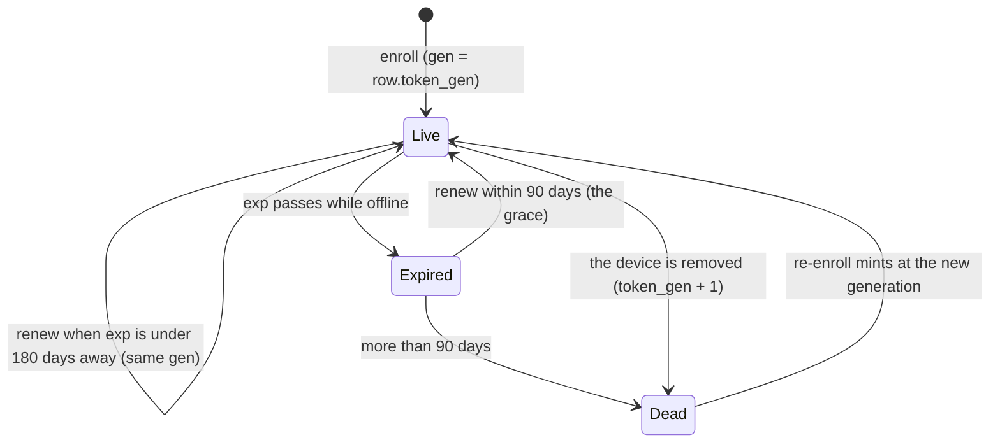

# FR-103: Device credentials renew themselves — an agent or tunnel-client token never expires out from under a running device

**Issue:** [#2134](https://github.com/gjovanov/roomler-ai/issues/2134) · **Status:** proposed 2026-10-14 (spec
and claim) · **Owner:** fleet (the agent token, removal), network (the tunnel-client token), the agent
(the renew loop) · **Anchors:** master `05b2bd2bd` · **Builds on:** FR-94 (its service credential already
renews itself), FR-40 (key rotation, the in-memory adoption pattern), FR-51 (removal), #2133

## 1. Goal

A device that keeps running keeps its credentials. Agent and tunnel-client tokens renew themselves well
before they expire. A device that slept through its anniversary recovers by itself after it updates.
Removing a device ends every token it was ever given, so a revived row never accepts an old one.

## 2. Evidence (master `05b2bd2bd`)

**Issuance.**
- `issue_agent_token` (`crates/services/src/auth/mod.rs` L462–480) uses a TTL of `unwrap_or(365 * 24 * 60 * 60)`. `issue_tunnel_client_token` (L573–593) does the same.
- Both are minted **only at enrollment**: `crates/modules/fleet/src/agent.rs` L228 (standard), L350 (ephemeral), and `crates/modules/network/src/routes/tunnel.rs` L165–167.
- No route re-issues either token, no `ServerMsg` carries one, and the agent never writes `agent_token` outside enrollment.

**Verification.**
- `Validation::default()` (`auth/mod.rs` L356–360) enforces `exp`.
- Agent token sites:
  - `AuthAgent` (`crates/modules/fleet/src/auth_agent.rs` L113–134, `accepted_agent` L201–248);
  - the agent socket (`crates/modules/fleet/src/socket.rs` L1282–1380);
  - DERP (`crates/modules/network/src/derp.rs` L318–417).
- Tunnel-client token sites:
  - the tunnel-client socket (`crates/modules/network/src/tunnel.rs` ~L1969–2060);
  - `GET /api/tunnel-client/agents` (`routes/tunnel.rs` L196–231), which has **no row check**.

**When it bites.**
- Agent tokens arrived on **2026-04-17** (`10cc0452a`), so the first possible expiry is **2027-04-17**, for a device enrolled that day and never re-enrolled.
- The server cannot list who is close: no row field records issuance. `agent_token_hash` is always `""` (`agent.rs` L219).

**On expiry.**
- The socket answers a fixed `401 "Unauthorized (agent)"`, the same as a revocation.
- The agent backs off 30 s, 60 s, 5 min, then 1 h forever (`agents/roomlerd/src/signaling.rs` L1007), and raises "re-enrollment required" at the third failure (L778).
- Recovery is `roomlerd re-enroll --token <fresh>`, run **on the machine**, and the running daemon picks it up only at the next restart.

**The token is copied at start.**
- `signaling::run` keeps the snapshot every reconnect uses (L586, `connect_once` L1134).
- The DERP dial closure captures it once per overlay start (`agents/roomlerd/src/overlay.rs` ~L351).
- The log uploader (`main.rs` ~L3569), the crash uploader and `OrgHttpRegistry` (`self_view.rs` L86–113) each hold a copy.
- The redactor registers it (`signaling.rs` L1234).

**The pattern to copy.**
- FR-94's service credential renews itself: `agents/roomlerd/src/exec_service.rs` `renew_if_due` L901–943, server `crates/modules/fleet/src/exec_service.rs` `renew` L226–244. "A lost response costs nothing … what ends a credential is the anchor, never the calendar."
- The persist pattern is `RemoteConfigServices::rotate_overlay_key` (`agents/roomlerd/src/remote_config.rs` L213–245): the daemon's `WriteLock`, a fresh load, the scalar or `[[orgs]]` slot, then adopt in memory.

**Removal revives old tokens.** `soft_delete` sets only `deleted_at`, and enrollment **revives** a tombstone in place for the same `(tenant_id, machine_id)` (`agent.rs` L143–208 → `AgentDao::rehydrate`). Tunnel clients do the same (`routes/tunnel.rs` L116–128, `TunnelClientDao::soft_delete` L292). A revived row therefore accepts every token it ever issued (#2133's "same shape").

## 3. Design

### 3a. Renewal

- `POST /api/agent/self/renew`, authenticated like `AuthAgent`: status-checked, deletion wins, a lookup failure is 500. It returns `{agent_token, expires_at}` for the same `sub` and tenant, at the row's current generation (§3c).
- The tunnel-client twin is `POST /api/tunnel-client/renew`, with the row check the roster route lacks.
- **Idempotent.** A lost response costs nothing: the old token stays valid until its own `exp`, and the device asks again.
- **Grace.** The renew routes alone accept a token up to **90 days past `exp`**. This is a renew-only verifier with `validate_exp = false` and an explicit bound; every other route keeps `Validation::default()`. The release routes are unauthenticated, so a device that slept through its anniversary updates, renews and reconnects by itself. The row must still be live and not quarantined.
- Kill switch: `rc.token_renewal = false` makes both renew routes answer 404, and the device keeps today's behaviour.

### 3b. The device

- **One renew check per enrollment**: the primary and every `[[orgs]]` entry, each against its own `server_url`.
  - It runs at start, after every successful connect, and every 12 h.
  - It renews when `exp − now < 180 days`, reading `exp` with `jwt_introspect::parse_unverified` (`agents/roomlerd/src/jwt_introspect.rs` L59).
- **On an auth-rejected connect**, before the backoff:
  1. Adopt a newer token from disk if another process re-enrolled. This makes `roomlerd re-enroll` work without a restart.
  2. Try a renewal: the old token is in its grace, and a revoked device is refused anyway.
- **Persist** exactly like `rotate_overlay_key`, then adopt through a **live `TokenSlot`** per enrollment that replaces every String copy. Each consumer reads it when it uses it: the socket per connect, DERP per dial, the uploaders and the HTTP registry per request. The new token is registered with the redactor.
- The tunnel CLI renews at start when due, and its `config::save` becomes atomic and `0600`.
- Kill switch: `ROOMLERD_TOKEN_RENEWAL=0`.
- ⚠️ The companion's `cmd_re_enroll` (`agents/roomler-desktop/src/commands.rs` L447–470) saves the fresh config **wholesale**, dropping `[[orgs]]` and every operator setting. It is fixed here (through `apply_enrollment`), and renewal never goes that way.

### 3c. A removal ends every earlier token

- `AgentClaims.gen` (serde default 0) and `Agent.token_gen` (serde default 0), with the same pair for tunnel clients.
- A token is accepted iff `claims.gen == row.token_gen`, at all five sites. Each already loads the row: no extra read, no hot-path write.
- `soft_delete` increments `token_gen` in the same atomic update that #2133 adds `$unset: exec_anchor` to. Enrollment, renewal and re-enrollment mint at the current generation.
- **Order at each site:** the deleted/quarantined check first, so a removed device still gets its typed `Goodbye AgentDeleted` and exits 7 (`socket.rs` L1348). The generation check runs only on a live row. On the socket it is decided before the upgrade, answering 401 like an expired token.
- **Renewal does not rotate the generation (decided 2026-10-14).** Rotation would cut off any copy minted before it, such as a long-lived DERP dial. It waits until §3b's `TokenSlot` is field-proven (§6).
- Kill switch: `rc.token_generation_check = false`.

### 3d. Visibility

- The socket upgrade has the claims, so `update_hello` stamps `token_exp` on the row.
- `AgentResponse.token_expires_at` drives an "expires" chip in `ui/src/components/admin/AgentsSection.vue`, amber under 60 days.
- `OrgStatus.token_expires_at` shows in `roomler status` and the companion.
- A test knob, `rc.agent_token_ttl_secs` (default one year), serves the integration lane and a throwaway stack. Prod is never shortened.

## 4. Phases

| P | Scope | Kill switch | Status |
|---|---|---|---|
| P0 | This spec, the issue (#2134 retitled) and the registry row | docs only | this PR |
| P1 | Server: both renew routes and the grace verifier; `token_gen`, its check at five sites, the removal bump in both DAOs; `token_exp` stamping and the DTO; the TTL knob; tests. Every `Agent { … }` literal gains the fields (`dao/agent.rs` L153, `tunnel-core/src/policy.rs` L968) | `rc.token_renewal`, `rc.token_generation_check` | — |
| P2 | Agent: `TokenSlot` through every consumer; the renew check (its horizon overridable by `ROOMLERD_TOKEN_RENEW_BEFORE_DAYS`, the field knob for AC1); persist; renew-on-401; `OrgStatus`; the `cmd_re_enroll` fix | `ROOMLERD_TOKEN_RENEWAL=0` | — |
| P3 | Tunnel CLI renewal; atomic `0600` save | — | — |
| P4 | UI chip; docs (§5 AC7); field | — | — |

Rollout:
1. The server first. It is inert until an agent renews: every existing token and row is at generation 0.
2. Then the agent.
3. A new agent on an old server gets a 404 from the renew route and keeps its token, which is today's behaviour.

## 5. Acceptance criteria

- [ ] **AC1:** a device renews by itself, field-checked on a vmtest candidate, red first. On the released agent with `ROOMLERD_TOKEN_RENEW_BEFORE_DAYS=400`, nothing renews. On the candidate, the token renews within a minute and the row's `token_exp` moves. The next socket and DERP connections use the new token.
- [ ] **AC2:** a device whose token is past `exp`, but by less than 90 days, renews and reconnects with no hands on the machine. A device more than 90 days past, or removed, or quarantined, is refused. Integration lane with the TTL knob, plus once on a throwaway local stack.
- [ ] **AC3:** removing a device ends every token it held. After the same machine re-enrolls, the old token is refused at all five sites and the new one is accepted (integration). Red first on master.
- [ ] **AC4:** never self-wedge.
  - A lost renewal response, a crash between save and adopt, and a cross-process re-enroll each leave the device online (integration plus unit).
  - A secondary org renews against its own server.
  - An old server answering 404 changes nothing.
- [ ] **AC5:** the tunnel CLI renews when due, and its config save is atomic and `0600`.
- [ ] **AC6:** the device list shows when each credential expires, and `roomler status` shows it too.
- [ ] **AC7:** docs:
  - a credential-lifecycle section with mermaid (`docs/security-baseline.md` § device plane, and a new `docs/device-credentials.md`);
  - the stale "1 year, rotates on use … argon2-hashed … OS keychain" row in `docs/remote-control.md` L691 corrected;
  - the stale comment at `auth/mod.rs` L460 fixed;
  - linked from `docs/README.md`.

## 6. Open decisions

1. **Rotation: decided, no** (operator, 2026-10-14). A later phase revisits it once `TokenSlot` is field-proven: monthly rotation with a two-generation window, so a passively stolen copy dies within about two months.
2. **The grace: 90 days.** It is long enough for a laptop in a drawer over a holiday quarter, and short enough that a year-old stolen token cannot be revived.
3. **Rows tombstoned before P1 deploys keep generation 0**, so their old tokens can still revive. Recommended: accept it; no migration.

## 7. Out of scope

- Rotation (§6.1).
- Binding a token to a device-held key (proof of possession).
- User session tokens (`docs/security-baseline.md` §1 tracks those).
- FR-94's service credential, which already renews.

## 8. Field-verification log

| # | Cell | Host | Result |
|---|---|---|---|

## 9. Related

- #2133 (A: a removal ends the anchor), which shares §3c's atomic update.
- FR-94 (`docs/fleet-rpc.md` § Anchoring a device).
- #2078: a clean-shutdown save erases unknown keys. The persist holds the daemon's lock against it.
