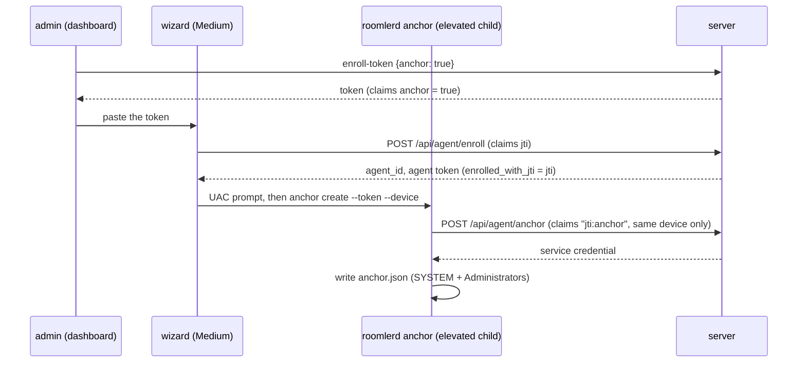

# FR-104: The wizard anchors a Windows device — SYSTEM exec set up at install, with one token and the administrator's prompt

**Issue:** [#2147](https://github.com/gjovanov/roomler-ai/issues/2147) · **Status:** proposed 2026-10-14 (spec and claim) · **Owner:**
fleet (the anchor route, enrollment tokens), the wizard (`agents/roomler-setup`, `crates/roomler-setup-core`),
the admin UI · **Anchors:** master `05b2bd2bd` · **Builds on:** FR-94 (the anchor; its P1 second half,
"the wizard writing the anchor", was not built), FR-84 (the wizard)

## 1. Goal

An administrator installing Roomler on a Windows machine can anchor it for SYSTEM exec in the same pass:
- one token pasted into the wizard;
- one more administrator prompt;
- no separate elevated `roomlerd anchor create` afterwards.

FR-94's invariant still holds: the anchoring happens inside an elevated process, and the SYSTEM service's
credential never passes through a process the signed-in user controls.

## 2. Evidence (master `05b2bd2bd`)

**The wizard does not elevate itself.**
- It runs at **Medium integrity**: `asInvoker`, no `requestedExecutionLevel` (`agents/roomler-setup/build.rs` L48–52). `crates/roomler-setup-core/src/msi_runner.rs` L139–156 measured it.
- The only elevated step is the `msiexec` child (`agents/roomler-setup/src/orchestrator_agent.rs` L355 → `agents/roomlerd/src/updater.rs` L2346 `spawn_msiexec_elevated`, `ShellExecuteExW` `"runas"`, file hard-coded to `msiexec.exe`).

**It enrolls in-process.** `roomlerd::enrollment::enroll` (`orchestrator_agent.rs` L488–503) runs with **one pasted token** (`src/front/index.html` L166–172). The wizard holds no user session, so it cannot mint another.

**One token cannot both enroll and anchor.**
- `/api/agent/enroll` claims the token's `jti` (`crates/modules/fleet/src/agent.rs` L187–198), and `/api/agent/anchor` claims it again (`crates/modules/fleet/src/exec_service.rs` L172–183).
- `used_tokens` is keyed by the bare `jti` (`crates/services/src/dao/used_token.rs` L66–78), whatever the purpose.

**Anchoring needs elevation, and only machine roles have the service.**
- `roomlerd anchor create` requires elevation (`agents/roomlerd/src/exec_service.rs` `require_elevated` ~L1532) and writes the anchor under a SYSTEM + Administrators DACL.
- Only the `DaemonSystem` and `DaemonMachine` roles (`src/role.rs` L35–55) install the SYSTEM service the anchor is for.

## 3. Design

### 3a. A token that may also anchor the device it enrolls

- `POST /api/tenant/{tid}/agent/enroll-token` takes an optional body `{ "anchor": true }` (`MANAGE_AGENTS`, as today).
  - It mints `EnrollmentClaims.anchor = true` (serde default false, so every existing token is unchanged).
  - The admin's choice is logged with the `jti`.
- `enroll_agent` records `enrolled_with_jti` on the row it creates or revives.
- `POST /api/agent/anchor` accepts an `anchor: true` token a **second** time, only for the device that token enrolled (`agent.enrolled_with_jti == claims.jti`). It claims `"{jti}:anchor"` in `used_tokens`, so the token anchors that device once. Any other device, and any second anchor, is refused.
- A token without the claim behaves exactly as today: one use, across both purposes.

### 3b. The admin UI

`ui/src/components/admin/EnrollmentDialog.vue` (the scope toggle at L47–62) gets a checkbox, for the Windows Background and Attended scopes: "Also let administrators run commands as SYSTEM on this device". It explains that:
- the wizard will show a second administrator prompt;
- the token should go only to the person installing it as an administrator.

### 3c. The wizard

- **Offer.** The token peek (`agents/roomler-setup/src/commands.rs` L198–221) reads the `anchor` claim. The anchor step is offered only for `DaemonSystem` / `DaemonMachine` on Windows.
- **The step.** After `EnrollOk`, a new best-effort step (shaped like the companion step, `orchestrator_agent.rs` L513–519) runs `roomlerd.exe anchor create --server <origin> --token <the same token> --device <agent_id> --force`.
  - It runs **elevated** through a generalised `spawn_elevated(file, argv)` in `roomler-setup-core`, beside `msi_runner.rs`; `spawn_msiexec_elevated` becomes a call to it.
  - It is awaited with `MsiRunner::attach(pid).wait_for_exit()`, and success is the exit code.
  - `--force` because the wizard enrolled this very host by id a moment earlier.
- **Progress.**
  - Events: `ProgressEvent::{AnchorStarted, AnchorOk, AnchorSkipped{reason}}` (`crates/roomler-setup-core/src/progress.rs`).
  - The checklist labels, and `DoneReport.anchored`.
  - A declined prompt or a failure leaves a Done-page note carrying the manual command (the text `ExecPolicyDialog.vue` L57–60 uses).
- The origin is normalised to pass `exec_service::origin_ok` (https only).

### 3d. Why not return the credential from `/api/agent/enroll`

The Medium wizard would then hold the SYSTEM service's credential, and the server cannot verify elevation. Whoever held it could pose as the service. The POST stays inside the elevated child (FR-94 §4).

## 4. Phases

| P | Scope | Kill switch | Status |
|---|---|---|---|
| P0 | This spec, the issue and the registry row | docs only | this PR |
| P1 | Server: the `anchor` claim, `enrolled_with_jti`, the second-purpose claim; tests | tokens carry `anchor` only when asked | — |
| P2 | Admin UI checkbox and copy | — | — |
| P3 | Wizard: `spawn_elevated`, the anchor step, progress, Done note | the step runs only for an `anchor: true` token | in review |
| P4 | Docs; field | — | — |

## 5. Acceptance criteria

- [ ] **AC1:** an `anchor: true` token enrolls a device and then anchors **that** device, once. It is refused for any other device and for a second anchor; a plain token behaves exactly as today (integration, red first on master).
- [ ] **AC2:** a `DaemonSystem` and a `DaemonMachine` wizard install on vmtest, given an anchor token, each end anchored. Each device advertises `exec-system`, and `whoami` through exec is `NT AUTHORITY\SYSTEM`, session 0. Red first: the released wizard, given the same token, ends unanchored.
- [ ] **AC3:** a declined or failed anchor step leaves the install complete and unanchored, and the Done page carries the manual command.
- [ ] **AC4:** the token is never printed, and the service credential never exists outside the elevated child and the anchor file.
- [ ] **AC5:** docs:
  - `docs/installation.md`'s Windows section;
  - `docs/fleet-rpc.md` § Anchoring a device, with this FR's sequence diagram;
  - the FR-94 spec's §9 entry updated;
  - linked from `docs/README.md`.

## 6. Open decisions

1. **Who may get an anchor-capable token.** Recommended: the admin ticks it per token (default off), for Windows Background and Attended scopes only.
   - The holder can anchor the device the token enrolled, and so pose as that device's service: faked "ran as SYSTEM" results, on that one device.
   - That is FR-94's existing delegation for plain tokens, made narrower (one device).
2. **One UAC prompt instead of two**, by relaunching the wizard elevated for `DaemonSystem`. It is cleaner for SystemContext installs. But it changes where the wizard writes its per-user state, and it breaks `DaemonMachine`, whose config belongs to the signed-in user. Recommended: not in v1.

## 7. Out of scope

- Anchoring from the scripts (`scripts/install.ps1`). An admin can run `roomlerd anchor create` after them.
- macOS and Linux, which have no anchor (their daemons are root).
- Pre-existing: the Medium wizard writes the SystemContext config under `%ProgramData%` and hardens it best-effort (`orchestrator_agent.rs` L467–486). Noted, not changed here.

## 8. Field-verification log

| # | Cell | Host | Result |
|---|---|---|---|

## 9. Related

- FR-94 (`docs/fr/FR-94-fleet-rpc-system-on-windows.md` §5c P1, §9).
- `docs/fleet-rpc.md`.
- FR-84 (the wizard).
- FR-105, whose anchor gains an SSH ceiling the wizard's checkbox may also set.
