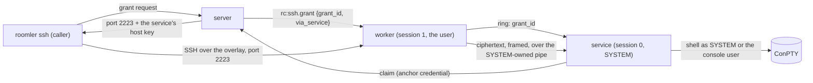

# FR-105: Roomler SSH runs as SYSTEM through the device's service — the SSH transport terminates in session 0

**Issue:** [#2148](https://github.com/gjovanov/roomler-ai/issues/2148) · **Status:** proposed 2026-10-14 (spec and claim) · **Owner:**
network (grants, the routing, the audit), fleet (the anchor credential), the Windows agent (the service's
SSH endpoint, the worker's splice) · **Anchors:** master `05b2bd2bd` · **Builds on:** FR-94 (decision 5:
"route SSH sessions through the service as a follow-up FR"), roomler SSH (`docs/roomler-ssh.md`), FR-83
(grant acks)

## 1. Goal

On an anchored Windows device, `roomler ssh <device>` runs as **SYSTEM** in session 0, or as **the signed-in
user** when the policy says `console_user`. That makes it the same identity as Fleet RPC after FR-94, on
every install type. `console_user` works on attended installs for the first time.

FR-94's invariant holds for SSH: **nothing the signed-in user can write may decide what SYSTEM runs, or read
what a SYSTEM session shows.**

## 2. Evidence (master `05b2bd2bd`)

**Roomler SSH runs entirely in the console-session worker.** The path is:
- `agents/roomlerd/src/ssh.rs` `maybe_intercept` L188;
- `SplitTun::wrap` (`crates/tunnel-core/src/overlay/split_tun.rs` L120: **one** port; `is_intercepted` L224; `listen` L189), on `DEFAULT_SSH_PORT = 2222` (`crates/modules/network/src/routes/agent_ssh.rs` L531–535);
- `accept_loop` L260;
- `serve_conn` L2232 → `russh::server::run_stream`.

**On an attended install the worker is the signed-in user.**
- `daemon` runs as that user (`pty/windows.rs` `spawn_attached` L638).
- `console_user` is refused, because only SYSTEM may call `WTSQueryUserToken` (`pty/windows.rs` L692–721).
- `docs/roomler-ssh.md`'s table (L321–325) still says `daemon` = SYSTEM on Windows, and the ConPTY paragraph (L307–314) blames "not a perMachine service install". Both are wrong on a perMachine attended install.

**Every input the SSH path reads is user-writable there:**
- the grant table: pushed over the worker's control socket as `ServerMsg::SshGrant` (`crates/remote_control/src/signaling.rs` L2582), and recorded in the worker's memory (`ssh.rs` `record_grant` L2365);
- the host key (`AgentConfig::ssh_host_key` in `%APPDATA%`, published by the worker's hello: `agents/roomlerd/src/signaling.rs` L1285, L5469), which the caller pins (`agents/roomler-cli/src/sshcmd.rs`);
- `ssh_authorized_keys`, `ssh_account_mode`, `ssh_max_privilege`, `forward_acl`, the consent sentinels, and the WireGuard key that gate 0 ("carrier identity") rests on.

**Why that matters.** Today each of these yields only the user's own identity. Once SSH runs as SYSTEM, each becomes an escalation.

## 3. Design (FR-94's D1' applied to SSH)

### 3a. The transport terminates in the service; the worker forwards ciphertext

- `SplitTun` intercepts a small fixed set of ports, `{2222, 2223}`. `Netstack::listen(port)` already takes any port.
- Port **2223** is spliced, byte for byte, into a new owner-checked pipe, `\\.\pipe\roomler-ssh-service`.
  - It uses the doorbell's SDDL (`agents/roomlerd/src/exec_service.rs` L1032, `first_pipe_instance`, `reject_remote_clients`).
  - The worker refuses a pipe SYSTEM does not own (`pipe_owned_by_system` L1388). Squatting costs only availability.
- The service runs `russh::server::run_stream` over the pipe stream with **its own** host key.
  - The worker sees only ciphertext: it can drop or delay bytes, but not read or inject (SSH's MACs).
- The pipe carries frames — `DATA`, `CONSENT_REQ`, `CONSENT_ANSWER`, `CLOSE` — so the service can ask the worker for consent (§3d).
- **The server chooses the port and the key per grant**, because the worker cannot route by inspection: the SSH user name is encrypted. The grant response already says where to dial and what key will answer. **`roomler ssh` needs no change.** `roomler proxy` (`sshcmd.rs` L164) is checked to take the grant's port.

### 3b. The grant is pulled, never relayed

- For a via-service grant, `decide` (`agent_ssh.rs` L344) persists the grant in a TTL'd `ssh_pending` store. It pushes the worker only `rc:ssh.grant { grant_id, via_service: true }`.
- The worker rings the service with the id. The service claims the grant with `POST /api/agent/service/ssh/{grant_id}/claim` (`AuthAgentService`: single use, this device only, within the grant's 60 s) and records it in its own table.
- **The claim is the ack.** It resolves `ssh_grant_acks` (`crates/modules/network/src/ssh_grant_acks.rs` `deliver`) on this pod, or through the row from another pod.
  - A worker's own `rc:ssh.grant_ack` for a via-service grant counts only as a **refusal**. The person's `ssh_enabled` off is still theirs to say.
- The service port is a shared constant in `remote_control::models::ssh_limits` (L1701).

### 3c. The host key is the service's

- The service generates its host key into the anchor directory, under the same owner and DACL checks (`check_private`).
- It publishes the public half with `PUT /api/agent/service/ssh-host-key` → `Agent.ssh_service_host_pubkey`.
- A via-service grant returns that key with port 2223. A worker-published key can never stand in for it.

### 3d. Routing, gates and accounts

- **`routes_ssh_via_service`**, all required:
  - a Windows device;
  - `exec_anchor` set;
  - a published `ssh_service_host_pubkey`;
  - the device advertising **`ssh-system`**, equality-matched (`ssh` is its prefix, as it is of `ssh-consent`);
  - `rc.ssh_via_service`.

  A worker lying about the word gains nothing: the client pins a key only the real service holds.
- **The anchor gains an SSH ceiling**, `ssh: off | console_user | system`, set by `roomlerd anchor ssh <…>` (elevated) and **default `off`**. An existing exec anchor never silently gains SYSTEM SSH.
  - The person's `ssh_enabled` is still checked by the worker before it rings, so either half can refuse.
  - `console_user_unsupported` (`agent_ssh.rs` L875) refuses `console_user` up front on a Windows device with no service path.
- **Accounts in the service:**
  - `daemon` → SYSTEM in session 0;
  - `console_user` → the signed-in user (`spawn_attached_as_console_user`, already SYSTEM-callable);
  - nobody signed in → refused, naming why.
- **Consent stays the person's.** The service sends `CONSENT_REQ`, and the worker answers through its existing `await_consent` (`ssh.rs` L1813). A faked approval only lets a server-authorized grant proceed: the FR-94 position.
- **Refused on the SYSTEM port in v1**, because their inputs are user-writable:
  - key-list sessions (`ssh_authorized_keys`);
  - `direct-tcpip` (`forward_acl`).
  - `sftp` runs as the session's identity.
- **Audit.** `ssh_audit` gains `ran_as` (`system` / `console_user` / `worker`), the server's decision.

## 4. Phases

| P | Scope | Kill switch | Status |
|---|---|---|---|
| P0 | This spec, the issue and the registry row. Docs truth first: `roomler-ssh.md`'s identity table and the P4b ConPTY paragraph; the stale `pty/windows.rs` L846 test comment. vmtest RED: SSH identity on attended (the user), SystemContext (SYSTEM in session 1), `console_user` refused on attended | docs only | spec #2149; docs truth the P0 PR; vmtest RED owed |
| P1 | Server: `ssh_pending`, the claim route, the claim-as-ack resolver; the host-key route; `routes_ssh_via_service`; port and key per grant; `ssh_audit.ran_as`; the composition baseline | `rc.ssh_via_service = false` | in review |

P1 as built (`crates/modules/network/src/routes/agent_ssh.rs`):
- **The service publishes its ceiling with its key.** `PUT /api/agent/service/ssh-host-key {host_pubkey, ceiling}`, with the service credential, stores `Agent.ssh_service {host_pubkey, ceiling, anchor_id, published_at}`. The write is filtered on the row still carrying that anchor, so a publish racing a re-anchor writes nothing (401).
- **Routing needs the endpoint to name the CURRENT anchor.** A re-anchor, an un-anchor or a removal therefore retires it with no cleanup, and the grant goes back to the worker until the service publishes again.
- **The ceiling decides per grant.** `system` permits `daemon` and `console_user`; `console_user` permits only that. Outside the ceiling, the grant takes the worker path exactly as before, not a refusal.
- **The claim window is the caller's wait** (`GRANT_ACK_TIMEOUT_SECS`). After the bound, the row is withdrawn; if it cannot be withdrawn because the claim won the race, that counts as confirmed. A refusal from the worker, or a failed push, withdraws it too. A refused claim is a 404 and an `ssh_audit` row `claim_refused` with no user.
- **Deferred:** refusing `console_user` up front on Windows with no service path. A SystemContext worker runs as SYSTEM and *can* serve it, and the server cannot yet tell that worker from an attended one; the device still refuses it, through the grant ack.
- A P1-era agent binds `via_service` and refuses such a grant (`Other`). It never advertises `ssh-system`, so no server sends it one.
| P2 | Service: the anchor's `ssh` ceiling and `roomlerd anchor ssh`; the service host key and its publication; the SSH pipe server; russh over the pipe with its own grant table; daemon → SYSTEM, console_user; key-list and `direct-tcpip` refused | the anchor's `ssh = off` (default) | — |
| P3 | Worker: the `ssh-system` word (from the service's health reply); 2223 → the pipe; the via-service grant ring; the consent frames | `ROOMLERD_SSH_VIA_SERVICE=0` | — |
| P4 | UI (`ran_as` in the SSH audit, the device's SSH identity); docs; field | — | — |

## 5. Acceptance criteria

- [ ] **AC1:** on an anchored attended device with `ssh = system`, `roomler ssh <dev> -- whoami` prints `NT AUTHORITY\SYSTEM`, session 0. Red first: the same device unanchored prints the signed-in user.
- [ ] **AC2:** `console_user` on an attended install runs as the signed-in user through the service (refused before this FR). With nobody signed in, it is refused, naming why.
- [ ] **AC3 (the invariant, on a standard-user device):**
  - (i) the user adding their own key to `ssh_authorized_keys` gets no session on 2223;
  - (ii) a forged grant-id ring is refused at the claim and audited;
  - (iii) the user republishing a worker host key changes nothing a client pins for 2223;
  - (iv) no session plaintext reaches any user process.
- [ ] **AC4:** revocation. Un-anchoring, or the anchor's `ssh = off`, sends grants back to the worker identity, and the audit says `worker`.
- [ ] **AC5:** a claim landing on the other pod still confirms the grant (integration with two servers, then prod, staged).
- [ ] **AC6:** docs:
  - `docs/roomler-ssh.md` with the identity per install type and this FR's routing and pipe diagrams;
  - `docs/fleet-rpc.md`'s anchor section (the SSH ceiling);
  - linked from `docs/README.md`.

## 6. Open decisions

1. **The ceiling's default.** Recommended: `off`. FR-104's wizard checkbox, or `roomlerd anchor ssh system`, turns it on.
2. **The v1 refusals on the SYSTEM port.** Recommended: key lists and `direct-tcpip`. An anchor-owned key list and forward ACL can follow.
3. **`ssh_activity` from the service.** Recommended: a later phase, posted with the anchor credential.

## 7. Out of scope

- D3: the service owning the socket and the WireGuard key.
- Standard-user installs whose overlay is down (no Wintun without admin). They stay unreachable by SSH until D3 or a netstack fallback.
- macOS and Linux, whose daemons are already root.

## 8. Field-verification log

| # | Cell | Host | Result |
|---|---|---|---|

## 9. Related

- FR-94 (§5a, decision 5).
- `docs/roomler-ssh.md` (P3a grants, P6a host keys, FR-83 acks).
- FR-104 (the wizard can set the ceiling at install).
- #2133.
