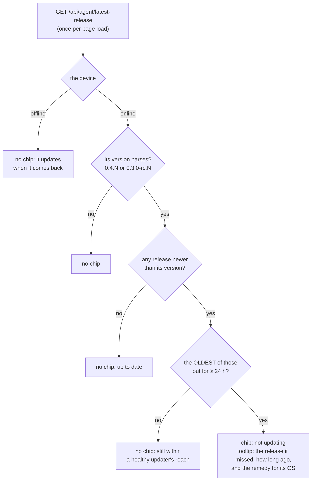

# FR-106: A device that stops taking updates says so on the devices page

**Issue:** [#2314](https://github.com/gjovanov/roomler-ai/issues/2314) · **Status:** **closed 2026-10-16**. P1
(#2315, `1ee8523b7`) is live since the promote of `hosted-20261016-377f1d4`, and all four criteria are field-verified
(§8). Spec and claim 2026-10-16, on the operator's "proceed" after FR-96 closed with its D3 open · **Owner:** the
devices page (UI) ·
**Anchors:** master `adc4e589f` · **Builds on:** [FR-96](FR-96-per-user-linux-installs-update-themselves.md) (D3:
"say so where the operator looks"), [FR-103](FR-103-device-credentials-renew-themselves.md) (the credential chip
this follows)

## 1. Goal

A device that is online but has not installed a release that has been out for a day gets a **"not updating"**
chip on the devices page. Its tooltip names the release it missed and the action that heals it. Today such a
device looks exactly like a healthy one: the page shows only `v<version>`.

The case that made this necessary is FR-96's. A per-user Linux install made before 0.4.138 cannot install
updates at all: its unit's `NoNewPrivileges` stops `pkexec` and `sudo`. Nothing the server sends can heal it;
one install by a person does. The chip is how the operator learns that a person is needed, and on which device.

## 2. Evidence (production, 2026-10-16 11:42Z, read-only counts)

- 49 live devices; online now: 12 Windows, 12 Linux, 2 macOS.
- Online devices on a release older than 0.4.137, the newest release then out for more than 24 h: **one**, a
  Linux device on **0.4.48**, about 90 releases behind. It is a lab device (the vmtest lane's long-lived anchor),
  not a customer's. Every other online device runs 0.4.137 or later.
- So today the chip would show on exactly one row. It is a safety net: a per-user `.deb` host from before
  0.4.138 that never logs out, an updater broken by a full disk, `auto_update` switched off and forgotten. Each
  of these is invisible on the devices page today, and each was found only by someone reading a device's log.
- The data is already in the browser's reach: `GET /api/agent/latest-release` returns the agent releases
  **newest first, each with `published_at`** (`crates/modules/fleet/src/agent_release.rs:81-90`, the shared
  cache in `crate::releases`). Nothing on the server or the device has to change. That matters, because a stuck
  device cannot receive an agent change anyway.
- The server cannot tell a per-user daemon from a system one for these devices. `desktop.session` is logind's
  class for the session a viewer would see (`crates/remote_control/src/models.rs:1742-1760`), which reads
  `user` for a system daemon on a logged-in desktop too. FR-102's install record (`install {method, scope}`)
  exists only for devices enrolled after it shipped. So the Linux tooltip names both remedies.

## 3. Design

| rule | why |
|---|---|
| **The oldest missed release's age, not the newest one's.** | Releases can come twice a day (0.4.138 and 0.4.139 were 12 h apart). Measured from the newest release, a device stuck for weeks would lose its chip with every release, then get it back a day later. The first release it missed is the honest start of the stall |
| **24 h** | A healthy online device takes a release within about 6.5 h. The root daemon checks every 4 h (`auto-updater armed interval_h=4`). The per-user helper's timer runs every 6 h, with up to 30 min of random delay, and a push reaches it at once. 24 h leaves room for a host that slept for part of the day |
| **Online only.** | An offline device installs what it missed at its next start. A chip there would say "not updating" about a machine that is merely off, which the presence column already shows |
| **No chip when anything is unknown.** | A version that does not parse, or a release list that failed to load, shows nothing. The absence of a signal must never invent a problem on a healthy device |
| **The remedy by OS.** | Linux: a per-user install made before 0.4.138 needs one install by a person (`sudo apt install ./roomlerd.deb`, the Software app, or a re-run of the install script), after which it updates itself; a system install that stopped needs `auto_update` and its log checked. Windows and macOS: `auto_update` and the log |
| **The count is capped by the list.** | The endpoint returns the newest releases only. A device older than all of them is "N+ releases behind" |

Pieces (all UI):

| piece | where |
|---|---|
| `updateStallChip(version, online, os, releases, now)`, a pure function, the credential chip's shape | `ui/src/utils/updateStall.ts` (new), beside `ui/src/utils/credentialExpiry.ts` |
| the release list, fetched once per session and kept 30 min: about 560 KB, 91 KB gzipped, 64 releases back to 0.4.74 on 2026-10-16. A slim server route would save bytes but adds a route to the composition baseline, so it is not worth it for one admin page | the agents store, `ui/src/stores/agents.ts` |
| the chip in the table view, after the credential chip | `ui/src/components/admin/AgentsSection.vue:378-388` |
| the chip in the card view, after the version chip | `ui/src/components/admin/AgentsSection.vue:741-747` |

## 4. Phases

| Phase | What | Kill switch | Proven on | Size |
|---|---|---|---|---|
| **P1** (#2315, `1ee8523b7`, live 2026-10-16) | the chip, its rule, its tooltip, the tests, the docs | none needed: it only reads, and the unknown case shows nothing | the vmtest org's devices page after a promote: the lab's stuck device shows it, and the healthy ones don't (§8) | S |

## 5. Acceptance criteria

- [x] **AC1**: an online device whose oldest missed release has been out for at least 24 h shows **"not updating"**.
  Its tooltip names that release, how long ago it came out, and the remedy for its OS. Shown absent on the
  current deploy first, then present after the promote, on a real stuck device. Field-verified 2026-10-16 on
  `vmtest-anchor` (v0.4.48), red at 11:58Z and green at 16:13Z (§8).
- [x] **AC2**: no chip on a healthy device: up to date; behind only by a release younger than 24 h; or offline.
  Checked on the operator's own devices page after the promote, where every online device is healthy. Verified
  2026-10-16 there (11 online devices, all on 0.4.139, no chip) and on every other row of the vmtest org's page (§8).
- [x] **AC3**: no chip when the release list fails to load or a version does not parse. Unit-tested
  (`updateStall.spec.ts`: no list, an empty list, `null`, an unparseable version, drafts and prereleases).
- [x] **AC4**: Docs: `docs/linux-self-update.md`'s stuck-host note points at the chip, `docs/ui.md` describes it, and
  the `docs/README.md` index row covers it. Landed with P1 (#2315).

## 6. Open decisions

| | decision | recommendation |
|---|---|---|
| **D1** | the threshold | **Decided 2026-10-16, as recommended** (operator: "proceed"): 24 h, for the reasons in §3 |
| **D2** | offline devices | **Decided 2026-10-16, as recommended**: no chip; the presence column already says it |

## 7. Out of scope

- The device reporting its own failed installs (FR-67): a stuck device cannot receive that change.
- Telling a per-user install from a system one for devices enrolled before FR-102's install record.
- Healing a stuck device from the server: by FR-96's construction, a person must install once.

## 8. Field-verification log

| date | build | host | result |
|---|---|---|---|
| 2026-10-16 11:58Z | production `hosted-20261016-32a9095` (before P1) | the vmtest org's devices page, rendered by Playwright from mars as the org's admin (`~/wt/fr106/fr106-run.sh`, which prints one line per device row) | 🔴 **RED: the chip does not exist.** The served `DevicesView` chunk carried FR-103's credential chip and nothing of FR-106. On the page, `vmtest-anchor` (v0.4.48, Linux, **online**) was in the table with no chip, and there was no stall chip anywhere. The other two online devices ran 0.4.139 |
| 2026-10-16 16:13Z | production `hosted-20261016-377f1d4` (contains P1 `1ee8523b7`; promoted 16:11Z, both pods ready, 0 restarts) | the same pass | 🟢 **AC1.** The served `DevicesView` chunk now carries the chip, and the page shows exactly one. On `vmtest-anchor`, `v0.4.48 linux online=true \| chip=true \| "not updating"`, with the tooltip *"v0.4.48 is 64+ releases behind: 0.4.73 came out 40 d ago and this device, online, has not installed it. A per-user Linux install made before 0.4.138 cannot install updates by itself. Install the current release on it once (…), and it updates itself from then on. On a system install that stopped, check auto_update in 'roomler config ls' and the log …"*. **AC2 in this org:** the six other online devices (all 0.4.139, Windows and Linux) show no chip; nor do the offline rows, even those on 0.4.134–0.4.136, which is the online-only rule |
| 2026-10-16 16:15Z | the same | the operator's own org, its devices page in Chrome (the DOM read, not a screenshot) | 🟢 **AC2.** The release list loaded (64 releases), and there were 0 stall chips. `roomler devices` shows all 11 online devices on 0.4.139, so no chip was due anywhere in the org |

## 9. Related

FR-96 (#2052, the per-user update half and D3), FR-103 (the credential chip), FR-67 (update outcomes, proposed),
FR-102 (the install record).
