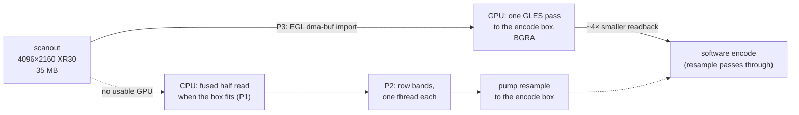

# FR-107: 4K DRM capture at full frame rate — honour the encode box, read in parallel, then the GPU

**Issue:** [#2317](https://github.com/gjovanov/roomler-ai/issues/2317) · **Status:** in progress — spec and
claim 2026-10-16, on the operator's *"can we improve on it"* after a window drag on FR-93 AC12's box ran at
9 fps. P1 and P2 merged (#2320); P2b (the pacing) and P3 (the GPU path) are lab-verified on that box: a moving
window at 27.9 fps on the VP9 path and 28.8 on the RTP track, against 6.3 and 15.1 for 0.4.139 on the same
desktop · **Owner:** remote desktop (the agent's DRM arm) · **Anchors:** master `7382639b8` · **Builds on:** [FR-36](FR-36-wayland-capture.md) (the DRM arm, the fused
half read, P2's deferred EGL detiling), [FR-93](FR-93-wayland-out-of-the-box.md) (AC12's box),
[FR-95](FR-95-system-installs-on-by-default-on-wayland.md) (the system install's capture)

## 1. Goal

On a 4K scanout, a moving window reaches the encode budget (30 fps) when the DRM arm captures. The encode
is not the obstacle: on the box below, OpenH264 took 13–19 ms a frame. The capture is.

## 2. Evidence (2026-10-16, an Apple M2 Pro Mac mini, Fedora Asahi Remix 42, GNOME 48, HDMI 4096×2160)

The operator's own sessions from a Windows laptop, the system install on 0.4.139, read from the box's
journal:

| Path | Measured |
|---|---|
| VP9 4:4:4 over the DataChannel (the viewer's default) | **6.7–9.1 fps**, from a heartbeat every 30 frames, 3.3–4.5 s apart. `avg_scale_ms ≈ 43` |
| H.264 (OpenH264) on the RTP track | `avg_capture_ms=114`, `avg_encode_ms=8` |
| network | `pipe_state=clear`, transit ~25 ms |

`roomlerd capture-smoke` on the box, the idle skip off, 0.4.139:

| | still | moving (the screen repainting, so the compositor flips buffers) |
|---|---|---|
| half size (`--downscale auto`, FR-36's fused read) | 27 ms | 34 ms |
| full 4K (`--downscale never`) | 46 ms | 52–55 ms |

What the numbers say:

- **The scanout mapping is uncached device memory**, so the CPU read is bandwidth-bound: 35 MB a frame,
  10-bit `XR30` unpacked on the way. FR-36 already measured how unforgiving it is: a strided read was 6×
  slower than a sequential one.
- **The DataChannel pumps read the full 4K, then resample it all.** The VP9-444 and FFmpeg DataChannel
  pumps open their capture with `DownscalePolicy::Never` (`agents/roomlerd/src/peer.rs:3595`, written for
  1080p sources: "fast enough at 1080p"). They then resample every frame down to the software cap,
  1920×1012 here. That resample is a Lanczos-3, which costs in proportion to the **source** area
  (`scrap_backend.rs`'s own note: 38 ms from a Retina panel). So 8.8 M pixels were read and resampled for
  an encode that keeps 1.9 M.
- **The frame period paid for the grab.** `DrmCapture::next_frame` timed its 33.3 ms period from when the
  last frame *arrived*, so every frame cost the period plus the grab: 1000 / (33.3 + grab) fps. That predicts
  15 fps for the CPU's ~34 ms read (measured 15.1–16.1) and 27 fps for the GPU's ~3 ms (measured 26.1–26.2).
- **The box's own desktop had no GPU acceleration** until it was fixed on 10-16 (#2317's comment). The
  Asahi repository's Mesa 25.3.6 was newer than the 6.14.2 kernel's GPU interface (`DRM_IOCTL_ASAHI_GET_PARAMS
  failed: Invalid argument`), so Mesa fell back to `llvmpipe`, and GNOME composited 4K on the CPU, in
  competition with the capture. Kernel 6.19.14 restored the GPU: `vkcube` reports `Apple M2 Pro (G14S B1)`.
  The measurements before the fix compare builds on the same software-rendered desktop. Those after it are
  the ones the acceptance criteria use.

## 3. Key design

**P1 — the DRM arm honours the pump's encode box.** `ScreenCapture::set_output_cap`
(`agents/roomlerd/src/capture/mod.rs:375`) already exists for exactly this, and every pump calls it with its
effective box (`peer.rs:4226`). macOS honours it; the DRM arm ignored it. Now the DRM worker reads the box on
every grab and takes the fused half read whenever half the source still covers it, whatever the policy says
(`wants_half`, `agents/roomlerd/src/capture/drm_backend.rs:1312`; `set_output_cap`, `drm_backend.rs:1525`).
A 4K scanout encoded at 1920×1012 is read at 2048×1080. A 1440p scanout for the same box keeps its full read,
because its half (1280×720) is smaller than what the encode keeps. The pump's "native" size is the frame's
pre-downscale size (`Frame::native_dims`), so the box it computes does not shrink with the frame, and the
choice cannot feed back into itself.

**P2 — the repack in row bands across threads** (`in_bands`, `drm_backend.rs:712`; `band_threads`,
`drm_backend.rs:740`). Each thread repacks its own band of rows and still reads them in order, the one access
pattern FR-36 measured the mapping to tolerate. The frame is independent row by row, so nothing is
coordinated but the join. The output is byte-identical to the single pass.

**P2b — the frame period runs from the ask** (`next_frame`, `drm_backend.rs:1459`). The period is timed
from when a frame was asked of the worker, so it absorbs the grab instead of adding to it.

**P3 — the GPU reads the scanout** (`agents/roomlerd/src/capture/drm_gpu.rs`). As built:

- **The context.** `Converter::open` (`drm_gpu.rs:312`) loads `libEGL.so.1` and `libGLESv2.so.2` with
  `libloading`, as `gpu_clock.rs` loads NVML, so no package gains a dependency. It opens Mesa's
  **surfaceless** platform (a render node, no display server, no GBM), requires
  `EGL_EXT_image_dma_buf_import`, surfaceless contexts and config-less contexts, and makes a GLES 2 context
  current on the `drm-capture` worker thread for that thread's life.
- **Refusing software.** It refuses a software renderer (`llvmpipe`, `softpipe`): that would do the CPU
  path's work more slowly, and on AC12's box before its kernel fix it was the only renderer there was.
- **Each frame** (`convert`, `drm_gpu.rs:678`). The scanout's dma-buf is imported once per buffer and cached
  (four entries, keyed by framebuffer and dma-buf inode as the CPU mapping is, FR-93 P3f). One draw renders
  it at **exactly** the pump's encode box with a box filter of up to 4×4 bilinear taps per pixel, written as
  B,G,R,A, so the readback is the `Frame` contract's BGRA. EGL owns the channel order and depth: the import
  names the fourcc, and a sample is always (r, g, b, a).
- **What stays the CPU's.** The idle skip (FR-93 P3d) still samples 32 rows from the CPU mapping before the
  GPU runs, and the cursor plane is read as before.
- **Failure.** Any GPU failure turns the GPU off for the rest of that capture, said once
  (`via_gpu`, `drm_backend.rs:151`). A host without EGL, or with only a software renderer, keeps P1 and P2.
- **Not yet.** The same import could read the tiled and compressed scanouts the CPU path refuses (Intel CCS,
  AMD DCC, Nvidia block-linear): FR-36 P2's deferred detiling, reached from the other side. It is not
  enabled here, because the open still refuses a non-linear modifier. That is a later phase, with its own
  field proof on such a GPU.

**P4 — the GPU writes the encoder's planes** (I420/I444), which removes the CPU's BGRA → YUV pass as well.

**Not this FR:** Apple's hardware video encoder has no Linux driver, so on Asahi the encode stays in
software. The GPU's work is the capture.

## 4. Phases

| Phase | What | Kill switch | Proven on | Size |
|---|---|---|---|---|
| **P1** | the DRM arm follows the pump's encode box to the half read (§3) | `ROOMLERD_DRM_FOLLOW_CAP=0` | ✅ the Asahi box, a candidate on 0.4.139's source (§9); merged #2320 | S |
| **P2** | the repack in row bands, 4 threads by default | `ROOMLERD_DRM_THREADS=1` | ✅ the same candidate (§9); `banded_repacks_match_the_single_pass`; merged #2320 | S |
| **P2b** | the frame period runs from the ask, not the arrival (§3) | — (a timing fix) | ✅ the Asahi box, a candidate on master `7382639b8` (§9) | S |
| **P3** | the GPU path: an EGL import, a GLES pass to the encode box, a readback (§3) | `ROOMLERD_DRM_GPU=0` | ✅ the same candidate (§9); unit: `the_gpu_renders_the_encode_box`, `the_taps_cover_the_footprint`, `the_import_names_the_buffer_as_getfb2_described_it` | M |
| **P4** | the GPU writes I420/I444 for the encoder | `ROOMLERD_DRM_GPU_YUV=0` | — | M |
| **P5** | docs: `docs/linux-capture.md` §3.4 (with P1/P2) and each later phase; the `docs/README.md` index row | — | — | S |

## 5. Test plan

- **Unit, run natively on the box** (`cargo test -p roomlerd --lib --features full -- drm_backend`; CI's lanes
  do not compile the `drm-capture` tests): `banded_repacks_match_the_single_pass` checks every layout
  (`XR24`, `AB24`, `XR30`, `AB30`) at 2, 3, 4, 7 and 64 threads against the single pass, for both the full and
  the half repack, with an odd width, an odd height and a padded pitch.
  `the_encode_box_halves_only_what_it_cannot_tell` covers the 4K, 1440p and 1080p boxes and the packing.
- **`capture-smoke` per phase**, still and moving, at the thread counts that matter: mars
  `~/wwlab/drm-bench.sh <binary> still|motion <frames>`.
- **A live session per path**, one viewer, the screen moving continuously (`vkcube`): mars
  `~/wwlab/fps-ab.sh <label> dc|rtp 30 vkcube`. It reads the pump's heartbeats for that session only and
  prints the service's actual binary first.

  ⚠️ **Never toggle GNOME's overview as the motion.** The animation runs for part of each toggle, and the
  idle skip rightly sends nothing in the still gaps, so every build reads 4–5 fps and the comparison means
  nothing.
- **Before/after on the same box, the same motion, the same hour**, the release first.

## 6. Acceptance criteria

- [ ] **AC1** — On the Asahi box (4K, GNOME, the FR-95 system capture), a continuously moving window holds
  **≥ 25 fps** on both the H.264/RTP and the VP9-444/DataChannel paths, from the pump's heartbeats. Red first
  on 0.4.139.
- [ ] **AC2** — The picture is unchanged in content. The banded repack is byte-identical to the single pass
  (unit test). The half read is FR-36's existing filter. A 1440p source keeps its full read for a 1080p box.
- [ ] **AC3** — The capture's per-frame cost is recorded before and after each phase (`capture-smoke`, still
  and moving).
- [ ] **AC4** — P3: capture ≤ 8 ms a frame at 4K on the box. A host without EGL falls back to the CPU path
  with one log line and no new package dependency.
- [ ] **AC5** — Each kill switch restores the behaviour before its phase.
- [ ] **AC6** — Docs: `docs/linux-capture.md` updated in the house style for each phase, and a
  `docs/README.md` index row.

## 7. Open decisions (operator)

| | Decision | Status |
|---|---|---|
| **D1** | The GPU path's API | *(Recommended: EGL + GLES through `dlopen`. Mesa ships them everywhere it runs, Asahi included, and GLES is enough for a downscale and a format conversion. Vulkan would add a second, larger surface for the same work.)* |
| **D2** | Whether P4 (the GPU's YUV) ships with P3 or after it | *(Recommended: after. P3 alone moves the read off the CPU, which is the measured wall.)* |

## 8. Out of scope

- Hardware encoding on Apple Silicon Linux (no driver).
- The per-user portal and mutter arms: the compositor hands over its own buffers there.
- **The X11 backend's frame gate** (`scrap_backend.rs`, `next_frame`) times its period from the arrival
  too, so it should pay for every grab the same way P2b found. It is a follow-up with its own before/after
  on an X11 host, not changed here without one.
- **The VP9-444 path's encode budget.** On a fast link the rate control rises to ~17.5 Mbps at QP 6, and
  libvpx (8 threads, row-mt, 4 tile columns, `cpu-used` 6) is then the slowest stage. It stayed under the
  frame period after P3 (27.9 fps), but trading quality for frame rate under motion is rate control's
  question (`docs/rate-control.md`), not this FR's.

## 9. Field-verification log

| Date | Host | Build | What | Result |
|---|---|---|---|---|
| 2026-10-16 | the Asahi box (M2 Pro, 4096×2160 `XR30`, GNOME 48, the system install), the operator's sessions from a Windows laptop | **0.4.139, the release** | the report: a window drag | 🔴 VP9-444/DataChannel 6.7–9.1 fps (`avg_scale_ms ≈ 43`); H.264/RTP `avg_capture_ms=114` |
| 2026-10-16 | the same box, `capture-smoke`, the idle skip off | 0.4.139; then a lab build of master `1ee8523b7` + P2 | the read alone | half: still 27 ms, moving 34 ms; full: still 46 ms, moving 52–55 ms. P2 at 1/4/8 threads: still half 27 → 18 → **12.6 ms**, full 46 → 27 → 17.7 ms; moving half 34 → 31 → 29 ms, full 55 → 47 → 41 ms. Under motion the compositor uses the same bandwidth |
| 2026-10-16 | the same box, one viewer, a continuously moving window (`vkcube`) | **0.4.139** (`/usr/bin/roomlerd`), then a lab build: 0.4.139's source `d11fe94ae` + P1 + P2 (`/usr/local/bin/roomlerd-cand-sys`) | the pipeline, per path | 🔴 0.4.139: VP9-444/DataChannel **9.2 fps** (resample 36.5 ms); H.264/RTP **16.1 fps** (capture 47.7 ms, encode 13.1 ms). ✅ P1 + P2: VP9-444/DataChannel **18.1 fps** (resample 16.5 ms); H.264/RTP **20.6 fps** (capture 30.0 ms, encode 17.2 ms). Unit: 18/18 `drm_backend` tests on the patched tree, natively on the box. ⚠️ **Wrong turns, recorded:** the first "before" runs shared the screen with the operator's own session (two capture pipelines; their session started 25 min before the check window), and the first benchmark toggled GNOME's overview, which measures the content rather than the pipeline (§5) |
| 2026-10-16 15:30Z | the same box | — | P3's prototype: an EGL import of the scanout | 🔴 **The box had no GPU acceleration.** `DRM_IOCTL_ASAHI_GET_PARAMS failed: Invalid argument`, and every `vkcube` used as this FR's motion had run on `llvmpipe`. Mesa 25.3.6 (the Asahi repository, installed with GNOME on 10-15) was newer than kernel 6.14.2's GPU interface, so GNOME and KDE composited 4K on the CPU. ✅ **Kernel 6.19.14-400.asahi** (operator: *"yes proceed"*), booted once through `grub2-reboot`, with 6.14.2 as the saved default until it came back, then made the default. After it: `vkcube` on `Apple M2 Pro (G14S B1)`, and the prototype (`gpucap.c`: GETFB2 → PRIME → EGL import → one GLES pass → `glReadPixels`) captured 4096×2160 `XR30` in **1.46 ms** to 2048×1080 and **1.38 ms** to 1920×1012, the colours right |
| 2026-10-16 | the same box, now GPU-composited, one viewer, `vkcube` | 0.4.139; P1+P2 (0.4.139's source + #2320); P3 then P3 + P2b (master `7382639b8` + this phase, `/usr/local/bin/roomlerd-cand-sys`) | the pipeline per path, back to back | VP9-444/DataChannel: **6.3** (0.4.139, resample 49.5 ms) → 12.7 (P1+P2, encode-bound at QP 6 and 17.5 Mbps) → 26.1 (P3, resample 0.0 ms) → **27.9 fps** (P3 + P2b). H.264/RTP: **15.1** (capture 47.8 ms) → 19.9 → 26.2 → **28.8 fps** (capture 17.0 ms with the pacing's wait, encode 16.3 ms). The log names the path: *"the GPU reads the scanout (FR-107 P3…) renderer="Apple M2 Pro (G14S B1)""*. Unit: 36/36 `capture::drm` tests and CI's full clippy line, natively on the box. ⚠️ The 26 fps plateau was the pacing (§2), predicted to within 1 fps before the fix |
