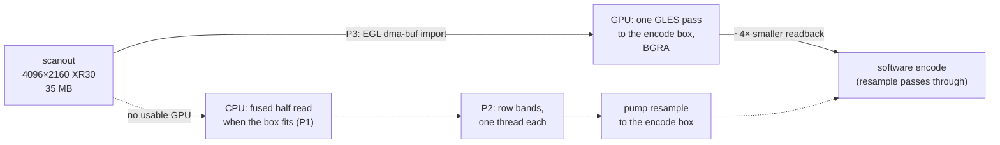

# FR-107: 4K DRM capture at full frame rate — honour the encode box, read in parallel, then the GPU

**Issue:** [#2317](https://github.com/gjovanov/roomler-ai/issues/2317) · **Status:** **closed 2026-10-17**,
field-verified on the released **0.4.140**. The spec and claim date from 2026-10-16, on the operator's *"can we
improve on it"* after a window drag on FR-93 AC12's box ran at 9 fps. P1 and P2 merged in #2320, P2b and P3 in
#2330. On that box a moving window now holds 27.3 fps on the VP9 path and 28.8 on the RTP track, against 6.3
and 15.1 for 0.4.139 on the same desktop. A frame's grab went from 23 ms to 1.9 ms (§9) · **Owner:** remote desktop (the agent's DRM arm) · **Anchors:** master `71969d9ed` · **Builds on:** [FR-36](FR-36-wayland-capture.md) (the DRM arm, the fused
half read, P2's deferred EGL detiling), [FR-93](FR-93-wayland-out-of-the-box.md) (AC12's box),
[FR-95](FR-95-system-installs-on-by-default-on-wayland.md) (the system install's capture)

## 1. Goal

On a 4K scanout, a moving window reaches the encode budget (30 fps) when the DRM arm captures. The encode
is not the obstacle: on the box below, OpenH264 took 13–19 ms a frame. The capture is.

## 2. Evidence (2026-10-16, an Apple M2 Pro Mac mini, Fedora Asahi Remix 42, GNOME 48, HDMI 4096×2160)

The operator's own sessions from a Windows laptop, the system install on 0.4.139, read from the box's
journal:

| Path | Measured |
|---|---|
| VP9 4:4:4 over the DataChannel (the viewer's default) | **6.7–9.1 fps**, from a heartbeat every 30 frames, 3.3–4.5 s apart. `avg_scale_ms ≈ 43` |
| H.264 (OpenH264) on the RTP track | `avg_capture_ms=114`, `avg_encode_ms=8` |
| network | `pipe_state=clear`, transit ~25 ms |

`roomlerd capture-smoke` on the box, the idle skip off, 0.4.139:

| | still | moving (the screen repainting, so the compositor flips buffers) |
|---|---|---|
| half size (`--downscale auto`, FR-36's fused read) | 27 ms | 34 ms |
| full 4K (`--downscale never`) | 46 ms | 52–55 ms |

What the numbers say:

- **The scanout mapping is uncached device memory**, so the CPU read is bandwidth-bound: 35 MB a frame,
  10-bit `XR30` unpacked on the way. FR-36 already measured how unforgiving it is: a strided read was 6×
  slower than a sequential one.
- **The DataChannel pumps read the full 4K, then resample it all.** The VP9-444 and FFmpeg DataChannel
  pumps open their capture with `DownscalePolicy::Never` (`agents/roomlerd/src/peer.rs:3652`, written for
  1080p sources: "fast enough at 1080p"). They then resample every frame down to the software cap,
  1920×1012 here. That resample is a Lanczos-3, which costs in proportion to the **source** area
  (`scrap_backend.rs`'s own note: 38 ms from a Retina panel). So 8.8 M pixels were read and resampled for
  an encode that keeps 1.9 M.
- **The frame period paid for the grab.** `DrmCapture::next_frame` timed its 33.3 ms period from when the
  last frame *arrived*, so every frame cost the period plus the grab: 1000 / (33.3 + grab) fps. That predicts
  15 fps for the CPU's ~34 ms read (measured 15.1–16.1) and 27 fps for the GPU's ~3 ms (measured 26.1–26.2).
- **The box's own desktop had no GPU acceleration** until it was fixed on 10-16 (#2317's comment). The
  Asahi repository's Mesa 25.3.6 was newer than the 6.14.2 kernel's GPU interface (`DRM_IOCTL_ASAHI_GET_PARAMS
  failed: Invalid argument`), so Mesa fell back to `llvmpipe`, and GNOME composited 4K on the CPU, in
  competition with the capture. Kernel 6.19.14 restored the GPU: `vkcube` reports `Apple M2 Pro (G14S B1)`.
  The measurements before the fix compare builds on the same software-rendered desktop. Those after it are
  the ones the acceptance criteria use.

## 3. Key design

**P1 — the DRM arm honours the pump's encode box.** `ScreenCapture::set_output_cap`
(`agents/roomlerd/src/capture/mod.rs:398`) already exists for exactly this, and every pump calls it with its
effective box (`peer.rs:4283`). macOS honours it; the DRM arm ignored it. Now the DRM worker reads the box on
every grab and takes the fused half read whenever half the source still covers it, whatever the policy says
(`wants_half`, `agents/roomlerd/src/capture/drm_backend.rs:1329`; `set_output_cap`, `drm_backend.rs:1542`).
A 4K scanout encoded at 1920×1012 is read at 2048×1080. A 1440p scanout for the same box keeps its full read,
because its half (1280×720) is smaller than what the encode keeps. The pump's "native" size is the frame's
pre-downscale size (`Frame::native_dims`), so the box it computes does not shrink with the frame, and the
choice cannot feed back into itself.

**P2 — the repack in row bands across threads** (`in_bands`, `drm_backend.rs:712`; `band_threads`,
`drm_backend.rs:740`). Each thread repacks its own band of rows and still reads them in order, the one access
pattern FR-36 measured the mapping to tolerate. The frame is independent row by row, so nothing is
coordinated but the join. The output is byte-identical to the single pass.

**P2b — the frame period runs from the ask** (`next_frame`, `drm_backend.rs:1476`). The period is timed
from when a frame was asked of the worker, so it absorbs the grab instead of adding to it.

**P3 — the GPU reads the scanout** (`agents/roomlerd/src/capture/drm_gpu.rs`). As built:

- **The display is the process's.** The first capture that reaches for the GPU brings up `Egl`
  (`drm_gpu.rs:316`). It loads `libEGL.so.1` and `libGLESv2.so.2` with `libloading`, as `gpu_clock.rs` loads
  NVML, so no package gains a dependency. It opens Mesa's **surfaceless** platform (a render node, no display
  server, no GBM) and requires `EGL_EXT_image_dma_buf_import`, surfaceless contexts and config-less contexts.
  It is **never terminated and never unloaded**. EGL gives every caller in a process the same display, so a
  capture that terminated it on its way out pulled it from under any capture still running: a second viewer,
  or a pump restart whose new capture opened before the old worker exited. That capture would lose its imports
  and fall back to the CPU. A failure to bring it up is not kept, so the next capture tries again.
- **The context is the capture's.** `Converter::open` (`drm_gpu.rs:464`) makes a GLES 2 context current on
  the `drm-capture` worker thread for that thread's life. `Egl::retire` (`drm_gpu.rs:445`) **unbinds** it
  before destroying it. EGL frees a destroyed context only once it is no longer current, and a worker that
  exits with its context bound never unbinds it. The first build destroyed it bound and leaked every
  capture's context for the life of the daemon (§9).
- **Refusing software.** It refuses a software renderer (`llvmpipe`, `softpipe`): that would do the CPU
  path's work more slowly, and on AC12's box before its kernel fix it was the only renderer there was.
- **Each frame** (`convert`, `drm_gpu.rs:754`). The scanout's dma-buf is imported once per buffer and cached
  (four entries, keyed by framebuffer and dma-buf inode as the CPU mapping is, FR-93 P3f). One draw renders
  it at **exactly** the pump's encode box with a box filter of up to 4×4 bilinear taps per pixel, written as
  B,G,R,A, so the readback is the `Frame` contract's BGRA. EGL owns the channel order and depth: the import
  names the fourcc, and a sample is always (r, g, b, a).
- **What stays the CPU's.** The idle skip (FR-93 P3d) still samples 32 rows from the CPU mapping before the
  GPU runs, and the cursor plane is read as before.
- **Failure.** Any GPU failure turns the GPU off for the rest of that capture, said once
  (`via_gpu`, `drm_backend.rs:151`). A host without EGL, or with only a software renderer, keeps P1 and P2.
- **Not yet.** The same import could read the tiled and compressed scanouts the CPU path refuses (Intel CCS,
  AMD DCC, Nvidia block-linear): FR-36 P2's deferred detiling, reached from the other side. It is not
  enabled here, because the open still refuses a non-linear modifier. That is a later phase, with its own
  field proof on such a GPU.

**P4 — the GPU writes the encoder's planes** (I420/I444), which removes the CPU's BGRA → YUV pass as well.

**Not this FR:** Apple's hardware video encoder has no Linux driver, so on Asahi the encode stays in
software. The GPU's work is the capture.

## 4. Phases

| Phase | What | Kill switch | Proven on | Size |
|---|---|---|---|---|
| **P1** | the DRM arm follows the pump's encode box to the half read (§3) | `ROOMLERD_DRM_FOLLOW_CAP=0` | ✅ merged #2320; **released in 0.4.140, field-verified** on the Asahi box (§9) | S |
| **P2** | the repack in row bands, 4 threads by default | `ROOMLERD_DRM_THREADS=1` | ✅ merged #2320, `banded_repacks_match_the_single_pass`; **released in 0.4.140, field-verified** (§9) | S |
| **P2b** | the frame period runs from the ask, not the arrival (§3) | — (a timing fix) | ✅ merged #2330; **released in 0.4.140, field-verified** (§9) | S |
| **P3** | the GPU path: an EGL import, a GLES pass to the encode box, a readback (§3) | `ROOMLERD_DRM_GPU=0` | ✅ merged #2330. Unit: `the_gpu_renders_the_encode_box`, `the_taps_cover_the_footprint`, `the_import_names_the_buffer_as_getfb2_described_it`; on a GPU (`#[ignore]`d): `a_capture_leaks_nothing_when_it_ends`. **Released in 0.4.140, field-verified** (§9) | M |
| **P4** | the GPU writes I420/I444 for the encoder | `ROOMLERD_DRM_GPU_YUV=0` | **Deferred, not built (D2).** P3 alone met every criterion: the grab costs 1.9 ms, and the encode is now the slowest stage (§8) | M |
| **P5** | docs: `docs/linux-capture.md` §3.4 (with P1/P2) and each later phase; the `docs/README.md` index row | — | ✅ #2320, #2330, and the close | S |

## 5. Test plan

- **Unit, run natively on the box** (`cargo test -p roomlerd --lib --features full -- drm_backend`; CI's lanes
  do not compile the `drm-capture` tests): `banded_repacks_match_the_single_pass` checks every layout
  (`XR24`, `AB24`, `XR30`, `AB30`) at 2, 3, 4, 7 and 64 threads against the single pass, for both the full and
  the half repack, with an odd width, an odd height and a padded pitch.
  `the_encode_box_halves_only_what_it_cannot_tell` covers the 4K, 1440p and 1080p boxes and the packing.
- **`capture-smoke` per phase**, still and moving, at the thread counts that matter: mars
  `~/wwlab/drm-bench.sh <binary> still|motion <frames>`.

  ⚠️ **Since P2b, `mean_ms` includes the wait to fill the period**, so at `--fps 240` nothing reads below
  4.17 ms. The grab's own cost needs a period below it: mars `~/wwlab/p3-grab-mars.sh` (`--fps 1000`, 240
  frames, GPU and CPU, still and moving).
- **The fallbacks**, mars `~/wwlab/p3-ac45-mars.sh`: the binary's `DT_NEEDED`, then `capture-smoke` three
  ways: the GPU path; `ROOMLERD_DRM_GPU=0`; and `libEGL.so.1` hidden by a `/dev/null` bind mount in a
  private mount namespace, which fails the `dlopen` as a host without EGL would.
- **A capture's teardown leaks nothing**, natively on a host with a GPU: `cargo test -p roomlerd --lib
  --features full -- --ignored --test-threads=1 a_capture_leaks_nothing`. It runs 30 captures on threads of
  their own and bounds resident memory. Its negative control is `retire` stripped of the unbind and
  `eglReleaseThread`, which is the first build's teardown, and the control must fail it. `eglReleaseThread`
  alone also releases the current context, so a control that strips only the unbind passes, and proves
  nothing. In production the same check is the service's resident memory across sessions: mars
  `~/wwlab/rss-sessions.sh <label> <n>`.
- **A live session per path**, one viewer, the screen moving continuously (`vkcube`): mars
  `~/wwlab/fps-ab.sh <label> dc|rtp 30 vkcube`. It reads the pump's heartbeats for that session only and
  prints the service's actual binary first.

  ⚠️ **Never toggle GNOME's overview as the motion.** The animation runs for part of each toggle, and the
  idle skip rightly sends nothing in the still gaps, so every build reads 4–5 fps and the comparison means
  nothing.
- **Before/after on the same box, the same motion, the same hour**, the release first.

## 6. Acceptance criteria

- [x] **AC1** — On the Asahi box (4K, GNOME, the FR-95 system capture), a continuously moving window holds
  **≥ 25 fps** on both the H.264/RTP and the VP9-444/DataChannel paths, from the pump's heartbeats. Red first
  on 0.4.139.
  *0.4.140: VP9-444/DataChannel **27.3 fps**, H.264/RTP **28.8 fps**. Red on 0.4.139, same desktop: 6.3 and
  15.1 (§9).*
- [x] **AC2** — The picture is unchanged in content. The banded repack is byte-identical to the single pass
  (unit test). The half read is FR-36's existing filter. A 1440p source keeps its full read for a 1080p box.
  *The unit tests cover the CPU path. For the GPU path, on 0.4.140, one frame from the GPU and one from the CPU
  path of the same still scanout at 2048×1080 differ by a mean of **0.10 levels of 255**, and 0.000% of
  samples differ by more than 16. The frame looks right by eye too: upright, true colour (§9).*
- [x] **AC3** — The capture's per-frame cost is recorded before and after each phase (`capture-smoke`, still
  and moving).
  *§9, per phase. On 0.4.140 the grab measured 1.92 / 1.91 ms (GPU), 13.1 / 13.8 ms (CPU), against 23.0 /
  24.1 ms for 0.4.139 on the same desktop.*
- [x] **AC4** — P3: capture ≤ 8 ms a frame at 4K on the box. A host without EGL falls back to the CPU path
  with one log line and no new package dependency.
  *0.4.140: **1.92 ms** a frame from 4096×2160 to 2048×1080, and 6.58 ms for a full-size readback. With
  `libEGL.so.1` hidden, one line (*"no GPU path here, the CPU reads the scanout"*), then 60/60 frames from the
  CPU. No `libEGL`/`libGLES` in the released binary's `DT_NEEDED`.*
- [x] **AC5** — Each kill switch restores the behaviour before its phase.
  *0.4.140:*
  - *`ROOMLERD_DRM_FOLLOW_CAP=0`: the VP9 pump resamples a full 4K frame again (45.2 ms) and runs 8.7 fps.*
  - *`ROOMLERD_DRM_THREADS=1` (with the GPU off): the half read takes 21.1 ms, the single pass, against 13.2.*
  - *`ROOMLERD_DRM_GPU=0`: no P3 line, at the CPU path's cost.*
  - *P2b has no switch.*
- [x] **AC6** — Docs: `docs/linux-capture.md` updated in the house style for each phase, and a
  `docs/README.md` index row.
  *`docs/linux-capture.md` §3.4 (the flow, the phase table with anchors, the measurements, the EGL lifecycle,
  the callouts) and §7's switches; the `docs/README.md` row; #2320, #2330 and the close.*

## 7. Open decisions (operator)

| | Decision | Status |
|---|---|---|
| **D1** | The GPU path's API | **EGL + GLES through `dlopen`**, as built in P3. Mesa ships them everywhere it runs, Asahi included, and GLES is enough for a downscale and a format conversion. Vulkan would add a second, larger surface for the same work |
| **D2** | Whether P4 (the GPU's YUV) ships with P3 or after it | **After, and not under this FR.** P3 alone met every criterion, and the encode is now the slowest stage (§8) |

## 8. Out of scope

- Hardware encoding on Apple Silicon Linux (no driver).
- The per-user portal and mutter arms: the compositor hands over its own buffers there.
- **The X11 backend's frame gate** (`scrap_backend.rs`, `next_frame`) times its period from the arrival
  too, so it should pay for every grab the same way P2b found. It is a follow-up with its own before/after
  on an X11 host, not changed here without one. **Done in #2421** (2026-10-17), on Linux only. The before/after
  was a kept vmtest Ubuntu cell, GNOME on Xorg, master against master plus the change, alternated A B A B at a
  60 fps target. At 3840×2160, H.264/RTP went from 32.6 and 33.8 fps to 46.1 and 46.5 (+39 %). VP9-444 stayed at
  16–18 fps either way, bound by its 30 ms CPU resample. At 1280×800 (a ~1 ms grab) it went from 55.5 to 57.6 fps.
  An idle desktop cost the same.
- **The VP9-444 path's encode budget.** On a fast link the rate control rises to ~17.5 Mbps at QP 6, and
  libvpx (8 threads, row-mt, 4 tile columns, `cpu-used` 6) is then the slowest stage. It stayed under the
  frame period after P3 (27.9 fps), but trading quality for frame rate under motion is rate control's
  question (`docs/rate-control.md`), not this FR's.
- **P4, the GPU writing the encoder's I420/I444**, deferred at the close (D2). With the grab at 1.9 ms, the
  BGRA → YUV pass is not where a frame's time goes. It is worth building once an encoder that takes YUV
  directly is the bottleneck, with its own measurement.

## 9. Field-verification log

| Date | Host | Build | What | Result |
|---|---|---|---|---|
| 2026-10-16 | the Asahi box (M2 Pro, 4096×2160 `XR30`, GNOME 48, the system install), the operator's sessions from a Windows laptop | **0.4.139, the release** | the report: a window drag | 🔴 VP9-444/DataChannel 6.7–9.1 fps (`avg_scale_ms ≈ 43`); H.264/RTP `avg_capture_ms=114` |
| 2026-10-16 | the same box, `capture-smoke`, the idle skip off | 0.4.139; then a lab build of master `75d1cfe51` + P2 | the read alone | half: still 27 ms, moving 34 ms; full: still 46 ms, moving 52–55 ms. P2 at 1/4/8 threads: still half 27 → 18 → **12.6 ms**, full 46 → 27 → 17.7 ms; moving half 34 → 31 → 29 ms, full 55 → 47 → 41 ms. Under motion the compositor uses the same bandwidth |
| 2026-10-16 | the same box, one viewer, a continuously moving window (`vkcube`) | **0.4.139** (`/usr/bin/roomlerd`), then a lab build: 0.4.139's source `5da2dc6bc` + P1 + P2 (`/usr/local/bin/roomlerd-cand-sys`) | the pipeline, per path | 🔴 0.4.139: VP9-444/DataChannel **9.2 fps** (resample 36.5 ms); H.264/RTP **16.1 fps** (capture 47.7 ms, encode 13.1 ms). ✅ P1 + P2: VP9-444/DataChannel **18.1 fps** (resample 16.5 ms); H.264/RTP **20.6 fps** (capture 30.0 ms, encode 17.2 ms). Unit: 18/18 `drm_backend` tests on the patched tree, natively on the box. ⚠️ **Wrong turns, recorded:** the first "before" runs shared the screen with the operator's own session (two capture pipelines; their session started 25 min before the check window), and the first benchmark toggled GNOME's overview, which measures the content rather than the pipeline (§5) |
| 2026-10-16 15:30Z | the same box | — | P3's prototype: an EGL import of the scanout | 🔴 **The box had no GPU acceleration.** `DRM_IOCTL_ASAHI_GET_PARAMS failed: Invalid argument`, and every `vkcube` used as this FR's motion had run on `llvmpipe`. Mesa 25.3.6 (the Asahi repository, installed with GNOME on 10-15) was newer than kernel 6.14.2's GPU interface, so GNOME and KDE composited 4K on the CPU. ✅ **Kernel 6.19.14-400.asahi** (operator: *"yes proceed"*), booted once through `grub2-reboot`, with 6.14.2 as the saved default until it came back, then made the default. After it: `vkcube` on `Apple M2 Pro (G14S B1)`, and the prototype (`gpucap.c`: GETFB2 → PRIME → EGL import → one GLES pass → `glReadPixels`) captured 4096×2160 `XR30` in **1.46 ms** to 2048×1080 and **1.38 ms** to 1920×1012, the colours right |
| 2026-10-16 | the same box, now GPU-composited, one viewer, `vkcube` | 0.4.139; P1+P2 (0.4.139's source + #2320); P3 then P3 + P2b (master `b0ec4a2b7` + this phase, `/usr/local/bin/roomlerd-cand-sys`) | the pipeline per path, back to back | VP9-444/DataChannel: **6.3** (0.4.139, resample 49.5 ms) → 12.7 (P1+P2, encode-bound at QP 6 and 17.5 Mbps) → 26.1 (P3, resample 0.0 ms) → **27.9 fps** (P3 + P2b). H.264/RTP: **15.1** (capture 47.8 ms) → 19.9 → 26.2 → **28.8 fps** (capture 17.0 ms with the pacing's wait, encode 16.3 ms). The log names the path: *"the GPU reads the scanout (FR-107 P3…) renderer="Apple M2 Pro (G14S B1)""*. Unit: 36/36 `capture::drm` tests and CI's full clippy line, natively on the box. ⚠️ The 26 fps plateau was the pacing (§2), predicted to within 1 fps before the fix |
| 2026-10-16 16:30Z | the same box, no session live (the last ended 16:08Z) | the same candidate | AC4 and AC5, through `capture-smoke` (§5) | **The grab** (240 frames, `--fps 1000`): GPU **1.80 ms** still and **2.05 ms** moving, 4096×2160 → 2048×1080; a full-size 4K readback 7.17 / 6.55 ms. The CPU path (`ROOMLERD_DRM_GPU=0`): 15.25 / 15.33 ms half, 23.35 / 23.45 ms full. Against 0.4.139's 27 / 34 ms half and 46 / 52–55 ms full (row 2). **No EGL:** `libEGL.so.1` hidden in a private mount namespace gives exactly one line, *"no GPU path here, the CPU reads the scanout (FR-107 P3) error=libEGL.so.1: /lib64/libEGL.so.1: file too short"*, then 60/60 frames from the CPU. **No new dependency:** no `libEGL`/`libGLES` in the binary's `DT_NEEDED`. **Kill switch:** `ROOMLERD_DRM_GPU=0` prints no P3 line and reads at the CPU's cost. ⚠️ The first run read 5.65 ms at `--fps 240`: since P2b, the smoke's mean includes the wait to fill the period (§5). P1's switch (`ROOMLERD_DRM_FOLLOW_CAP=0`) needs a live session and is owed with 0.4.140's verification |
| 2026-10-16 17:15Z | the same box | the P3 build, then the fix: master `71969d9ed` + #2330 with `Egl` and `retire` (the service's `/proc/<pid>/exe` sha256 `3c27e96e…`, the build's own) | the GPU path's teardown, found while reviewing #2330 before its merge | 🔴 **Every capture leaked its EGL context.** `Drop` destroyed the context while it was still current on the worker, then terminated the display. EGL frees a destroyed context only once it is no longer current, and the worker exits without unbinding it. The same sequence in a C loop, 50 captures on fresh threads: resident memory 53 → 191 MB, 2.8 MB a capture. With an unbind first it stays flat at 51 MB. ✅ **The fix:** `a_capture_leaks_nothing_when_it_ends` passes, and its negative control fails it (`retire` stripped of the unbind and `eglReleaseThread`): *"resident memory grew 95120 kB over 30 captures"*. On the service, each of three sessions logged *"the GPU reads the scanout"*, so the shared display served every capture. The grab is unchanged (1.96 / 1.93 ms half, 6.61 / 5.62 ms full), and the fallbacks re-ran as in the row above. ⚠️ **Wrong turns:** a control that stripped only the unbind PASSED, because `eglReleaseThread` releases the current context too. The service's resident memory over four live sessions moved ±15 MB either way on both builds (`mem_trim`), too noisy to show 3 MB a capture. One session read 14.6 fps with the GPU path up, and it was encode-bound: `frames_captured` went 216 → 418 while `frames_encoded` went 180 → 300, at ~24 Mbps. That is §8's VP9 budget, not the capture |
| 2026-10-17 05:35Z | the same box, GPU-composited GNOME, the system install, now also on its org's mesh | **0.4.140, the release.** `/usr/bin/roomlerd`, sha256 `6c338ca5…`: the published tarball's own bytes, installed by `roomlerd self-update` with its `.asc` verified against the pinned key | AC1–AC5 on the released bytes | ✅ **AC1:** VP9-444/DataChannel **27.3 fps** (resample 0.0 ms), H.264/RTP **28.8 fps** (capture 16.8 ms with the pacing's wait, encode 16.6 ms). **AC3/AC4, the grab** (240 frames, `--fps 1000`): GPU 1.92 / 1.91 ms half and 6.58 / 6.47 ms full; CPU path 13.10 / 13.79 ms half. 0.4.139, measured the same hour on the same desktop: 23.0 / 24.1 ms half, 42.3 / 51.0 ms full. **AC2:** a GPU frame and a CPU frame of the same still scanout at 2048×1080 differ by a mean of 0.10 levels of 255, with 0.000% of samples apart by more than 16. The GPU frame is upright and in true colour. **AC4:** with libEGL hidden, one line and 60/60 CPU frames; no EGL in `DT_NEEDED`. **AC5:** `FOLLOW_CAP=0` gives resample 45.2 ms and 8.7 fps; `THREADS=1` gives a 21.1 ms half read against 13.2; `GPU=0` gives no P3 line, at the CPU's cost. ⚠️ The first environment check of the FOLLOW_CAP drop-in read nothing either way, because the `< /proc/<pid>/environ` redirect ran as the unprivileged user before `sudo`. It was re-read in a root shell, beside a control variable that must be present |
