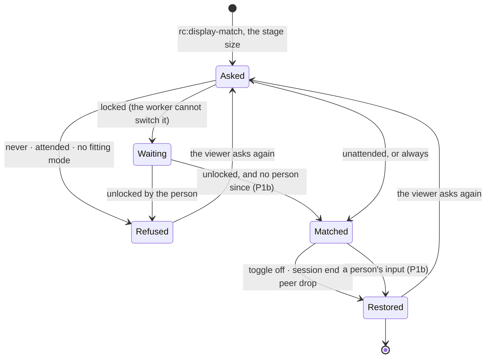

# FR-108: Display follows the viewer — never on a screen someone is using

**Issue:** [#2322](https://github.com/gjovanov/roomler-ai/issues/2322) · **Status:** proposed 2026-10-16 —
spec and claim · **Owner:** the Windows agent (`display_match.rs`, the user-context worker), the viewer (the
display-match toggle); later the Linux virtual desktop · **Anchors:** master `e0fcc2174` · **Program:**
[StarDesk teardown](../plans/stardesk-teardown-program.md), wave 2 (§5.3) · **Builds on:** rc.191's display
match, [FR-92](FR-92-keep-busy.md) (a person told from the controller without hooks),
[FR-34](FR-34-locked-consent-and-stuck-capture.md) (the locked host),
[FR-80](FR-80-a-session-with-no-pixels-says-why.md) (a session says why)

## 1. Goal

Display match makes remote text crisp by switching the host's display to the largest mode that fits the
viewer's window, so the pixels run 1:1 end to end (rc.191). Since 2026-08-02 it is **on by default**. On an
unattended machine that is exactly right. On a machine someone is using, it takes their screen. Their
1920×1080 desktop becomes whatever fits inside the controller's browser window for as long as the session
lasts; for a 1280×720 window that is 720×576 or 640×480.

Display match should switch only a screen that nobody is using: a locked host, a host whose person has been
away for minutes, a host with nobody signed in, a virtual desktop. Everywhere else the device answers why
not, and the viewer says it. When the person comes back mid-session, their mode comes back with them. The
later phases carry the same rule to Linux virtual desktops, to modes no monitor offers (through the virtual
display) and to several displays at once.

StarDesk's "Follow current display" switches the host to the client's resolution, and creates a virtual
"Universal Screen" where it cannot (plan §1, P7). Neither it nor rc.191 asks whether someone is sitting at
the screen.

## 2. Evidence (master `e0fcc2174`)

| What | Where | Consequence |
|---|---|---|
| The viewer asks on every connect to a Windows host, and the toggle is ON unless this browser once turned it off | `ui/src/views/remote/RemoteControl.vue` L3459–3470 (`readStoredDisplayMatch`: "2026-08-02 operator default: ON"), L4383–4387 (re-sent per connect), L3446 (Windows hosts only) | A first session from any browser switches the host |
| The agent switches without asking who is at the screen, and tells the viewer nothing | `agents/roomlerd/src/peer.rs` L9397 (the `rc:display-match` arm: `apply_for` or `restore_for`, the outcome only logged) | An attended person's mode changes, and the viewer cannot say whether it did |
| The pick is the largest mode inside the request | `agents/roomlerd/src/display_match.rs` L34 (`pick_display_mode`) | A 946×598 stage (a 1280×720 browser) gets at most 946×598. On a typical 1080p monitor's mode list that is 720×576 or 640×480, because 800×600 is 2 px too tall |
| The switch is temporary, and three paths restore it | `display_match.rs` L22–26 (`CDS_FULLSCREEN`), L227 (`apply_for`), L239 (`restore_for`), L224 (`DM_OWNER`, one owning session); `peer.rs` L9075 (control channel closed), L1696 (peer dropped) | The restore paths exist; the guard belongs before the switch |
| The worker already knows whether the session is locked | `agents/roomlerd/src/lock_state.rs` L212 (`probe_lock_state`), L233 (`probe_lock_state_service`), L328 (`spawn_monitor`) | "Locked" is a fact the guard can read |
| FR-92 tells a person from the controller without hooks | `agents/roomlerd/src/keep_busy/host_win.rs` L45 (`last_input_tick`, `GetLastInputInfo`), L129 (`remote_epoch`, bumped by the arbiter on every controller injection); `keep_busy/engine.rs` L10–25 ("Who is a real user") | "Someone is using it" can be measured the EDR-safe way |
| Field, 2026-10-16: a vmtest Win11 guest with `vmtest` signed in at the console; a session from the production viewer | the guest's log, 13:08:21Z: `display-match: could not switch mode req_w=946 req_h=598 e=no supported mode fits within 946x598 (1 modes)` | The agent tries to switch an attended guest today. Only the Basic Render Driver's single mode stopped it |

## 3. Design

### 3a. Who is at the screen

`attended` is true when **the person's session is unlocked and a person touched its input within the last
`N`** (default 5 minutes, open decision 1). Anything else is unattended:

- the session is **locked** (`lock_state` reads `Locked`): the person walked away. ⚠️ P0 measured that the
  worker **cannot** switch a locked screen: on the lock screen `ChangeDisplaySettingsExW` failed with
  `rc=-1` (§8 row 4). So a locked host is answered `locked`, and the request waits. When the session
  unlocks, typically the controller typing the password, and no person's input has come since, the match
  applies then (P1b). An unattended office PC is usually locked, so this is the main path, not an edge;
- **nobody is signed in**: SystemContext at the logon screen;
- a **virtual desktop** (`ROOMLERD_AGENT_VIRTUAL_DESKTOP=1`, Linux, P2): nobody can sit at it;
- the input has been idle for at least `N`, or the only input since the session began was the controller's.

A person's input is an advance of the session's idle clock (`GetLastInputInfo`) that no controller injection
explains, which is FR-92's own rule (`keep_busy/engine.rs` L10–25), and like FR-92 it uses no hooks, no raw
input and no key polling. When the viewer asks, on connect, the controller has injected nothing yet, so any
input inside `N` is the person's.

### 3b. The owner's say: `display_match = auto | always | never`

A device-owned key, default `auto` (3a decides):
- `always` keeps rc.191's behaviour, for a kiosk or a machine its owner never sits at;
- `never` refuses every time.

Like `lock_on_end` and `privacy_mode_allowed`, it is absent from `DesiredConfig` and read live.

### 3c. The answer on the control channel

Every request gets one answer, `rc:display-match.state`:

```json
{ "t": "rc:display-match.state", "on": false, "refused": "attended" }
{ "t": "rc:display-match.state", "on": true, "mode": { "w": 1600, "h": 900 } }
```

`refused` ∈ `attended`, `locked` (waiting for an unlock, 3a), `disabled_on_device`, `no_fitting_mode`,
`switch_failed`, `unsupported`.
- **An older viewer** ignores the unknown `t`.
- **A newer viewer facing an older agent** gets no answer, and shows the toggle as it does today.
- ⚠️ **A refusal word the viewer does not know** (from a newer agent) is shown verbatim, never read as success.

### 3d. The viewer

The toggle stays the user's preference, still ON by default, and the device decides per session. The pill
says what the device answered, for example "1:1 Match host display: not now, someone is using this
computer". The viewer sends on connect and on toggle, as today, with no re-send loop.

### 3e. The person comes back (P1b)

While a match is applied, a person's input (3a) restores the original mode at once, and the viewer is told
(`on: false`, `refused: attended`). The session does not re-apply it until the viewer asks again: the
person's screen is not a tug of war (open decision 2).



### 3f. Linux, modes no monitor offers, several displays (P2–P4)

As plan §5.3 has it:
- **P2:** a declared Xvfb mode ladder in `virtual_desktop.rs` (RandR picks only declared modes), for
  virtual-desktop hosts, which are unattended by construction.
- **P3:** a mode no monitor offers comes from the virtual display (the IddCx FR, when it exists).
- **P4:** several displays at once, with a pump and a `video-bytes` channel per display, and viewer windows
  placed by `getScreenDetails`.

## 4. Phases

| P | Scope | Kill switch | Status |
|---|---|---|---|
| P0 | This spec and the claim. Three probes on vmtest: (1) does `GetLastInputInfo`, read in the worker, move on the person's input (QMP) and on the controller's injection, and can the two be told apart; (2) what `ChangeDisplaySettingsExW(CDS_FULLSCREEN)` does at the lock screen and at the logon screen (SystemContext); (3) a guest with several modes, a display driver beyond the Basic Render Driver, so a real switch and restore can be seen | docs only | **done 2026-10-16** (§8 rows 2–4): (1) the idle clock moves for both the person and the controller, so the guard must subtract the arbiter's injections; (2) at the lock screen the switch **fails** (`rc=-1`), which reshaped 3a; the logon screen is still owed; (3) a virtio video model plus `viogpudo` gives session 1 23 modes, and the red was recorded on it |
| P1 | The guard (3a), the owner's key (3b), the answer (3c) and the viewer's words (3d), on Windows | `display_match = always` restores rc.191 | — |
| P1b | The locked host's request applies at the unlock when nobody is at the screen (3a), and the person coming back restores their mode (3e) | — | — |
| P2 | Linux virtual desktops: the Xvfb mode ladder | — | — |
| P3 | Modes no monitor offers, through the virtual display | — | — |
| P4 | Several displays | — | — |
| P5 | Docs: a display-match section in `docs/remote-control.md` (mermaid, the answers, the owner's key) and a `docs/README.md` row | — | — |

## 5. Acceptance criteria

- [ ] **AC1 (attended, red first):** on a Windows host with the person active (input within the last
  minute; QMP input on vmtest), a session with display match ON (the default) leaves the host's mode
  unchanged, and the viewer shows why. Red first: the deployed agent attempts the switch (its log; on a host
  with several modes, the mode itself).
- [ ] **AC2 (unattended switches, then restores):** a host idle for at least `N` switches to the picked mode when
  the viewer asks. A locked host answers `locked`, then switches once the controller has unlocked it (P1b).
  The original mode is back at disconnect in both cases. All of it is read on the host (the screenshot's
  size, or `EnumDisplaySettings`).
- [ ] **AC3 (the person comes back, P1b):** during a matched session, the person's input restores the mode
  within 1 s, and the viewer is told.
- [ ] **AC4 (the owner decides):** `never` refuses every time with `disabled_on_device`. `always` switches an
  attended host, as rc.191 does.
- [ ] **AC5 (old and new together):** an older viewer with a P1 agent ignores the answer, and a P1 viewer with
  an older agent shows the toggle as today.
- [ ] **AC6 (no hooks):** FR-92's source scan covers the guard's code and fails on a planted
  `SetWindowsHookEx`.
- [ ] **AC7 (Linux, P2):** a virtual-desktop host switches to a declared mode and restores it.
- [ ] **AC8:** **Docs:** `docs/remote-control.md` carries the display-match section (mermaid, the answers, the
  owner's key), with a row in `docs/README.md`'s index.

## 6. Open decisions

1. **`N`, the time without a person's input before a host counts as unattended.** Recommended: 5 minutes,
   the low end of a typical screen-saver or lock timeout.
2. **Re-arm when the person leaves again** (3e). Recommended: no; the viewer asks again (toggle off and on),
   so a returning person never fights a timer.
3. **The viewer's default.** With the guard in place ON is safe. Recommended: keep it ON.

## 7. Out of scope

- macOS and Wayland hosts. rc.191 is Windows only, and Linux comes only for virtual desktops (P2).
- DPI and scaling changes.

## 8. Field-verification log

| # | Date | Cell | Result |
|---|---|---|---|
| 1 | 2026-10-16 | **The evidence, not a cell.** A kept vmtest Win11 `--type system` guest on agent 0.4.139, `vmtest` Active at the console; the production viewer (fresh browser storage, so display match ON) driven by Playwright from the vmtest harness host | The agent tried to switch the attended guest's display: `could not switch mode req_w=946 req_h=598 e=no supported mode fits within 946x598 (1 modes)`. The guest's Basic Render Driver offers one mode, so nothing changed, and nothing told the viewer |
| 2 | 2026-10-16 | **AC1, the red (0.4.139), on a guest with several modes.** The same guest after P0 (3): video model virtio plus `viogpudo` from the harness's virtio-win ISO, so session 1 lists 23 modes (640×480 … 5120×2160) where QXL with the Basic Render Driver listed one. The person was at the screen: `vmtest` Active at the console, with QMP mouse moves just before and during the session. The viewer sent the toggle's exact message on its own control channel, `{t:"rc:display-match", enable:true, width:946, height:598}` | **The attended screen was taken.** 13:43:38.307Z the request; 13 ms later the agent: `switched host display mode req_w=946 req_h=598 mode_w=640 mode_h=480`. The host's own screenshots at 13:43:44 and 13:43:54, while the person kept moving the mouse, were **640×480**, with the companion cut off at the right edge and the taskbar gone. At disconnect: `restored on session close (owner)`, then 1280×800 again. The viewer received no answer. **Wrong turn:** a first session that only connected and held, with the toggle at its ON default, sent no request at all. The viewer sends on connect only if the agent's OS is known and the stage element exists at that moment (`RemoteControl.vue` L4385) |
| 3 | 2026-10-16 | **P0 (1): the idle clock.** The same guest. A sampler ran as the person in session 1 for 150 s, reading `GetLastInputInfo` every 250 ms; the person moved over QMP, then the controller moved the pointer over the stage (20 moves), then the person again | **Both move it, and nothing tells them apart.** The person's moves (13:46:24.6–26.4) and the controller's (every sample 13:46:55.5–58.6) and the person's again (13:47:19.8–20.5) each advanced the tick, with `idle_ms` 0–234 at each read. So the guard cannot read "a person" from the clock alone; it must subtract the arbiter's own injections (3a), as FR-92 does |
| 4 | 2026-10-16 | **P0 (2): the lock screen.** The same guest, locked (`LockWorkStation` as the person; LogonUI 1). A session asked for 946×598 | **A locked screen cannot be switched by the worker.** The agent: `could not switch mode req_w=946 req_h=598 e=ChangeDisplaySettingsExW failed rc=-1`, and the host's screenshots before, during and after read 1280×800. So "locked" waits for the unlock instead of switching (3a, P1b). The logon screen (nobody signed in) is still owed |

## 9. Related

- [Plan §5.3](../plans/stardesk-teardown-program.md): this FR, and its place in wave 2.
- [FR-92](FR-92-keep-busy.md): the idle clock and the arbiter's epoch; the no-hooks rule.
- [FR-34](FR-34-locked-consent-and-stuck-capture.md): the locked host.
- [FR-99](FR-99-privacy-mode.md): a sibling: what the person at the screen sees during a session.
