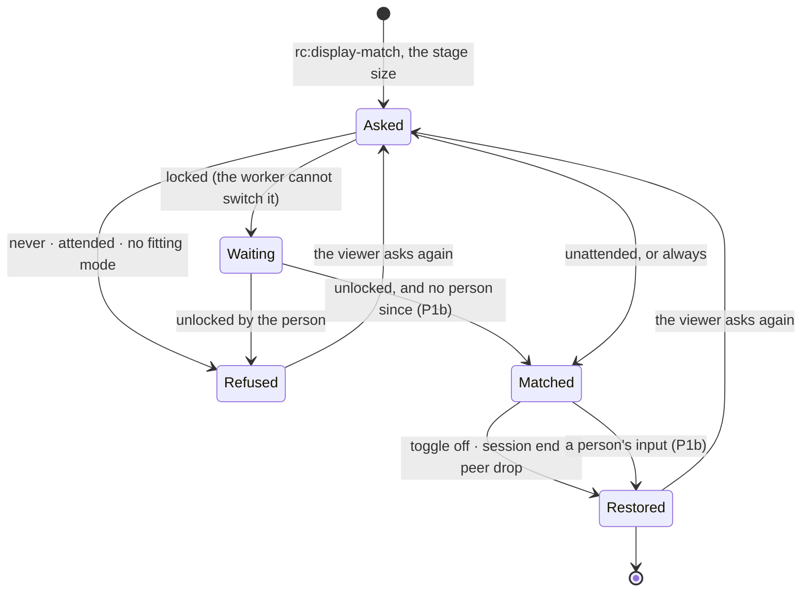

# FR-108: Display follows the viewer — never on a screen someone is using

**Issue:** [#2322](https://github.com/gjovanov/roomler-ai/issues/2322) · **Status:** in progress — P0
measured, P1 built ([`docs/display-match.md`](../display-match.md)) · **Owner:** the Windows agent (`display_match.rs`, the user-context worker), the viewer (the
display-match toggle); later the Linux virtual desktop · **Anchors:** master `e0fcc2174` · **Program:**
[StarDesk teardown](../plans/stardesk-teardown-program.md), wave 2 (§5.3) · **Builds on:** rc.191's display
match, [FR-92](FR-92-keep-busy.md) (a person told from the controller without hooks),
[FR-34](FR-34-locked-consent-and-stuck-capture.md) (the locked host),
[FR-80](FR-80-a-session-with-no-pixels-says-why.md) (a session says why)

## 1. Goal

Display match makes remote text crisp by switching the host's display to the largest mode that fits the
viewer's window, so the pixels run 1:1 end to end (rc.191). Since 2026-08-02 it is **on by default**. On an
unattended machine that is exactly right. On a machine someone is using, it takes their screen. Their
1920×1080 desktop becomes whatever fits inside the controller's browser window for as long as the session
lasts; for a 1280×720 window that is 720×576 or 640×480.

Display match should switch only a screen that nobody is using: a locked host, a host whose person has been
away for minutes, a host with nobody signed in, a virtual desktop. Everywhere else the device answers why
not, and the viewer says it. When the person comes back mid-session, their mode comes back with them. The
later phases carry the same rule to Linux virtual desktops, to modes no monitor offers (through the virtual
display) and to several displays at once.

StarDesk's "Follow current display" switches the host to the client's resolution, and creates a virtual
"Universal Screen" where it cannot (plan §1, P7). Neither it nor rc.191 asks whether someone is sitting at
the screen.

## 2. Evidence (master `e0fcc2174`)

| What | Where | Consequence |
|---|---|---|
| The viewer asks on every connect to a Windows host, and the toggle is ON unless this browser once turned it off | `ui/src/views/remote/RemoteControl.vue` L3459–3470 (`readStoredDisplayMatch`: "2026-08-02 operator default: ON"), L4383–4387 (re-sent per connect), L3446 (Windows hosts only) | A first session from any browser switches the host |
| The agent switches without asking who is at the screen, and tells the viewer nothing | `agents/roomlerd/src/peer.rs` L9397 (the `rc:display-match` arm: `apply_for` or `restore_for`, the outcome only logged) | An attended person's mode changes, and the viewer cannot say whether it did |
| The pick is the largest mode inside the request | `agents/roomlerd/src/display_match.rs` L34 (`pick_display_mode`) | A 946×598 stage (a 1280×720 browser) gets at most 946×598. On a typical 1080p monitor's mode list that is 720×576 or 640×480, because 800×600 is 2 px too tall |
| The switch is temporary, and three paths restore it | `display_match.rs` L22–26 (`CDS_FULLSCREEN`), L227 (`apply_for`), L239 (`restore_for`), L224 (`DM_OWNER`, one owning session); `peer.rs` L9075 (control channel closed), L1696 (peer dropped) | The restore paths exist; the guard belongs before the switch |
| The worker already knows whether the session is locked | `agents/roomlerd/src/lock_state.rs` L212 (`probe_lock_state`), L233 (`probe_lock_state_service`), L328 (`spawn_monitor`) | "Locked" is a fact the guard can read |
| FR-92 tells a person from the controller without hooks | `agents/roomlerd/src/keep_busy/host_win.rs` L45 (`last_input_tick`, `GetLastInputInfo`), L129 (`remote_epoch`, bumped by the arbiter on every controller injection); `keep_busy/engine.rs` L10–25 ("Who is a real user") | "Someone is using it" can be measured the EDR-safe way |
| Field, 2026-10-16: a vmtest Win11 guest with `vmtest` signed in at the console; a session from the production viewer | the guest's log, 13:08:21Z: `display-match: could not switch mode req_w=946 req_h=598 e=no supported mode fits within 946x598 (1 modes)` | The agent tries to switch an attended guest today. Only the Basic Render Driver's single mode stopped it |

## 3. Design

### 3a. Who is at the screen

`attended` is true when **the person's session is unlocked and a person touched its input within the last
`N`** (default 5 minutes, open decision 1). Anything else is unattended:

- the session is **locked** (`lock_state` reads `Locked`): the person walked away. ⚠️ P0 measured that the
  worker **cannot** switch a locked screen: on the lock screen `ChangeDisplaySettingsExW` failed with
  `rc=-1` (§8 row 4). So a locked host is answered `locked`, and the request waits. When the session
  unlocks, typically the controller typing the password, and no person's input has come since, the match
  applies then (P1b). An unattended office PC is usually locked, so this is the main path, not an edge;
- **nobody is signed in**: SystemContext at the logon screen;
- a **virtual desktop** (`ROOMLERD_AGENT_VIRTUAL_DESKTOP=1`, Linux, P2): nobody can sit at it;
- the input has been idle for at least `N`, or the only input since the session began was the controller's.

A person's input is an advance of the session's idle clock (`GetLastInputInfo`) that no controller injection
explains, which is FR-92's own rule (`keep_busy/engine.rs` L10–25), and like FR-92 it uses no hooks, no raw
input and no key polling. When the viewer asks, on connect, the controller has injected nothing yet, so any
input inside `N` is the person's.

### 3b. The owner's say: `display_match = auto | always | never`

A device-owned key, default `auto` (3a decides):
- `always` keeps rc.191's behaviour, for a kiosk or a machine its owner never sits at;
- `never` refuses every time.

Like `lock_on_end` and `privacy_mode_allowed`, it is absent from `DesiredConfig` and read live.

### 3c. The answer on the control channel

Every request gets one answer, `rc:display-match.state`:

```json
{ "t": "rc:display-match.state", "on": false, "refused": "attended" }
{ "t": "rc:display-match.state", "on": true, "mode": { "w": 1600, "h": 900 } }
```

`refused` ∈ `attended`, `locked` (waiting for an unlock, 3a), `disabled_on_device`, `no_fitting_mode`,
`switch_failed`, `unsupported`.
- **An older viewer** ignores the unknown `t`.
- **A newer viewer facing an older agent** gets no answer, and shows the toggle as it does today.
- ⚠️ **A refusal word the viewer does not know** (from a newer agent) is shown verbatim, never read as success.

### 3d. The viewer

The toggle stays the user's preference, still ON by default, and the device decides per session. The pill
says what the device answered, for example "1:1 Match host display: not now, someone is using this
computer". The viewer sends on connect and on toggle, as today, with no re-send loop.

### 3e. The person comes back (P1b)

While a match is applied, a person's input (3a) restores the original mode at once, and the viewer is told
(`on: false`, `refused: attended`). The session does not re-apply it until the viewer asks again: the
person's screen is not a tug of war (open decision 2).

*As built (P1b):*
- **The come-back watcher:** a per-session watcher checks four times a second while the session holds a
  mode. A person's input under `auto` hands it back as `attended`; the owner's `never` hands it back as
  `disabled_on_device`. A screen that locks is not a person who came back.
- **The waiting request:** one answered `locked` waits per session and is decided again at the unlock.
- **The rule that makes the unlock work:** a lock after the person's last input means they are away,
  however recent that input was. The controller typing the password is machine input, so after the
  controller's unlock nobody is at the screen. Without the rule, someone who locked and walked off a
  minute ago would read as `attended` for four more minutes.

[`docs/display-match.md`](../display-match.md) has the tables and the anchors.



### 3f. Linux, modes no monitor offers, several displays (P2–P4)

As plan §5.3 has it, with P2 corrected by its probe:
- **P2:** virtual-desktop hosts, which are unattended by construction. The plan said "a declared Xvfb mode
  ladder in `virtual_desktop.rs`". **P2's probe found no ladder to declare** (§8 row 5). Xvfb 21.1 has one
  mode, its start size. `xrandr --newmode` returns success but keeps nothing, and the screen cannot shrink
  below that mode. Xorg with the dummy driver, run unprivileged, switched at runtime to every size asked:
  a viewer's 946×598, 3840×2160, even past its configured `Virtual` size. So P2 runs the virtual desktop
  on Xorg + dummy where `xserver-xorg-video-dummy` is installed, and keeps Xvfb, answering `unsupported`,
  where it is not (open decision 4). Two more things P2 has to build:
  - **The capture reopens after a switch.** On Linux, scrap's X11 capturer takes its size when it opens;
    only the macOS arm reopens on a size change (`capture/scrap_backend.rs`).
  - **The restore** returns to the start mode, as on Windows. The mode the viewer asked for is added for
    the session and removed after it.
- **P3:** a mode no monitor offers comes from the virtual display (the IddCx FR, when it exists).
- **P4:** several displays at once, with a pump and a `video-bytes` channel per display, and viewer windows
  placed by `getScreenDetails`.

## 4. Phases

| P | Scope | Kill switch | Status |
|---|---|---|---|
| P0 | This spec and the claim. Three probes on vmtest: (1) does `GetLastInputInfo`, read in the worker, move on the person's input (QMP) and on the controller's injection, and can the two be told apart; (2) what `ChangeDisplaySettingsExW(CDS_FULLSCREEN)` does at the lock screen and at the logon screen (SystemContext); (3) a guest with several modes, a display driver beyond the Basic Render Driver, so a real switch and restore can be seen | docs only | **done 2026-10-16** (§8 rows 2–4): (1) the idle clock moves for both the person and the controller, so the guard must subtract the arbiter's injections; (2) at the lock screen the switch **fails** (`rc=-1`), which reshaped 3a. The logon screen is still owed. By the code it takes the same path: `lock_state` reads any input desktop but `Default` as `Locked`, so P1 answers it `locked` and it waits. Its cell rides AC2's locked half on the release; (3) a virtio video model plus `viogpudo` gives session 1 23 modes, and the red was recorded on it |
| P1 | The guard (3a), the owner's key (3b), the answer (3c) and the viewer's words (3d), on Windows | `display_match = always` restores rc.191 | **built** ([`docs/display-match.md`](../display-match.md)): `presence.rs` (a tracker that keeps the last idle-clock move the machine does not explain, its 500 ms sampler from the worker's start, the decision), `display_match.rs` (the owner's policy, `may_switch`, `request_for`, the answer), the arbiter's and keep busy's tick notes, the console-only and never-pushable key, the viewer's answer and words. Unit tests on Windows and Linux with four negative controls: the tracker counting machine input as a person failed three tests, `auto` ignoring presence failed one, a planted `SetWindowsHookExW` failed the scan, and the gate removed failed the console test. **Shipped in agent 0.4.140 and field-verified there:** AC1 and AC4 (§8 row 8), AC2's idle half (§8 rows 7 and 9), AC5 both ways (§8 row 10) |
| P1b | The locked host's request applies at the unlock when nobody is at the screen (3a), and the person coming back restores their mode (3e) | `display_match = always` (no hand-back) | **built** (3e "as built"): `away_since_lock` in the tracker, the waiting request and `on_unlock` from the session's lock watcher, the 250 ms `on_tick` watcher with `hand_back`. Unit tests on Windows and Linux with two negative controls: an `away_since_lock` that never reads a lock as away failed the two lock tests, and a `hand_back` that keeps the mode under `never` failed the hand-back test. **Shipped in agent 0.4.140 and field-verified there:** AC2's locked half (§8 row 6), AC3 (§8 row 7) |
| P2 | Linux virtual desktops: switch the virtual desktop's mode to the one asked (Xorg + dummy, open decision 4), reopen the capture after a switch, restore at the end | `display_match = never` | **probe done 2026-10-16** (§8 row 5): Xvfb cannot switch at all; Xorg + dummy switches to any size. **Built** (decision 4 settled 2026-10-17: Xorg + dummy where installed, Xvfb otherwise): the server pick and its kill switch `ROOMLERD_VIRTUAL_DESKTOP_SERVER=xvfb`, the config (an exact start mode, `ReducedBlanking`, no input devices, an empty config dir), the request as the mode exactly, `xrandr` switch and restore, the capture reopened on a mode generation. Tests: the config, the argv, the server pick, the kill switch, the modeline, the mode fitting, `xrandr --current` parsing |
| P3 | Modes no monitor offers, through the virtual display | — | — |
| P4 | Several displays | — | — |
| P5 | Docs: [`docs/display-match.md`](../display-match.md) (mermaid, the answers, the owner's key), linked from `docs/remote-control.md` §18.6.1 and indexed in `docs/README.md` | — | the page exists from P1 and grows with each phase |

## 5. Acceptance criteria

- [x] **AC1 (attended, red first):** on a Windows host with the person active (input within the last
  minute; QMP input on vmtest), a session with display match ON (the default) leaves the host's mode
  unchanged, and the viewer shows why. Red first: the deployed agent attempts the switch (its log; on a host
  with several modes, the mode itself). **Verified** on agent 0.4.140 (§8 row 8), against row 2's red on
  0.4.139. With the person moving, the request is answered `refused: attended`, the host's own screenshots
  stay at 1280×800, and the viewer reads "not now: someone is using this computer".
- [x] **AC2 (unattended switches, then restores):** a host idle for at least `N` switches to the picked mode when
  the viewer asks. A locked host answers `locked`, then switches once the controller has unlocked it (P1b).
  The original mode is back at disconnect in both cases. All of it is read on the host (the screenshot's
  size, or `EnumDisplaySettings`). **Verified** on agent 0.4.140, read from the host's own screenshots. The
  locked half (§8 row 6): `locked` while locked, 640×480 at the controller's unlock, 1280×800 after the
  disconnect. The idle half (§8 rows 7 and 9): 640×480 after 330 s with nobody there, held while nobody
  came back, and 1280×800 after the disconnect.
- [x] **AC3 (the person comes back, P1b):** during a matched session, the person's input restores the mode
  within 1 s, and the viewer is told. **Verified** on agent 0.4.140 (§8 row 7). One QMP move sent between
  06:19:28.657Z and 28.954Z. The viewer got `refused: attended` at 29.028Z, and the host's own screenshot,
  taken by 29.742Z, read 1280×800 again.
- [x] **AC4 (the owner decides):** `never` refuses every time with `disabled_on_device`. `always` switches an
  attended host, as rc.191 does. **Verified** on agent 0.4.140 (§8 row 8). `never` answered
  `disabled_on_device` and the host stayed at 1280×800. `always` switched the attended screen to 640×480,
  kept it there while the person moved, and restored it at the disconnect.
- [x] **AC5 (old and new together):** an older viewer with a P1 agent ignores the answer, and a P1 viewer with
  an older agent shows the toggle as today. **Verified** (§8 row 10). A viewer from before P1, served from
  its own image's bundle, took the 0.4.140 agent's `rc:display-match.state` without an error and stayed
  connected. Today's viewer on a 0.4.139 agent got no answer and showed the toggle as before, with no line
  under it.
- [x] **AC6 (no hooks):** FR-92's source scan covers the guard's code and fails on a planted
  `SetWindowsHookEx`. **Verified** (P1). `presence::tests::no_keylogger_shaped_api_in_display_match` scans
  `presence.rs` and `display_match.rs` for FR-92's Windows list: hooks, raw input, keyboard state,
  `GetAsyncKeyState`. It passed. With the string constant `"SetWindowsHookExW"` planted at the end of
  `display_match.rs` it failed; restored from the commit, it passed again. It is a sibling of FR-92's own
  scan rather than an entry in it, because FR-92's scan asserts that it lists every file of `keep_busy/`.
- [x] **AC7 (Linux, P2):** a virtual-desktop host switches to the mode the viewer asks for and restores it,
  read on the host (`xrandr`, the root window's size), and the stream follows the new size. On a host with
  only Xvfb, the answer is `unsupported`. *(Reworded by P2's probe: first written as "a declared mode", but
  Xvfb has no modes to declare, §8 row 5.)* **Verified on a candidate** (§8 rows 11–13). The host's root
  window went 1920x1080 → 946x598 two seconds after the request, and back to 1920x1080 after the disconnect.
  The capture reopened and the encoder re-initialised at 946x598. The released 0.4.141 and the kill switch
  answer `unsupported` on Xvfb. It gets re-checked on the release that carries P2. **Re-checked on 0.4.143**
  (row 14), the release that carries it: the same answers on the released binary.
- [x] **AC8:** **Docs:** a `docs/display-match.md` page (mermaid, the answers, the owner's key), linked from
  `docs/remote-control.md`, with a row in `docs/README.md`'s index. *(Reworded in P1: first written as a
  section inside `docs/remote-control.md`, but other specs cite that page by line number, and a page of its
  own, like `privacy-mode.md`, moves none of them. The page exists from P1 and is ticked when the last
  phase is in it.)* **Done.** `docs/display-match.md` carries the decision sequence diagram, the status
  table through FR-97 P3e-2 (0.4.148), and the owner's `display_match` key; `remote-control.md` §18.6.1
  links it under the "1:1 Match host display" button; `docs/README.md`'s index has its row. Grew with the
  doc, not retrofitted: each phase landed its own update to this page in its own PR (P1's build, P2's Linux
  virtual desktop, FR-97 P3e-2's X11 arm) — only the box itself was left unticked.

## 6. Open decisions

1. **`N`, the time without a person's input before a host counts as unattended.** Recommended: 5 minutes,
   the low end of a typical screen-saver or lock timeout.
2. **Re-arm when the person leaves again** (3e). Recommended: no; the viewer asks again (toggle off and on),
   so a returning person never fights a timer.
3. **The viewer's default.** With the guard in place ON is safe. Recommended: keep it ON.
4. **The X server behind a virtual desktop (P2, raised by its probe).** Xvfb cannot change its mode (§8
   row 5). The options:
   - **Xorg + the dummy driver where `xserver-xorg-video-dummy` is installed, Xvfb otherwise.** It is one
     small package from the distribution's main archive, runs as the daemon's own user (the real binary,
     not the console-only wrapper), and takes any size at runtime. A host without it keeps today's Xvfb and
     answers `unsupported`, so nothing changes for it;
   - TigerVNC's `Xvnc`, which also resizes. Not measured;
   - keep Xvfb everywhere and answer `unsupported`: no package, and no crisp 1:1 text on a virtual desktop.

   Recommended: the first. **Decided by the operator, 2026-10-17: the first, as recommended** (P2).

## 7. Out of scope

- macOS and Wayland hosts. rc.191 is Windows only, and Linux comes only for virtual desktops (P2).
- DPI and scaling changes.

## 8. Field-verification log

| # | Date | Cell | Result |
|---|---|---|---|
| 1 | 2026-10-16 | **The evidence, not a cell.** A kept vmtest Win11 `--type system` guest on agent 0.4.139, `vmtest` Active at the console; the production viewer (fresh browser storage, so display match ON) driven by Playwright from the vmtest harness host | The agent tried to switch the attended guest's display: `could not switch mode req_w=946 req_h=598 e=no supported mode fits within 946x598 (1 modes)`. The guest's Basic Render Driver offers one mode, so nothing changed, and nothing told the viewer |
| 2 | 2026-10-16 | **AC1, the red (0.4.139), on a guest with several modes.** The same guest after P0 (3): video model virtio plus `viogpudo` from the harness's virtio-win ISO, so session 1 lists 23 modes (640×480 … 5120×2160) where QXL with the Basic Render Driver listed one. The person was at the screen: `vmtest` Active at the console, with QMP mouse moves just before and during the session. The viewer sent the toggle's exact message on its own control channel, `{t:"rc:display-match", enable:true, width:946, height:598}` | **The attended screen was taken.** 13:43:38.307Z the request; 13 ms later the agent: `switched host display mode req_w=946 req_h=598 mode_w=640 mode_h=480`. The host's own screenshots at 13:43:44 and 13:43:54, while the person kept moving the mouse, were **640×480**, with the companion cut off at the right edge and the taskbar gone. At disconnect: `restored on session close (owner)`, then 1280×800 again. The viewer received no answer. **Wrong turn:** a first session that only connected and held, with the toggle at its ON default, sent no request at all. The viewer sends on connect only if the agent's OS is known and the stage element exists at that moment (`RemoteControl.vue` L4385) |
| 3 | 2026-10-16 | **P0 (1): the idle clock.** The same guest. A sampler ran as the person in session 1 for 150 s, reading `GetLastInputInfo` every 250 ms; the person moved over QMP, then the controller moved the pointer over the stage (20 moves), then the person again | **Both move it, and nothing tells them apart.** The person's moves (13:46:24.6–26.4) and the controller's (every sample 13:46:55.5–58.6) and the person's again (13:47:19.8–20.5) each advanced the tick, with `idle_ms` 0–234 at each read. So the guard cannot read "a person" from the clock alone; it must subtract the arbiter's own injections (3a), as FR-92 does |
| 4 | 2026-10-16 | **P0 (2): the lock screen.** The same guest, locked (`LockWorkStation` as the person; LogonUI 1). A session asked for 946×598 | **A locked screen cannot be switched by the worker.** The agent: `could not switch mode req_w=946 req_h=598 e=ChangeDisplaySettingsExW failed rc=-1`, and the host's screenshots before, during and after read 1280×800. So "locked" waits for the unlock instead of switching (3a, P1b). The logon screen (nobody signed in) is still owed |
| 5 | 2026-10-16 | **P2's probe (a dev box, not a cell).** Ubuntu with X.Org 21.1.11/21.1.12. Xvfb started at 1920×1080 and again at 3840×2160. Then Xorg with `xserver-xorg-video-dummy` 0.4.0, started unprivileged as the real binary (`/usr/lib/xorg/Xorg`, not the console-only wrapper) with a `-config` of `VideoRam 256000` and `Virtual 3840 2160`. Each was read with `xrandr` and the root window's size (`xwininfo -root`) | **Xvfb cannot switch.** RandR lists one mode, the start size, and reports it as the maximum too. `xrandr --newmode` returns 0, but the mode is not kept: it is not listed, and `--addmode` says `cannot find mode`. `--fb` to any smaller size fails `BadValue` on `RRSetCrtcConfig`, because the one CRTC still holds the start mode. **Xorg + dummy switches to anything asked, at runtime:** newmode, addmode, then `--output DUMMY0 --mode` took it from 2048×1536 to 1280×720, then 946×598 (a 1280×720 browser's stage, row 2), 3840×2160 and 5120×2880 (past `Virtual`), the root window following each time. The plan's "declared Xvfb mode ladder" cannot exist; decision 4 picks the server |
| 6 | 2026-10-17 | **AC2, the locked half (0.4.140).** The guest of rows 2–4 (virtio video with `viogpudo`, 23 modes), updated to the released 0.4.140 and re-enrolled, `display_match` at its default `auto`. It was locked with `LockWorkStation` as the person (LogonUI 1). The production viewer (Playwright from the vmtest harness host, `hosted-20261016-377f1d4`) connected and sent the toggle's exact request at 946×598 on its own control channel. Then it typed the guest's password at the lock screen through the session, with FR-99 AC7's harness | **Refused while locked, switched at the controller's unlock, restored at the end.** The request at 06:04:40.300Z got its answer 1 ms later: `{on:false, refused:"locked"}`, and the agent logged `not switched … why="locked"`. The controller unlocked the guest. At 06:04:46.913Z the agent logged `switched host display mode req_w=946 req_h=598 mode_w=640 mode_h=480`, and the viewer got `{on:true, mode:{w:640, h:480}}`. The host's own screenshots read 1280×800 while locked, **640×480** at 13 s and 22 s after the unlock (LogonUI 0), and 1280×800 again 10 s after the disconnect (agent: `restored on peer drop (owner)`). Capture fell back from DXGI to GDI across the switch (`DXGI persistent AccessLost`), as it does at every lock-screen transition. This is the lock screen; the logon screen (nobody signed in) is still not measured |
| 7 | 2026-10-17 | **AC2's idle half and AC3 (0.4.140).** The same guest, unlocked, with nobody at it for 330 s. Then the same viewer and the same request, and the person moved the mouse over QMP during the matched session. It was run twice. The second run sent **one** QMP move with the send bracketed in the log, then took the host's screenshots back to back, each bracketed too. The clock offset between the guest and the harness host was taken from each session's own request/answer pair (the guest ran about 0.2 s behind) | **An idle host switches; the person's move hands the screen back well inside a second.** Run 1: request at 06:11:28.614Z, `switched … mode_w=640 mode_h=480`, viewer answered `on:true` 23 ms later, host screenshot **640×480**. At the person's first move the agent logged `the screen is handed back … why="attended"`, and the viewer got `{on:false, refused:"attended"}`, both within 0.32 s of the earliest the move could have been sent. Host screenshots afterwards read 1280×800. Run 2 (timed): 640×480 again. Then the one move was sent between 06:19:28.657Z and 06:19:28.954Z. The agent handed the screen back (`06:19:28.818Z` on the guest's clock), and the viewer got `refused:"attended"` at 06:19:29.028Z, 74–371 ms after the move. **The host's own screenshot, taken by 06:19:29.742Z, already read 1280×800**, as did the three after it. The session was not re-matched: the viewer has to ask again (3e) |
| 8 | 2026-10-17 | **AC1 and AC4 (0.4.140).** The same guest and viewer. Before each cell the owner's `display_match` was set as the console user with `roomler config set`, which answered "in effect now, no restart needed". In the attended cells the person moved the mouse over QMP before and during the session. The viewer's own line under its toggle was read from its settings dialog, on the Display tab. Afterwards `display_match` went back to `auto` | **The device decides, and the viewer says why.** **`auto`, the person at the screen (AC1):** the request at 06:35:05.496Z was answered within 1 ms with `{on:false, refused:"attended"}`. The host's screenshots before, during (twice, with the person still moving) and after the session read **1280×800**. The viewer's toggle read "1:1 Match host display — ON" and its line read **"not now: someone is using this computer"**. A first run at 06:30Z gave the same answer and screenshots; it read the dialog's default Video tab, which carries no toggle. **`never` (AC4):** `{on:false, refused:"disabled_on_device"}`, 1280×800 throughout, and the viewer read "not now: this device's owner turned display match off". **`always`, the person moving (AC4):** `{on:true, mode:{w:640, h:480}}`. The attended screen was switched, as rc.191 did. It stayed at 640×480 while the person kept moving (no hand-back under `always`) and was 1280×800 again after the disconnect. Row 2's red, the same guest on 0.4.139, switched an attended screen under the default |
| 9 | 2026-10-17 | **AC2's idle half, through to the disconnect (0.4.140).** Row 7 showed the idle switch, but both of its runs ended with the person's hand-back, not with a disconnect. The same guest, unlocked, with nobody at it for 330 s. The same request, then 25 s with nobody coming back, then the viewer disconnected | **Switched while nobody was there, restored at the disconnect.** At 06:43:04.944Z (guest clock) the agent logged `switched … mode_w=640 mode_h=480`, and the viewer got `on:true` 14 ms after its request. The host's screenshots read 1280×800 before, **640×480** switched and still 640×480 after 9 s more, then **1280×800** after the disconnect. The agent logged `restored on peer drop (owner)` at 06:43:29.980Z |
| 10 | 2026-10-17 | **AC5, old and new together.** A fresh vmtest Win11 `--type system` guest (`vmtest-w-ins-sys-065622`, harness run `20261017-065621`, 18 PASS of 20), first on agent 0.4.139 and then updated in place to the released 0.4.140. **New viewer, old agent:** the production viewer (`hosted-20261016-377f1d4`, which carries P1) with the toggle's exact request. **Old viewer, new agent:** a viewer from before P1, the SPA of `hosted-20261016-67d6713` taken out of that image, served into the page on the real origin (documents get the old `index.html`, `/assets/*` comes from the old bundle, `/api` and `/ws` go to production). That is how a tab cached before the promote talks to today's server, and the cell never needed prod to serve the old bundle. Service workers were blocked so nothing cached could stand in | **Both directions work as before.** **New viewer, 0.4.139:** no `rc:display-match.state` arrived. The viewer's toggle read "1:1 Match host display — ON" with no line under it, as before P1. The old agent did what rc.191 does: it tried the switch and logged `could not switch mode … no supported mode fits within 946x598 (1 modes)` on this single-mode guest. **Old viewer, 0.4.140:** the page ran the old bundle (`/assets/index-C0_2_B0p.js`). The P1 agent answered `{on:false, refused:"attended"}`, and the old viewer traced the frame itself (`[rc:control] inbound: …`) and went on. There was no page error, it was still connected 20 s later, and the disconnect was normal. By construction too: the pre-P1 viewer's `parseControlInbound` returns `null` for any `t` it does not know, and its handler acts only on known kinds (`useRemoteControl.ts` L1434 and L9117 at `4743b4e5d^`) |
| 11 | 2026-10-17 | **P2's red: a Linux virtual desktop on the released agent.** A fresh vmtest ubuntu `--type user` install of 0.4.141 (`vmtest-ub-ins-use-172707`, Ubuntu 24.04) with `xvfb`, `xserver-xorg-video-dummy`, `x11-xserver-utils` and `openbox` installed. The daemon ran its own desktop (`ROOMLERD_VIRTUAL_DESKTOP=1` in a systemd `--user` drop-in). Production's viewer asked display match at 946x598 on its control channel (`rc-dm-said.spec.ts`), held and disconnected. A test-only sampler on the guest read the virtual display's root window every 2 s with the X server's own `xwininfo` (`fr108-lin.sh`, `fr108-sampler.sh`) | **Today a virtual desktop cannot follow.** The desktop came up on Xvfb `:99`, and the answer was `{"on": false, "refused": "unsupported"}`. The root window read 1920x1080 in all 30 samples |
| 12 | 2026-10-17 | **P2's green.** Row 11's cell on a release build of this branch (`full,viewer-indicator-x11`, SHA-256 `b2b9226d…`), swapped in with `linux-reenroll.sh` | **The desktop follows the viewer and comes back.** It came up on **Xorg `:99` with the dummy driver** (`server=XorgDummy`) at 1920x1080. The answer was `{"on": true, "mode": {"w": 946, "h": 598}}`. The root window read 1920x1080 × 8, then **946x598 × 12** from 2 s after the request, then **1920x1080 × 8** after the disconnect ("restored on peer drop (owner)"). Within 13 ms of the switch the capture opened again at 946x598 and the encoder re-initialised for 946x598 frames, so the stream followed. **Wrong turns:** a first build crashed rustc 1.95. A local named `display` inside `tracing::warn!` resolves to tracing's own `display` helper, which the macro brings into scope; the type error crashed the compiler while rendering, and was not line endings. The first sampler mangled its `awk` through nested shell quoting and logged nonsense, so the cell was run again with the sampler as a script file |
| 13 | 2026-10-17 | **P2's kill switch.** Row 12's build with `ROOMLERD_VIRTUAL_DESKTOP_SERVER=xvfb` added to the drop-in | **Xvfb again, and `unsupported`**, as on the release. Afterwards the guest's own 0.4.141 (`1a9ac2ae…`) was put back and the guest destroyed |
| 14 | 2026-10-18 | **AC7 on the release that carries P2, 0.4.143.** A fresh vmtest ubuntu `--type user` install of the RELEASED 0.4.143 (`vmtest-ub-ins-use-100455`; the binary `3b42f578…`, the release's own), with `xvfb`, `xserver-xorg-video-dummy`, `x11-xserver-utils`, `openbox` and `x11-utils` installed and the daemon running its own desktop (the `ROOMLERD_VIRTUAL_DESKTOP=1` drop-in). Row 12's cell (`fr108-lin.sh`, binary kept): production's viewer asked display match at 946x598, held and disconnected, while the sampler read the root window every 2 s | **The same as the candidate, on the released bytes.** The desktop came up on **Xorg `:99` with the dummy driver** (`server=XorgDummy`) at 1920x1080. The answer was `{"on": true, "mode": {"w": 946, "h": 598}}`. The root window read 1920x1080 × 6, then **946x598 × 13** from one second after the request, then **1920x1080 × 8** after the disconnect ("restored on peer drop"). **Wrong turn:** the first attempt on this guest got 2 of the 5 packages: the guest was freshly booted, and its apt step came up short. The daemon refused its virtual desktop and logged "missing required binaries" in a loop, as it should. With all five installed (5/5), the retry above passed. The guest was destroyed by name afterwards and its rows removed |

## 9. Related

- [Plan §5.3](../plans/stardesk-teardown-program.md): this FR, and its place in wave 2.
- [FR-92](FR-92-keep-busy.md): the idle clock and the arbiter's epoch; the no-hooks rule.
- [FR-34](FR-34-locked-consent-and-stuck-capture.md): the locked host.
- [FR-99](FR-99-privacy-mode.md): a sibling: what the person at the screen sees during a session.
