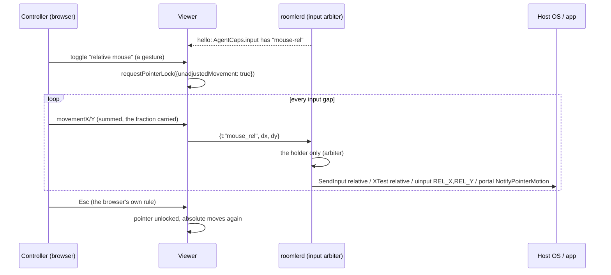

# FR-109: Relative mouse — Pointer Lock in the browser for apps that capture the pointer

**Issue:** [#2333](https://github.com/gjovanov/roomler-ai/issues/2333) · **Status:** done — every criterion
field-verified on a release. P1 (Windows) on 0.4.141; P2a (X11), P2b (uinput), P2c (per-user Wayland) and P2d
(macOS) re-checked on 0.4.143, the release that carries them all (§8 rows 36–39); P3 (the auto-switch) on the
live viewer; [`docs/relative-mouse.md`](../relative-mouse.md) · **Owner:** the agent's input path (`input/`, every injector), the viewer (Pointer Lock, the input
pump) · **Anchors:** master `b0ec4a2b7` · **Program:** [StarDesk teardown](../plans/stardesk-teardown-program.md),
wave 3 (§6.1, row P9) · **Builds on:** [FR-92](FR-92-keep-busy.md) (the agent never reads input), #1945
(the arbiter's release-all), FR-98 C3 (the input gap)

## 1. Goal

A controller in the browser can drive what reads **relative** mouse motion: a 3D or CAD viewport, a game
camera, anything that hides the cursor and recentres it every frame. StarDesk calls this "Client mouse"
(the teardown's row P9). Roomler has only the absolute mouse. When the host app captures the pointer, the
controller's cursor reaches the edge of the stage and the motion stops, while the app sees a pointer
pinned at the centre.

Nothing to install on the controlling side stays true: Pointer Lock is a web API.

## 2. Evidence (master `b0ec4a2b7`)

| What | Where |
|---|---|
| Every move is absolute: `mouse_move {x, y, mon}`, normalised `0..1` per monitor, so a resolution change mid-session needs no resync | [`input/mod.rs:320`](../../agents/roomlerd/src/input/mod.rs#L320) `InputMsg` |
| enigo moves to an absolute pixel | [`enigo_backend.rs:152`](../../agents/roomlerd/src/input/enigo_backend.rs#L152) `Coordinate::Abs` |
| The uinput device is an absolute tablet **by design**: "a relative device would force us to track the pointer and guess at acceleration" | [`uinput_backend.rs:18`](../../agents/roomlerd/src/input/uinput_backend.rs#L18), axes at `:312` |
| The portal path moves with `NotifyPointerMotionAbsolute` on the stream | [`portal/input.rs:468`](../../agents/roomlerd/src/capture/portal/input.rs#L468) |
| The viewer coalesces pointer moves at the input gap and sends the last position | [`useRemoteControl.ts:6215`](../../ui/src/composables/useRemoteControl.ts#L6215), the gap's key at `:2389` |
| The agent already says when the host hides its cursor (`cursor:hide`); the viewer only drops its ghost cursor | `useRemoteControl.ts:9398` |
| No Pointer Lock anywhere in the viewer | `git grep requestPointerLock ui/src`: nothing |
| `AgentCaps.input` today: `arbiter`, `exclusive`, `ghost-cursor` | [`caps.rs:1640`](../../agents/roomlerd/src/encode/caps.rs#L1640) |

## 3. Design

### 3a. The wire

- `InputMsg::MouseRel { dx: i32, dy: i32 }`, `t: "mouse_rel"`, in whole counts. The viewer sums
  `movementX/Y` across the input gap and carries the fraction into the next message, so slow motion is not
  rounded away.
- It is a **real variant**, like #1945's `MouseRelease`: every injector's match is exhaustive, so each
  backend has to decide what it does with it, and none can forget.
- **A click must not move the pointer.** `mouse_button` carries a position, and every backend moves there
  before the button (`input/mod.rs`, `MouseButton`). In relative mode the viewer has no position to send:
  the host app has hidden the cursor and owns where it is. So relative mode presses with a second new
  variant, `InputMsg::MousePress { btn }`, which presses where the pointer is. It releases with #1945's
  existing `MouseRelease { btn }`, which already lets go without moving. The wheel carries no position and
  needs nothing.
- ⚠️ An older agent fails to parse a variant it does not know, so the frame is **gated at both ends**:
  - the agent advertises `mouse-rel` in `AgentCaps.input` only where its injector can carry it;
  - the viewer sends `mouse_rel` only to an agent that advertises it;
  - the match is equality, and an unknown word is ignored (the `RpcCap` rule).

### 3b. Injection, per backend

| Backend | Relative motion | P0 checks |
|---|---|---|
| enigo, Windows (user worker) | `Coordinate::Rel` → `SendInput` with `MOUSEEVENTF_MOVE` and no `ABSOLUTE` | a raw-input reader sees the injected deltas; what pointer acceleration does to the cursor and to raw input |
| SystemContext (SYSTEM in the console session) | the same enigo, on its dedicated thread ([`system_context_backend.rs:5`](../../agents/roomlerd/src/input/system_context_backend.rs#L5)) | the same, from that worker |
| enigo, X11 | XTest relative motion | an XInput2 raw reader sees them |
| enigo, macOS | enigo's relative move | whether apps read the deltas, or a `CGEvent` needs the delta fields set (open decision 2). **Answered** (rows 30–31): enigo's relative move already sets the delta fields to the counts sent. A session event tap reads every event with exactly that delta, and so does an app's `NSEvent`, with the cursor coupled or decoupled |
| uinput (system installs) | a **second**, relative-only device (`REL_X`, `REL_Y`), made on first use. The absolute tablet stays as it is | how libinput classifies it beside the tablet, on GNOME and KDE. **Answered** (rows 15–16): a pointer on both, its unaccelerated deltas handed on 1:1 |
| the Wayland portal, or mutter's own RemoteDesktop, where FR-93 P4 routes GNOME's input | `NotifyPointerMotion(dx, dy)`, or mutter's `NotifyPointerMotionRelative(dx, dy)`; neither names a stream | that GNOME and KDE honour it (open decision 3). **Answered** (rows 20–23): mutter's call on GNOME and the portal's on KDE both move the pointer by exactly the counts sent |

### 3c. The arbiter

`mouse_rel` is movement. Only the session holding input injects it, the same as `mouse_move`.
Held-button tracking, the modifier fence and release-all on teardown are unchanged
([`arbiter.rs:17`](../../agents/roomlerd/src/input/arbiter.rs#L17)): a drag in relative mode is a held
button plus deltas.

### 3d. The viewer

- **Entering:** a toolbar toggle, shown only when the agent advertises `mouse-rel`. Pointer Lock needs a
  user gesture, and the toggle is one. `requestPointerLock({unadjustedMovement: true})` asks for raw,
  unaccelerated deltas. A browser that rejects the option gets plain Pointer Lock.
- **Leaving:** Esc, the browser's own rule, or the toggle. With Keyboard Lock active in fullscreen, Esc
  must be held. The viewer says so in its hint.
- **While locked:** `mousemove` carries `movementX/Y`; buttons and the wheel keep their messages. The
  ghost cursor is hidden.
- **Coalescing:** at the existing input gap (FR-98 C3), summing deltas instead of keeping the last
  position.

### 3e. Auto-switch (P3)

`cursor:hide` already arrives when the host hides its cursor. In relative-capable sessions it offers
relative mode: the next click inside the stage enters Pointer Lock (open decision 1), and the cursor coming
back (`cursor:shape`) leaves it.

⚠️ The lock screen and fullscreen video hide the cursor too. So the switch waits for a click, and **never**
happens while the host is locked.

*As built (P3; the operator settled decision 1 on 2026-10-17: enter):*
- **The cursor coming back** is the next `cursor:pos` after a `cursor:hide`, not `cursor:shape` as first
  written. The agent sends a shape only when it changes, and a position on every tick while the cursor
  shows.
- **The entering click is not forwarded.** As an absolute press it would jump the captured pointer to the
  click, and its button-up is swallowed too.
- **Esc while the cursor stays hidden** suppresses the switch until the cursor shows again. Without that, a
  host that keeps its cursor hidden would re-enter on every click.
- A lock from the toolbar is never ended by the cursor coming back; only the auto-switch's own lock is.
- ⚠️ **A hide counts only after the channel has carried the host's pointer** (a `cursor:pos` or
  `cursor:shape`). The agent's poller sends `cursor:hide` once whenever its tracker reports nothing, and a
  tracker that sees no pointer (Linux without DRM capture, macOS) reports nothing from the start. The first
  build of P3 took that first hide for an app capturing the pointer. It was held for decision 1, and P2a
  and P2c then made exactly those Linux hosts advertise `mouse-rel`, so as first built a viewer of a per-user
  Wayland or X11 host would have entered Pointer Lock on its first click. Found while rebasing P3 onto P2.
  The price: a Windows session that starts with the cursor already hidden switches only after the cursor
  has shown once. A DRM host's tracker reports the pointer, so the switch works there as on Windows.
- The kill switch is `localStorage['roomler-rc-relative-auto'] = 'off'`.

### 3f. What the agent never does

The agent only injects. It never reads input, so there is no hook, no raw-input sink and no key polling, by
FR-92's rule. The field probes that read raw input (§5) are test scripts on throwaway guests, never part
of `roomlerd`. A unit test holds this
([`input/mod.rs:846`](../../agents/roomlerd/src/input/mod.rs#L846) `fr109_relative_mouse_reads_no_input`,
AC6). It scans the six files relative mode touches for hooks, raw-input registration and reads,
keyboard-state reads, an evdev grab, XRecord, XI2 event selection and a macOS event tap. It allows exactly
one key-state call: FR-92's own keep-busy check for a held mouse button (`buttons_held_now`), and only
inside that function.

### 3g. As built (P1)

- **The wire:** `MouseRel { dx: i32, dy: i32 }` and `MousePress { btn }`. A fractional `dx` does not parse,
  so the agent drops it as it drops any unreadable frame.
- **The gate:** `advertises_mouse_rel()` is true on a Windows build with `enigo-input` unless
  `ROOMLERD_INPUT_MOUSE_REL` says a false word, and `stub_caps` appends the word at every announcement,
  beside `keep-busy`. The viewer offers the control on equality, unless the browser's
  `roomler-rc-relative-mouse` is `off`.
- **Windows** needed one change for both injectors: enigo's shared `dispatch`, which the SystemContext
  worker reuses through `dispatch_for_external`.
- **The arbiter** tracks `MousePress` as held. Its tracking ended in a `_ => {}` arm, where the new press
  would have fallen through, and a session ending mid-drag would never have let go.
- **Leaving Pointer Lock** sends the gathered motion and releases held buttons with `mouse_release`. The
  blur release uses `mouse_release` too in relative mode: the old one sent `mouse_button` at the last
  absolute point, which would throw a captured pointer there.
- `docs/relative-mouse.md` has the tables and the anchors.

## 4. Phases

| P | Scope | Kill switch | Status |
|---|---|---|---|
| P0 | This spec and the claim. Probes: (1) Windows `SendInput` relative from the user worker and from SystemContext, read by a raw-input probe that hides and recentres the cursor, with acceleration on and off; (2) X11 XTest relative; (3) a relative uinput device beside the tablet, on GNOME and KDE; (4) the portal's `NotifyPointerMotion`; (5) the browsers: Pointer Lock, `unadjustedMovement`, Esc under Keyboard Lock | docs only | spec and claim 2026-10-16 (#2334). **(1), (2) and (5) measured** (§8 rows 1, 2, 4): relative `SendInput` and relative XTest both reach a raw reader 1:1, absolute moves give it nothing on either, and every headless engine rejects `unadjustedMovement`. (1) from SystemContext came with AC1's green (rows 8, 10). **(3) measured** (rows 15–16): a relative-only uinput device beside a tablet is a pointer to udev and libinput on GNOME and KDE alike, and libinput hands on its unaccelerated deltas 1:1. **(4) measured** with P2c (rows 20–23): mutter's `NotifyPointerMotionRelative` on GNOME and the portal's `NotifyPointerMotion` on KDE move the pointer by exactly the counts sent, unaccelerated |
| P1 | The wire, the gate, enigo's relative path (Windows user and SystemContext), the arbiter, the viewer's toggle and pump | agent `ROOMLERD_INPUT_MOUSE_REL=0` (stops advertising `mouse-rel`); viewer `roomler-rc-relative-mouse=off` | **built** (3g): `mouse_rel` and `mouse_press` in every backend's match. Windows advertises `mouse-rel`; Linux and macOS do not until P2, and their backends press where the pointer is but drop relative motion. Unit tests: wire spellings, the kill switch, enigo's calls, the arbiter, uinput's events, the portal plan, and the viewer's accumulator and gate (vitest 2153). Negative controls, each of which failed its test: a prefix-matched cap, rounding in the accumulator (it passed at first, so the test was tightened), a dropped carry, an untracked press, and a press that moves first. **Shipped in 0.4.140, where the field found a Windows relative move going out ABSOLUTE** (enigo's default, §8 row 5). It is fixed by building every enigo with `windows_subject_to_mouse_speed_and_acceleration_level` (#2352, merged `b96573700`), and the fix rides the next agent release. **On #2352's candidate, AC1 is green on both Windows paths and AC4 is green** (§8 rows 6–8). AC6's source scan is added. AC3 is green with master's viewer served into the page (§8 row 9). Owed: AC1 and AC4 again on the release that carries #2352, and AC3 again once a promote serves the viewer |
| P2 | X11 through enigo's XTest (P2a); uinput's relative device (P2b); the portal and macOS by P0's answers | the same | **P2a built** (#2380): on Linux, `advertises_mouse_rel` asked whether the cached desktop brief is an `x11` session with `full` input reach. enigo's `MouseRel` arm already sent XTest relative motion on every OS, so the advertisement was all that was missing. A unit test covers the predicate's eight cases. **Field-green on a candidate** (§8 rows 12–14): red on the released agent (not advertised, though XTest relative was already 1:1), green on this build (advertised, 10 × 100 raw), and nothing advertised on the same guest's Wayland session. **P2b built**: uinput's relative-only pointer beside the tablet (`open_rel_device`: `REL_X`/`REL_Y` plus buttons, made on the first `mouse_rel`, settled before its first frame, destroyed with the injector), and the predicate became `linux_injector_carries_rel(uinput_would_inject(brief), brief)`. uinput carries relative motion for any session, so it is yes when uinput is opted in and openable, when an automatic capture is alive, or when the brief plans the DRM arm that FR-95 pairs with uinput. The plan counts because the caps are announced before any session. Tests: the frame lands on the relative pointer and never on the tablet, the automatic injector drops it off screen, and the predicate's nine cases. **Field-green on a candidate** (rows 17–18): GNOME and KDE system installs advertise `mouse-rel`, and libinput reads 10 × `+100` unaccelerated from "Roomler Virtual Pointer". **P2c built**: a per-user Wayland install carries relative motion through its RemoteDesktop session. The portal plan turns `mouse_rel` into one `NotifyPointerMotion`, or `NotifyPointerMotionRelative` on mutter's own session, naming no stream, and the predicate also says yes for a `wayland` brief whose `portal` or `mutter` arm has `full` reach. That reach comes only from the planned RemoteDesktop route, which the arbiter hands every event before any injector. Tests: the call and its mutter shape, no backend quirk touching it, and the predicate's new cases. **Field-green on a candidate** (rows 20–24): GNOME through mutter and KDE through the portal, red on 0.4.141 (not advertised, and the burst moved nothing), green on this build (advertised, ten steps of exactly +50 in the lab's probe, and the same distance in the stream's picture). **P2d built**: a macOS agent advertises `mouse-rel` in a GUI session with the Accessibility grant (`macos_injector_carries_rel(has_gui_session, accessibility_trusted)`). The root LaunchDaemon's check can answer "granted" with no WindowServer to post into, so the grant alone is no. enigo's `MouseRel` arm already posted the motion with its delta fields set, so the advertisement was all that was missing, as it was on X11. A unit test covers the predicate's four cases. **Field-green on a candidate** (rows 30–33): red on 0.4.141 (not advertised, though the injection already carried the deltas); green on this build (advertised, the control offered, 10 × +40 and 10 × −40 read by a session event tap and by the app, with the cursor coupled and then decoupled); no word without the Accessibility grant, and none with the kill switch |
| P3 | Auto-switch on `cursor:hide` | viewer storage key `roomler-rc-relative-auto=off` | **built** (3e, decision 1 settled 2026-10-17: enter). `shouldAutoEnterRelative` is pure and tested one gate at a time. Negative controls: without the lock-screen gate, and without the new tracked-pointer gate, each fails its test. The tracked-pointer gate was added while rebasing onto P2, which made Linux hosts whose tracker sees no pointer advertise `mouse-rel` |
| P4 | Docs: `docs/relative-mouse.md`, linked from `docs/remote-control.md` §6 and indexed in `docs/README.md` | — | the page exists from P1 and grew with each phase; **done with P2d**, the last OS row (AC7) |

## 5. Acceptance criteria

- [x] **AC1 (Windows, red first):** on a vmtest Win11 host, a probe script hides the cursor, recentres it
  and sums raw-input deltas. The controller moves 1000 counts right. Red: today the probe sees the motion
  stop where the controller's cursor reaches the stage edge. Green: in relative mode the probe's sum is
  within 5 % of the controller's, on the user worker and on SystemContext. **Verified on #2352's exact
  code** (its candidate rehearsal; §8 rows 6 and 8). The probe summed exactly **1000** on the user worker and
  on SystemContext. The reds: 0 on 0.4.139, which could not parse the frame (row 3), and 0 relative with 10
  absolute on the released 0.4.140, on both paths (rows 5 and 6). **The release that carries #2352,
  0.4.141, read exactly 1000 on both paths** (rows 10 and 11).
- [x] **AC2 (Linux, and macOS from P2d):** the same on an X11 host (XTest), and on a system install
  through uinput. The absolute pointer keeps working beside it in both. **Verified on candidates.**
  *(macOS added by P2d: the spec first held macOS behind decision 2, with no criterion of its own.)*
  - X11 (P2a, rows 12–14): 10 × 100 raw, the absolute pointer still moving beside it, and, on that build, nothing advertised on Wayland (P2c carries it there now).
  - uinput (P2b, rows 15–18): GNOME and KDE system installs advertise `mouse-rel`, and libinput reads 10 × `+100` unaccelerated from the relative pointer. The tablet's absolute moves keep working beside it (rows 15–16).
  - per-user Wayland (P2c, rows 20–23): GNOME through mutter's RemoteDesktop and KDE through the portal advertise `mouse-rel`, and the lab's probe reads ten steps of exactly +50 for 10 × `{dx: 50}`. The absolute moves keep working beside it.
  - macOS (P2d, rows 30–33): a per-user agent with the Accessibility grant advertises `mouse-rel`, and a session event tap and the app both read 10 × `+40` for 10 × `{dx: 40}`, then 10 × `−40` with the cursor decoupled as a game decouples it. The absolute moves keep working beside it. Without the grant, or with the kill switch, it advertises nothing.

  Each gets re-checked on the release that carries it. **Done on 0.4.143** (rows 36–39), the first release
  to carry all four. P2a: 10 RawMotion events of exactly 100 on an X11 host. P2b: 10 × `+100` unaccelerated
  on both system guests, against controls on older releases that advertise nothing and move nothing. P2c:
  the stream's pointer moved by the counts sent on GNOME and KDE. P2d: `mouse-rel` advertised, +400 coupled
  and −400 decoupled.
- [x] **AC3 (the gate):** an agent without `mouse-rel` never receives `mouse_rel`, and its viewer shows no
  toggle. An older viewer with a P1 agent works as today. **Verified** (§8 rows 5–9). Master's viewer, served
  into the page, offered the control to the 0.4.140 agent and not to the same agent with
  `ROOMLERD_INPUT_MOUSE_REL=0`, and sent it no `mouse_rel`. Production's older viewer drove 0.4.140
  normally. **Re-checked on the live viewer after the 2026-10-17 promote** (row 29): the same answers.
- [x] **AC4 (the arbiter):** a watcher who does not hold input cannot move the pointer relatively, and a
  session that ends mid-drag still releases its button. **Verified on #2352's candidate** (§8 row 7). With
  input exclusive, the watcher's 70 counts never reached the host (1030, not 1100). The holder's press,
  dropped mid-drag by its disconnect, was let go: left button 1 down, 1 up, and only the arbiter could
  have sent that up. **The released 0.4.141 read the same** (row 11): 1030, and 1 down, 1 up.
- [x] **AC5 (auto-switch):** a hidden cursor offers relative mode on the next click; a locked host never
  enters it. **Verified on the live viewer** (rows 34–35, production after the 2026-10-17 19:27Z promote).
  - The first clause: a Windows host app hiding its cursor switches the click into Pointer Lock, and its
    return ends it. Row 35, as on the candidate in rows 27–28. A host whose tracker never sees a pointer
    keeps the click a click (rows 25–26).
  - The locked-host clause: with the cursor tracked and then hidden, and the host locked, the click stays a
    click. In the same session, unlocked through the viewer, the same click enters relative mode (row 34).
- [x] **AC6 (no hooks):** a source scan in FR-92's shape covers this FR's agent code and fails on a planted
  raw-input registration. **Verified:** `input::tests::fr109_relative_mouse_reads_no_input` (§3f) passed
  on Windows. Two negative controls each failed it, with the file and line. A `RegisterRawInputDevices`
  string constant planted at the end of `arbiter.rs` failed with `input/arbiter.rs:1848: uses
  RegisterRawInputDevices`. A `GetAsyncKeyState` one planted at the end of `enigo_backend.rs`, outside
  FR-92's mouse-button read, failed with `polls key state outside FR-92's mouse-button read`. Restored
  from a copy, it passed again. It is a sibling of FR-92's own scan and of FR-108's, for the reason FR-108
  gives: FR-92's scan asserts that it lists every file of `keep_busy/`.
- [x] **AC7:** **Docs:** a `docs/relative-mouse.md` page (mermaid, the per-OS table, the limits), linked
  from `docs/remote-control.md` §6, with a row in `docs/README.md`'s index. **Done with P2d**: the page has
  its two mermaid diagrams (a session, and P3's switching on by itself), a per-host table with every OS
  filled in, the kill switches and the limits. `remote-control.md` §6 links it and `docs/README.md` indexes
  it.

## 6. Open decisions

1. **Auto-switch.** Enter Pointer Lock on the next click while the host's cursor is hidden, or only offer
   it. Recommended: enter, with a visible "Esc releases the mouse" hint. The click is the gesture Pointer
   Lock needs anyway. **Decided by the operator, 2026-10-17: enter, as recommended** (P3).
2. **macOS hosts.** enigo's relative move, or a `CGEvent` with its delta fields set explicitly. Recommended:
   let P0 decide by what a 3D app actually reads. **Decided by the field (rows 30–31): enigo's relative
   move.** It already sets the delta fields to the counts sent, so the two options are one. An app reads
   them as `NSEvent`'s `deltaX`/`deltaY`, which is what SDL and GLFW read in their relative modes. An app that
   reads the GameController framework (`GCMouse`) is not measured: it reads the mouse devices, and the lab
   has no real one.
3. **The Wayland portal.** Relative motion through `NotifyPointerMotion`, or refused by name with a reason
   the viewer shows. Recommended: carry it if P0 shows GNOME and KDE honour it. **Decided by P0 (4):
   carried** (P2c, rows 20–23).
4. **The kill switch.** Recommended: the env var `ROOMLERD_INPUT_MOUSE_REL=0`, read once where the caps are
   built, so a device stops advertising and no viewer sends the frame; plus a viewer storage key.

## 7. Out of scope

- Gamepad passthrough (excluded by the operator).
- Touch presets and macros (the next wave-3 FR).
- Reading input on the host in any form (§3f).
- Changing the host's pointer speed or acceleration settings.

## 8. Field-verification log

| # | Date | Cell | Result |
|---|---|---|---|
| 1 | 2026-10-16 | **P0 (1): `SendInput` and a raw-input reader, no agent involved.** A kept vmtest Win11 guest with `vmtest` Active at the console. A test-only probe, run as the person through an interactive task, reads raw mouse input (`RIDEV_INPUTSINK`), sums relative deltas, counts absolute events and recentres the cursor after every move. A second task, also as the person, sends 10 moves of +100 with `SendInput`, relative (`MOUSEEVENTF_MOVE`, what enigo's `Coordinate::Rel` sends) or absolute (`MOVE\|ABSOLUTE`, what every viewer move becomes today) | **Relative arrives 1:1; absolute gives a raw reader nothing.** Relative and recentred: sum **1000**, 10 relative events. Absolute and recentred: **0** relative, 10 absolute events. Relative without recentring: 1000. So pointer acceleration does not touch the raw deltas, and recentring with `SetCursorPos` adds no raw motion. The same from SystemContext is AC1's green |
| 2 | 2026-10-16 | **P0 (5): Pointer Lock in Playwright's headless engines** (image v1.62). A local page asks for Pointer Lock on a click, `{unadjustedMovement: true}` first and plain if rejected, then gets 10 synthetic moves of +10 px | **Every engine rejects `unadjustedMovement`.** Chromium 151 and Firefox 153 then lock with plain Pointer Lock; WebKit 26.5 cannot lock ("requires the window to have focus"). The synthetic `movementX` is unusable: Chromium sums to (−200, −150) over 84 events, Firefox to (−3850, −2100). So P1's fallback to plain Pointer Lock is load-bearing, and AC1's cell sends exact `mouse_rel` frames on the input channel instead of measuring through headless Pointer Lock |
| 3 | 2026-10-16 | **AC1 and AC3, the red (0.4.139).** The kept guest of row 1 on agent 0.4.139; prod at `hosted-20261016-377f1d4`; row 1's probe sums raw input for 150 s while the production viewer, driven by Playwright from the vmtest harness host, holds a session (`rel-ac1.sh`) | **Nothing relative reaches the host today.** `red-abs`, the viewer's own 10 absolute moves: the probe sums **0** relative and counts 20 absolute events. `red-rel`, 10 × `mouse_rel {dx: 100}` sent raw on the input channel: **0** and 0, because the old agent cannot parse the frame and drops it safely. The agent advertised `input = ["arbiter", "exclusive", "ghost-cursor", "keep-busy"]`, with no `mouse-rel`, and the viewer showed no relative-mouse control. The green is owed on 0.4.140, which carries P1 (#2337) |
| 4 | 2026-10-17 | **P0 (2): XTest relative on X11, no agent involved.** Xvfb (X.Org 21.1) on a dev box; `xinput test-xi2 --root` records XI2 events; `xdotool` sends 10 moves of +100 through XTest, relative (`mousemove_relative`, the same `XTestFakeRelativeMotionEvent` enigo's X11 `Coordinate::Rel` uses) or absolute | **The same picture as Windows.** Relative: **10** RawMotion events, raw dx summing to exactly **1000.0**. Absolute: **0** RawMotion events (10 plain Motion events). So an X11 game that reads XI2 raw motion gets relative moves 1:1 and nothing from absolute ones. P2 can advertise `mouse-rel` on X11 sessions whose injector is enigo. A real Xorg with a compositor, and Xwayland, are not measured |
| 5 | 2026-10-17 | **AC1, the first green attempt (0.4.140): it FAILED.** Row 3's guest, updated to the released 0.4.140 (the MSI installed directly; `roomlerd self-update` exited 1601 there) and re-enrolled. It advertised `input = [..., "mouse-rel"]`. Row 3's cell was run again: 10 × `mouse_rel {dx: 100}`, then the viewer's absolute moves as the control | **The frames arrived, but as absolute moves.** `green-rel`: the probe summed **0** relative and counted **10 absolute** events, one per frame. `green-abs`: 0 and 20, as before. **Root cause, read in enigo 0.6.1** (`src/win/win_impl.rs`, `move_mouse`): with the default `windows_subject_to_mouse_speed_and_acceleration_level = false`, `Coordinate::Rel` reads the cursor and sends an ABSOLUTE move to cursor + delta, so that pointer acceleration does not apply. Only with the flag set does it send `MOUSEEVENTF_MOVE`. P1's dispatch test checked that `Rel` was *asked for*, and P0 (1) used `SendInput` itself, so neither could see this. **Fixed:** one `enigo_settings()` with the flag set, at all five `Enigo::new` sites (the user worker's and SystemContext's four), plus a test that locks the flag; a negative control with it off failed that test. The green is re-run on the candidate |
| 6 | 2026-10-17 | **AC1 on the user worker: red on the release, green on the fix.** A fresh vmtest Win11 `--type user` install of the released 0.4.140 (`vmtest-w-ins-use-060348`), with `vmtest` Active at the console, running row 3's probe and cell. First the released exe as shipped. Then its `roomlerd.exe` was swapped for the one in #2352's candidate rehearsal (run 39007933040, `077cede61`): taken out of the per-user MSI with `msiexec /a`, the released exe kept beside it. The candidate carries the release's version number, so it never ran outside throwaway guests | **The per-user worker had row 5's bug, and the fix cures it.** Released 0.4.140: 10 × `mouse_rel {dx: 100}` reached the probe as **0** relative and **10 absolute** events. Candidate: **1000** relative in 10 events, **0** absolute, exactly the controller's counts. The agent advertised `mouse-rel` both times. The production viewer (`hosted-20261016-377f1d4`, before #2337) offered no relative-mouse control, so the frames went raw on the input channel, as in row 3. One more thing from row 5: there, `roomlerd self-update` exited 1601, yet a direct `msiexec /i` from the same elevated SSH session installed the MSI. So the session could reach the Windows Installer, and why the updater path failed is still open |
| 7 | 2026-10-17 | **AC4, the arbiter, on the candidate (row 6's guest).** Two sessions from the production viewer in two browser contexts, A and B. A switched the device's input to exclusive on its control channel, which made A the holder (`rc:control.state` showed `holder: A` to both). B, the watcher, sent 10 × `mouse_rel {dx: 7}`. A sent 10 × `{dx: 100}`, then `mouse_press left`, then disconnected mid-drag. B, which the floor passed to, sent 10 × `{dx: 3}` as the positive control. The probe (row 1's, also counting left-button downs and ups) watched throughout | **The watcher moved nothing, and the dropped drag let go.** The probe summed **1030** in 20 relative events: A's 1000 and B's 30 once it held the floor. B's 70 as a watcher never reached the host (a leak would have read 1100). Left button: **1 down, 1 up**. A's press went raw on the input channel, so the viewer's own held-button tracker never knew of it, and B sent no button at all. The up can only be the arbiter's release-all when A's session closed. The floor passed to B 44 ms before A's disconnect click returned |
| 8 | 2026-10-17 | **AC1 on SystemContext, green on the fix.** Row 5's guest (`vmtest-w-ins-sys-102216`, `--type system`, released 0.4.140), with its `roomlerd.exe` swapped for the candidate's from the perMachine MSI. It is the same binary as row 6's (SHA-256 `4346fbc4…`, against the release's `94827598…`). The device was re-enrolled after the service restart and its `lock_on_end` pinned to `never`, so that no lock at a session's end could take the probe's desktop away. Row 3's cell, then the viewer's absolute moves as the control | **SystemContext carries relative motion now.** `cand-sys-rel`: **1000** relative in 10 events, **0** absolute. On the release, row 5 read 0 relative and 10 absolute. `cand-sys-abs`: 0 relative and 20 absolute, as on every build. With row 6, AC1 holds on both Windows paths |
| 9 | 2026-10-17 | **AC3, the viewer half, on master's viewer.** Production still serves the viewer from before #2337. So master's own viewer (a `ui/dist` build of master plus FR-111's P1a) was served into the page on the real origin by Playwright, with `/api` and `/ws` going to production, which is the code a promote ships. The agent was the released 0.4.140 on a fresh vmtest Win11 `--type system` guest (`vmtest-w-ins-sys-065622`). It ran as shipped, then with the agent's kill switch `ROOMLERD_INPUT_MOUSE_REL=0` set in the service environment (restart and re-enroll), then with it cleared. Each cell logged the agent's `capabilities.input`, whether the control showed, and every frame the page sent on its input channel while the pointer crossed the stage | **The control follows the agent's word, and no `mouse_rel` goes where it is not advertised.** As shipped: `input` ends in `mouse-rel`, the toolbar control **shows**, and a click on it locked the pointer. The page sent `mouse_move` × 30 and `key` × 2 (the Esc that left the lock). With the kill switch: `input` has no `mouse-rel`, the control **does not show**, and the page sent `mouse_move` × 30 and **no `mouse_rel`**. That also proves the agent's kill switch. The other half (an older viewer with a P1 agent works as today) is rows 5–8: production's pre-#2337 viewer drove 0.4.140 and the candidate normally, and its absolute moves arrived |
| 10 | 2026-10-17 | **AC1 on the released 0.4.141, SystemContext.** Row 9's guest (`vmtest-w-ins-sys-065622`, `--type system`) got the release's perMachine MSI installed directly (`roomlerd 0.4.141`, `roomlerd.exe` SHA-256 `e981a603…`), was re-enrolled, and had `lock_on_end` pinned to `never`. Row 3's cell, then the absolute control | **The released bytes carry #2352's fix.** `input` ends in `mouse-rel` and the control shows. 10 × `mouse_rel {dx: 100}` read **1000** relative in 10 events and **0** absolute; the absolute control read 0 relative and 20 absolute. Row 8 measured the same on the candidate; this is the release |
| 11 | 2026-10-17 | **AC1 on the user worker and AC4, on the released 0.4.141.** A fresh vmtest Win11 `--type user` install of 0.4.141 (`vmtest-w-ins-use-100800`) with `vmtest` Active at the console. Row 3's cell and its absolute control, then row 7's two-session arbiter cell (`rel-ac4.sh`) | **The user worker carries it too.** `input` ends in `mouse-rel`, the control shows, and 10 × `mouse_rel {dx: 100}` read **1000** relative in 10 events and **0** absolute; the absolute control read 0 and 20. AC4: **the watcher moved nothing, and the dropped drag let go**, as on the candidate (row 7). With input exclusive and A holding it, B's 10 × `{dx: 7}` as a watcher never reached the host, and the probe summed **1030** in 20 relative events: A's 1000 and B's 30 once the floor passed to it, 19 ms before A's mid-drag disconnect returned. A leak would have read 1100. Left button: **1 down, 1 up**, the arbiter's release-all |
| 12 | 2026-10-17 | **P2a's red: an X11 host on the released agent.** A fresh vmtest ubuntu `--type user` install of 0.4.140 (`vmtest-ub-ins-use-095754`; Ubuntu 24.04, GNOME), switched to Xorg (GDM `WaylandEnable=false`; logind `Type=x11`) and re-enrolled after the session restart. A test-only probe in the person's X session recorded XI2 events with `xinput test-xi2 --root` (`xi2probe.sh`), and the production viewer held a session (`rel-x11.sh`). It sent 10 × `mouse_rel {dx: 100}` raw on the input channel, then, as the control, its own absolute moves | **Nothing advertised, though the injection already worked.** `input` = `["arbiter", "exclusive", "ghost-cursor", "keep-busy"]`, and the control did not show. The raw frames reached the probe as **10 RawMotion events of exactly 100** (1000.0): enigo's XTest relative motion was 1:1 all along, and only the word was missing. **A finding:** unlike row 4's Xvfb, a real Xorg raises RawMotion for ABSOLUTE XTest moves too. The control gave 20 RawMotion events whose x values are the pointer's **positions** (640, 640, 653, 653, … 761, 761), not deltas, so a game reading raw motion would take each absolute move as a large jump |
| 13 | 2026-10-17 | **P2a's green: this PR's build on the same X11 session.** A release build of this branch (`full,viewer-indicator-x11`, SHA-256 `ad47771e…`) put in place of `/usr/bin/roomlerd`, re-enrolled, `auto_update = false`. Row 12's cell | **Advertised, offered, 1:1.** `input` ends in `mouse-rel`, the control shows, and 10 × `mouse_rel {dx: 100}` reached the probe as **10 RawMotion events of 100.00 each**, 1000.0 |
| 14 | 2026-10-17 | **P2a's negative control: the same build on the guest's Wayland session.** GDM switched back to Wayland (logind `Type=wayland`) and the device re-enrolled; the binary stayed this branch's | **The word follows the session.** `input` has no `mouse-rel` and the control does not show: on Wayland, XTest reaches only Xwayland clients, and the session here captures through the portal |
| 15 | 2026-10-17 | **P0 (3) on GNOME: a relative uinput device beside a tablet, no agent involved.** The lab's `wlab-gnome-sys` (Ubuntu 26.04, kernel 7.0, GNOME on Wayland, `wlab` signed in), under its lab lock. A test-only probe (`reluinput-probe.py`, as root) made a tablet like the agent's (`ABS_X`/`ABS_Y` over 0..32767 plus buttons) and beside it a relative-only pointer (`REL_X`/`REL_Y` plus buttons). It sent one absolute move through the first and 10 × `REL_X +100` through the second, while `libinput debug-events` recorded | **A pointer, with its deltas handed on 1:1.** udev marked both `ID_INPUT_MOUSE=1`. libinput added both as pointers (`cap:p`), the tablet with `calib` and the relative one with `scroll-button`. The tablet's move arrived as `POINTER_MOTION_ABSOLUTE 50.00/50.00`. The relative device gave 10 `POINTER_MOTION` events, each **`+100.00` unaccelerated**, the delta a relative-pointer client (a game) receives; the accelerated values the cursor follows ramped 75 → 164 → 200. **Wrong turn:** the first run installed libinput's tool with `dnf` on what is an Ubuntu guest, so nothing was recorded. The second used apt |
| 16 | 2026-10-17 | **P0 (3) on KDE.** Row 15's probe on `wlab-kde-sys` (Fedora 44, kernel 6.19, Plasma on Wayland) | **The same**: both devices pointers, the relative one's 10 events `+100.00` unaccelerated, accelerated 75 → 164 → 200 |
| 17 | 2026-10-17 | **P2b on GNOME: red on the installed agent, green on this branch's build.** `wlab-gnome-sys` is a system install whose automatic capture (FR-95) injects through uinput. The production viewer held a session and sent 10 × `mouse_rel {dx: 100}` raw on the input channel, while `libinput debug-events` recorded (`fr109-p2b-lab.sh`). First on the installed 0.4.138; then on a release build of this branch (SHA-256 `883656e0…`, swapped in with the lab's `swap-cand-g.sh`, the original kept beside it) | **Red:** `input` had no `mouse-rel`, the control did not show, and libinput recorded **no** relative motion: 0.4.138's uinput backend dropped the frames. **Green:** `input` ends in `mouse-rel`, read from the brief's DRM plan when the caps were announced, before the session. The control shows, and libinput added **"Roomler Virtual Pointer"** (`cap:p`) beside the agent's "Roomler Virtual Input" (`cap:kp`) and recorded **10 `POINTER_MOTION` events of `+100.00` unaccelerated**. All ten carry one timestamp: the frames waited out the new device's settle and then arrived together, none lost |
| 18 | 2026-10-17 | **P2b on KDE.** Row 17's two cells on `wlab-kde-sys` (installed 0.4.136, then the same build) | **The same.** Red: no `mouse-rel`, the control hidden, no relative motion. Green: `mouse-rel` advertised, the control shown, "Roomler Virtual Pointer" added, and 10 × `+100.00` unaccelerated |
| 19 | 2026-10-17 | **The lab guests put back.** Each guest's original binary reinstalled from the copy kept beside it, the daemon restarted, row 17's cell run once more, and the guest shut off as it was found | 0.4.138 (`7cca5e6e…`) and 0.4.136 (`47d8b2cd…`) again: no `mouse-rel` and no relative motion on either |
| 20 | 2026-10-17 | **P0 (4) and P2c's red on GNOME: a per-user install, its input through mutter's RemoteDesktop.** The lab's `wlab-gnome` (Ubuntu 26.04, GNOME on Wayland, a per-user install whose automatic capture records through `org.gnome.Mutter.ScreenCast` and routes input through mutter's RemoteDesktop session, FR-93 P4), under its lab lock. Two readings, neither through roomler code: the lab's own fullscreen GTK4 probe (`wlab-probe`, native Wayland), which logs pointer motion in its window's pixels, and the picture the production viewer received, diffed between screenshots (both routes ask for the cursor embedded in the stream). The viewer put the pointer at x = 0.2, sent 10 × `mouse_rel {dx: 50}` raw on the input channel 80 ms apart, then put it at x = 0.8 (`fr109-p2c-lab.sh`, `rc-rel-video.spec.ts`). First on the installed 0.4.139, then on the released 0.4.141 swapped in | **Nothing relative moved on either release.** Neither advertised `mouse-rel`, and the control did not show. The probe logged two positions, x = 256 and x = 1024: the two absolute moves (0.2 and 0.8 of 1280), and nothing between. In the picture the relative burst changed nothing, while the absolute step moved the cursor from 0.200 to 0.800 of the stage, the method's positive control. Two shots with no input between them differed nowhere, the noise floor. **Wrong turn:** the first plan read the agent's `cursor:pos`, but a Linux agent reports the cursor only from DRM capture, so a per-user session never sends it |
| 21 | 2026-10-17 | **P2c's green on GNOME.** Row 20's cell on a release build of this branch (`full,viewer-indicator-x11`, SHA-256 `8b8c4021…`; it reports master's version, 0.4.141), swapped in with the lab's `swap-cand-g.sh` and the user service restarted | **Advertised, offered, and moved by the counts sent.** `input` ends in `mouse-rel` and the control shows. The probe logged the pointer at 256, then **306, 356, … 756**, ten steps of exactly +50 at the frames' 80 ms spacing, then 1024 for the absolute move. So mutter's relative call is not accelerated. In the picture the cursor moved from 0.200 to **0.591** of the stage (756 / 1280 = 0.591), and the noise floor was clean |
| 22 | 2026-10-17 | **P2c on KDE: the first attempts measured nothing, and why.** The lab's `wlab-kde` (Fedora 44, Plasma on Wayland, a per-user install of 0.4.137 whose capture and input ride the desktop portal's RemoteDesktop session). Row 20's chain, as on GNOME | **No session, so no reading either way.** The portal never streamed. The guest's restore token from 2026-10-15 was gone, so the portal asked the person at the screen, and nobody answered. The absolute control moved nothing and the probe logged nothing, which is what stops such a run passing for a red. Re-arming with the lab's token script failed for a harness reason: its spec, from an older checkout, read only the first page of the device listing (master fixed that in #2382) and never found the agent. A screenshot then showed **two** dialogs. Plasma's own "roomlerd is asking to control input devices" prompt (Allow; "Always allow" left unticked on a shared guest) sits modal over the portal's dialog (Approve, its remember box ticked), so the old one-click re-arm cannot reach the second. An approval given to 0.4.141 did not spare the next daemon start (a swap and a restart) the dialogs, so each cell approves for itself |
| 23 | 2026-10-17 | **P2c's red and green on KDE.** The cell clicks Allow and then Approve by QMP, as the person at the screen, 10 s after the viewer connects. It starts the probe after that and measures 45 s after connecting. First the released 0.4.141 swapped in, then row 21's candidate | **Red (0.4.141):** no `mouse-rel` and the control hidden. The probe logged 256 and 1024 only. In the picture the burst changed nothing, while the absolute control moved the cursor from 0.199 to 0.799. **Green (the candidate):** `mouse-rel` advertised and the control shown. The probe logged **306, 356, … 756**, ten steps of exactly +50, then 1024, so the portal's `NotifyPointerMotion` on KDE is not accelerated either. In the picture the probe's crosshair and the cursor moved from 0.185 to 0.575 of the stage, 499 px of 1280. The noise floor was clean in every cell |
| 24 | 2026-10-17 | **The lab guests put back.** Each guest's original binary reinstalled from the copy kept beside it, the user service restarted, the cell run once more, the copy removed, and the guest shut off as it was found | `wlab-gnome`: 0.4.139 (`509d8918…`), with no `mouse-rel`, and the burst moved nothing. `wlab-kde`: 0.4.137 (`bab97433…`), with no `mouse-rel`. Its cell ran without an approval, so it read no motion of any kind |
| 25 | 2026-10-17 | **P3's tracked-pointer gate, the red: the first build of P3 on a host whose tracker sees no pointer.** `wlab-gnome` running row 21's P2c build, which advertises `mouse-rel`. Its tracker reports no pointer (no DRM capture), so the cursor channel carries one `cursor:hide` when it opens and nothing after. The viewer was P3's first build (`17a4e1f90`, the draft held for decision 1), served into the page. It clicked the middle of the picture with the lab's GTK4 probe logging buttons (`fr109-p3-lab.sh`, `rc-rel-auto.spec.ts`, mode `never`) | **The first click took the pointer.** Cursor sequence: `hide`, alone. After the click: Pointer Lock on, the hint read "The host hid its cursor, so the mouse is relative: Esc releases it", and the page sent **no `mouse_button`** (only `mouse_move` × 2): the click was swallowed. Ten mouse moves then went out as `mouse_rel` × 28. The host's probe logged **0** buttons. This is the bug the gate exists for. It never shipped, because the draft was held for decision 1 |
| 26 | 2026-10-17 | **P3's tracked-pointer gate, the green.** Row 25's cell on the same guest and build, with this branch's viewer | **The click stays a click.** Cursor sequence: `hide`, alone. After the click: Pointer Lock off, no hint, and `mouse_button` × 2 (down and up). The host's probe logged the press and the release at (640, 400), the middle of its window. Ten moves went out as `mouse_move` × 20, absolute. The guest was then put back to 0.4.139 (`509d8918…`) and shut off. **Wrong turn:** the spec's first version waited for the hint element, which correctly never appears here, so the cell hung until the test timeout; it now waits at most 1 s |
| 27 | 2026-10-17 | **P3's red on Windows: production's viewer, a host app that hides its cursor.** A kept vmtest Win11 `--type system` guest on the released 0.4.141 (`vmtest-w-ins-sys-162509`), `vmtest` at the console, `lock_on_end` pinned to `never`. A test-only probe ran as the person (`hidecursor.ps1`, an interactive task): a topmost maximized window that hides the cursor 3 s in, shows it again at 45 s, and records every mouse button that reaches it. Production's viewer (`hosted-20261017-30356ee`, bundle `index-BH7zOrId.js`) waited for its cursor channel to carry the pointer, then for the hide, and clicked the middle of the picture (`fr109-p3.sh`, `rc-rel-auto.spec.ts`, mode `win`) | **Today the click is a click.** Cursor sequence `shape pos … hide`. After the click: no Pointer Lock, no hint, `mouse_button` × 2, and the probe recorded the button down and up 1 s after the hide. Ten moves went out as `mouse_move` × 20. The cursor came back at 45 s with nothing to end |
| 28 | 2026-10-17 | **P3's green on Windows.** Row 27's cell with this branch's viewer (`index-Cy4k-QjD.js`) | **The click switches, and the cursor coming back ends it.** After the click: Pointer Lock on, the hint "The host hid its cursor, so the mouse is relative: Esc releases it", and **no `mouse_button`**: the probe recorded no button at all, so the click was the gesture and never reached the app. Ten moves went out as `mouse_rel` × 28. When the probe showed its cursor at 45 s, the next `cursor:pos` ended the lock the switch had taken (Pointer Lock off) |
| 29 | 2026-10-17 | **AC3 on the live viewer, after a promote.** Production was promoted to `hosted-20261017-30356ee` at 12:45Z, which serves #2337's control. Row 9's gate cell (`rc-rel-gate.spec.ts`) was run with no bundle served into the page, on row 27's guest: the agent as it is, then with `ROOMLERD_INPUT_MOUSE_REL=0` in its service environment (re-enrolled to restart), then the switch cleared | **The live viewer follows the agent's word.** With `mouse-rel` advertised, the control shows and a click on it took Pointer Lock (page frames `mouse_move` × 30, `key` × 2: the Esc that left). With the kill switch, `input` has no `mouse-rel`, the control does not show, and the page sent `mouse_move` × 30 and **no `mouse_rel`**. **Wrong turn on the same guest:** a first pass of the host-probe cells read nothing at all, because a fresh system install starts at `lock_on_end=auto` (FR-99 P3c) and the console sat locked after the first session. Pinned to `never` and rebooted, the second pass read everything (rows 27–28 ran after it) |
| 30 | 2026-10-17 | **P2d's red: a macOS host on the released agent.** A throwaway tart clone of `vmtest-golden` on the operator's MacBook: macOS 15.7.7, no graphics window, auto-login, SIP off. The released 0.4.141 `.pkg` (`fed0881f…`) was installed as the default per-user agent with auto-update opted out, and given Accessibility and Screen Recording in `TCC.db` with the bundle's own designated requirement. SIP off is what allows that write; no VNC was needed. It was enrolled as an ephemeral node. A test-only Swift probe window logged the mouse events macOS delivered: location, `NSEvent` deltas and the CGEvent delta fields. It also logged the cursor every 50 ms and ran a listen-only session event tap. Production's viewer (`rc-rel-mac.spec.ts`) connected and sent 5 absolute `mouse_move` frames as a control. Then on its own input channel, whether advertised or not, it sent 10 × `mouse_rel {dx: 40}`. Then 10 × `{dx: −40}`, by which time the probe had decoupled the cursor and hidden it, as a game does (`CGAssociateMouseAndMouseCursorPosition(false)`). Scripts: `p2d-run.sh` → `p2d-mac.sh` → `p2d-guest.sh` | **Not advertised, though the injection already carried the deltas.** `input` read `arbiter, exclusive, ghost-cursor, keep-busy`: no `mouse-rel`, and no control. The raw frames moved the cursor from 307 to 707 and back to 307 in steps of 40. The tap read all 20 events with `mouseEventDeltaX` exactly +40, then −40. The absolute control landed on the agent's own pixel targets (102 → 307), **with its delta fields reversed: −51 for a +51 move**, which is enigo's absolute arm (`current − target`). **Wrong turns:** the first red's probe logged nothing, because it had no cursor poll and its bursts ran off the screen's edge. The window then received only 3 of each 10 events. That was not AppKit's coalescing (switched off, the same) and not GameController (removed, the same). The tap read all 10, and the window logged `mouseExited`/`mouseEntered` mid-screen. A centred window over the probe took the events, most likely a system alert, which was not looked at. Raised above alerts, the probe received every event (rows 31–33) |
| 31 | 2026-10-17 | **P2d's green.** Row 30's cell on this branch's release build (run 39058988214, `.pkg` `f0d63766…`, `roomlerd` `5c1b620c…`) | **Advertised, offered, and every count arrives.** `input` added `mouse-rel`, and the viewer showed the relative-mouse control. The app received all 10 events of the coupled burst, each `deltaX` = `mouseEventDeltaX` = +40, sum +400, cursor 307 → 707. With the cursor decoupled and hidden it received all 10 of the next, each −40, sum −400. The tap read the same 20 |
| 32 | 2026-10-17 | **The predicate's grant half.** Row 31's build with Screen Recording only, no Accessibility | **No word without the grant.** `permissions` read `screen-capture`, `has_input_permission` false, no `mouse-rel`, no control. The agent logged `enigo init failed — the application does not have the permission to simulate input`, and the tap read no event at all |
| 33 | 2026-10-17 | **The kill switch.** Row 31's build with both grants and `ROOMLERD_INPUT_MOUSE_REL=0` in the LaunchAgent's `EnvironmentVariables` | **No word.** `has_input_permission` true, no `mouse-rel`, no control. Frames sent straight onto the channel still injected (sum +400, then −400), as on every OS: the switch withdraws the word, and the word is what keeps a viewer from sending them. Each VM of rows 30–33 was deleted at the end of its cell |
| 34 | 2026-10-17 | **AC5's locked host, on the live viewer.** Production was promoted to `hosted-20261017-76f83fe` at 19:27Z, which serves P3. One session from production's own viewer (`index-tJoqjQJP.js`, nothing served into the page) to a kept vmtest Win11 `--type system` guest on the released 0.4.141 (`vmtest-w-ins-sys-193053`, `vmtest` at the console, `lock_on_end` pinned to `never`). The page watched its cursor channel and its control channel's `rc:host_locked`. Once the host's pointer had been reported, the host's probe (`hidecursor.ps1`, row 27's) hid the cursor. Once the page saw that hide, the host was locked as its person (`lockws.ps1`, LogonUI up). The page clicked the picture, then typed the guest password through the viewer to unlock, waited for the probe's hidden cursor again, and clicked once more (`rc-rel-lock.spec.ts`, `fr109-ac5-lock.sh`) | **A locked host never enters it, and the same click does once unlocked.** The cursor channel read `shape pos … hide`, then `rc:host_locked {locked: true}`, the last cursor message still `hide`. **The locked click: no Pointer Lock, no hint**, sent as a click (`mouse_button` × 2). After the password: `locked: false`, the cursor hidden again, and **the same click took Pointer Lock**. The hint read "The host hid its cursor, so the mouse is relative: Esc releases it", and the page sent `mouse_rel` |
| 35 | 2026-10-17 | **P3 on the live viewer.** Row 28's cell with no bundle served into the page, on row 34's guest | **The same as the candidate.** The click on the hidden cursor took Pointer Lock with the hint; the 10 moves after it went out as 20 `mouse_rel` frames; the cursor's return ended relative mode on its own. **Wrong turn:** the first pass read `host cursor hidden after a tracked pointer: false`. The fresh guest's cursor sat suppressed (its last input a tablet's), and the tracker reports nothing while it is, so the viewer never saw a pointer and rightly kept the click a click. The cell now sweeps the mouse across the picture first, so injected moves wake the cursor. A first run of rows 34–35 also failed "agent not online": the reboot that pinned `lock_on_end` had unenrolled the ephemeral device, so it was re-enrolled. The guest was destroyed by name afterwards and its row removed |
| 36 | 2026-10-18 | **P2d on the release that carries it, 0.4.143.** Row 31's cell (`p2d-run.sh`) on the RELEASED `roomlerd-0.4.143-aarch64-apple-darwin.pkg` (SHA-256 `380f58ff…`, from the published release), in a throwaway clone of the tart golden: macOS 15.7.7, Accessibility and Screen Recording granted | **The same as the candidate.** `input` ends in `mouse-rel`, the viewer showed the relative-mouse control, and the spec passed. The probe read the absolute control (5 moves, x 102 → 307), 10 × +40 coupled (sum +400), then 10 × −40 decoupled (sum −400). The VM was deleted |
| 37 | 2026-10-18 | **P2b on the release, both system guests.** Row 17's cell (`fr109-p2b-lab.sh`) with the binary taken out of the published `roomlerd-0.4.143-x86_64-unknown-linux-gnu.deb` (SHA-256 `3b42f578…`) swapped onto `wlab-gnome-sys` and `wlab-kde-sys`. Then each guest's own binary was restored and measured once more, as the control | **Advertised and 1:1 on both.** On 0.4.143: `mouse-rel` advertised, the control shown, "Roomler Virtual Pointer" added, and 10 × `mouse_rel {dx: 100}` read by `libinput debug-events` as 10 `POINTER_MOTION` of +100.00 unaccelerated. The controls, the guests' own older releases (0.4.138 on GNOME, 0.4.136 on KDE): no `mouse-rel`, no control, 0 motion lines |
| 38 | 2026-10-18 | **P2c on the release, both per-user guests.** Row 20's cell (`fr109-p2c-lab.sh`) with the same released binary on `wlab-gnome` (mutter) and `wlab-kde` (the portal; Plasma's Allow and the portal's Approve clicked in-cell, `APPROVE=1`) | **Moved by the counts sent, on both.** On 0.4.143: `mouse-rel` advertised, the control shown, and the 10 × `mouse_rel {dx: 50}` burst moved the pointer embedded in the stream from x 0.200 to 0.591 on GNOME and from 0.199 to 0.590 on KDE. The absolute moves to 0.8 and the quiet noise floor came out as before. The guests' own binary, restored afterwards, was 0.4.142 on both (installed since by FR-95's lab work). It carries P2c too, so it answered the same way: a second release, not a control |
| 39 | 2026-10-18 | **P2a on the release, an X11 host.** A fresh vmtest ubuntu `--type user` install of the RELEASED 0.4.143 (`vmtest-ub-ins-use-100455`; the binary `3b42f578…`, the release's own), switched to Xorg (`x11-mode.sh`: logind `Type=x11`) and re-enrolled after the session restart. Row 12's cell (`rel-x11.sh`, the XI2 probe `xi2probe.sh`): 10 × `mouse_rel {dx: 100}`, then the viewer's own absolute moves as the control | **Advertised and 1:1.** `input` ends in `mouse-rel`, the control shows, and the probe read **10 RawMotion events of exactly 100.00** (`raw_dx` 1000). The control gave 20 RawMotion events carrying the pointer's positions (640, 640, 653 … 761), real Xorg's known behaviour for absolute XTest moves (row 12's finding). The guest was destroyed by name afterwards and its row removed |

## 9. Related

- [Plan §6.1](../plans/stardesk-teardown-program.md): this FR, and its place in wave 3.
- [FR-92](FR-92-keep-busy.md): the no-hooks rule.
- #1945: `MouseRelease`, the arbiter's release-all without a move.
- FR-98 C3: the input gap the pump coalesces at.
