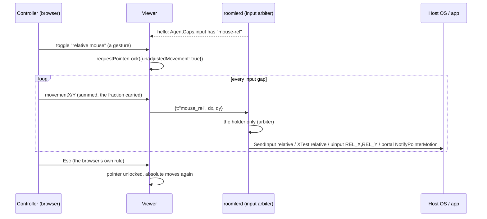

# FR-109: Relative mouse — Pointer Lock in the browser for apps that capture the pointer

**Issue:** [#2333](https://github.com/gjovanov/roomler-ai/issues/2333) · **Status:** in progress — spec and
claim · **Owner:** the agent's input path (`input/`, every injector), the viewer (Pointer Lock, the input
pump) · **Anchors:** master `7382639b8` · **Program:** [StarDesk teardown](../plans/stardesk-teardown-program.md),
wave 3 (§6.1, row P9) · **Builds on:** [FR-92](FR-92-keep-busy.md) (the agent never reads input), #1945
(the arbiter's release-all), FR-98 C3 (the input gap)

## 1. Goal

A controller in the browser can drive what reads **relative** mouse motion: a 3D or CAD viewport, a game
camera, anything that hides the cursor and recentres it every frame. StarDesk calls this "Client mouse"
(the teardown's row P9). Roomler has only the absolute mouse. When the host app captures the pointer, the
controller's cursor reaches the edge of the stage and the motion stops, while the app sees a pointer
pinned at the centre.

Nothing to install on the controlling side stays true: Pointer Lock is a web API.

## 2. Evidence (master `7382639b8`)

| What | Where |
|---|---|
| Every move is absolute: `mouse_move {x, y, mon}`, normalised `0..1` per monitor, so a resolution change mid-session needs no resync | [`input/mod.rs:164`](../../agents/roomlerd/src/input/mod.rs#L164) `InputMsg` |
| enigo moves to an absolute pixel | [`enigo_backend.rs:132`](../../agents/roomlerd/src/input/enigo_backend.rs#L132) `Coordinate::Abs` |
| The uinput device is an absolute tablet **by design**: "a relative device would force us to track the pointer and guess at acceleration" | [`uinput_backend.rs:18`](../../agents/roomlerd/src/input/uinput_backend.rs#L18), axes at `:297` |
| The portal path moves with `NotifyPointerMotionAbsolute` on the stream | [`portal/input.rs:440`](../../agents/roomlerd/src/capture/portal/input.rs#L440) |
| The viewer coalesces pointer moves at the input gap and sends the last position | [`useRemoteControl.ts:5853`](../../ui/src/composables/useRemoteControl.ts#L5853), the gap's key at `:2172` |
| The agent already says when the host hides its cursor (`cursor:hide`); the viewer only drops its ghost cursor | `useRemoteControl.ts:9082` |
| No Pointer Lock anywhere in the viewer | `git grep requestPointerLock ui/src`: nothing |
| `AgentCaps.input` today: `arbiter`, `exclusive`, `ghost-cursor` | [`caps.rs:1460`](../../agents/roomlerd/src/encode/caps.rs#L1460) |

## 3. Design

### 3a. The wire

- `InputMsg::MouseRel { dx: i32, dy: i32 }`, `t: "mouse_rel"`, in whole counts. The viewer sums
  `movementX/Y` across the input gap and carries the fraction into the next message, so slow motion is not
  rounded away.
- It is a **real variant**, like #1945's `MouseRelease`: every injector's match is exhaustive, so each
  backend has to decide what it does with it, and none can forget.
- **A click must not move the pointer.** `mouse_button` carries a position, and every backend moves there
  before the button (`input/mod.rs`, `MouseButton`). In relative mode the viewer has no position to send:
  the host app has hidden the cursor and owns where it is. So relative mode presses with a second new
  variant, `InputMsg::MousePress { btn }`, which presses where the pointer is. It releases with #1945's
  existing `MouseRelease { btn }`, which already lets go without moving. The wheel carries no position and
  needs nothing.
- ⚠️ An older agent fails to parse a variant it does not know, so the frame is **gated at both ends**:
  - the agent advertises `mouse-rel` in `AgentCaps.input` only where its injector can carry it;
  - the viewer sends `mouse_rel` only to an agent that advertises it;
  - the match is equality, and an unknown word is ignored (the `RpcCap` rule).

### 3b. Injection, per backend

| Backend | Relative motion | P0 checks |
|---|---|---|
| enigo, Windows (user worker) | `Coordinate::Rel` → `SendInput` with `MOUSEEVENTF_MOVE` and no `ABSOLUTE` | a raw-input reader sees the injected deltas; what pointer acceleration does to the cursor and to raw input |
| SystemContext (SYSTEM in the console session) | the same enigo, on its dedicated thread ([`system_context_backend.rs:5`](../../agents/roomlerd/src/input/system_context_backend.rs#L5)) | the same, from that worker |
| enigo, X11 | XTest relative motion | an XInput2 raw reader sees them |
| enigo, macOS | enigo's relative move | whether apps read the deltas, or a `CGEvent` needs the delta fields set (open decision 2) |
| uinput (system installs) | a **second**, relative-only device (`REL_X`, `REL_Y`), made on first use. The absolute tablet stays as it is | how libinput classifies it beside the tablet, on GNOME and KDE |
| the Wayland portal | `NotifyPointerMotion(dx, dy)`, which needs no stream | that GNOME and KDE honour it (open decision 3) |

### 3c. The arbiter

`mouse_rel` is movement. Only the session holding input injects it, the same as `mouse_move`.
Held-button tracking, the modifier fence and release-all on teardown are unchanged
([`arbiter.rs:17`](../../agents/roomlerd/src/input/arbiter.rs#L17)): a drag in relative mode is a held
button plus deltas.

### 3d. The viewer

- **Entering:** a toolbar toggle, shown only when the agent advertises `mouse-rel`. Pointer Lock needs a
  user gesture, and the toggle is one. `requestPointerLock({unadjustedMovement: true})` asks for raw,
  unaccelerated deltas. A browser that rejects the option gets plain Pointer Lock.
- **Leaving:** Esc, the browser's own rule, or the toggle. With Keyboard Lock active in fullscreen, Esc
  must be held. The viewer says so in its hint.
- **While locked:** `mousemove` carries `movementX/Y`; buttons and the wheel keep their messages. The
  ghost cursor is hidden.
- **Coalescing:** at the existing input gap (FR-98 C3), summing deltas instead of keeping the last
  position.

### 3e. Auto-switch (P3)

`cursor:hide` already arrives when the host hides its cursor. In relative-capable sessions it offers
relative mode: the next click inside the stage enters Pointer Lock (open decision 1), and the cursor coming
back (`cursor:shape`) leaves it.

⚠️ The lock screen and fullscreen video hide the cursor too. So the switch waits for a click, and **never**
happens while the host is locked.

### 3f. What the agent never does

The agent only injects. It never reads input, so there is no hook, no raw-input sink and no key polling, by
FR-92's rule. The field probes that read raw input (§5) are test scripts on throwaway guests, never part
of `roomlerd`.

## 4. Phases

| P | Scope | Kill switch | Status |
|---|---|---|---|
| P0 | This spec and the claim. Probes: (1) Windows `SendInput` relative from the user worker and from SystemContext, read by a raw-input probe that hides and recentres the cursor, with acceleration on and off; (2) X11 XTest relative; (3) a relative uinput device beside the tablet, on GNOME and KDE; (4) the portal's `NotifyPointerMotion`; (5) the browsers: Pointer Lock, `unadjustedMovement`, Esc under Keyboard Lock | docs only | spec and claim 2026-10-16 |
| P1 | The wire, the gate, enigo's relative path (Windows user and SystemContext, X11), the arbiter, the viewer's toggle and pump | agent `ROOMLERD_INPUT_MOUSE_REL=0` (stops advertising `mouse-rel`); viewer storage key | — |
| P2 | uinput's relative device; the portal and macOS by P0's answers | the same | — |
| P3 | Auto-switch on `cursor:hide` | viewer storage key | — |
| P4 | Docs: `docs/relative-mouse.md`, linked from `docs/remote-control.md` §6 and indexed in `docs/README.md` | — | — |

## 5. Acceptance criteria

- [ ] **AC1 (Windows, red first):** on a vmtest Win11 host, a probe script hides the cursor, recentres it
  and sums raw-input deltas. The controller moves 1000 counts right. Red: today the probe sees the motion
  stop where the controller's cursor reaches the stage edge. Green: in relative mode the probe's sum is
  within 5 % of the controller's, on the user worker and on SystemContext.
- [ ] **AC2 (Linux):** the same on an X11 host (XTest), and on a system install through uinput. The
  absolute pointer keeps working beside it in both.
- [ ] **AC3 (the gate):** an agent without `mouse-rel` never receives `mouse_rel`, and its viewer shows no
  toggle. An older viewer with a P1 agent works as today.
- [ ] **AC4 (the arbiter):** a watcher who does not hold input cannot move the pointer relatively, and a
  session that ends mid-drag still releases its button.
- [ ] **AC5 (auto-switch):** a hidden cursor offers relative mode on the next click; a locked host never
  enters it.
- [ ] **AC6 (no hooks):** a source scan in FR-92's shape covers this FR's agent code and fails on a planted
  raw-input registration.
- [ ] **AC7:** **Docs:** a `docs/relative-mouse.md` page (mermaid, the per-OS table, the limits), linked
  from `docs/remote-control.md` §6, with a row in `docs/README.md`'s index.

## 6. Open decisions

1. **Auto-switch.** Enter Pointer Lock on the next click while the host's cursor is hidden, or only offer
   it. Recommended: enter, with a visible "Esc releases the mouse" hint. The click is the gesture Pointer
   Lock needs anyway.
2. **macOS hosts.** enigo's relative move, or a `CGEvent` with its delta fields set explicitly. Recommended:
   let P0 decide by what a 3D app actually reads.
3. **The Wayland portal.** Relative motion through `NotifyPointerMotion`, or refused by name with a reason
   the viewer shows. Recommended: carry it if P0 shows GNOME and KDE honour it.
4. **The kill switch.** Recommended: the env var `ROOMLERD_INPUT_MOUSE_REL=0`, read once where the caps are
   built, so a device stops advertising and no viewer sends the frame; plus a viewer storage key.

## 7. Out of scope

- Gamepad passthrough (excluded by the operator).
- Touch presets and macros (the next wave-3 FR).
- Reading input on the host in any form (§3f).
- Changing the host's pointer speed or acceleration settings.

## 8. Field-verification log

| # | Date | Cell | Result |
|---|---|---|---|

## 9. Related

- [Plan §6.1](../plans/stardesk-teardown-program.md): this FR, and its place in wave 3.
- [FR-92](FR-92-keep-busy.md): the no-hooks rule.
- #1945: `MouseRelease`, the arbiter's release-all without a move.
- FR-98 C3: the input gap the pump coalesces at.
