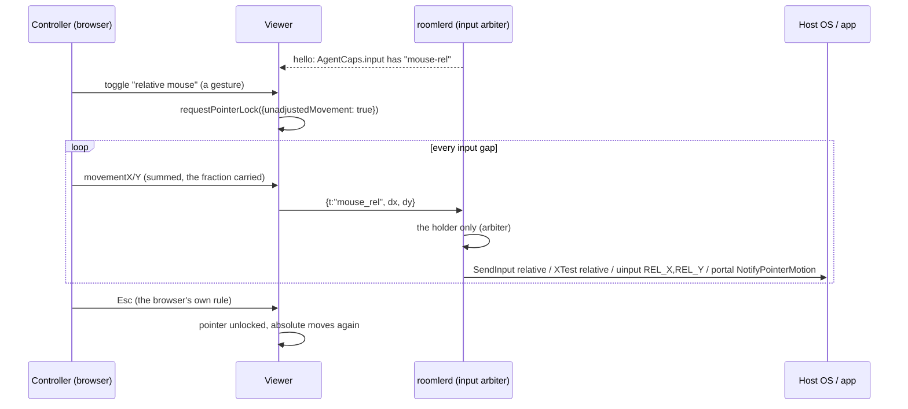

# FR-109: Relative mouse — Pointer Lock in the browser for apps that capture the pointer

**Issue:** [#2333](https://github.com/gjovanov/roomler-ai/issues/2333) · **Status:** in progress — P1 built
(Windows; [`docs/relative-mouse.md`](../relative-mouse.md)) · **Owner:** the agent's input path (`input/`, every injector), the viewer (Pointer Lock, the input
pump) · **Anchors:** master `7382639b8` · **Program:** [StarDesk teardown](../plans/stardesk-teardown-program.md),
wave 3 (§6.1, row P9) · **Builds on:** [FR-92](FR-92-keep-busy.md) (the agent never reads input), #1945
(the arbiter's release-all), FR-98 C3 (the input gap)

## 1. Goal

A controller in the browser can drive what reads **relative** mouse motion: a 3D or CAD viewport, a game
camera, anything that hides the cursor and recentres it every frame. StarDesk calls this "Client mouse"
(the teardown's row P9). Roomler has only the absolute mouse. When the host app captures the pointer, the
controller's cursor reaches the edge of the stage and the motion stops, while the app sees a pointer
pinned at the centre.

Nothing to install on the controlling side stays true: Pointer Lock is a web API.

## 2. Evidence (master `7382639b8`)

| What | Where |
|---|---|
| Every move is absolute: `mouse_move {x, y, mon}`, normalised `0..1` per monitor, so a resolution change mid-session needs no resync | [`input/mod.rs:238`](../../agents/roomlerd/src/input/mod.rs#L238) `InputMsg` |
| enigo moves to an absolute pixel | [`enigo_backend.rs:152`](../../agents/roomlerd/src/input/enigo_backend.rs#L152) `Coordinate::Abs` |
| The uinput device is an absolute tablet **by design**: "a relative device would force us to track the pointer and guess at acceleration" | [`uinput_backend.rs:18`](../../agents/roomlerd/src/input/uinput_backend.rs#L18), axes at `:298` |
| The portal path moves with `NotifyPointerMotionAbsolute` on the stream | [`portal/input.rs:449`](../../agents/roomlerd/src/capture/portal/input.rs#L449) |
| The viewer coalesces pointer moves at the input gap and sends the last position | [`useRemoteControl.ts:5864`](../../ui/src/composables/useRemoteControl.ts#L5864), the gap's key at `:2175` |
| The agent already says when the host hides its cursor (`cursor:hide`); the viewer only drops its ghost cursor | `useRemoteControl.ts:9162` |
| No Pointer Lock anywhere in the viewer | `git grep requestPointerLock ui/src`: nothing |
| `AgentCaps.input` today: `arbiter`, `exclusive`, `ghost-cursor` | [`caps.rs:1460`](../../agents/roomlerd/src/encode/caps.rs#L1460) |

## 3. Design

### 3a. The wire

- `InputMsg::MouseRel { dx: i32, dy: i32 }`, `t: "mouse_rel"`, in whole counts. The viewer sums
  `movementX/Y` across the input gap and carries the fraction into the next message, so slow motion is not
  rounded away.
- It is a **real variant**, like #1945's `MouseRelease`: every injector's match is exhaustive, so each
  backend has to decide what it does with it, and none can forget.
- **A click must not move the pointer.** `mouse_button` carries a position, and every backend moves there
  before the button (`input/mod.rs`, `MouseButton`). In relative mode the viewer has no position to send:
  the host app has hidden the cursor and owns where it is. So relative mode presses with a second new
  variant, `InputMsg::MousePress { btn }`, which presses where the pointer is. It releases with #1945's
  existing `MouseRelease { btn }`, which already lets go without moving. The wheel carries no position and
  needs nothing.
- ⚠️ An older agent fails to parse a variant it does not know, so the frame is **gated at both ends**:
  - the agent advertises `mouse-rel` in `AgentCaps.input` only where its injector can carry it;
  - the viewer sends `mouse_rel` only to an agent that advertises it;
  - the match is equality, and an unknown word is ignored (the `RpcCap` rule).

### 3b. Injection, per backend

| Backend | Relative motion | P0 checks |
|---|---|---|
| enigo, Windows (user worker) | `Coordinate::Rel` → `SendInput` with `MOUSEEVENTF_MOVE` and no `ABSOLUTE` | a raw-input reader sees the injected deltas; what pointer acceleration does to the cursor and to raw input |
| SystemContext (SYSTEM in the console session) | the same enigo, on its dedicated thread ([`system_context_backend.rs:5`](../../agents/roomlerd/src/input/system_context_backend.rs#L5)) | the same, from that worker |
| enigo, X11 | XTest relative motion | an XInput2 raw reader sees them |
| enigo, macOS | enigo's relative move | whether apps read the deltas, or a `CGEvent` needs the delta fields set (open decision 2) |
| uinput (system installs) | a **second**, relative-only device (`REL_X`, `REL_Y`), made on first use. The absolute tablet stays as it is | how libinput classifies it beside the tablet, on GNOME and KDE |
| the Wayland portal | `NotifyPointerMotion(dx, dy)`, which needs no stream | that GNOME and KDE honour it (open decision 3) |

### 3c. The arbiter

`mouse_rel` is movement. Only the session holding input injects it, the same as `mouse_move`.
Held-button tracking, the modifier fence and release-all on teardown are unchanged
([`arbiter.rs:17`](../../agents/roomlerd/src/input/arbiter.rs#L17)): a drag in relative mode is a held
button plus deltas.

### 3d. The viewer

- **Entering:** a toolbar toggle, shown only when the agent advertises `mouse-rel`. Pointer Lock needs a
  user gesture, and the toggle is one. `requestPointerLock({unadjustedMovement: true})` asks for raw,
  unaccelerated deltas. A browser that rejects the option gets plain Pointer Lock.
- **Leaving:** Esc, the browser's own rule, or the toggle. With Keyboard Lock active in fullscreen, Esc
  must be held. The viewer says so in its hint.
- **While locked:** `mousemove` carries `movementX/Y`; buttons and the wheel keep their messages. The
  ghost cursor is hidden.
- **Coalescing:** at the existing input gap (FR-98 C3), summing deltas instead of keeping the last
  position.

### 3e. Auto-switch (P3)

`cursor:hide` already arrives when the host hides its cursor. In relative-capable sessions it offers
relative mode: the next click inside the stage enters Pointer Lock (open decision 1), and the cursor coming
back (`cursor:shape`) leaves it.

⚠️ The lock screen and fullscreen video hide the cursor too. So the switch waits for a click, and **never**
happens while the host is locked.

### 3f. What the agent never does

The agent only injects. It never reads input, so there is no hook, no raw-input sink and no key polling, by
FR-92's rule. The field probes that read raw input (§5) are test scripts on throwaway guests, never part
of `roomlerd`. A unit test holds this
([`input/mod.rs:688`](../../agents/roomlerd/src/input/mod.rs#L688) `fr109_relative_mouse_reads_no_input`,
AC6). It scans the six files relative mode touches for hooks, raw-input registration and reads,
keyboard-state reads, an evdev grab, XRecord, XI2 event selection and a macOS event tap. It allows exactly
one key-state call: FR-92's own keep-busy check for a held mouse button (`buttons_held_now`), and only
inside that function.

### 3g. As built (P1)

- **The wire:** `MouseRel { dx: i32, dy: i32 }` and `MousePress { btn }`. A fractional `dx` does not parse,
  so the agent drops it as it drops any unreadable frame.
- **The gate:** `advertises_mouse_rel()` is true on a Windows build with `enigo-input` unless
  `ROOMLERD_INPUT_MOUSE_REL` says a false word, and `stub_caps` appends the word at every announcement,
  beside `keep-busy`. The viewer offers the control on equality, unless the browser's
  `roomler-rc-relative-mouse` is `off`.
- **Windows** needed one change for both injectors: enigo's shared `dispatch`, which the SystemContext
  worker reuses through `dispatch_for_external`.
- **The arbiter** tracks `MousePress` as held. Its tracking ended in a `_ => {}` arm, where the new press
  would have fallen through, and a session ending mid-drag would never have let go.
- **Leaving Pointer Lock** sends the gathered motion and releases held buttons with `mouse_release`. The
  blur release uses `mouse_release` too in relative mode: the old one sent `mouse_button` at the last
  absolute point, which would throw a captured pointer there.
- `docs/relative-mouse.md` has the tables and the anchors.

## 4. Phases

| P | Scope | Kill switch | Status |
|---|---|---|---|
| P0 | This spec and the claim. Probes: (1) Windows `SendInput` relative from the user worker and from SystemContext, read by a raw-input probe that hides and recentres the cursor, with acceleration on and off; (2) X11 XTest relative; (3) a relative uinput device beside the tablet, on GNOME and KDE; (4) the portal's `NotifyPointerMotion`; (5) the browsers: Pointer Lock, `unadjustedMovement`, Esc under Keyboard Lock | docs only | spec and claim 2026-10-16 (#2334). **(1), (2) and (5) measured** (§8 rows 1, 2, 4): relative `SendInput` and relative XTest both reach a raw reader 1:1, absolute moves give it nothing on either, and every headless engine rejects `unadjustedMovement`. Owed: (1) from SystemContext (AC1's green), (3) uinput beside the tablet, (4) the portal, which decide the rest of P2 |
| P1 | The wire, the gate, enigo's relative path (Windows user and SystemContext), the arbiter, the viewer's toggle and pump | agent `ROOMLERD_INPUT_MOUSE_REL=0` (stops advertising `mouse-rel`); viewer `roomler-rc-relative-mouse=off` | **built** (3g): `mouse_rel` and `mouse_press` in every backend's match. Windows advertises `mouse-rel`; Linux and macOS do not until P2, and their backends press where the pointer is but drop relative motion. Unit tests: wire spellings, the kill switch, enigo's calls, the arbiter, uinput's events, the portal plan, and the viewer's accumulator and gate (vitest 2153). Negative controls, each of which failed its test: a prefix-matched cap, rounding in the accumulator (it passed at first, so the test was tightened), a dropped carry, an untracked press, and a press that moves first. **Shipped in 0.4.140, where the field found a Windows relative move going out ABSOLUTE** (enigo's default, §8 row 5). It is fixed by building every enigo with `windows_subject_to_mouse_speed_and_acceleration_level` (#2352, merged `29184b9a3`), and the fix rides the next agent release. **On #2352's candidate, AC1 is green on both Windows paths and AC4 is green** (§8 rows 6–8). AC6's source scan is added. AC3 is green with master's viewer served into the page (§8 row 9). Owed: AC1 and AC4 again on the release that carries #2352, and AC3 again once a promote serves the viewer |
| P2 | X11 through enigo's XTest (P2a); uinput's relative device, the portal and macOS by P0's answers | the same | **P2a built**: on Linux, `advertises_mouse_rel` asks `linux_xtest_carries_rel`. It is yes only when the cached desktop brief is an `x11` session with `full` input reach, uinput is not opted in, and no automatic system capture (FR-95) is alive, because those two route a session to uinput. enigo's `MouseRel` arm already sent XTest relative motion on every OS, so the advertisement was all that was missing. A unit test covers the predicate's eight cases. The field cell on an X11 host is owed. uinput's relative device, the portal and macOS: not built |
| P3 | Auto-switch on `cursor:hide` | viewer storage key | — |
| P4 | Docs: `docs/relative-mouse.md`, linked from `docs/remote-control.md` §6 and indexed in `docs/README.md` | — | the page exists from P1 and grows with each phase |

## 5. Acceptance criteria

- [x] **AC1 (Windows, red first):** on a vmtest Win11 host, a probe script hides the cursor, recentres it
  and sums raw-input deltas. The controller moves 1000 counts right. Red: today the probe sees the motion
  stop where the controller's cursor reaches the stage edge. Green: in relative mode the probe's sum is
  within 5 % of the controller's, on the user worker and on SystemContext. **Verified on #2352's exact
  code** (its candidate rehearsal; §8 rows 6 and 8). The probe summed exactly **1000** on the user worker and
  on SystemContext. The reds: 0 on 0.4.139, which could not parse the frame (row 3), and 0 relative with 10
  absolute on the released 0.4.140, on both paths (rows 5 and 6). The agent release that carries #2352
  gets the same cell before the close.
- [ ] **AC2 (Linux):** the same on an X11 host (XTest), and on a system install through uinput. The
  absolute pointer keeps working beside it in both.
- [x] **AC3 (the gate):** an agent without `mouse-rel` never receives `mouse_rel`, and its viewer shows no
  toggle. An older viewer with a P1 agent works as today. **Verified** (§8 rows 5–9). Master's viewer, served
  into the page, offered the control to the 0.4.140 agent and not to the same agent with
  `ROOMLERD_INPUT_MOUSE_REL=0`, and sent it no `mouse_rel`. Production's older viewer drove 0.4.140
  normally. It gets re-checked once a promote serves this viewer.
- [x] **AC4 (the arbiter):** a watcher who does not hold input cannot move the pointer relatively, and a
  session that ends mid-drag still releases its button. **Verified on #2352's candidate** (§8 row 7). With
  input exclusive, the watcher's 70 counts never reached the host (1030, not 1100). The holder's press,
  dropped mid-drag by its disconnect, was let go: left button 1 down, 1 up, and only the arbiter could
  have sent that up.
- [ ] **AC5 (auto-switch):** a hidden cursor offers relative mode on the next click; a locked host never
  enters it.
- [x] **AC6 (no hooks):** a source scan in FR-92's shape covers this FR's agent code and fails on a planted
  raw-input registration. **Verified:** `input::tests::fr109_relative_mouse_reads_no_input` (§3f) passed
  on Windows. Two negative controls each failed it, with the file and line. A `RegisterRawInputDevices`
  string constant planted at the end of `arbiter.rs` failed with `input/arbiter.rs:1848: uses
  RegisterRawInputDevices`. A `GetAsyncKeyState` one planted at the end of `enigo_backend.rs`, outside
  FR-92's mouse-button read, failed with `polls key state outside FR-92's mouse-button read`. Restored
  from a copy, it passed again. It is a sibling of FR-92's own scan and of FR-108's, for the reason FR-108
  gives: FR-92's scan asserts that it lists every file of `keep_busy/`.
- [ ] **AC7:** **Docs:** a `docs/relative-mouse.md` page (mermaid, the per-OS table, the limits), linked
  from `docs/remote-control.md` §6, with a row in `docs/README.md`'s index.

## 6. Open decisions

1. **Auto-switch.** Enter Pointer Lock on the next click while the host's cursor is hidden, or only offer
   it. Recommended: enter, with a visible "Esc releases the mouse" hint. The click is the gesture Pointer
   Lock needs anyway.
2. **macOS hosts.** enigo's relative move, or a `CGEvent` with its delta fields set explicitly. Recommended:
   let P0 decide by what a 3D app actually reads.
3. **The Wayland portal.** Relative motion through `NotifyPointerMotion`, or refused by name with a reason
   the viewer shows. Recommended: carry it if P0 shows GNOME and KDE honour it.
4. **The kill switch.** Recommended: the env var `ROOMLERD_INPUT_MOUSE_REL=0`, read once where the caps are
   built, so a device stops advertising and no viewer sends the frame; plus a viewer storage key.

## 7. Out of scope

- Gamepad passthrough (excluded by the operator).
- Touch presets and macros (the next wave-3 FR).
- Reading input on the host in any form (§3f).
- Changing the host's pointer speed or acceleration settings.

## 8. Field-verification log

| # | Date | Cell | Result |
|---|---|---|---|
| 1 | 2026-10-16 | **P0 (1): `SendInput` and a raw-input reader, no agent involved.** A kept vmtest Win11 guest with `vmtest` Active at the console. A test-only probe, run as the person through an interactive task, reads raw mouse input (`RIDEV_INPUTSINK`), sums relative deltas, counts absolute events and recentres the cursor after every move. A second task, also as the person, sends 10 moves of +100 with `SendInput`, relative (`MOUSEEVENTF_MOVE`, what enigo's `Coordinate::Rel` sends) or absolute (`MOVE\|ABSOLUTE`, what every viewer move becomes today) | **Relative arrives 1:1; absolute gives a raw reader nothing.** Relative and recentred: sum **1000**, 10 relative events. Absolute and recentred: **0** relative, 10 absolute events. Relative without recentring: 1000. So pointer acceleration does not touch the raw deltas, and recentring with `SetCursorPos` adds no raw motion. The same from SystemContext is AC1's green |
| 2 | 2026-10-16 | **P0 (5): Pointer Lock in Playwright's headless engines** (image v1.62). A local page asks for Pointer Lock on a click, `{unadjustedMovement: true}` first and plain if rejected, then gets 10 synthetic moves of +10 px | **Every engine rejects `unadjustedMovement`.** Chromium 151 and Firefox 153 then lock with plain Pointer Lock; WebKit 26.5 cannot lock ("requires the window to have focus"). The synthetic `movementX` is unusable: Chromium sums to (−200, −150) over 84 events, Firefox to (−3850, −2100). So P1's fallback to plain Pointer Lock is load-bearing, and AC1's cell sends exact `mouse_rel` frames on the input channel instead of measuring through headless Pointer Lock |
| 3 | 2026-10-16 | **AC1 and AC3, the red (0.4.139).** The kept guest of row 1 on agent 0.4.139; prod at `hosted-20261016-377f1d4`; row 1's probe sums raw input for 150 s while the production viewer, driven by Playwright from the vmtest harness host, holds a session (`rel-ac1.sh`) | **Nothing relative reaches the host today.** `red-abs`, the viewer's own 10 absolute moves: the probe sums **0** relative and counts 20 absolute events. `red-rel`, 10 × `mouse_rel {dx: 100}` sent raw on the input channel: **0** and 0, because the old agent cannot parse the frame and drops it safely. The agent advertised `input = ["arbiter", "exclusive", "ghost-cursor", "keep-busy"]`, with no `mouse-rel`, and the viewer showed no relative-mouse control. The green is owed on 0.4.140, which carries P1 (#2337) |
| 4 | 2026-10-17 | **P0 (2): XTest relative on X11, no agent involved.** Xvfb (X.Org 21.1) on a dev box; `xinput test-xi2 --root` records XI2 events; `xdotool` sends 10 moves of +100 through XTest, relative (`mousemove_relative`, the same `XTestFakeRelativeMotionEvent` enigo's X11 `Coordinate::Rel` uses) or absolute | **The same picture as Windows.** Relative: **10** RawMotion events, raw dx summing to exactly **1000.0**. Absolute: **0** RawMotion events (10 plain Motion events). So an X11 game that reads XI2 raw motion gets relative moves 1:1 and nothing from absolute ones. P2 can advertise `mouse-rel` on X11 sessions whose injector is enigo. A real Xorg with a compositor, and Xwayland, are not measured |
| 5 | 2026-10-17 | **AC1, the first green attempt (0.4.140): it FAILED.** Row 3's guest, updated to the released 0.4.140 (the MSI installed directly; `roomlerd self-update` exited 1601 there) and re-enrolled. It advertised `input = [..., "mouse-rel"]`. Row 3's cell was run again: 10 × `mouse_rel {dx: 100}`, then the viewer's absolute moves as the control | **The frames arrived, but as absolute moves.** `green-rel`: the probe summed **0** relative and counted **10 absolute** events, one per frame. `green-abs`: 0 and 20, as before. **Root cause, read in enigo 0.6.1** (`src/win/win_impl.rs`, `move_mouse`): with the default `windows_subject_to_mouse_speed_and_acceleration_level = false`, `Coordinate::Rel` reads the cursor and sends an ABSOLUTE move to cursor + delta, so that pointer acceleration does not apply. Only with the flag set does it send `MOUSEEVENTF_MOVE`. P1's dispatch test checked that `Rel` was *asked for*, and P0 (1) used `SendInput` itself, so neither could see this. **Fixed:** one `enigo_settings()` with the flag set, at all five `Enigo::new` sites (the user worker's and SystemContext's four), plus a test that locks the flag; a negative control with it off failed that test. The green is re-run on the candidate |
| 6 | 2026-10-17 | **AC1 on the user worker: red on the release, green on the fix.** A fresh vmtest Win11 `--type user` install of the released 0.4.140 (`vmtest-w-ins-use-060348`), with `vmtest` Active at the console, running row 3's probe and cell. First the released exe as shipped. Then its `roomlerd.exe` was swapped for the one in #2352's candidate rehearsal (run 39007933040, `077cede61`): taken out of the per-user MSI with `msiexec /a`, the released exe kept beside it. The candidate carries the release's version number, so it never ran outside throwaway guests | **The per-user worker had row 5's bug, and the fix cures it.** Released 0.4.140: 10 × `mouse_rel {dx: 100}` reached the probe as **0** relative and **10 absolute** events. Candidate: **1000** relative in 10 events, **0** absolute, exactly the controller's counts. The agent advertised `mouse-rel` both times. The production viewer (`hosted-20261016-377f1d4`, before #2337) offered no relative-mouse control, so the frames went raw on the input channel, as in row 3. One more thing from row 5: there, `roomlerd self-update` exited 1601, yet a direct `msiexec /i` from the same elevated SSH session installed the MSI. So the session could reach the Windows Installer, and why the updater path failed is still open |
| 7 | 2026-10-17 | **AC4, the arbiter, on the candidate (row 6's guest).** Two sessions from the production viewer in two browser contexts, A and B. A switched the device's input to exclusive on its control channel, which made A the holder (`rc:control.state` showed `holder: A` to both). B, the watcher, sent 10 × `mouse_rel {dx: 7}`. A sent 10 × `{dx: 100}`, then `mouse_press left`, then disconnected mid-drag. B, which the floor passed to, sent 10 × `{dx: 3}` as the positive control. The probe (row 1's, also counting left-button downs and ups) watched throughout | **The watcher moved nothing, and the dropped drag let go.** The probe summed **1030** in 20 relative events: A's 1000 and B's 30 once it held the floor. B's 70 as a watcher never reached the host (a leak would have read 1100). Left button: **1 down, 1 up**. A's press went raw on the input channel, so the viewer's own held-button tracker never knew of it, and B sent no button at all. The up can only be the arbiter's release-all when A's session closed. The floor passed to B 44 ms before A's disconnect click returned |
| 8 | 2026-10-17 | **AC1 on SystemContext, green on the fix.** Row 5's guest (`vmtest-w-ins-sys-102216`, `--type system`, released 0.4.140), with its `roomlerd.exe` swapped for the candidate's from the perMachine MSI. It is the same binary as row 6's (SHA-256 `4346fbc4…`, against the release's `94827598…`). The device was re-enrolled after the service restart and its `lock_on_end` pinned to `never`, so that no lock at a session's end could take the probe's desktop away. Row 3's cell, then the viewer's absolute moves as the control | **SystemContext carries relative motion now.** `cand-sys-rel`: **1000** relative in 10 events, **0** absolute. On the release, row 5 read 0 relative and 10 absolute. `cand-sys-abs`: 0 relative and 20 absolute, as on every build. With row 6, AC1 holds on both Windows paths |
| 9 | 2026-10-17 | **AC3, the viewer half, on master's viewer.** Production still serves the viewer from before #2337. So master's own viewer (a `ui/dist` build of master plus FR-111's P1a) was served into the page on the real origin by Playwright, with `/api` and `/ws` going to production, which is the code a promote ships. The agent was the released 0.4.140 on a fresh vmtest Win11 `--type system` guest (`vmtest-w-ins-sys-065622`). It ran as shipped, then with the agent's kill switch `ROOMLERD_INPUT_MOUSE_REL=0` set in the service environment (restart and re-enroll), then with it cleared. Each cell logged the agent's `capabilities.input`, whether the control showed, and every frame the page sent on its input channel while the pointer crossed the stage | **The control follows the agent's word, and no `mouse_rel` goes where it is not advertised.** As shipped: `input` ends in `mouse-rel`, the toolbar control **shows**, and a click on it locked the pointer. The page sent `mouse_move` × 30 and `key` × 2 (the Esc that left the lock). With the kill switch: `input` has no `mouse-rel`, the control **does not show**, and the page sent `mouse_move` × 30 and **no `mouse_rel`**. That also proves the agent's kill switch. The other half (an older viewer with a P1 agent works as today) is rows 5–8: production's pre-#2337 viewer drove 0.4.140 and the candidate normally, and its absolute moves arrived |

## 9. Related

- [Plan §6.1](../plans/stardesk-teardown-program.md): this FR, and its place in wave 3.
- [FR-92](FR-92-keep-busy.md): the no-hooks rule.
- #1945: `MouseRelease`, the arbiter's release-all without a move.
- FR-98 C3: the input gap the pump coalesces at.
