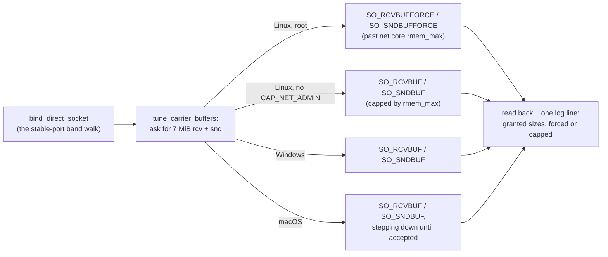

# FR-110: Overlay throughput — the carrier sockets ask for buffers the size of a burst

**Issue:** [#2350](https://github.com/gjovanov/roomler-ai/issues/2350) · **Status:** **closed 2026-10-17**,
field-verified on the released **0.4.141** (§9) — spec and claim the same day, on the operator's *"make #2350 an
FR and fix it for 0.4.141"*, after FR-107's field test put an Apple M2 Pro Linux host on its org's mesh and
measured it · **Owner:** networking (the overlay's carrier
plane) · **Anchors:** master `597aaf14f` · **Builds on:** [multi-org v2](../multi-org.md) (§4a, the shared
carrier plane), [FR-107](FR-107-drm-capture-throughput.md) (where it was found),
[FR-97](FR-97-os-feature-parity.md) (N8 / P3i, the host firewall: a separate gap of the same shape)

## 1. Goal

TCP over the overlay runs at the path's capacity, not at what a default-sized UDP receive buffer survives.
The overlay already measures paths and picks the best carrier. Once it has, the daemon must not drop the
carrier's own datagrams before reading them.

## 2. Evidence (2026-10-17)

The host: Fedora Asahi Remix 42 on an Apple M2 Pro (aarch64). It had just joined its org's mesh as a
secondary enrollment. The overlay and the host were otherwise healthy:

- direct paths to every peer that allows one, with 0% probe loss;
- MagicDNS both ways, a QUIC tunnel forward, and SSH over the overlay.

**What was measured.** 256 MiB over SSH between that host and a Linux server in another provider's
datacenter (17 ms apart):

| | over the overlay | over the public internet |
|---|---|---|
| server → Asahi host | **116–149 Mbit/s** | 785 Mbit/s |
| Asahi host → server | **254–347 Mbit/s** | 648 Mbit/s |

A Windows laptop behind home NAT pulled 40 Mbit/s from the host over the overlay. The same laptop pulled
313 Mbit/s from a public CDN.

**Why: drops at the receiving socket, not CPU.**

- **CPU was idle.** During the server → host upload the receiver's daemon used ~1% CPU (an M2 Pro) and the
  sender's used 0.8% of one core. ChaCha20 at ~19 MB/s costs that much.
- **The receiving socket overflowed.** The receiver's `/proc/net/snmp` `RcvbufErrors` rose by **303–623**
  per 256 MiB, and TCP inside the tunnel read each drop as congestion.
- **The buffer is the kernel default.** All of the daemon's carrier sockets showed `rb212992` in
  `ss -uampn`, although that host allows 4 MiB (`net.core.rmem_max`). `crates/tunnel-core/src/overlay`
  never calls `SO_RCVBUF` or `SO_SNDBUF`.

**The hypothesis proven with no code change.** The daemon never sets the buffer, so its sockets take
`net.core.rmem_default`. That was raised to 4 MiB at runtime, the daemon restarted, and the same transfer
repeated. Then everything was reverted:

| The receiver's carrier buffer | server → host, 256 MiB | the receiver's `RcvbufErrors` |
|---|---|---|
| 208 KB, the default (0.4.140) | **116 / 128 Mbit/s** | +455 / +623 |
| 4 MiB | **520 / 522 Mbit/s** | **+0** |

That is 4.3× faster, with no drops. The other direction did not move, because the server's sockets were
unchanged.

## 3. Key design

- **One seam.** Every direct carrier socket is bound by `bind_direct_socket`
  (`crates/tunnel-core/src/overlay/direct.rs:1570`). That covers the shared carrier plane's `lan` and
  `public-dial` sockets (`carrier_plane.rs:338`, `:362`) and the per-runtime binds kept behind
  `overlay_shared_carrier = false` (`runtime/establish.rs:822`, `:862`). Tuning right after the bind covers
  both modes, every org and every OS.
- **The size: 7 MiB, receive and send.** That is what wireguard-go and Tailscale ask for. A burst at
  1 Gbit/s fills 208 KB in under 2 ms.
- **⚠️ Linux needs the FORCE variants.** `SO_RCVBUF` is capped by `net.core.rmem_max`, and that is 212992 on
  most distributions; the test server above has exactly that. A plain `SO_RCVBUF` would therefore change
  nothing where it matters most. The daemon runs as root under systemd, so it may use
  `SO_RCVBUFFORCE`/`SO_SNDBUFFORCE`. When those are refused (`EPERM`, no `CAP_NET_ADMIN`), it falls back to
  the capped call. Either way the socket works.
- **Windows** has no such cap: `SO_RCVBUF`/`SO_SNDBUF` take the size. **macOS** caps by
  `kern.ipc.maxsockbuf`, so the request steps down (7 → 4 → 2 → 1 MiB) until one is accepted.
- **Said once per socket.** The size actually granted is read back and logged with the socket's role (`lan`,
  `public-dial`), and with whether it was forced or capped. On Windows, where nothing like `ss -m` exists,
  that line is the evidence.
  ⚠️ The packaged Linux units set `RUST_LOG=roomlerd=info,warn`, which drops `tunnel_core` INFO. The first
  candidate's buffers were in place (`ss`: `rb14680064`) while the line never reached the journal. So the
  logger appends `tunnel_core::overlay::sockbuf=info` unconditionally
  (`crates/agent-core/src/logging.rs:225`), as it already does for the `turn` crate's refresh warnings.
- **Kill switch:** `ROOMLERD_OVERLAY_SOCKBUF=0` skips the tuning, so the sockets keep the OS default as
  before FR-110.
- **What it costs.** The kernel charges a socket's buffer only for datagrams actually queued, so an idle
  socket costs nothing. A queue builds only when the reader falls behind the arrival rate. Then datagrams
  wait instead of being dropped, and for TCP inside the tunnel a drop costs more than the wait.

## 4. Phases

| Phase | What | Kill switch | Proven on | Size |
|---|---|---|---|---|
| **P1** | the carrier buffers, on all three OSes (§3) | `ROOMLERD_OVERLAY_SOCKBUF=0` | ✅ the released **0.4.141** (§9), against 0.4.140's red; first on a candidate on the Asahi box. Unit: `the_request_steps_down_and_never_up`, `a_carrier_socket_asks_and_never_ends_smaller`, `a_tuned_socket_still_carries_datagrams`; as root on Linux (`#[ignore]`d): `as_root_linux_forces_past_the_cap` | S |
| **P2** | docs: §2 of `docs/overlay-communication.md` (the direct carrier's socket buffers), §9's switch, §10's record, and the `docs/README.md` index row | — | ✅ with P1; the release's numbers at the close | S |

## 5. Test plan

- **Unit, every OS:**
  - The helper asks for the size and reads back at least the OS default.
  - Without the privilege to force on Linux, it falls back and the socket still sends and receives.
  - The kill switch leaves the default untouched.
- **Field, the same pair as §2.** On 0.4.140 first (the red), then the candidate:
  - The server → host transfer with the receiver's `RcvbufErrors` delta.
  - `ss -uampn` on the carrier sockets.
  - The log line.
- **A receiver whose `rmem_max` is the distro default** (212992), to prove that FORCE reaches the size where
  the plain call cannot.
- **A Windows receiver** (a lab guest): the log line, and throughput before and after.
- **Regression:** direct, srflx and DERP paths come up as before, and a remote-control session works. (On a
  default device the session does not ride the overlay at all: AC5.)

## 6. Acceptance criteria

- [x] **AC1** — From the Linux server to the Asahi host over the overlay, 256 MiB: **≥ 400 Mbit/s with
  `RcvbufErrors` +0** on the receiver. Red first on 0.4.140 (116–128 Mbit/s, +455 / +623). Field-verified on
  the released build. *(✅ 0.4.141, the release's own bytes: **516 / 543 Mbit/s, +0**, both carrier sockets
  `rb14680064`, forced; §9 10:04Z.)*
- [x] **AC2** — On a Linux host whose `net.core.rmem_max` is the distro default (212992), the daemon running
  as root gets the full buffer on its carrier sockets (`ss -uampn`). A daemon without `CAP_NET_ADMIN` keeps
  working on what the cap allows, and says so. *(✅ 0.4.141. As root under that cap: `rb14680064`, 512 Mbit/s,
  +0; §9 10:04Z. A per-user Ubuntu install, which runs with no capabilities (`CapEff` all zero): `rb425984`,
  the cap doubled, and the WARN on both sockets, *"run the daemon as root, or raise net.core.rmem_max"*,
  while its mesh stayed up; §9 11:26Z.)*
- [x] **AC3** — Windows and macOS log the granted sizes. A Windows receiver's throughput over the overlay is
  measured before and after. *(✅ 0.4.141. Both log `recv=7340032 send=7340032 recv_how=Plain`: the full 7 MiB,
  on a Windows 11 guest and on a Mac whose `kern.ipc.maxsockbuf` is 8 MiB. A Windows receiver, interleaved
  with 0.4.140 under the same load: **416 → 435 Mbit/s** (means of 5 runs, every pair faster), with UDP
  Receive Errors 0 → 0 on both. Windows was not dropping at its default, so it gains little; §9 11:12Z.)*
- [x] **AC4** — `ROOMLERD_OVERLAY_SOCKBUF=0` restores the OS default (`ss`: `rb212992` on that Linux host).
  *(✅ 0.4.141: every socket `rb212992`, the line says "left at the OS default", and the drops come back:
  146 Mbit/s, +588; §9 10:04Z.)*
- [x] **AC5** — No regression: direct, srflx and DERP paths come up as before, and a remote-control session
  works. *(Reworded at the close; it read "a remote-control session over the overlay works". Since #1882, a
  session rides the overlay only on a device whose `rc_overlay` is on. That is off by default, after
  [FR-64](FR-64-remote-desktop-never-rides-the-overlay.md)'s decision that remote desktop should not ride the
  mesh. So on a default device the session's media never reaches the sockets this FR changed. ✅ 0.4.141:
  from the Asahi host every peer in both orgs came up direct, srflx included, and the one that rode DERP
  before still does. A session to it reached Active, and P9c recorded `direct`; §9 10:17Z.)*
- [x] **AC6** — Docs: `docs/overlay-communication.md` in the house style, and a `docs/README.md` index row.
  *(✅ shipped with P1 in #2364; the release's numbers added at the close.)*

## 7. Open decisions (operator)

| | Decision | Status |
|---|---|---|
| **D1** | The size | **7 MiB for receive and send**, as built and released in 0.4.141 (wireguard-go's and Tailscale's choice). 4 MiB already removed every drop in §2's experiment, and 7 MiB leaves room for faster links. Windows and macOS grant it in full; Linux grants it to a root daemon through FORCE |
| **D2** | The relay carriers' sockets (the TURN client, the FR-19 org relay) | **Not in this FR.** They carry relay paths, which the ladder prefers less, and they bind elsewhere. Measure them first |

## 8. Out of scope

- **Batched datagram I/O** (`recvmmsg`/`sendmmsg`, UDP GSO/GRO). That is the next lever if the field shows
  CPU becoming the limit once drops are gone. Today CPU is at ~1%.
- **The host firewall** (FR-97 N8 / P3i): on a Fedora Server-zone host the roomler adapters fall under the
  default zone.
- **The MagicDNS resolver's socket** and other non-carrier sockets.

## 9. Field-verification log

| Date | Host | Build | What | Result |
|---|---|---|---|---|
| 2026-10-17 04:20Z | the Asahi box (M2 Pro, Fedora Asahi Remix 42) on its org's mesh; the Linux server 17 ms away | 0.4.139-era candidate, then the released 0.4.140 | the finding (#2350) | 🔴 The server → host transfer ran at 121–149 Mbit/s over the overlay, against 785 over the public path. The receiver's `RcvbufErrors` rose by +303 per 256 MiB. CPU was ~1% on both ends. All carrier sockets showed `rb212992` in `ss`. The Windows laptop pulled 40 Mbit/s over the overlay, against 313 from a CDN |
| 2026-10-17 06:50Z | the same pair | 0.4.140 | the hypothesis, with no code change | ✅ With `net.core.rmem_default` raised to 4 MiB (runtime only) and the daemon restarted, the same transfer ran at **520 / 522 Mbit/s** with `RcvbufErrors` **+0**. At the default it had run at 116 / 128 Mbit/s with +455 / +623. Reverted afterwards: every socket was back to `rb212992` |
| 2026-10-17 07:00Z | the box, natively (aarch64) | master `597aaf14f` + P1 | the code, as root and not | ✅ `cargo clippy -p roomler-ai-tunnel-core --features overlay-l3,overlay-netstack --all-targets -D warnings` and CI's full roomlerd clippy line both rc 0. As `wlab` (no `CAP_NET_ADMIN`) the unit tests pass on the plain path. As root, `as_root_linux_forces_past_the_cap` passes. **It still passes with `rmem_max`/`wmem_max` lowered to the distro default 212992**, where the plain option could reach only 425984, so the pass is FORCE's. The root guard fails it as `wlab` (*"run this test as root"*) |
| 2026-10-17 07:25Z | the box (the receiver) and the Linux server 17 ms away, over the org's mesh | a candidate, master `8a1babe8a` + P1, as the box's system service; back on the released 0.4.140 afterwards (its bytes, `6c338ca5…`) | AC1, AC2, AC4, AC5 against 0.4.140's red | ✅ **AC1:** the carrier sockets show `rb14680064` (7 MiB, Linux reports double), with every other socket still at the default. The log line reads `what="lan" … recv=14680064 send=14680064 recv_how=Forced send_how=Forced`. Server → box, 256 MiB: **520 / 515 Mbit/s with `RcvbufErrors` +0**; red on 0.4.140: 116 / 128 Mbit/s, +455 / +623. **AC2:** the daemon as root with `rmem_max`/`wmem_max` at 212992 still got `rb14680064`: **528 Mbit/s, +0**. **AC4:** `ROOMLERD_OVERLAY_SOCKBUF=0` leaves every socket at `rb212992` and logs *"left at the OS default"*, and the drops come back: 135 Mbit/s, +311. **AC5:** from the box, grox peers came up direct, and those that rode DERP before still do. An RC session ran; P9c recorded it as `direct` (host IPv6 to the server's srflx IPv6), so it did not ride the overlay. ⚠️ **Wrong turns:** the first candidate's buffers were right, but its log line was invisible: the packaged unit's `RUST_LOG=roomlerd=info,warn` drops `tunnel_core` INFO (§3). The first run also died when SSH over the overlay timed out right after a restart, with a ping already answering, so the wait is now on SSH itself. And the RC check could not run while my own script held the lab lock |
| 2026-10-17 08:59Z | a vmtest Windows 11 guest (SystemContext) receiving from an Ubuntu guest on the same lab LAN, over the mesh's LAN-direct tier | the released 0.4.140 on both | AC3's before | 256 MiB ×2: **424 / 433 Mbit/s**, every byte received, Windows UDP Receive Errors 0 → 0. No FR-110 line (0.4.140 has none). Windows was not dropping at its default buffer |
| 2026-10-17 10:04Z | the Asahi box (the receiver) and the Linux server, over the org's mesh, as on 10-17 07:25Z | the **released 0.4.141**: `roomlerd self-update`, and the service's bytes equal the release tarball's (sha256 `381ae5ca…`) | AC1, AC2, AC4 on the release | ✅ **AC1:** both carrier sockets `rb14680064`, `recv_how=Forced`, every other socket at the default. Server → box **516 / 543 Mbit/s, `RcvbufErrors` +0**. Box → server 190 Mbit/s; the server, still on 0.4.140, is the receiver in that direction. **AC2:** with `rmem_max`/`wmem_max` at 212992 the daemon as root still got `rb14680064`: 512 Mbit/s, +0. **AC4:** the kill switch leaves every socket at `rb212992` and logs *"left at the OS default"*, and the drops come back: 146 Mbit/s, +588. Every change was undone, and the service is back on the release's bytes with no drop-ins |
| 2026-10-17 10:07–10:17Z | the Asahi box | 0.4.141 | AC5 | ✅ From the box, every peer in both orgs came up direct. A laptop in the same org reaches it on the `srflx` tier, and the one peer that rode DERP before (a double-NATed WSL node) still does. A VP9/DataChannel session to the box reached Active at 10:17:08Z. ICE went from a relay pair to direct within 2 s, and P9c recorded `carrier="direct"` (host IPv6 ↔ srflx IPv6): 12 heartbeats at 23.5 fps, ended by the controller. ⚠️ **Wrong turn:** the first two sessions failed with *"agent never reported online"* while the server listed the box as online. The lab spec read only the first page of the device listing (25 rows; the org had 37), and the box's row was on page 2. Fixed for the six vmtest specs in #2382. Fixed for the harness in roomler-ai-deploy#37: its `device_count` read 25 too, so its org-baseline guard could not fail |
| 2026-10-17 10:26–10:43Z | a fresh vmtest Windows 11 guest (SystemContext), the same Ubuntu sender | 0.4.141 receiving, 0.4.140 sending | AC3, after | ✅ The daemon logs `recv=7340032 send=7340032 recv_how=Plain` for `lan` and `public-dial`. Windows reports the size itself; Linux reports double. 256 MiB ×9: 431, 181, 410, 433, 290, 430, 438, 443, 438 Mbit/s, with UDP Receive Errors 0 → 0 in every run. The two slow runs had no drops and came at a host load of ~4.5. The before had been measured at a lower load, so the interleaved run below settles it. ⚠️ **Wrong turn:** a kill-switch arm on the same guest restarted the service. A vmtest cell is enrolled *ephemeral*, so the clean stop unenrolled it: the row was deleted and the guest left the mesh. Never restart an ephemeral cell for an A/B |
| 2026-10-17 10:45Z | a Mac (Apple silicon) on the org's mesh, read over Fleet RPC | 0.4.141 (self-updated) | AC3, macOS | ✅ All three carrier sockets (two LAN interfaces and `public-dial`) log `recv=7340032 send=7340032 recv_how=Plain send_how=Plain`. `kern.ipc.maxsockbuf` there is 8388608, so the first step was accepted |
| 2026-10-17 11:00–11:15Z | two fresh vmtest Windows 11 guests, one on each version, and the same Ubuntu sender | 0.4.140 and 0.4.141 | AC3, before and after under one load | ✅ 0.4.140 alone (host load ~2.5): 429, 428, 429, 428, 425, 429, 407, 416 Mbit/s. **Interleaved** (load ~4.9), 0.4.140 / 0.4.141: 414 / 441, 422 / 434, 405 / 425, 423 / 437, 418 / 439, means **416 / 435 Mbit/s**, with 0.4.141 faster in every pair. UDP Receive Errors 0 → 0 throughout. Windows does not drop at its default here, so the gain is small, and nothing collapses under load |
| 2026-10-17 11:26Z | a fresh vmtest Ubuntu 24.04 guest, a **per-user** install | 0.4.141 | AC2, without `CAP_NET_ADMIN` | ✅ `rmem_max`/`wmem_max` 212992, the distro default. The daemon runs as the user with `CapEff=0000000000000000`. Its two carrier sockets show `rb425984`, the cap doubled: FORCE was refused and the plain option took what the cap allows. Both log the WARN, *"the OS kept this carrier socket's receive buffer small; TCP over the overlay may drop under bursts (FR-110: run the daemon as root, or raise net.core.rmem_max)"*, `recv=425984 recv_how=Plain`. Its mesh stayed up: connected, its overlay address assigned, its LAN carrier receiving. So a per-user Linux install gains nothing from this FR until the host's caps are raised |
