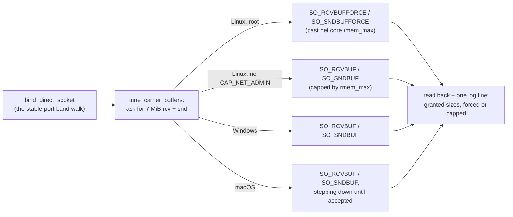

# FR-110: Overlay throughput — the carrier sockets ask for buffers the size of a burst

**Issue:** [#2350](https://github.com/gjovanov/roomler-ai/issues/2350) · **Status:** in progress — spec and
claim 2026-10-17, on the operator's *"make #2350 an FR and fix it for 0.4.141"*, after FR-107's field test put
an Apple M2 Pro Linux host on its org's mesh and measured it · **Owner:** networking (the overlay's carrier
plane) · **Anchors:** master `597aaf14f` · **Builds on:** [multi-org v2](../multi-org.md) (§4a, the shared
carrier plane), [FR-107](FR-107-drm-capture-throughput.md) (where it was found),
[FR-97](FR-97-os-feature-parity.md) (N8 / P3i, the host firewall: a separate gap of the same shape)

## 1. Goal

TCP over the overlay runs at the path's capacity, not at what a default-sized UDP receive buffer survives.
The overlay already measures paths and picks the best carrier. Once it has, the daemon must not drop the
carrier's own datagrams before reading them.

## 2. Evidence (2026-10-17)

The host: Fedora Asahi Remix 42 on an Apple M2 Pro (aarch64). It had just joined its org's mesh as a
secondary enrollment. The overlay and the host were otherwise healthy:

- direct paths to every peer that allows one, with 0% probe loss;
- MagicDNS both ways, a QUIC tunnel forward, and SSH over the overlay.

**What was measured.** 256 MiB over SSH between that host and a Linux server in another provider's
datacenter (17 ms apart):

| | over the overlay | over the public internet |
|---|---|---|
| server → Asahi host | **116–149 Mbit/s** | 785 Mbit/s |
| Asahi host → server | **254–347 Mbit/s** | 648 Mbit/s |

A Windows laptop behind home NAT pulled 40 Mbit/s from the host over the overlay. The same laptop pulled
313 Mbit/s from a public CDN.

**Why: drops at the receiving socket, not CPU.**

- **CPU was idle.** During the server → host upload the receiver's daemon used ~1% CPU (an M2 Pro) and the
  sender's used 0.8% of one core. ChaCha20 at ~19 MB/s costs that much.
- **The receiving socket overflowed.** The receiver's `/proc/net/snmp` `RcvbufErrors` rose by **303–623**
  per 256 MiB, and TCP inside the tunnel read each drop as congestion.
- **The buffer is the kernel default.** All of the daemon's carrier sockets showed `rb212992` in
  `ss -uampn`, although that host allows 4 MiB (`net.core.rmem_max`). `crates/tunnel-core/src/overlay`
  never calls `SO_RCVBUF` or `SO_SNDBUF`.

**The hypothesis proven with no code change.** The daemon never sets the buffer, so its sockets take
`net.core.rmem_default`. That was raised to 4 MiB at runtime, the daemon restarted, and the same transfer
repeated. Then everything was reverted:

| The receiver's carrier buffer | server → host, 256 MiB | the receiver's `RcvbufErrors` |
|---|---|---|
| 208 KB, the default (0.4.140) | **116 / 128 Mbit/s** | +455 / +623 |
| 4 MiB | **520 / 522 Mbit/s** | **+0** |

That is 4.3× faster, with no drops. The other direction did not move, because the server's sockets were
unchanged.

## 3. Key design

- **One seam.** Every direct carrier socket is bound by `bind_direct_socket`
  (`crates/tunnel-core/src/overlay/direct.rs:1566`). That covers the shared carrier plane's `lan` and
  `public-dial` sockets (`carrier_plane.rs:338`, `:362`) and the per-runtime binds kept behind
  `overlay_shared_carrier = false` (`runtime/establish.rs:822`, `:862`). Tuning right after the bind covers
  both modes, every org and every OS.
- **The size: 7 MiB, receive and send.** That is what wireguard-go and Tailscale ask for. A burst at
  1 Gbit/s fills 208 KB in under 2 ms.
- **⚠️ Linux needs the FORCE variants.** `SO_RCVBUF` is capped by `net.core.rmem_max`, and that is 212992 on
  most distributions; the test server above has exactly that. A plain `SO_RCVBUF` would therefore change
  nothing where it matters most. The daemon runs as root under systemd, so it may use
  `SO_RCVBUFFORCE`/`SO_SNDBUFFORCE`. When those are refused (`EPERM`, no `CAP_NET_ADMIN`), it falls back to
  the capped call. Either way the socket works.
- **Windows** has no such cap: `SO_RCVBUF`/`SO_SNDBUF` take the size. **macOS** caps by
  `kern.ipc.maxsockbuf`, so the request steps down (7 → 4 → 2 → 1 MiB) until one is accepted.
- **Said once per socket.** The size actually granted is read back and logged with the socket's role (`lan`,
  `public-dial`), and with whether it was forced or capped. On Windows, where nothing like `ss -m` exists,
  that line is the evidence.
- **Kill switch:** `ROOMLERD_OVERLAY_SOCKBUF=0` skips the tuning, so the sockets keep the OS default as
  before FR-110.
- **What it costs.** The kernel charges a socket's buffer only for datagrams actually queued, so an idle
  socket costs nothing. A queue builds only when the reader falls behind the arrival rate. Then datagrams
  wait instead of being dropped, and for TCP inside the tunnel a drop costs more than the wait.

## 4. Phases

| Phase | What | Kill switch | Proven on | Size |
|---|---|---|---|---|
| **P1** | the carrier buffers, on all three OSes (§3) | `ROOMLERD_OVERLAY_SOCKBUF=0` | — | S |
| **P2** | docs: the carrier plane's section in `docs/overlay-communication.md`, and the `docs/README.md` index row | — | — | S |

## 5. Test plan

- **Unit, every OS:**
  - The helper asks for the size and reads back at least the OS default.
  - Without the privilege to force on Linux, it falls back and the socket still sends and receives.
  - The kill switch leaves the default untouched.
- **Field, the same pair as §2.** On 0.4.140 first (the red), then the candidate:
  - The server → host transfer with the receiver's `RcvbufErrors` delta.
  - `ss -uampn` on the carrier sockets.
  - The log line.
- **A receiver whose `rmem_max` is the distro default** (212992), to prove that FORCE reaches the size where
  the plain call cannot.
- **A Windows receiver** (a lab guest): the log line, and throughput before and after.
- **Regression:** direct, srflx and DERP paths come up as before, and a remote-control session works over
  the overlay.

## 6. Acceptance criteria

- [ ] **AC1** — From the Linux server to the Asahi host over the overlay, 256 MiB: **≥ 400 Mbit/s with
  `RcvbufErrors` +0** on the receiver. Red first on 0.4.140 (116–128 Mbit/s, +455 / +623). Field-verified on
  the released build.
- [ ] **AC2** — On a Linux host whose `net.core.rmem_max` is the distro default (212992), the daemon running
  as root gets the full buffer on its carrier sockets (`ss -uampn`). A daemon without `CAP_NET_ADMIN` keeps
  working on what the cap allows, and says so.
- [ ] **AC3** — Windows and macOS log the granted sizes. A Windows receiver's throughput over the overlay is
  measured before and after.
- [ ] **AC4** — `ROOMLERD_OVERLAY_SOCKBUF=0` restores the OS default (`ss`: `rb212992` on that Linux host).
- [ ] **AC5** — No regression: direct, srflx and DERP paths come up as before, and a remote-control session
  over the overlay works.
- [ ] **AC6** — Docs: `docs/overlay-communication.md` in the house style, and a `docs/README.md` index row.

## 7. Open decisions (operator)

| | Decision | Status |
|---|---|---|
| **D1** | The size | *(Recommended: 7 MiB for receive and send, wireguard-go's and Tailscale's choice. 4 MiB already removed every drop in §2's experiment, and 7 MiB leaves room for faster links.)* |
| **D2** | The relay carriers' sockets (the TURN client, the FR-19 org relay) | *(Recommended: not in this FR. They carry relay paths, which the ladder prefers less, and they bind elsewhere. Measure them first.)* |

## 8. Out of scope

- **Batched datagram I/O** (`recvmmsg`/`sendmmsg`, UDP GSO/GRO). That is the next lever if the field shows
  CPU becoming the limit once drops are gone. Today CPU is at ~1%.
- **The host firewall** (FR-97 N8 / P3i): on a Fedora Server-zone host the roomler adapters fall under the
  default zone.
- **The MagicDNS resolver's socket** and other non-carrier sockets.

## 9. Field-verification log

| Date | Host | Build | What | Result |
|---|---|---|---|---|
| 2026-10-17 04:20Z | the Asahi box (M2 Pro, Fedora Asahi Remix 42) on its org's mesh; the Linux server 17 ms away | 0.4.139-era candidate, then the released 0.4.140 | the finding (#2350) | 🔴 The server → host transfer ran at 121–149 Mbit/s over the overlay, against 785 over the public path. The receiver's `RcvbufErrors` rose by +303 per 256 MiB. CPU was ~1% on both ends. All carrier sockets showed `rb212992` in `ss`. The Windows laptop pulled 40 Mbit/s over the overlay, against 313 from a CDN |
| 2026-10-17 06:50Z | the same pair | 0.4.140 | the hypothesis, with no code change | ✅ With `net.core.rmem_default` raised to 4 MiB (runtime only) and the daemon restarted, the same transfer ran at **520 / 522 Mbit/s** with `RcvbufErrors` **+0**. At the default it had run at 116 / 128 Mbit/s with +455 / +623. Reverted afterwards: every socket was back to `rb212992` |
