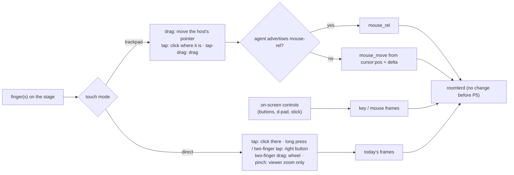

# FR-111: Touch controls — a phone or tablet as a real controller

**Issue:** [#2359](https://github.com/gjovanov/roomler-ai/issues/2359) · **Status:** proposed — spec and claim
2026-10-17 · **Owner:** the viewer's input path (`useRemoteControl.ts`, the stage, `MobileKeyboard.vue`);
the agent only from P5 · **Anchors:** master `f93c23f74` · **Program:**
[StarDesk teardown](../plans/stardesk-teardown-program.md), wave 3 (§3 "Touch controls", row P11) ·
**Builds on:** [FR-109](FR-109-relative-mouse.md) (`mouse_rel`, for the trackpad mode)

## 1. Goal

A phone or a tablet should drive a remote computer as well as a laptop does, with nothing installed on it.
StarDesk ships native clients with 200+ touch key-mapping presets and macro keys (the teardown's row P11).
Roomler's controller is the browser. Today it treats a finger as a mouse: a touch moves the host's pointer
to that point and presses the left button there. A touch browser gets no right button, no scrolling, no
trackpad and no keys beyond the soft keyboard.

The first touch work (G1, phases P1–P3) is **viewer-only**. Every control emits frames the agent already
understands (`mouse_button`, `mouse_move`, `mouse_wheel`, `key`, and FR-109's `mouse_rel` where
advertised), so it works with every deployed agent and needs no release.

## 2. Evidence (master `f93c23f74`)

| What | Where |
|---|---|
| A finger is the mouse: pointer events with no `pointerType` branch; a touch down is `mouse_button` down at that point | [`useRemoteControl.ts:10098`](../../ui/src/composables/useRemoteControl.ts#L10098) `onPointerDown`, `:10118` `onPointerUp` |
| The stage listens for `pointerdown`, `pointerup`, `pointermove` and `wheel`, and nothing else | [`useRemoteControl.ts:10668`](../../ui/src/composables/useRemoteControl.ts#L10668) |
| **No `pointercancel` handler** anywhere in the viewer, and **no `touch-action`** in the UI. A touch browser that turns a drag into a pan or a zoom fires `pointercancel` and never `pointerup`; P0 measures what the host is left with | `git grep -n -e pointercancel -e touch-action ui/src`: nothing; the stage's CSS, [`RemoteControl.vue:4658`](../../ui/src/views/remote/RemoteControl.vue#L4658) |
| The soft keyboard is the only touch-specific control: an off-screen textarea whose input becomes key frames | [`MobileKeyboard.vue`](../../ui/src/components/remote/MobileKeyboard.vue) |
| The viewer knows where the host's pointer is (`cursor:pos` on the cursor channel), which a trackpad mode needs for absolute moves | [`useRemoteControl.ts:9133`](../../ui/src/composables/useRemoteControl.ts#L9133) |
| `InputMsg::Touch` is parsed and dropped by every injector | [`input/mod.rs:253`](../../agents/roomlerd/src/input/mod.rs#L253); [`enigo_backend.rs:267`](../../agents/roomlerd/src/input/enigo_backend.rs#L267), [`uinput_backend.rs:582`](../../agents/roomlerd/src/input/uinput_backend.rs#L582), [`portal/input.rs:210`](../../agents/roomlerd/src/capture/portal/input.rs#L210) |

## 3. Design

### 3a. Touch on the stage (P1)

- **`touch-action: none` on the stage**, so the browser hands every touch to the viewer instead of panning
  or zooming the page.
- **`pointercancel` releases** whatever that pointer held, through the same path as `pointerup` and the
  blur release (FR-93's `lastPointerNorm`). A forwarded press always gets its release.
- **Gestures in direct mode:** a tap is a left click where the finger is (today). A long press (≥ 500 ms
  without moving) or a two-finger tap is the right button. A two-finger drag is `mouse_wheel`. A pinch zooms
  the viewer's picture locally and sends nothing.
- A second finger cancels a pending single-finger press instead of dragging with it.

*As built (P1):*
- **The stage** sets `touch-action: none`, decided by `touchInput.ts` `stageTouchAction` (the kill switch
  is the storage word `legacy`). A mouse or pen pointer the browser cancels releases exactly the button it
  pressed (`createPointerPressTracker`, `releaseForCancelledPointer`).
- **The gestures** are a pure state machine, `touchGestures.ts` `createDirectGestures`: touch samples in,
  mouse actions out, no DOM and no timers. Its thresholds: an 8 px slop, a 500 ms long press, a 350 ms
  two-finger tap, a 24 px pinch. A press is decided only once the finger says what it is. A tap clicks
  where it landed; a drag presses where it landed and releases where it lifts; a long press clicks the
  right button where it is. A two-finger tap clicks the right button between the fingers. A scroll is
  `mouse_wheel` in pixels with natural direction. A pinch zooms the viewer.
- **The wiring** (`useRemoteControl.ts`) routes only `pointerType === 'touch'` through the recognizer and
  re-arms the long press at its deadline. A finger that lands outside the picture starts nothing, as a mouse
  press there does, but a second finger during a gesture still counts.
- **The zoom** (`RemoteControl.vue` `onPinchZoom`) switches to Custom zoom from the size shown, and keeps
  the point between the fingers under them by scrolling the stage.

### 3b. Trackpad mode (P2)

- The screen acts like a laptop trackpad. A one-finger drag moves the host's pointer by the finger's delta,
  scaled by a sensitivity. A tap clicks where the pointer is, a two-finger tap is the right button, and a
  tap followed by a drag drags.
- **To an agent that advertises `mouse-rel`** the motion goes as FR-109's `mouse_rel` and the presses as
  `mouse_press` / `mouse_release`, which press where the pointer is.
- **To an older agent** the viewer moves from the last `cursor:pos` by the delta, with absolute
  `mouse_move` and `mouse_button` frames. That works with every deployed agent.
- The ghost cursor shows where the host's pointer is, since the finger is no longer on it.

*As built (P2):*
- `touchGestures.ts` `createTrackpadGestures`: a moving finger is `pointer` travel (the slop included, so a
  small move is not swallowed); a tap is a left click with no position; a 500 ms hold arms a left drag, let
  go on lift. Two fingers share direct mode's handling, factored out (`twoMove`, `twoTapped`).
- `useRemoteControl.ts` `runTrackpad`: the travel is measured in the picture's normalised space
  (`padTravel`, the stage's own mapping, so letterbox and zoom need nothing extra). To a `mouse-rel` agent
  it goes as `mouse_rel` through FR-109's accumulator, with `mouse_press` / `mouse_release`. To an older
  agent it becomes absolute moves from `cursor:pos` divided by the picture's intrinsic size, re-read at each
  gesture's start.
- The mode is `touchMode` / `setTouchMode` on the composable, remembered as `roomler-rc-touch-mode`. The
  toolbar control (`rc-touch-mode`) shows on a touch device unless the `legacy` switch is set. **The default
  is direct** until open decision 1 is settled. The ghost cursor is the host's own cursor overlay, which
  `cursor:pos` already drives.

### 3c. On-screen controls (P3, G1)

- An overlay on the stage with buttons, a d-pad and a stick, each emitting existing frames: `key` for keys,
  and mouse frames for a mouse stick.
- A held button holds its key, and release-all covers it: the arbiter releases a session's held keys on
  teardown, and the viewer's blur release covers a hidden tab.
- **Built-in presets** (open decision 2), chosen per device and remembered in the browser. No server
  state in G1.

### 3d. The editor, macros and tenant presets (P4, G2)

- A layout editor: place, size and bind buttons. Macros are click / press / release steps with delays, as
  StarDesk has.
- **Presets become tenant-scoped data**, per `docs/data-model.md`: a collection keyed by tenant, shared by
  its members, never agent config.

### 3e. Native touch (P5, G3, optional)

- `InputMsg::Touch` injected natively: `InjectTouchInput` on Windows, a uinput multitouch device on Linux.
- Gated like FR-109's frames: a capability word, equality-matched.
- Only if open decision 3 wants it after G1 and G2.

### 3f. What it never does

The agent still only injects (FR-92's rule). No phase reads input on the host.

## 4. Phases

| P | Scope | Kill switch | Status |
|---|---|---|---|
| P0 | Probes: (1) **red first**, a one-finger drag on today's stage in touch emulation, read on a vmtest Win11 host by a raw-input probe that counts button downs and ups; (2) what each engine's touch emulation gives Playwright (taps, drags, two-finger gestures), for the ACs' cells | docs only | spec and claim 2026-10-17. **(1) measured** (§8 row 1): in Chromium's touch emulation a drag is taken as a pan after 69 ms, and the host's button stays down until something else releases it. (2) is measured for Chromium only (CDP touch events reach the page and its gesture handling); WebKit and Firefox are owed |
| P1 | Touch on the stage (3a) | viewer storage key `roomler-rc-touch=legacy` | **built** (3a "as built"): the stage keeps every touch, a cancelled pointer lets go, and the direct-mode gestures. Unit tests: `touchInput.spec.ts` (8), `touchGestures.spec.ts` (11), vitest 2173. A negative control, a press tracker that never forgets a pointer, failed 3 tests. **Field-green on a candidate bundle** (this branch's `ui/dist` served into the page, §8 rows 2–4). It gets re-checked once a promote serves it |
| P2 | Trackpad mode (3b) | the mode switch | **built** (3b "as built"): 5 trackpad tests, plus 2 for the mode's storage, vitest green. **Field-green on a candidate bundle** on both paths (§8 rows 5–6). The default stays direct until decision 1 |
| P3 | On-screen controls and built-in presets (3c) | the overlay's toggle | — |
| P4 | Editor, macros, tenant presets (3d) | — | — |
| P5 | Native touch injection (3e) | agent capability word | — |
| P6 | Docs: `docs/touch-controls.md` (mermaid, the gestures, the modes, the presets), linked from `docs/remote-control.md` §6 and indexed in `docs/README.md` | — | grows with each phase |

## 5. Acceptance criteria

- [x] **AC1 (red first):** a one-finger drag on the stage of a touch browser ends with the host's button
  released (a raw-input probe on a vmtest Win11 host counts downs and ups). Red: today a drag the browser
  cancels leaves it down. **Verified** on a candidate bundle (§8 rows 1–3). Red: production's viewer left the
  press without a release for 4.6 s. Green: the press and its release 484 ms apart, and with the browser
  free to cancel (the legacy switch), 78 ms apart. It gets re-checked once a promote serves P1.
- [x] **AC2:** in direct mode, long press and two-finger tap give the right button, two-finger drag scrolls
  the host, and a pinch zooms only the viewer (nothing reaches the host). **Verified** on a candidate bundle
  (§8 row 4). The host read a right click for each, one wheel notch for a 135 px scroll, and nothing for a
  pinch that zoomed the picture five times. It gets re-checked once a promote serves P1.
- [x] **AC3:** trackpad mode moves the host's pointer relatively, on an agent that advertises `mouse-rel`
  and on an older one, and a tap clicks where the pointer is. **Verified** on a candidate bundle (§8 rows
  5–6). A 100 px drag moved the host's cursor about 325 px, by `mouse_rel` on 0.4.140 and by absolute
  moves from `cursor:pos` with `mouse-rel` switched off. Each time the tap clicked at the pointer. It gets
  re-checked once a promote serves P2.
- [ ] **AC4:** on-screen buttons and the d-pad reach the host as the keys they name, read by a test-only
  probe on the guest.
- [ ] **AC5:** G1 works with every deployed agent: AC1–AC4's cells pass on an agent from before this FR.
- [ ] **AC6:** presets. The built-ins switch and are remembered per device (G1); the editor and tenant
  presets work (G2).
- [ ] **AC7:** **Docs:** a `docs/touch-controls.md` page (mermaid, the gestures, the modes, the presets),
  linked from `docs/remote-control.md` §6, with a row in `docs/README.md`'s index.

## 6. Open decisions

1. **The default on a phone.** Direct touch (today's) or trackpad. Recommended: trackpad on a phone-sized
   screen, direct on a tablet, switchable in the toolbar.
2. **The built-in presets G1 ships.** Recommended: arrows; WASD with mouse look; an office row (Esc, Tab,
   Alt+Tab, Ctrl+C / V / Z).
3. **G3 at all.** Native touch injection only if a host app needs real touch (a touch-first Windows app)
   once G1 and G2 exist.
4. **Panning a zoomed picture on a phone.** In P1, two fingers moving together scroll the host, so a picture
   zoomed past the stage is moved around by zooming out and back in elsewhere (the zoom keeps the point
   between the fingers under them). Recommended: while the picture is larger than the stage, two fingers
   pan the picture and the host scrolls only when it fits, with a one-line hint. The trackpad mode (P2)
   could instead pan to follow the host's pointer.

## 7. Out of scope

- Gamepad passthrough (excluded by the operator).
- Native controller apps: nothing to install on the controlling side stays true.
- Reading input on the host in any form (§3f).

## 8. Field-verification log

| # | Date | Cell | Result |
|---|---|---|---|
| 1 | 2026-10-17 | **P0 (1), the red: a one-finger drag on today's stage.** A fresh vmtest Win11 `--type system` guest (`vmtest-w-ins-sys-065622`) on agent 0.4.140, with `vmtest` Active at the console. The production viewer (`hosted-20261016-377f1d4`) ran in Chromium's mobile emulation (Playwright's Pixel 7: `isMobile`, `hasTouch`, a 394×725 stage), driven from the vmtest harness host. It sent real touch input through CDP `Input.dispatchTouchEvent`: a one-finger drag of 12 moves across the stage, then a plain tap as the control. A capture-phase hook logged every pointer event the page saw and every `mouse_button` the viewer sent. A test-only probe on the guest, run as the person, kept a timeline of the left button's raw downs and ups | **A drag the browser takes over leaves the host's button down.** The finger's `pointerdown` made the viewer send `mouse_button {left, down:true}`. 69 ms later Chromium fired `pointercancel`, taking the gesture as a pan, and no `pointerup` came, so no release was sent. The host's probe read the drag's press at 12.718 s and **then no release**. The tap 4.6 s later read `D@17312 U@17312`, and the tap's up is what let go. So the host's left button stays down until something else releases it, and the next touch's moves become a drag. The control tap sent its down and up within 1 ms, and the host saw both. **Wrong turn:** the first run (07:10Z) showed the same on the viewer side (`pointercancel` 78 ms after the press, no release sent). Its probe did not compile: a field named `Events` hid `Component.Events`, and Add-Type treats that warning as an error. Renamed, the probe ran in the second run |
| 2 | 2026-10-17 | **AC1, the green: the stage keeps the drag (a candidate bundle).** Row 1's guest, cell and probe. The viewer was P1a's own `ui/dist`, served into the page on the real origin by Playwright (documents get its `index.html`, `/assets/*` comes from the bundle, `/api` and `/ws` go to production), so the cell needed no promote. The page ran `/assets/index-DHl0de8i.js` | **The drag completes, and its release reaches the host.** The stage reported `touch-action: none`. Chromium no longer cancelled: the drag delivered 14 moves, and the viewer sent the release at the drag's end point. The host read the press and its release **484 ms apart** (`D@12047 U@12531`). The control tap read `D@16531 U@16531` |
| 3 | 2026-10-17 | **AC1's other half: a cancel that happens anyway is released.** The same, with the kill switch `roomler-rc-touch=legacy` set, so the stage was `touch-action: auto` and the browser free to cancel | **The cancel handler lets go at once.** Chromium cancelled 91 ms into the drag, and the viewer sent `mouse_button {left, up}` at the last point the finger reached, in the same millisecond. The host read the press and its release **78 ms apart** (`D@9203 U@9281`) |
| 4 | 2026-10-17 | **AC2: the direct-mode gestures (a candidate bundle).** The same guest, with P1's own `ui/dist` in Chromium's Pixel 7 emulation. Real CDP multi-touch, 2.5 s apart: a tap (the control), a long press (800 ms), a two-finger tap (100 ms), a two-finger drag upwards (10 steps, about 135 px) and a pinch outwards. The host's probe kept a timeline of both buttons and the wheel | **Each gesture reaches the host as what it means.** Tap: `L l`, a left click. Long press: a right click 509 ms after the finger landed (`R r`). Two-finger tap: a right click between the fingers (`R r`). Scroll: **one** `mouse_wheel {dy: 100}`, which the host read as `W-120`, one notch down (the fingers went up). Pinch: the picture went from 394 to 1979 px wide, and the host read **nothing**. **Wrong turns, three runs:** the first run aimed the tap and the scroll at the stage's box, and the second at the picture element's box. On a phone the picture is letterboxed inside both, so both times the two gestures landed outside it and, as designed, did nothing. The third run aimed at the picture's own rectangle. **A finding that changed the code:** in that run the viewer sent 21 wheel frames of 6–12 px and the host read none. The agent rounds every frame to a 100 px step on its own (`enigo_backend.rs` `wheel_to_steps`), so the viewer now gathers a gesture's pixels and sends whole steps (`createWheelSteps`). The run above is with that change |
| 5 | 2026-10-17 | **AC3, trackpad mode on a `mouse-rel` agent (a candidate bundle).** The same guest (0.4.140, which advertises `mouse-rel`), with P2's own `ui/dist` in Chromium's Pixel 7 emulation and `roomler-rc-touch-mode=trackpad` (the toolbar control read "Touch: trackpad"). A one-finger drag of 100 CSS px to the right across the 394 px picture, then a tap at 70 % of the picture. Two test-only probes ran as the person: the cursor's position every 40 ms, and the buttons | **The finger moves the pointer, and the tap clicks where the pointer is.** The viewer sent ten `mouse_rel` frames of 32–33 counts, 324 in all, which is 100/394 of the host's 1280 px width. The host's cursor walked from (964, 400) in steps of about 32 px to (1279, 400), where the screen's edge stopped it. The tap sent `mouse_press` then `mouse_release`, with no position, and the host read a left click (`L l`) |
| 6 | 2026-10-17 | **AC3, trackpad mode on an agent without `mouse-rel`.** The same, with the agent's kill switch `ROOMLERD_INPUT_MOUSE_REL=0` set (restart and re-enroll), so the viewer took its absolute path. The drag went 100 CSS px to the left. The switch was cleared afterwards | **The same motion, from absolute moves.** The viewer started from the host's pointer, its last `cursor:pos` (x 1278 of 1280), and sent absolute `mouse_move` frames from x 0.973 to 0.745, a share of 0.254. The host's cursor went from (1278, 400) to **(952, 400)**, 326 px in steps of about 32. The tap sent `mouse_button` at (0.744, 0.5), the pointer's own position and not the finger's, and the host read `L l`. **Wrong turn:** the first run dragged right, but the cursor already sat at the right edge from row 5, so every move clamped at x = 1. The cell was re-run dragging left |

## 9. Related

- [Plan §3](../plans/stardesk-teardown-program.md): this FR, and its place in wave 3.
- [FR-109](FR-109-relative-mouse.md): `mouse_rel` and `mouse_press`, which the trackpad mode uses.
- [FR-92](FR-92-keep-busy.md): the no-hooks rule.
