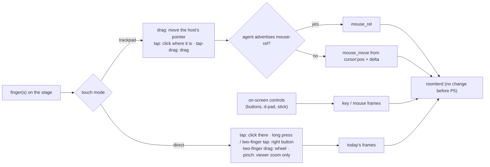

# FR-111: Touch controls — a phone or tablet as a real controller

**Issue:** [#2359](https://github.com/gjovanov/roomler-ai/issues/2359) · **Status:** done — every criterion
field-verified: P1–P4 merged and live (P4a #2413, P4b #2418; promoted 2026-10-18 00:15Z), AC1–AC7 ticked,
every open decision settled by the operator (1–4 on 2026-10-17, 5–6 on 2026-10-18); P5 (native touch) not
built, by decision 3 · **Owner:** the viewer's input path
(`useRemoteControl.ts`, the stage, `MobileKeyboard.vue`), and from P4a the `remote` module's
`touch_presets`; the agent only from P5 · **Anchors:** master `9d9eb94c9` · **Program:**
[StarDesk teardown](../plans/stardesk-teardown-program.md), wave 3 (§3 "Touch controls", row P11) ·
**Builds on:** [FR-109](FR-109-relative-mouse.md) (`mouse_rel`, for the trackpad mode)

## 1. Goal

A phone or a tablet should drive a remote computer as well as a laptop does, with nothing installed on it.
StarDesk ships native clients with 200+ touch key-mapping presets and macro keys (the teardown's row P11).
Roomler's controller is the browser. Today it treats a finger as a mouse: a touch moves the host's pointer
to that point and presses the left button there. A touch browser gets no right button, no scrolling, no
trackpad and no keys beyond the soft keyboard.

The first touch work (G1, phases P1–P3) is **viewer-only**. Every control emits frames the agent already
understands (`mouse_button`, `mouse_move`, `mouse_wheel`, `key`, and FR-109's `mouse_rel` where
advertised), so it works with every deployed agent and needs no release.

## 2. Evidence (master `9d9eb94c9`)

| What | Where |
|---|---|
| A finger is the mouse: pointer events with no `pointerType` branch; a touch down is `mouse_button` down at that point | [`useRemoteControl.ts:10825`](../../ui/src/composables/useRemoteControl.ts#L10825) `onPointerDown`, `:10687` `onPointerUp` |
| The stage listens for `pointerdown`, `pointerup`, `pointermove` and `wheel`, and nothing else | [`useRemoteControl.ts:11237`](../../ui/src/composables/useRemoteControl.ts#L11237) |
| **No `pointercancel` handler** anywhere in the viewer, and **no `touch-action`** in the UI. A touch browser that turns a drag into a pan or a zoom fires `pointercancel` and never `pointerup`; P0 measures what the host is left with | `git grep -n -e pointercancel -e touch-action ui/src`: nothing; the stage's CSS, [`RemoteControl.vue:4808`](../../ui/src/views/remote/RemoteControl.vue#L4808) |
| The soft keyboard is the only touch-specific control: an off-screen textarea whose input becomes key frames | [`MobileKeyboard.vue`](../../ui/src/components/remote/MobileKeyboard.vue) |
| The viewer knows where the host's pointer is (`cursor:pos` on the cursor channel), which a trackpad mode needs for absolute moves | [`useRemoteControl.ts:9648`](../../ui/src/composables/useRemoteControl.ts#L9648) |
| `InputMsg::Touch` is parsed and dropped by every injector | [`input/mod.rs:257`](../../agents/roomlerd/src/input/mod.rs#L257); [`enigo_backend.rs:267`](../../agents/roomlerd/src/input/enigo_backend.rs#L267), [`uinput_backend.rs:592`](../../agents/roomlerd/src/input/uinput_backend.rs#L592), [`portal/input.rs:210`](../../agents/roomlerd/src/capture/portal/input.rs#L210) |

## 3. Design

### 3a. Touch on the stage (P1)

- **`touch-action: none` on the stage**, so the browser hands every touch to the viewer instead of panning
  or zooming the page.
- **`pointercancel` releases** whatever that pointer held, through the same path as `pointerup` and the
  blur release (FR-93's `lastPointerNorm`). A forwarded press always gets its release.
- **Gestures in direct mode:** a tap is a left click where the finger is (today). A long press (≥ 500 ms
  without moving) or a two-finger tap is the right button. A two-finger drag is `mouse_wheel`. A pinch zooms
  the viewer's picture locally and sends nothing.
- A second finger cancels a pending single-finger press instead of dragging with it.

*As built (P1):*
- **The stage** sets `touch-action: none`, decided by `touchInput.ts` `stageTouchAction` (the kill switch
  is the storage word `legacy`). A mouse or pen pointer the browser cancels releases exactly the button it
  pressed (`createPointerPressTracker`, `releaseForCancelledPointer`).
- **The gestures** are a pure state machine, `touchGestures.ts` `createDirectGestures`: touch samples in,
  mouse actions out, no DOM and no timers. Its thresholds: an 8 px slop, a 500 ms long press, a 350 ms
  two-finger tap, a 24 px pinch. A press is decided only once the finger says what it is. A tap clicks
  where it landed; a drag presses where it landed and releases where it lifts; a long press clicks the
  right button where it is. A two-finger tap clicks the right button between the fingers. A scroll is
  `mouse_wheel` in pixels with natural direction. A pinch zooms the viewer.
- **The wiring** (`useRemoteControl.ts`) routes only `pointerType === 'touch'` through the recognizer and
  re-arms the long press at its deadline. A finger that lands outside the picture starts nothing, as a mouse
  press there does, but a second finger during a gesture still counts.
- **The zoom** (`RemoteControl.vue` `onPinchZoom`) switches to Custom zoom from the size shown, and keeps
  the point between the fingers under them by scrolling the stage.

### 3b. Trackpad mode (P2)

- The screen acts like a laptop trackpad. A one-finger drag moves the host's pointer by the finger's delta,
  scaled by a sensitivity. A tap clicks where the pointer is, a two-finger tap is the right button, and a
  tap followed by a drag drags.
- **To an agent that advertises `mouse-rel`** the motion goes as FR-109's `mouse_rel` and the presses as
  `mouse_press` / `mouse_release`, which press where the pointer is.
- **To an older agent** the viewer moves from the last `cursor:pos` by the delta, with absolute
  `mouse_move` and `mouse_button` frames. That works with every deployed agent.
- The ghost cursor shows where the host's pointer is, since the finger is no longer on it.

*As built (P2):*
- `touchGestures.ts` `createTrackpadGestures`: a moving finger is `pointer` travel (the slop included, so a
  small move is not swallowed); a tap is a left click with no position; a 500 ms hold arms a left drag, let
  go on lift. Two fingers share direct mode's handling, factored out (`twoMove`, `twoTapped`).
- `useRemoteControl.ts` `runTrackpad`: the travel is measured in the picture's normalised space
  (`padTravel`, the stage's own mapping, so letterbox and zoom need nothing extra). To a `mouse-rel` agent
  it goes as `mouse_rel` through FR-109's accumulator, with `mouse_press` / `mouse_release`. To an older
  agent it becomes absolute moves from `cursor:pos` divided by the picture's intrinsic size, re-read at each
  gesture's start.
- The mode is `touchMode` / `setTouchMode` on the composable, remembered as `roomler-rc-touch-mode`. The
  toolbar control (`rc-touch-mode`) shows on a touch device unless the `legacy` switch is set. **With
  nothing remembered, a phone-sized screen starts in trackpad mode** and a larger one in direct mode (open
  decision 1, settled 2026-10-17; `phoneSized`, `readTouchMode`). The ghost cursor is the host's own cursor overlay, which
  `cursor:pos` already drives.

### 3c. On-screen controls (P3, G1)

- An overlay on the stage with buttons, a d-pad and a stick, each emitting existing frames: `key` for keys,
  and mouse frames for a mouse stick.
- A held button holds its key, and release-all covers it: the arbiter releases a session's held keys on
  teardown, and the viewer's blur release covers a hidden tab.
- **Built-in presets** (open decision 2), chosen per device and remembered in the browser. No server
  state in G1.

**As built (P3):**
- `touchControls.ts` is pure: the presets, the d-pad's eight sectors (`dpadKeys`, a 25 % deadzone, 135° per
  direction so a diagonal holds two keys), the stick's speed (`stickVelocity`, a share of the picture's
  width a second, squared past a 15 % deadzone), and `createControlsDriver`, which tracks each finger by
  its pointer id and counts every key and button, so two fingers on one key send one press and one release.
- `TouchControls.vue` draws a preset inside the stage, the fullscreen element, and follows the stage's
  scroll. A control captures its pointer and stops its events, so the stage's gestures never see it. It lets
  go of everything on a preset change, a blur, a hidden tab and an unmount.
- The stage's sink (`stageControls` in `attachInput`) sends a key as the keyboard does (Ctrl as Cmd on a Mac
  host, FR-13) and tracks it in the held-input tracker, so the stage's own blur and detach release cover it.
  A release for something already let go is dropped. A mouse button and the stick take the trackpad's two
  paths: `mouse_press` / `mouse_rel` for an agent that advertises `mouse-rel`, absolute frames from the host
  pointer's position for an older one.
- The toolbar's **On-screen controls** menu (Off and the three presets) is offered where the touch mode is.
  The choice is kept per device in `localStorage['roomler-rc-touch-controls:<device id>']`, off by default.
- Decision 2 is built to its recommendation. The presets are data (`BUILTIN_PRESETS`), so another answer is
  an edit to that table.
- Tests: `touchControls.spec.ts` (20, the HID usages checked against the keyboard path's `kbdCodeToHid`) and
  `TouchControls.spec.ts` (6: the chord order, a touch kept from the stage, ⌘ on a Mac host, the d-pad
  following a finger, the stick's frame loop, and the release on a preset change, a blur and an unmount).
  Two negative controls each failed their test: a driver that let go of a key as soon as any finger
  holding it lifted, and a button whose press reached the stage.
- When the last stick lets go, the next press reads where the host pointer is (`end` on the sink), since
  something else may have moved it meanwhile.

### 3d. The editor, macros and tenant presets (P4, G2)

- A layout editor: place, size and bind buttons. Macros are click / press / release steps with delays, as
  StarDesk has.
- **Presets become tenant-scoped data**, per `docs/data-model.md`: a collection keyed by tenant, shared by
  its members, never agent config.

*As built: the server half in P4a, the viewer's in P4b-1 and P4b-2:*

- **The data is the viewer's own `TouchPreset`** (`touchControls.ts`), stored as it is: a name and a list of
  rows, d-pads and sticks. P4 adds one action kind beside `keys` and `mouse`: a **macro**, a list of steps,
  each a key or a mouse button with `press`, `release` or `tap`, and a wait after it. The stored shape and
  the viewer's are one, so a built-in can be copied into the editor and saved as it is.
- **`touch_presets`, owned by the `remote` module** (the module a controller reaches). One document per
  preset: `tenant_id`, `name` (unique per tenant), `controls`, who created and last changed it, and when.
  Routes, nested like the org's session policy:

  | Route | Who |
  |---|---|
  | `GET /api/tenant/{tid}/touch-preset` | any member: every viewer in the org offers them |
  | `POST /api/tenant/{tid}/touch-preset` | `MANAGE_TENANT` (decision 5, settled 2026-10-18) |
  | `PUT /api/tenant/{tid}/touch-preset/{id}` | `MANAGE_TENANT`; the id resolved **within** the tenant, so a foreign one is a 404 that leaks nothing |
  | `DELETE /api/tenant/{tid}/touch-preset/{id}` | `MANAGE_TENANT`, the same |

- **Validated strictly on the server**, because every member's viewer runs what is stored:
  - unknown fields are refused, so a misspelt key is an error rather than nothing;
  - keys must be HID usages on the keyboard page that the viewer's keyboard path can produce;
  - labels are short and drawn as text, never HTML;
  - sizes and places stay within sane pixel ranges;
  - a macro has at most 32 steps, a wait at most 5 s and the whole macro at most 30 s;
  - at most 24 controls per preset and 50 presets per org, with a body limit on the routes.
- **A member's own layout stays in the browser** (decision 6, settled 2026-10-18): the editor saves to `localStorage`
  per user, with no server and no permission, and an org admin can publish a layout to the org. *As built
  (P4b-2):* a built-in, or an org layout without the right, is read-only and copied before it changes; a
  draft is checked against the server's rules, with its codes, before any save; keys are captured from the
  keyboard rather than typed as names. **While the editor is open, the viewer forwards no key to the
  host** (`keyboardPaused`): its key listener sits on the window and forwards whatever has focus, so a
  layout's name would otherwise be typed into the remote machine too.
- **A macro runs on the viewer**, through the same sink as a button: each step is a `key` or mouse frame,
  each wait a timer. *As built (P4b-1):* it plays to its end once started, and lifting the finger does not
  stop it. Designed first as a cancel on the lift, that would have cut a short macro in half on a quick
  tap. Closing the overlay, a preset change, a blur or a hidden tab stops it and lets go of whatever it
  holds, the same release the driver already does for a held button.

### 3e. Native touch (P5, G3, optional)

- `InputMsg::Touch` injected natively: `InjectTouchInput` on Windows, a uinput multitouch device on Linux.
- Gated like FR-109's frames: a capability word, equality-matched.
- Only if open decision 3 wants it after G1 and G2.

### 3f. What it never does

The agent still only injects (FR-92's rule). No phase reads input on the host.

## 4. Phases

| P | Scope | Kill switch | Status |
|---|---|---|---|
| P0 | Probes: (1) **red first**, a one-finger drag on today's stage in touch emulation, read on a vmtest Win11 host by a raw-input probe that counts button downs and ups; (2) what each engine's touch emulation gives Playwright (taps, drags, two-finger gestures), for the ACs' cells | docs only | spec and claim 2026-10-17. **(1) measured** (§8 row 1): in Chromium's touch emulation a drag is taken as a pan after 69 ms, and the host's button stays down until something else releases it. (2) is measured for Chromium only (CDP touch events reach the page and its gesture handling); WebKit and Firefox are owed |
| P1 | Touch on the stage (3a) | viewer storage key `roomler-rc-touch=legacy` | **built** (3a "as built"): the stage keeps every touch, a cancelled pointer lets go, and the direct-mode gestures. Unit tests: `touchInput.spec.ts` (8), `touchGestures.spec.ts` (11), vitest 2173. A negative control, a press tracker that never forgets a pointer, failed 3 tests. **Field-green on a candidate bundle** (this branch's `ui/dist` served into the page, §8 rows 2–4). Re-checked on the live viewer after the 2026-10-17 promote (§8 rows 9–10) |
| P2 | Trackpad mode (3b) | the mode switch | **built** (3b "as built"): 5 trackpad tests, plus 2 for the mode's storage, vitest green. **Field-green on a candidate bundle** on both paths (§8 rows 5–6). The default stays direct until decision 1 |
| P3 | On-screen controls and built-in presets (3c) | the overlay's toggle | **built** (3c "as built"): the overlay, the driver, three presets built to decision 2's recommendation, remembered per device. 26 unit tests, vitest 2209. **Field-green on a candidate bundle** (§8 rows 7–8): every control reached the host as the key it names, on both pointer paths. Re-checked on the live viewer after the 2026-10-17 promote (§8 rows 9–10) |
| P4a | The org's presets on the server: `touch_presets` (the `remote` module), its four routes, strict validation, macro steps in the schema (3d) | — (inert until P4b's viewer reads it) | **built** (3d; decision 5, settled as recommended on 2026-10-18): `TouchPreset` and `TouchPresetRequest::validate` in `remote_control`, `TouchPresetDao`, the four routes in `modules/remote/src/touch_presets.rs`, the unique `(tenant_id, name)` index. Tests: 4 unit (a viewer's own JSON parses and validates, unknown fields refused at every level, 35 refusal cases each by its code, the key range) and 4 integration (who reads and writes, a foreign id as a 404, refusals by code with nothing stored and a 413, the 50 cap). The composition baseline is re-recorded for exactly the two routes and the one index |
| P4b-1 | The org's presets in the overlay's menu, macros played by the driver (3d) | the overlay's toggle | **built**: `orgPresets` (server rows under `org:` ids, a malformed row left out), `presetById` and `readControlsPreset` that know them, the store's `fetchOrgTouchPresets` (none on any error), the menu's "Your organization" heading, and `playMacro` / `stopMacros` in the driver (plays to its end, ignores a press while playing, releases only its own, lets go of what it still holds, never waits over 5 s), with the button lit while it plays. Tests: 8 vitest in `touchControls.spec.ts` and 1 in `TouchControls.spec.ts`; the suite 2232 green, the build green. Two negative controls each failed their test: a lift that stopped the macro, and a step that released a key it had not pressed. **The macro engine is field-green** through a member's own layout (§8 row 15, phase D): one 90 ms tap played all five steps on the host in order, both 300 ms waits read as 297 ms there, and the macro finished after the finger lifted. **The org half is field-green on the live viewer** (§8 row 18): a preset created through P4a's API was offered under "Your organization" and its macro played on the host in order |
| P4b-2 | The editor, and a member's own presets in the browser (3d) | — (a menu item; nothing changes until a layout is saved) | **built** (3d "as built"; decision 6, settled as recommended on 2026-10-18): `TouchPresetEditor.vue` (the three kinds of layout, key capture, a live preview on a sink that sends nothing), `touchPresetEdit.ts` (the server's rules and codes mirrored in `validatePreset`, a member's own layouts under `roomler-rc-touch-presets:<user id>`), the store's `saveOrgTouchPreset` / `deleteOrgTouchPreset`, and `keyboardPaused` in `useRemoteControl.ts` (no key forwarded while the editor is open, and what the keyboard held let go on pausing). Tests: 9 vitest in `touchPresetEdit.spec.ts` (every built-in passes the rules, a refusal per code) and 6 in `TouchPresetEditor.spec.ts`; the suite and the build green. Two negative controls each failed their test: an org layout editable without the right, and a capture that let one key in twice. `keyboardPaused` has no unit test (no spec instantiates the composable), so it is proven on the surface: **field-green on a candidate bundle** (§8 rows 15–16). Nothing typed while the editor was open reached the host's probe, a key held when it opened was let go there, and the keyboard came back when it closed. With the check taken out, the name's keys, the capture keys and a key-up all reached the host. **Re-checked on the live viewer** after the 2026-10-18 promote (row 17): the same answers |
| P5 | Native touch injection (3e) | agent capability word | — |
| P6 | Docs: `docs/touch-controls.md` (mermaid, the gestures, the modes, the presets), linked from `docs/remote-control.md` §6 and indexed in `docs/README.md` | — | **done** (AC7): five mermaid diagrams, every built phase through P4 |

## 5. Acceptance criteria

- [x] **AC1 (red first):** a one-finger drag on the stage of a touch browser ends with the host's button
  released (a raw-input probe on a vmtest Win11 host counts downs and ups). Red: today a drag the browser
  cancels leaves it down. **Verified** on a candidate bundle (§8 rows 1–3). Red: production's viewer left the
  press without a release for 4.6 s. Green: the press and its release 484 ms apart, and with the browser
  free to cancel (the legacy switch), 78 ms apart. **Re-checked on the live viewer after the 2026-10-17 promote** (row 9): 406 ms apart, and 78 ms under the legacy switch.
- [x] **AC2:** in direct mode, long press and two-finger tap give the right button, two-finger drag scrolls
  the host, and a pinch zooms only the viewer (nothing reaches the host). **Verified** on a candidate bundle
  (§8 row 4). The host read a right click for each, one wheel notch for a 135 px scroll, and nothing for a
  pinch that zoomed the picture five times. **Re-checked on the live viewer** (row 9): the same four answers.
- [x] **AC3:** trackpad mode moves the host's pointer relatively, on an agent that advertises `mouse-rel`
  and on an older one, and a tap clicks where the pointer is. **Verified** on a candidate bundle (§8 rows
  5–6). A 100 px drag moved the host's cursor about 325 px, by `mouse_rel` on 0.4.140 and by absolute
  moves from `cursor:pos` with `mouse-rel` switched off. Each time the tap clicked at the pointer.
  **Re-checked on the live viewer** (row 10): 640 → 1276 by `mouse_rel`, 640 → 315 by absolute frames, each
  tap at the pointer.
- [x] **AC4:** on-screen buttons and the d-pad reach the host as the keys they name, read by a test-only
  probe on the guest. **Verified** on a candidate bundle (§8 row 7). A window on the host recorded the keys
  delivered to it. Each of the three presets' buttons and both d-pads read as the key it names, every chord
  pressed in order and let go in reverse, and a finger sliding from up through the diagonal to right held both
  keys on the diagonal. **Re-checked on the live viewer** (row 10): every key, and the stick, both ways.
- [x] **AC5:** G1 works with every deployed agent: AC1–AC4's cells pass on an agent from before this FR.
  **Verified** (§8 rows 1–8). Every cell ran on 0.4.140, which predates this FR and carries none of its code.
  Each pointer path also ran with `mouse-rel` switched off (rows 6 and 8), which is what every agent
  before 0.4.140 advertises: the viewer then sent only `key`, `mouse_button`, `mouse_move` and
  `mouse_wheel`, frames every deployed agent takes.
- [x] **AC6:** presets. The built-ins switch and are remembered per device (G1); the editor and tenant
  presets work (G2). **Verified.** G1 (§8 row 7, re-checked live in row 10): the three presets switched
  from the toolbar, and after a reload the device's choice came back. G2, the editor (rows 15–16 on a
  candidate bundle, row 17 on the live viewer): a member's own layout was made in the editor, saved,
  offered under "This browser", and its macro played on the host in order, and nothing typed in the editor
  reached the host. G2, the org's presets (row 18, live): a preset created through P4a's API was offered
  under "Your organization", its macro played on the host in order, and the choice was remembered for the
  device.
- [x] **AC7:** **Docs:** a `docs/touch-controls.md` page (mermaid, the gestures, the modes, the presets),
  linked from `docs/remote-control.md` §6, with a row in `docs/README.md`'s index. **Done:** the page has
  five mermaid diagrams and covers the gestures, both modes, the overlay and the presets through P4 (the
  org's, the viewer's handling and the editor). It is linked from `remote-control.md` §6 (input injection)
  and indexed in `docs/README.md`. P5 (native touch) is not built, by decision 3.

## 6. Open decisions

Decisions 1–4 were **decided by the operator on 2026-10-17, as recommended**, and decisions 5 and 6 (P4's)
on **2026-10-18, as recommended**.

1. **The default on a phone.** Direct touch (today's) or trackpad. Recommended: trackpad on a phone-sized
   screen, direct on a tablet, switchable in the toolbar. **Decided as recommended.** Built: with nothing
   remembered, a screen whose shorter side is under 600 CSS px starts in trackpad mode (`phoneSized`,
   `readTouchMode`), and the toolbar's choice is remembered and wins.
2. **The built-in presets G1 ships.** Recommended: arrows; WASD with mouse look; an office row (Esc, Tab,
   Alt+Tab, Ctrl+C / V / Z). P3 is built to this recommendation, and the presets are data
   (`BUILTIN_PRESETS`), so another answer is an edit to that table. **Decided as recommended**, so P3 stands.
3. **G3 at all.** Native touch injection only if a host app needs real touch (a touch-first Windows app)
   once G1 and G2 exist. **Decided as recommended:** P5 waits for such an app.
4. **Panning a zoomed picture on a phone.** In P1, two fingers moving together scroll the host, so a picture
   zoomed past the stage is moved around by zooming out and back in elsewhere (the zoom keeps the point
   between the fingers under them). Recommended: while the picture is larger than the stage, two fingers
   pan the picture and the host scrolls only when it fits, with a one-line hint. The trackpad mode (P2)
   could instead pan to follow the host's pointer. **Decided as recommended**, for direct mode: the view
   pans the stage while `pictureOverflows`, shows the hint, and only otherwise does the wheel reach the
   host (`onTwoFingerScroll`). Trackpad mode keeps a laptop's two-finger scroll; following the host's
   pointer was the alternative and was not taken.
5. **Who writes the org's presets** (P4). Recommended: `MANAGE_TENANT`, the bit that already decides the
   org's session policy and limits for every session. A preset runs on every member's viewer, so writing
   one is deciding for the org; reading stays open to every member. The alternative, a new permission bit,
   is one more grant to reconcile on every managed role (`docs/permissions.md`) for a setting that sends
   only keys the member could press anyway. **Decided as recommended** (2026-10-18), so P4a stands: one
   `MANAGE_TENANT` guard per write route.
6. **A member's own layout** (P4). Recommended: kept in the browser (`localStorage`, per user), so a member
   needs no permission and the server holds only what the org shares. The alternative, per-user rows on
   the server, would follow a person across devices at the cost of a second, per-user collection.
   **Decided as recommended** (2026-10-18), so P4b-2 stands: a member's own layouts are kept per user in
   the browser (`readMyPresets`), and only publishing one to the org reaches the server.

## 7. Out of scope

- Gamepad passthrough (excluded by the operator).
- Native controller apps: nothing to install on the controlling side stays true.
- Reading input on the host in any form (§3f).

## 8. Field-verification log

| # | Date | Cell | Result |
|---|---|---|---|
| 1 | 2026-10-17 | **P0 (1), the red: a one-finger drag on today's stage.** A fresh vmtest Win11 `--type system` guest (`vmtest-w-ins-sys-065622`) on agent 0.4.140, with `vmtest` Active at the console. The production viewer (`hosted-20261016-377f1d4`) ran in Chromium's mobile emulation (Playwright's Pixel 7: `isMobile`, `hasTouch`, a 394×725 stage), driven from the vmtest harness host. It sent real touch input through CDP `Input.dispatchTouchEvent`: a one-finger drag of 12 moves across the stage, then a plain tap as the control. A capture-phase hook logged every pointer event the page saw and every `mouse_button` the viewer sent. A test-only probe on the guest, run as the person, kept a timeline of the left button's raw downs and ups | **A drag the browser takes over leaves the host's button down.** The finger's `pointerdown` made the viewer send `mouse_button {left, down:true}`. 69 ms later Chromium fired `pointercancel`, taking the gesture as a pan, and no `pointerup` came, so no release was sent. The host's probe read the drag's press at 12.718 s and **then no release**. The tap 4.6 s later read `D@17312 U@17312`, and the tap's up is what let go. So the host's left button stays down until something else releases it, and the next touch's moves become a drag. The control tap sent its down and up within 1 ms, and the host saw both. **Wrong turn:** the first run (07:10Z) showed the same on the viewer side (`pointercancel` 78 ms after the press, no release sent). Its probe did not compile: a field named `Events` hid `Component.Events`, and Add-Type treats that warning as an error. Renamed, the probe ran in the second run |
| 2 | 2026-10-17 | **AC1, the green: the stage keeps the drag (a candidate bundle).** Row 1's guest, cell and probe. The viewer was P1a's own `ui/dist`, served into the page on the real origin by Playwright (documents get its `index.html`, `/assets/*` comes from the bundle, `/api` and `/ws` go to production), so the cell needed no promote. The page ran `/assets/index-DHl0de8i.js` | **The drag completes, and its release reaches the host.** The stage reported `touch-action: none`. Chromium no longer cancelled: the drag delivered 14 moves, and the viewer sent the release at the drag's end point. The host read the press and its release **484 ms apart** (`D@12047 U@12531`). The control tap read `D@16531 U@16531` |
| 3 | 2026-10-17 | **AC1's other half: a cancel that happens anyway is released.** The same, with the kill switch `roomler-rc-touch=legacy` set, so the stage was `touch-action: auto` and the browser free to cancel | **The cancel handler lets go at once.** Chromium cancelled 91 ms into the drag, and the viewer sent `mouse_button {left, up}` at the last point the finger reached, in the same millisecond. The host read the press and its release **78 ms apart** (`D@9203 U@9281`) |
| 4 | 2026-10-17 | **AC2: the direct-mode gestures (a candidate bundle).** The same guest, with P1's own `ui/dist` in Chromium's Pixel 7 emulation. Real CDP multi-touch, 2.5 s apart: a tap (the control), a long press (800 ms), a two-finger tap (100 ms), a two-finger drag upwards (10 steps, about 135 px) and a pinch outwards. The host's probe kept a timeline of both buttons and the wheel | **Each gesture reaches the host as what it means.** Tap: `L l`, a left click. Long press: a right click 509 ms after the finger landed (`R r`). Two-finger tap: a right click between the fingers (`R r`). Scroll: **one** `mouse_wheel {dy: 100}`, which the host read as `W-120`, one notch down (the fingers went up). Pinch: the picture went from 394 to 1979 px wide, and the host read **nothing**. **Wrong turns, three runs:** the first run aimed the tap and the scroll at the stage's box, and the second at the picture element's box. On a phone the picture is letterboxed inside both, so both times the two gestures landed outside it and, as designed, did nothing. The third run aimed at the picture's own rectangle. **A finding that changed the code:** in that run the viewer sent 21 wheel frames of 6–12 px and the host read none. The agent rounds every frame to a 100 px step on its own (`enigo_backend.rs` `wheel_to_steps`), so the viewer now gathers a gesture's pixels and sends whole steps (`createWheelSteps`). The run above is with that change |
| 5 | 2026-10-17 | **AC3, trackpad mode on a `mouse-rel` agent (a candidate bundle).** The same guest (0.4.140, which advertises `mouse-rel`), with P2's own `ui/dist` in Chromium's Pixel 7 emulation and `roomler-rc-touch-mode=trackpad` (the toolbar control read "Touch: trackpad"). A one-finger drag of 100 CSS px to the right across the 394 px picture, then a tap at 70 % of the picture. Two test-only probes ran as the person: the cursor's position every 40 ms, and the buttons | **The finger moves the pointer, and the tap clicks where the pointer is.** The viewer sent ten `mouse_rel` frames of 32–33 counts, 324 in all, which is 100/394 of the host's 1280 px width. The host's cursor walked from (964, 400) in steps of about 32 px to (1279, 400), where the screen's edge stopped it. The tap sent `mouse_press` then `mouse_release`, with no position, and the host read a left click (`L l`) |
| 6 | 2026-10-17 | **AC3, trackpad mode on an agent without `mouse-rel`.** The same, with the agent's kill switch `ROOMLERD_INPUT_MOUSE_REL=0` set (restart and re-enroll), so the viewer took its absolute path. The drag went 100 CSS px to the left. The switch was cleared afterwards | **The same motion, from absolute moves.** The viewer started from the host's pointer, its last `cursor:pos` (x 1278 of 1280), and sent absolute `mouse_move` frames from x 0.973 to 0.745, a share of 0.254. The host's cursor went from (1278, 400) to **(952, 400)**, 326 px in steps of about 32. The tap sent `mouse_button` at (0.744, 0.5), the pointer's own position and not the finger's, and the host read `L l`. **Wrong turn:** the first run dragged right, but the cursor already sat at the right edge from row 5, so every move clamped at x = 1. The cell was re-run dragging left |
| 7 | 2026-10-17 | **AC4 and AC6's G1 half: the on-screen controls (a candidate bundle).** The same guest (0.4.140), with P3's own `ui/dist` in Chromium's Pixel 7 emulation; the page ran `/assets/index-D3SDkDdi.js`. A test-only window on the host, visible and maximized, recorded the keys and buttons delivered to it. It has no hook and hears only its own input, so a first tap on the picture gave it the focus. A second probe kept the cursor's position. The viewer picked each preset from the toolbar and pressed its controls with real CDP touch: the office row; the arrow d-pad's four arms, then a finger sliding from up through up-right to right; PgUp, PgDn, Space and Enter; then WASD's W, Jump, Shift, Ctrl, E, R, Fire and Aim, and the stick pushed 0.6 of its radius to the right for 0.86 s. Then a reload | **Every control reached the host as the key it names.** The window read the focus tap (`F L l`), then Esc `D1B U1B`, Tab `D09 U09`, and the chords `D11 D43 U43 U11` (Ctrl+C), `D11 D56 U56 U11` (Ctrl+V) and `D11 D5A U5A U11` (Ctrl+Z), each pressed in order and let go in reverse. The arrow d-pad read `D26 U26`, `D27 U27`, `D28 U28`, `D25 U25`, and the slide `D26 D27 U26 U27`: both keys held on the diagonal. PgUp, PgDn, Space and Enter read `D21 U21`, `D22 U22`, `D20 U20`, `D0D U0D`. WASD read W `D57 U57`, Jump `D20 U20`, Shift `D10 U10`, Ctrl `D11 U11`, E `D45 U45`, R `D52 U52`, Fire `L l` and Aim `R r`; the viewer sent Fire and Aim as `mouse_press` and `mouse_release`. The stick sent `mouse_rel` of 6 counts a frame, and the host's cursor went from x 646 to 948 in 0.86 s. **AC6, G1:** the choice was kept as `roomler-rc-touch-controls:<device>=wasd`. After a reload the overlay came back as WASD, and Off removed it and kept `off` |
| 8 | 2026-10-17 | **AC4 and AC5: the same controls on an agent without `mouse-rel`.** Row 7's cell again, with the agent's kill switch `ROOMLERD_INPUT_MOUSE_REL=0` in the service environment (re-enrolled to restart), so the agent advertised what every agent before 0.4.140 does. The switch was cleared and the device re-enrolled afterwards | **The same keys, and the mouse by absolute frames.** The viewer sent no `mouse_rel` at all. Fire went out as `mouse_button` at (0.5, 0.5), the host pointer's position from `cursor:pos`, and the host read `L l`, then Aim `R r`. The stick moved the host's cursor from x 643 to 948 in 0.9 s by absolute moves. Every key read as in row 7, the slide through the diagonal included (`D26 D27 U26 U27`) |
| 9 | 2026-10-17 | **AC1 and AC2 on the live viewer, after a promote.** Production was promoted to `hosted-20261017-30356ee` at 12:45Z, which serves P1–P3. Rows 2–4's cells were run again with no bundle served into the page (production's own `index-BH7zOrId.js`), on a kept vmtest Win11 `--type system` guest on the released 0.4.141 (`vmtest-w-ins-sys-162509`), with `vmtest` at the console and `lock_on_end` pinned to `never` | **The live viewer does what the candidate did.** AC1: `touch-action: none`, and the drag's press and release reached the host 406 ms apart. With the legacy switch, the browser cancelled 78 ms in and the release went out at once, as in row 3. AC2: the tap is a left click, the long press and the two-finger tap are right clicks, the two-finger scroll is one wheel notch, and the pinch zoomed only the picture, from 394 to 1979 px wide. **Wrong turn:** a first pass read nothing on the host at all. A fresh system install starts at `lock_on_end=auto` (FR-99 P3c), so the console sat locked after the first session, under every probe. Pinned to `never` and rebooted, the second pass read everything |
| 10 | 2026-10-17 | **AC3–AC5 on the live viewer.** Rows 5–8's cells, the same way: trackpad mode and the on-screen controls on the agent as it is, then again with `ROOMLERD_INPUT_MOUSE_REL=0` in its service environment (re-enrolled to restart), then the switch cleared | **The same, both ways.** With `mouse-rel`, ten `mouse_rel` frames of about 32 moved the host's cursor from x 640 to 1276, and the tap clicked where the pointer was. Without it, absolute frames moved it from 640 to 315, and the tap clicked at x 0.246. Every key of the three presets reached the host's probe window, chords in order, and the stick moved the cursor by `mouse_rel` and then by absolute frames. The preset was remembered across a reload, and `off` hid it |
| 11 | 2026-10-17 | **Open decision 1, on a phone and on a tablet.** Row 9's guest, in Chromium's touch emulation with nothing remembered in the browser (`rc-touch-decisions.spec.ts`, `DECISION=1`). Production's viewer, then this change's bundle (`index-BzLyLHX2.js`) on a Pixel 7 (412×839) and on an iPad Mini (768×1024) | **A phone starts in trackpad mode, a tablet in direct.** Pixel 7: production's control read "Touch: direct", this bundle's "Touch: trackpad". iPad Mini: "Touch: direct". Nothing was remembered in any run |
| 12 | 2026-10-17 | **Open decision 4: two fingers on a zoomed picture.** The same, `DECISION=4`, direct mode pinned in storage: a two-finger drag upwards while the picture fits, a pinch outwards past the stage, then the same drag again. Every input frame the page sent was counted, and the stage's scroll offsets read | **Zoomed, the drag pans the picture instead of scrolling the host.** While the picture fit, both builds sent one `mouse_wheel`, so the host scrolled. After the pinch (the picture 3222 px wide): production sent a `mouse_wheel` again and the stage stayed at 0,700; this bundle sent **nothing**, the stage panned from 0,700 to 0,820, and the pan hint showed |
| 13 | 2026-10-17 | **Decision 1 on the live viewer.** Production was promoted to `hosted-20261017-76f83fe` at 19:27Z, which serves #2398. Row 11's cell with no bundle served into the page (production's own `index-tJoqjQJP.js`), on a kept vmtest Win11 `--type system` guest on the released 0.4.141 (`vmtest-w-ins-sys-193053`) | **The same as the candidate.** Pixel 7: "Touch: trackpad (tap to use direct touch)". iPad Mini: "Touch: direct (tap to use a trackpad)". Nothing remembered in either run |
| 14 | 2026-10-17 | **Decision 4 on the live viewer.** Row 12's cell, the same way | **The same as the candidate.** While the picture fit, one `mouse_wheel`. Zoomed to 3222 px: **no frame at all**, the stage panned from 0,700 to 0,820, and the pan hint showed. The guest was destroyed by name afterwards and its row removed |
| 15 | 2026-10-17 | **P4b-2: the keyboard while the editor is open, and a macro made in it (a candidate bundle).** A fresh kept vmtest Win11 `--type system` guest on the released 0.4.142 (`vmtest-w-ins-sys-205844`), `vmtest` at the console. This change's bundle (`index-BgPCMmoX.js`) was served into the page in Chromium's Pixel 7 emulation, with direct mode pinned and real keyboard events (CDP). The host's key probe, a visible window focused by a tap on the picture, logged the keys delivered to it, and the viewer's input channel was spied (`rc-touch-editor.spec.ts`). Five phases: **A** "ab" typed before the editor; **H** Shift held, then the editor opened over it; **B** "zx9" and a Backspace typed into a layout's name; **C** the editor closed, then "c" typed; **D** a five-step macro built in the editor (tap A, wait 300 ms; press Shift; tap B, wait 300 ms; release Shift; tap C), saved to this browser, chosen from the menu, and tapped once for 90 ms | **Nothing typed in the editor reached the host, and the keyboard came back when it closed.** A: `key_text` a and b were sent, and the probe read `D41 U41 D42 U42`. H: Shift down was sent and read (`D10`). Opening the editor sent the Shift up at once, and the probe read `U10` at that moment; the physical key-up later sent nothing. B: **nothing was sent and the probe read nothing.** The field read "zx", so the typing and the Backspace went to the field. C: `key_text` c, read as `D43 U43`. D: the keys pressed to capture the steps sent nothing. The saved layout (`mine:…`) was offered under "This browser" and drawn in the overlay. One 90 ms tap played the whole macro after the finger lifted: the probe read `D41 U41`, then 297 ms later `D10 D42 U42`, then 297 ms later `U10 D43 U43`, in that order. At the session's end the probe lost the focus (`f`): `lock_on_end=auto` locked the unattended guest, as FR-99 P3c designs |
| 16 | 2026-10-17 | **P4b-2's negative control, then the green again, on one guest.** A second fresh kept vmtest Win11 `--type system` guest on 0.4.142 (`vmtest-w-ins-sys-214406`), with `lock_on_end` pinned to `never` before any session and the probe's window shown before each session started. Row 15's cell ran first on a bundle built from this change with only the key listener's `keyboardPaused` check taken out (`index-DV0n4qnt.js`), then on this change's own bundle (`index-BgPCMmoX.js`) | **Without the check, everything typed while the editor was open reached the host; with it, nothing did.** Without: the layout's name went out, and the probe read `D5A U5A D58 U58 D39 U39 D08 U08` (z, x, 9, Backspace). Playwright clearing the field sent a Delete (`D2E U2E`). The keys pressed to capture the macro's steps reached the host (`D41 U41 D10 U10 D42 U42 D10 U10 D43 U43`), and so did the physical Shift key-up after the editor opened (a second `U10`). The field read "zx9", because the viewer took the Backspace for the host. With the check, on the same guest: none of those, a single `U10` when the editor opened, and the field read "zx". In both runs A ("ab"), C ("c") and the macro read the same on the host (its waits 297/296 ms, then 313/297 ms). **Wrong turns:** two earlier negative-control runs were void. In the first, on row 15's guest, the probe's window came up 30 s after its launch, after the session's typing. In the second, row 15's session had ended with `lock_on_end=auto` locking the unattended guest, so the viewer's keys went to the secure desktop and the probe read nothing. The cell now waits for the probe's window and pins `never` first. An attempt to unlock that guest through the viewer hung on a selector of mine, and the guest was then destroyed by another session's cleanup. This guest was destroyed by name afterwards and its row removed |
| 17 | 2026-10-18 | **P4b-2 on the live viewer, after the promote.** Production was promoted to `hosted-20261017-21ec316` at 00:15Z, which serves P4a and P4b. Row 15's cell with no bundle served into the page (production's own `index-C_h05XIg.js`), on a fresh kept vmtest Win11 `--type system` guest on the released 0.4.142 (`vmtest-w-ins-sys-083735`), with `lock_on_end` pinned to `never` before any session and the probe's window shown before the session started | **The same as the candidate.** "ab" read `D41 U41 D42 U42`. A held Shift was released the moment the editor opened (a single `U10`). "zx9" and a Backspace typed into the name sent nothing and reached nothing, and the field read "zx". "c" after the editor closed read `D43 U43`. Building the macro sent nothing. The macro tapped once read `D41 U41`, then 297 ms later `D10 D42 U42`, then 297 ms later `U10 D43 U43` |
| 18 | 2026-10-18 | **The org's presets on the live viewer (P4a + P4b-1).** The same guest and viewer. An org preset was created through `POST /api/tenant/{tid}/touch-preset` as the vmtest org's admin (201): one button holding row 15's five-step macro. The page was opened in Chromium's Pixel 7 emulation (`rc-touch-org.spec.ts`), the preset chosen from the controls menu, and its button tapped once for 90 ms. The preset was deleted afterwards | **Offered and played.** The menu showed it under "Your organization", its overlay was drawn as `org:<server id>`, and the choice was remembered for the device under that id. The host's probe read `D41 U41`, then 297 ms later `D10 D42 U42`, then 297 ms later `U10 D43 U43`, the macro finishing after the finger lifted. The cleanup's delete answered 204 and the list no longer held it. The guest is kept for the 0.4.143 candidate's smoke |

## 9. Related

- [Plan §3](../plans/stardesk-teardown-program.md): this FR, and its place in wave 3.
- [FR-109](FR-109-relative-mouse.md): `mouse_rel` and `mouse_press`, which the trackpad mode uses.
- [FR-92](FR-92-keep-busy.md): the no-hooks rule.
