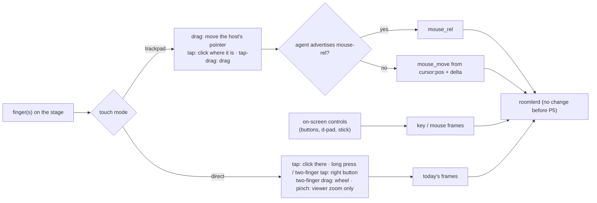

# FR-111: Touch controls — a phone or tablet as a real controller

**Issue:** [#2359](https://github.com/gjovanov/roomler-ai/issues/2359) · **Status:** proposed — spec and claim
2026-10-17 · **Owner:** the viewer's input path (`useRemoteControl.ts`, the stage, `MobileKeyboard.vue`);
the agent only from P5 · **Anchors:** master `f93c23f74` · **Program:**
[StarDesk teardown](../plans/stardesk-teardown-program.md), wave 3 (§3 "Touch controls", row P11) ·
**Builds on:** [FR-109](FR-109-relative-mouse.md) (`mouse_rel`, for the trackpad mode)

## 1. Goal

A phone or a tablet should drive a remote computer as well as a laptop does, with nothing installed on it.
StarDesk ships native clients with 200+ touch key-mapping presets and macro keys (the teardown's row P11).
Roomler's controller is the browser. Today it treats a finger as a mouse: a touch moves the host's pointer
to that point and presses the left button there. A touch browser gets no right button, no scrolling, no
trackpad and no keys beyond the soft keyboard.

The first touch work (G1, phases P1–P3) is **viewer-only**. Every control emits frames the agent already
understands (`mouse_button`, `mouse_move`, `mouse_wheel`, `key`, and FR-109's `mouse_rel` where
advertised), so it works with every deployed agent and needs no release.

## 2. Evidence (master `f93c23f74`)

| What | Where |
|---|---|
| A finger is the mouse: pointer events with no `pointerType` branch; a touch down is `mouse_button` down at that point | [`useRemoteControl.ts:10098`](../../ui/src/composables/useRemoteControl.ts#L10098) `onPointerDown`, `:10118` `onPointerUp` |
| The stage listens for `pointerdown`, `pointerup`, `pointermove` and `wheel`, and nothing else | [`useRemoteControl.ts:10668`](../../ui/src/composables/useRemoteControl.ts#L10668) |
| **No `pointercancel` handler** anywhere in the viewer, and **no `touch-action`** in the UI. A touch browser that turns a drag into a pan or a zoom fires `pointercancel` and never `pointerup`; P0 measures what the host is left with | `git grep -n -e pointercancel -e touch-action ui/src`: nothing; the stage's CSS, [`RemoteControl.vue:4658`](../../ui/src/views/remote/RemoteControl.vue#L4658) |
| The soft keyboard is the only touch-specific control: an off-screen textarea whose input becomes key frames | [`MobileKeyboard.vue`](../../ui/src/components/remote/MobileKeyboard.vue) |
| The viewer knows where the host's pointer is (`cursor:pos` on the cursor channel), which a trackpad mode needs for absolute moves | [`useRemoteControl.ts:9133`](../../ui/src/composables/useRemoteControl.ts#L9133) |
| `InputMsg::Touch` is parsed and dropped by every injector | [`input/mod.rs:253`](../../agents/roomlerd/src/input/mod.rs#L253); [`enigo_backend.rs:267`](../../agents/roomlerd/src/input/enigo_backend.rs#L267), [`uinput_backend.rs:582`](../../agents/roomlerd/src/input/uinput_backend.rs#L582), [`portal/input.rs:210`](../../agents/roomlerd/src/capture/portal/input.rs#L210) |

## 3. Design

### 3a. Touch on the stage (P1)

- **`touch-action: none` on the stage**, so the browser hands every touch to the viewer instead of panning
  or zooming the page.
- **`pointercancel` releases** whatever that pointer held, through the same path as `pointerup` and the
  blur release (FR-93's `lastPointerNorm`). A forwarded press always gets its release.
- **Gestures in direct mode:** a tap is a left click where the finger is (today). A long press (≥ 500 ms
  without moving) or a two-finger tap is the right button. A two-finger drag is `mouse_wheel`. A pinch zooms
  the viewer's picture locally and sends nothing.
- A second finger cancels a pending single-finger press instead of dragging with it.

### 3b. Trackpad mode (P2)

- The screen acts like a laptop trackpad. A one-finger drag moves the host's pointer by the finger's delta,
  scaled by a sensitivity. A tap clicks where the pointer is, a two-finger tap is the right button, and a
  tap followed by a drag drags.
- **To an agent that advertises `mouse-rel`** the motion goes as FR-109's `mouse_rel` and the presses as
  `mouse_press` / `mouse_release`, which press where the pointer is.
- **To an older agent** the viewer moves from the last `cursor:pos` by the delta, with absolute
  `mouse_move` and `mouse_button` frames. That works with every deployed agent.
- The ghost cursor shows where the host's pointer is, since the finger is no longer on it.

### 3c. On-screen controls (P3, G1)

- An overlay on the stage with buttons, a d-pad and a stick, each emitting existing frames: `key` for keys,
  and mouse frames for a mouse stick.
- A held button holds its key, and release-all covers it: the arbiter releases a session's held keys on
  teardown, and the viewer's blur release covers a hidden tab.
- **Built-in presets** (open decision 2), chosen per device and remembered in the browser. No server
  state in G1.

### 3d. The editor, macros and tenant presets (P4, G2)

- A layout editor: place, size and bind buttons. Macros are click / press / release steps with delays, as
  StarDesk has.
- **Presets become tenant-scoped data**, per `docs/data-model.md`: a collection keyed by tenant, shared by
  its members, never agent config.

### 3e. Native touch (P5, G3, optional)

- `InputMsg::Touch` injected natively: `InjectTouchInput` on Windows, a uinput multitouch device on Linux.
- Gated like FR-109's frames: a capability word, equality-matched.
- Only if open decision 3 wants it after G1 and G2.

### 3f. What it never does

The agent still only injects (FR-92's rule). No phase reads input on the host.

## 4. Phases

| P | Scope | Kill switch | Status |
|---|---|---|---|
| P0 | Probes: (1) **red first**, a one-finger drag on today's stage in touch emulation, read on a vmtest Win11 host by a raw-input probe that counts button downs and ups; (2) what each engine's touch emulation gives Playwright (taps, drags, two-finger gestures), for the ACs' cells | docs only | spec and claim 2026-10-17 |
| P1 | Touch on the stage (3a) | viewer storage key `roomler-rc-touch=legacy` | — |
| P2 | Trackpad mode (3b) | the mode switch | — |
| P3 | On-screen controls and built-in presets (3c) | the overlay's toggle | — |
| P4 | Editor, macros, tenant presets (3d) | — | — |
| P5 | Native touch injection (3e) | agent capability word | — |
| P6 | Docs: `docs/touch-controls.md` (mermaid, the gestures, the modes, the presets), linked from `docs/remote-control.md` §6 and indexed in `docs/README.md` | — | grows with each phase |

## 5. Acceptance criteria

- [ ] **AC1 (red first):** a one-finger drag on the stage of a touch browser ends with the host's button
  released (a raw-input probe on a vmtest Win11 host counts downs and ups). Red: today a drag the browser
  cancels leaves it down.
- [ ] **AC2:** in direct mode, long press and two-finger tap give the right button, two-finger drag scrolls
  the host, and a pinch zooms only the viewer (nothing reaches the host).
- [ ] **AC3:** trackpad mode moves the host's pointer relatively, on an agent that advertises `mouse-rel`
  and on an older one, and a tap clicks where the pointer is.
- [ ] **AC4:** on-screen buttons and the d-pad reach the host as the keys they name, read by a test-only
  probe on the guest.
- [ ] **AC5:** G1 works with every deployed agent: AC1–AC4's cells pass on an agent from before this FR.
- [ ] **AC6:** presets. The built-ins switch and are remembered per device (G1); the editor and tenant
  presets work (G2).
- [ ] **AC7:** **Docs:** a `docs/touch-controls.md` page (mermaid, the gestures, the modes, the presets),
  linked from `docs/remote-control.md` §6, with a row in `docs/README.md`'s index.

## 6. Open decisions

1. **The default on a phone.** Direct touch (today's) or trackpad. Recommended: trackpad on a phone-sized
   screen, direct on a tablet, switchable in the toolbar.
2. **The built-in presets G1 ships.** Recommended: arrows; WASD with mouse look; an office row (Esc, Tab,
   Alt+Tab, Ctrl+C / V / Z).
3. **G3 at all.** Native touch injection only if a host app needs real touch (a touch-first Windows app)
   once G1 and G2 exist.

## 7. Out of scope

- Gamepad passthrough (excluded by the operator).
- Native controller apps: nothing to install on the controlling side stays true.
- Reading input on the host in any form (§3f).

## 8. Field-verification log

| # | Date | Cell | Result |
|---|---|---|---|

## 9. Related

- [Plan §3](../plans/stardesk-teardown-program.md): this FR, and its place in wave 3.
- [FR-109](FR-109-relative-mouse.md): `mouse_rel` and `mouse_press`, which the trackpad mode uses.
- [FR-92](FR-92-keep-busy.md): the no-hooks rule.
