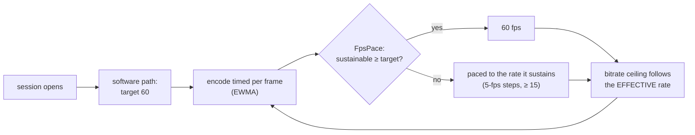

# FR-112: 60 fps without a hardware encoder — the frame rate follows what the encoder sustains

**Issue:** [#2394](https://github.com/gjovanov/roomler-ai/issues/2394) · **Status:** ✅ **closed 2026-10-18**, every
criterion field-verified on a release (§9).
- P1, P2a and P2b are in **0.4.142**. The Asahi host sends **56.2 fps** of VP9-444 where 0.4.141 sends 27, H.264
  **56.2** where it sends 28.7, and a still screen costs 15 % CPU instead of 44 %.
- **AC3 found a flap**: the pace's hysteresis held nothing, so a pace on a step boundary moved every window it
  crossed. P2d (a step-up margin) and its review's follow-ups are in **0.4.143**. There a host that cannot
  sustain 60 settles with no pace change at all, and `ROOMLERD_SW_PACE_UP_MARGIN=0` gives back the old flapping
  (11 moves in 40 s).
- P4's docs: [#2425](https://github.com/gjovanov/roomler-ai/pull/2425).
- P3 (macOS, Windows) moved to [#2430](https://github.com/gjovanov/roomler-ai/issues/2430), and the hardware
  pace's own flaw to [#2432](https://github.com/gjovanov/roomler-ai/issues/2432).
Spec and claim 2026-10-17, on the operator's *"why is asahi having
less than 30fps, cant it reach 60?"* and, after the answer, *"yes do it"* · **Owner:** remote desktop (the software
encode paths) · **Anchors:** master `406d6f590` ·
**Builds on:** [FR-107](FR-107-drm-capture-throughput.md) (the capture costs 1.9 ms), [FR-74](FR-74-text-clarity-on-direct-paths.md)
(the direct path's quality cap), [FR-1](FR-1-remote-desktop-drag-smoothness.md) P5's `FpsPace`
(`encode/encode_pressure.rs:171`) · **Related:** [FR-98](FR-98-input-to-photon-budget.md) (input-to-photon under
50 ms: a 60 fps frame waits half as long)

## 1. Goal

A host with no hardware encoder sends **60 fps when its CPU can encode 60, and as many as it can when it cannot**.
The rate is decided per session from the measured encode cost, never assumed. Today every software path is pinned
at 30 by a constant, and on a fast host the constant is not even the limit: the encoder is.

## 2. Evidence (2026-10-17)

### The cap

| Path | Today | Anchor |
|---|---|---|
| VP9-444 over the DataChannel | 30, or 60 with `ROOMLERD_VP9_FPS=60` | `agents/roomlerd/src/peer.rs:9435` |
| H.264 over RTP (OpenH264) | 30: `TARGET_FPS_SW`, and the encoder's own `max_frame_rate(30)` | `peer.rs:98`, `encode/openh264_backend.rs:50` |
| Hardware encoders | 60 | `peer.rs:105`, `ffmpeg_target_fps` (`peer.rs:9459`) |

### The Asahi host at the cap, and past it

An Apple M2 Pro (6 performance + 4 efficiency cores), Fedora Asahi Remix 42, GNOME at 4096×2160 **60 Hz**, the
scanout read by the GPU and encoded at 2048×1080 (FR-107). The released 0.4.141, one viewer 17 ms away on a direct
path, a spinning cube in a window, each arm a fresh session (`ROOMLERD_VP9_*` as a systemd drop-in, removed after):

| VP9-444 arm | target | encoded | captured | avg QP | ceiling | roomlerd CPU |
|---|---|---|---|---|---|---|
| today (`cpu-used` 6, 4:4:4) | 30 | **27.0** | 27.0 | 10 | 17.5 Mbps | ~3.8 cores |
| `ROOMLERD_VP9_FPS=60` | 60 | **27.1** | 27.1 | 7 | 30.4 Mbps | ~4.0 cores |
| + `cpu-used` 8 | 60 | 28.9 | 28.9 | 5 | 24.5 Mbps | ~3.5 cores |
| + `cpu-used` 9 | 60 | 30.0 | 30.0 | 6 | 24.3 Mbps | ~3.4 cores |
| + 4:2:0 | 60 | 28.1 | 28.1 | 10 | 21.1 Mbps | ~3.8 cores |
| + worst quality q-index 32 | 60 | 25.0 | 25.0 | 7 | 28.3 Mbps | ~3.9 cores |
| + `cpu-used` 8, 4:2:0 | 60 | 20.7 | **38.2** | 4 | 26–31 Mbps | ~3.5 cores |
| + `cpu-used` 9, 4:2:0 | 60 | 26.3 | **43.8** | 2 | 24–28 Mbps | ~3.5 cores |

- **The constant is not the limit.** Raising the target to 60 changed nothing: the loop took ~37 ms a frame
  either way, and libvpx kept ~4 of the 10 cores busy.
- **The capture is not the limit.** In the 4:2:0 arms the capture ran at 38–44 fps while the encode stayed under
  30, and the display refreshes at 60 Hz.
- **Nor the encoder's settings.** The 60 target *doubled* the bitrate ceiling (`initial_bitrate_for_fps`,
  `encode/mod.rs:695`) and QP fell from 10 to 7, yet a frame still took ~37 ms, and no speed setting helped much.
  What does help is the clock the encoder is given (below).

### What a frame costs, measured offline

Both benches ran **on the Asahi host**, at 2048×1080, on synthetic screen content: a static text-like desktop, a
window dragged 8 px a frame, and a 256×256 block of noise that changes wholly (worst-case content).

**H.264**: roomlerd's own BGRA → I420 conversion (copied verbatim from `encode/openh264_backend.rs:328`), then
OpenH264 as roomlerd pins it (0.9.3 over openh264-sys2 0.9.6):

| H.264 stage, configuration | ms per frame | max fps | bytes per frame |
|---|---|---|---|
| convert: roomlerd's scalar code | 1.35 | 742 | — |
| convert: dcv-color-primitives (the VP9 path's) | 3.16 | 317 | — |
| encode as built (30 fps, one slice) | 4.57 | 219 | 55.8 KB |
| encode, `max_frame_rate(60)`, same bitrate | **2.41** | 416 | 27.4 KB |
| encode, + 4 threads, one slice | 2.44 | 411 | 27.4 KB |
| encode, + slices ≤ 1200 B, threads | 5.39 | 186 | 23.9 KB |
| encode, screen-content mode | 4.22 | 237 | 29.9 KB |
| **convert + encode, 30 / 60 fps** | **5.97 / 5.48** | 168 / 183 | 55.0 / 30.3 KB |

- **Neither the conversion nor OpenH264 is the limit.** A frame costs ~6 ms back to back, yet the RTP pump
  reported `avg_encode_ms` **16.6** in the field (FR-107 §9, 0.4.140). The other ~10 ms is the clock (below).
- **Slices are a loss here.** ⚠️ Wrong turn, recorded: the first run of this bench was on an x86-64 Windows
  laptop, at 17.1 ms a frame, where slices with threads looked 1.7× faster. On the host they make a frame 2.2×
  *slower*. (openh264-sys2 builds no assembly for aarch64, so the host runs the C code too; why the laptop was
  slower was not established.) Measure on the host.

**VP9 (libvpx 1.15)** through roomlerd's own `Vp9Encoder::encode_sync` (BGRA → I444 included), at the direct
path's quality cap (q-index 16, `ROOMLERD_VP9_DIRECT_MAX_Q`):

| VP9 configuration (2048×1080, 4:4:4 unless said) | ms per frame | max fps | bytes per frame |
|---|---|---|---|
| today: 30 fps, 17.5 Mbps, `cpu-used` 6, 4 tile columns | 47.0 | 21 | 113 KB |
| 60 fps, 30.4 / 17.5 / 10 Mbps, `cpu-used` 6, 4 tiles | 52.1 / 45.9 / 43.8 | 19–23 | 113 KB |
| 60 fps, 8 tile columns, `cpu-used` 6 | 43–44 | 23 | 113 KB |
| 60 fps, 8 tiles, `cpu-used` 8 | 33.7–37.2 | 27–30 | 117 KB |
| **60 fps, 8 tiles, `cpu-used` 9** | **21.9** | **46** | 118 KB |
| 60 fps, 8 tiles, `cpu-used` 8, **4:2:0** | 24.0 | 42 | 58 KB |
| 60 fps, 8 tiles, `cpu-used` 8, **no quality cap** (q63) | 23.7 | 42 | 30 KB |

- **On this content the quality cap, not the bitrate, sets the frame size**: every capped row ran at q-index 16
  whatever the target, ~113 KB a frame. The field's content (a moving window) stayed under the cap (QP 5–10).
- ⚠️ **Both benches ran at whatever clock the scheduler gave them**, and the next subsection shows that clock is
  the real limit. These rows are what libvpx does on a throttled core, not what the CPU can do. A first reading
  of them, "4:4:4 at 2048×1080 tops out near 45 fps", was wrong.

### The clock: the encoder runs as fast as the scheduler lets it

The H.264 bench sustains 6 ms a frame back to back, yet the live pump measured 16.6. The difference is how the
work arrives. A live encoder works a third of the time, a frame every 33 ms, and Linux's energy-aware scheduler
(`schedutil` over `apple-cpufreq`, 702–3264 MHz) gives a thread like that a low clock, on an efficiency core:

| The same OpenH264 frame, 2048×1080 | back to back | with a 30 fps idle gap |
|---|---|---|
| performance cores only (`taskset -c 4-9`) | 5.97 ms | **20.07 ms** |
| efficiency cores only (`taskset -c 0-3`) | 15.05 ms | 22.29 ms |
| wherever the scheduler puts it | 5.94 ms | 20.50 ms |

| Idle gap between frames | 0 | 5 ms | 11 ms | 16 ms | 28 ms |
|---|---|---|---|---|---|
| ms per frame (unpinned) | 5.95 | 9.43 | 13.82 | **16.76** | 20.68 |

A frame stretches until it nearly fills its period: at a 30 fps cadence it takes ~16.8 ms, exactly the field's
figure. Keeping one performance core busy (which holds that cluster's shared clock up) changed nothing live
(16.3 → 15.8 ms), so the live encoder thread runs on the efficiency cluster.

**Asked for its clock, the same encoder is a different encoder.** `uclampset -a -m 1024` on roomlerd's threads (a
utilisation clamp: the scheduler places a clamped thread on a big core and runs it at a high clock), the released
0.4.141, today's encoder settings, one session per arm:

| Live, the Asahi host | unclamped | `uclamp_min` 1024 |
|---|---|---|
| H.264/RTP `avg_encode_ms` (30 fps target) | 16.1 | **5.3** |
| VP9-444 encoded fps, 30 fps target | 26.8 | **29.1** (the target) |
| **VP9-444 encoded fps, 60 fps target** | 19.4 | **56.3**, QP 13, 25.2 Mbps |

So the cap was not the only constant in the way: a scheduler that clocks a periodic encoder down hid a 3× speed-up.
With its clock, today's VP9 settings send 56 fps, and an H.264 frame costs 5 ms.

## 3. Key design

- **The encoder asks for its clock.** On Linux the encoder thread sets its own utilisation clamp
  (`sched_setattr`, `SCHED_FLAG_UTIL_CLAMP_MIN`, policy and priority kept) when it starts
  (`encode/clock.rs`). libvpx creates its worker threads at the first encode, from that thread, so they inherit
  the clamp. OpenH264's worker and the capture worker do the same, and so does whatever they start (Mesa's
  shader-cache thread, from the capture worker's EGL). A clamp counts only while a thread is runnable, so an idle
  screen costs nothing more. A host whose kernel lacks util clamping says so once and runs as today.
- **Those threads are enough.** Clamping every other daemon thread as well, including the async runtime's that
  carry the DataChannel (SCTP, DTLS), added nothing: 56.3 fps with the clamp on everything, 56.2 with it on the
  runtime alone, 56.3 with only the encode and capture threads (§9). Clamping the runtime would also clock up
  every timer the daemon wakes for, on every host, with no session open.
- **The encode is timed** on the VP9-444 pump (today only `avg_scale_ms`), as the RTP pump already does, and the
  heartbeat says it (`avg_encode_ms`). The tier below steers by it.
- **Software paths target 60, and FR-1's `FpsPace` paces them down.** `FpsPace` already does exactly this for
  hardware encoders: from the encode EWMA it computes the sustainable rate, quantised to 5 fps.
  Wiring it into the two software pumps turns the constant into a measurement. An explicit `ROOMLERD_VP9_FPS`
  still pins the rate.
- **A step up waits for headroom (P2d).** `FpsPace` was meant to be hysteretic: an engaged pace moved only when
  the new step differed from it by 5 fps. Two different 5-fps steps always do, so the check held nothing, and an
  estimate hovering on a step boundary moved the pace every window it crossed. The 0.4.142 field trace (§9) has
  55 → 50 → 55 → 50 → 45 → 50, five moves in ten windows. The software pace now steps down at once (a pace the encoder
  cannot hold is the judder pacing exists to remove) and up only when the estimate clears the higher step by
  2.5 fps (`SW_PACE_UP_MARGIN_FPS`, `encode/encode_pressure.rs`; `ROOMLERD_SW_PACE_UP_MARGIN=0` restores 0.4.142's
  pace). Half a step is narrower than a step, so a recovering encoder still climbs. It absorbs an EWMA that swings
  less than that across a step boundary, but not every swing: the trace's settled windows moved the EWMA by up to
  ±3.4 fps, and one reversal survives there, three windows apart (the unit test's 8 moves). The 2-moves-in-40-s
  candidate arms (§9) are the evidence, not this sizing argument. The margin has a cost: after a dip, an encoder
  that sustains 60–62.5 fps runs at 55 instead of 60. The hardware pace keeps margin 0. It has the same flaw, but
  on hardware that cost lands on an encoder whose whole point is 60, so the trade is measured on a hardware host
  first ([#2432](https://github.com/gjovanov/roomler-ai/issues/2432)).
- **Never below 0.4.141.** A software pump is never paced below 30, the target it had
  (`RateGovernor::paced_software_fps`, `SW_PACE_FLOOR_FPS`). A host that cannot sustain 30 then runs exactly as
  it did: its loop is slower than the 33 ms cadence, so the gate never waits, and the bitrate base is 30's. Without
  the floor `FpsPace` would step a 27 fps host down to 25, below what it sends today.
- **On by default on Linux only.** The clock is Linux's (P1), and the tier was measured there. On a host whose
  clock was never the limit, 60 frames cost twice the CPU of 30, and an attended desktop pays for it, so Windows
  and macOS opt in (`ROOMLERD_SW_FPS_60=1`) until P3 measures them on their own hardware.
- **The bitrate ceiling follows the effective rate, sub-linearly.** OpenH264's cost follows bits per frame (§2:
  4.6 → 2.4 ms when they halve), and the link pays the bitrate on every path. A ceiling computed for 60 while the
  pump runs at 30 doubles every frame's bits, so the ceiling is computed from the paced rate. It grows by
  √(fps/30) rather than linearly: at 60 a moving window travels half as far between frames, so each frame needs
  fewer bits than at 30.
- **H.264's static assumptions go.** Under the tier the RTP pump starts at 60 (`target_fps_with_tier`), and the
  auto-fps-cap that drops a software backend to 30 stays off for it: the readback that cap absorbs is WGC's, on
  Windows, where the tier is opt-in. The pump hands OpenH264 the rate it runs at
  (`VideoEncoder::set_frame_rate`, `ENCODER_OPTION_FRAME_RATE`), because OpenH264 budgets each frame's bits from
  it: configured for 30 and fed 60, it spends a 30 fps frame's bits on every one. One slice stays: slicing
  measured slower on the host (§2).
- **OpenH264's runtime settings reach it.** Two defects kept them out, both older than this FR. The crate creates
  the C encoder's state at the first encode, and `SetOption` before that answers `cmInitExpected` (4): every
  session's first `set_bitrate` (the quality-derived target, applied before the first frame) failed, was recorded
  as applied, and was never retried. The release logs it twice a session (§9). Early settings are now held until
  the first frame is through. And the crate sets layer 0's max bitrate to the construction bitrate, and OpenH264
  refuses a target above the max (`cmInitParaError`), so no runtime raise past it ever took: not Quality=High, not
  REMB recovering, not the 60 fps base. `apply_runtime_bitrate` now moves the max with the target.
- **The keyframe period keeps its seconds.** OpenH264 counts its IDR period in frames, and the live encoder's was
  60: two seconds at 30 fps, one at 60. A frame-rate change now carries the period with it
  (`ENCODER_OPTION_IDR_INTERVAL` = fps × 2 s, `IDR_EVERY_S`); the recording profile keeps its own GOP. CI caught
  it: `tests/l4_latency.rs`'s replay cell read the periodic keyframe at +1 s as an obeyed replay (4 of 5).
- **The ≤ 1280-px cap is not the limit it looks like.** The cap that shrinks software H.264 "so encode stays under
  the 33 ms 30-fps budget" fires on the host, and 230 ms later the viewer's default resolution (`original`,
  `ui/src/composables/useRemoteControl.ts:5044`) overrides it: the field already encodes 2048×1080, and with its
  clock that costs 5.5 ms a frame. So P2c, which would have decided the cap from the measured encode, is dropped.
- **No VP9 quality trade on this host.** With its clock, today's settings (`cpu-used` 6, four tile columns, the
  q-index-16 cap) send 56 fps. `ROOMLERD_VP9_CPU_USED` stays the lever for a host that measures short.
- **Static screens cost what they cost today.** The idle skip (FR-93 P3d) and the keepalive cadence do not change;
  a 60 target only spends frames on a screen that moves.

## 4. Phases

| Phase | What | Kill switch | Proven on | Size |
|---|---|---|---|---|
| **P1** | the encoder asks for its clock: on Linux a `uclamp_min` on the encoder thread (libvpx's workers inherit it), OpenH264's worker and the capture worker; the VP9-444 pump times its encode (`avg_encode_ms`); the VP9 bench kept as an ignored test | `ROOMLERD_ENCODER_CLOCK=0` | ✅ released in 0.4.142, field-verified on the Asahi host and a per-user lab guest (§9) | S |
| **P2a** | the VP9-444 pump's tier: target 60, `FpsPace` fed by its encode EWMA and never below 30, the ceiling from the rate it runs at (×√2 at 60); on by default on Linux | `ROOMLERD_SW_FPS_60=0` (back to 30) | ✅ released in 0.4.142, field-verified on the Asahi host (§9) | M |
| **P2b** | the H.264 RTP pump's tier: target 60 on Linux, the same pace (`SoftwarePace`, shared with P2a) and ceiling, OpenH264's frame rate following the rate it runs at, its runtime settings held until its first frame and its max bitrate moving with the target, the auto-fps-cap left to Windows | `ROOMLERD_SW_FPS_60=0` | ✅ released in 0.4.142, field-verified on the Asahi host (§9) | M |
| **P2d** | the software pace's steps up wait for headroom: down at once, up only once the estimate clears the higher step by 2.5 fps (`SW_PACE_UP_MARGIN_FPS`); the hardware pace keeps margin 0 until it is measured ([#2432](https://github.com/gjovanov/roomler-ai/issues/2432)) | `ROOMLERD_SW_PACE_UP_MARGIN=0` (0.4.142's pace) | ✅ released in **0.4.143**, field-verified on it (§9): no pace change in 38 and 43 windows where 0.4.142 flapped, and the switch gives the flapping back. Before it: a candidate on the Asahi host (0.4.142's pace 14 moves in 40 s, the margin 2); unit: margin 0 replays 0.4.142's logged field trace window for window | S |
| ~~**P2c**~~ | ~~software H.264's ≤ 1280-px cap decided by the measured encode~~ — dropped: the viewer's default `original` already overrides the cap (§3), and the host encodes 2048×1080 in 5.5 ms | — | — | — |
| ~~**P3**~~ | ~~the clock elsewhere: macOS (the encoder threads' QoS class) and Windows (no power throttling for the encode thread), each measured on its own hardware first~~ — moved to [#2430](https://github.com/gjovanov/roomler-ai/issues/2430), so this FR can close on what Linux measured | per OS | → #2430 | S |
| **P4** | docs: `docs/rate-control.md` (the software tier, the ceiling), `docs/encoders.md` (the clock, why one slice), the `docs/README.md` index row | — | ✅ `encoders.md` § Software encoders (the clock, the tier, OpenH264's settings), `rate-control.md` § Software encoders and two config rows, both index rows | S |

## 5. Test plan

- **Unit:** the ceiling as a function of the effective rate (30 → today's exactly; 60 → ×√2); `FpsPace` on a
  software EWMA (steps, hysteresis, the floor); the clamp request's encoding (flags, size) and its kill switch;
  every kill switch restores today's values.
- **The clock, on the host:** an encoder thread's clamp reads back 1024 (`uclampset -p <tid>`), libvpx's workers
  too, and nothing else of the daemon's; a per-user install (no root) gets it as well, or logs why not.
- **Field, the Asahi host** (the §2 arms as the red, on 0.4.141): VP9-444 and H.264 with a moving window; the
  heartbeat's encoded rate, QP, `avg_encode_ms`, and roomlerd's CPU.
- **A host that cannot sustain 60:** a lab guest with few cores; it must settle at the rate it sustains, never
  below today's, without flapping.
- **A still screen:** the FR-93 AC8 measurement (idle CPU) before and after.
- **Every kill switch** restores 0.4.141's behaviour.

## 6. Acceptance criteria

- [x] **AC1** — The Asahi host, VP9-444 over the DataChannel, a moving window, a direct path: **≥ 55 fps
  encoded**. Red first on 0.4.141 (27.0 fps; 56.3 with the clock asked for by hand, §2).
  ✅ 0.4.142 as released: **56.2 fps** encoded and captured, target 60, never paced, QP 15, 1.9 cores (§9). Red:
  27.0 on 0.4.141 (§2), and 27.7 on 0.4.142 with both kill switches.
- [x] **AC2** — The same host over H.264/RTP: **≥ 55 fps**. Red first on 0.4.141.
  ✅ 0.4.142 as released: **56.2 fps**, target 60, never paced, a 5.2 ms encode, 0.4 cores (§9). Red: 28.7 on
  0.4.141 (§9's P2b table), and 28.7 on 0.4.142 with both kill switches.
- [x] **AC3** — A host that cannot sustain 60 settles at the rate it sustains: never below its 0.4.141 rate, and
  at most one pace change in any 10 s once settled.
  ✅ **The released 0.4.143** (P2d), the Asahi host's system service updated to it, every arm one session (§9):
  - With `ROOMLERD_ENCODER_CLOCK=0` the host cannot sustain 60. It encodes **28.0 fps** against 27.0 on 0.4.141,
    paced 30 in all 38 windows, **no pace change**.
  - With the estimate put on the 40 fps step (the clock off and `ROOMLERD_VP9_CPU_USED=9`): **32.3 fps**, paced 35
    in all 43 windows, **no pace change**.
  - `ROOMLERD_SW_PACE_UP_MARGIN=0` on the same host gives back 0.4.142's pace: **11 moves** in 40 s, 3 undone
    within two windows. That arm's fps is void because the lab viewer stalled; its pace log is the agent's own.
  - The history below is how AC3 got here.
  🟡 0.4.142 with `ROOMLERD_ENCODER_CLOCK=0` (the Asahi host made one that cannot: a 31 ms VP9-444 encode)
  settles at 30, 27.7 fps encoded against 27.0 on 0.4.141, with no pace change in 38 windows (§9). But the
  same host's other arm, its encode getting cheaper as the lab viewer stalled, undid a step three times within
  one or two windows. The cause is `FpsPace`'s hysteresis, which held nothing (§3), so a settled host whose
  estimate sits on a step boundary would flap too. P2d fixes it. On a candidate, with the estimate on the 40 fps
  step, the pace moved twice in 40 s against 0.4.142's 14 times, and `ROOMLERD_SW_PACE_UP_MARGIN=0` restored
  0.4.142's pace (§9). AC3 ticks on P2d's release.
- [x] **AC4** — A still screen costs what it cost on 0.4.141 (FR-93 AC8's idle CPU, within its noise).
  ✅ Less: **15 %** of a core on 0.4.142 against 44 % on 0.4.141, the same 60 s still arm (§9).
- [x] **AC5** — Quality under motion: the 60 fps session's average QP within 6 of the 30 fps session's on the same
  content, and a still screen refines to the same QP as 0.4.141.
  ✅ The spinning cube: QP 15 at 56.2 fps against QP 10 at 27.7 fps (0.4.142 with both kill switches, 0.4.141's
  behaviour), within 6. A still screen refines to an average QP of 1 on 0.4.142 and on 0.4.141 (§9).
- [x] **AC6** — Every kill switch restores 0.4.141's behaviour (30 fps, no clamp).
  ✅ 0.4.142 with `ROOMLERD_ENCODER_CLOCK=0` and `ROOMLERD_SW_FPS_60=0`: VP9-444 27.7 fps at the 30 target and
  H.264 28.7 with a 16.4 ms encode (0.4.141: 27.0; 28.7 with 16.6 ms), and no thread clamped. Each alone:
  `ROOMLERD_SW_FPS_60=0` puts the target back at 30 (29.1 fps, the clock still on), and
  `ROOMLERD_ENCODER_CLOCK=0` leaves 0 of 84 threads clamped (§9). P2d's own switch is checked under AC3.
- [x] **AC7** — Docs: `docs/rate-control.md` and `docs/encoders.md` in the house style, and a `docs/README.md`
  index row.
  ✅ `encoders.md` § *Software encoders: the clock and 60 fps* (a mermaid flow, the field table, `file:line`
  anchors, OpenH264's three facts), `rate-control.md` § *Software encoders at 60 fps* and the two config rows,
  and both `docs/README.md` rows.
- [x] **AC8** — The clock: on the Asahi host at a 30 fps target, the H.264 encode costs **≤ 8 ms** (16.1 on
  0.4.141), the encoding and capture threads (and the threads they start) carry the clamp and no other thread
  does, and a per-user install gets it too or says why not.
  ✅ 0.4.142 with `ROOMLERD_SW_FPS_60=0`: **6.2 ms** (5–7 ms a window). Half-way through each session, the
  clamped threads were the DRM capture worker, the encoder (VP9: `rc-enc` and its 7 libvpx workers; H.264:
  OpenH264's worker) and Mesa's shader-cache thread, which the capture worker's EGL starts. Every other daemon
  thread read 0: 74 of 84, 75 of 78. On the per-user GNOME lab guest, 0.4.142 clamped the encoder and its three
  workers (4 of 78), and its journal logs `encoder clock: asked for … uclamp_min=1024`. That guest captures through
  the portal's PipeWire stream, which is not one of the clamped roles: P1 clamps the DRM capture worker (§9).

## 7. Open decisions (operator)

| | Decision | Status |
|---|---|---|
| **D1** | On by default for every software host, or opt-in | *(Recommended: on. It is adaptive: a host that cannot sustain 60 is paced to what it can, and the floor is today's behaviour.)* |
| **D2** | The ceiling at 60 | *(Recommended: ×√2 of the 30 fps ceiling. ×2 is what starved the encoder in §2; ×1 halves each frame's bits, which the dial's Sharper exists to avoid.)* |
| **D3** | The Priority dial | *(Recommended: unchanged meaning — it scales the ceiling. The frame rate is measured, not chosen.)* |
| **D4** | VP9's speed settings under motion | *(Recommended: unchanged. With its clock, today's settings reach 56 fps on the host; `ROOMLERD_VP9_CPU_USED` stays the lever for a host that measures short.)* |
| **D5** | The clock's strength | *(Recommended: 1024, full speed while the encoder runs. A clamp counts only while the thread is runnable, so a still screen costs nothing more; a lower value hands per-frame latency back.)* |

## 8. Out of scope

- Hardware encoders: they already target 60 and have their own pacing (FR-1 P5).
- The X11 capture's frame gate (FR-107 §8): a separate before/after on an X11 host.
- The GPU writing the encoder's YUV (FR-107 P4): worth it only if the bench shows the conversion matters.
- A 120 Hz target: no field host asks for it yet.
- Noticed, not this FR's: software H.264's ≤ 1280-px auto-downscale fires at session start and the viewer's
  default `original` overrides it 230 ms later, so every such session pays an extra encoder rebuild and a resize.

## 9. Field-verification log

| Date | Host | Build | What | Result |
|---|---|---|---|---|
| 2026-10-17 15:52–16:19Z | the Asahi host, its 4096×2160 60 Hz desktop, one viewer 17 ms away | the released 0.4.141 (sha256 `381ae5ca…`), `ROOMLERD_VP9_*` drop-ins per arm, removed after | the red, and the levers | 🔴 §2's table: 27.0 fps at the 30 target, 27.1 at 60; no speed, chroma or quality setting passed 30.5. The display is 60 Hz (GNOME's current mode `4096x2160@60.000`), and the capture reached 44 fps when the encode let it. ⚠️ `ROOMLERD_RATE_FACTOR_VP9_444` looked like the ceiling's knob, and the arms that set it kept 30 Mbps: the libvpx pump hard-codes its 4:4:4 headroom (`peer.rs:4629`), and the factor reaches only the FFmpeg cells |
| 2026-10-17 16:22–16:34Z | the Asahi host, natively (aarch64, toolchain 1.95.0) | master `2ba695cc8`'s `Vp9Encoder` + an ignored bench test; a standalone OpenH264 bench on the pinned crates | P1's benches (§2) | VP9 at 4:4:4: 47.0 ms a frame today, 21.9 with eight tile columns and `cpu-used` 9, ~45 fps at best. H.264: convert + encode 5.97 ms at 30 fps and 5.48 at 60, against the 16.6 ms the RTP pump reported in the field. ⚠️ **Wrong turns:** the first VP9 run built without `vp9-444` and ran no test ("0 passed, 1916 filtered out"); Linux releases build with `full,vp9-444,vp9-444-bindgen`. The first OpenH264 run was on an x86-64 Windows laptop: 17.1 ms a frame, and slices looked 1.7× faster; on the host they are 2.2× slower. That run blamed missing assembly, which was wrong: openh264-sys2 builds none for aarch64 either. And both host benches ran unclamped, so they measured the throttled clock (next row) |
| 2026-10-17 16:36–17:10Z | the Asahi host: the OpenH264 bench, then live sessions on the released 0.4.141 | — | the clock (§2) | ✅ The same OpenH264 frame takes 5.97 ms back to back and 20.07 ms with a 30 fps idle gap, even pinned to the performance cores, and per-frame time tracks the gap (5.95 / 9.43 / 13.82 / 16.76 / 20.68 ms for 0 / 5 / 11 / 16 / 28 ms). Live, a spin loop holding the performance cluster's clock changed nothing (16.3 → 15.8 ms), and `uclampset -a -m 1024` on the daemon's threads took the H.264 encode from 16.1 to **5.3 ms**, VP9-444 at a 30 target from 26.8 to 29.1 fps, and **VP9-444 at a 60 target from 19.4 to 56.3 fps** (QP 13, 25.2 Mbps). Every clamp was reset (`min: 0`) and every drop-in removed. ⚠️ **Wrong turns:** `scaling_cur_freq` reads 702 MHz throughout even while the bench runs at full speed, so `apple-cpufreq` does not report the real clock and the gap sweep stands in for it; a `pgrep -f` wait loop matched its own shell and hung until killed; and the spinner's two VP9 arms are void, because the rate controller fell to 2–3 Mbps for a reason unrelated to the arm |
| 2026-10-17 17:26–17:42Z | the Asahi host, the system service | a P1 + P2 candidate built on the host with the Linux release's features (sha256 `5345a841…`, reports 0.4.141) | first pass | ✅ H.264/RTP at the 30 target: `avg_encode_ms` **5.2** (16.1 on 0.4.141), with no clamp set by hand: P1's own. A still screen: 13 % CPU. ⚠️ The VP9 arm read 21.8 fps encoded of 33.4 captured, the rate controller falling from 18.4 to 2.3 Mbps while the encode took 5.7 ms: the viewer, not the agent. Its decode reports said 4, 9, 18 (struggling), 7 and 1 fps, its paint age reached 2.9 s, and the agent's viewer-rate cap dropped frames to match. The same signature voided the earlier spinner arms and, in the second pass, the release's own moving arm (20.9 fps, `frames_skipped_decode` 144), so it belongs to the lab viewer (headless Chromium on the lab host), not to a build. ⚠️ **Wrong turns:** the harness's still arm returned its killed viewer's exit status, which ended the run early, and the viewer's container still held the lab lock, so the restore refused and the host stayed on the candidate until 17:42, when the lock freed and it was put back by hand. The mid-session clamp dump was empty: a quoting error two shells deep |
| 2026-10-17 17:51–18:04Z | the Asahi host, the system service; each arm one session, alone | the same candidate, then both kill switches, then the released 0.4.141 | second pass | ✅ Below. "Clamped" is every daemon thread whose `uclamp.min` (from `/proc/<tid>/sched`) was not 0, half-way through the window. The host was put back on the release's bytes with no drop-in left |

| Arm (VP9-444 over the DataChannel unless named; 20 s of a spinning cube, still arms 60 s) | encoded fps | `avg_encode_ms` p50 | roomlerd CPU | clamped |
|---|---|---|---|---|
| the candidate | **56.3** (captured 56.3, QP 16, 16.3 Mbps) | 7.2 | 1.6 cores | the encoder, its 7 libvpx workers, the capture worker, Mesa's cache thread; 75 of 85 at 0 |
| the candidate, every daemon thread clamped by hand | 56.3 | 7.0 | 1.5 cores | all 84 |
| the candidate, the async runtime's threads clamped by hand | 56.2 | 7.3 | 1.6 cores | the above + 65 runtime threads |
| the candidate again | **56.3** (QP 14, 20.0 Mbps) | 7.3 | 1.7 cores | the encoder, its workers, the capture worker |
| both kill switches (`ROOMLERD_ENCODER_CLOCK=0`, `ROOMLERD_SW_FPS_60=0`) | 27.9 at the 30 target (QP 10, 17.5 Mbps) | 30.7 | 3.5 cores | none |
| both kill switches, H.264/RTP | 28.7 | 16.6 | 0.6 cores | none |
| still: the candidate · the kill switches · the release | — | 4.8 · 15.7 · — | **13 %** · 36 % · 44 % | encoder + workers + capture · none · none |

- **AC1's measurement passes on the candidate** (56.3 fps twice, against 27.0 on 0.4.141). 56.3 is the capture's
  rate, not the encoder's: the encode takes 7 ms of a 17 ms frame, and every clamped arm stopped at the same
  figure.
- **The clock is cheaper, not dearer, in CPU time**: 1.6 cores for 56 fps against 3.5 for 28, and a third of the
  release's cost on a still screen. A clocked-down core is not idle; it is slow, and the work takes longer on it.
- **The kill switches restore 0.4.141** (AC6's measurement): 27.9 fps at the 30 target, no thread clamped, an
  H.264 frame back at 16.6 ms.
- **The pace never engaged** (`paced_fps=None` in every window): this host sustains 60. AC3 needs a host that
  does not.

**P2b, 2026-10-17 18:21–18:33Z**, the Asahi host, the system service: a P2b candidate built on the host (sha256
`034840a7…`, before the max-bitrate fix), then both kill switches, then the released 0.4.141; one session per arm.
Every H.264 session ran at 2048×1080: the ≤ 1280-px cap fired and the viewer's `original` overrode it (§3).

| Arm (H.264/RTP unless named; 20 s of a spinning cube, the still arm 60 s) | encoded fps | `avg_encode_ms` | roomlerd CPU | what the session logged |
|---|---|---|---|---|
| the candidate | **56.2** (target 60, never paced) | 5–6 | 0.4 cores | the tier; OpenH264's frame rate set to 60; `set_bitrate` refused **1** for the 60 fps base |
| the candidate again | **56.2** | 5–6 | 0.4 cores | the same |
| the candidate, still | — | 4–6 | 5 % | — |
| the candidate, VP9-444 (the shared pace) | 56.3 | 7.6 | 1.8 cores | — |
| both kill switches | 28.8 at the 30 target | 16.6 | 0.6 cores | no refusal at all: the held bitrate took after the first frame |
| the release 0.4.141 | 28.7 | 16.6 | 0.6 cores | `set_bitrate` refused **4** (`cmInitExpected`) twice: the red for the held settings |

- **AC2's measurement passes on the candidate**: 56.2 fps twice, against 28.7 on the release.
- ⚠️ The candidate's `set_bitrate` refused **1** (`cmInitParaError`) for every raise past the construction
  bitrate: the max-bitrate defect (§3), found here and fixed after this run, so its field check is owed. Until it,
  this H.264 session ran at the construction 13.3 Mbps instead of the 18.8 Mbps the 60 fps base asks for.
- ⚠️ The release's still arm is void: the operator connected to the host from the grox org in the middle of it
  (18:30:04Z). Worse, the harness's live check compared the last session request with the last termination across
  all sessions, so the end of its own session hid the operator's, and its cleanup restarted roomlerd under them at
  18:31:12Z. The check is now per session id, over the running process only, and a cleanup restarts only when the
  host is not already on the release.

**The release, 2026-10-17 22:55–23:13Z.** The Asahi host's system service updated itself to the released 0.4.142
(`roomlerd self-update`: `SucceededVerified`, sha256 `dd3d6792…`). Each arm was one session, every restart waited
for a per-session live check, and the host ended on the release's bytes with no drop-in left.

| Arm (0.4.142 as released unless named; 20 s of a spinning cube, the still arm 60 s, the AC3 arms 40 s) | encoded fps | encode ms | roomlerd CPU | clamped half-way |
|---|---|---|---|---|
| VP9-444 over the DataChannel | **56.2** (captured 56.2, target 60, never paced; QP 15, 19.5 Mbps) | 8.1 (p50) | 1.9 cores | `drm-capture`, `rc-enc` and its 7 libvpx workers, Mesa's `roomler:disk$0`; 74 of 84 at 0 |
| H.264/RTP | **56.2** (target 60, never paced) | 5.2 | 0.4 cores | `drm-capture`, `roomlerd-encode`, `roomler:disk$0`; 75 of 78 at 0 |
| still, VP9-444 | 5.7 (QP 1, max 13) | 5.5 (p50) | **15 %** | the same three roles; 75 of 85 at 0 |
| H.264, `ROOMLERD_SW_FPS_60=0` (the clock on, the 30 target) | 29.1 | **6.2** (5–7 a window) | 0.25 cores | `drm-capture`, `roomlerd-encode`, `roomler:disk$0` |
| VP9-444, both kill switches | 27.7 at the 30 target (QP 10, 17.5 Mbps) | 31.5 (p50) | 3.8 cores | none: 0 of 83 |
| H.264, both kill switches | 28.7 at the 30 target | 16.4 | 0.6 cores | none: 0 of 78 |
| AC3: VP9-444, `ROOMLERD_ENCODER_CLOCK=0` (the tier on) | 27.7, paced 30 in all 38 windows (QP 11) | 31.3 (p50) | 3.7 cores | none: 0 of 84 |
| AC3, the same, the arm before it | void: 30.8 of 32.9 captured, the lab viewer stalled (decode reports 29, 6, 12) and the rate controller fell to 2.4 Mbps | 19.0 (p50) | 3.3 cores | none: 0 of 84 |

- **AC1, AC2, AC4–AC6 and AC8 pass on the release.** The 0.4.141 references are §2's and the second pass's:
  VP9-444 at 27.0 fps, H.264 at 28.7 with a 16.6 ms encode, and a still screen at 44 %, refining to QP 1 (max 10).
- **The per-user half of AC8**, 23:08–23:13Z, on the per-user GNOME lab guest, also updated to 0.4.142: a long
  session with a cube moving, and 25 s in, every thread of every process in the user unit's cgroup. 4 of 78
  threads carry the clamp, `rc-enc` and its three libvpx workers, and the journal says `encoder clock: asked for
  … role="encoder" uclamp_min=1024`. The capture there is the portal's PipeWire stream, which P1 does not clamp.
  ⚠️ **Wrong turn:** the first try read only the main process, at the session's very end, and found nothing
  clamped (0 of 61).
- 🔴 **AC3's flap.** In the void arm the encode got cheaper as the session went on (31 ms → 15 ms), and the pace
  went 30×8 35×2 40 45×4 50×6 **55 50×4 55×2 50 45×2 50×2** 55×2 60×6, undoing a step three times within one or
  two windows. The stall only moved the estimate across the step boundaries. The cause is `FpsPace`'s no-op
  hysteresis (§3), so P2d.

**P2d, 2026-10-18**, unit-tested (`encode/encode_pressure.rs`). At margin 0, the void arm's 41 windows of
`avg_encode_ms` replay exactly what 0.4.142 logged: 12 moves, three of them undone within two windows. At the
2.5 fps margin the same trace moves 8 times and undoes none within two windows. Its one reversal, three windows
apart, follows a three-window rise in the encode cost. It still releases to 60 at the end, one window later. A
synthetic hover on the 55 boundary flaps every window at margin 0; with the margin it takes one step down and
holds.

**P2d on a candidate, 2026-10-17 23:48–23:59Z.** The Asahi host's system service ran a P2d candidate built on the
host (sha256 `c1350f81…`, reports 0.4.142). Each arm was one session, every restart waited for the per-session
live check, and the host ended on the release's bytes with no drop-in left.

| Arm (the candidate; VP9-444 unless named, a spinning cube) | encoded fps | encode ms (p10 · p50 · p90) | the pace per heartbeat (run lengths) | moves · undone within two windows |
|---|---|---|---|---|
| the clock on, 20 s | **56.4** (QP 14) | 7.4 · 7.5 · 7.6 | 60×37 | 0 · 0 |
| H.264/RTP, the clock on, 20 s | **56.1** | 5.4 (the average) | 60×39 | 0 · 0 |
| `ROOMLERD_ENCODER_CLOCK=0`, 40 s | 28.9 (QP 11) | 26.6 · 29.6 · 31.1 | 35×4 30×35 | 1 · 0 |
| the clock off and `ROOMLERD_VP9_CPU_USED=9`, 40 s | 35.5 | 22.3 · 23.5 · 25.4 | 35×5 40×40 35×3 | 2 · 0 |
| the same, `ROOMLERD_SW_PACE_UP_MARGIN=0` (0.4.142's pace) | 33.9 | 22.5 · 24.6 · 27.1 | 40×2 35 40×2 35 40 35×4 40×3 35×5 40×11 35×5 40×3 35 40 35×3 40×2 | **14 · 6** |
| the same, the margin back on | 34.8 | 21.3 · 23.7 · 25.9 | 35×9 40×29 35×10 | 2 · 0 |

- 🔴→✅ **The red and the green under the same conditions.** With the clock off and `cpu-used` 9, the VP9-444 encode
  takes 21–27 ms, an estimate that keeps crossing the 40 fps step. 0.4.142's pace moved 14 times in 40 s and undid
  a step within two windows six times. With the margin it moved twice, in each of two arms, and the encoded rate did
  not fall (35.5 and 34.8 fps against 33.9). The margin-0 arm is the kill switch at work: its rule is 0.4.142's,
  which the unit tests prove identical step for step.
- **No regression where the encoder sustains 60**: VP9-444 at 56.4 fps and H.264 at 56.1, never paced, the clamps
  where they were. The clock-off arm settles at 30 after its first estimate and stays there.
- AC3's measure passes on the candidate: at most one pace change in any 10 s once settled. It ticks on the
  release.

**The release, 0.4.143, 2026-10-18 09:53–10:02Z.** The Asahi host's system service updated itself
(`roomlerd self-update`: `SucceededVerified`, sha256 `4d117046…`). Each arm was one session, and every restart
waited for the per-session live check.

| Arm (VP9-444, a spinning cube, 40 s) | encoded fps | encode ms (p10 · p50 · p90) | the pace per heartbeat | moves · undone within two windows |
|---|---|---|---|---|
| `ROOMLERD_ENCODER_CLOCK=0` (cannot sustain 60) | 28.0 (QP 11; 0.4.141: 27.0) | 28.9 · 31.2 · 32.8 | 30×38 | **0 · 0** |
| + `ROOMLERD_VP9_CPU_USED=9` (the estimate on the 40 fps step) | 32.3 (QP 8) | 23.9 · 25.7 · 28.9 | 35×43 | **0 · 0** |
| the same, `ROOMLERD_SW_PACE_UP_MARGIN=0` (0.4.142's pace) | void: the lab viewer stalled (decode reports 0–15) | 19.7 · 23.5 · 33.1 | 35×4 30×6 35×3 40×3 30×2 35×2 40×2 45×2 50×2 45×2 50×3 45×4 | 11 · 3 |

- **AC3 passes on the release.** Both margin-on arms settled with no pace change at all, and the encoded rate never
  fell below 0.4.141's 27.0.
- **The switch restores 0.4.142's pace.** The stalled arm's fps is void, but its pace log is the agent's own, and
  it flapped as 0.4.142 does.
- ⚠️ **Wrong turn:** the run's fourth arm (the margin back on) never ran. The run was held over a `roomler ssh`
  session, the session dropped at 10:02Z, and the script died with it before its cleanup, which left the clock-off
  drop-in on the host. It was found and removed at 10:16Z, with no live session and the service restarted on the
  release's bytes. Long runs now go in a transient unit, which outlives the session.
