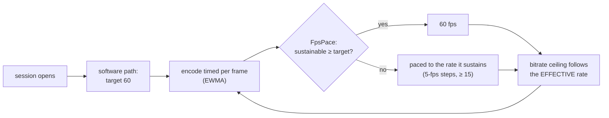

# FR-112: 60 fps without a hardware encoder — the frame rate follows what the encoder sustains

**Issue:** [#2394](https://github.com/gjovanov/roomler-ai/issues/2394) · **Status:** P1 + P2a built
([#2399](https://github.com/gjovanov/roomler-ai/pull/2399)): on a candidate the Asahi host sends **56.3 fps** of
VP9-444 where 0.4.141 sends 27, at 1.6 cores instead of 3.5, and a still screen costs 13 % CPU instead of 44 %. The
release check is owed; P2b (H.264) is next. Spec and claim 2026-10-17, on the operator's *"why is asahi having
less than 30fps, cant it reach 60?"* and, after the answer, *"yes do it"* · **Owner:** remote desktop (the software
encode paths) · **Anchors:** master `a20bda769` ·
**Builds on:** [FR-107](FR-107-drm-capture-throughput.md) (the capture costs 1.9 ms), [FR-74](FR-74-text-clarity-on-direct-paths.md)
(the direct path's quality cap), [FR-1](FR-1-remote-desktop-drag-smoothness.md) P5's `FpsPace`
(`encode/encode_pressure.rs:171`) · **Related:** [FR-98](FR-98-input-to-photon-budget.md) (input-to-photon under
50 ms: a 60 fps frame waits half as long)

## 1. Goal

A host with no hardware encoder sends **60 fps when its CPU can encode 60, and as many as it can when it cannot**.
The rate is decided per session from the measured encode cost, never assumed. Today every software path is pinned
at 30 by a constant, and on a fast host the constant is not even the limit: the encoder is.

## 2. Evidence (2026-10-17)

### The cap

| Path | Today | Anchor |
|---|---|---|
| VP9-444 over the DataChannel | 30, or 60 with `ROOMLERD_VP9_FPS=60` | `agents/roomlerd/src/peer.rs:8931` |
| H.264 over RTP (OpenH264) | 30: `TARGET_FPS_SW`, and the encoder's own `max_frame_rate(30)` | `peer.rs:98`, `encode/openh264_backend.rs:50` |
| Hardware encoders | 60 | `peer.rs:105`, `ffmpeg_target_fps` (`peer.rs:8955`) |

### The Asahi host at the cap, and past it

An Apple M2 Pro (6 performance + 4 efficiency cores), Fedora Asahi Remix 42, GNOME at 4096×2160 **60 Hz**, the
scanout read by the GPU and encoded at 2048×1080 (FR-107). The released 0.4.141, one viewer 17 ms away on a direct
path, a spinning cube in a window, each arm a fresh session (`ROOMLERD_VP9_*` as a systemd drop-in, removed after):

| VP9-444 arm | target | encoded | captured | avg QP | ceiling | roomlerd CPU |
|---|---|---|---|---|---|---|
| today (`cpu-used` 6, 4:4:4) | 30 | **27.0** | 27.0 | 10 | 17.5 Mbps | ~3.8 cores |
| `ROOMLERD_VP9_FPS=60` | 60 | **27.1** | 27.1 | 7 | 30.4 Mbps | ~4.0 cores |
| + `cpu-used` 8 | 60 | 28.9 | 28.9 | 5 | 24.5 Mbps | ~3.5 cores |
| + `cpu-used` 9 | 60 | 30.0 | 30.0 | 6 | 24.3 Mbps | ~3.4 cores |
| + 4:2:0 | 60 | 28.1 | 28.1 | 10 | 21.1 Mbps | ~3.8 cores |
| + worst quality q-index 32 | 60 | 25.0 | 25.0 | 7 | 28.3 Mbps | ~3.9 cores |
| + `cpu-used` 8, 4:2:0 | 60 | 20.7 | **38.2** | 4 | 26–31 Mbps | ~3.5 cores |
| + `cpu-used` 9, 4:2:0 | 60 | 26.3 | **43.8** | 2 | 24–28 Mbps | ~3.5 cores |

- **The constant is not the limit.** Raising the target to 60 changed nothing: the loop took ~37 ms a frame
  either way, and libvpx kept ~4 of the 10 cores busy.
- **The capture is not the limit.** In the 4:2:0 arms the capture ran at 38–44 fps while the encode stayed under
  30, and the display refreshes at 60 Hz.
- **Nor the encoder's settings.** The 60 target *doubled* the bitrate ceiling (`initial_bitrate_for_fps`,
  `encode/mod.rs:685`) and QP fell from 10 to 7, yet a frame still took ~37 ms, and no speed setting helped much.
  What does help is the clock the encoder is given (below).

### What a frame costs, measured offline

Both benches ran **on the Asahi host**, at 2048×1080, on synthetic screen content: a static text-like desktop, a
window dragged 8 px a frame, and a 256×256 block of noise that changes wholly (worst-case content).

**H.264**: roomlerd's own BGRA → I420 conversion (copied verbatim from `encode/openh264_backend.rs:328`), then
OpenH264 as roomlerd pins it (0.9.3 over openh264-sys2 0.9.6):

| H.264 stage, configuration | ms per frame | max fps | bytes per frame |
|---|---|---|---|
| convert: roomlerd's scalar code | 1.35 | 742 | — |
| convert: dcv-color-primitives (the VP9 path's) | 3.16 | 317 | — |
| encode as built (30 fps, one slice) | 4.57 | 219 | 55.8 KB |
| encode, `max_frame_rate(60)`, same bitrate | **2.41** | 416 | 27.4 KB |
| encode, + 4 threads, one slice | 2.44 | 411 | 27.4 KB |
| encode, + slices ≤ 1200 B, threads | 5.39 | 186 | 23.9 KB |
| encode, screen-content mode | 4.22 | 237 | 29.9 KB |
| **convert + encode, 30 / 60 fps** | **5.97 / 5.48** | 168 / 183 | 55.0 / 30.3 KB |

- **Neither the conversion nor OpenH264 is the limit.** A frame costs ~6 ms back to back, yet the RTP pump
  reported `avg_encode_ms` **16.6** in the field (FR-107 §9, 0.4.140). The other ~10 ms is the clock (below).
- **Slices are a loss here.** ⚠️ Wrong turn, recorded: the first run of this bench was on an x86-64 Windows
  laptop, at 17.1 ms a frame, where slices with threads looked 1.7× faster. On the host they make a frame 2.2×
  *slower*. (openh264-sys2 builds no assembly for aarch64, so the host runs the C code too; why the laptop was
  slower was not established.) Measure on the host.

**VP9 (libvpx 1.15)** through roomlerd's own `Vp9Encoder::encode_sync` (BGRA → I444 included), at the direct
path's quality cap (q-index 16, `ROOMLERD_VP9_DIRECT_MAX_Q`):

| VP9 configuration (2048×1080, 4:4:4 unless said) | ms per frame | max fps | bytes per frame |
|---|---|---|---|
| today: 30 fps, 17.5 Mbps, `cpu-used` 6, 4 tile columns | 47.0 | 21 | 113 KB |
| 60 fps, 30.4 / 17.5 / 10 Mbps, `cpu-used` 6, 4 tiles | 52.1 / 45.9 / 43.8 | 19–23 | 113 KB |
| 60 fps, 8 tile columns, `cpu-used` 6 | 43–44 | 23 | 113 KB |
| 60 fps, 8 tiles, `cpu-used` 8 | 33.7–37.2 | 27–30 | 117 KB |
| **60 fps, 8 tiles, `cpu-used` 9** | **21.9** | **46** | 118 KB |
| 60 fps, 8 tiles, `cpu-used` 8, **4:2:0** | 24.0 | 42 | 58 KB |
| 60 fps, 8 tiles, `cpu-used` 8, **no quality cap** (q63) | 23.7 | 42 | 30 KB |

- **On this content the quality cap, not the bitrate, sets the frame size**: every capped row ran at q-index 16
  whatever the target, ~113 KB a frame. The field's content (a moving window) stayed under the cap (QP 5–10).
- ⚠️ **Both benches ran at whatever clock the scheduler gave them**, and the next subsection shows that clock is
  the real limit. These rows are what libvpx does on a throttled core, not what the CPU can do. A first reading
  of them, "4:4:4 at 2048×1080 tops out near 45 fps", was wrong.

### The clock: the encoder runs as fast as the scheduler lets it

The H.264 bench sustains 6 ms a frame back to back, yet the live pump measured 16.6. The difference is how the
work arrives. A live encoder works a third of the time, a frame every 33 ms, and Linux's energy-aware scheduler
(`schedutil` over `apple-cpufreq`, 702–3264 MHz) gives a thread like that a low clock, on an efficiency core:

| The same OpenH264 frame, 2048×1080 | back to back | with a 30 fps idle gap |
|---|---|---|
| performance cores only (`taskset -c 4-9`) | 5.97 ms | **20.07 ms** |
| efficiency cores only (`taskset -c 0-3`) | 15.05 ms | 22.29 ms |
| wherever the scheduler puts it | 5.94 ms | 20.50 ms |

| Idle gap between frames | 0 | 5 ms | 11 ms | 16 ms | 28 ms |
|---|---|---|---|---|---|
| ms per frame (unpinned) | 5.95 | 9.43 | 13.82 | **16.76** | 20.68 |

A frame stretches until it nearly fills its period: at a 30 fps cadence it takes ~16.8 ms, exactly the field's
figure. Keeping one performance core busy (which holds that cluster's shared clock up) changed nothing live
(16.3 → 15.8 ms), so the live encoder thread runs on the efficiency cluster.

**Asked for its clock, the same encoder is a different encoder.** `uclampset -a -m 1024` on roomlerd's threads (a
utilisation clamp: the scheduler places a clamped thread on a big core and runs it at a high clock), the released
0.4.141, today's encoder settings, one session per arm:

| Live, the Asahi host | unclamped | `uclamp_min` 1024 |
|---|---|---|
| H.264/RTP `avg_encode_ms` (30 fps target) | 16.1 | **5.3** |
| VP9-444 encoded fps, 30 fps target | 26.8 | **29.1** (the target) |
| **VP9-444 encoded fps, 60 fps target** | 19.4 | **56.3**, QP 13, 25.2 Mbps |

So the cap was not the only constant in the way: a scheduler that clocks a periodic encoder down hid a 3× speed-up.
With its clock, today's VP9 settings send 56 fps, and an H.264 frame costs 5 ms.

## 3. Key design

- **The encoder asks for its clock.** On Linux the encoder thread sets its own utilisation clamp
  (`sched_setattr`, `SCHED_FLAG_UTIL_CLAMP_MIN`, policy and priority kept) when it starts
  (`encode/clock.rs`). libvpx creates its worker threads at the first encode, from that thread, so they inherit
  the clamp. OpenH264's worker and the capture worker do the same, and so does whatever they start (Mesa's
  shader-cache thread, from the capture worker's EGL). A clamp counts only while a thread is runnable, so an idle
  screen costs nothing more. A host whose kernel lacks util clamping says so once and runs as today.
- **Those threads are enough.** Clamping every other daemon thread as well, including the async runtime's that
  carry the DataChannel (SCTP, DTLS), added nothing: 56.3 fps with the clamp on everything, 56.2 with it on the
  runtime alone, 56.3 with only the encode and capture threads (§9). Clamping the runtime would also clock up
  every timer the daemon wakes for, on every host, with no session open.
- **The encode is timed** on the VP9-444 pump (today only `avg_scale_ms`), as the RTP pump already does, and the
  heartbeat says it (`avg_encode_ms`). The tier below steers by it.
- **Software paths target 60, and FR-1's `FpsPace` paces them down.** `FpsPace` already does exactly this for
  hardware encoders: from the encode EWMA it computes the sustainable rate, quantised to 5 fps, hysteretic.
  Wiring it into the two software pumps turns the constant into a measurement. An explicit `ROOMLERD_VP9_FPS`
  still pins the rate.
- **Never below 0.4.141.** A software pump is never paced below 30, the target it had
  (`RateGovernor::paced_software_fps`, `SW_PACE_FLOOR_FPS`). A host that cannot sustain 30 then runs exactly as
  it did: its loop is slower than the 33 ms cadence, so the gate never waits, and the bitrate base is 30's. Without
  the floor `FpsPace` would step a 27 fps host down to 25, below what it sends today.
- **On by default on Linux only.** The clock is Linux's (P1), and the tier was measured there. On a host whose
  clock was never the limit, 60 frames cost twice the CPU of 30, and an attended desktop pays for it, so Windows
  and macOS opt in (`ROOMLERD_SW_FPS_60=1`) until P3 measures them on their own hardware.
- **The bitrate ceiling follows the effective rate, sub-linearly.** OpenH264's cost follows bits per frame (§2:
  4.6 → 2.4 ms when they halve), and the link pays the bitrate on every path. A ceiling computed for 60 while the
  pump runs at 30 doubles every frame's bits, so the ceiling is computed from the paced rate. It grows by
  √(fps/30) rather than linearly: at 60 a moving window travels half as far between frames, so each frame needs
  fewer bits than at 30.
- **H.264's static assumptions go.** The auto-fps-cap that drops every software backend to 30 (`peer.rs:3027`)
  and OpenH264's `max_frame_rate(30)` follow the tier instead. The cap that shrinks software H.264 to ≤ 1280 px
  "so encode stays under the 33 ms 30-fps budget" fired on the host, whose clocked encoder costs 5 ms. It is
  decided by the measured encode, as the hardware path's `DownscaleTier` already is. One slice stays: slicing
  measured slower on the host (§2).
- **No VP9 quality trade on this host.** With its clock, today's settings (`cpu-used` 6, four tile columns, the
  q-index-16 cap) send 56 fps. `ROOMLERD_VP9_CPU_USED` stays the lever for a host that measures short.
- **Static screens cost what they cost today.** The idle skip (FR-93 P3d) and the keepalive cadence do not change;
  a 60 target only spends frames on a screen that moves.

## 4. Phases

| Phase | What | Kill switch | Proven on | Size |
|---|---|---|---|---|
| **P1** | the encoder asks for its clock: on Linux a `uclamp_min` on the encoder thread (libvpx's workers inherit it), OpenH264's worker and the capture worker; the VP9-444 pump times its encode (`avg_encode_ms`); the VP9 bench kept as an ignored test | `ROOMLERD_ENCODER_CLOCK=0` | 🟡 a candidate on the Asahi host (§9); the release check owed | S |
| **P2a** | the VP9-444 pump's tier: target 60, `FpsPace` fed by its encode EWMA and never below 30, the ceiling from the rate it runs at (×√2 at 60); on by default on Linux | `ROOMLERD_SW_FPS_60=0` (back to 30) | 🟡 a candidate on the Asahi host (§9); the release check owed | M |
| **P2b** | the H.264 RTP pump's tier: target 60 on Linux, OpenH264's frame rate following it (and its runtime settings held until the encoder exists: today the first `set_bitrate` of every session fails `cmInitExpected`), the auto-fps-cap left to Windows, the same pace and ceiling | `ROOMLERD_SW_FPS_60=0` | ⏳ | M |
| **P2c** | software H.264's ≤ 1280-px cap decided by the measured encode, as the hardware path's `DownscaleTier` is | `ROOMLERD_SW_FPS_60=0` | ⏳ | S |
| **P3** | the clock elsewhere: macOS (the encoder threads' QoS class) and Windows (no power throttling for the encode thread), each measured on its own hardware first | per OS | ⏳ | S |
| **P4** | docs: `docs/rate-control.md` (the software tier, the ceiling), `docs/encoders.md` (the clock, why one slice), the `docs/README.md` index row | — | ⏳ | S |

## 5. Test plan

- **Unit:** the ceiling as a function of the effective rate (30 → today's exactly; 60 → ×√2); `FpsPace` on a
  software EWMA (steps, hysteresis, the floor); the clamp request's encoding (flags, size) and its kill switch;
  every kill switch restores today's values.
- **The clock, on the host:** an encoder thread's clamp reads back 1024 (`uclampset -p <tid>`), libvpx's workers
  too, and nothing else of the daemon's; a per-user install (no root) gets it as well, or logs why not.
- **Field, the Asahi host** (the §2 arms as the red, on 0.4.141): VP9-444 and H.264 with a moving window; the
  heartbeat's encoded rate, QP, `avg_encode_ms`, and roomlerd's CPU.
- **A host that cannot sustain 60:** a lab guest with few cores; it must settle at the rate it sustains, never
  below today's, without flapping.
- **A still screen:** the FR-93 AC8 measurement (idle CPU) before and after.
- **Every kill switch** restores 0.4.141's behaviour.

## 6. Acceptance criteria

- [ ] **AC1** — The Asahi host, VP9-444 over the DataChannel, a moving window, a direct path: **≥ 55 fps
  encoded**. Red first on 0.4.141 (27.0 fps; 56.3 with the clock asked for by hand, §2).
- [ ] **AC2** — The same host over H.264/RTP: **≥ 55 fps**. Red first on 0.4.141.
- [ ] **AC3** — A host that cannot sustain 60 settles at the rate it sustains: never below its 0.4.141 rate, and
  at most one pace change in any 10 s once settled.
- [ ] **AC4** — A still screen costs what it cost on 0.4.141 (FR-93 AC8's idle CPU, within its noise).
- [ ] **AC5** — Quality under motion: the 60 fps session's average QP within 6 of the 30 fps session's on the same
  content, and a still screen refines to the same QP as 0.4.141.
- [ ] **AC6** — Every kill switch restores 0.4.141's behaviour (30 fps, no clamp).
- [ ] **AC7** — Docs: `docs/rate-control.md` and `docs/encoders.md` in the house style, and a `docs/README.md`
  index row.
- [ ] **AC8** — The clock: on the Asahi host at a 30 fps target, the H.264 encode costs **≤ 8 ms** (16.1 on
  0.4.141), the encoding and capture threads (and the threads they start) carry the clamp and no other thread
  does, and a per-user install gets it too or says why not.

## 7. Open decisions (operator)

| | Decision | Status |
|---|---|---|
| **D1** | On by default for every software host, or opt-in | *(Recommended: on. It is adaptive: a host that cannot sustain 60 is paced to what it can, and the floor is today's behaviour.)* |
| **D2** | The ceiling at 60 | *(Recommended: ×√2 of the 30 fps ceiling. ×2 is what starved the encoder in §2; ×1 halves each frame's bits, which the dial's Sharper exists to avoid.)* |
| **D3** | The Priority dial | *(Recommended: unchanged meaning — it scales the ceiling. The frame rate is measured, not chosen.)* |
| **D4** | VP9's speed settings under motion | *(Recommended: unchanged. With its clock, today's settings reach 56 fps on the host; `ROOMLERD_VP9_CPU_USED` stays the lever for a host that measures short.)* |
| **D5** | The clock's strength | *(Recommended: 1024, full speed while the encoder runs. A clamp counts only while the thread is runnable, so a still screen costs nothing more; a lower value hands per-frame latency back.)* |

## 8. Out of scope

- Hardware encoders: they already target 60 and have their own pacing (FR-1 P5).
- The X11 capture's frame gate (FR-107 §8): a separate before/after on an X11 host.
- The GPU writing the encoder's YUV (FR-107 P4): worth it only if the bench shows the conversion matters.
- A 120 Hz target: no field host asks for it yet.

## 9. Field-verification log

| Date | Host | Build | What | Result |
|---|---|---|---|---|
| 2026-10-17 15:52–16:19Z | the Asahi host, its 4096×2160 60 Hz desktop, one viewer 17 ms away | the released 0.4.141 (sha256 `381ae5ca…`), `ROOMLERD_VP9_*` drop-ins per arm, removed after | the red, and the levers | 🔴 §2's table: 27.0 fps at the 30 target, 27.1 at 60; no speed, chroma or quality setting passed 30.5. The display is 60 Hz (GNOME's current mode `4096x2160@60.000`), and the capture reached 44 fps when the encode let it. ⚠️ `ROOMLERD_RATE_FACTOR_VP9_444` looked like the ceiling's knob, and the arms that set it kept 30 Mbps: the libvpx pump hard-codes its 4:4:4 headroom (`peer.rs:4583`), and the factor reaches only the FFmpeg cells |
| 2026-10-17 16:22–16:34Z | the Asahi host, natively (aarch64, toolchain 1.95.0) | master `8a1babe8a`'s `Vp9Encoder` + an ignored bench test; a standalone OpenH264 bench on the pinned crates | P1's benches (§2) | VP9 at 4:4:4: 47.0 ms a frame today, 21.9 with eight tile columns and `cpu-used` 9, ~45 fps at best. H.264: convert + encode 5.97 ms at 30 fps and 5.48 at 60, against the 16.6 ms the RTP pump reported in the field. ⚠️ **Wrong turns:** the first VP9 run built without `vp9-444` and ran no test ("0 passed, 1916 filtered out"); Linux releases build with `full,vp9-444,vp9-444-bindgen`. The first OpenH264 run was on an x86-64 Windows laptop: 17.1 ms a frame, and slices looked 1.7× faster; on the host they are 2.2× slower. That run blamed missing assembly, which was wrong: openh264-sys2 builds none for aarch64 either. And both host benches ran unclamped, so they measured the throttled clock (next row) |
| 2026-10-17 16:36–17:10Z | the Asahi host: the OpenH264 bench, then live sessions on the released 0.4.141 | — | the clock (§2) | ✅ The same OpenH264 frame takes 5.97 ms back to back and 20.07 ms with a 30 fps idle gap, even pinned to the performance cores, and per-frame time tracks the gap (5.95 / 9.43 / 13.82 / 16.76 / 20.68 ms for 0 / 5 / 11 / 16 / 28 ms). Live, a spin loop holding the performance cluster's clock changed nothing (16.3 → 15.8 ms), and `uclampset -a -m 1024` on the daemon's threads took the H.264 encode from 16.1 to **5.3 ms**, VP9-444 at a 30 target from 26.8 to 29.1 fps, and **VP9-444 at a 60 target from 19.4 to 56.3 fps** (QP 13, 25.2 Mbps). Every clamp was reset (`min: 0`) and every drop-in removed. ⚠️ **Wrong turns:** `scaling_cur_freq` reads 702 MHz throughout even while the bench runs at full speed, so `apple-cpufreq` does not report the real clock and the gap sweep stands in for it; a `pgrep -f` wait loop matched its own shell and hung until killed; and the spinner's two VP9 arms are void, because the rate controller fell to 2–3 Mbps for a reason unrelated to the arm |
| 2026-10-17 17:26–17:42Z | the Asahi host, the system service | a P1 + P2 candidate built on the host with the Linux release's features (sha256 `5345a841…`, reports 0.4.141) | first pass | ✅ H.264/RTP at the 30 target: `avg_encode_ms` **5.2** (16.1 on 0.4.141), with no clamp set by hand: P1's own. A still screen: 13 % CPU. ⚠️ The VP9 arm read 21.8 fps encoded of 33.4 captured, the rate controller falling from 18.4 to 2.3 Mbps while the encode took 5.7 ms: the viewer, not the agent. Its decode reports said 4, 9, 18 (struggling), 7 and 1 fps, its paint age reached 2.9 s, and the agent's viewer-rate cap dropped frames to match. The same signature voided the earlier spinner arms and, in the second pass, the release's own moving arm (20.9 fps, `frames_skipped_decode` 144), so it belongs to the lab viewer (headless Chromium on the lab host), not to a build. ⚠️ **Wrong turns:** the harness's still arm returned its killed viewer's exit status, which ended the run early, and the viewer's container still held the lab lock, so the restore refused and the host stayed on the candidate until 17:42, when the lock freed and it was put back by hand. The mid-session clamp dump was empty: a quoting error two shells deep |
| 2026-10-17 17:51–18:04Z | the Asahi host, the system service; each arm one session, alone | the same candidate, then both kill switches, then the released 0.4.141 | second pass | ✅ Below. "Clamped" is every daemon thread whose `uclamp.min` (from `/proc/<tid>/sched`) was not 0, half-way through the window. The host was put back on the release's bytes with no drop-in left |

| Arm (VP9-444 over the DataChannel unless named; 20 s of a spinning cube, still arms 60 s) | encoded fps | `avg_encode_ms` p50 | roomlerd CPU | clamped |
|---|---|---|---|---|
| the candidate | **56.3** (captured 56.3, QP 16, 16.3 Mbps) | 7.2 | 1.6 cores | the encoder, its 7 libvpx workers, the capture worker, Mesa's cache thread; 75 of 85 at 0 |
| the candidate, every daemon thread clamped by hand | 56.3 | 7.0 | 1.5 cores | all 84 |
| the candidate, the async runtime's threads clamped by hand | 56.2 | 7.3 | 1.6 cores | the above + 65 runtime threads |
| the candidate again | **56.3** (QP 14, 20.0 Mbps) | 7.3 | 1.7 cores | the encoder, its workers, the capture worker |
| both kill switches (`ROOMLERD_ENCODER_CLOCK=0`, `ROOMLERD_SW_FPS_60=0`) | 27.9 at the 30 target (QP 10, 17.5 Mbps) | 30.7 | 3.5 cores | none |
| both kill switches, H.264/RTP | 28.7 | 16.6 | 0.6 cores | none |
| still: the candidate · the kill switches · the release | — | 4.8 · 15.7 · — | **13 %** · 36 % · 44 % | encoder + workers + capture · none · none |

- **AC1's measurement passes on the candidate** (56.3 fps twice, against 27.0 on 0.4.141). 56.3 is the capture's
  rate, not the encoder's: the encode takes 7 ms of a 17 ms frame, and every clamped arm stopped at the same
  figure.
- **The clock is cheaper, not dearer, in CPU time**: 1.6 cores for 56 fps against 3.5 for 28, and a third of the
  release's cost on a still screen. A clocked-down core is not idle; it is slow, and the work takes longer on it.
- **The kill switches restore 0.4.141** (AC6's measurement): 27.9 fps at the 30 target, no thread clamped, an
  H.264 frame back at 16.6 ms.
- **The pace never engaged** (`paced_fps=None` in every window): this host sustains 60. AC3 needs a host that
  does not.
