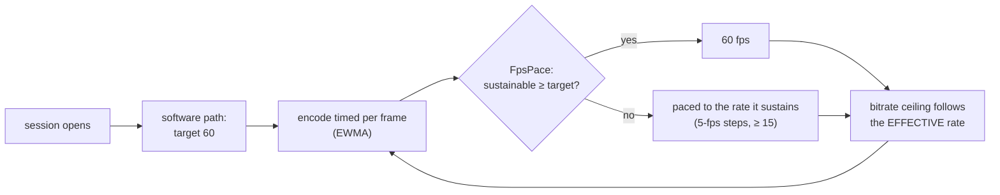

# FR-112: 60 fps without a hardware encoder — the frame rate follows what the encoder sustains

**Issue:** [#2394](https://github.com/gjovanov/roomler-ai/issues/2394) · **Status:** proposed — spec and claim
2026-10-17, on the operator's *"why is asahi having less than 30fps, cant it reach 60?"* and, after the answer,
*"yes do it"* · **Owner:** remote desktop (the software encode paths) · **Anchors:** master `a20bda769` ·
**Builds on:** [FR-107](FR-107-drm-capture-throughput.md) (the capture costs 1.9 ms), [FR-74](FR-74-text-clarity-on-direct-paths.md)
(the direct path's quality cap), [FR-1](FR-1-remote-desktop-drag-smoothness.md) P5's `FpsPace`
(`encode/encode_pressure.rs:171`) · **Related:** [FR-98](FR-98-input-to-photon-budget.md) (input-to-photon under
50 ms: a 60 fps frame waits half as long)

## 1. Goal

A host with no hardware encoder sends **60 fps when its CPU can encode 60, and as many as it can when it cannot**.
The rate is decided per session from the measured encode cost, never assumed. Today every software path is pinned
at 30 by a constant, and on a fast host the constant is not even the limit: the encoder is.

## 2. Evidence (2026-10-17)

### The cap

| Path | Today | Anchor |
|---|---|---|
| VP9-444 over the DataChannel | 30, or 60 with `ROOMLERD_VP9_FPS=60` | `agents/roomlerd/src/peer.rs:8931` |
| H.264 over RTP (OpenH264) | 30: `TARGET_FPS_SW`, and the encoder's own `max_frame_rate(30)` | `peer.rs:98`, `encode/openh264_backend.rs:50` |
| Hardware encoders | 60 | `peer.rs:105`, `ffmpeg_target_fps` (`peer.rs:8955`) |

### The Asahi host at the cap, and past it

An Apple M2 Pro (6 performance + 4 efficiency cores), Fedora Asahi Remix 42, GNOME at 4096×2160 **60 Hz**, the
scanout read by the GPU and encoded at 2048×1080 (FR-107). The released 0.4.141, one viewer 17 ms away on a direct
path, a spinning cube in a window, each arm a fresh session (`ROOMLERD_VP9_*` as a systemd drop-in, removed after):

| VP9-444 arm | target | encoded | captured | avg QP | ceiling | roomlerd CPU |
|---|---|---|---|---|---|---|
| today (`cpu-used` 6, 4:4:4) | 30 | **27.0** | 27.0 | 10 | 17.5 Mbps | ~3.8 cores |
| `ROOMLERD_VP9_FPS=60` | 60 | **27.1** | 27.1 | 7 | 30.4 Mbps | ~4.0 cores |
| + `cpu-used` 8 | 60 | 28.9 | 28.9 | 5 | 24.5 Mbps | ~3.5 cores |
| + `cpu-used` 9 | 60 | 30.0 | 30.0 | 6 | 24.3 Mbps | ~3.4 cores |
| + 4:2:0 | 60 | 28.1 | 28.1 | 10 | 21.1 Mbps | ~3.8 cores |
| + worst quality q-index 32 | 60 | 25.0 | 25.0 | 7 | 28.3 Mbps | ~3.9 cores |
| + `cpu-used` 8, 4:2:0 | 60 | 20.7 | **38.2** | 4 | 26–31 Mbps | ~3.5 cores |
| + `cpu-used` 9, 4:2:0 | 60 | 26.3 | **43.8** | 2 | 24–28 Mbps | ~3.5 cores |

- **The constant is not the limit.** Raising the target to 60 changed nothing: the loop took ~37 ms a frame
  either way, and libvpx kept ~4 of the 10 cores busy.
- **The capture is not the limit.** In the 4:2:0 arms the capture ran at 38–44 fps while the encode stayed under
  30, and the display refreshes at 60 Hz.
- **The bits are.** Every arm ran at 20–30 Mbps with QP 2–10, roughly 0.8–1 MB a frame. The 60 target *doubled*
  the bitrate ceiling (`initial_bitrate_for_fps`, `encode/mod.rs:685`), so each frame got as many bits as before
  and the encoder spent them on quality (QP 10 → 7) in the same time. Speed settings only trim the search, not the
  entropy coding of a megabyte.

### What a frame costs, measured offline

**OpenH264**, the crate roomlerd pins (0.9.3 over openh264-sys2 0.9.6), at 2048×1080, synthetic screen content (a
static text-like desktop, a window dragged 8 px a frame, a block that changes wholly). Measured on an x86-64
laptop; roomlerd's own 30 fps figure on the Asahi host is 16.6 ms, within 3% of this table's first row:

| OpenH264 configuration | ms per frame | max fps | bytes per frame |
|---|---|---|---|
| as built (30 fps, one slice) | 17.1 | 58 | 55.8 KB |
| as built, `max_frame_rate(60)`, same bitrate | **8.8** | 114 | 27.4 KB |
| + 4 threads, still one slice | 9.2 | 109 | 27.4 KB |
| + slices ≤ 1200 B, threads automatic | **5.2** | 193 | 23.9 KB, 24.5 slices |
| screen-content mode | 46.1 | 22 | 29.9 KB |
| complexity low | 7.5 | 134 | 28.7 KB |

- **Threads alone buy nothing**: OpenH264 parallelises across slices, and the live profile has one
  (`openh264_backend.rs:80`). Size-limited slices make the threads work: 1.7× faster again.
- **Each ≤ 1200-byte slice fits one RTP packet**, so a frame no longer needs FU-A fragmentation.
- **Screen-content mode is 5× slower** here. It stays off.

**VP9 (libvpx 1.15) through roomlerd's own `Vp9Encoder::encode_sync`** on the Asahi host, BGRA → I444 included:
P1's bench (`vp9_encode_cost_bench`: bitrate × tile columns × speed × chroma at 2048×1080). Its table lands with
P1, and it chooses P4's levers.

## 3. Key design

- **The encode is timed** on the VP9-444 pump (today only `avg_scale_ms`), as the RTP pump already does, and the
  heartbeat says it (`avg_encode_ms`). Everything below steers by it.
- **Software paths target 60, and FR-1's `FpsPace` paces them down.** `FpsPace` already does exactly this for
  hardware encoders: from the encode EWMA it computes the sustainable rate, quantised to 5 fps, hysteretic,
  floored at 15. Wiring it into the two software pumps turns the constant into a measurement. An explicit
  `ROOMLERD_VP9_FPS` still pins the rate.
- **The bitrate ceiling follows the effective rate, sub-linearly.** On a software encoder the cost follows bits
  per frame, so a ceiling computed for 60 while the pump runs at 30 doubles every frame's bits and holds it at
  30. The ceiling is computed from the paced rate, and grows by √(fps/30) rather than linearly: at 60 a moving
  window travels half as far between frames, so each frame needs fewer bits than at 30.
- **OpenH264 in slices.** The live profile asks for size-limited slices (≤ 1200 B) with automatic threads. Its
  `max_frame_rate` follows the tier instead of a constant.
- **VP9-444's encoder at 60** takes the levers the bench (§2) shows cost the least quality per millisecond saved.
  The candidates: fewer bits per frame (the ceiling above), more tile columns (four at 2048 px today,
  `encode/libvpx.rs:385`, which keeps ~4 of 10 cores busy), and `cpu-used`.
- **Static screens cost what they cost today.** The idle skip (FR-93 P3d) and the keepalive cadence do not change;
  a 60 target only spends frames on a screen that moves.

## 4. Phases

| Phase | What | Kill switch | Proven on | Size |
|---|---|---|---|---|
| **P1** | measure: the VP9-444 pump times its encode and reports `avg_encode_ms`; the two benches (`vp9_encode_cost_bench`, an OpenH264 twin) kept as ignored tests | — | ⏳ | S |
| **P2** | OpenH264 in slices: size-limited (≤ 1200 B) with automatic threads, `max_frame_rate` from the tier | `ROOMLERD_OPENH264_SLICES=0` | ⏳ | S |
| **P3** | the software tier: target 60, `FpsPace` fed by the encode EWMA on both software pumps, the ceiling from the effective rate | `ROOMLERD_SW_FPS_60=0` (back to 30) | ⏳ | M |
| **P4** | VP9-444 at 60: the encoder levers the bench chose | per lever | ⏳ | S |
| **P5** | docs: `docs/rate-control.md` (the software tier, the ceiling), `docs/encoders.md` (OpenH264 slices, the VP9 levers), the `docs/README.md` index row | — | ⏳ | S |

## 5. Test plan

- **Unit:** the ceiling as a function of the effective rate (30 → today's exactly; 60 → ×√2); `FpsPace` on a
  software EWMA (steps, hysteresis, the floor); OpenH264's live config carries the slice mode and threads, and the
  kill switch restores today's.
- **Field, the Asahi host** (the §2 arms as the red, on 0.4.141): VP9-444 and H.264 with a moving window; the
  heartbeat's encoded rate, QP, `avg_encode_ms`, and roomlerd's CPU.
- **A host that cannot sustain 60:** a lab guest with few cores; it must settle at the rate it sustains, never
  below today's, without flapping.
- **A still screen:** the FR-93 AC8 measurement (idle CPU) before and after.
- **Every kill switch** restores 0.4.141's behaviour.

## 6. Acceptance criteria

- [ ] **AC1** — The Asahi host, VP9-444 over the DataChannel, a moving window, a direct path: **≥ 55 fps
  encoded**. Red first on 0.4.141 (27.0 fps).
- [ ] **AC2** — The same host over H.264/RTP: **≥ 55 fps**. Red first on 0.4.141.
- [ ] **AC3** — A host that cannot sustain 60 settles at the rate it sustains: never below its 0.4.141 rate, and
  at most one pace change in any 10 s once settled.
- [ ] **AC4** — A still screen costs what it cost on 0.4.141 (FR-93 AC8's idle CPU, within its noise).
- [ ] **AC5** — Quality under motion: the 60 fps session's average QP within 6 of the 30 fps session's on the same
  content, and a still screen refines to the same QP as 0.4.141.
- [ ] **AC6** — Every kill switch restores 0.4.141's behaviour (30 fps, one slice).
- [ ] **AC7** — Docs: `docs/rate-control.md` and `docs/encoders.md` in the house style, and a `docs/README.md`
  index row.

## 7. Open decisions (operator)

| | Decision | Status |
|---|---|---|
| **D1** | On by default for every software host, or opt-in | *(Recommended: on. It is adaptive: a host that cannot sustain 60 is paced to what it can, and the floor is today's behaviour.)* |
| **D2** | The ceiling at 60 | *(Recommended: ×√2 of the 30 fps ceiling. ×2 is what starved the encoder in §2; ×1 halves each frame's bits, which the dial's Sharper exists to avoid.)* |
| **D3** | The Priority dial | *(Recommended: unchanged meaning — it scales the ceiling. The frame rate is measured, not chosen.)* |

## 8. Out of scope

- Hardware encoders: they already target 60 and have their own pacing (FR-1 P5).
- The X11 capture's frame gate (FR-107 §8): a separate before/after on an X11 host.
- The GPU writing the encoder's YUV (FR-107 P4): worth it only if the bench shows the conversion matters.
- A 120 Hz target: no field host asks for it yet.

## 9. Field-verification log

| Date | Host | Build | What | Result |
|---|---|---|---|---|
| 2026-10-17 15:52–16:19Z | the Asahi host, its 4096×2160 60 Hz desktop, one viewer 17 ms away | the released 0.4.141 (sha256 `381ae5ca…`), `ROOMLERD_VP9_*` drop-ins per arm, removed after | the red, and the levers | 🔴 §2's table: 27.0 fps at the 30 target, 27.1 at 60; no speed, chroma or quality setting passed 30.5. The display is 60 Hz (GNOME's current mode `4096x2160@60.000`), and the capture reached 44 fps when the encode let it. ⚠️ `ROOMLERD_RATE_FACTOR_VP9_444` looked like the ceiling's knob, and the arms that set it kept 30 Mbps: the libvpx pump hard-codes its 4:4:4 headroom (`peer.rs:4583`), and the factor reaches only the FFmpeg cells |
