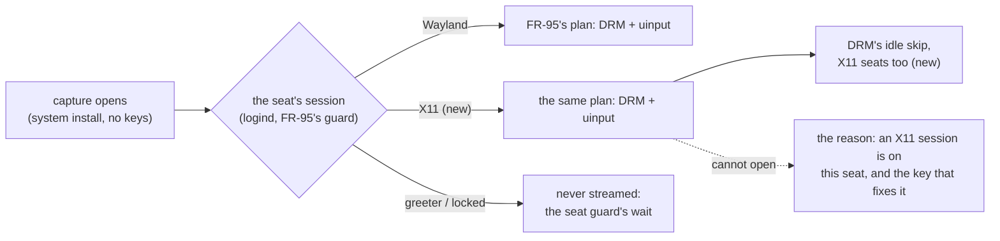

# FR-113: A system install on an X11 desktop shows it by default — FR-95's plan for X11 seats

**Issue:** [#2458](https://github.com/gjovanov/roomler-ai/issues/2458) · **Status:** ✅ **closed 2026-10-19, every
criterion ticked**. Proposed 2026-10-18, spec and claim, on the operator's go-ahead (*"5. yes"*) from #2450. P1 + P2
(D1–D3 as recommended, docs in the same change) were **released in 0.4.144**, whose release run (§8) ticked AC1, AC2,
AC4, AC5, AC6 and AC7. On 0.4.144 AC3 passed lock, unlock and both user switches but failed the logout, because the
seat guard read a `closing` session as on screen. **P4** (#2516) fixed that, shipped in **0.4.145**, and AC3 passed
there on the released bytes (§8) · **Owner:** remote desktop (agent) · **Anchors:** master
`c7a306e47` · **Builds on:** [FR-95](FR-95-system-installs-on-by-default-on-wayland.md) (the system plan, its seat guard),
[FR-36](FR-36-wayland-capture.md) (DRM + uinput), [FR-93](FR-93-wayland-out-of-the-box.md) (the idle skip P3d, the desktop
brief P2b), FR-80 (the reason codes)

## 1. Goal

A **system** (root) install on an **X11** desktop shows the viewer that desktop, with input, with no capture key set,
as FR-95 made a system install do on Wayland. Where it cannot, the viewer reads the true reason and the key that
fixes it, never "headless".

## 2. Evidence (2026-10-18, #2450)

The released 0.4.143 on a vmtest Ubuntu 24.04 cell, GDM on Xorg (`WaylandEnable=false`), auto-login. `loginctl`:
seat0's session `type=x11`. A system install on its defaults (no `drm_capture`, no `uinput`):

```
desktop brief (FR-93 P2b) session=user kind=x11 desktop="-" capture_arm=x11 input_reach=none
WARN displays: scrap enumeration failed; using stub e=connection refused
WARN scrap capture unavailable — falling back to NoopCapture error=no primary display: connection refused code="no_display"
```

The viewer got **no picture**. The same cell with `drm_capture = true` (the vmtest lane's own system install sets it,
with `uinput`) captured the X11 session through DRM: 84 of 84 viewer samples with a picture, 47 distinct.

**Why.** A systemd unit carries none of the session's variables (`DISPLAY`, `XAUTHORITY`): `docs/linux-capture.md`
§1. FR-95's plan engages only for a person's **Wayland** session on screen. `person_on_screen`
(`agents/roomlerd/src/capture/mod.rs:928`) keeps a session only when `s.kind == "wayland"` (`:931`), so on an X11 seat
the plan falls through to the X11 arm, which a root daemon cannot open. FR-95's AC5 asked for exactly that ("X11
hosts are unchanged"), and this FR is what changing it means.

## 3. Key design (measured before it is decided)



- **FR-95's plan for X11 seats.** `person_on_screen` accepts an X11 user session, and `system_plan` decides by the
  session's kind with one switch each (`AutoKinds { wayland, x11 }`). The plan then picks DRM capture + `uinput` as on
  Wayland. DRM reads the scanout below any display server, so it does not depend on the display manager, and on X11 it
  is already proven (§2). `uinput` reaches Xorg through libinput as it reaches a Wayland compositor.
  ⚠️ *Corrected while writing P1:* the "twin" at `mod.rs:904` is `own_session_in`, the **per-user** daemon's plan. It
  stays as it is: per-user X11 installs are out of scope (§7), since scrap reaches their own `DISPLAY`.
- **The seat guard holds on X11.** FR-95 P2's guard (never the greeter, never a locked screen; the person's session
  must be the one on screen) reads logind, so it carries over. It must be shown on X11 (AC3), since a DRM read of the
  scanout would otherwise show whatever is on screen. **It sees a lock only through `LockedHint`**, so the X11 half
  switches on only for a desktop that sets it: GNOME Shell or KDE's `ksmserver` running as the person (D4).
- **DRM's idle skip on X11 seats.** FR-93 P3d skips unchanged frames on Wayland seats only
  (`capture/drm_backend.rs:1061`; the X11 cell logged "every frame is read (not a Wayland seat …)"). An idle X11
  desktop through DRM would read every frame, so P1 extends the skip, or AC6 fails. **Why P3d was Wayland-only**
  (`drm_idle.rs`): a Wayland compositor flips buffers, so the buffer's identity tells a change; an X server draws
  into the buffer on screen in place, so only the sampled rows can, and 32 rows would leave a typed character up to
  1 s late. **P1's answer** is a second mode, `drm_idle::IdleSkip::InPlace`: the same gate, with one row sampled
  every `IN_PLACE_ROW_GAP` = 8 rows. Any change at least 8 rows tall crosses a sampled row wherever it lands, and
  the text caret, which moves on every keystroke, is that tall, so it is delivered on the next tick. A smaller
  change keeps P3d's 1 s bound. The cost is an eighth of the rows a tick, against the whole picture a delivered
  frame reads, converts and encodes. No extra full-frame read, because the hash is still taken before the read
  (hash, then read: a change between them only causes one redundant delivery).
- **The reason when it cannot.** `linux_no_pixels_code` (`mod.rs:1803`) asks only `seat_shows_wayland` (`:1870`),
  so a reachable-but-unopened X11 seat reads `no_display` ("headless"). It should name the X11 session and the key.
  **P2's answer:** `seat_kind()` replaces the Wayland-only question, and a new code `x11_not_enabled` carries what
  was found and a hint by install type (`x11_hint_with`). Viewers type the code as a string and print the agent's
  hint, so an older bundle shows it too.
- **Its own kill switch**, `x11_auto_system` (D3), independent of FR-95's `wayland_auto_system` (`mod.rs:663`), so
  either can be turned off without the other. Explicit capture keys keep winning, as in FR-95 (`capture_keys_set`).

## 4. Phases

| Phase | What | Kill switch | Proven on | Size |
|---|---|---|---|---|
| **P0** | measure the population: system installs whose desktop brief reads `kind=x11` with no picture (the server's count, FR-93 P2b) | — | ✅ 2026-10-19, prod: of 30 Linux devices with a brief, 3 read `kind=x11`. Two are this FR's release cells (`capture_arm=drm`, `input_reach=full`, 0.4.144) and one is an offline 0.4.140 per-user install (`capture_arm=x11`). No live device sat in #2450's state, so the change is prospective: new installs on Xorg desktops | S |
| **P1** | the plan for X11 seats (DRM + `uinput`), the seat guard on X11, DRM's idle skip on X11 seats (`IdleSkip::InPlace`) | `x11_auto_system = false` | ✅ candidate `c1ea719ab`; ✅ **the release 0.4.144** on GNOME/Xorg and SDDM/Plasma X11 cells (§8) | M |
| **P2** | the true reason when the plan cannot capture an X11 seat (`x11_not_enabled`) | `x11_auto_system = false` (back to `no_display`) | ✅ the candidate; ✅ the release 0.4.144: `x11_not_enabled` and its hint on prod's viewer (§8) | S |
| **P3** | docs: `docs/linux-capture.md` (§1.2.2 the X11 half, §1.1 the reason, §3.2 the idle skip and its measurement, §7 the switch), the `docs/README.md` index row | — | ✅ in P1's change | S |
| **P4** | the seat guard reads logind's `State`: a bound session that is `closing` (a logout whose processes are still ending) is away (`capture/seat_guard.rs`), plus `linux-capture.md` §1.2.1 | — (it can only close the guard, never open it) | 🔴 the release 0.4.144: 90 s of a black scanout reached the viewer after a logout, with nothing said (§8). ✅ candidate `73539996e` (§8): the guard closed 29 ms after `terminate-session`, before Xorg exited; nothing was read after; the reason was named in 2.5 s; after the typed login a new viewer session had picture and input. ✅ **the release 0.4.145** (§8): the same on a fresh served install of the release (`closing=true` at the logout's second, named +2.6 s), the regression 7/7 | S |

## 5. Acceptance criteria

- [x] **AC1** — A system install on its defaults on GNOME/Xorg shows the desktop to the viewer, with input. Red first
  on 0.4.143 (#2450).
  ✅ **On the candidate** (`c1ea719ab`, 2026-10-18, §8). The red came first, on the same cell and config: the released
  0.4.143 sent `no_display`, and no picture. The candidate showed a picture in 62 of 62 samples, switched on by
  itself (`backend=drm … FR-95 P2, FR-113 P1 … idle_skip=InPlace`), with the automatic `uinput`. The input was read
  in the person's own X session (`xdotool getmouselocation`): the pointer, parked at (100, 100), stood at
  **(716, 448)** after the viewer's move to 0.56, 0.56 of the frame (exactly 716.8, 448 on 1280×800).
  ✅ **On the release 0.4.144** (2026-10-19, a fresh cell the lane installed it on, re-enrolled on a DEFAULT config):
  35 of 35 samples with a picture, `backend=drm, switched on by itself`, `idle_skip=InPlace`, the automatic
  `uinput`, and the pointer went (100, 100) → **(716, 448)**.
- [x] **AC2** — The same on a second X11 display manager and desktop (LightDM/XFCE, or SDDM/Plasma on X11).
  ✅ **On the release 0.4.144** (2026-10-19, §8). The cell was Ubuntu 24.04 with `kde-plasma-desktop` + `sddm`: Plasma
  5.27's X11 session (`plasma`), SDDM auto-login, session `Desktop=KDE`, with `ksmserver` and `kwin_x11` running for
  the person. The daemon was the release's `.deb` (sha256 `4bacb16e…`), re-enrolled on a DEFAULT config.
  - **Picture and input:** 28 of 28 samples with a picture, and the pointer went (100, 100) → **(716, 448)**.
  - **D4, measured:** `kscreenlocker_greet` set `LockedHint=yes` within 1 s of `loginctl lock-session`, and cleared
    it on unlock.
  - **Lock and unlock under a viewer:** the guard closed 0.31 s after the lock command. The one new frame in that
    window was the desktop (8×5 thumbnail difference 0.1), not the lock screen. The lock was named 2.5 s after the
    guard closed. A new viewer session after the unlock had picture and input again.
  - ⚠️ **A fresh Plasma locks an idle session after 5 min**, so the first try met a lock nobody asked for. The guard
    read it correctly, and the controller was told it was waiting on the host.
- [x] **AC3** — The greeter and a locked screen are never streamed: lock, unlock, logout, login and a user switch on
  an X11 seat, each recovering within 10 s or naming its reason (FR-93 AC7's harness).
  ✅ **On the candidate, the lock and the unlock** (§8). GNOME's lock set `LockedHint`, and the guard read nothing
  more (`guard=Locked`). The viewer named the lock 2.8 s after the guard closed. After the unlock, a new picture came
  0.6 s later, and the notice was gone at 1.1 s.
  ✅ **On the release 0.4.144, lock, unlock and both user switches** (2026-10-19, §8, `verdict.py`).
  - **Setup:** the lifecycle verdict, with the lab's probe (`wlab-probe --x11`, a counter ticking every 250 ms)
    on the person's desktop, so a recovery shows as a live picture rather than an unchanged one.
  - **Result:** 7 of 7 events PASS.
    - lock, named at +2.7 s;
    - unlock, live at +2.3 s;
    - switch-user (GDM's transient Xorg greeter), named at +2.6 s;
    - switch-back, live at +1.6 s;
    - GNOME's lock, then switch, named at +2.6 s;
    - switch-back to the locked session, named at +0.2 s;
    - unlock, live at +2.3 s.
  - **Never streamed:** the lock, the greeter and the lock-then-greeter windows each brought **no** new picture.
  🔴 **On the release 0.4.144, the logout failed.** After `loginctl terminate-session`:
  - the viewer showed **black with nothing said** for 90 s, and the typed login could not happen (no greeter);
  - GDM's auto-login session worker ignored SIGTERM, so logind kept the session `closing`, and still the seat's
    active session, until systemd's 90 s stop timeout;
  - the guard read it as on screen, and the DRM capture kept reading the bare scanout.
  → **P4**.
  ✅ **On the P4 candidate `73539996e`** (2026-10-19, the same cell and setup, §8). Logout and login: `verdict.py` PASS.
  - **The logout:** `terminate-session` ran at 09:05:49.541, and the guard logged `closing=true` and closed at .570.
    Xorg exited at .598, after that. The encoder's last frame window ended at 09:05:49.15, and nothing was read
    after the close. The viewer named the reason (*showing another session / the login screen*) at +2.5 s.
    - It showed one black frame, captured in those 29 ms as Xorg's teardown blanked the screen. That is FR-95's
      transition frame, and it carries no content.
  - **Through GDM's 90 s hang and its greeter (c10):** no new picture.
  - **The typed login:** it worked once the greeter was up. The old viewer kept the reason, since it was bound to
    the person who was told. A new viewer session bound itself to the new session (`session="136"`), with 34/34
    samples with a picture and the pointer going (100, 100) → (716, 448).

  ✅ **On the release 0.4.145** (2026-10-19, §8). Every AC3 event passed on the released bytes.
  - **The cell:** a fresh vmtest cell installed the published release through the served installer, the lane's
    eleven checks green. GDM was switched to Xorg with auto-login, so GDM's 90 s worker hang was in play, and the
    daemon was re-enrolled on a DEFAULT config. The binary was `07412c9f…`.
  - **The bytes:** the candidate field-tested before the tag is bit-identical to the published `.deb` (sha256
    `8027436957b5dd33`).
  - **The logout:** the guard logged `closing=true` at 13:02:09.734, the logout's second, and the viewer named the
    reason at +2.6 s. Nothing new reached it through the hang or the greeter.
  - **The typed login** (session 36): the old viewer kept its reason, and a new viewer bound to the new session had
    picture and input (100,100) → (716,448).
  - **The regression,** with the probe: 7/7 PASS. Lock named +2.9 s, unlock live +2.0 s, switch-user named +3.0 s,
    switch-back live +1.9 s, lock-switch named +2.9 s, switch-back (locked) named +0.0 s, unlock live +2.2 s. No new
    picture inside any lock or greeter window.
- [x] **AC4** — Explicit keys win, and `x11_auto_system = false` gives back 0.4.143's behaviour exactly; Wayland hosts
  are unchanged.
  ✅ **On the candidate** (§8). `ROOMLERD_X11_AUTO_SYSTEM=0` logged exactly what 0.4.143 did: no picture,
  `code="no_display"`, reach `none`. The same cell switched back to Wayland was captured as before: FR-95's plan,
  `idle_skip=Flips`, 56 of 56 samples with a picture. Explicit keys are `capture_keys_set`, unchanged, and are pinned
  by unit tests.
  ✅ **On the release 0.4.144** (2026-10-19). Each switch was proven applied in the unit's environment (names only).
  - With `ROOMLERD_X11_AUTO_SYSTEM`: no picture, `code="no_display"`, reach `none`, and `no_display` on prod's viewer.
  - Back on Wayland with the drop-in removed: FR-95's plan, `idle_skip=Flips`, 64 of 64 samples with a picture.
- [x] **AC5** — A plan that cannot capture an X11 seat names the X11 session and the key, never `no_display`.
  ✅ **On the candidate** (§8). With `ROOMLERD_VIEWING_NOTICE=0` nobody could be told, and the agent sent
  `code="x11_not_enabled"`, detail *logind shows an X11 session on this seat, and this daemon has no display of its
  own…*. Prod's viewer showed the hint: *This computer is showing an X11 desktop, and it is not captured by itself
  because nobody at the screen could be told they are being viewed…*.
  ✅ **On the release 0.4.144** (2026-10-19). The switch was proven in the unit's environment. The result was
  `code="x11_not_enabled"` with the same detail, and prod's viewer showed *This device cannot capture its screen* and
  *This computer is showing an X11 desktop, and it is not captured by itself because nobody at the screen could be
  told they are being viewed…*, with the code `x11_not_enabled`.
- [x] **AC6** — An idle X11 desktop through DRM costs within 2× of FR-29's X11 figure.
  ✅ **On the candidate** (§8; `linux-capture.md` §3.2). An idle GNOME/Xorg desktop, two 60 s windows, every
  `roomlerd` process: **5.5 % and 5.5 %** of a core, inside 6.8 %. Every frame read (`ROOMLERD_DRM_IDLE_SKIP=0`)
  costs 46.3 % and 46.5 %.
  ✅ **On the release 0.4.144** (2026-10-19, the release's full feature set, `ffmpeg-encoder` included):
  **6.1 % and 6.1 %** of a core, inside 6.8 %. All 268 samples had a picture.
- [x] **AC7** — Docs: `docs/linux-capture.md` updated in the house style, and the `docs/README.md` index row.
  ✅ In P1's change: §1.2.2 (the X11 half, a diagram and a table), §1.1 (the reason's rows), §3.2 (the idle skip and
  its measurement), §7 (the switch). The index row already lists `linux-capture.md`. P4's change adds the
  closing rule to §1.2.1 (the diagram's away edge, and a ⚠️ with the measurement) and the measured KDE locker to
  §1.2.2.

## 6. Open decisions

| | Decision | Status |
|---|---|---|
| **D1** | On by default for X11 system installs | *(Recommended: yes, as FR-95. The seat guard is what makes it safe, and AC3 proves it.)* **P1 implements the recommendation**; it ships in no release before the field run, and the operator can still overturn it. |
| **D2** | DRM first, or the session's own X server (`DISPLAY` from logind's session, plus its Xauthority, whose path depends on the display manager) | *(Recommended: DRM first, as it is display-manager agnostic and proven here. The Xauthority path only for a host without DRM access.)* |
| **D3** | The switch's name | *(Recommended: `x11_auto_system`, default on.)* **As implemented** (`ROOMLERD_X11_AUTO_SYSTEM`); off gives back 0.4.143 exactly, including P2's reason (`no_display`) and the X11 idle skip (every frame read). `wayland_auto = false` and `wayland_aware = false` turn it off too. |
| **D4** | A locker that never sets logind's `LockedHint` | Found while writing P1. The seat guard knows a lock only by `LockedHint` (`seat_guard::guard`). GNOME sets it on Xorg too, and LightDM's `light-locker` locks by switching to a greeter session, which the guard already reads as away. An in-session locker that does not set it (xscreensaver, i3lock, slock, some xfce4-screensaver versions) would have its lock screen read, and its password field typed into by the automatic `uinput`. **Decided in P1, on the PR review (#2471):** refuse such a desktop by default. The X11 half switches on only where `gnome-shell` or `ksmserver` runs as the person (`lock_reporting_shell`, read from `/proc`, since logind's `Desktop` is empty for GDM's auto-login session). Anything else plans `SystemPlan::LockUnreported`, before the surface is probed, and `x11_not_enabled` says so and offers the explicit keys. An allowlist entry for another desktop must first show its locker setting `LockedHint` (AC2's desktop is the first candidate). **Measured (2026-10-18, §8):** XFCE 4.18.3 on Ubuntu 24.04 (`xfce4-screensaver` 4.18.3) left `LockedHint` at `no` through `loginctl lock-session`, so it stays refused, and was refused in the field with the hint shown on prod's viewer. |

## 7. Out of scope

- Per-user installs on X11: scrap through the user's own `DISPLAY` already works.
- Xwayland: FR-93's guard refuses it, by design.

## 8. Field-verification log

| Date | Host | Build | What | Result |
|---|---|---|---|---|
| 2026-10-18 10:19–10:26Z | a vmtest Ubuntu 24.04 cell, GDM on Xorg, a system install | the released 0.4.143 | the red (#2450) | 🔴 on its defaults: `capture_arm=x11`, `connection refused`, `no_display`, no picture. With `drm_capture = true`: DRM, 84/84 samples with a picture. |
| 2026-10-18 14:28Z | a new kept cell, the same image (GNOME 46, GDM switched to Xorg, auto-login), the system daemon re-enrolled on a DEFAULT config | the released 0.4.143 | the red again, on this cell | 🔴 no picture; `code="no_display"`; input reach `none`; brief `kind=x11 capture_arm=x11` |
| 2026-10-18 14:34–14:39Z | the same cell and config | candidate `c1ea719ab` (the release's Linux features minus `ffmpeg-encoder`), auto-update off | AC1 | ✅ 62/62 samples with a picture, `idle_skip=InPlace`, the automatic `uinput`. The pointer, parked at (100, 100), stood at (716, 448) after the viewer's move (`xdotool`, in the person's X session) |
| 2026-10-18 14:40Z | the same | the same | AC3: `loginctl lock-session`, then `unlock-session` | ✅ the guard closed on `LockedHint` and read nothing; the viewer named the lock +2.8 s after; a picture +0.6 s after the unlock, live +1.1 s. One new frame 2.1 s before the guard closed (the shield's first, likely) |
| 2026-10-18 14:43–14:57Z | the same | the same; then `ROOMLERD_DRM_IDLE_SKIP=0` | AC6: an idle desktop, two 60 s windows | ✅ 5.5 %, 5.5 % (and 5.5 % in a first run's second window) against 46.3 %, 46.5 % reading every frame |
| 2026-10-18 15:01Z | the same | the same, `ROOMLERD_X11_AUTO_SYSTEM=0` | AC4: the kill switch | ✅ exactly 0.4.143's lines: no picture, `no_display`, reach `none` |
| 2026-10-18 15:06Z | the same | the same, `ROOMLERD_VIEWING_NOTICE=0` | AC5: nobody to tell | ✅ `code="x11_not_enabled"`, its detail, and the no-surface hint on prod's viewer |
| 2026-10-18 15:12Z | the same cell switched back to Wayland | the same, defaults | AC4: Wayland unchanged | ✅ FR-95's plan, `idle_skip=Flips`, the P3d line, 56/56 samples with a picture |
| 2026-10-18 19:31Z | the same cell, back on Xorg (GNOME) | candidate `8be890c19` (D4, after the PR review) | AC1 again: `lock_reporting_shell` must find GNOME Shell | ✅ 64/64 samples with a picture, `InPlace`, the automatic `uinput`; the pointer (100,100) → (716,448) |
| 2026-10-18 19:39Z | the same cell, the auto-login switched to **XFCE 4.18.3 on Xorg** (no `gnome-shell`, no `ksmserver`) | the same | D4: a desktop that does not report its lock | ✅ refused: no picture, no DRM read, `code="x11_not_enabled"`, and prod's viewer showed *…an X11 desktop whose screen locker does not report a lock to the system (GNOME and KDE do…)*. Measured: `loginctl lock-session` left `LockedHint` at `no` with `xfce4-screensaver` 4.18.3 running, which is exactly the case D4 exists for |
| 2026-10-19 07:46–08:06Z | a fresh kept vmtest cell the lane installed **the release** on (GNOME 46, GDM switched to Xorg, auto-login), the system daemon re-enrolled on a DEFAULT config | **the release 0.4.144** | AC1, #2473 | ✅ 35/35 samples with a picture, `switched on by itself`, `idle_skip=InPlace`, the automatic `uinput`; the pointer (100,100) → (716,448); the brief `kind=x11 capture_arm=drm input_reach=full` |
| 2026-10-19 07:35–07:59Z | a second kept cell: Ubuntu 24.04 + `kde-plasma-desktop` + `sddm`, Plasma 5.27's X11 session under SDDM auto-login (`Desktop=KDE`), 0.4.143 upgraded with the release's `.deb` (sha256 `4bacb16e…`) | the release 0.4.144 | AC2, D4 | ✅ `LockedHint=yes` 1 s after `lock-session`, `no` after `unlock-session`; 28/28 samples with a picture, the pointer (100,100) → (716,448); under a viewer the guard closed 0.31 s after the lock command (the one frame read in that window was the desktop, thumbnail difference 0.1), the lock named +2.5 s, picture and input again after the unlock. A fresh Plasma auto-locks an idle session after 5 min: switched off for the runs |
| 2026-10-19 08:31–08:35Z | the GNOME cell | the release | AC3: lock, unlock, switch-user, switch-back, lock-switch, switch-back, unlock (`verdict.py`, with `wlab-probe --x11` ticking on the desktop) | ✅ 7/7 PASS: named +2.7 / +2.6 / +2.6 / +0.2 s, live (the probe's counter moving) +2.3 / +1.6 / +2.3 s; no new picture inside any lock or greeter window |
| 2026-10-19 08:35–08:37Z | the same | the release | AC3: logout, then a typed login | 🔴 black, nothing said. `terminate-session`: GDM's auto-login session worker ignored SIGTERM (`session-26.scope: … SIGKILL … Failed with result 'timeout'` at +90 s), so logind kept the session `closing` and the seat's active one; the guard (id, class, `LockedHint`) stayed open and the DRM capture read on (`frames_captured` 72 → 144); no greeter for 90 s, so the typed login had nothing to type into → **P4** |
| 2026-10-19 08:47–08:49Z | the same, back on Xorg | the release | AC6 | ✅ 6.1 %, 6.1 % of a core (268/268 samples with a picture) |
| 2026-10-19 08:52Z | the same, `ROOMLERD_VIEWING_NOTICE=0` (proven in the unit's environment) | the release | AC5 | ✅ `code="x11_not_enabled"`, and the hint on prod's viewer |
| 2026-10-19 08:56Z | the same, `ROOMLERD_X11_AUTO_SYSTEM=0` (proven) | the release | AC4: the kill switch | ✅ no picture, `code="no_display"`, reach `none` |
| 2026-10-19 08:58Z | the same, GDM back on Wayland, the drop-in removed | the release | AC4: Wayland unchanged; #2473 on Wayland | ✅ FR-95's plan, `idle_skip=Flips`, 64/64 samples with a picture; the brief `kind=wayland capture_arm=drm input_reach=full` |
| 2026-10-19 09:04–09:10Z | the GNOME cell back on Xorg (auto-login), the release kept as `/usr/bin/roomlerd.rel` | **candidate `73539996e` (P4)**, the release's Linux features minus `ffmpeg-encoder`, sha256 `17463b8a…`, re-enrolled on defaults | AC3: logout, then a typed login; then a new viewer session | ✅ `verdict.py` PASS 2/2. The guard: `closing=true` 29 ms after `terminate-session`, before Xorg exited; nothing read after (the encoder's last window ended 09:05:49.15); named +2.5 s; one black transition frame from those 29 ms. GDM hung 90 s again, and the viewer said why throughout. The typed login went through once the greeter was up; a new viewer session bound to it: 34/34 samples with a picture, the pointer (100,100) → (716,448) |
| 2026-10-19 09:10–09:14Z | the same, the new login, the probe restarted | the same | AC3 regression: lock, unlock, both user switches | ✅ 7/7 PASS: lock named +2.5 s, unlock live +2.1 s, switch-user named +2.9 s, switch-back live +1.9 s, lock-switch named +2.9 s, switch-back (still locked) named +0.0 s, unlock live +2.2 s; no new picture inside any lock or greeter window |
| 2026-10-19 12:22–12:30Z | a fresh kept GNOME/Xorg cell (auto-login), cloned after deploy#44 (a guest `sudo` no longer costs 15 s) | **the 0.4.145 candidate** (run 39248610025, the `.deb` `8027436957b5dd33`, binary `07412c9f…`), re-enrolled on defaults | AC3 before the tag: logout, typed login, a new viewer, the regression | ✅ logout + login `verdict.py` PASS (`closing=true` at the logout's second, named +2.4 s); a new viewer on the new login: (100,100) → (716,448); the regression 7/7 PASS |
| 2026-10-19 13:00–13:09Z | a fresh cell the lane installed **the published 0.4.145** on (served installer, its eleven checks green), GDM switched to Xorg with auto-login, re-enrolled on defaults | **the release 0.4.145** (binary `07412c9f…`; its `.deb` bit-identical to the candidate's) | AC3 on the release | ✅ logout: `closing=true` at 13:02:09.734, named +2.6 s, nothing new through GDM's 90 s hang or its greeter; typed login (session 36): a new viewer with picture and input (100,100) → (716,448); the regression 7/7 PASS (named +2.9 / +3.0 / +2.9 / +0.0 s, live +2.0 / +1.9 / +2.2 s) |
| — | wrong turns, recorded | — | — | Three harness errors, each voided a run before it was caught: (1) every guest `sudo` took **15 s** (the cell's hostname is not in `/etc/hosts`): an action ran 15 s after its timestamp, and `switch-user` read FAIL twice, blamed on ssh and then on GDM, until the guest's own `sudo[…] COMMAND=` line showed it; (2) the first AC5 run wrote its drop-in into a directory that did not exist, so it measured the defaults: the `env` step now creates the dir and prints the unit's environment names; (3) a switch-back to an unchanged desktop is invisible to the verdict without the probe |
