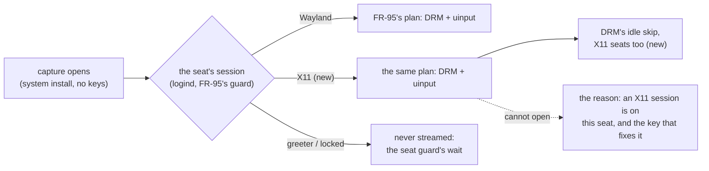

# FR-113: A system install on an X11 desktop shows it by default — FR-95's plan for X11 seats

**Issue:** [#2458](https://github.com/gjovanov/roomler-ai/issues/2458) · **Status:** proposed 2026-10-18, spec and claim,
on the operator's go-ahead (*"5. yes"*) from #2450 · **Owner:** remote desktop (agent) · **Anchors:** master
`df4803f87` · **Builds on:** [FR-95](FR-95-system-installs-on-by-default-on-wayland.md) (the system plan, its seat guard),
[FR-36](FR-36-wayland-capture.md) (DRM + uinput), [FR-93](FR-93-wayland-out-of-the-box.md) (the idle skip P3d, the desktop
brief P2b), FR-80 (the reason codes)

## 1. Goal

A **system** (root) install on an **X11** desktop shows the viewer that desktop, with input, with no capture key set,
as FR-95 made a system install do on Wayland. Where it cannot, the viewer reads the true reason and the key that
fixes it, never "headless".

## 2. Evidence (2026-10-18, #2450)

The released 0.4.143 on a vmtest Ubuntu 24.04 cell, GDM on Xorg (`WaylandEnable=false`), auto-login. `loginctl`:
seat0's session `type=x11`. A system install on its defaults (no `drm_capture`, no `uinput`):

```
desktop brief (FR-93 P2b) session=user kind=x11 desktop="-" capture_arm=x11 input_reach=none
WARN displays: scrap enumeration failed; using stub e=connection refused
WARN scrap capture unavailable — falling back to NoopCapture error=no primary display: connection refused code="no_display"
```

The viewer got **no picture**. The same cell with `drm_capture = true` (the vmtest lane's own system install sets it,
with `uinput`) captured the X11 session through DRM: 84 of 84 viewer samples with a picture, 47 distinct.

**Why.** A systemd unit carries none of the session's variables (`DISPLAY`, `XAUTHORITY`): `docs/linux-capture.md`
§1. FR-95's plan engages only for a person's **Wayland** session on screen. `person_on_screen`
(`agents/roomlerd/src/capture/mod.rs:875`) keeps a session only when `s.kind == "wayland"` (`:878`), so on an X11 seat
the plan falls through to the X11 arm, which a root daemon cannot open. FR-95's AC5 asked for exactly that ("X11
hosts are unchanged"), and this FR is what changing it means.

## 3. Key design (measured before it is decided)



- **FR-95's plan for X11 seats.** `person_on_screen` and its twin (`mod.rs:904`) accept an X11 user session when the
  new switch is on, and the plan then picks DRM capture + `uinput` as on Wayland. DRM reads the scanout below any
  display server, so it does not depend on the display manager, and on X11 it is already proven (§2). `uinput` reaches
  Xorg through libinput as it reaches a Wayland compositor.
- **The seat guard holds on X11.** FR-95 P2's guard (never the greeter, never a locked screen; the person's session
  must be the one on screen) reads logind, so it carries over. It must be shown on X11 (AC3), since a DRM read of the
  scanout would otherwise show whatever is on screen.
- **DRM's idle skip on X11 seats.** FR-93 P3d skips unchanged frames on Wayland seats only
  (`capture/drm_backend.rs:1044`; the X11 cell logged "every frame is read (not a Wayland seat …)"). An idle X11
  desktop through DRM would read every frame, so P1 extends the skip, or AC6 fails.
- **The reason when it cannot.** `linux_no_pixels_code` (`mod.rs:1803`) asks only `seat_shows_wayland` (`:1870`),
  so a reachable-but-unopened X11 seat reads `no_display` ("headless"). It should name the X11 session and the key.
- **Its own kill switch**, `x11_auto_system` (D3), independent of FR-95's `wayland_auto_system` (`mod.rs:663`), so
  either can be turned off without the other. Explicit capture keys keep winning, as in FR-95 (`capture_keys_set`).

## 4. Phases

| Phase | What | Kill switch | Proven on | Size |
|---|---|---|---|---|
| **P0** | measure the population: system installs whose desktop brief reads `kind=x11` with no picture (the server's count, FR-93 P2b) | — | ⏳ | S |
| **P1** | the plan for X11 seats (DRM + `uinput`), the seat guard on X11, DRM's idle skip on X11 seats | `x11_auto_system = false` | ⏳ | M |
| **P2** | the true reason when the plan cannot capture an X11 seat | — | ⏳ | S |
| **P3** | docs: `docs/linux-capture.md` (the plan, its X11 half, the switch), the `docs/README.md` index row | — | ⏳ | S |

## 5. Acceptance criteria

- [ ] **AC1** — A system install on its defaults on GNOME/Xorg shows the desktop to the viewer, with input. Red first
  on 0.4.143 (#2450).
- [ ] **AC2** — The same on a second X11 display manager and desktop (LightDM/XFCE, or SDDM/Plasma on X11).
- [ ] **AC3** — The greeter and a locked screen are never streamed: lock, unlock, logout, login and a user switch on
  an X11 seat, each recovering within 10 s or naming its reason (FR-93 AC7's harness).
- [ ] **AC4** — Explicit keys win, and `x11_auto_system = false` gives back 0.4.143's behaviour exactly; Wayland hosts
  are unchanged.
- [ ] **AC5** — A plan that cannot capture an X11 seat names the X11 session and the key, never `no_display`.
- [ ] **AC6** — An idle X11 desktop through DRM costs within 2× of FR-29's X11 figure.
- [ ] **AC7** — Docs: `docs/linux-capture.md` updated in the house style, and the `docs/README.md` index row.

## 6. Open decisions

| | Decision | Status |
|---|---|---|
| **D1** | On by default for X11 system installs | *(Recommended: yes, as FR-95. The seat guard is what makes it safe, and AC3 proves it.)* |
| **D2** | DRM first, or the session's own X server (`DISPLAY` from logind's session, plus its Xauthority, whose path depends on the display manager) | *(Recommended: DRM first, as it is display-manager agnostic and proven here. The Xauthority path only for a host without DRM access.)* |
| **D3** | The switch's name | *(Recommended: `x11_auto_system`, default on.)* |

## 7. Out of scope

- Per-user installs on X11: scrap through the user's own `DISPLAY` already works.
- Xwayland: FR-93's guard refuses it, by design.

## 8. Field-verification log

| Date | Host | Build | What | Result |
|---|---|---|---|---|
| 2026-10-18 10:19–10:26Z | a vmtest Ubuntu 24.04 cell, GDM on Xorg, a system install | the released 0.4.143 | the red (#2450) | 🔴 on its defaults: `capture_arm=x11`, `connection refused`, `no_display`, no picture. With `drm_capture = true`: DRM, 84/84 samples with a picture. |
