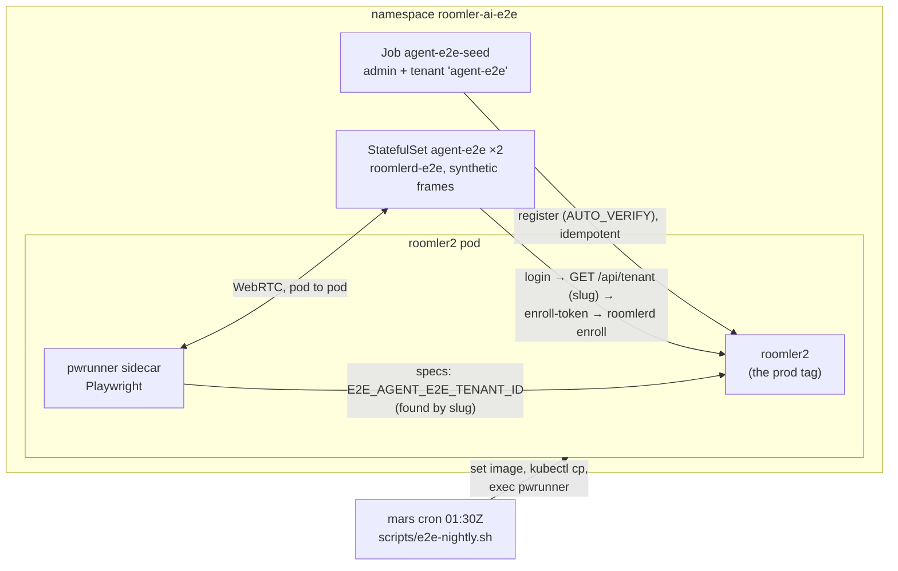

# FR-114: The agent-e2e lane runs every night — remote-session specs against a real agent in the e2e namespace

**Issue:** [#2524](https://github.com/gjovanov/roomler-ai/issues/2524) · **Status:** proposed 2026-10-19 — spec and
claim, on the operator's go-ahead (*"do the test based on your best judgement … proceed"*) · **Owner:** testing (the
e2e pod lane) · **Anchors:** master `95238f1b3` · **Builds on:** `scripts/e2e-k8s/AGENT-E2E.md` (the harness as it
was first written), [FR-102](FR-102-growth-observability.md) AC19 (whose pod-lane run this owes)

## 1. Goal

Every remote-desktop spec in `ui/e2e/` that needs an agent runs in the nightly pod lane, against two synthetic-frame
agents enrolled in the e2e server, and fails the night when it fails. Today all six are listed and skipped: the lane
reads like coverage and is none.

## 2. Evidence (2026-10-17 … 10-19)

| What | Measured |
|---|---|
| The nightly (mars, 01:30Z, against the prod tag) | lists the agent-e2e specs and skips them: 15 skipped on 2026-10-19 (`hosted-20261018-368ac01`), the six agent-e2e specs among them |
| Why it skips | the lane passes only `E2E_BASE_URL`, `E2E_API_URL`, `E2E_MAILPIT_URL` (`scripts/e2e-nightly.sh:133`); every agent-e2e spec skips on `!E2E_AGENT_E2E_TENANT_ID` (e.g. `ui/e2e/remote-session-smoke.spec.ts:92`) |
| The namespace | `roomler-ai-e2e` holds mailpit, minio, mongodb, redis and roomler2 (with its `pwrunner` sidecar), and **no `agent-e2e` StatefulSet**. The deploy repo's `k8s/overlays/e2e` has none of the template's four agent-e2e files |
| The image | no workflow builds `roomlerd-e2e`, and no copy exists on the build host. `Dockerfile.agent-e2e:30` builds with `rust:1.88-bookworm`, while the workspace is edition 2024 and the main `Dockerfile` builds with `rust:1.95-bookworm` |
| The seed | `job-agent-e2e-seed.yaml:77` reads `tenant_id` out of `GET /api/auth/me`, which no longer carries one, so the seed cannot finish. The agents then need a hand-rebaked Secret (`secret-agent-e2e-bootstrap.yaml`, `tenant_id: 000…0`) |
| The specs | 4 of the 6 seed `access_token` / `refresh_token` into `localStorage` (`remote-session-smoke.spec.ts:116`, `remote-file-upload-smoke.spec.ts:124`, `remote-recording-smoke.spec.ts:55`, `remote-recording-refused.spec.ts:104`). That has granted nothing since sessions became cookie-only (#691), so even a live harness would fail them at the login form. `remote-session-rating.spec.ts` was fixed by FR-102 (#2366, `signedInContext` at `:96`) and passed on production against a vmtest guest on 2026-10-17 |

## 3. Key design

1. **The tenant is found by its slug, never pasted into a Secret.** The seed registers the admin and its tenant
   (`tenant_slug: agent-e2e`, idempotent on 409; `register` takes the tenant fields, `crates/api/src/routes/auth.rs:22`;
   the e2e server auto-verifies, `configmap-roomler2-config.yaml:43`). Then it, the agent bootstrap and the nightly
   each read the id from `GET /api/tenant` (`crates/api/src/routes/tenant.rs:32`, flat rows with `slug`). The
   "rebake the Secret" step and its stale-id failure mode go away, and the Secret keeps only the admin's documented
   test credentials.
2. **The image builds on the workspace's toolchain** (`rust:1.95-bookworm`, as the main `Dockerfile`), from master,
   and is pushed to the cluster's registry (`registry.roomler.ai/roomlerd-e2e`) under a dated tag. The overlay pins
   that tag, never `latest`, so a night's agent is a known build.
3. **The four specs sign in the way the rating spec does**: `context.request.post('/api/auth/login')`, so the HttpOnly
   cookie lands in that context's jar; the `roomler-signed-in` hint by `addInitScript`; purestat aborted. They keep the
   admin's bearer token for their own API calls, which the server still accepts.
4. **The nightly passes the tenant only when the harness is there.** If `statefulset/agent-e2e` exists and the tenant
   resolves, `E2E_AGENT_E2E_TENANT_ID` goes into the run. Otherwise the run is today's, and the log says why.
   ⚠️ The nightly prints test **starts**, not outcomes: the proof is the skip count compared night over night.

## 4. Phases

| Phase | What | Kill switch | Status |
|---|---|---|---|
| P1 | the four specs' cookie sign-in; `Dockerfile.agent-e2e` on rust 1.95, with the bootstrap finding the tenant by slug; the seed reading the tenant from `GET /api/tenant`; the template's registry; the nightly's tenant discovery; `AGENT-E2E.md` and `docs/testing.md` | revert the PR | — |
| P2 | build and push `roomlerd-e2e`; install the overlay into the deploy repo (`k8s/overlays/e2e`, manual apply, never ArgoCD-synced); apply; the seed; both agents online | `kubectl -n roomler-ai-e2e delete statefulset agent-e2e` (the nightly then skips as today) | — |
| P3 | an on-demand run of the six specs in the `pwrunner`; then the next nightly | as P2 | — |

## 5. Acceptance criteria

- [ ] **AC1 (P1):** no spec in `ui/e2e/` seeds `access_token` or `refresh_token` into `localStorage`
  (`grep -rn "setItem('access_token'" ui/e2e` finds nothing), and the four sign in through the context's cookie jar.
- [ ] **AC2 (P2):** `roomlerd-e2e` builds from master with the workspace's toolchain and is pushed to
  `registry.roomler.ai` under a dated tag that the overlay pins.
- [ ] **AC3 (P2):** after a fresh apply, with no hand edit to any Secret, both `agent-e2e` pods are Ready and both
  agents are online in the e2e server's `agent-e2e` tenant. Red first: today's seed fails at the `/me` read.
- [ ] **AC4 (P3):** an on-demand run in the `pwrunner` sidecar runs all six agent-e2e specs: none skips. Each passes,
  or its failure is diagnosed and either fixed or entered in `scripts/e2e-expected-failures.txt` with the reason.
  `remote-session-rating.spec.ts` passes, which is FR-102 AC19's pod-lane run.
- [ ] **AC5 (P3):** the first nightly after P2 skips six fewer specs than the night before. The lane's verdict holds,
  or names what newly failed.
- [ ] **AC6 (docs):** `docs/testing.md` documents the agent-e2e lane in the house style (a mermaid diagram, a table,
  `file:line` anchors), `scripts/e2e-k8s/AGENT-E2E.md` matches what was run, and `docs/README.md`'s index row for
  `testing.md` names the lane.

## 6. Open decisions (defaults in bold)

1. **Which agent build the lane tests.** **The image built from master at P2, re-built by hand when an agent change
   needs it.** Option: re-build it per agent release so the lane always tests the released agent.
2. **How many agents.** **Two** (the template's), so a switch-device spec has somewhere to switch to.

## 7. Out of scope

- Input round-trips: the image has no `enigo-input` (no X server), as `AGENT-E2E.md` already says.
- Tunnel and SSH specs against the harness, and any Windows or macOS agent in the lane.
- Running the lane on every PR: it needs the cluster, and stays nightly.

## 8. Field-verification log

| Date | Build | What was checked | Result |
|---|---|---|---|
