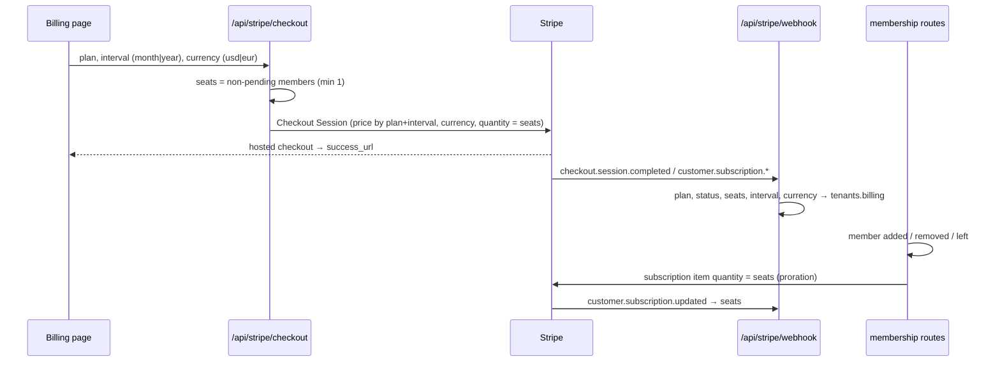
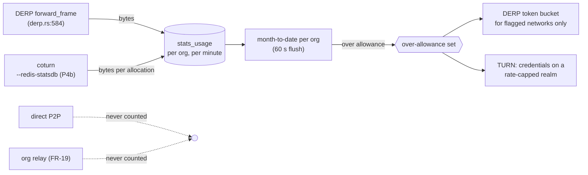
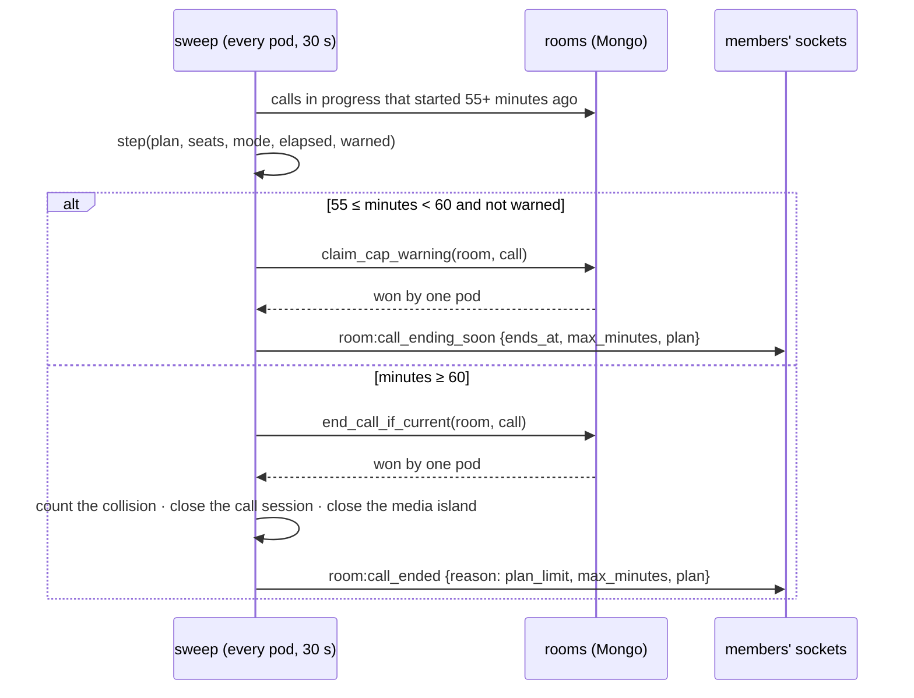

# FR-115 — Plans that give the network away and charge for what costs money

| | |
|---|---|
| **Issue** | [#2557](https://github.com/gjovanov/roomler-ai/issues/2557) |
| **Status** | in progress — P0 and P0-ops done 2026-10-19; P1+P2, P3, P5 and the EUR guard merged 2026-10-20, not yet promoted |
| **Arc** | P3 of the pricing sequence in [`../business-model.md`](../business-model.md) §5 (enforce → meter → **reshape** → keys) |
| **Related** | [FR-32](FR-32-plan-limit-enforcement.md) (the one decision point), [FR-20](FR-20-per-tenant-relay-cost-metering.md) (the ledger), [FR-19](FR-19-peer-relays.md) (org relays), [FR-52](FR-52-cross-org-remote-access.md) (support sessions to other orgs), [FR-102](FR-102-growth-observability.md) (revenue view) |
| **Private annex** | `roomler-ai-docs/gtm/pricing/FR-115-annex-census-2026-10-19.md` — per-org census, account counts, competitor detail |

## Goal

Make the Free plan at least as generous as Tailscale's free plan on the things that cost us
nothing (devices, direct traffic, mesh features, chat), allow commercial use on it outright,
and put the limits on what actually costs money or grows with the customer: **concurrent
remote-desktop sessions**, **relayed bytes**, **meeting time**, and **seats**. Bill paid
plans **per seat**, monthly or annually (two months free), in **USD or EUR**.

## Root cause and evidence

`business-model.md` deferred the reshape until FR-20 had metered a month. It has metered seven
weeks. What the meter and the code show (aggregates; the per-org census is in the annex):

### 1. Almost nothing scales with usage, and devices cost nothing at all

| Cost driver | Measured, whole fleet, 30 days to 2026-10-19 | At `config/relay-costs.toml` prices |
|---|---|---|
| Direct P2P (remote desktop, mesh) | 373 session-hours; 94 % of sessions with a recorded carrier went direct | €0 by construction |
| DERP (`derp_bytes`, attributed per org) | ≈ 30 GB (79 GB since 2026-08-30); median day 0.3 GB, max day 15 GB | ≈ €0.30 |
| coturn TURN (fleet total only) | ≤ ≈ 950 GB egress on the central coturn hosts; 41 allocations on average, 307 at peak | ≤ ≈ €9.50 |
| SFU | 0.03 participant-hours since 2026-08-30 | ≈ €0 |

⚠️ The TURN figure is an **upper bound**: the `eu-central` stats region polls the coturn
workers' host NIC (`crates/core/src/relay_load.rs:28`), which also carries whatever else those
hosts serve. It is still the largest relay figure, and it is **the one relay cost no org can
be charged for today** — FR-20 decided not to build per-tenant TURN attribution
([FR-20](FR-20-per-tenant-relay-cost-metering.md) P3, "reopen when a tenant's TURN volume
becomes material"). A relay allowance makes it material by definition.

Concurrency, from the two busiest orgs: peaks of **4** and **3** simultaneous remote sessions;
p90 session length 7 minutes.

### 2. The tiers as shipped contradict themselves

| Surface | Says |
|---|---|
| Landing page, docs home | "$8 /user/mo" (`ui/src/views/LandingView.vue:130`, `ui/docs/theme/home-layout.ts:72`) |
| In-app billing page | "$8 /mo" (`ui/src/views/billing/BillingView.vue:62`) |
| Stripe checkout | `quantity = 1` — one unit per org (`crates/services/src/stripe.rs:202`) |
| MRR estimate | price × member count (`crates/api/src/routes/cost.rs:68`) |
| `Plan::Pro` | unlimited members (`crates/db/src/models/tenant.rs:441`) |

A 20-person team is quoted $160 and billed $8.

### 3. The one limit a new Free org hits is the one that should not exist

Only `max_devices` and `max_tunnel_clients` are **established** — enforced whatever the org's
`plan_enforcement` mode (`crates/services/src/quota.rs:71` at `8dcb27a32`, before P1). Every other gate runs in `Warn` for
an org created after 2026-08-30, by standing decision (`crates/db/src/models/tenant.rs:58`), so
for a new signup MagicDNS and exit nodes already pass. The advertised "1 concurrent session"
(Free) and "5" (Pro) are enforced **nowhere**: FR-32 withheld the gate because nothing wrote
`remote_sessions` (`crates/services/src/dao/remote_session.rs:52`). That table is written now —
projected from the audit stream (`crates/remote_control/src/audit.rs:3`) — but it is
best-effort: three rows have shown "open" for up to 25 days. **A gate must not count it.**

So the effective Free tier is the inverse of the intended one: devices capped at 3,
concurrency unlimited.

### 4. The market

From the vendors' own pricing pages, 2026-10-19 (detail and URLs in the annex):

| | Free | Paid entry | Limits on |
|---|---|---|---|
| Tailscale | 6 users, unlimited user devices + 50 servers, MagicDNS, exit nodes, SSO, peer relays; **non-commercial** | $8 / seat (Standard), $18 (Premium) | seats |
| NetBird | 5 users, 100 machines, commercial OK | €6 / active user | users + machines |
| TeamViewer | personal use only, commercial-use detection | €13.90/mo: 1 user, **1 channel**, 3 devices; extra channel €43.90 | concurrent channels |
| AnyDesk | personal use only | €24.90/mo: 1 connection, 100 devices; extra connection €37.90 | concurrent connections |
| Zoom / Teams / Meet | group meetings 40 / 60 / 60 min | $14–17 / $4 / $7 per user | users; free fenced by meeting length |

Mesh vendors give devices away and charge per seat; remote-desktop vendors charge per
concurrent session; meeting vendors fence free by meeting length; nobody meters relay
bandwidth on a price list (Tailscale lowers DERP quality instead).

## Decisions (operator, 2026-10-19)

| # | Decision |
|---|---|
| D1 | **Per seat.** A seat is a non-pending member of the org; the Stripe subscription quantity is the seat count and follows membership changes with proration. |
| D2 | **Free keeps 10 users, and the cap is enforced** — established, so `plan_enforcement` cannot switch it off. Paid plans have no user cap; every user is a billed seat. |
| D3 | **Commercial use is allowed on Free**, and said so plainly on the landing, pricing and billing pages and in the announcement. The fence is objective — one concurrent session, no support sessions to other orgs — never "personal use" detection. |
| D4 | **Over the relay allowance: throttle, never refuse.** Supersedes `business-model.md` §6 rule 4 ("relayed connections refused"): for a host behind symmetric NAT or a full-tunnel VPN the relay is the only path, so refusing it means the product stops working. Direct traffic and org-relay traffic are never counted. |
| D5 | **Annual billing at two months free** (annual = 10 × monthly), and **EUR prices** beside USD. |
| D6 | **Clean up the orphaned orgs** (owner account gone, test debris from 2026-02). |
| D7 | **Tell the users** — one email, sent once the new plans are live, saying only what is live. |

## Key design

### The ladder

| | **Free** | **Pro** | **Business** | **Enterprise** |
|---|---|---|---|---|
| Price | 0 — commercial use allowed | $8 / €8 per seat per month; $80 / €80 per seat per year | $16 / €16 per seat per month; $160 / €160 per seat per year | custom |
| Users | **10, enforced** | per seat | per seat | per seat |
| Devices · tunnel clients | **100 · 100** (was 3 · 3) | 1,000 · 1,000 (was 30) | 5,000 · 5,000 (was 300) | custom |
| MagicDNS | **yes** (was Pro) | yes | yes | yes |
| Exit nodes | **yes, from P4d** (after the throttle exists) | yes | yes | yes |
| Concurrent remote sessions | **1 per org, enforced** | 1 per seat | unlimited (fair use) | unlimited |
| Support sessions to other orgs (FR-52) | — | yes | yes | yes |
| Relay (DERP + TURN) at full speed | 10 GB / month, then throttled | 25 GB per seat, pooled | 100 GB per seat, pooled | custom |
| Own relays (FR-19) | unmetered | unmetered | unmetered | unmetered |
| Meetings | 10 people, 60 minutes | 50 people | 100 people, recordings | custom |
| Storage | 1 GB | 10 GB per seat | 50 GB per seat | custom |
| Channels, history | unlimited | unlimited | unlimited | unlimited |

Plan ids stay `free` / `pro` / `business`: they are stored in tenant documents and matched in
the webhook, so renaming one is a migration (`crates/services/src/stripe.rs:337`).

### Limits become a function of plan **and** seats

`Plan::limits()` (`crates/db/src/models/tenant.rs:411`) is a pure function of the plan, and
`quota::evaluate` takes only the plan (`crates/services/src/quota.rs:258` at `8dcb27a32`; P1 added `evaluate_for`). Per-seat
allowances (concurrency, relay, storage) need the billed seat count, so the tenant's
`BillingInfo` gains `seats` (the subscription quantity, written by the webhook) and the
limits are computed from `(plan, seats)`. Free has no seats; a paid org whose webhook has not
landed yet is computed at one seat, the floor, so a missing number can only under-grant.

### Plans bind only where they are sold

Every org is created on `free` (`crates/services/src/dao/tenant.rs:284`), on every server.
On the hosted service that is a plan; on a self-hosted server it is only the absence of
one. So `Core::plans_sold` (`crates/core/src/state.rs:127`) is true only where the hosted
`saas` module is compiled in and switched on (`crates/api/src/state.rs:285`). The published
self-host image and the compose build are both built without it. With it false, the one
decision point refuses nothing and counts nothing (`crates/core/src/quota.rs:49`), and the
two fences that read the plan outside it stand down too: the session cap
(`crates/modules/remote/src/controller.rs:698`) and the meeting sweep
(`crates/modules/conference/src/meeting_cap.rs:104`).

⚠️ Found while documenting P5, after P1 and P3 had merged. Without the flag, P1's
established member cap, P3's one session at a time and P5's 60-minute meeting would have
bound every self-hosted org from the next self-host image on. By the same code, the device
cap had bound self-hosted orgs since FR-32 (three devices), which the README's "unlimited
devices" contradicted. The self-host image is published by hand, last on 2026-10-12, so no
self-hosted server ran any of FR-115's caps.

### Per-seat checkout and the quantity sync

Prices are configured per (plan, interval) — `price_pro`, `price_business` (monthly, live
since 2026-07-27) plus `price_pro_annual`, `price_business_annual` — each a Stripe Price with a
USD amount and an EUR `currency_options` entry, so one id serves both currencies and checkout
names the currency. An absent annual id hides the annual option rather than failing checkout,
the same contract as an empty monthly id today (`crates/services/src/stripe.rs:141`).

A currency is on sale only once `stripe.currencies` names it (`ROOMLER__STRIPE__CURRENCIES`,
default `usd`, `usd,eur` once O1 lands). The billing page starts a European browser on EUR,
so a currency the live Prices cannot charge in must stay off the page, not just be refused at
checkout. `get_plans` lists only the currencies on sale, the page shows its currency toggle
only when there is a choice, and checkout refuses any other before it reads anything from
Stripe. A promote therefore does not wait for O1: EUR and annual appear when the operator
switches them on.

### The concurrency fence

Counted **in the hub**, at session start, after the authz gate and the FR-101 ceiling
(`crates/modules/remote/src/controller.rs:80`) — never from `remote_sessions`. The count is
the controller's org's live sessions; a session to another org's device (FR-52) counts against
the **controller's** org, which may live on the other pod, so the count is kept in Redis as
leases that expire with the session rather than read from one pod's `DashMap`. Refused with a
message naming the session that holds the slot (device and person) so the person can end it;
a live session is **never** ended by the fence (`business-model.md` §6 rule 4). Established,
like the device cap: no org is over it today.

**As built (P3).** The authz gate reads the cap from the device's org
(`org_session_cap_of`, `crates/modules/remote/src/controller.rs:605`) and hands it to the hub
in `DispatchCtx`, and in the body of a request relayed to the pod that owns the device. The
hub counts that org's live sessions after its coalesce, so a re-asked session is not a
second one (`crates/modules/fleet/src/hub.rs:1524`). Tenant affinity puts an org's devices
and its controllers on one pod, so that pod's count is the org's. Redis leases are needed
only for the one case affinity cannot place: a session to **another** org's device, which
must count against the controller's org. That is **P3b**; until it lands, a cross-org session
counts against the device's org, and an outsider's session (FR-52's extauth path) opens
uncapped. A refusal is `org_session_limit`
(`crates/remote_control/src/error.rs:41`), which the viewer does not retry
(`ui/src/composables/useRemoteControl.ts:716`). It names the person and the device holding
the slot, and a Pro org at its cap (one per billed seat) is told the way past it is a
session ending or Business. Kill switch `rc.org_session_cap = false`.

### The relay allowance

- DERP already meters per network on the forward path
  (`crates/modules/network/src/derp.rs:683`). The throttle adds **one** set lookup on that
  path, consulted only for networks the 60 s flush flagged; the path must stay within FR-18's
  budget, measured with the same bench FR-20 used (`derp.rs:704`).
- TURN attribution is FR-20's deferred P3, taken up with the option FR-20 already chose
  (`--redis-statsdb`; the username is `<expiry>:<id>`, `crates/remote_control/src/turn_creds.rs:6`).
- Throttled, never refused (D4). The tenant analytics page shows usage against the allowance in
  units, never money (FR-20's decision stands).

### Meetings

Free meetings end at 60 minutes with a warning at 55; the participant caps become
established. The SFU's unit cost (`sfu_participant_hour = 0.004` in `relay-costs.toml`) has
never been checked against a real call; P5 measures it from `stats_call_user` before any
number is advertised beyond what the current single-worker room is known to carry.

### Meetings, as built (P5)

**A sweep, not a timer.** A timer lives in the pod that started the call, and a rolling
deploy restarts pods: the call would outlive its timer and run uncapped. Every pod reads
the calls in progress every 30 s (`crates/modules/conference/src/meeting_cap.rs:248`) and
decides each one with `quota::evaluate_for` on the new `Limit::MeetingMinutes`, read as
"may it run one more minute?" (`meeting_cap.rs:58`). The comparison stays in the one
place plan limits are compared, and like the device cap it is **established**: `warn`,
every new org's default, does not soften it (`crates/services/src/quota.rs:93`). So does
`VideoMaxParticipants`, Free's other meeting fence; its count reads the owner pod's room,
so it can only under-count and fails open.

| Guard | Where | What it prevents |
|---|---|---|
| The warning is a write conditional on `current_call_id = call` and `cap_warned_call_id ≠ call` | `crates/services/src/dao/room.rs:743` | two pods warning one meeting; warning a meeting that ended |
| The end is a write conditional on `current_call_id = call` and `in_progress` | `room.rs:762` | ending the **next** meeting in a room restarted between the sweep's read and its write |
| The FR-102 collision is counted after the won end | `meeting_cap.rs:198` | a meeting counted twice when two pods reach it together |
| `meetings.free_cap = false` | `crates/config/src/settings.rs` (`MeetingsSettings`) | the kill switch: no meeting is warned or ended |

Precision is one sweep period: the warning lands between 55:00 and 55:30, the end between
60:00 and 60:30. The browser counts the minutes left from `ends_at`, not from the moment
the warning arrives (`ui/src/utils/meetingCap.ts`). A meeting started again after the end
is a new call with its own sixty minutes. A meeting the sweep first sees past 60 minutes
is ended at once, **without** the warning, because `step` checks the end before the
warning. That happens only if no pod swept for five minutes or more (an outage of every
pod, or a meeting already running when P5 first deployed).

⚠️ A call whose row the startup stale-call reset ends (`maintenance.rs:21`, on every boot,
under the startup lease) while its media lives on in the surviving pod is no longer
in progress, so the sweep does not see it. That gap is in call state, which predates
P5. The cap can lose at most the minutes of one meeting that spans a deploy.

**The SFU measurement P5 owed came back empty**: the 90 days to 2026-10-20 held too
little conferencing to fit a unit cost from (the field log; counts in the private annex),
so there is no field number for what one room carries. A room is one
mediasoup router on one worker, which mediasoup's own scalability guidance puts at
roughly 500 consumers. A meeting where everyone sends a camera and a microphone needs
2·N·(N−1) consumers: 180 at 10 people, about 4,900 at 50 and 19,800 at 100. Free's 10
fits. Pro's 50 (P1 raised it from 10) and Business's 100 (unchanged) do not, unless a
room is piped across workers. That is O4.

## Phases

| Phase | What | Kill switch | Status |
|---|---|---|---|
| P0 | Spec, registry row, issue | — | ✅ #2560 (`8dcb27a32`) |
| P0-ops | Tombstone the orphaned orgs (owner account gone), with an export first | restore from the export | ✅ 2026-10-19 21:32Z — 62 of 62, backup verified first; **deleted outright 2026-10-20** (O5), from a second verified export |
| P1 | The ladder: `Plan::limits_for(seats)`, Free = 10 users established + 100 devices + MagicDNS, unlimited chat; plan copy, commercial-use message on landing / docs / billing; snapshot tests | revert (data only) | ✅ merged #2565 (`069981677`), promoted 2026-10-20 (`hosted-20261020-9776afb`); AC1 and AC2 field-verified on prod |
| P2 | Per-seat Stripe: quantity at checkout, annual + EUR prices, quantity sync with proration, webhook stores seats/interval/currency/plan, plan change on the live subscription, summary route; integration tests against a recording fake Stripe; then Stripe **test mode** and an e2e checkout with a test card | `stripe.seat_sync = false`; absent annual ids hide annual | ✅ merged #2565 (`069981677`) against the fake; proven against Stripe's test mode, including a test-card checkout in a real browser (#2604, AC3 + AC4). A Free `year` price that put annual on every page was fixed by #2603 |
| P3 | Concurrency fence: counted by the device's hub, established, start-only, names the holder | `rc.org_session_cap = false` | ✅ merged #2571 (`73bc6daeb`); field-verified on prod for one org (AC6's first half); the cross-org half is P3b |
| P3b | A cross-org session counts against the controller's org (Redis leases); Free gets no support sessions to other orgs | `rc.org_session_cap = false` | ⬜ |
| P4a | Relay allowance on DERP: month-to-date, over-allowance set, token bucket, analytics quota slot | `relay_allowance.enabled = false` | ⬜ |
| P4b | Per-org TURN attribution (`--redis-statsdb` → `turn_bytes`) | coturn flag off | ⬜ |
| P4c | TURN throttle for over-allowance orgs | `relay_allowance.turn = false` | ⬜ |
| P4d | Exit nodes on Free | revert (data only) | ⬜ |
| P5 | Meetings: Free 60-minute cap, established participant caps, measured SFU cost | `meetings.free_cap = false` | ✅ merged #2583 (`5679857cc`); AC9 field-verified on prod 2026-10-20 in real time (warned at 55:00, ended at 60:00); the SFU measurement found nothing to measure (O4) |
| P6 | Announcement email to real users, once P1 + P2 are live | — | ✅ sent 2026-10-20 13:55Z to every real user, after #2603's promote and an all-green AC5 re-check; the send log is in the private annex |
| P7 | **Docs**: `business-model.md` (§4 ladder, §6 rule 4, §7), `compare/vs-tailscale.md`, a plans-and-limits page, with diagrams, linked from `docs/README.md` | — | 🟡 `business-model.md` and `vs-tailscale.md` landed with P0/P1; [`plans-and-limits.md`](../plans-and-limits.md) in review; P4's docs come with P4 |

## Acceptance criteria

- [x] AC1 — A new Free org enrolls its 100th device and is refused the 101st with the plan message (prod).
- [x] AC2 — A Free org's 11th member is refused, with `plan_enforcement` set to `warn` **and** to `off` (prod).
- [x] AC3 — Checkout in Stripe test mode, monthly and annual, USD and EUR, charges quantity = seats, and the webhook stores plan, seats, interval and currency (integration test against test mode **and** an e2e checkout with a test card).
- [x] AC4 — Adding and removing a member of a paid org changes the subscription quantity with a proration (integration test against test mode).
- [x] AC5 — Landing page, docs home and billing page show the same per-seat prices, the annual price and EUR, and say Free allows commercial use (e2e).
- [ ] AC6 — A Free org's second concurrent remote session is refused at start with a message naming the session holding the slot, and the first session is untouched (prod, two browsers). A cross-org session counts against the controller's org.
- [ ] AC7 — A Free org over its relay allowance still connects over DERP at the throttled rate; a direct transfer and an org-relay transfer add **zero** relay bytes (unit, falsifiable as FR-20's; prod).
- [ ] AC8 — `turn_bytes` is populated per org from coturn (prod).
- [x] AC9 — A Free meeting is warned at 55 and ended at 60 minutes (prod).
- [x] AC10 — The orphaned orgs are tombstoned from an export, and no per-org view counts them (prod). Since 2026-10-20 they are deleted outright (O5), so no view can.
- [x] AC11 — The announcement reached every real user and no internal or test account (send log).
- [ ] AC12 — Docs updated or created in the house style with diagrams, and linked from `docs/README.md`'s index.

## Open decisions

| # | Question | Default until answered |
|---|---|---|
| O1 | Live Stripe prices: create the annual Prices and the EUR currency options in the live account, then set `ROOMLER__STRIPE__PRICE_PRO_ANNUAL`, `…__PRICE_BUSINESS_ANNUAL` and `ROOMLER__STRIPE__CURRENCIES=usd,eur` | **Decided 2026-10-20: yes, and done.** Both monthly Prices carry an EUR option at the USD number; annual Prices exist on the same products; the prod ConfigMap names them and sets `usd,eur` (the field log) |
| O2 | Do pending invites count toward Free's 10? | no — a seat is a member who accepted |
| O3 | Throttled rate for an over-allowance org | 1 Mbps per org on Free, 4 Mbps on paid plans, measured before it ships |
| O4 | Pro's 50 and Business's 100 people per meeting, against one mediasoup worker per room (*Meetings, as built*) | the numbers stay as published; a synthetic-participant load test measures what one room carries, then either a room pipes across workers or the published numbers come down to the measured one |
| O5 | AC10's "no per-org view counts them". Admin stats, plan compliance and weekly active orgs exclude the 62 tombstoned orphans. FR-102's growth **Orgs** list shows them with an *archived* chip, and a cohort view asked for more than its default 26 weeks would count them in their February cohorts. Hiding archived orgs outright would also hide an owner's own archive, which is the churn signal that list is for | **Decided 2026-10-20: remove them completely, and done.** Every document of the 62 is deleted (the field log), so no view lists or counts them |

## Out of scope

SSO / SCIM (not built), mobile clients, offline licence keys for self-hosted Enterprise
(`business-model.md` §5 P4), right-sizing the regional PoP fleet (`business-model.md` §7
decision 5), and any limit on a self-hosted server — self-hosting stays free and unlimited.

## Field-verification log

| Date | What | Result |
|---|---|---|
| 2026-10-19 | Read-only prod census (ledger, sessions, relay stats, memberships) | the numbers in *Root cause*; per-org detail in the annex. ⚠️ A first pass summed BSON `Long`s with JS `+`, which concatenates: the fleet DERP total read 1.03e34 GB while every per-row figure was right. Re-run with `Number()` conversion and checked against the weekly sums |
| 2026-10-19 | P0-ops — the orphaned orgs | Selection: a missing owner account, outside the exclusion set, no live member, and no devices, overlay, messages or files: **62**, all created 2026-02. Exported with their 100 memberships, 62 rooms, 83 room members and 310 roles to a private backup on the ops host, and the file checked before any write. Recomputed at write time and matched the backup (62 = 62); `deleted_at` + `is_archived` set on 62 of 62. Live orgs went from 77 to 15 |
| 2026-10-19 | Found while building P2 | Two live billing bugs beyond the ones in *Root cause*. (1) A Pro org's "Switch to Business" ran a **second checkout**, which starts a second subscription: two bills. (2) `customer.subscription.updated` wrote only the status, so a plan changed in Stripe's portal **never reached the org**. Both fixed in P2: a live subscription refuses checkout (409) and changes go through `change-plan`; the webhook maps the price to the plan. No org's billing record shows a second subscription |
| 2026-10-20 | P5's SFU measurement — read-only prod census of `call_sessions` and `stats_call`, 30 and 90 days | **Nothing to measure**: too little conferencing in the window to fit a unit cost from, so `sfu_participant_hour` stays unverified. Neither fence would have changed a meeting in it — none on a capped plan ran past 60 minutes or held more than 10 people. Counts in the private annex; the consequence is O4 |
| 2026-10-20 | Found while documenting P5 | **Plan limits bound self-hosted servers.** Every org is created `free`, and nothing exempted a server that sells no plans. P1's member cap, P3's session cap and P5's meeting cap would have reached self-hosters with the next self-host image (published by hand, last on 2026-10-12, so none did); the device cap always had. Fixed by `Core::plans_sold` (*Plans bind only where they are sold*), with an integration test per fence on a server without `saas` |
| 2026-10-20 | **Before**: the field harness on `hosted-20261019-e46da07`, which predates FR-115 | One throwaway Free org, owned by the vmtest admin and listed in `growth_exclusions`; agents enrolled through the API with no daemon behind them; members past the owner are membership rows with no account. **AC1**: the 4th device refused, *"3 of 3 devices used"*. **AC2**: the 11th member **added** in `warn` and in `off`. **AC6**: two sessions requested 1 s apart, **both** created. **AC9**: a call backdated to 61 minutes still `in_progress` after 75 s, with no event. **AC5**: the old ladder on `/` and `/pricing` ("3 devices", "$8 /user/mo", no commercial-use line). Each AC fails, as it should on a deploy without FR-115 |
| 2026-10-20 | **After**: the same harness on `hosted-20261020-9776afb`, promoted 09:32Z | **AC1**: 100 devices enrolled, the 101st refused, *"Device limit reached for the Free plan (100 of 100 devices used)"*. **AC2**: the 11th member refused in `warn` and in `off`, *"Members limit reached for the Free plan (10 of 10 members used)"*. **AC6**: the second session refused with `org_session_limit`, *"…vmtest admin is connected to fr115-field-001 right now…"*; the first session got no `rc:terminate`. **AC9**: a call backdated to 56 minutes was warned at 09:49:44Z (`cap_warned_call_id` set) and ended at 09:53:44Z, 60 min 4 s after its start, with `room:call_ended {reason: plan_limit}` |
| 2026-10-20 | Found by AC5 on prod | **Annual on sale where nothing is.** `/api/stripe/plans` listed Free with a `year` price of $0, and every page reads a `year` entry as "annual is on sale". The billing page showed an *Annual · 2 months free* toggle, and the Free card on `/` and `/pricing` read *"or $0 per user per year (two months free)"*. These were AC5's only failures. Fixed by #2603 in the server (`get_plans`) and, defensively, in the UI. Also learned: a guest's `/pricing` is the static page, whose Free card says "Free for commercial use" as its first feature and has no chip |
| 2026-10-20 | Stripe **test mode** (#2604), test Prices on their own products | **AC3**: four real Checkout Sessions (Pro/Business × month/year × USD/EUR), each with quantity = 3 seats, the right Price and currency, and `amount_total` = 3 × the unit price. **AC4**: on a real subscription paid by the test card, a member joining moved the quantity from 2 to 3 with a proration charge, and leaving moved it back with a credit. Stripe's own subscription events, delivered as Stripe signs them, set plan, seats, interval and currency. **AC3 end to end**: our checkout opened a Sandbox Checkout page (*"Qty 3, €24.00"*), a real browser paid it with the test card, and Stripe's `checkout.session.completed` put the org on Pro with 3 seats, monthly, EUR. The invoice showed €24.00 paid. Everything created in Stripe was deleted afterwards |
| 2026-10-20 | **AC9 in real time**, on `hosted-20261020-9776afb` | A meeting in the field org with one participant joined over a live socket, as the SPA joins, started 09:55:54Z. `room:call_ending_soon` reached the client at 10:50:55Z (55:00.3, `ends_at` 10:55:54.743Z), and `room:call_ended {reason: plan_limit, max_minutes: 60, plan: free}` at 10:55:55Z (60:00.3). Afterwards the field org was cleaned up: the 9 filler memberships deleted, the 100 devices deleted through the API, and the org archived. It stays in `growth_exclusions` |
| 2026-10-20 | #2603 promoted (`hosted-20261020-d2eae7e`, 13:54Z), AC5 re-checked, **P6 sent** | Free lists only `month`. Every AC5 check passes on the static home, `/pricing` and the billing page: $8 / $16 per user per month, Free allows commercial use, no yearly line on Free, no Annual toggle, no €. AC5 stays unticked until O1 puts annual and EUR on sale. The announcement went to every real user at 13:55Z. SendGrid accepted every message, and internal, test and unverified accounts were excluded (counts in the private annex) |
| 2026-10-20 | **AC10, the orphaned orgs deleted** (O5, operator's decision) | The 62 ids came from the P0-ops export, and each was re-checked as a tombstoned org with no owner account before anything ran. Every collection was scanned for references to them or their rooms (as ObjectId or hex). There were 617 documents in 5 collections: orgs, memberships, rooms, room members and roles. No other collection referenced them. They were exported, and the export was verified (617 = 617) before the delete, which required that exact count. 0 documents are left. Prod holds 16 orgs and no tombstones. The exports stay on the ops host until the operator says otherwise |
| 2026-10-20 | **O1 live, and AC5 whole** | Live Stripe, on the operator's go (0 live subscriptions at the time): both monthly Prices gained an EUR option at the USD number, and annual Prices were created on the same products at $80 / €80 and $160 / €160 per seat per year. The prod ConfigMap got the two annual ids and `ROOMLER__STRIPE__CURRENCIES=usd,eur` (deploy repo), followed by a rollout restart (14:19Z). **AC5**: the static home (`/pricing` and `/landing` 301 to it) shows *"$8 / €8 per user / month · or $80 / €80 per user per year (two months free)"* and the Business pair. Free stays *"$0 forever"* and says it allows commercial use. The billing page, in a `de-DE` browser, shows the Monthly/Annual and USD/EUR toggles, €8 / €16 per user per month, and €80 / €160 per user per year with *"two months free"* |
