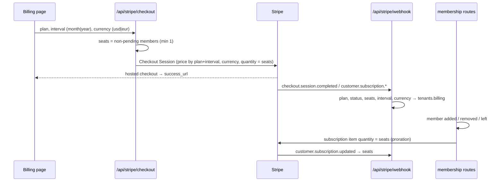
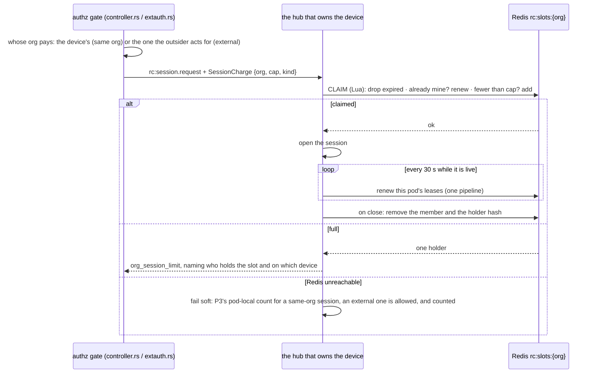
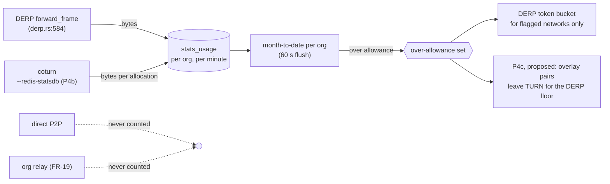
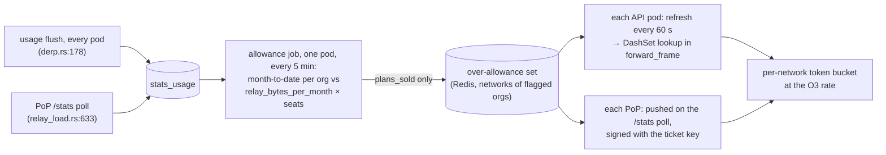
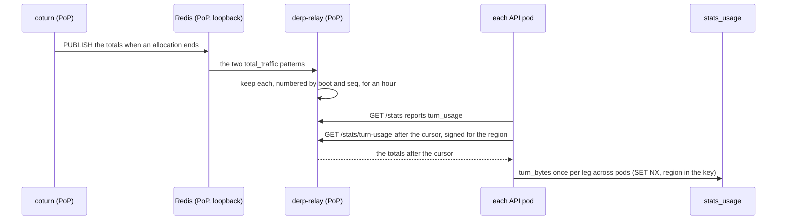
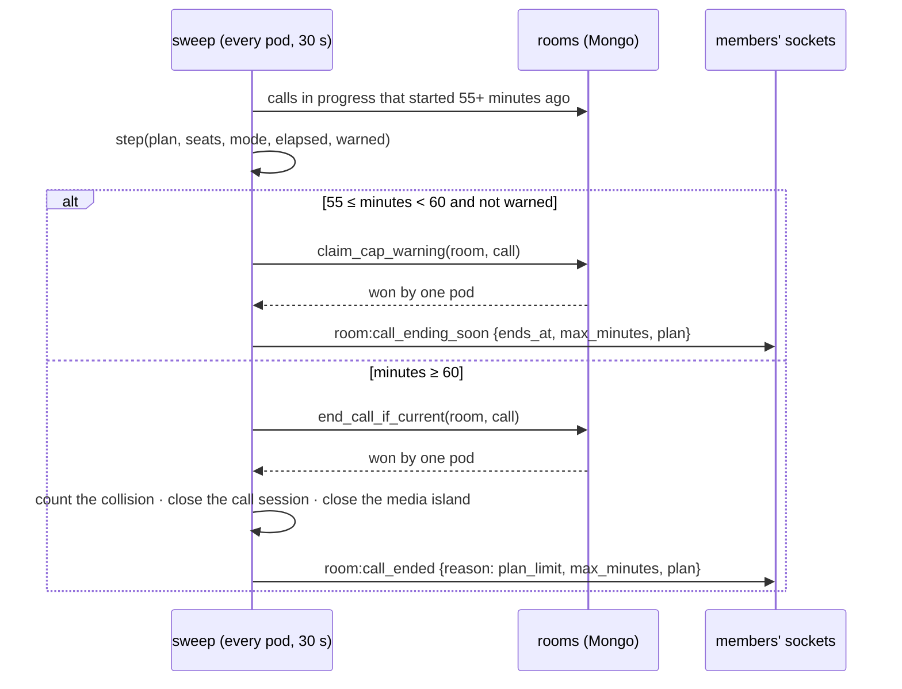

# FR-115 — Plans that give the network away and charge for what costs money

| | |
|---|---|
| **Issue** | [#2557](https://github.com/gjovanov/roomler-ai/issues/2557) |
| **Status** | every phase live on prod (P4d since 2026-10-24) and AC1–AC12 ticked; still open, and the FR waits on them: the issue #2820 (P4c-1 moves a live TURN carrier only when the pair re-establishes; the real-pair test is done, *P4c, as built*) and O4's decision. **O4 is measured** (2026-10-26, *O4, measured*): one room carries about 20 people with cameras on. **O3 is complete** (2026-10-25, the field log). Free's and the paid rate keep typing, kernel-TCP bulk and a remote-desktop session over the overlay usable. roomler SSH's collapse under both was #2876, fixed by #2899, which shipped in agent 0.4.171 and was verified on the published build |
| **Arc** | P3 of the pricing sequence in [`../business-model.md`](../business-model.md) §5 (enforce → meter → **reshape** → keys) |
| **Related** | [FR-32](FR-32-plan-limit-enforcement.md) (the one decision point), [FR-20](FR-20-per-tenant-relay-cost-metering.md) (the ledger), [FR-19](FR-19-peer-relays.md) (org relays), [FR-52](FR-52-cross-org-remote-access.md) (support sessions to other orgs), [FR-102](FR-102-growth-observability.md) (revenue view) |
| **Private annex** | `roomler-ai-docs/gtm/pricing/FR-115-annex-census-2026-10-19.md` — per-org census, account counts, competitor detail |

## Goal

Make the Free plan at least as generous as Tailscale's free plan on the things that cost us
nothing (devices, direct traffic, mesh features, chat), allow commercial use on it outright,
and put the limits on what actually costs money or grows with the customer: **concurrent
remote-desktop sessions**, **relayed bytes**, **meeting time**, and **seats**. Bill paid
plans **per seat**, monthly or annually (two months free), in **USD or EUR**.

## Root cause and evidence

`business-model.md` deferred the reshape until FR-20 had metered a month. It has metered seven
weeks. What the meter and the code show (aggregates; the per-org census is in the annex):

### 1. Almost nothing scales with usage, and devices cost nothing at all

| Cost driver | Measured, whole fleet, 30 days to 2026-10-19 | At `config/relay-costs.toml` prices |
|---|---|---|
| Direct P2P (remote desktop, mesh) | 373 session-hours; 94 % of sessions with a recorded carrier went direct | €0 by construction |
| DERP (`derp_bytes`, attributed per org) | ≈ 30 GB (79 GB since 2026-08-30); median day 0.3 GB, max day 15 GB | ≈ €0.30 |
| coturn TURN (fleet total only) | ≤ ≈ 950 GB egress on the central coturn hosts; 41 allocations on average, 307 at peak | ≤ ≈ €9.50 |
| SFU | 0.03 participant-hours since 2026-08-30 | ≈ €0 |

⚠️ The TURN figure is an **upper bound**: the `eu-central` stats region polls the coturn
workers' host NIC (`crates/core/src/relay_load.rs:28`), which also carries whatever else those
hosts serve. It is still the largest relay figure, and it is **the one relay cost no org can
be charged for today** — FR-20 decided not to build per-tenant TURN attribution
([FR-20](FR-20-per-tenant-relay-cost-metering.md) P3, "reopen when a tenant's TURN volume
becomes material"). A relay allowance makes it material by definition.

Concurrency, from the two busiest orgs: peaks of **4** and **3** simultaneous remote sessions;
p90 session length 7 minutes.

### 2. The tiers as shipped contradict themselves

| Surface | Says |
|---|---|
| Landing page, docs home | "$8 /user/mo" (`ui/src/views/LandingView.vue:130`, `ui/docs/theme/home-layout.ts:72`) |
| In-app billing page | "$8 /mo" (`ui/src/views/billing/BillingView.vue:62`) |
| Stripe checkout | `quantity = 1` — one unit per org (`crates/services/src/stripe.rs:202`) |
| MRR estimate | price × member count (`crates/api/src/routes/cost.rs:85`) |
| `Plan::Pro` | unlimited members (`crates/db/src/models/tenant.rs:441`) |

A 20-person team is quoted $160 and billed $8.

### 3. The one limit a new Free org hits is the one that should not exist

Only `max_devices` and `max_tunnel_clients` are **established** — enforced whatever the org's
`plan_enforcement` mode (`crates/services/src/quota.rs:71` at `c5d36ca84`, before P1). Every other gate runs in `Warn` for
an org created after 2026-08-30, by standing decision (`crates/db/src/models/tenant.rs:58`), so
for a new signup MagicDNS and exit nodes already pass. The advertised "1 concurrent session"
(Free) and "5" (Pro) are enforced **nowhere**: FR-32 withheld the gate because nothing wrote
`remote_sessions` (`crates/services/src/dao/remote_session.rs:52`). That table is written now —
projected from the audit stream (`crates/remote_control/src/audit.rs:3`) — but it is
best-effort: three rows have shown "open" for up to 25 days. **A gate must not count it.**

So the effective Free tier is the inverse of the intended one: devices capped at 3,
concurrency unlimited.

### 4. The market

From the vendors' own pricing pages, 2026-10-19 (detail and URLs in the annex):

| | Free | Paid entry | Limits on |
|---|---|---|---|
| Tailscale | 6 users, unlimited user devices + 50 servers, MagicDNS, exit nodes, SSO, peer relays; **non-commercial** | $8 / seat (Standard), $18 (Premium) | seats |
| NetBird | 5 users, 100 machines, commercial OK | €6 / active user | users + machines |
| TeamViewer | personal use only, commercial-use detection | €13.90/mo: 1 user, **1 channel**, 3 devices; extra channel €43.90 | concurrent channels |
| AnyDesk | personal use only | €24.90/mo: 1 connection, 100 devices; extra connection €37.90 | concurrent connections |
| Zoom / Teams / Meet | group meetings 40 / 60 / 60 min | $14–17 / $4 / $7 per user | users; free fenced by meeting length |

Mesh vendors give devices away and charge per seat; remote-desktop vendors charge per
concurrent session; meeting vendors fence free by meeting length; nobody meters relay
bandwidth on a price list (Tailscale lowers DERP quality instead).

## Decisions (operator, 2026-10-19)

| # | Decision |
|---|---|
| D1 | **Per seat.** A seat is a non-pending member of the org; the Stripe subscription quantity is the seat count and follows membership changes with proration. |
| D2 | **Free keeps 10 users, and the cap is enforced** — established, so `plan_enforcement` cannot switch it off. Paid plans have no user cap; every user is a billed seat. |
| D3 | **Commercial use is allowed on Free**, and said so plainly on the landing, pricing and billing pages and in the announcement. The fence is objective — one concurrent session, no support sessions to other orgs — never "personal use" detection. |
| D4 | **Over the relay allowance: throttle, never refuse.** Supersedes `business-model.md` §6 rule 4 ("relayed connections refused"): for a host behind symmetric NAT or a full-tunnel VPN the relay is the only path, so refusing it means the product stops working. Direct traffic and org-relay traffic are never counted. |
| D5 | **Annual billing at two months free** (annual = 10 × monthly), and **EUR prices** beside USD. |
| D6 | **Clean up the orphaned orgs** (owner account gone, test debris from 2026-02). |
| D7 | **Tell the users** — one email, sent once the new plans are live, saying only what is live. |

## Key design

### The ladder

| | **Free** | **Pro** | **Business** | **Enterprise** |
|---|---|---|---|---|
| Price | 0 — commercial use allowed | $8 / €8 per seat per month; $80 / €80 per seat per year | $16 / €16 per seat per month; $160 / €160 per seat per year | custom |
| Users | **10, enforced** | per seat | per seat | per seat |
| Devices · tunnel clients | **100 · 100** (was 3 · 3) | 1,000 · 1,000 (was 30) | 5,000 · 5,000 (was 300) | custom |
| MagicDNS | **yes** (was Pro) | yes | yes | yes |
| Exit nodes | **yes** (P4d, once the throttle held what they relay) | yes | yes | yes |
| Concurrent remote sessions | **1 per org, enforced** | 1 per seat | unlimited (fair use) | unlimited |
| Support sessions to other orgs (FR-52) | — | yes | yes | yes |
| Relay (DERP + TURN) at full speed | 10 GB / month, then throttled | 25 GB per seat, pooled | 100 GB per seat, pooled | custom |
| Own relays (FR-19) | unmetered | unmetered | unmetered | unmetered |
| Meetings | 10 people, 60 minutes | 50 people | 100 people, recordings | custom |
| Storage | 1 GB | 10 GB per seat | 50 GB per seat | custom |
| Channels, history | unlimited | unlimited | unlimited | unlimited |

Plan ids stay `free` / `pro` / `business`: they are stored in tenant documents and matched in
the webhook, so renaming one is a migration (`crates/services/src/stripe.rs:337`).

### Limits become a function of plan **and** seats

`Plan::limits()` (`crates/db/src/models/tenant.rs:411`) is a pure function of the plan, and
`quota::evaluate` takes only the plan (`crates/services/src/quota.rs:258` at `c5d36ca84`; P1 added `evaluate_for`). Per-seat
allowances (concurrency, relay, storage) need the billed seat count, so the tenant's
`BillingInfo` gains `seats` (the subscription quantity, written by the webhook) and the
limits are computed from `(plan, seats)`. Free has no seats; a paid org whose webhook has not
landed yet is computed at one seat, the floor, so a missing number can only under-grant.

### Plans bind only where they are sold

Every org is created on `free` (`crates/services/src/dao/tenant.rs:284`), on every server.
On the hosted service that is a plan; on a self-hosted server it is only the absence of
one. So `Core::plans_sold` (`crates/core/src/state.rs:131`) is true only where the hosted
`saas` module is compiled in and switched on (`crates/api/src/state.rs:323`). The published
self-host image and the compose build are both built without it. With it false, the one
decision point refuses nothing and counts nothing (`crates/core/src/quota.rs:49`), and the
two fences that read the plan outside it stand down too: the session cap
(`crates/modules/remote/src/controller.rs:745`) and the meeting sweep
(`crates/modules/conference/src/meeting_cap.rs:104`).

⚠️ Found while documenting P5, after P1 and P3 had merged. Without the flag, P1's
established member cap, P3's one session at a time and P5's 60-minute meeting would have
bound every self-hosted org from the next self-host image on. By the same code, the device
cap had bound self-hosted orgs since FR-32 (three devices), which the README's "unlimited
devices" contradicted. The self-host image is published by hand, last on 2026-10-12, so no
self-hosted server ran any of FR-115's caps.

### Per-seat checkout and the quantity sync

Prices are configured per (plan, interval) — `price_pro`, `price_business` (monthly, live
since 2026-07-27) plus `price_pro_annual`, `price_business_annual` — each a Stripe Price with a
USD amount and an EUR `currency_options` entry, so one id serves both currencies and checkout
names the currency. An absent annual id hides the annual option rather than failing checkout,
the same contract as an empty monthly id today (`crates/services/src/stripe.rs:141`).

A currency is on sale only once `stripe.currencies` names it (`ROOMLER__STRIPE__CURRENCIES`,
default `usd`, `usd,eur` once O1 lands). The billing page starts a European browser on EUR,
so a currency the live Prices cannot charge in must stay off the page, not just be refused at
checkout. `get_plans` lists only the currencies on sale, the page shows its currency toggle
only when there is a choice, and checkout refuses any other before it reads anything from
Stripe. A promote therefore does not wait for O1: EUR and annual appear when the operator
switches them on.

### The concurrency fence

Counted **in the hub**, at session start, after the authz gate and the FR-101 ceiling
(`crates/modules/remote/src/controller.rs:80`) — never from `remote_sessions`. The count is
the controller's org's live sessions; a session to another org's device (FR-52) counts against
the **controller's** org, which may live on the other pod, so the count is kept in Redis as
leases that expire with the session rather than read from one pod's `DashMap`. Refused with a
message naming the session that holds the slot (device and person) so the person can end it;
a live session is **never** ended by the fence (`business-model.md` §6 rule 4). Established,
like the device cap: no org is over it today.

**As built (P3).** The authz gate reads the cap from the device's org
(`org_session_cap_of`, `crates/modules/remote/src/controller.rs:652`) and hands it to the hub
in `DispatchCtx`, and in the body of a request relayed to the pod that owns the device. The
hub counts that org's live sessions after its coalesce, so a re-asked session is not a
second one (`crates/modules/fleet/src/hub.rs:1621`). Tenant affinity puts an org's devices
and its controllers on one pod, so that pod's count is the org's. Redis leases are needed
only for the one case affinity cannot place: a session to **another** org's device, which
must count against the controller's org. That is **P3b** (#2637), live since 2026-10-21 with
`rc.session_slots` on. With that switch off, a cross-org session counts against the device's org, and an
outsider's session (FR-52's extauth path) opens
uncapped. A refusal is `org_session_limit`
(`crates/remote_control/src/error.rs:41`), which the viewer does not retry
(`ui/src/composables/useRemoteControl.ts:734`). It names the person and the device holding
the slot, and a Pro org at its cap (one per billed seat) is told the way past it is a
session ending or Business. Kill switch `rc.org_session_cap = false`.

### P3b, as proposed: a cluster-wide session count that heals itself (O6 + O7 decided 2026-10-20)

**Why P3's count cannot carry it.** P3 counts on the hub that owns the device
(`crates/modules/fleet/src/hub.rs:1605`). Under tenant affinity, that hub holds every live
session of the device's org, so the count is complete for a same-org session. A cross-org
session breaks that assumption: the org that pays is the controller's, and its sessions live
on whichever pods hold the devices they reach. Today FR-52's external path opens its session
uncapped (`crates/modules/remote/src/extauth.rs:305`), waiting for this phase. P3's own count
also has a documented race: the count and the insert are two steps, so two starts in the same
instant can both pass (`hub.rs:1617`).

**The record: session slots in the cluster directory.** C-1's directory
(`crates/core/src/cluster/directory.rs`) already keeps per-entity records in Redis on exactly
these terms. Redis is a directory, not a database: every record can be re-derived from a live
registry, a reader fails soft to the pod-local answer, and TTL expiry backs up explicit
release. Its records live 90 s, three times the 30 s heartbeat (`directory.rs:25`). P3b adds
one namespace on the same discipline:

| Key | Holds | Written by |
|---|---|---|
| `rc:slots:{org}` (sorted set) | member = session id, score = lease expiry | the hub that owns the session |
| `rc:slot:{session}` (hash, same TTL) | the holder: user, device, kind (`same_org` / `external`) | the same hub |

**Why this is durable.**

- **One atomic claim.** The Lua claim drops expired members, checks the count and adds the
  session in one step, so the race at `hub.rs:1617` closes.
- **It heals itself.** A lease lives 90 s and is renewed every 30 s by the pod that holds the
  session. A pod that dies stops renewing, and its slots free themselves within 90 s. A Redis
  restart loses the set, but renewal is an upsert, so within one renewal round every live
  session is back in it. Nothing has to be reconciled by hand.
- **Idempotent.** The member is the session id, so a retried claim for the same session
  renews it rather than spending a second slot. P3's duplicate coalesce stays true across
  pods.
- **Fails soft, never closed.** A Redis error never refuses a session, the same rule as every
  FR-115 fence: never refuse on a guess. A same-org request falls back to P3's hub count,
  which is complete under tenant affinity. An external request is allowed and counted
  (`rc_slot_claim_failed_total`).
- **One count for both kinds.** Same-org sessions move onto the same record, so an org's own
  sessions and the support sessions its members run into other orgs share its plan's slots.
  P3's hub count stays as the fallback.

**Whose quota an external session uses (O6 + O7, decided by the operator 2026-10-20).** FR-52's
outsider is an account (`docs/fr/FR-52-cross-org-remote-access.md:388`). That account is not a
member of the device's org, and it may belong to several orgs of its own, or to none.

- **No paid org is needed (O7).** Any account that may start an external session today still may.
- **The session uses the quota of the org it is for, at that org's tier (O6).** The `/connect`
  page asks which of the outsider's orgs the session is *for*, from **all** of them, Free
  included, and needs no question when there is one. The session, its slot and its audit row all
  carry that org, and the session takes one of that org's concurrent-session slots
  (`max_concurrent_sessions` for its plan and seats, the same number same-org sessions use). A
  Free org therefore runs one session at a time, whether it is to its own device or someone
  else's.
- **An account in no org uses Free's quota, counted against the account** (`rc:slots:user:{id}`):
  one external session at a time. *An org-less account has no tier of its own, so this case was
  the session's application of the decision; the operator confirmed it on 2026-10-21.* It keeps FR-52's
  helping-a-friend case working without membership.

The rejected alternative was to charge the device's org. That is always defined and needs no
picker, but it contradicts AC6 as written and puts a support desk's sessions on its customer's
plan.

**Kill switches:** `rc.org_session_cap = false` lifts every cap. `rc.session_slots = false`
returns to P3's hub count, with external sessions uncapped as they are today.

**Before the field.**
- **Unit:** the Lua claim's four outcomes against a real Redis: claim, renew-mine, full (with
  the holder), and expired-dropped.
- **Integration, two pods:**
  1. A Free org A holds a session to its own device on pod 1.
  2. An external session from A to org B's device on pod 2 is refused with `org_session_limit`,
     naming the first; the first session is untouched.
  3. Pod 1's renewal stops, and the slot frees within 90 s.
  4. An account in no org holds one external session; its second is refused, naming the first,
     and the first is untouched.
- **Field:** the same on prod with two test orgs, after FR-52's P4f field run.

**Not in P3b:** metering an external session's relay bytes (FR-52 P5, its F3), and the
analytics surface for external sessions.

### The relay allowance

- DERP already meters per network on the forward path
  (`crates/modules/network/src/derp.rs:683`). The throttle adds **one** set lookup on that
  path, consulted only for networks the 60 s flush flagged; the path must stay within FR-18's
  budget, measured with the same bench FR-20 used (`derp.rs:704`).
- TURN attribution is FR-20's deferred P3, taken up with the option FR-20 already chose
  (`--redis-statsdb`; the username is `<expiry>:<id>`, `crates/remote_control/src/turn_creds.rs:6`).
- Throttled, never refused (D4). The tenant analytics page shows usage against the allowance in
  units, never money (FR-20's decision stands).

### P4a — the DERP throttle (approved by the operator 2026-10-20)

**What it must not break.** DERP over TLS :443 is the floor that always connects (pillar 2,
commitment 2). A throttle that delays a WireGuard handshake past its retry window turns "slow"
into "down" for exactly the hosts that have no other path: symmetric NAT, full-tunnel VPNs. So
the throttle shapes **bulk only**:

| Frame class (`crates/remote_control/src/derp_frame.rs:39`) | Throttled when over allowance? |
|---|---|
| WireGuard types 1–3 (handshake initiation, response, cookie) | **never**: tiny, and the handshake must complete |
| disco (`DISCO_MAGIC`), the path-upgrade probes | **never**: they are how a pair climbs back off DERP |
| WireGuard type 4 (transport data) | yes |
| tunnel-class payloads (`quic-derp-v1`) | yes, on top of R4's existing ~3 Mbit/s per-source cap |

**The pieces.**

- **Month-to-date** is the ledger FR-20 already writes: `derp_bytes` from both collection
  points (the API pods' forward path, the PoPs' `/stats`), summed per org since the first of
  the month (UTC). One pod computes it every 5 minutes under a Redis claim, the same shape as
  the seat reconcile, and only where `Core::plans_sold`.
- **The set is per network**, because that is what `forward_frame` holds; the job resolves
  org → networks. An org leaves the set when its month rolls over or its plan's allowance grows
  (an upgrade takes effect within one job period).
- **API pods** refresh a local `DashSet<network_id>` every 60 s. The forward path adds one
  lock-free lookup, and only for frames already past the ACL; it is measured with FR-20's bench
  (`crates/modules/network/src/derp.rs:704`) against FR-18's latency budget before it ships.
- **PoPs are DB-free and must stay so.** Tickets cannot carry the flag: they live 24 h and are
  checked once, at connect (`crates/remote_control/src/derp_ticket.rs:33`). Instead the API,
  which already polls each PoP's `/stats`, sends the PoP the set on that poll, signed with the
  ticket signer, which the PoP already verifies (`crates/derp-relay/src/main.rs:50`). A PoP
  that has not heard a fresh set within 3 poll periods drops it: it fails open, never closed.
- **The bucket** is per network (the org's mesh), at O3's rate: 1 Mbit/s on Free, 4 Mbit/s on
  paid plans. Over the bucket, a frame is dropped, as R4 already does for tunnels: WireGuard
  rides UDP semantics, and TCP inside it backs off to the rate.

**The measurement O3 asks for, before it ships.** On the fleet, a pair held on DERP (UDP
between the two hosts blocked, so only the floor carries), at 1 and 4 Mbit/s: a 100 MB copy
over the mesh (roomler SSH), an interactive shell's keystroke latency, and a remote-desktop
session riding the org's overlay (#1882's `rc_overlay`: its ICE may use the WireGuard overlay).
A session's own WebRTC path relays through TURN, not DERP, so only an overlay-riding session
meets this throttle; TURN's is P4c. Then a WireGuard handshake storm (restart one side) to show
the handshake path stays unthrottled. If 1 Mbit/s makes the mesh unusable, the Free rate goes
up, not the policy.

**Kill switch:** `relay_allowance.enabled = false` (empty set, no job). **Surface:** the org's
analytics page shows relayed bytes against the allowance in units, never money (FR-20), and
says when the throttle is on.

**Not in P4a:** TURN (P4b attributes coturn bytes per org with `--redis-statsdb`, and P4c brings
TURN under the allowance, *P4c, as proposed*), and exit nodes on Free (P4d, after the throttle
exists).

### P4b, as proposed: per-org TURN bytes from coturn's statistics DB (AC8, approved 2026-10-20)

**Where FR-20 left it.** FR-20's P3 weighed per-tenant TURN attribution and deferred it on
purpose (`docs/fr/FR-20-per-tenant-relay-cost-metering.md`, its P3 row). coturn's Prometheus
labels are realm-only. Per-username labels would be a cardinality bomb, because a REST username
carries its expiry and is never reused. `--redis-statsdb` is sound, and FR-20 recommends it
when this is taken up. AC8 takes it up. `Meter::TurnBytes` already exists
(`crates/services/src/dao/stats.rs:80`), but nothing writes it.

**What coturn publishes.** This is from its source (`src/apps/relay/ns_ioalib_engine_impl.c`,
read 2026-10-20). The cluster's coturn is 4.18.0, linked with hiredis.

| Channel | When | Payload |
|---|---|---|
| `turn/realm/<realm>/user/<username>/allocation/<id>/traffic` | every 4096 packets of the allocation | that period's `rcvp=…, rcvb=…, sentp=…, sentb=…` (a delta) |
| `…/allocation/<id>/total_traffic` | once, when the allocation is deleted | the allocation's totals, in the same format |
| `…/traffic/peer`, `…/total_traffic/peer` | the same, for the relay ↔ peer leg | the same format |

**The design.**

1. **The username names the paying org: `{expiry}:{principal}:org-{org}`.** Four issuance
   paths know the org: the hub's per-session issuance (the session's org), a meeting's
   credentials (the room's org), an overlay pair's relay grant and a tunnel's QUIC credentials
   (the node's or tunnel's org). coturn reads the expiry before the first `:` and HMACs the
   whole username, so neither coturn nor any client sees a difference. The session-less
   pre-fetch (`GET /api/turn/credentials`) knows no org. Bytes relayed under it are counted as
   unattributed and logged, never guessed; that is FR-20's rule.
   ⚠️ The `org-` marker, not the position, is what makes the org readable. An overlay pair's
   principal is itself `{node}:{node}` (`overlay::pair_key`), so an uncharged pair username
   also ends in an ObjectId, which a "last hex part" rule would book as an org.
2. **Cluster coturn** (`coturn-worker-1..3` in the `coturn` namespace) points `redis-statsdb`
   at the cluster's Redis. The API subscribes to `…/total_traffic` and `…/total_traffic/peer`.
   Both API pods receive every message, so the first pod to win a `SET NX` on the allocation
   leg records it, and no allocation is counted twice. The key is the username, the
   allocation id and the leg, because coturn numbers allocations per process and two workers
   can reuse an id. The bytes counted are what coturn sends
   out: `sentb` toward the client plus the peer leg's `sentb`, just as DERP counts the bytes it
   forwards. They are written per org as `turn_bytes`, with the same `add_usage` the DERP
   flusher uses.
3. **PoP coturn** (the four regional PoPs, docker-compose) gets a local Redis on each PoP for
   coturn's statistics. The PoP's `derp-relay` daemon subscribes and keeps per-org totals. It
   reports them on the `/stats` poll the API already makes (`crates/core/src/relay_load.rs`),
   and the API turns them into `turn_bytes`. The PoP stays database-free.
   *Superseded by [P4b-2, as built](#p4b-2-as-built-the-pops-coturn-pulled-and-booked-once):* the
   PoP keeps coturn's totals themselves and the API pulls them. A per-org counter on `/stats`
   would be booked twice by two pods (#2763), and `/stats` is public.
4. **Exact, but not immediate.** `total_traffic` lands when the allocation ends, so a long
   allocation reports late. For AC8, which is accounting, that is enough. P4c's throttle needs
   fresher numbers and can add the 4096-packet deltas then.
5. **Kill switch:** `relay_allowance.turn_attribution = false` means no subscription and no
   TURN bytes read from the PoPs.

**Rollout, one worker at a time.** The workers run `coturn/coturn:latest`, unpinned, so a
restart can pull a different coturn than the one verified here. **Pinning the running version
(4.18.0) comes first.** Their ConfigMaps (`coturn-worker-N-config`) live outside the deploy repo
and move into it before they are edited, so the change is reviewable and reversible. Then one
line (`redis-statsdb=…`) goes to worker-1. It is verified (a TURN-only session still connects,
and the statistics arrive), then applied to workers 2 and 3. The PoPs follow.

**As built (2026-10-22).** The ConfigMaps did **not** move to the deploy repo. Their source of
truth is `roles/coturn` in `k8s-cluster-multi`, the Ansible repo that builds the cluster.
Moving them would have made two sources for one object. A commit there is just as reviewable,
and re-rendering the previous commit reverses it. Rendering the role against the live
cluster *before any edit* found it behind on two counts:

- It pinned coturn **4.17.0**, a pin that had never been applied. The workers ran **4.18.0**
  through `:latest`, so re-running the role would have downgraded TURN on all three at once.
- Its template lacked the `prometheus` line, which the DERP sidecar's `/stats` scrapes
  (`crates/derp-relay/src/main.rs:641`).

The role was first brought level with what ran. Then it gained `redis-statsdb` with three
choices:

- **DB 1, not the API's 0.** PUBLISH reaches subscribers on every DB, while coturn's status
  keys and its start-up `KEYS` sweep stay out of the API's keyspace.
- **The Redis ClusterIP as an address, not a name.** coturn then auto-denies it as a relay
  peer. With the name `redis.roomler-ai.svc…` it cannot, because its deny parser reads the
  `-` as a range separator.
- **A short `connect_timeout`,** because coturn's first connection is synchronous.

A rehearsal against the same image digest came first. TURN served with Redis up,
blackholed, unresolvable, and restarted under a running coturn, and the totals arrived in
exactly the parsed format. The role was then applied one worker at a time
(k8s-cluster-multi `e352c63`; the field log has the checks).

**Before the field.**
- **Unit:** the parser on coturn's exact payloads, the username split, and the egress sum.
- **Integration:** a fake publisher on the test Redis produces `turn_bytes` rows for the org,
  with each allocation counted once even with two subscribers.
- **Field:** a session forced through TURN (`iceTransportPolicy: relay`), after which
  `stats_usage` shows `turn_bytes` for that org (AC8). Check it before the coturn flip and after.
  *As run:* no relay-forced session. Fleet traffic populated four orgs within minutes. The
  bytes were traced to two known lane sessions and to a throwaway org whose only devices were
  the AC7 rig's (field log, 2026-10-22).

### P4b-2, as built: the PoPs' coturn, pulled and booked once

Item 3 above had each PoP sum per-org totals and report them on `/stats`. Two facts about the
PoP path made that wrong:

- **Every API pod polls every PoP.** A cumulative counter diffed by two pods is booked twice.
  The FR-20 path that books the PoPs' DERP bytes does exactly that, latently, because no node
  homes to a PoP yet (#2763).
- **`/stats` is public.** The usernames coturn reports name the paying org and the principal.

So the PoP keeps coturn's totals themselves, and the API pulls them:

| Piece | Where |
|---|---|
| The parser, one for both readers | `crates/remote_control/src/turn_stats.rs:42` (`parse`), moved from the cluster's collector |
| The PoP's store and its collector | `crates/derp-relay/src/main.rs:256` (`TurnUsage`), `:382` (the subscription to `TURN_STATS_REDIS`) |
| The PoP's endpoint | `crates/derp-relay/src/main.rs:494` (`GET /stats/turn-usage`), under the prefix every PoP's nginx already proxies |
| The signed request | `crates/remote_control/src/derp_ticket.rs:220` (sign), `:239` (verify): audience `derp-turn-usage`, a `region` claim, 60 s |
| The pull | `crates/core/src/relay_load.rs:314` (`TurnUsagePull`), from endpoints whose `/stats` reports `turn_usage` (`:186`) |
| The booking, one for both readers | `crates/core/src/turn_bytes.rs:86` (`record`). The cluster's claim key is P4b-1's, unchanged (`:71`) |
| The PoP deploy | `scripts/relay-pop/`: a `redis` service, `TURN_STATS` in `pop.env`, `TURN_STATS_REDIS` for derp-relay, coturn pinned |

- **Once, by the claim, not the cursor.** Each pod keeps its own cursor (`boot` + the last
  `seq`), so a pod that restarts reads the PoP's whole hour again. The claim, which carries the
  PoP's region, then books only what no pod has.
- **Pinned to what runs.** The four PoPs run coturn **4.16.0** (pulled as `:latest`, two weeks
  up on 2026-10-23), not the cluster's 4.18.0, and the compose file now pins that digest. A rehearsal on
  it gave the same channels and payload format, Redis support linked, and the Redis host
  auto-denied as a relay peer.
- **Nothing new is public, and no secret is new.** The pull carries a request signed with the
  DERP ticket key, which the PoP checks with the public half it already holds.
- **Kill switches.** `TURN_STATS=0` in a PoP's `pop.env` (then re-provision), and
  `relay_allowance.turn_attribution` on the API, which also stops the cluster's collector.
- **Monitored behind the switch.** Since the PoPs reported in the field (2026-10-23), the cost
  view reports `turn_bytes` monitored whenever `relay_allowance.turn_attribution` is on, and
  `monitored: false` with a null total when it is off (`crates/api/src/routes/cost.rs:59`).

### P4c, as proposed: the relay allowance reaches TURN (O8–O10 decided 2026-10-23)

The first sketch had over-allowance credentials land on a rate-capped coturn realm (the
diagram in *The relay allowance*). Checked against the code and coturn's own help text, that
mechanism does not exist, so this section replaces it.

**What is true today.**

- **The allowance counts DERP bytes only.** The month-to-date sum filters on `derp_bytes`
  (`crates/services/src/dao/stats.rs:220`), though the plan table sells "Relay (DERP + TURN)".
  An org that relays only through TURN can never enter the over-allowance set.
- **The set is keyed by overlay network**, held on each pod
  (`crates/modules/network/src/relay_allowance.rs:53`) and read by `rate_of(network)` in one
  atomic load (`:66`).
- **TURN credentials are minted in ten places.** Only the overlay's pair grant
  (`crates/modules/network/src/overlay.rs:1079`) and warm grant (`:201`) can ask `rate_of`
  cheaply. The remote-desktop hub, the credentials route, conference and hive cannot: they do
  not depend on the network module, and the hub's mints are synchronous.
- **coturn has nothing to throttle with.** It runs one realm, one shared secret, no user
  database and no `max-bps`. coturn picks a realm by ORIGIN or its default, never by the
  credential, so a credential cannot move an org onto a capped realm. `max-bps` caps a whole
  session's bytes with no regard for packet type, so it would also hold WireGuard handshakes,
  which P4a was built never to do.
- **The overlay already has the right lever.** A pair with no TURN grant stays on its DERP
  floor (`crates/tunnel-core/src/overlay/relay_link.rs:2010`), and P4a already holds DERP's
  bulk frames to the plan's rate while letting every handshake through. The server can also
  stamp a pair's relay tier itself (`server_relay_verdict`,
  `crates/modules/network/src/overlay.rs:2312`), flipping both ends at once.

**Proposal, in two steps.**

| Step | What | Kill switch |
|---|---|---|
| **P4c-0** (O8) | `turn_bytes` count toward the month's relay, as the plan table says. An org over its allowance by DERP + TURN gets its DERP throttled, as today | `relay_allowance.count_turn = false` |
| **P4c-1** (O9) | An over-allowance org's **overlay** pairs leave TURN for the DERP floor: the server's verdict stamps them DERP, and the pair grant and warm grant withhold TURN from older agents that compute their own tier. Never refused: the floor always connects, and a direct path is untouched | `relay_allowance.turn = false` (the row's existing name) |

**Deliberately not throttled (O10): remote-desktop, conference, hive and tunnel TURN.**

- A browser's WebRTC relays only through TURN, so withholding it would refuse the session,
  which D4 forbids, and a coturn-level cap would hold its handshakes too. Those sessions are
  bounded instead by the plan's own fences: Free's one concurrent remote session (P3), and
  its 10-person, 60-minute meetings (P5).
- A tunnel's TURN leg cannot be steered from the server: `quic-derp-v1` is negotiated only
  when the client asked for it and sent its DERP identity
  (`crates/modules/network/src/tunnel.rs:878`).

Their bytes still count toward the allowance (P4c-0), so an org that relays heavily through
them has its mesh throttled. The alternative to O10 is a second coturn listener per site with
`max-bps`: a change to the cluster's role and to every PoP, a port a corporate firewall may
block, and handshakes held with the bulk.

**Before P4c-0 ships**, the private annex gets how many orgs would cross the allowance with
TURN counted. O3's rates (1 Mbit/s Free, 4 Mbit/s paid) stay as P4a shipped them.

**Field tests, when built.** P4c-0: a throwaway org pushed over its allowance by TURN bytes
alone enters the set. P4c-1: one pair of that org runs on DERP at the plan's rate and takes
TURN again once the org is back under, and a handshake storm on the throttled pair shows no
handshake held.

### P4c, as built (dark, 2026-10-23)

Built as proposed, behind two switches that ship **off**: `relay_allowance.count_turn` for
P4c-0 and `relay_allowance.turn` for P4c-1 (`crates/config/src/settings.rs:415`, `:421`).

| Piece | Where |
|---|---|
| TURN in the month to date (P4c-0) | `crates/services/src/dao/stats.rs:208`: `turn_bytes` beside `derp_bytes`, read by the job and the org's page alike, so the two never disagree; the page says which it counts (`counts_turn`, `crates/api/src/routes/cost.rs:578`) |
| An over-allowance org (P4c-1) | `crates/modules/network/src/overlay.rs:2350` (`turn_withheld`) |
| The relay request | `overlay.rs:931`: no TURN grant, both ends' verdicts re-stamped DERP, a forced-DERP pin for a node too old for verdicts. Only when `keeps_pair_on_derp` (`:2360`) says both ends have a DERP floor and the requester's `/derp` is up |
| The verdict | `overlay.rs:2312`: the org's pairs are pinned to DERP, as a churn pin would; an active org relay still outranks it |
| The warm creds | `overlay.rs:207`: none while over (a latency optimisation, never reach) |
| The re-stamp | `overlay.rs:1329` (`refan_networks`), called when the pod's set changes (`crates/modules/network/src/relay_allowance.rs:208`), so a pair flips when its org crosses, not at the next incidental re-fan |
| The pod's map | `relay_allowance.rs:170`: each entry is tagged with its database, and an app's refresh replaces only its own entries. Production is unchanged, and it is what lets the integration test drive the map |

- **Proof:** `relay_allowance_tests::turn_bytes_count_toward_the_allowance_only_with_count_turn`
  is red with the switch off and green with it on. `an_over_allowance_orgs_pairs_leave_turn_for_the_derp_floor`
  runs three nodes over real agent WebSockets: a TURN grant inside the allowance, then a DERP
  verdict, no grant and a pin for the older node while over, then a single-relay verdict and a
  grant again once under. The nodes report srflx addresses, so their capability verdict is
  single-relay, not DERP, and the over-allowance DERP is the change.
- **Internal orgs, before switching on (O11, decided 2026-10-23).** The private annex showed
  an internal org that would cross its allowance on test traffic alone. The operator took all
  three answers:
  - **Enterprise has no relay allowance.** Its relay is "custom" on the ladder
    (`crates/db/src/models/tenant.rs:624`).
  - **The operator's orgs are exempt.** `relay_allowance.exempt_tenants`
    (`crates/config/src/settings.rs:427`) names them, and `is_exempt`
    (`crates/services/src/relay_allowance.rs:42`) is asked by both the job and the org's page.
  - **That org's real seats are recorded** (data, in the annex).

  Proof: `relay_allowance_tests::exempt_and_enterprise_orgs_are_never_throttled`. A Free org
  past its 10 GB is throttled, and its twin under an exempt id and an Enterprise org past
  500 GB are not.
- **On in production since 2026-10-23** (deploy `a29d397`), red then green in the field log.
  P4c-0: a throwaway org put over by TURN bytes alone entered the set, the operator's org with
  the same bytes did not, and no real org did. P4c-1, on simulated agents: over, the pair's
  verdict was DERP with no TURN grant, and the older node was pinned. Back under, the re-stamp
  turned the verdict back to single-relay unasked, and TURN was granted again.
- **The real-pair field test, 2026-10-24** (the field log), on real agents behind an egress
  firewall that lets UDP out only to the relay fleet:
  - **No mesh pair in the fleet rides TURN.** Every pair gets a DERP floor at birth, and when
    the first end sends over it the other follows (demote-follow). Upward probing covers only
    the direct tiers. So P4c-1 has almost nothing to move today, and the throttle that holds mesh
    traffic is P4a's.
  - **A real TURN pair needed the floor off and a host off the cluster.** Over the allowance it
    did **not** move while live: it re-formed on DERP only when one end restarted (#2820). On
    DERP it ran at the plan's rate, 0.89–0.90 Mbit/s.
  - **A handshake storm on the throttled floor was not held:** re-establishment took 1.2–1.4 s
    while the relay dropped ~540 bulk frames, against 1.0–1.2 s unthrottled.
  - **Found on the way:** an MTU black hole on 1280-MTU uplinks (#2819).
  - **The same on a corp path.** CORPLAP-2 sits behind Check Point's VPN and TLS inspection.
    It joined the test org as a netstack secondary through the operator's `join-org` push.
    Over the allowance its DERP floor ran at 0.89 Mbit/s, against 5.5 unthrottled. Three peer
    restarts with the bucket drained re-established in gaps of at most 2.0 s.
  - **Not run there:** the unthrottled storm on CORPLAP-2. A fleet update mid-test left the
    org without its SOCKS front (#2836).

### P4d, as built: exit nodes on Free

Free's `exit_nodes` is `true` (`crates/db/src/models/tenant.rs:565`). The plans list says so
(`crates/services/src/stripe.rs:728`), and so do the static home that renders that list, the
app's fallback copy (`ui/src/utils/landing.ts:180`) and the billing page, which reads the
limit. It waited for the throttle. An exit node carries a host's whole egress, and on a pair
that falls to a relay, those bytes were the one way Free could cost real money. Past the
allowance, that path is now throttled on DERP (P4a), and the overlay leaves TURN for it (P4c).

- **In practice it changes less than the ladder suggests.** `ExitNodes` is not an established
  limit (`crates/services/src/quota.rs:93`), and every new org's `plan_enforcement` is `warn`.
  So a Free org in `warn` could already make an exit node: the gate in `set_exit_node`
  (`crates/modules/network/src/routes/overlay_route.rs:394`) let it through and counted a quota
  collision. P4d stops counting that collision, and lets an org in `enforce` do the same. Such
  an org was refused 403 before.
- **Proof:** `free_gives_devices_and_mesh_and_fences_concurrency` (`tenant.rs`), and
  `billing_tests` and `ui/e2e/billing.spec.ts`, which read `exit_nodes: true` for Free from
  `/api/stripe/plans`.
- **Live since 2026-10-24** (`hosted-20261024-6a327b8`), red then green in the field log. On a
  throwaway Free org in `enforce`, enabling an exit node went from 403 to the lookup (404), and
  a simulated node that advertised `0.0.0.0/0` was made an exit node and un-made (200, 200).
  The org's exit-node collisions, 2 from the red, gained none. The plans list and the static
  home show exit nodes in Free's network line, and Pro no longer lists them.

### Meetings

Free meetings end at 60 minutes with a warning at 55; the participant caps become
established. The SFU's unit cost (`sfu_participant_hour = 0.004` in `relay-costs.toml`) has
never been checked against a real call; P5 measures it from `stats_call_user` before any
number is advertised beyond what the current single-worker room is known to carry.

### Meetings, as built (P5)

**A sweep, not a timer.** A timer lives in the pod that started the call, and a rolling
deploy restarts pods: the call would outlive its timer and run uncapped. Every pod reads
the calls in progress every 30 s (`crates/modules/conference/src/meeting_cap.rs:248`) and
decides each one with `quota::evaluate_for` on the new `Limit::MeetingMinutes`, read as
"may it run one more minute?" (`meeting_cap.rs:58`). The comparison stays in the one
place plan limits are compared, and like the device cap it is **established**: `warn`,
every new org's default, does not soften it (`crates/services/src/quota.rs:93`). So does
`VideoMaxParticipants`, Free's other meeting fence; its count reads the owner pod's room,
so it can only under-count and fails open.

| Guard | Where | What it prevents |
|---|---|---|
| The warning is a write conditional on `current_call_id = call` and `cap_warned_call_id ≠ call` | `crates/services/src/dao/room.rs:743` | two pods warning one meeting; warning a meeting that ended |
| The end is a write conditional on `current_call_id = call` and `in_progress` | `room.rs:762` | ending the **next** meeting in a room restarted between the sweep's read and its write |
| The FR-102 collision is counted after the won end | `meeting_cap.rs:198` | a meeting counted twice when two pods reach it together |
| `meetings.free_cap = false` | `crates/config/src/settings.rs` (`MeetingsSettings`) | the kill switch: no meeting is warned or ended |

Precision is one sweep period: the warning lands between 55:00 and 55:30, the end between
60:00 and 60:30. The browser counts the minutes left from `ends_at`, not from the moment
the warning arrives (`ui/src/utils/meetingCap.ts`). A meeting started again after the end
is a new call with its own sixty minutes. A meeting the sweep first sees past 60 minutes
is ended at once, **without** the warning, because `step` checks the end before the
warning. That happens only if no pod swept for five minutes or more (an outage of every
pod, or a meeting already running when P5 first deployed).

⚠️ A call whose row the startup stale-call reset ends (`maintenance.rs:21`, on every boot,
under the startup lease) while its media lives on in the surviving pod is no longer
in progress, so the sweep does not see it. That gap is in call state, which predates
P5. The cap can lose at most the minutes of one meeting that spans a deploy.

**The SFU measurement P5 owed came back empty**: the 90 days to 2026-10-20 held too
little conferencing to fit a unit cost from (the field log; counts in the private annex),
so there is no field number for what one room carries. A room is one
mediasoup router on one worker, which mediasoup's own scalability guidance puts at
roughly 500 consumers. A meeting where everyone sends a camera and a microphone needs
2·N·(N−1) consumers: 180 at 10 people, about 4,900 at 50 and 19,800 at 100. Free's 10
fits. Pro's 50 (P1 raised it from 10) and Business's 100 (unchanged) do not, unless a
room is piped across workers. That is O4.

### O4, measured: one room is one worker thread (2026-10-26)

Prod gave nothing to measure (one audio-only sample in the whole retention window,
2026-10-26), so the bench builds the room itself.
`crates/modules/conference/examples/room_capacity.rs` drives one mediasoup worker with the
production settings (`media::worker_pool::worker_settings`, now the one function the pool
uses too) and one router with the production codecs (`media::room_manager::media_codecs`).
Its synthetic participants send what the client sends (`ui/src/stores/conference.ts`): one
VP8 camera stream with no simulcast and one Opus stream each, with every participant
consuming every other one's. Each sends RTP into its own `PlainTransport` and receives on an
SRTP-encrypting one, so the per-consumer encryption (the N² half of the work) is paid as on
a `WebRtcTransport`. The CPU is the worker *thread's*, from procfs. `get_resource_usage` is
process-wide when the worker runs as a thread.

⚠️ **It is an upper bound.** Not modelled, and each makes the real cost higher: ICE
consent checks and DTLS, receiver RTCP (reports, transport-cc feedback, NACKs) and
retransmission, and decrypting the senders' SRTP.

| Per participant | Host | Last N delivering ≥ 97 % | The next step |
|---|---|---|---|
| VP8 1.58 Mbit/s (Chrome's ceiling for the client's unconstrained 640×480 capture) + Opus 40 kbit/s | Ryzen 9 9955HX3D (Zen 5) | **20**: worker 99.8 %, 88,200 pkt/s out | 25: 60 % |
| the same | Ryzen 7 1700X (Zen 1) | **15**: worker 85 % | 20: 35 % |
| VP8 0.53 Mbit/s + Opus | Zen 5 | **30**: worker 100 %, 92,800 pkt/s | 35: 69 % |
| Opus only, everyone unmuted | Zen 5 | **40**: worker 76 % | 50: 89 % |

Production's nodes are Ryzen 9 7950X3D (Zen 4), between the two hosts and much nearer the
first.

- **The ceiling is packets, not bits.** One worker thread forwards about 85,000–110,000
  packets a second, whatever their size: audio's small packets saturate it at 109,000.
- **Neither knob moved it.** `WorkerSettings::default()` in mediasoup 0.20 runs the worker at
  `Debug` with every log tag on, although its own doc says `Error`. `Warn` measured the same.
  io_uring off measured the same.
- **A saturated worker floods its log.** It emits `BitrateProber … probe delay too high` as a
  WARN, about 3,300 lines in one run. Production's `warn` floor passes them, so an overloaded
  room would also fill the pod's log.
- **A pod gives its four workers two CPUs between them**
  (`roomler-ai-deploy/k8s/base/deployment-roomler2.yaml`), so it carries at most about two
  such rooms at once.
- **The client has its own ceiling.** At 50 people each participant would receive
  49 × 1.6 Mbit/s ≈ 78 Mbit/s, which a home uplink and a browser decoding 16 tiles do not
  sustain either.

So neither Pro's 50 nor Business's 100 fits one room as built: about 20 people with
cameras on. O4's two branches are the operator's to choose (*Open decisions*).

## Phases

| Phase | What | Kill switch | Status |
|---|---|---|---|
| P0 | Spec, registry row, issue | — | ✅ #2560 (`c5d36ca84`) |
| P0-ops | Tombstone the orphaned orgs (owner account gone), with an export first | restore from the export | ✅ 2026-10-19 21:32Z — 62 of 62, backup verified first; **deleted outright 2026-10-20** (O5), from a second verified export |
| P1 | The ladder: `Plan::limits_for(seats)`, Free = 10 users established + 100 devices + MagicDNS, unlimited chat; plan copy, commercial-use message on landing / docs / billing; snapshot tests | revert (data only) | ✅ merged #2565 (`ca7c23bdc`), promoted 2026-10-20 (`hosted-20261020-9776afb`); AC1 and AC2 field-verified on prod |
| P2 | Per-seat Stripe: quantity at checkout, annual + EUR prices, quantity sync with proration, webhook stores seats/interval/currency/plan, plan change on the live subscription, summary route; integration tests against a recording fake Stripe; then Stripe **test mode** and an e2e checkout with a test card | `stripe.seat_sync = false`; absent annual ids hide annual | ✅ merged #2565 (`ca7c23bdc`) against the fake; proven against Stripe's test mode, including a test-card checkout in a real browser (#2604, AC3 + AC4). A Free `year` price that put annual on every page was fixed by #2603 |
| P3 | Concurrency fence: counted by the device's hub, established, start-only, names the holder | `rc.org_session_cap = false` | ✅ merged #2571 (`83e9a9772`); field-verified on prod for one org (AC6's first half); the cross-org half is P3b |
| P3b | A cross-org session counts against the org it is for, at that org's tier (Redis leases); no paid org needed; an account in no org gets Free's one session | `rc.org_session_cap = false`; `rc.session_slots = false` | ✅ **live and field-verified 2026-10-21**: #2637 (`726654b35` since the 2026-10-21 history rewrite), session slots in the cluster directory (*P3b, as proposed*), with O6 + O7 as the operator decided them on 2026-10-20. The integration lane ran all 11 `org_session_cap` tests, two pods among them. Promoted with `hosted-20261021-adbdadc`, then `rc.session_slots` switched on (deploy `596782e`), on the operator's go. In the field, both halves of AC6 hold: same-org with the slot doing the refusing (red, then green), and cross-org through FR-52's external path (field log) |
| P4a | Relay allowance on DERP: month-to-date, over-allowance set, token bucket, analytics quota slot | `relay_allowance.enabled = false` | 🟡 **live 2026-10-21**, switched on in the deploy repo (`f5940b7`) on the operator's go. At that moment 0 orgs were over their allowance, so it held nobody. On prod all three of AC7's clauses hold (field log): the throttle and the direct path since 2026-10-21, and the org relay since 2026-10-22. Each was measured as a pair against a DERP arm on the same org and ledger. Still owed: O3's usability items. The design was approved 2026-10-20 (*P4a — the DERP throttle*). P4a-1 (#2616, `d6235e5ee`) is on the API pods; P4a-3 (#2629, `b2c66f102`) is the analytics surface; P4a-2 (#2633, `11f18c33a`) merged 2026-10-20: the PoPs throttle by the set the API signs and pushes on its `/stats` poll, and a PoP that holds no set throttles nothing. All four PoPs have run it since 2026-10-21 06:11Z, and the API's push has reached every one since the 12:46Z promote (field log) |
| P4b | Per-org TURN attribution (`--redis-statsdb` → `turn_bytes`) | `relay_allowance.turn_attribution = false`; coturn flag off | ✅ **live on every coturn**: the cluster's since 2026-10-22, the PoPs' since 2026-10-23. Designed 2026-10-20 (#2619). P4b-1 (#2622, `54a3709ff`) makes TURN usernames name the paying org (`:org-`) and adds the collector. coturn-worker-1..3 are pinned to the 4.18.0 they ran, and they have published to Redis since 22:14–22:21Z (k8s-cluster-multi `e352c63`, one worker at a time; *As built* above). `relay_allowance.turn_attribution` has been on since 22:25:55Z (deploy `b656323`). AC8 is field-verified (field log). **P4b-2** (the PoPs' coturn, *P4b-2, as built*) merged in #2767 (`023ac05a1`). Its PoP half has been live on all four PoPs since 2026-10-23 09:41Z, each PoP keeping coturn's totals for the API to pull with a signed request (field log). The API's pull went live with the promote of `hosted-20261023-5b3eb0a` (18:02Z), and the PoPs' totals were booked once in the field (field log). The cost view reports TURN monitored behind the switch (#2782). Found while designing it: #2763, PoP-relayed DERP bytes would be booked once per API pod (latent), fixed by #2773 and live on both halves |
| P4c | TURN throttle for over-allowance orgs | `relay_allowance.count_turn = false`; `relay_allowance.turn = false` | ✅ **on since 2026-10-23** (deploy `a29d397`), field-verified on prod (the field log): P4c-0 counts TURN toward the allowance, and P4c-1 moves over-allowance overlay pairs to the DERP floor (*P4c, as built*, #2791). O8–O10 decided by the operator; internal orgs (O11) by Enterprise's unlimited relay and the exempt list (#2798), live with it |
| P4d | Exit nodes on Free | revert (data only) | ✅ **live since 2026-10-24** (#2803, promoted with `hosted-20261024-6a327b8`), field-verified red then green on prod (*P4d, as built*, the field log) |
| P5 | Meetings: Free 60-minute cap, established participant caps, measured SFU cost | `meetings.free_cap = false` | ✅ merged #2583 (`8ed9ccb34`); AC9 field-verified on prod 2026-10-20 in real time (warned at 55:00, ended at 60:00); the SFU measurement found nothing to measure (O4) |
| P6 | Announcement email to real users, once P1 + P2 are live | — | ✅ sent 2026-10-20 13:55Z to every real user, after #2603's promote and an all-green AC5 re-check; the send log is in the private annex |
| P7 | **Docs**: `business-model.md` (§4 ladder, §6 rule 4, §7), `compare/vs-tailscale.md`, a plans-and-limits page, with diagrams, linked from `docs/README.md` | — | ✅ `business-model.md` and `vs-tailscale.md` landed with P0/P1; [`plans-and-limits.md`](../plans-and-limits.md) merged #2592 (`94f9ab2c5`). P4's docs came with P4: the relay allowance and its TURN half in plans-and-limits (#2747, #2791, #2798), [`relay-cost-metering.md`](../relay-cost-metering.md) §B–§C (#2773, #2782), and P4d with P4c's switch-on (#2803) |

## Acceptance criteria

- [x] AC1 — A new Free org enrolls its 100th device and is refused the 101st with the plan message (prod).
- [x] AC2 — A Free org's 11th member is refused, with `plan_enforcement` set to `warn` **and** to `off` (prod).
- [x] AC3 — Checkout in Stripe test mode, monthly and annual, USD and EUR, charges quantity = seats, and the webhook stores plan, seats, interval and currency (integration test against test mode **and** an e2e checkout with a test card).
- [x] AC4 — Adding and removing a member of a paid org changes the subscription quantity with a proration (integration test against test mode).
- [x] AC5 — Landing page, docs home and billing page show the same per-seat prices, the annual price and EUR, and say Free allows commercial use (e2e).
- [x] AC6 — A Free org's second concurrent remote session is refused at start with a message naming the session holding the slot, and the first session is untouched (prod, two browsers). A cross-org session counts against the controller's org.
- [x] AC7 — A Free org over its relay allowance still connects over DERP at the throttled rate; a direct transfer and an org-relay transfer add **zero** relay bytes (unit, falsifiable as FR-20's; prod). Prod: 2026-10-21 (throttle, direct) and 2026-10-22 (org relay, three devices), each against a DERP arm on the same org and ledger. Unit: `derp.rs`'s billing tests pin that only a forwarded DERP frame bills.
- [x] AC8 — `turn_bytes` is populated per org from coturn (prod). Four orgs within minutes of the switch, traced to known sessions (2026-10-22). The PoPs' coturn is P4b-2.
- [x] AC9 — A Free meeting is warned at 55 and ended at 60 minutes (prod).
- [x] AC10 — The orphaned orgs are tombstoned from an export, and no per-org view counts them (prod). Since 2026-10-20 they are deleted outright (O5), so no view can.
- [x] AC11 — The announcement reached every real user and no internal or test account (send log).
- [x] AC12 — Docs updated or created in the house style with diagrams, and linked from `docs/README.md`'s index. [`plans-and-limits.md`](../plans-and-limits.md) (three mermaid diagrams), [`relay-cost-metering.md`](../relay-cost-metering.md) and [`business-model.md`](../business-model.md), each with its row in the index, describe every phase as shipped (2026-10-24, P7).

## Open decisions

| # | Question | Default until answered |
|---|---|---|
| O1 | Live Stripe prices: create the annual Prices and the EUR currency options in the live account, then set `ROOMLER__STRIPE__PRICE_PRO_ANNUAL`, `…__PRICE_BUSINESS_ANNUAL` and `ROOMLER__STRIPE__CURRENCIES=usd,eur` | **Decided 2026-10-20: yes, and done.** Both monthly Prices carry an EUR option at the USD number; annual Prices exist on the same products; the prod ConfigMap names them and sets `usd,eur` (the field log) |
| O2 | Do pending invites count toward Free's 10? | no — a seat is a member who accepted |
| O3 | Throttled rate for an over-allowance org | 1 Mbps per org on Free, 4 Mbps on paid plans, measured before it ships |
| O4 | Pro's 50 and Business's 100 people per meeting, against one mediasoup worker per room (*Meetings, as built*) | the numbers stay as published; a synthetic-participant load test measures what one room carries, then either a room pipes across workers or the published numbers come down to the measured one. **Measured 2026-10-26: about 20 people with cameras on, 40 on audio alone** (*O4, measured*). Waiting on the operator: publish the measured number, or build the scaling (simulcast, receiving only the visible tiles, a room piped across workers) as its own FR and re-measure |
| O5 | AC10's "no per-org view counts them". Admin stats, plan compliance and weekly active orgs exclude the 62 tombstoned orphans. FR-102's growth **Orgs** list shows them with an *archived* chip, and a cohort view asked for more than its default 26 weeks would count them in their February cohorts. Hiding archived orgs outright would also hide an owner's own archive, which is the churn signal that list is for | **Decided 2026-10-20: remove them completely, and done.** Every document of the 62 is deleted (the field log), so no view lists or counts them |
| O6 | Whose plan pays for an external (FR-52) session (*P3b, as proposed*)? | **Decided 2026-10-20 (operator): it uses the quota of the org it is for, at that org's tier.** The outsider picks the org on `/connect`, from all of their orgs, and the session takes one of that org's concurrent-session slots. An account in no org uses Free's quota (one session), counted against the account; the operator confirmed this case on 2026-10-21 |
| O7 | Do accounts in no paid org get no external sessions? | **Decided 2026-10-20 (operator): no, no paid org is needed.** FR-52's helping-a-friend case keeps working without membership |
| O8 | P4c-0: do TURN bytes count toward the relay allowance, as the plan table says (*P4c, as proposed*)? | **Decided 2026-10-23 (operator): yes.** No org crosses with TURN counted today (the annex) |
| O9 | P4c-1: do an over-allowance org's overlay pairs leave TURN for the DERP floor? | **Decided 2026-10-23 (operator): yes** |
| O10 | Do remote-desktop, conference, hive and tunnel TURN stay unthrottled, bounded by the session and meeting caps, rather than a second coturn listener per site with `max-bps`? | **Decided 2026-10-23 (operator): yes, unthrottled** |
| O11 | How is an internal org treated, whose test traffic alone would cross its allowance (the annex)? | **Decided 2026-10-23 (operator): all three.** Enterprise has no relay allowance, the operator's orgs are exempt (`exempt_tenants`), and that org's real seats are recorded |

## Out of scope

SSO / SCIM (not built), mobile clients, offline licence keys for self-hosted Enterprise
(`business-model.md` §5 P4), right-sizing the regional PoP fleet (`business-model.md` §7
decision 5), and any limit on a self-hosted server — self-hosting stays free and unlimited.

## Field-verification log

| Date | What | Result |
|---|---|---|
| 2026-10-19 | Read-only prod census (ledger, sessions, relay stats, memberships) | the numbers in *Root cause*; per-org detail in the annex. ⚠️ A first pass summed BSON `Long`s with JS `+`, which concatenates: the fleet DERP total read 1.03e34 GB while every per-row figure was right. Re-run with `Number()` conversion and checked against the weekly sums |
| 2026-10-19 | P0-ops — the orphaned orgs | Selection: a missing owner account, outside the exclusion set, no live member, and no devices, overlay, messages or files: **62**, all created 2026-02. Exported with their 100 memberships, 62 rooms, 83 room members and 310 roles to a private backup on the ops host, and the file checked before any write. Recomputed at write time and matched the backup (62 = 62); `deleted_at` + `is_archived` set on 62 of 62. Live orgs went from 77 to 15 |
| 2026-10-19 | Found while building P2 | Two live billing bugs beyond the ones in *Root cause*. (1) A Pro org's "Switch to Business" ran a **second checkout**, which starts a second subscription: two bills. (2) `customer.subscription.updated` wrote only the status, so a plan changed in Stripe's portal **never reached the org**. Both fixed in P2: a live subscription refuses checkout (409) and changes go through `change-plan`; the webhook maps the price to the plan. No org's billing record shows a second subscription |
| 2026-10-20 | P5's SFU measurement — read-only prod census of `call_sessions` and `stats_call`, 30 and 90 days | **Nothing to measure**: too little conferencing in the window to fit a unit cost from, so `sfu_participant_hour` stays unverified. Neither fence would have changed a meeting in it — none on a capped plan ran past 60 minutes or held more than 10 people. Counts in the private annex; the consequence is O4 |
| 2026-10-20 | Found while documenting P5 | **Plan limits bound self-hosted servers.** Every org is created `free`, and nothing exempted a server that sells no plans. P1's member cap, P3's session cap and P5's meeting cap would have reached self-hosters with the next self-host image (published by hand, last on 2026-10-12, so none did); the device cap always had. Fixed by `Core::plans_sold` (*Plans bind only where they are sold*), with an integration test per fence on a server without `saas` |
| 2026-10-20 | **Before**: the field harness on `hosted-20261019-e46da07`, which predates FR-115 | One throwaway Free org, owned by the vmtest admin and listed in `growth_exclusions`; agents enrolled through the API with no daemon behind them; members past the owner are membership rows with no account. **AC1**: the 4th device refused, *"3 of 3 devices used"*. **AC2**: the 11th member **added** in `warn` and in `off`. **AC6**: two sessions requested 1 s apart, **both** created. **AC9**: a call backdated to 61 minutes still `in_progress` after 75 s, with no event. **AC5**: the old ladder on `/` and `/pricing` ("3 devices", "$8 /user/mo", no commercial-use line). Each AC fails, as it should on a deploy without FR-115 |
| 2026-10-20 | **After**: the same harness on `hosted-20261020-9776afb`, promoted 09:32Z | **AC1**: 100 devices enrolled, the 101st refused, *"Device limit reached for the Free plan (100 of 100 devices used)"*. **AC2**: the 11th member refused in `warn` and in `off`, *"Members limit reached for the Free plan (10 of 10 members used)"*. **AC6**: the second session refused with `org_session_limit`, *"…vmtest admin is connected to fr115-field-001 right now…"*; the first session got no `rc:terminate`. **AC9**: a call backdated to 56 minutes was warned at 09:49:44Z (`cap_warned_call_id` set) and ended at 09:53:44Z, 60 min 4 s after its start, with `room:call_ended {reason: plan_limit}` |
| 2026-10-20 | Found by AC5 on prod | **Annual on sale where nothing is.** `/api/stripe/plans` listed Free with a `year` price of $0, and every page reads a `year` entry as "annual is on sale". The billing page showed an *Annual · 2 months free* toggle, and the Free card on `/` and `/pricing` read *"or $0 per user per year (two months free)"*. These were AC5's only failures. Fixed by #2603 in the server (`get_plans`) and, defensively, in the UI. Also learned: a guest's `/pricing` is the static page, whose Free card says "Free for commercial use" as its first feature and has no chip |
| 2026-10-20 | Stripe **test mode** (#2604), test Prices on their own products | **AC3**: four real Checkout Sessions (Pro/Business × month/year × USD/EUR), each with quantity = 3 seats, the right Price and currency, and `amount_total` = 3 × the unit price. **AC4**: on a real subscription paid by the test card, a member joining moved the quantity from 2 to 3 with a proration charge, and leaving moved it back with a credit. Stripe's own subscription events, delivered as Stripe signs them, set plan, seats, interval and currency. **AC3 end to end**: our checkout opened a Sandbox Checkout page (*"Qty 3, €24.00"*), a real browser paid it with the test card, and Stripe's `checkout.session.completed` put the org on Pro with 3 seats, monthly, EUR. The invoice showed €24.00 paid. Everything created in Stripe was deleted afterwards |
| 2026-10-20 | **AC9 in real time**, on `hosted-20261020-9776afb` | A meeting in the field org with one participant joined over a live socket, as the SPA joins, started 09:55:54Z. `room:call_ending_soon` reached the client at 10:50:55Z (55:00.3, `ends_at` 10:55:54.743Z), and `room:call_ended {reason: plan_limit, max_minutes: 60, plan: free}` at 10:55:55Z (60:00.3). Afterwards the field org was cleaned up: the 9 filler memberships deleted, the 100 devices deleted through the API, and the org archived. It stays in `growth_exclusions` |
| 2026-10-20 | #2603 promoted (`hosted-20261020-d2eae7e`, 13:54Z), AC5 re-checked, **P6 sent** | Free lists only `month`. Every AC5 check passes on the static home, `/pricing` and the billing page: $8 / $16 per user per month, Free allows commercial use, no yearly line on Free, no Annual toggle, no €. AC5 stays unticked until O1 puts annual and EUR on sale. The announcement went to every real user at 13:55Z. SendGrid accepted every message, and internal, test and unverified accounts were excluded (counts in the private annex) |
| 2026-10-20 | **AC10, the orphaned orgs deleted** (O5, operator's decision) | The 62 ids came from the P0-ops export, and each was re-checked as a tombstoned org with no owner account before anything ran. Every collection was scanned for references to them or their rooms (as ObjectId or hex). There were 617 documents in 5 collections: orgs, memberships, rooms, room members and roles. No other collection referenced them. They were exported, and the export was verified (617 = 617) before the delete, which required that exact count. 0 documents are left. Prod holds 16 orgs and no tombstones. The exports stay on the ops host until the operator says otherwise |
| 2026-10-20 | **O1 live, and AC5 whole** | Live Stripe, on the operator's go (0 live subscriptions at the time): both monthly Prices gained an EUR option at the USD number, and annual Prices were created on the same products at $80 / €80 and $160 / €160 per seat per year. The prod ConfigMap got the two annual ids and `ROOMLER__STRIPE__CURRENCIES=usd,eur` (deploy repo), followed by a rollout restart (14:19Z). **AC5**: the static home (`/pricing` and `/landing` 301 to it) shows *"$8 / €8 per user / month · or $80 / €80 per user per year (two months free)"* and the Business pair. Free stays *"$0 forever"* and says it allows commercial use. The billing page, in a `de-DE` browser, shows the Monthly/Annual and USD/EUR toggles, €8 / €16 per user per month, and €80 / €160 per user per year with *"two months free"* |
| 2026-10-21 | **P4a-2 on the PoPs**: `derp-relay` from `hosted-20261020-247e017`, one PoP at a time, us-east first as the canary (06:08–06:11Z) | On all four, a garbage `POST /stats` went from 405 to **401**, and `/stats` gained `"allowance":{"networks":0,"age_s":null,…}`. The API's poller read every PoP through the swap: `stats_relay` got all 10 samples after it. Each PoP keeps its old binary for rollback. Every PoP had 0 DERP registrations, so no live frame crossed the new forward path here; the candidate check below covers the agent's side |
| 2026-10-21 | **0.4.149's candidate over DERP** (release-agent run 39586854858): the FR-115 gate before the tag | A kept vmtest cell paired with the anchor, `overlay_direct=false`. On 0.4.149: `relay`/`derp`, `roomler why` reading `relay:derp`, 20/20 pings out and 10/10 back. The same procedure on 0.4.148 gave the identical result, the control showing the rig really forces DERP. The release session accepted it, and 0.4.149 was released at 11:29Z |
| 2026-10-21 | **Promoted `hosted-20261021-adbdadc`** (12:46Z), the operator's go | Pods Ready at 12:51Z, `/health` 200, all 24 agents back (0 missing). **The API's set reaches every PoP**: `age_s` went from `null` before the roll to 14–15 s on all four after it, and refreshes on every poll. `networks` stays 0, as it should with the switch off |
| 2026-10-21 | **P3b on**: `rc.session_slots` (deploy `596782e`, rollout restart 13:05Z), the operator's go. The harness's `ac6s` arm: a throwaway Free org, two simulated agents, two controller sockets | **Red, switch off (13:03Z):** the second same-org session was refused by P3's hub count (`org_session_limit`, *"…vmtest admin is connected to fr115-field-001 right now…"*), `rc_slot_full_total` stayed 0, and Redis held no slot key. **Green, switch on (13:06Z):** the same refusal in the same words, but **`rc_slot_full_total` went 0 → 1**, and the org's slot set held exactly session 1 during the hold. In both runs session 1 got no `rc:terminate`, and session 2 opened once session 1 ended. Fleet: 0 agents missing after the restart. AC6's cross-org half is still owed: it needs an account outside the device's org |
| 2026-10-21 | **AC6's cross-org half**, through FR-52's real external path, with `rc.session_slots` on (15:09Z). One outsider account, seeded in the DB on the operator's instruction (a fake `.invalid` email, excluded from growth, deleted after the run). Three throwaway Free orgs of the vmtest admin: V holds the devices, and the outsider joins X1 and X2. The simulated devices answer the blind relay | **No org:** a second concurrent external session was refused `session_limit` (*"Without an organization, an account runs one remote session at a time, and you are connected to fr115-field-001 right now…"*), and it opened once the first ended. **Cross-org:** while the admin's same-org session held X1's slot, the outsider's external session charged to X1 was refused `session_limit` in X1's own words (*"…vmtest admin is connected to fr115-x1-001 right now…"*). The control, charged to X2, opened, and the X1 one opened once the admin's session ended. `rc_slot_full_total` on the device org's pod rose by exactly the two refusals, and the org's `external_rc_audit` agrees. A first run misread every outcome (a same-millisecond `>=` time filter in the harness); the waits are index-based now. **AC6 ticked** |
| 2026-10-21 | **The relay allowance switched on** (deploy `f5940b7`, rollout restart 21:23Z), the operator's go. Then **AC7** on a throwaway Free org: two kept vmtest cells re-enrolled into it, one with `overlay_direct=false` so the pair rides DERP, and an 8 MiB download over the overlay. A single synthetic 11 GB `derp_bytes` ledger row put the org over its 10 GB, and removing that row was what lifted the throttle | **Before the switch:** 0 orgs over their allowance (the highest at 3.5 %), so it held nobody. **Under the allowance:** DERP, 0.45 s (≈149 Mbit/s). **Over it:** still DERP and still connected, **77.5 s = 866 kbit/s**, the Free bucket of 1 Mbit/s less TCP and WireGuard overhead. The set (one network at 125,000 B/s) reached all four PoPs, and the analytics read *throttled*. **Direct, while over:** 0.067 s, and the org's `derp_bytes` grew by only 1,826 B of handshake and disco, not the 8,388,608 B transferred. **Row removed:** the set cleared within 31 s, and DERP ran at 0.46 s again. Still owed for AC7: the org-relay clause (zero by construction, not yet field-run or named in a test). Still owed for O3: its usability items |
| 2026-10-22 | **P4b on prod: coturn publishes its statistics, and the API attributes them (AC8).** The coturn role was rendered against the live cluster before any edit and rehearsed on a throwaway Redis with the same image digest (*As built*). Then it was applied to coturn-worker-1, -2 and -3 one at a time (22:14, 22:18, 22:21Z; k8s-cluster-multi `e352c63`), and the switch went on (deploy `b656323`, rollout restart 22:25:55Z) | **Before:** 0 `turn_bytes` rows in all three ledgers, although 50 remote sessions rode TURN in the previous 7 days. **Each worker**, before the next: both containers Ready with no restarts and the digest unchanged; coturn 4.18.0 logging the auto-deny and its Redis connection; the DERP sidecar reading coturn's gauges again; real clients allocating within 90 s (4, 2, 11); status and traffic messages arriving on Redis. After the third worker, the role renders to an empty diff. **Switch on:** both pods subscribed, all 25 agents back within ~90 s, `/health` 200. **Green:** `turn_bytes` rows for 2 orgs at 22:36Z and for 4 by 23:01Z, in the hourly and daily rollups too, with 0 unattributed. **Traced:** the vmtest org's two lane remote sessions (22:36:39 and 22:44:57) appear as its buckets at 22:36 (120,788 B) and 22:45–22:46 (116,025 B). A throwaway org whose only devices were the AC7 rig got rows only from those devices. **Seen, nothing changed:** coturn publishes `traffic` with an empty username for sessions that never authenticated, which the parser refuses; after each restart one client re-allocated with an expired username and was refused; each worker's start-up sweep clears every worker's status keys, which nothing reads. **AC8 ticked** |
| 2026-10-22 | **AC7's org-relay clause, three devices** on agent 0.4.153, in a throwaway Free org (excluded from growth, archived after). The **relay** was roomlerd in a container with `relay_server_enabled`, its UDP 3478 published on a public address and approved as its static endpoint. Members **A** and **B** were two kept vmtest cells. All five gates of `docs/peer-relays.md` were set | **Path:** A→B direct over the LAN, then `relay:derp` with A's `overlay_direct=false`. In `warn` the mint decided grant (VNI 1 and 2) and pushed nothing. In `on`, A→B reached **`relay:org`** (VNI 3, handshake done). **Over:** one synthetic 11 GB row put the org's network in the set at 125,000 B/s. **Negative arm:** 8 MiB on `relay:org` took **0.268 s ≈ 251 Mbit/s, not throttled**. The org's raw `derp_bytes` grew **7,424 B** of background over the window, against 8,388,608 B carried. **Positive arm:** same pair, org and ledger, with A's `overlay_org_relay=false`, so `relay:derp`. It took **77.45 s = 866 kbit/s, throttled**, and `derp_bytes` grew **9,807,954 B** (1.17× the payload). With gate 5 off, the mint refused `requester_unsupported`. **Unit side:** `derp_bytes` has two production writers, the central flush (`crates/modules/network/src/derp.rs:236`) and the PoP ingest (`crates/core/src/relay_load.rs:472`). Both are fed only by forwarded DERP frames, and `derp.rs`'s billing tests (`a_relayed_frame_bills_exactly_the_bytes_it_carried` …) pin that only such a frame bills. No server process ever sees an org-relay byte. **Trap, again:** a `python3 -m http.server` backgrounded over the guest's ssh held the channel open and hung the run. The file server now runs as a transient systemd unit. **Cleanup:** the org's ledger rows, devices, cells, container, image and port are all gone, and the org is archived. **AC7 ticked** |
| 2026-10-23 | **Promoted `hosted-20261023-ee827af`** (07:42Z, the operator's go), carrying #2740: the allowance set goes only to `/stats` endpoints that report an `allowance`. #2740 had left the poller's integration test stale, because its fake PoP reported no `allowance`. #2740 touched only `crates/core`, so the integration lane never ran on it, and master's run went red. The FR-90 session found it, and #2749 fixed it with a negative control | **Red → green:** `relay allowance push: refused … 405` went from 60 per 10 minutes per pod (three eu-central endpoints that are not PoPs, every 30 s poll) to **0** in both new pods. The four PoPs still got the set, `age_s` 4–5 s, and that freshness is the positive control: the new poller ran and pushed. All 27 agents were back within ~4 minutes, and both pods were subscribed to coturn's statistics |
| 2026-10-23 | **P4b-2's PoP half, all four PoPs** one at a time, us-east first (09:35–09:41Z). New `derp-relay` from `hosted-20261023-023ac05`, coturn pinned to the 4.16.0 digest each already ran, a loopback-only Redis. Only the render, compose and binary steps ran, not a full `provision.sh`, whose apt-get can upgrade Docker on a live PoP | **Before the edit:** all four ran coturn 4.16.0 through `:latest`, with configs matching the repo's templates. A rehearsal on that exact digest gave the same totals format as 4.18.0. **On every PoP:** `turn_usage` went absent → present on `/stats`; the unsigned pull went **404 → 401**; coturn logged its Redis connection and the auto-deny of the Redis host; derp-relay subscribed; Redis listened on loopback only. The fleet TURN health check was **OK** on every probe (STUN over UDP, TCP and TLS, UDP and TLS allocations, the relay echo, DERP), and its own allocations arrived as totals, **`kept` 0 → 8** per PoP. No PoP had a live TURN allocation when it restarted. **Still owed:** the booking, which needs the API's pull, which needs a promote |
| 2026-10-23 | **#2763's PoP half, all four PoPs** one at a time, us-east first (11:03–11:06Z): `derp-relay` from `hosted-20261023-e587e31` (#2773), a binary swap only, after a run on the PoPs' base image with a throwaway ticket key | **On every PoP:** `/stats` gained a top-level `boot`, equal to `turn_usage.boot`; `healthz` 200; the unsigned pull still 401; the allowance set re-pushed within 5 s. No PoP had a DERP registration, so no session dropped. Detail on #2763 |
| 2026-10-23 | **Promoted `hosted-20261023-5b3eb0a`** (18:02:17Z, the operator's go), carrying P4b-2's pull (#2767) and #2763's API half (#2773) with other FRs' merged work; gated on `ad38ef2a2`'s CI, integration and installer smoke, the image's own commit plus a test-only change | Pods up at 18:02:31Z and 18:02:48Z, 0 restarts. **28/28** agents seen in the 30 min before the roll were back by 18:07Z. No `relay allowance push: refused`, both pods subscribed for TURN with no warning, and no pull error |
| 2026-10-23 | **P4b-2 end to end on us-east** (18:10–18:29Z): from inside the PoP's coturn container, two `turnutils_uclient` runs, one uncharged and one charged to an id that is no tenant, while a subscriber on the PoP's statistics Redis captured coturn's own totals. The row above (09:41Z) is the before-state: totals kept, no pull to book them | **Charged:** the 8 legs coturn had published at the verdict, `sentb` **98,808**, were booked **98,808**, once: one row, 8 claim keys, one per leg. A ninth leg that ended later (252 bytes) got its own key and row. **Uncharged:** both pods logged all 8 legs unattributed, so each pulled every total, and nothing was claimed or booked. Real traffic too: the pull booked 6 charged legs of 2 orgs on eu-north by 18:24Z. Cleanup: the probe's rows deleted, the capture stopped (its `docker exec`'d `redis-cli` outlived its unit and was killed by PID), files removed |
| 2026-10-23 | **P4c's red on the live deploy** (`hosted-20261023-0c0d5ff`, which predates #2791). Two Free orgs with no devices each got one synthetic 11 GB `turn_bytes` row in the hourly ledger (21:40Z): a throwaway org (excluded from growth) and one of the operator's. The rows were dated to a closed day so the daily rollup never folds them in. P4c-1's rig is the integration test's: three simulated agents over real agent WebSockets, with TEST-NET endpoints and srflx, a and b reading server verdicts, c too old to | **P4c-0:** after more than one job period (21:46Z), the over-allowance set held **neither** network, and the throwaway org's page read `used_bytes: 0` beside its 11 GB of TURN. **Positive control:** an 11 GB `derp_bytes` row put its network in the set within a minute (21:49:41Z, 125,000 B/s). Its page then read `used_bytes` 11,000,000,000, the DERP row alone beside the TURN row. So the job was alive, and ignoring TURN. **P4c-1:** inside the allowance, a's verdict for b was `single-relay-anchor`, and a and c were both granted TURN. **Over it (by DERP), the same:** `single-relay-anchor`, TURN to a and to c, no pin. Removing the DERP row cleared the set by 21:54:44Z |
| 2026-10-23 | **P4d's red, same deploy**: the throwaway Free org's admin enables an exit node on an id that names no node. The plan gate runs before the lookup (`set_exit_node`), so the answer is the gate's alone | In `enforce`: **403**, *"Exit nodes are not available on the Free plan. Upgrade to enable."* In `warn`, every new org's default: **404**, from the lookup. So the gate let it through and only counted a collision. The org went back to `warn` |
| 2026-10-23 | **`hosted-20261023-f530ac6` promoted** (a peer session; pods 22:47:57Z and 22:48:14Z), carrying #2798, so Enterprise's unlimited relay went live with it. **Red, switches off on that image** | Both pods' env carried only `ENABLED` and `TURN_ATTRIBUTION`. With both TURN rows still in, the set was empty at 22:49:36Z and again at 22:52:24Z. The page read `used_bytes: 0`, `counts_turn: false`, `exempt: false`: the new fields, answered by the new code |
| 2026-10-23 | **P4c on** (deploy `a29d397`: `COUNT_TURN`, `TURN` and the six exempt ids; rollout restart 22:52:41Z, both pods Ready with the three keys by 22:53:06Z), on the operator's go (O8–O11) | **Fleet:** 28 of the 28 agents seen in the 30 minutes before the restart were seen after it. **P4c-0 green (22:53:32Z):** the set held exactly one network, the throwaway org's, at 125,000 B/s, on TURN alone. The operator's org, with the identical row, stayed out, and no real org entered (the annex). The page read `used_bytes` 11,000,000,000, `counts_turn: true`, `throttled: true`. Each pod logged the network entering at its first refresh (22:52:56Z, 22:53:44Z) and re-stamped its pairs. **P4c-1 green, over (23:14:07Z and three more asks a minute apart):** a's verdict for b `derp` and no TURN grant to a. c got no grant and a forced-DERP pin (1,800,000 ms, the central relay) |
| 2026-10-23 | **Wrong turn: the first "back under" read measured P7, not P4c** | The first run asked for a relay every ~70 s. Once the org was back under (both pods re-stamping its 3 nodes, 22:57:56Z and 22:58:44Z), every request followed a grant, and P7's churn detector counts exactly that. Three grant→re-request cycles in 10 minutes pin a pair to DERP for 30 minutes (`crates/modules/network/src/overlay.rs:1127`), and both pairs were pinned at 23:02Z. So the second run's reads after the org went back under showed that pin, not P4c's: a remaining TTL counting down from 800,082 ms, and a forced DERP for a too. The first run's client log was lost as well: `grep` buffered a pipeline that `timeout` then killed. The harness now asks once before and once after the flip, and `tee`s its log |
| 2026-10-23 | **P4c-1 back under, on fresh pods** (`hosted-20261023-c680ec9`, a peer's promote at 23:29Z, so no pod held a P7 pin) | Over (23:36:04Z): `derp`, no grant, c pinned for 1,800,000 ms. The rows were removed (23:36:09Z), and the probe asked nothing. **At 23:40:31Z, a's verdict for b flipped `derp` → `single-relay-anchor`,** pushed by the re-stamp, not asked for. **At 23:40:36Z both were granted TURN** (2 servers to a), and nobody was pinned. Cleanup: the 3 simulated devices deleted, the synthetic rows gone (0 left), the set empty. The throwaway org stays for P4d's green |
| 2026-10-24 | **Promoted `hosted-20261024-6a327b8`** (08:31Z, the operator's go), carrying P4d (#2803) with peers' merged work (FR-97 P2a and records, the 0.4.161 and 0.4.162 bumps, the grid sort fix #2804, FR-119 P2b-9). It was held overnight for a member's remote session on a live device, which re-attached seconds after every roll, until the operator's go. The session had ended by the time of the roll | Pods up at 08:31:31Z and 08:31:53Z, 0 restarts, `/health` 200 on 0.4.162. P4c's three keys are still in both pods' env. **Fleet:** every agent seen in the 30 minutes before the roll was seen after it (0 missing) |
| 2026-10-24 | **P4d's green**, against its red of 2026-10-23 (the old deploy), on the same throwaway Free org | **Plans list:** `/api/stripe/plans` reads `exit_nodes: true` for Free (it read `false`), and Free's network line is *"Private network with MagicDNS and exit nodes"*. Pro no longer lists exit nodes, on the API or on the static home's Pro card. **The gate:** in `enforce`, enabling an exit node on an id that names no node now reaches the lookup, **404** (it was **403**, *"Exit nodes are not available on the Free plan"*). In `warn`, still 404. **The full flow, in `enforce`:** a simulated node that advertised `0.0.0.0/0` (`can_be_exit_node: true`) was made an exit node, 200 with `is_exit_node: true`, and un-made, 200. **Collisions:** the org's exit-node quota collisions read 2 for 2026-10-23, the red's two calls, which is the positive control. None were counted for any of today's three calls. Cleanup: the 3 simulated devices deleted, the org back in `warn`, then archived |
| 2026-10-24 | **The real-pair test, setup.** A new throwaway Free org (growth-excluded) and seven agents on 0.4.162 in containers. Each sat behind an egress firewall that lets UDP out **only to the relay fleet**, so no direct tier can work and TURN can. Five nodes ran on a build host that carries a cluster coturn, two behind a home NAT. Census first: the peer tables of two fleet hosts | **Census:** 0 TURN pairs; every relayed pair is `relay:derp/tcp`. CORPLAP-2 holds a live UDP warm allocation, yet rides DERP: without a srflx it gets the anchor role, and its TURN-over-TCP:443 leg doesn't survive Check Point's TLS inspection. Its DERP registration was refused three times before it took. **On the build host**, single-relay failed every time. Its own coturn hairpins and the host is dual-homed, so the NAT reads symmetric. The QUIC rendezvous timed out, the attempts churned, and P7 pinned the pairs to DERP. **Behind the home NAT**, two nodes with their DERP floor off formed a real **QUIC-over-TURN** pair: 64 MiB at **21.5 Mbit/s** |
| 2026-10-24 | **The real-pair test, the cycle.** The synthetic 11 GB `turn_bytes` row put the org over (the set took it at 09:51:37Z). Then a third node's restarts stormed the throttled floor, and the row was removed | **Over, live:** both pods re-stamped the pairs at 09:51:37 and 09:51:56Z, but the TURN pair **did not move**. It stayed on TURN, unthrottled, for 6+ minutes (#2820). **Re-established** (one end restarted): it came up on DERP at **0.89–0.90 Mbit/s**, three 4 MiB samples. **Storm:** three restarts of a peer while a bulk pull saturated the bucket. The relay's allowance-drop counter rose by ~540 frames during it, and re-establishment took 1.4 / 1.2 / 1.2 s, against 1.0 / 1.2 / 1.0 s unthrottled on TURN: handshakes not held. **Back under:** the pair stayed on DERP (one TURN sample, then demote-follow). **Found:** on the home NAT's 1280-MTU uplink, the QUIC-over-TURN carrier dropped every full-size packet (pings ≤1128 B passed, ≥1228 B didn't) while reading healthy (#2819). **Cleanup:** the containers and images removed, the seven devices deleted, the org's ledger rows deleted (0 synthetic left), the set empty, the org archived |
| 2026-10-24 | **CORPLAP-2 on the throttled floor**, the run the rows above owed. CORPLAP-2 joined a new throwaway Free org (growth-excluded) as a **netstack** secondary through `join-org`: no restart, no TUN, no routes. The push needs an admin of both orgs, so the operator's session sent it, the operator holding an admin role in the test org for the run. Two rig peers on 0.4.164 ran in containers. The synthetic row put the org over (the set took it at 17:51:08Z), and deleting it brought the org back under | **Paired** over `relay:derp/tcp` at about 57 ms, through Check Point's TLS inspection. **Under:** 4 MiB through the SOCKS front in 6.07 s (5.5 Mbit/s). **Over:** 37.68 s, **0.89 Mbit/s**, the lab pair's rate. The relay logged at least about 170 allowance drops for that one pull. **Storm:** a third node restarted three times while CORPLAP-2's own 95 s pull drained the bucket (0.86 Mbit/s throughout). The gaps between successful probes were **1.4 / 2.0 / 2.0 s** (normal interval 0.36 s), and the drop counter rose by about 375. A held handshake would have meant 5 s retries. One extra 0.8 s gap matched a second sender's frame in the drop log at that second: a probe losing to the bulk. **Not run:** the unthrottled storm on CORPLAP-2. An operator-triggered fleet update moved the laptop to 0.4.165 mid-test, and the restarted daemon came back without the org's SOCKS front: the update watcher held the port 0.8 s past the one bind attempt (#2836). A second restart would have cut four live tunnels. **Cleanup:** the org's three devices deleted (CORPLAP-2's loop took its goodbye) and its `[[orgs]]` entry removed, the operator's admin role removed, the ledger rows deleted, the org archived, the containers and image removed |
| 2026-10-25 | **O3, the usability measurement at Free's rate** (agents 0.4.169). Two containers in a throwaway Free org (growth-excluded) with all UDP egress dropped, so the pair rides only the DERP floor (`relay:derp/tcp`, 2 ms). The org went over its allowance *before* the pair formed, so P4c-1 granted no TURN. The relay's drop counter showed the bucket full in every loaded run. Transport: roomler SSH on 2222 | **Bulk over kernel TCP (HTTP): 0.85–0.86 Mbit/s**, 64 MB in 600 s, so 100 MB in about 16 min (unthrottled: 154 Mbit/s). **Typing** (a PTY echo over roomler SSH, one key every 250 ms): idle p50 2 / p95 4 / max 12 ms. With a bulk holding the bucket full: p50 3–4 / p95 44–45 / max 82 ms, **0 of 120 lost**. **Bulk over roomler SSH (`scp`): 48.5 kbit/s**, 1 MiB in 173 s (unthrottled: 66 Mbit/s). So the rate is usable, but roomler SSH was not: its server side is smoltcp, which ran with no congestion control (#2876). Fixing that exposed #2882: a dropped netstack stream lost its unacknowledged tail, and the reader saw a clean EOF. #2884 fixed both (0.4.170) |
| 2026-10-25 | **#2876's cause, and its fix**, same rig and throttle. On the released 0.4.170, Reno's gain did not hold up: 35 kbit/s. One instrumented build isolated the cause: master on smoltcp 0.13.1, runtime knobs, and an RTO trace per retransmit. Then master on smoltcp 0.14.0 was interleaved with 0.4.170 on the device node. Each run is a 1 MiB `scp` over roomler SSH | **Cause:** smoltcp 0.13.1 doubled the RTO on every *fast* retransmit and resent the whole window. Only an RTT sample from never-sent data collapsed the backoff, and every retransmit aborted that sample, so a policed path pinned the timer at 60 s (trace `2000 4000 … 60000`). With knobs only: stock 33 and 101 kbit/s; no fast-retransmit backoff, plus a collapse on every ACK of new data, **803 kbit/s**. **Fix: smoltcp 0.14.0 (#2899).** Four runs at **535–805 kbit/s**, each done in 10–16 s, with the RTO at most 2 s, against 0.4.170's 77 and 67 kbit/s. Kernel TCP: 0.86 Mbit/s. Typing beside a roomler SSH bulk: p50 2 / p95 7 / max 43 ms. Unthrottled 8 MiB: 70.1 and 52.6 Mbit/s against 73.1 and 51.1, so no regression. **Wrong turn:** the 13:17Z reading blamed the 1 s RTO floor, but a 200 ms floor alone collapses the same way over a 30 ms round trip |
| 2026-10-25 | **O3, the paid rate**, on the operator's go. The same throwaway org was switched Free → Pro by a direct write to its `plan`. It had no billing, so it counted one seat. A synthetic DERP row put it past Pro's one-seat allowance, so the set held its network at 500,000 B/s. Afterwards it went back to Free, with every row it got deleted (`plan=free`, `billing=null`, the set absent). Each run is 8 MiB from the device to the client | **HTTP over kernel TCP: 3.62 and 3.63 Mbit/s.** `scp` over roomler SSH: 0.4.170 **did not finish in 150 s** (2.6 MB and 3.7 MB), while smoltcp 0.14 held **3.23 and 3.21 Mbit/s** (89% of kernel TCP). Typing on 0.14 beside an 8 MiB bulk: 60/60 keystrokes, p50 2 / p95 11 / max 43 ms. The paid bucket behaves like Free's at four times the rate, and #2876 is no artefact of Free's low one (#2557 -6401254452) |
| 2026-10-25 | **#2876 on the published agent 0.4.171** (tagged `agent-v0.4.171` on `0831dd289`, published 18:28:01Z, 37 assets). The binary under test came out of the released x86_64 `.deb`, whose SHA-256 matched its published sidecar. It was interleaved with 0.4.170 on the device node under Free's throttle, each run a 1 MiB `scp` | **0.4.171: 803, 804 and 538 kbit/s**, each done in 10–16 s, with every file's SHA-256 intact. **0.4.170: 77 kbit/s, then not finished in 150 s** (999,424 B). Kernel TCP: 0.86 Mbit/s. **#2876 and #2882 closed** (-6401683455, -6400998813). The throttle was lifted, and the org's rows deleted |
| 2026-10-25 | **O3, a remote-desktop session over the overlay**, the last O3 item (#2557 -6402633621). A new node in the throwaway org ran the published 0.4.171 with its own desktop: Xvfb at 1280×720 with openbox, a clock, a terminal and xeyes. Its `rc_overlay` was on, and its UDP was open only to DNS and the overlay prefix. The viewer was the remote-desktop e2e spec's headless Chromium, inside the client node's network namespace. As FR-121 provides, it named the device it runs on, so the server handed it that device's loopback relay; every other TURN server was stripped. So the only possible pair was overlay to overlay, and every session selected the agent's candidate on its overlay address. Each session is 60 s, **light** (the clock plus a terminal redrawing twice a second) or **heavy** (plus a full-screen terminal scrolling without pause) | **Light:** fps p50 16 unthrottled (308 kbit/s), **16 at Free's rate** (346 kbit/s), **17 at the paid rate** (372 kbit/s), so unaffected. **Heavy:** fps p50 40 unthrottled (3.1 Mbit/s), **12 at Free's** (634 kbit/s), **27 at the paid** (2.67 Mbit/s). The stream is held to the bucket and degrades without stalling. In all six sessions: connect 0.31–0.45 s, first frame 1.5–2.4 s, RTT p50 4–11 ms, **no sample at zero fps**. With the bulk and typing rows above, 1 Mbit/s keeps the mesh usable, so the policy and the Free rate stand. **O3 is complete.** Afterwards the org went back to Free with every row deleted. A first driver run died when a bulk agent update restarted the rig host's own daemon mid-run (its systemd cgroup took the job), which left the Free throttle on until it was cleaned by hand. The rerun used a transient unit |
| 2026-10-26 | **O4: what one room carries.** Prod first: a read-only aggregate of `stats_call_user` found one audio-only sample (33 kbit/s up) in the whole retention window, so no field calibration exists. Then `examples/room_capacity.rs` (*O4, measured*), production's worker settings and codecs, on a Ryzen 9 9955HX3D and on a Ryzen 7 1700X. Each step held 5 s, then 15 s measured, ramping N until under 90 % delivered | **Cameras at Chrome's 640×480 ceiling (1.58 Mbit/s VP8 + 40 kbit/s Opus):** delivered 100 % up to N = 20 (worker 99.8 %, 88,200 pkt/s, 653 Mbit/s), 60 % at 25. On Zen 1: 100 % at 15 (85 %), 35 % at 20. **0.53 Mbit/s VP8:** 100 % at 25 (89 %), 97 % at 30 (100 %), 69 % at 35. **Audio only:** 100 % at 40 (76 %), 89 % at 50 (100 %, 109,000 pkt/s). `--log-level warn` and `--no-liburing` measured the same as production's defaults. A saturated worker logged about 3,300 `BitrateProber … probe delay too high` WARNs. **One room carries about 20 people with cameras on, against Pro's 50 and Business's 100** |
