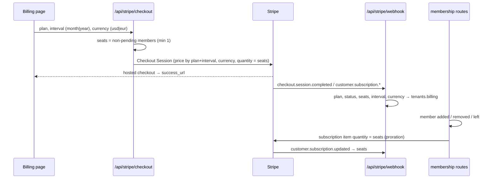
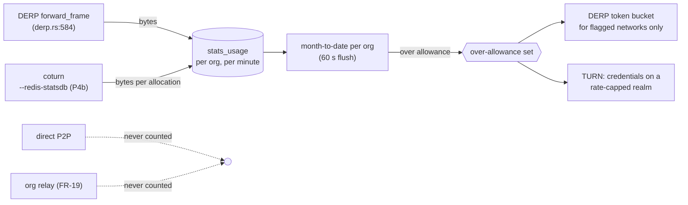

# FR-115 — Plans that give the network away and charge for what costs money

| | |
|---|---|
| **Issue** | [#2557](https://github.com/gjovanov/roomler-ai/issues/2557) |
| **Status** | in progress — P0 and P0-ops done 2026-10-19; P1+P2 implemented, merge held for the 0.4.146 release freeze |
| **Arc** | P3 of the pricing sequence in [`../business-model.md`](../business-model.md) §5 (enforce → meter → **reshape** → keys) |
| **Related** | [FR-32](FR-32-plan-limit-enforcement.md) (the one decision point), [FR-20](FR-20-per-tenant-relay-cost-metering.md) (the ledger), [FR-19](FR-19-peer-relays.md) (org relays), [FR-52](FR-52-cross-org-remote-access.md) (support sessions to other orgs), [FR-102](FR-102-growth-observability.md) (revenue view) |
| **Private annex** | `roomler-ai-docs/gtm/pricing/FR-115-annex-census-2026-10-19.md` — per-org census, account counts, competitor detail |

## Goal

Make the Free plan at least as generous as Tailscale's free plan on the things that cost us
nothing (devices, direct traffic, mesh features, chat), allow commercial use on it outright,
and put the limits on what actually costs money or grows with the customer: **concurrent
remote-desktop sessions**, **relayed bytes**, **meeting time**, and **seats**. Bill paid
plans **per seat**, monthly or annually (two months free), in **USD or EUR**.

## Root cause and evidence

`business-model.md` deferred the reshape until FR-20 had metered a month. It has metered seven
weeks. What the meter and the code show (aggregates; the per-org census is in the annex):

### 1. Almost nothing scales with usage, and devices cost nothing at all

| Cost driver | Measured, whole fleet, 30 days to 2026-10-19 | At `config/relay-costs.toml` prices |
|---|---|---|
| Direct P2P (remote desktop, mesh) | 373 session-hours; 94 % of sessions with a recorded carrier went direct | €0 by construction |
| DERP (`derp_bytes`, attributed per org) | ≈ 30 GB (79 GB since 2026-08-30); median day 0.3 GB, max day 15 GB | ≈ €0.30 |
| coturn TURN (fleet total only) | ≤ ≈ 950 GB egress on the central coturn hosts; 41 allocations on average, 307 at peak | ≤ ≈ €9.50 |
| SFU | 0.03 participant-hours since 2026-08-30 | ≈ €0 |

⚠️ The TURN figure is an **upper bound**: the `eu-central` stats region polls the coturn
workers' host NIC (`crates/core/src/relay_load.rs:28`), which also carries whatever else those
hosts serve. It is still the largest relay figure, and it is **the one relay cost no org can
be charged for today** — FR-20 decided not to build per-tenant TURN attribution
([FR-20](FR-20-per-tenant-relay-cost-metering.md) P3, "reopen when a tenant's TURN volume
becomes material"). A relay allowance makes it material by definition.

Concurrency, from the two busiest orgs: peaks of **4** and **3** simultaneous remote sessions;
p90 session length 7 minutes.

### 2. The tiers as shipped contradict themselves

| Surface | Says |
|---|---|
| Landing page, docs home | "$8 /user/mo" (`ui/src/views/LandingView.vue:130`, `ui/docs/theme/home-layout.ts:72`) |
| In-app billing page | "$8 /mo" (`ui/src/views/billing/BillingView.vue:62`) |
| Stripe checkout | `quantity = 1` — one unit per org (`crates/services/src/stripe.rs:202`) |
| MRR estimate | price × member count (`crates/api/src/routes/cost.rs:68`) |
| `Plan::Pro` | unlimited members (`crates/db/src/models/tenant.rs:441`) |

A 20-person team is quoted $160 and billed $8.

### 3. The one limit a new Free org hits is the one that should not exist

Only `max_devices` and `max_tunnel_clients` are **established** — enforced whatever the org's
`plan_enforcement` mode (`crates/services/src/quota.rs:71`). Every other gate runs in `Warn` for
an org created after 2026-08-30, by standing decision (`crates/db/src/models/tenant.rs:58`), so
for a new signup MagicDNS and exit nodes already pass. The advertised "1 concurrent session"
(Free) and "5" (Pro) are enforced **nowhere**: FR-32 withheld the gate because nothing wrote
`remote_sessions` (`crates/services/src/dao/remote_session.rs:52`). That table is written now —
projected from the audit stream (`crates/remote_control/src/audit.rs:3`) — but it is
best-effort: three rows have shown "open" for up to 25 days. **A gate must not count it.**

So the effective Free tier is the inverse of the intended one: devices capped at 3,
concurrency unlimited.

### 4. The market

From the vendors' own pricing pages, 2026-10-19 (detail and URLs in the annex):

| | Free | Paid entry | Limits on |
|---|---|---|---|
| Tailscale | 6 users, unlimited user devices + 50 servers, MagicDNS, exit nodes, SSO, peer relays; **non-commercial** | $8 / seat (Standard), $18 (Premium) | seats |
| NetBird | 5 users, 100 machines, commercial OK | €6 / active user | users + machines |
| TeamViewer | personal use only, commercial-use detection | €13.90/mo: 1 user, **1 channel**, 3 devices; extra channel €43.90 | concurrent channels |
| AnyDesk | personal use only | €24.90/mo: 1 connection, 100 devices; extra connection €37.90 | concurrent connections |
| Zoom / Teams / Meet | group meetings 40 / 60 / 60 min | $14–17 / $4 / $7 per user | users; free fenced by meeting length |

Mesh vendors give devices away and charge per seat; remote-desktop vendors charge per
concurrent session; meeting vendors fence free by meeting length; nobody meters relay
bandwidth on a price list (Tailscale lowers DERP quality instead).

## Decisions (operator, 2026-10-19)

| # | Decision |
|---|---|
| D1 | **Per seat.** A seat is a non-pending member of the org; the Stripe subscription quantity is the seat count and follows membership changes with proration. |
| D2 | **Free keeps 10 users, and the cap is enforced** — established, so `plan_enforcement` cannot switch it off. Paid plans have no user cap; every user is a billed seat. |
| D3 | **Commercial use is allowed on Free**, and said so plainly on the landing, pricing and billing pages and in the announcement. The fence is objective — one concurrent session, no support sessions to other orgs — never "personal use" detection. |
| D4 | **Over the relay allowance: throttle, never refuse.** Supersedes `business-model.md` §6 rule 4 ("relayed connections refused"): for a host behind symmetric NAT or a full-tunnel VPN the relay is the only path, so refusing it means the product stops working. Direct traffic and org-relay traffic are never counted. |
| D5 | **Annual billing at two months free** (annual = 10 × monthly), and **EUR prices** beside USD. |
| D6 | **Clean up the orphaned orgs** (owner account gone, test debris from 2026-02). |
| D7 | **Tell the users** — one email, sent once the new plans are live, saying only what is live. |

## Key design

### The ladder

| | **Free** | **Pro** | **Business** | **Enterprise** |
|---|---|---|---|---|
| Price | 0 — commercial use allowed | $8 / €8 per seat per month; $80 / €80 per seat per year | $16 / €16 per seat per month; $160 / €160 per seat per year | custom |
| Users | **10, enforced** | per seat | per seat | per seat |
| Devices · tunnel clients | **100 · 100** (was 3 · 3) | 1,000 · 1,000 (was 30) | 5,000 · 5,000 (was 300) | custom |
| MagicDNS | **yes** (was Pro) | yes | yes | yes |
| Exit nodes | **yes, from P4d** (after the throttle exists) | yes | yes | yes |
| Concurrent remote sessions | **1 per org, enforced** | 1 per seat | unlimited (fair use) | unlimited |
| Support sessions to other orgs (FR-52) | — | yes | yes | yes |
| Relay (DERP + TURN) at full speed | 10 GB / month, then throttled | 25 GB per seat, pooled | 100 GB per seat, pooled | custom |
| Own relays (FR-19) | unmetered | unmetered | unmetered | unmetered |
| Meetings | 10 people, 60 minutes | 50 people | 100 people, recordings | custom |
| Storage | 1 GB | 10 GB per seat | 50 GB per seat | custom |
| Channels, history | unlimited | unlimited | unlimited | unlimited |

Plan ids stay `free` / `pro` / `business`: they are stored in tenant documents and matched in
the webhook, so renaming one is a migration (`crates/services/src/stripe.rs:337`).

### Limits become a function of plan **and** seats

`Plan::limits()` (`crates/db/src/models/tenant.rs:411`) is a pure function of the plan, and
`quota::evaluate` takes only the plan (`crates/services/src/quota.rs:258`). Per-seat
allowances (concurrency, relay, storage) need the billed seat count, so the tenant's
`BillingInfo` gains `seats` (the subscription quantity, written by the webhook) and the
limits are computed from `(plan, seats)`. Free has no seats; a paid org whose webhook has not
landed yet is computed at one seat, the floor, so a missing number can only under-grant.

### Per-seat checkout and the quantity sync

Prices are configured per (plan, interval) — `price_pro`, `price_business` (monthly, live
since 2026-07-27) plus `price_pro_annual`, `price_business_annual` — each a Stripe Price with a
USD amount and an EUR `currency_options` entry, so one id serves both currencies and checkout
names the currency. An absent annual id hides the annual option rather than failing checkout,
the same contract as an empty monthly id today (`crates/services/src/stripe.rs:141`).

### The concurrency fence

Counted **in the hub**, at session start, after the authz gate and the FR-101 ceiling
(`crates/modules/remote/src/controller.rs:80`) — never from `remote_sessions`. The count is
the controller's org's live sessions; a session to another org's device (FR-52) counts against
the **controller's** org, which may live on the other pod, so the count is kept in Redis as
leases that expire with the session rather than read from one pod's `DashMap`. Refused with a
message naming the session that holds the slot (device and person) so the person can end it;
a live session is **never** ended by the fence (`business-model.md` §6 rule 4). Established,
like the device cap: no org is over it today.

**As built (P3).** The authz gate reads the cap from the device's org
(`org_session_cap_of`, `crates/modules/remote/src/controller.rs:605`) and hands it to the hub
in `DispatchCtx`, and in the body of a request relayed to the pod that owns the device. The
hub counts that org's live sessions after its coalesce, so a re-asked session is not a
second one (`crates/modules/fleet/src/hub.rs:1524`). Tenant affinity puts an org's devices
and its controllers on one pod, so that pod's count is the org's. Redis leases are needed
only for the one case affinity cannot place: a session to **another** org's device, which
must count against the controller's org. That is **P3b**; until it lands, a cross-org session
counts against the device's org, and an outsider's session (FR-52's extauth path) opens
uncapped. A refusal is `org_session_limit`
(`crates/remote_control/src/error.rs:41`), which the viewer does not retry
(`ui/src/composables/useRemoteControl.ts:716`). It names the person and the device holding
the slot, and a Pro org at its cap (one per billed seat) is told the way past it is a
session ending or Business. Kill switch `rc.org_session_cap = false`.

### The relay allowance

- DERP already meters per network on the forward path
  (`crates/modules/network/src/derp.rs:683`). The throttle adds **one** set lookup on that
  path, consulted only for networks the 60 s flush flagged; the path must stay within FR-18's
  budget, measured with the same bench FR-20 used (`derp.rs:704`).
- TURN attribution is FR-20's deferred P3, taken up with the option FR-20 already chose
  (`--redis-statsdb`; the username is `<expiry>:<id>`, `crates/remote_control/src/turn_creds.rs:6`).
- Throttled, never refused (D4). The tenant analytics page shows usage against the allowance in
  units, never money (FR-20's decision stands).

### Meetings

Free meetings end at 60 minutes with a warning at 55; the participant caps become
established. The SFU's unit cost (`sfu_participant_hour = 0.004` in `relay-costs.toml`) has
never been checked against a real call; P5 measures it from `stats_call_user` before any
number is advertised beyond what the current single-worker room is known to carry.

## Phases

| Phase | What | Kill switch | Status |
|---|---|---|---|
| P0 | Spec, registry row, issue | — | ✅ #2560 (`8dcb27a32`) |
| P0-ops | Tombstone the orphaned orgs (owner account gone), with an export first | restore from the export | ✅ 2026-10-19 21:32Z — 62 of 62, backup verified first |
| P1 | The ladder: `Plan::limits_for(seats)`, Free = 10 users established + 100 devices + MagicDNS, unlimited chat; plan copy, commercial-use message on landing / docs / billing; snapshot tests | revert (data only) | 🟡 implemented, in review |
| P2 | Per-seat Stripe: quantity at checkout, annual + EUR prices, quantity sync with proration, webhook stores seats/interval/currency/plan, plan change on the live subscription, summary route; integration tests against a recording fake Stripe; then Stripe **test mode** and an e2e checkout with a test card | `stripe.seat_sync = false`; absent annual ids hide annual | 🟡 implemented against the fake; test-mode run waits for test keys |
| P3 | Concurrency fence: counted by the device's hub, established, start-only, names the holder | `rc.org_session_cap = false` | 🟡 in review (#2571) |
| P3b | A cross-org session counts against the controller's org (Redis leases); Free gets no support sessions to other orgs | `rc.org_session_cap = false` | ⬜ |
| P4a | Relay allowance on DERP: month-to-date, over-allowance set, token bucket, analytics quota slot | `relay_allowance.enabled = false` | ⬜ |
| P4b | Per-org TURN attribution (`--redis-statsdb` → `turn_bytes`) | coturn flag off | ⬜ |
| P4c | TURN throttle for over-allowance orgs | `relay_allowance.turn = false` | ⬜ |
| P4d | Exit nodes on Free | revert (data only) | ⬜ |
| P5 | Meetings: Free 60-minute cap, established participant caps, measured SFU cost | `meetings.free_cap = false` | ⬜ |
| P6 | Announcement email to real users, once P1 + P2 are live | — | ⬜ |
| P7 | **Docs**: `business-model.md` (§4 ladder, §6 rule 4, §7), `compare/vs-tailscale.md`, a plans-and-limits page, with diagrams, linked from `docs/README.md` | — | ⬜ |

## Acceptance criteria

- [ ] AC1 — A new Free org enrolls its 100th device and is refused the 101st with the plan message (prod).
- [ ] AC2 — A Free org's 11th member is refused, with `plan_enforcement` set to `warn` **and** to `off` (prod).
- [ ] AC3 — Checkout in Stripe test mode, monthly and annual, USD and EUR, charges quantity = seats, and the webhook stores plan, seats, interval and currency (integration test against test mode **and** an e2e checkout with a test card).
- [ ] AC4 — Adding and removing a member of a paid org changes the subscription quantity with a proration (integration test against test mode).
- [ ] AC5 — Landing page, docs home and billing page show the same per-seat prices, the annual price and EUR, and say Free allows commercial use (e2e).
- [ ] AC6 — A Free org's second concurrent remote session is refused at start with a message naming the session holding the slot, and the first session is untouched (prod, two browsers). A cross-org session counts against the controller's org.
- [ ] AC7 — A Free org over its relay allowance still connects over DERP at the throttled rate; a direct transfer and an org-relay transfer add **zero** relay bytes (unit, falsifiable as FR-20's; prod).
- [ ] AC8 — `turn_bytes` is populated per org from coturn (prod).
- [ ] AC9 — A Free meeting is warned at 55 and ended at 60 minutes (prod).
- [ ] AC10 — The orphaned orgs are tombstoned from an export, and no per-org view counts them (prod).
- [ ] AC11 — The announcement reached every real user and no internal or test account (send log).
- [ ] AC12 — Docs updated or created in the house style with diagrams, and linked from `docs/README.md`'s index.

## Open decisions

| # | Question | Default until answered |
|---|---|---|
| O1 | Live Stripe prices: create the annual Prices and the EUR currency options in the live account | operator; test mode carries everything until then |
| O2 | Do pending invites count toward Free's 10? | no — a seat is a member who accepted |
| O3 | Throttled rate for an over-allowance org | 1 Mbps per org on Free, 4 Mbps on paid plans, measured before it ships |

## Out of scope

SSO / SCIM (not built), mobile clients, offline licence keys for self-hosted Enterprise
(`business-model.md` §5 P4), right-sizing the regional PoP fleet (`business-model.md` §7
decision 5), and any limit on a self-hosted server — self-hosting stays free and unlimited.

## Field-verification log

| Date | What | Result |
|---|---|---|
| 2026-10-19 | Read-only prod census (ledger, sessions, relay stats, memberships) | the numbers in *Root cause*; per-org detail in the annex. ⚠️ A first pass summed BSON `Long`s with JS `+`, which concatenates: the fleet DERP total read 1.03e34 GB while every per-row figure was right. Re-run with `Number()` conversion and checked against the weekly sums |
| 2026-10-19 | P0-ops — the orphaned orgs | Selection: a missing owner account, outside the exclusion set, no live member, and no devices, overlay, messages or files: **62**, all created 2026-02. Exported with their 100 memberships, 62 rooms, 83 room members and 310 roles to a private backup on the ops host, and the file checked before any write. Recomputed at write time and matched the backup (62 = 62); `deleted_at` + `is_archived` set on 62 of 62. Live orgs went from 77 to 15 |
| 2026-10-19 | Found while building P2 | Two live billing bugs beyond the ones in *Root cause*. (1) A Pro org's "Switch to Business" ran a **second checkout**, which starts a second subscription: two bills. (2) `customer.subscription.updated` wrote only the status, so a plan changed in Stripe's portal **never reached the org**. Both fixed in P2: a live subscription refuses checkout (409) and changes go through `change-plan`; the webhook maps the price to the plan. No org's billing record shows a second subscription |
