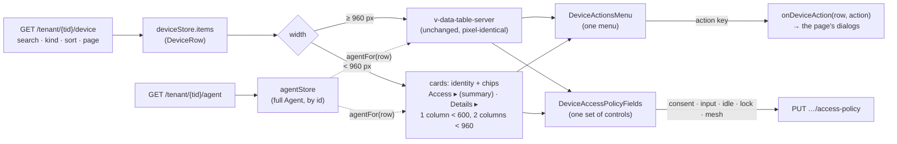

# FR-116: Phone and tablet parity — the same facts and actions at 360 px as on desktop, details on demand

**Issue:** [#2561](https://github.com/gjovanov/roomler-ai/issues/2561) · **Status:** every phase merged and on production —
P1–P8 since 2026-10-20 09:33Z (`hosted-20261020-9776afb`), D1 (#2599) and the D6 smoke (#2601) since 13:53Z, P3d (#2607)
since 14:39Z (`hosted-20261020-3fbc5ad`), P6c (#2652) and the pin fix #2653 since 2026-10-21 13:18Z
(`hosted-20261021-f72df08`); AC1–AC3, AC5, AC6 and AC9 field-verified there (§8); open: AC4's last item (the agent's
message author, FR-90's), AC7 and AC8, which need a real phone (the operator) · **Owner:** the web app (UI); P6 touches three server payloads ·
**Anchors:** master `bfcb2349b` · **Builds on:** [FR-12](FR-12-onboarding-tutorial.md) (the tour anchors),
[FR-103](FR-103-device-credentials-renew-themselves.md) and [FR-106](FR-106-devices-say-when-not-updating.md) (the
"needs a person" chips), [FR-111](FR-111-touch-controls.md) (touch control of the viewer, left as it is)

## 1. Goal

Every page of the web app works on a phone (360–430 px) and on a portrait tablet:

- **the same facts and the same actions as on desktop** — nothing is named differently, and nothing is missing,
  because of the screen's width;
- **no sideways scroll of the page** — a wide table may scroll inside its own box, the page never does;
- **details on demand** — policy controls, technical facts and long help text sit behind an expansion panel, a
  menu or a dialog instead of being open on every row.

The operator's report, 2026-10-19: the Devices page on a phone *"displays too much info (e.g. all DDLs and
checkboxes visible — should be in expansion panel), has few inconsistencies with large screen (like real device
name instead of display name)"*, and every page should be checked the same way.

## 2. Evidence

### 2.1 Production, the Devices page at 390 px (2026-10-19, read-only)

Rendered in the operator's own browser, in a 390 px frame of the same origin, so the page computed its phone layout
from real data:

| what | measured |
|---|---|
| cards | 22, each **481–521 px** tall: four selects and two checkboxes open on every card |
| page height | **11,895 px** of scrolling for 22 devices |
| names | 16 of the 22 devices carry a display name; the phone card showed the **machine name for all 16**, where the desktop grid shows the display name |
| menu | no "Edit name & tags"; "Overlay routes" and "Overlay ACL" pointed at **`/tenant//network/…`** — the tenant id lost (`AgentsSection.vue:1032`, `:1037`, since #738) |
| finding a device | no search, no kind filter, no paging: every device, in one list |
| tunnel clients | a separate 7-column `v-table` below the cards; its title row overflows the card and the table scrolls sideways |
| "Update all" | `d-none d-sm-inline-flex` (`AgentsSection.vue:13`) with no phone fallback, against `docs/ui.md`'s own rule |
| "needs a person" | the credential chip (FR-103), the ephemeral chip (FR-51) and the permission warnings were missing from the card, though `docs/ui.md` says the cards show them |
| deep link | the dashboard's Tunnels tile (`/devices?type=tunnel`) filtered only the desktop grid |
| tour | the Devices tour's steps 2 and 3 (`device-search`, `device-grid`) point at desktop-only anchors, so on a phone the tour shows 1 of 3, then ends and is marked seen |

At 820 px (a portrait tablet) the same one-column cards stretched every select to 800 px.

### 2.2 Every page: a 4 px sideways scroll

The house padding is `pa-2` (8 px) on phones (`docs/ui.md` § Responsive page padding), and a default `v-row` pulls
12 px past it on each side. `v-main` scrolls (`AppLayout.vue:1227-1233`, `overflow-y: auto`), so it also scrolls
**sideways by 4 px** on every page that has a row: measured on the tenant dashboard, the org list, Billing and
Observability, and on the sign-in pages.

### 2.3 Six read-only audits

Six code audits, one per area, read every view and component and checked their claims with renders at 360–430 px
(Vuetify 3.13, headless Chromium, and the operator's browser for §2.1). About 120 findings; the ones this FR
commits to are in §4, by phase. The patterns behind most of them:

| pattern | effect | where (examples) |
|---|---|---|
| a phone branch and a desktop branch of the same thing | they drift: different names, different actions | the Devices cards (§2.1); the room chat rendered three ways (`ChatView.vue:61-71`, `:125-133`, `ConferenceView.vue:133-156`) |
| `v-card-title` / `v-card-subtitle` / `v-chip` never wrap | a title row pushes its own buttons off-screen | Overlay ACL's **New rule** clipped below 800 px (`OverlayAclSection.vue:5-33`); dialog titles push Close away (`DeviceConsoleDialog.vue:6-11`) |
| a `d-flex` row of fields without `flex-wrap` | fields shrink to nothing | the Tunnel ACL host field renders **0 px** wide (`TunnelPoliciesSection.vue:289-345`) |
| a horizontal `v-btn-toggle` in a narrow row | it scrolls inside itself, hiding options | ManagedSwitch hides **On** (`ManagedSwitch.vue:4-20`); Enrollment hides **This user only** (`EnrollmentDialog.vue:49-60`) |
| hover-only facts and actions | nothing on a touch screen; invisible buttons that still take taps | message actions (`MessageBubble.vue:30-58`, `:309-316`: a tap can **pin a message for the whole room**); video tiles (`VideoTile.vue:73-111`) |
| wide tables with no phone layout | the action column is off-screen | Members, Invites, Files, audit lists, ACL rules, Overlay routes (its **Save** is ~300 px off-screen) |
| three meanings of "mobile" | branches disagree between 600 and 1280 px | Vuetify's `mobile` is &lt; 1280 px (no `mobileBreakpoint` in `plugins/vuetify.ts`); the Devices page used &lt; 960; `docs/ui.md`'s rule uses &lt; 600 |
| the machine name where a person expects the display name | the same device is named two ways | audit pages, Overlay ACL and routes (a lossy DNS label), Tunnel ACL (id prefixes), analytics' uptime strip, usage, hive — three of these because the **server** sends only `name` |

## 3. Design

### 3.1 The rules (they go into `docs/ui.md`)

1. **One source per concept, at every width.** A phone layout renders the same data, through the same menu and the
   same controls, as the desktop layout. Two copies of a menu are a defect waiting to happen (§2.1).
2. **Details on demand.** A card or row shows identity, state and what needs a person; settings and technical
   facts open in an expansion panel whose title summarises what is inside, so a closed card still answers "how is
   this set?".
3. **A device is named by `deviceLabel()`** (`display_name || name`) wherever a person reads it; the technical
   `name` only where a machine reads it back (MagicDNS, `overlay_exit_node = "…"`, a CLI selector).
4. **The page never scrolls sideways**; a wide table scrolls in its own box, and has a phone layout when its
   actions would be off-screen.
5. **Breakpoint vocabulary:** `xs` (&lt; 600) for phone-only presentation and full-screen dialogs; `smAndDown`
   (&lt; 960) for card layouts; Vuetify's `mobile` (&lt; 1280) only for the navigation drawer.
6. **No hover-only information**: a fact in `title=` also has a tap path (a caption, `open-on-click`, a menu).

### 3.2 P1 — the Devices page

| piece | what |
|---|---|
| `components/admin/DeviceActionsMenu.vue` (new) | the one action menu: emits an action key, never opens a dialog itself; links carry the tenant id |
| `components/admin/DeviceAccessPolicyFields.vue` (new) | the six access-policy controls: `plain` in the grid cell, `outlined` and labelled in the card, with the `title=` hints spelled out on demand for touch |
| `components/admin/devicePolicy.ts` (new) | the choices and hints (moved, byte-identical), and `policySummary()`: the consent mode always, then only what differs from the defaults |
| `composables/useHideDeviceName.ts` | `deviceLabel()`, beside `secondaryDeviceName()` |
| `components/admin/AgentsSection.vue` | one toolbar (search, kind, count) at every width; below 960 px the same rows as cards with Access and Details panels, every "needs a person" chip, tags, a pager; the tunnel-clients table removed (tunnels are rows of the same feed); "Update all" icon-only below 600 px; the tour's anchors on the cards too; every dialog and notice names the device by `deviceLabel()` |

The desktop grid is untouched: screenshots of master and P1 at 1300 and 2400 px differ in **0 pixels** (§8).

### 3.3 Later phases — what each commits to

The high and medium findings, by phase; anchors at `bfcb2349b`. Each phase lists its own low findings in its PR.

**P2 — the shell**

| finding | where | fix |
|---|---|---|
| the page scrolls sideways by 4 px (§2.2) | `AppLayout.vue:1227-1233` | `overflow-x: hidden` on `v-main`; `v-row dense` where a page needs edge-to-edge |
| app bar overflow: with the unread and call buttons up, the avatar menu — and **Logout** — go off-screen | `AppLayout.vue:431-540` | a phone budget: `?` and the theme toggle into the avatar menu below 600 px, the text buttons icon-only with a badge |
| a page opens at the previous page's scroll offset (`v-main` is the scroller, nothing resets it) | `AppLayout.vue:563-567` | reset on path change |
| a running call leaves no visible controls once you leave its page | `AppLayout.vue:406-420`, `:703-707` | an in-call control in the app bar on phones (D5) |
| other-org activity and the current org's name are drawer-only | `AppLayout.vue:57-65` | a dot on the nav icon |
| dialogs never go full screen on a phone | 20+ dialogs | a `useResponsiveDialog()` (`fullscreen` on `xs`), with a toolbar close |
| rail state from a wide window leaks into the phone drawer | `AppLayout.vue:49`, `:176`, `:271`, `:412` | `railActive = !mobile && rail` |

**P3 — admin, network, audit, and the device dialogs**

| finding | where | fix |
|---|---|---|
| Overlay ACL: **New rule** and Refresh clipped off the card title below 800 px — no rule can be created on a phone | `OverlayAclSection.vue:5-33` | a wrapping title, the caption as a `v-card-subtitle text-wrap` |
| Tunnel ACL editor: the host field is 0 px, the match and proto selects show nothing | `TunnelPoliciesSection.vue:289-345` | `flex-wrap` rows, as the Overlay editor already has |
| ManagedSwitch hides **On**, so On and Leave alone look the same | `ManagedSwitch.vue:4-20` | wrap, `flex-shrink-0` on the toggle |
| Overlay routes: **Save** and the exit-node switch off-screen | `OverlaySubnetRoutesSection.vue:62-163` | a card per node below 600 px |
| ACL rules, audit lists, Members, Invites, Files, enroll keys: the action column off-screen | the six tables | `mobile-breakpoint` or cards with a kebab menu |
| devices named by machine name, DNS label or id prefix | `ExecAuditSection.vue:127-141`, `SshAuditSection.vue:128-142`, `SshActivitySection.vue:142-150`, `OverlayAclSection.vue:425-430`, `OverlaySubnetRoutesSection.vue:76`, `TunnelPoliciesSection.vue:184-254`, `:683-698` | `deviceLabel()` through the wire's FKs |
| device console: the root/SYSTEM warning is one clipped line (desktop too) | `DeviceConsoleDialog.vue:19-33` | the alert out of `v-card-subtitle` |
| agent logs: each message 1–9 characters wide | `AgentLogsDialog.vue:102-114`, `:300-331` | the message on its own line below 600 px |
| Enrollment hides **This user only** | `EnrollmentDialog.vue:49-60` | a vertical toggle on `xs` |
| Settings is ~6 screens of alerts and an embedded history table | `SettingsSection.vue:4-400` | one expansion panel per gate on `xs` |
| Roles: what a role grants is hover-only; tapping a permission's label toggles it | `RolesSection.vue:86-93`, `:207-214` | grants as chips on tap; hints as `persistent-hint` |

**P4 — chat and conference**

| finding | where | fix |
|---|---|---|
| message actions are hover-only, and the invisible buttons still take taps (pin for the whole room) | `MessageBubble.vue:30-58`, `:309-316` | a ⋮ menu on touch; `pointer-events: none` while hidden |
| rich-text mode clips Send, attach, emoji and GIF off-screen | `MessageEditor.vue:12-141` | the formatting row scrolls on its own; Send stays outside it |
| the default composer has no Send button, and no line break on a soft keyboard | `MessageEditor.vue:129-140`, `:376-384` | Send in both modes |
| an agent-session transcript covers the room on a phone and cannot be closed | `ChatView.vue:111`, `:233`, `:526-537`; `HiveTranscript.vue:16-39` | a close button; closed by default below 960 px |
| the call's chat and files are fixed 320 px columns that squeeze or clip the video | `ConferenceView.vue:109-158`, `:671-677` | overlays below 960 px, one at a time |
| a screen share gets ~72 px of width on a phone (Auto picks the sidebar layout) | `useConferenceLayout.ts:92`, `SidebarLayout.vue:91-99` | spotlight on narrow containers |
| the mini-conference names people by a 6-character user-id prefix (desktop too) | `MiniConference.vue:45` | the participant's display name |
| a long URL or token makes the whole message list scroll sideways | `MessageBubble.vue:10`, `:77` | `overflow-wrap: anywhere` |
| screen share offered where the browser has no `getDisplayMedia` | `ConferenceView.vue:174-178` | hide it there |

**P5 — the remote viewer's chrome** (presentation only: no change to input, transport, consent or session logic)

| finding | where | fix |
|---|---|---|
| once a session starts, the toolbar's title gets 0 px (no device name), chips lose their text, and **Disconnect** and Fullscreen are off-screen | `RemoteControl.vue:15-864`, `:45` | on `xs`: name, status and Disconnect on row 1, tools on an extension row; the rarer tools in an overflow menu |
| stage alerts shrink to a 32 px strip beside the picture, at every width — and their coming and going resizes the frame, which re-sends `rc:resolution` | `RemoteControl.vue:892-954`, `:5162-5169` | the alerts as an overlay on the stage |
| the **Unverified** device-identity badge is hidden below 600 px | `RemoteControl.vue:69-80` | always shown when it warns (icon-only on `xs`) |
| the Settings **Session** tab is off-screen on a phone | `RemoteControl.vue:1506-1511` | `show-arrows` |
| the Metrics tab's live values never render (`hide-details` with `messages`) | `RemoteControl.vue:1691-1739` | `hide-details="auto"` |
| the files drawer has no tap path into a folder and no "upload here" | `RemoteControl.vue:2188-2194` | a chevron per folder; an upload button |

**P6 — observability, analytics, growth, hive**

| finding | where | fix |
|---|---|---|
| a sideways swipe on a wide table switches the tab | `GrowthView.vue:41`, `AnalyticsView.vue:31` | `:touch="false"` on the `v-window` |
| the org-timeline drawer cannot be closed on a phone | `GrowthView.vue:409` | a close button; full screen on `xs` |
| per-user usage: the timeline track is 36 px wide | `UsagePanel.vue:34`, `UsageTimeline.vue:215-270` | full screen on `xs`; stacked rows |
| devices named by machine name because the **server** sends only `name` | `crates/api/src/routes/stats.rs:592`, `:727`; `crates/api/src/routes/usage.rs:610-614`; hive's frozen `device_name` | send `display_name` (D4) |
| agent-session rows squeeze the title to ~40 px | `HiveSessionsView.vue:108-164` | the row's actions in a menu on `xs` |
| Growth's tabs and Analytics' 4th tab hidden without arrows | `GrowthView.vue:23-35`, `AnalyticsView.vue:24-29` | `show-arrows` |
| Growth's headline number hidden at 360 px | `GrowthView.vue:49-54` | the number into `v-card-text` |

**P7 — public pages and sign-in**

| finding | where | fix |
|---|---|---|
| iOS capitalises the username, and the server matches it exactly | `LoginView.vue:14-29`, `RegisterView.vue:22-42`; `crates/services/src/dao/user.rs:159-161` | `autocapitalize="none"`, `autocorrect="off"`, `autocomplete` |
| sign-in provider buttons are 28 px tall | `LoginView.vue:50-62` | full-width on `xs` |
| the landing nav has no phone menu | `LandingView.vue:12-21` | a menu below 600 px |

**P8 — docs and a guard**: `docs/ui.md` gets §3.1's rules with a diagram; and a phone-width smoke (the SPA against a
mocked API, at 360 and 390 px, every signed-in route): no page-level sideways scroll, and each page's primary
actions inside the viewport.

## 4. Phases

| Phase | What | Kill switch | Proven on | Size |
|---|---|---|---|---|
| **P1** — #2563 | the Devices page (§3.2) | revert the PR: UI only, no server or agent state, no stored preference changed | the operator's org at 390 px on production after a promote, red then green; the desktop grid pixel-identical | M |
| **P2** — #2567 | the shell (§3.3) | revert | a route sweep at 360/390 px | M |
| **P3** — P3a #2570 · P3b #2572 · P3c #2582 (a stack on #2567) | admin, network, audit, device dialogs | revert | the same sweep; the ACL editors and Overlay routes by hand | L |
| **P3d** — #2607 | the audit lists on a phone: compact cards, 20 at a time, a long command clamped until tapped; and the SSH audit's refusal that also read "granted" (P3a) | revert: UI only | the exec audit at 360 px with 100 rows: 47,997 → 4,822 px in the harness; production after a promote | S |
| **P4** — P4a #2574 (chat) · P4b #2580 (calls) | chat and conference | revert | a two-browser call with one at phone width | L |
| **P5** — #2577 · P5b #2588 (the files drawer; a stack on #2577) | the viewer's chrome | revert | an offline device's page for the idle chrome; a session from a real phone (the operator) | M |
| **P6** — P6a #2584 (UI) · P6b #2586 (D4, the server); hive's rows are FR-90's and stay open | observability, analytics, growth, hive + display names on the server | revert (the server fields are additive) | the sweep | L |
| **P6c** — #2652 | hive's session rows and dialogs name the device as the Devices page does (a UI join on `device_id`; the kept `device_name` only for a device the org no longer lists). The agent's message author, `Claude · <device_name>` (`crates/modules/hive/src/model.rs:640`), is stamped by the server and stays FR-90's | revert: UI only | the hive pages on production after a promote | S |
| **P7** — #2575 (sign-in) · P7b #2587 (the landing bar) | public pages, sign-in | revert | iOS Safari sign-in (the operator) | S |
| **P8** — docs: this PR, a stack on #2582; the smoke: open (§6) | docs + the phone-width smoke | — | CI | S |

Found by the audit and fixed outside the phases (every width): a deep link to an org named the org last picked in the browser instead of the URL's — #2566.

## 5. Acceptance criteria

- [x] **AC1**: Devices at 390 px on production names every device as the desktop grid does, collapses access and
  details by default, offers every desktop action, searches, filters by kind and pages; tunnel clients are cards;
  the desktop grid is unchanged. Red on production first (§8), then green after the promote. *(§8, 2026-10-20.)*
- [x] **AC2**: no page-level sideways scroll at 360 and 390 px on any signed-in route (measured per route).
  *(§8: the smoke's 17 routes at both widths, on production.)*
- [x] **AC3**: every page's primary actions are on-screen at 360 px without a sideways scroll (the list per page is
  the P8 smoke's). *(§8. The idle viewer's secondary break-glass button still reaches 361 px; #2601 shortens it.)*
- [ ] **AC4**: a device is named by its display name everywhere a person reads a device name: the Devices page and
  its dialogs, the audit pages, the overlay pages, the Tunnel ACL, analytics, usage, hive. *(§8: every surface
  but hive verified on production 2026-10-20. Hive's rows and dialogs: P6c. Still open: the agent's message
  author in a session room, `Claude · <device_name>`, which the server stamps (FR-90's).)*
- [x] **AC5**: complex dialogs are full screen on `xs` with their actions reachable. *(§8, 2026-10-20.)*
- [x] **AC6**: chat and calls on a phone: Send is always visible; message actions work by tap, and nothing invisible
  takes a tap; the transcript closes; a call leaves visible controls once you leave its page. *(§8, 2026-10-21: on
  production, P4's proof plan, a two-browser call with one at 360 px with touch; red first on Pin, fixed by #2653.)*
- [ ] **AC7**: the remote viewer on a phone: a connected session at 360 px shows the device name, its status and
  Disconnect; the Unverified badge shows; every settings tab is reachable.
- [ ] **AC8**: sign-in from iOS does not capitalise the username.
- [x] **AC9**: Docs: `docs/ui.md` states §3.1's rules with a diagram, and the `docs/README.md` index row covers them.
  *(P8 #2589: `docs/ui.md` § Phones and tablets — the breakpoint diagram, the rules table, the list decision.)*

## 6. Open decisions

| | decision | recommendation |
|---|---|---|
| **D1** | the desktop grid's Consent column keeps all six controls open, so a row is ~210 px tall — collapse it to the same summary plus an expandable row? | yes, as **P1b**, once the operator has seen P1 on a phone; it reuses `DeviceAccessPolicyFields` |
| **D2** | the breakpoint vocabulary | §3.1 rule 5; do **not** change Vuetify's global `mobileBreakpoint`, which would move the drawer and the viewer at 960–1279 px |
| **D3** | the built-in touch presets put buttons above a short landscape stage (`touchControls.ts:165-205`) | a product call: moving them changes them for every user |
| **D4** | display names in the stats, usage and hive payloads | yes, in P6: additive fields, the `AgentDao::label()` rule |
| **D5** | the in-call controls on a phone | an app-bar button opening Return · Mute · Camera · Hang up |
| **D6** | P8's phone-width smoke as a CI lane: the SPA from a build, every `/api` answered by fixtures, Playwright at 360 and 390 px over each signed-in route — no page-level sideways scroll, each page's primary actions inside the viewport. It is the harness every FR-116 PR was checked with, made a gate | yes, as its own PR: it adds a Playwright browser install to a UI lane, which is the operator's call on CI cost |

## 7. Out of scope

- Native apps; offline mode; a PWA install flow.
- Redesigning desktop layouts beyond parity (D1 is the one exception, and it is a decision).
- The viewer's input, transport, consent and session logic — P5 is presentation only.
- Server behaviour other than the three display-name fields (D4).

## 8. Field-verification log

| date | build | host | result |
|---|---|---|---|
| 2026-10-19 21:14Z | production (the image live that evening) | the operator's org, Devices, in a 390 px frame of the same origin in the operator's browser (DOM read + screenshots; no control touched) | 🔴 **RED (AC1).** 22 cards of 481–521 px, 11,895 px tall; 16 of 16 display-named devices shown by machine name; no Edit name & tags; `/tenant//network/…` links; a 7-column tunnel table scrolling sideways; no search |
| 2026-10-19 21:20Z | the same | tenant dashboard, org list, Billing, Observability at 390 px | 🔴 **RED (AC2).** `v-main` `scrollWidth − clientWidth` = 4 on each |
| 2026-10-19 23:30Z | P1 in the local harness (the SPA from `vite dev`, every `/api` call answered by synthetic devices) | 390 × 844, 820 × 1100, 1300 × 900, 2400 × 1000 | 🟢 P1 locally: 7 cards in 2,015 px (a card ~260 px, Access and Details closed); display names; the full menu with Edit name & tags; `?type=tunnel` lands on tunnel cards; two columns at 820 px. **Desktop: 0 differing pixels** against master at 1300 and 2400 px |
| 2026-10-20 09:13–09:20Z | production, `hosted-20261019-e46da07` (the image before FR-116's promote) | the operator's org: the P8 smoke's routes except chat and call, at 390 and 360 px (instrument below) | 🔴 **RED (AC2, AC3).** `.v-main` scrolls 4 px sideways on `/`, the dashboard and Observability at both widths; Overlay ACL's **Refresh** and **New rule** at 524–756 px; Devices 11,839 px tall at 390 px; at 360 px the idle viewer's **Force control (admin break-glass)** reaches 361 px |
| 2026-10-20 09:32Z | promote of `hosted-20261020-9776afb`: 44 commits, every FR-116 phase among them | the fleet | pods on the image at 09:33Z, 0 restarts; 21 of 32 devices online across 4 orgs, the operator's 15 of 22 as before the roll; `roomler exec` answered from 6 devices (Linux, and Windows on direct and on DERP); a tunnel forward 200 in 0.44 s |
| 2026-10-20 09:47Z | the same | the same frames | ⚠️ **The browser kept the previous build.** Every route still drew the old entry script from cache (`transferSize 0`) while the network served the new one, and the old one was a 404 on the new pods. The SPA shell (`location /`) carried no `Cache-Control`. Not FR-116's: fixed by #2605. The runs below add a unique query to every route and record each frame's entry script |
| 2026-10-20 09:50–10:10Z | production, `hosted-20261020-9776afb` (each frame's entry script checked) | the same routes, plus chat and call (a room with 0 unread and nobody in a call); dialogs; the API | 🟢 **GREEN (AC1, AC2, AC3, AC5).** **AC1:** 22 devices on 3 pages of cards 203–255 px (page 1 2,716 px); 22 of 22 named as the desktop grid names them; 16 of 16 display-named devices by their display name; Access and Details closed on every card; search on screen, the kind filter, paging; the full menu with Edit name & tags; Overlay routes and Overlay ACL at `/tenant/<id>/network/…`; `?type=tunnel` selects Tunnels and shows them as cards; two columns of 231 px at 820 px. **AC2:** 17 routes × 2 widths — the document 0, `.v-main` clipped. **AC3:** every route's primary action on screen at 360 px. **AC5:** Execution policy, SSH policy and Agent logs full screen at 390 px with their actions on screen; Edit name & tags a small dialog, whole |
| 2026-10-20 10:00Z | the same | desktop width (1300 px); the usage payload | 🟡 **AC4, but for hive.** Machine name / display name as a device's text: exec audit 0 / 54, SSH activity 0 / 28, analytics 0 / 16; Overlay routes name 2 of 2 by display name; the ACLs' only matches are free text (a rule's name, two policies' names), and no id prefixes are left; a person's usage over 30 days: 754 of 754 viewing and 1,970 of 1,970 tunnel windows on display-named devices carry `agent_display_name`. Hive's rows are FR-90's |
| 2026-10-20 | the same | — | **Open on production.** The idle viewer's break-glass button at 360 px (#2601). The exec audit list is **43,398 px** at 360 px — 100 rows as cards of ~424 px, a long command up to 1,936 px, no paging — against §3.1's detail-on-demand rule: a follow-up. Not run: AC6 (chat and a call from a phone), AC7 (a connected session from a phone), AC8 (iOS sign-in), all the operator's |

**The instrument (2026-10-20).** The operator's Chrome, signed in: a same-origin W × 844 frame of each route inside
`/icon-192.png`, a document with no CSP (the SPA's own `frame-src` refuses a frame of itself). Scrollbars are hidden
in the frame, as a phone's overlay scrollbars take no width, and each route settles 4.5 s after `.v-main` appears.
The off-screen rule is the D6 smoke's. `purestat_ignore` was set for the runs and restored afterwards, so no frame
counted as a visit. The viewer route is an offline device's idle page, which starts no session.

| date | build | host | result |
|---|---|---|---|
| 2026-10-20 13:53Z | promote of `hosted-20261020-d2eae7e` (by FR-115's session; carries D1 #2599 and D6 #2601) | — | — |
| 2026-10-20 14:17–14:18Z | production, `hosted-20261020-d2eae7e` (each frame's entry script checked) | the same instrument | 🟢 **D1** at 1300 px: 10 rows of 53–61 px (each ~210 px with every control open before D1), every Consent summary closed (`aria-expanded="false"`) and no select rendered; a click opens the six controls in place (4 selects, 2 checkboxes; the row 234 px) and a second click closes them. 🔴 **P3d before:** the exec audit 42,534 px at 360 px, 100 rows, no paging. 🔴 **#2605 before:** `/login` and a tenant deep link carry no `Cache-Control`, and a never-seen deep link loaded twice comes from cache the second time (`transferSize 0`) |
| 2026-10-20 14:37:35Z | promote of `hosted-20261020-3fbc5ad`: P3d #2607, the SPA-shell fix #2605, FR-90's server half (`74996c9c0`) | the fleet | pods ready by 14:39:24Z, 0 restarts; 20 of 32 online, the operator's 14 of 22 (the one fewer last seen 13:29Z, before the roll); `roomler exec` answered from 5 devices; a tunnel forward 200 in 0.50 s |
| 2026-10-20 14:40–14:45Z | production, `hosted-20261020-3fbc5ad` | the same instrument | 🟢 **P3d** at 360 px: the exec audit **5,264 px** (20 cards of 204–270 px; 9 long commands behind **Show all**), the SSH audit 4,376 px, SSH activity 5,476 px; **Show 20 more** reaches 40 on each; nothing off-screen. 🟢 **#2605:** `Cache-Control: no-cache` on `/login` and the deep link, and the second load of a never-seen deep link revalidates (`transferSize 300`, a 304). 🟢 **AC3's last red:** the idle viewer's break-glass button spans 99–261 px at 360 px (361 px this morning); the only elements past the edge are in the closed Remote files drawer |
| 2026-10-21 06:10–06:29Z | production, `hosted-20261020-5ffa1d8` | the vmtest org from mars (Playwright 1.62): a desktop context (1300 px) and a phone context (360 × 780, touch, mobile, `(hover: none)` true), the same test account in both (participants are keyed per connection); a throwaway room each run | 🔴 **AC6, Pin.** Send on screen, empty and with a long message; the hover row `display: none` (0 × 0); ⋮ on screen; a tap on the header's empty stretch pins nothing and opens nothing; the menu opens (React, Reply in thread, Edit, Pin, Delete); **Pin by tap does nothing**: the app logs `API error 415`. Since the first commit the UI's `togglePin` sent a bare PUT, and the server's `Json<{ pinned }>` refused it, so no message could be pinned at any width; fixed by #2653. Then 🟢 the call: the phone decodes the desktop's video; off the call page the bar's in-call menu is on screen (Return to call, Mute, Turn camera off, Hang up), Mute works by tap, and Return comes back to the live call. The first run's cleanup was cut by the test's own timeout, so its room was deleted by hand (HTTP 200, then 404); later runs set an action timeout |
| 2026-10-21 13:16:11Z | promote of `hosted-20261021-f72df08`: P6c #2652, the pin fix #2653 (with FR-118 P0, FR-97 P2g and FR-70 M3a.1/.2 from other sessions) | the fleet | pods ready by 13:18:25Z, 0 restarts; `roomler exec` answered from 5 devices; a tunnel forward 200 in 0.48 s |
| 2026-10-21 13:19Z | production, `hosted-20261021-f72df08` (the frames' entry script checked) | the same, plus one of the org's agent-session rooms | 🟢 **AC6.** Pin by tap (`is_pinned` true), then Unpin by tap (false); every check above again; **the transcript**, at 360 px: the toggle on screen, closed by default, opened by tap, its close button on screen (316–356 px), closed. 🟢 **AC4, hive rows (P6c):** 40 of 40 session rows name their device by the rule at 1300 and at 360 px; none of those 40 devices has a display name, so the display-name branch itself is proven by P6c's red/green unit tests. AC4 stays open on the agent's message author (FR-90's) |

## 9. Related

FR-12 (#788, the tour), FR-27 (the owner's consent shortcut the Access summary names), FR-51 (ephemeral devices),
FR-100 (#2092, the identity badge P5 makes visible on phones), FR-103 (#2134) and FR-106 (#2314) (the chips), FR-111
(#2359, touch control of the viewer).
