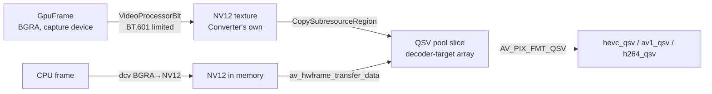
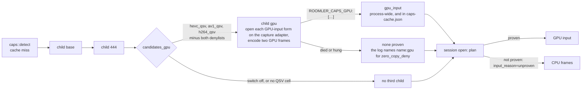
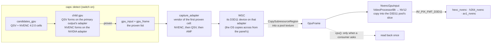

# FR-118: GPU-resident frames — a captured frame stays on the GPU until the encoder takes it

**Issue:** [#2669](https://github.com/gjovanov/roomler-ai/issues/2669) · **Status:** proposed 2026-10-21 —
spec and claim · **Owner:** the agent's capture and encode path · **Anchors:** master `c636c6e8c` ·
**Program:** [StarDesk teardown](../plans/stardesk-teardown-program.md), wave 2 ("zero-copy") ·
**Builds on:** [FR-70](FR-70-media-pipeline-leaves-the-runtime.md) (the encoder thread, M1),
[FR-77](FR-77-encoder-chroma-matrix.md) (cells and the probe), [FR-107](FR-107-drm-capture-throughput.md)
(the DRM arm's GPU path), [FR-16](FR-16-rc-quality-benchmark.md) / [FR-98](FR-98-input-to-photon-budget.md)
(L0 and L4) · **Unblocks:** [FR-119](FR-119-high-refresh-streaming.md) above 60 fps

## 1. Goal

On a host whose screen and hardware encoder share a GPU, a captured frame goes from the capture surface to
the encoder **without leaving the GPU**. Scaling and the BGRA → NV12 conversion happen on the GPU, and the
encoder takes the GPU surface. A frame is read back into CPU memory only when something that runs on the
CPU asks for it.

Today every hardware-encoded frame makes a round trip. The capture backend copies the GPU surface into
system memory, the pump converts it to NV12 on the CPU, and the encoder copies it back onto the GPU (§2).
StarDesk advertises a "Zero-Copy pipeline". The question for us is narrower and measurable: **how much of
each frame's time is that round trip, on the encoders the fleet actually runs?** The pump's heartbeat
cannot answer it yet (§3), so P0 measures before anything is built.

## 2. Evidence

### 2.1 Where the copies happen (master `c636c6e8c`)

| Step | Where | What it costs |
|---|---|---|
| WGC reads every arrived frame back, **inside `FrameArrived`**, before the latest-wins slot | `capture/wgc_backend.rs:610` → `copy_to_cpu` `:771` (`CopyResource` `:804`, then a synchronous `Map` and a row copy into a `Vec`) | A GPU → CPU copy plus a CPU stall per frame, including frames the slot then drops |
| WGC's D3D11 device is on the **default adapter** | `create_d3d11_device` `wgc_backend.rs:729`, `None` at `:740` ("defer until that's a real field issue") | Which GPU holds the frames is not decided by anyone |
| The SystemContext DXGI arm reads back too, and its device is bound to the adapter that **owns the output** | `system_context/dxgi_direct.rs:366` (`find_primary_output` `:1071`); `read_acquired` `:861`; its Phase B GPU scale still ends in a readback (`vp_blt_and_read` `:702`) | Desktop Duplication cannot cross adapters (`E_INVALIDARG`), so on that arm the capture adapter is fixed |
| `Frame` owns a `Vec<u8>` | `capture/mod.rs:85`, `data` at `:90`; `PixelFormat` is `Bgra`, `Nv12` or `I420` (`:281`) | The contract has no way to say "this frame is on the GPU" |
| The pump converts BGRA → NV12 (or I444) **on the CPU**, BT.601 limited range | `FfmpegEncoder::convert_into` `encode/ffmpeg/encoder.rs:1960` (dcv, in row bands on a persistent pool above 2 MP, straight into the frame since FR-119 P2b-11; it was `convert_bgra`, which then copied the planes in); the matrix is `encode/color.rs:16` | Per-pixel CPU work on every frame |
| …then copies the planes into an `AVFrame`, uploads it for the VAAPI / D3D12 / Vulkan encoders, and submits | `encode_sync` `encoder.rs:2375`; `HwKind` `encode/ffmpeg/hwframes.rs:50` (those three kinds only) | The VAAPI, D3D12 and Vulkan cells make the full GPU → CPU → GPU round trip in our code; NVENC, QSV and AMF do the upload inside `send_frame` |
| The portal arm copies twice | `capture/portal/pipewire.rs:806` (out of the PipeWire buffer), then the helper's stdout into the daemon (`capture/portal/wire.rs`, which argues for exactly this as a first version); a DmaBuf buffer is reported, never read | Two CPU copies, by design until a measurement says otherwise |
| macOS copies the `CGDisplayStream` surface into the `Vec` | `capture/scrap_backend.rs` (the vendored scrap's quartz arm) | One copy per frame |

### 2.2 What the fleet measures today (7 days to 2026-10-21, read-only)

From `agent_logs`: 142 538 FFmpeg DC pump heartbeats from 11 hosts, read-only, from mars. The "encode"
column is the pump's `avg_encode_ms` (`peer.rs:9542`): the time inside `encode_sync`, so **conversion,
copies, upload, submission and the packet drain together** (§3). The fps columns are the delivered rate
between consecutive heartbeats (spaced 2.0 s). The median sits at 16–17 fps on almost every host because an
idle desktop produces few frames, which is not a limit. So the table shows the top of the distribution, p99
and max, and how many windows reached 50 fps.

| Encoder | Encode geometry | Windows | Encode ms (median / p90) | fps p99 / max (60 targeted) | Windows ≥ 50 fps |
|---|---|---|---|---|---|
| `hevc_qsv` | 1366×768 | 21 378 | 7.6 / 7.9 | 35.9 / 60.4 | 73 |
| `hevc_qsv` | 1920×1080 | 96 013 | 10.6 / 11.2 | 19.0 / 60.1 | 14 |
| `av1_qsv` | 1920×1200 | 4 715 | 11.9 / 12.8 | 48.0 / 59.0 | 28 |
| `hevc_qsv` | **2880×1800** | 591 | **24.4 / 25.6** | **27.6 / 29.4** | **0** |
| `av1_nvenc` | 1920×1200, direct | 88 | 9.9 / 10.9 | 57.6 / 57.6 | 2 |
| `hevc_nvenc` | 1920×1200, direct, the same host | 136 | **21.7 / 24.7** | **26.8 / 31.8** | **0** |
| `av1_nvenc` | 2560×1600 | 513 | 16.4 / 17.8 | 54.3 / 58.3 | 21 |
| `hevc_videotoolbox` | 3024×1964 | 803 | 6.3 / 6.6 | 54.6 / 55.1 | 645 of 794 |
| `hevc_vaapi` | 1600×900, a virtual desktop | 105 | 4.2 / 4.8 | 40.3 / 41.1 | 0 |

> [!IMPORTANT]
> **The 2880×1800 `hevc_qsv` laptop never reached 30 fps** in 590 windows, against a 60 fps target. At
> 1080p the QSV encode stage already takes **10.6 ms**: 64 % of a 60 fps frame period, and more than a whole
> 120 fps period (8.3 ms). At the measured cost, the CPU path cannot carry 120 fps at 1080p on any of these
> encoders.

## 3. What the numbers do and do not say

- **"Encode" is five things.** `encode_sync` runs `convert_bgra`, `build_av_frame` (a plane copy), the hardware
  upload, `send_frame` and `drain_packets` in one timed call. How much of the 10.6 ms is the CPU round trip and
  how much is the hardware encoding is **not known**. Nothing in this FR is built until P0 splits it.
- **Not every slow cell is a copy problem.** On the host that runs both, `hevc_nvenc` takes 22 ms where
  `av1_nvenc` takes 10–11 ms. The CPU work is the same for both, so at most ~11 ms of the 22 is conversion and
  copies. The rest is HEVC NVENC itself on that GPU, and a GPU-resident frame would not fix it. Recorded so that
  P2's result is not read as a promise for every encoder.
- **The capture readback is off the pump's clock on WGC, and on it on the DXGI arm.** WGC reads back on its own
  worker thread (§2.1), so its cost shows up as frame age (latency) and CPU load, not as pump time. The DXGI arm
  reads back on its capture thread while the pump waits, so there it is pump time, inside `avg_capture_ms`, which
  also includes the wait for a frame on an event-driven backend. P0 measures WGC's readback on the capture
  thread, and P0b the DXGI arm's.

## 4. Design

### 4.1 The contract first (C0)

```rust
pub enum FrameData {
    Cpu(Vec<u8>),
    /// Windows: a texture from the capture's own pool, on the capture device.
    D3d11(D3d11Frame),
    /// macOS: the IOSurface the stream delivered, its use count held.
    IoSurface(IoSurfaceFrame),
    /// Linux: a dma-buf (fd, modifier, planes) exported by the DRM arm.
    DmaBuf(DmaBufFrame),
}
```

`Frame.data` becomes `FrameData`. `Frame::cpu()` returns the bytes. On a GPU frame it reads them back
**once**, with today's code, and keeps them. Every consumer that has not moved keeps working and pays the copy
only when it asks:

| Consumer | Anchor | After C0 |
|---|---|---|
| the pump's CPU resample | `encode/resample.rs:461`, `:463` | `cpu()`; on the GPU path the scale happens on the GPU first (§4.3), so it passes through |
| `FfmpegEncoder::convert_into` | `encode/ffmpeg/encoder.rs:1960` | takes the GPU surface instead, on a GPU cell |
| libvpx (VP9 4:4:4), openh264, Media Foundation | `encode/libvpx.rs`, `encode/openh264_backend.rs:455`, `encode/mf/sync_pipeline.rs:313` | `cpu()`, unchanged |
| the idle detector's hash | `session_idle.rs:218` | `cpu()`; it samples a few rows, and the cost is measured in P2 |
| the recorder and its pointer | `recording/recorder.rs`, `recording/pointer.rs` | `cpu()`, unchanged |

While only `Cpu` is produced (P1), behaviour is byte-identical. That is P1's test.

### 4.2 The adapter rule

A frame stays on the GPU only when the capture surface and the encoder are on **the same adapter**: equal
`AdapterLuid`, read from the live capture device (`IDXGIDevice::GetAdapter`), never assumed. Otherwise the frame
is read back, which is exactly today's path.

- **SystemContext (DXGI):** the device is on the output's adapter by construction (§2.1).
- **WGC:** the device is on the default adapter today. WGC itself can deliver to a device on another adapter (the
  OS copies across), so creating the WGC device on the **encoder's** adapter would make the LUIDs equal on a
  hybrid laptop at the price of an OS-side cross-adapter copy. Whether that beats today's path is measured, not
  assumed (open decision 1).
- **Linux:** the DRM arm's dma-buf lives on the scanout's render node, and VAAPI must open that node.

> [!WARNING]
> An adapter mismatch must never produce a wrong picture. It falls back to the readback, and the session
> reports why (§4.6).

### 4.3 Windows

- **Scale and convert on the GPU.** One D3D11 `VideoProcessorBlt` from the BGRA capture texture into an NV12
  texture at the encode box. The output colour space is **BT.601, limited range**: the matrix the CPU path uses
  today (`encode/color.rs:16`). A host that flips paths must not change colour. The DXGI arm already builds a
  VideoProcessor for its Phase B scale (`dxgi_direct.rs:203`–`326`); this generalises it to NV12 output on that
  arm (P2), then gives it to WGC (P3).
- **One device, shared.** `HwKind::D3d11va` wraps the **capture's** `ID3D11Device` with
  `av_hwdevice_ctx_alloc` (never `_create`, which would open a second device), then
  `AVD3D11VADeviceContext.device` and `av_hwdevice_ctx_init`. The capture worker and the encoder thread (FR-70
  M1) then use one immediate context from two threads. That needs `ID3D10Multithread::SetMultithreadProtected`,
  or FFmpeg's lock callbacks shared with the capture thread. P2 picks one and proves it under load.
- **Never hand over the capture pool's own surface.** `CopyResource` into a texture from the encoder's frame pool,
  then release the WGC frame. Holding WGC's surface past `FrameArrived` stalls the capture. On the DXGI arm the
  `VideoProcessorBlt` writes straight into the encoder's texture, and the duplication frame is released before
  the next acquire, as it is today.
- **The encoder follows the capture device.** The DXGI arm rebuilds its device after an `AccessLost` (a lock, an
  unlock, a UAC prompt, a mode change: `reset()` runs `primary()` again), and the lock screen is the reason this
  arm exists. So a GPU frame carries its device, and the encoder rebuilds its hardware frames context when the
  device changes, at the cost of the keyframe any rebuild costs. Until it has, frames take the CPU path.
- **Per backend:** NVENC takes `AV_PIX_FMT_D3D11` frames on its own adapter. QSV takes a device and frames
  **derived** from the D3D11VA ones (`av_hwdevice_ctx_create_derived`, `av_hwframe_ctx_create_derived`). AMF
  takes `AV_PIX_FMT_D3D11` frames. The first cell is QSV on the DXGI arm (§5). The panel and the encoder share the
  Intel adapter on the fleet's QSV hosts, every one of them captures through that arm (§9, 2026-10-27), and the
  arm's device is on the output's adapter by construction, so the adapter rule holds there without open
  decision 1. That is also where the measured cost is largest.

### 4.4 macOS

The stream's `IOSurface` becomes a `CVPixelBuffer` (`CVPixelBufferCreateWithIOSurface`, no copy) and reaches
VideoToolbox as an `AV_PIX_FMT_VIDEOTOOLBOX` frame. VideoToolbox converts BGRA itself. The surface's use count
is held until the encoder releases the frame. `CGDisplayStream` recycles a small pool, so a held surface must
never outlive one frame period. The capture API is deprecated on recent macOS versions; that migration is
FR-97's, and this phase rides whichever API delivers the surface.

### 4.5 Linux

The DRM arm already imports the scanout through EGL (FR-107 P3, `capture/drm_gpu.rs`) and reads it back. The
GPU path exports a dma-buf instead, as `AV_PIX_FMT_DRM_PRIME`, and maps it to VAAPI (`av_hwframe_map`) for
`*_vaapi`. The scanout's modifier must be one the VAAPI driver can import; otherwise the readback is used. The
portal and mutter arms stay on the copy. Passing the compositor's buffers to the daemon needs a per-frame
lifetime handshake, and `wire.rs` already records why that waits for a measurement.

### 4.6 A GPU cell is a cell

The GPU input path is a property of a **cell** (encoder × chroma × input path). Every rule in the
`encoder-cells` skill applies:

- **The probe proves an open.** The probe child opens the GPU-input form on a D3D11 device of the **same
  adapter** (Windows), on the render node (Linux), or with a `CVPixelBuffer` (macOS), and reports it. Any failure
  means no GPU cell, never a crashed daemon.
- **Only a session proves the cell.** The first sessions on a new cell are read for decode errors, keyframe
  requests and colour before the cell is trusted.
- **One kill switch, honoured everywhere.** `ROOMLERD_ZERO_COPY` (config `zero_copy`), default OFF for one
  release. Plus `zero_copy_deny` in the `encoder_cells_deny` shape (`name:path`). Both are honoured by the probe
  **and** by session dispatch: "a kill switch a child process honours and the daemon ignores keeps nothing out of
  the daemon".
- **The session says which path it took and why.** The heartbeat and `rc:video-info` carry
  `input_path = gpu | cpu`, and for `cpu` a reason: `switch_off`, `denied`, `adapter_mismatch`,
  `consumer_needs_cpu`, `open_failed`. Without the reason, "zero-copy did nothing" is unattributable.

```mermaid
flowchart LR
  subgraph today["Today: every hardware cell"]
    A1[capture surface<br/>GPU] -->|CopyResource + Map| B1[Vec&lt;u8&gt; BGRA<br/>CPU]
    B1 -->|dcv BGRA→NV12| C1[NV12 planes<br/>CPU]
    C1 -->|AVFrame copy| D1[AVFrame<br/>CPU]
    D1 -->|upload inside send_frame,<br/>or hwframes upload| E1[encoder<br/>GPU]
  end
  subgraph gpu["FR-118: same adapter, switch on"]
    A2[capture surface<br/>GPU] -->|CopyResource into<br/>the encoder's pool| B2[pool texture<br/>GPU]
    B2 -->|VideoProcessorBlt<br/>scale + BT.601 NV12| C2[NV12 texture<br/>GPU]
    C2 -->|AV_PIX_FMT_D3D11| E2[encoder<br/>GPU]
    B2 -.->|cpu(): only when a CPU<br/>consumer asks| F2[Vec&lt;u8&gt;]
  end
```

## 5. Phases

| P | Scope | Kill switch | Status |
|---|---|---|---|
| P0 | **The split.** `encode_sync`'s five steps timed apart: `avg_convert_ms`, `avg_upload_ms`, `avg_submit_ms`, `avg_drain_ms` on the FFmpeg DC heartbeat, plus `avg_readback_ms` from the capture thread: WGC's (P0), then the SystemContext DXGI arm's (P0b). Then a fleet read, per encoder × geometry | none: telemetry, a handful of `Instant` pairs per frame, no knobs read in the frame path | **built** (§5.1): P0 shipped in 0.4.150, P0b in 0.4.181. The fleet read is AC1, done 2026-10-28 (§9.5) |
| P1 | **C0, the contract.** `FrameData` + `Frame::cpu()`. Only `Cpu` is produced | none: no behaviour change, byte-identical by test | **built** (§5.2) |
| P2 | **Windows, the SystemContext DXGI arm → QSV, the first cell.** Every QSV host in the fleet captures through this arm, none through WGC (§9, 2026-10-27). The GPU scale + NV12 conversion, `HwKind::D3d11va` on the capture device, the adapter rule, the probe's GPU-input open, the session's `input_path` and reason, and the encoder following the capture device across a rebuild (§4.3). In three steps: **P2-1** the GPU frame, read back by every consumer; **P2-2** QSV takes it; **P2-3** the probe's GPU-input open | `zero_copy` / `ROOMLERD_ZERO_COPY` (default OFF) + `zero_copy_deny` | **P2-1 built** (§5.3), **P2-2 built** (§5.4), **P2-3 built** (§5.5); released in 0.4.181, first field run 2026-10-28 (§9.2) |
| P3 | The WGC arm, and NVENC and AMF on D3D11 frames; open decision 1 measured on a hybrid laptop | the same | **open decision 1 measured 2026-10-28** (§9.4): WGC's device goes on the encoder's adapter. **The WGC arm + NVENC built 2026-10-28** (§5.6), released in 0.4.183 the same day. First field contact the same evening (§9.6): neo16 captures through the DXGI arm in SystemContext. **Field-verified 2026-10-29** (§9.7), on neo16 with its SystemContext swap off for the run: WGC + `av1_nvenc` at 2560×1600, readback + encode 18.26 → 5.14 and 5.23 ms a frame, the worker's CPU 9.64 → 3.18 and 3.09 ms an encoded frame. The heartbeat's reason after an adoption (#3071) fixed 2026-10-29 (§5.7). AMF not built: the measurement found no need for it |
| P4 | Folded into P2 on 2026-10-27: it was the DXGI arm, which is where the first cell's hosts capture | — | → P2 |
| P5 | macOS: IOSurface → VideoToolbox | the same | — |
| P6 | Linux: the DRM arm's dma-buf → VAAPI | the same | — |
| P7 | Docs and the final field table | — | **P2's half written** (2026-10-28): `docs/encoders.md` § GPU-resident frames and its two configuration rows, `docs/remote-control.md` §5.1f, and both index rows; each later cell adds its own |

P0 decides the rest. If convert + copy + upload turn out to be a small share of the encode stage on a backend,
that backend's phase is not built, and the reason is recorded here.

### 5.1 P0 — as built (2026-10-21)

Telemetry only, on the FFmpeg DC pump's heartbeat. No knob is read in the frame path, and nothing changes
what the pump does.

| Heartbeat field | What it times | Where |
|---|---|---|
| `avg_convert_ms` | `convert_bgra` and the `AVFrame` build: the CPU colour conversion and a plane copy | `encode_sync`, `agents/roomlerd/src/encode/ffmpeg/encoder.rs` |
| `avg_upload_ms` | the hardware-frame upload: VAAPI, D3D12 and Vulkan; zero for every other encoder | the same |
| `avg_submit_ms` | `send_frame`, where NVENC, QSV and AMF upload a software frame themselves | the same |
| `avg_drain_ms` | receiving the packets | the same |
| `avg_readback_ms` | the capture thread's copy of the capture surface into CPU memory. WGC's runs off the pump's clock, so `avg_capture_ms` never contained it. The DXGI arm's (P0b) runs while the pump waits for the reply, so there it is a part of `avg_capture_ms` | WGC: the `FrameArrived` handler, `agents/roomlerd/src/capture/wgc_backend.rs`. DXGI: `read_acquired`, `agents/roomlerd/src/system_context/dxgi_direct.rs` |

- **The four parts add up to the encode stage** (`avg_encode_ms` also includes the hop to FR-70's encoder
  thread). They are cumulative per encoder (`StageTimes`, carried by `rate_stats()`) and reported per frame
  over each heartbeat window. A background swap keeps the encoder struct, so it keeps counting. An inline
  re-open builds a new encoder, and each encoder carries its own id, so a window never diffs two encoders'
  totals.
- **P0 left the DXGI arm out; P0b (2026-10-27) adds it.** Its readback runs while the pump waits for the
  worker's reply, so it was already inside `avg_capture_ms`, together with the acquire wait, and P0 deferred it.
  Then the first fleet read showed that every QSV host captures through this arm (§9), so their readback read
  `0`: not measured, not free. Now `read_acquired` times the whole copy (the staging copy, the `Map` and the row
  copy, or the VideoProcessor scale and its smaller readback), the capture thread adds it to the capture's
  totals, and `SystemContextCapture` reports them through the same `readback_totals`. The scrap-wrapped DXGI
  backend copies inside scrap and is not measured, and GDI reads nothing back from a GPU. Every other backend
  reports `avg_readback_ms = 0`: scrap copies on the pump's clock, and the synthetic source has nothing to read
  back.
- **Tests:** five. They cover the window rule (the per-frame difference, an empty window, a new encoder
  starting its own window even after it has counted more frames, distinct ids) and the readback window
  (including a reopened capturer).
- **Negative controls:** run together, each fails exactly its target, 2 failed / 3 passed. In NC1 the window
  ignores the encoder id: `left: None, right: Some([12.0, 1.0, 2.0, 0.5])`. In NC2 the readback window loses its
  reopen rule and panics on the u64 underflow the rule prevents.
- **P0b's test:** `readback_totals_count_only_measured_frames`. A frame whose backend did not time its readback
  is not counted, so the scrap-wrapped backend's frames cannot dilute the average with zeros. Its negative
  control counts every frame and fails it: `left: (1, 0), right: (0, 0)`. The agent's lib suite is 2375 with the
  Windows hardware features.

### 5.2 P1 — C0, the contract, as built (2026-10-27)

`Frame.data` is now a `FrameData` (`agents/roomlerd/src/capture/mod.rs`), and every consumer reads the pixels
through `Frame::cpu()`. Only `FrameData::Cpu` exists, so nothing changes at run time.

| Piece | What it is |
|---|---|
| `FrameData::Cpu(Vec<u8>)` | the one variant today. The GPU forms of §4.1 arrive with their cells, each as a variant |
| `Frame::cpu() -> &[u8]` | the bytes, laid out as `pixel_format` with `stride` per row. On a GPU frame it will read them back once and keep them |
| `Frame::cpu_mut() -> &mut Vec<u8>` | the bytes to change in place: the recorder draws its pointer into a frame, and tests paint one |
| `From<Vec<u8>> for FrameData` | so a backend that captures into memory builds a frame with `data: bytes.into()` |

- **Every accessor destructures without a wildcard** (`let FrameData::Cpu(bytes) = …`). A new variant
  therefore fails to compile until each accessor handles it, so a GPU frame can never be read as an empty or
  stale CPU buffer by accident.
- **Where it changed:** 21 files. Every capture backend that builds a frame (WGC, the SystemContext pump,
  scrap, DRM, the portal, the synthetic source), the resample, every encoder's input (FFmpeg, libvpx,
  openh264, Media Foundation), the encoder thread, the recorder and its pointer layer, the idle detector, the
  lock overlay, and two integration tests. All the edits are the same two shapes: `data: bytes.into()` where a
  frame is built, and `frame.cpu()` / `frame.cpu_mut()` where one is read. Nineteen of the files are
  line-neutral.
- **Tests:** a new one, `a_cpu_frame_reads_back_the_bytes_it_was_built_with`. The bytes a frame is built with
  come back unchanged, a `cpu_mut` write lands in place, and a clone carries the same bytes. The agent's lib
  suite (2374 with the Windows hardware features) and the recorder and export integration tests pass unchanged.
- **Negative control:** a `cpu()` that drops the first byte fails 11 tests, the new one and 10 of the
  recorder's pointer tests, which draw through these accessors.
- **AC2's GPU half** (a GPU frame's `cpu()` equals today's readback, on a Windows CI device) waits for the
  first GPU variant (P2). Its L0 half reads the `l4_latency` cells on this change's CI run against master's.

### 5.3 P2-1 — the GPU frame, as built (2026-10-28)

The DXGI arm can now deliver a frame that stays on the GPU. Nothing takes it as a texture yet (that is P2-2),
so every consumer reads it back through `Frame::cpu()`: with the switch on, the readback moves from the
capture thread to whichever consumer asks first, and nothing else changes.

| Piece | What it is | Where |
|---|---|---|
| `FrameData::Gpu(GpuFrame)` | a BGRA8 texture on the capture's D3D11 device. Cheap to clone: the clones share the texture and its one readback | `agents/roomlerd/src/capture/gpu_frame.rs` |
| `GpuFrame::cpu()` | the bytes, read back on the first call (a staging copy, `Map` and a row copy, as every Windows backend reads back today) and kept. A readback that fails yields a black frame of the right size, never a short buffer, because every consumer trusts the frame's dims | the same |
| `Frame::cpu_mut()` on a GPU frame | turns it into a CPU frame first: a consumer that changes pixels (the recorder's pointer) needs them in memory | `agents/roomlerd/src/capture/mod.rs` |
| `TexturePool` | the textures a backend copies its frames into, on its device. A texture goes back when the last clone of its frame is dropped; a pool keeps at most 6. Making one turns the device's multithread protection on (the switch FFmpeg's D3D11VA device turns on too), because frames are read back on other threads while the capture thread keeps using the immediate context; a device that refuses it keeps CPU frames | `agents/roomlerd/src/capture/gpu_frame.rs` |
| the DXGI arm's GPU frame | `try_gpu_frame` → `gpu_frame`: one `CopyResource` from the duplication surface into a pool texture (native), or the Phase B VideoProcessor scale and a copy of its output (a smaller box). It runs before the CPU paths. An FP16 desktop and a rotated output keep their CPU paths (the LUT, the raw copy), and a failure is contained like a VP failure: CPU frames until `VP_RETRY_AFTER`, never a `BackendBail`. The backend's label reads `dxgi-direct-gpu` while it delivers GPU frames | `agents/roomlerd/src/system_context/dxgi_direct.rs` |
| the switch | `ROOMLERD_ZERO_COPY` (config `zero_copy`): `1`/`true`/`yes`/`on` turn it on, anything else leaves it off. Read once when the backend opens, so a capture rebuilt after a desktop switch reads it again | `gpu_frame::zero_copy_enabled` |

- **What the heartbeat shows with the switch on:** `avg_readback_ms` falls to about 0, because the capture
  thread reads nothing back, and the readback reappears in the stage of whichever consumer reads the frame
  first: the encoder's `avg_convert_ms`, whose conversion reads the bytes. That shift is P2-1's field signal
  that frames are travelling on the GPU.
- **The duplication surface is released right after the copy is queued**, without waiting for the copy, as
  Microsoft's Desktop Duplication sample does; the copy is ordered before the next frame's by the device. The
  CPU paths still wait (their `Map` does). A torn or stale picture with the switch on would point here first.
- **Tests:** five, in the Windows recorder lane (`capture::gpu_frame`), four of them on a WARP device so CI
  needs no GPU. A GPU frame's `cpu()` is the bytes its texture holds (an odd width, so the staging rows are
  padded), and its clones share the one readback; `cpu_mut()` turns it into a CPU frame; a texture returns to
  its pool, and one of the old dims is not kept after the pool moves on; a frame reads back on another
  thread, with the device's multithread protection on; and the switch's parsing. The lib suite is 2380 with
  the Windows hardware features.
- **Negative controls**, run together, each failing its own tests: a readback that copies row 0 for every row
  fails the two readback tests (the bytes repeat after the first row); a frame that never returns its texture
  fails the pool test (`left: 0, right: 1`); a pool that skips multithread protection fails the threads test.
- **AC2's GPU half is met in CI** by the first test: a GPU frame's `cpu()` returns exactly the bytes its
  texture holds, which is what today's readback returns. Its L0 half (the `l4_latency` cells of C0's CI run
  against master's, §5.2) is still to be read, so the box stays open until it is.

### 5.4 P2-2 — QSV takes the GPU frame, as built (2026-10-28)

A QSV encoder opened while the pump encodes a GPU frame takes GPU frames: the frame becomes NV12 on the GPU,
in a frame pool on the capture's own device, and reaches `send_frame` without touching CPU memory. Any other
case opens today's CPU form, and the heartbeat says which form and why.



| Piece | What it is | Where |
|---|---|---|
| `gpu_input::Converter` | one D3D11 VideoProcessor, BGRA in, NV12 out, BT.601 studio range (`ID3D11VideoContext1` colour spaces, or the older bit fields), driver enhancements off | `agents/roomlerd/src/encode/ffmpeg/gpu_input.rs` |
| `gpu_input::QsvGpuInput` | a D3D11VA device context wrapping the capture's device (`av_hwdevice_ctx_alloc`, never `_create`), a QSV device derived from it, and a 12-frame QSV pool made on that device as **decoder-target**: FFmpeg 9.0.1 builds a fixed D3D11 pool as one array texture and maps a decoder-target surface to (texture, slice), the transcode path; a render-target surface it tags `MFX_INFINITE` over the same array texture, which this code does not rely on. A GPU frame is converted, then copied into a pool frame's slice; a CPU frame is uploaded by FFmpeg. The converter writes into a texture of the slices' 16-aligned size (`qsv_init_child_ctx` aligns them), with the picture top-left, so the copy is a whole subresource. A slice of another size, from an FFmpeg that aligns differently, falls back to copying the picture's box, checked and logged on the first frame | the same |
| `gpu_input::plan` | the gates, read at every open: the switch, the capture device the pump named, the cell (`hevc_qsv`, `av1_qsv`, `h264_qsv` at 4:2:0; `vp9_qsv` waits for its own probes to be measured), `zero_copy_deny` (`name:gpu` entries, the `encoder_cells_deny` shape), then the pool, which fails on an adapter without QSV | the same |
| `gpu_hint` | how the capture device reaches the open: the pump names the frame's device around its one `codec.open` (`opening_on`, a thread-local scope inside its `spawn_blocking`, no `.await` within), and a background rebuild names the device its `RebuildSpec` carries. `InputForm` is the form and reason | `agents/roomlerd/src/encode/ffmpeg/gpu_hint.rs` |
| the encoder | `build_encoder` tries the GPU form first for a QSV cell and falls back to the CPU form on any refusal or failed open. `encode_sync` takes the GPU input's path when there is one. A rate rebuild, synchronous or in the background, opens on the same device. When a GPU frame comes from another device, or when the encoder opened on a CPU frame (`cpu_frames`, such as the first-frame prime), it reopens once on that device; a device it was refused on is not tried again | `agents/roomlerd/src/encode/ffmpeg/encoder.rs` |
| the DXGI arm keeps its device | with the switch on, `reset` keeps the D3D11 device and its texture pool across an `AccessLost` when the device is alive and still on the primary output's adapter (`Kept::fits`, the adapter LUID). Without that, each lock, unlock and cap lift would make a new device, and the encoder would reopen (0.6–0.9 s for QSV) and send a keyframe each time. The duplication is still rebuilt from scratch | `agents/roomlerd/src/system_context/dxgi_direct.rs` |
| the heartbeat | `input_path` (`gpu` / `cpu`) and `input_reason`: `switch_off`, `cpu_frames`, `no_gpu_cell`, `denied`, `adapter_mismatch`, `open_failed` | `agents/roomlerd/src/peer.rs` |

- **On the GPU path the stages read differently.** `avg_convert_ms` is the CPU time it takes to submit the GPU
  conversion and the copy, `avg_upload_ms` is about zero, and `avg_submit_ms` is QSV without its own copy and
  upload of the frame.
- **Colour**, checked against the CPU path's dcv conversion on flat patches at 64×32, and at 72×36 inside an
  80×48 texture: max |GPU − CPU| Y 0 / UV 0 on an AMD Radeon 610M, Y 1 / UV 0 on an NVIDIA RTX 5090 Laptop GPU.
  Intel's VideoProcessor is AC3's field check. WARP has no video processor, so this comparison cannot run in CI.
- **Chroma at a horizontal colour edge can differ.** Where two colours meet inside a 2×2 chroma block (an edge
  on an odd row), the AMD processor takes one row's chroma where dcv averages the two: 56 code values at a blue
  bar over grey, on that one chroma row only, while every flat row matched exactly. This is chroma siting, not
  a misplaced picture, and it stays in the chroma of one sample row at an edge. AC3's ±2 is on flat colour for
  this reason. Measure Intel's behaviour at an edge in the field too.
- **Tests:** five. The colour comparison runs on every adapter that has a video processor, at both sizes. The pool opens
  where QSV runs, and elsewhere fails with `adapter_mismatch` and leaves nothing behind (shown on the AMD and
  NVIDIA adapters). `plan` reads its gates in order (on WARP). The `gpu_hint` scope restores what was there,
  and a denylist entry must be exact. The lib suite is 2385 with the Windows hardware features.
  - **Where they run:** the two `gpu_hint` tests also run in the Linux FFmpeg lane. The three Windows ones run
    locally only, because no Windows CI lane builds FFmpeg (`ci.yml` keeps the media half out of the Windows
    test lane on purpose).
- **Negative controls**, run together, each fail their own test:
  - a BT.709 output colour space fails the colour test, at max |GPU − CPU| Y 28 / UV 12 on the Radeon;
  - a `plan` that skips the denylist fails the gate test (`left: "open_failed"`, `right: "denied"`);
  - a denylist that also matches a bare name fails the exact-entry test.
- **Not yet:** the probe's GPU-input open (P2-3, built next: §5.5), `input_path` on `rc:video-info`, and any
  run on a QSV host. With the switch OFF (the default), every path is today's.

### 5.5 P2-3 — the probe proves the GPU-input form, as built (2026-10-28)

After P2-2, the first open of a QSV encoder's GPU-input form would have happened in the daemon, in a session.
The `encoder-cells` rules forbid that order. A driver is untrusted code, and a fault inside one in the daemon's
address space takes `roomlerd` down, and with it the operator's remote access to a corp laptop. Now the
capability probe's child opens the form first, and a session opens it only on a host where the child did.



| Piece | What it is | Where |
|---|---|---|
| the `gpu` phase | a third child, `ROOMLERD_CAPS_PHASE=gpu`, after `base` and `444`, given its names in `ROOMLERD_CAPS_GPU_NAMES`. For each name it announces `ROOMLER_CAPS_PROGRESS:<name>:gpu`, opens the encoder in the GPU-input form on a D3D11 device of the adapter that owns the primary output (the adapter the DXGI arm captures on), checks that the encoder really took GPU input rather than falling back to CPU frames, and encodes two moving 480×270 GPU frames, which must produce packets. It answers `ROOMLER_CAPS_GPU:[…]` | `probe_gpu`, `agents/roomlerd/src/encode/caps.rs` |
| `candidates_gpu` | what the phase tries: the base matrix's QSV cells that the GPU input covers (`hevc_qsv`, `av1_qsv`, `h264_qsv` at 4:2:0), minus `encoder_cells_deny` and `zero_copy_deny`. With the switch off there are none, so no third child is spawned, and a probe costs what it did before | the same |
| the proof gate | `gpu_input::plan` adds `unproven` after `denied`: a session opens the GPU-input form only for a name the child proved. The probe child is the only process where an unproven form may open, because proving it is its job | `agents/roomlerd/src/encode/ffmpeg/gpu_input.rs` |
| the cache | `gpu_input` rides the probe report and `caps-cache.json`, and a cache hit installs it the way a probe does. It is not a wire capability, so the hello does not change. The knob hash already covers `ROOMLERD_ZERO_COPY` and `ROOMLERD_ZERO_COPY_DENY` (env and config), so turning the switch on or editing the denylist re-probes | `agents/roomlerd/src/encode/caps_cache.rs` |
| a dying child | the log names the open it was inside (`<name>:gpu`, the entry to add to `zero_copy_deny`). It costs only the GPU forms: sessions take CPU frames, and the daemon and every cell are unaffected. A hung child is killed at the probe's 60 s bound | `caps.rs` |
| `primary_output_device` | the device the phase opens on: the primary output's adapter, and a device there | `agents/roomlerd/src/system_context/dxgi_direct.rs` |
| `zero_copy` and `zero_copy_deny` in config | P2-1 and P2-2 shipped both as env vars only, although the code's comments already named the config keys. Both are now config keys: `roomler config set zero_copy true`, and `zero_copy_deny` validated as `name:gpu` entries or `none`. They are bridged to the env names through the config fallbacks, so they reach the probe child, and a Windows service, without editing the service's environment. Local only: `zero_copy_deny` is not pushable through remote config yet | `crates/agent-core/src/config.rs`, `crates/agent-core/src/config_surface.rs` |

- **What the field test reads:** the probe's `caps probe: GPU-input phase reported` line, with `tried` and
  `proven`, then each session's `input_path` and `input_reason`. On a QSV host with the switch on, `unproven`
  means the child did not prove the form, and its own `GPU-input form not proven` line says why.
- **What it costs:** nothing with the switch off. With it on, one more child on a probe-cache miss: at most
  three QSV opens (0.6–0.9 s each, §5.4) and six small frames.
- **A cached "none proven" lasts as long as the cache**, like a 4:4:4 answer. A child that died or proved
  nothing is not retried until the cache expires (7 days), a knob changes, or the build or the driver changes.
  To re-probe sooner, delete `caps-cache.json` or set `caps_cache = false`.
- **Tests:**
  - `the_gpu_phase_tries_only_what_a_session_may_open` (AC6's probe half): nothing with the switch off;
    `hevc_qsv`, `av1_qsv` and `h264_qsv` with it on, never `vp9_qsv` or NVENC; a `zero_copy_deny` entry and a
    4:2:0 `encoder_cells_deny` entry each remove their cell.
  - `plan_reads_every_gate_at_the_open` (AC6's session half) now stops at `unproven` once past the denylist,
    because no probe runs in a test process.
  - The probe envelope's round trip carries `gpu_input`.
  - `zero_copy_and_its_denylist_set_echo_clear_and_bridge` and `env_fallbacks_carry_every_bridged_kind` cover
    the config keys.
  - The agent's lib suite is 2386 with the Windows hardware features, and agent-core's is 276.
  - Like P2-2's, the Windows tests run locally only: no Windows CI lane builds FFmpeg.
- **Negative controls**, each failing only its own tests:
  - `candidates_gpu` ignoring the switch fails the phase test (`the switch is off`);
  - `plan` skipping the proof fails the gate test (`left: "open_failed"`, `right: "unproven"`);
  - a `zero_copy_deny` validator that accepts any input path fails the config test
    (`"hevc_qsv:cpu" must be refused`);
  - a denylist that never reaches the fallback map fails the config test and the fallback map's test
    (`left: None`).
- **The child, run by hand** on this build's debug binary on neo16, which has no Intel graphics:
  `ROOMLERD_CAPS_CHILD=1 ROOMLERD_CAPS_PHASE=gpu ROOMLERD_CAPS_GPU_NAMES=hevc_qsv,av1_qsv ROOMLERD_ZERO_COPY=1
  roomlerd caps-probe`. For each name, `plan` refused with `adapter_mismatch` ("no QSV on this device"), the
  CPU form did not open either, and the name was not proven (29–32 ms each). The child printed
  `ROOMLER_CAPS_GPU:[]` and exited 0. ⚠️ A debug binary run by the signed-in user logs into the live worker's
  daily file: the 15 lines at 2026-10-28T02:59:11.197–.348Z in neo16's `roomlerd.log` are this run, not the
  daemon.
- **Not yet:** a run on a QSV host (AC3, which needs a release carrying P2-1 to P2-3), `input_path` on
  `rc:video-info`, and pushing `zero_copy_deny` through remote config.

### 5.6 P3 — the WGC arm hands NVENC its frames, as built (2026-10-28)

Open decision 1 was measured first (§9.4): on a hybrid laptop, WGC with its device on the encoder's adapter
costs the OS's copy across, 0.3–0.6 ms at the median. So P3 puts WGC's device on the GPU-input encoder's
adapter, keeps each frame on it, and gives NVENC a D3D11 frame pool there. It reuses P2's pieces: the
`GpuFrame` and its texture pool, the VideoProcessor conversion (BT.601 limited, the CPU path's matrix), the
probe's `gpu` child, and the `unproven` gate. All of it sits behind the same `zero_copy` switch and
`zero_copy_deny` list.



| Piece | What it is | Where |
|---|---|---|
| the capture's adapter | `preferred_vendor`: the vendor of the first proven GPU-input cell in the order every codec's cascade opens backends in (NVENC, QSV, AMF). `capture_adapter`: the first hardware adapter of that vendor. `caps::detect` installs the proven list for the capture side too (`install_gpu_input_cells`) | `capture/gpu_frame.rs:87`, `:99`, `:71`; `encode/caps.rs:1552` |
| WGC's device | created on that adapter when the switch is on (`D3D11CreateDevice` with an explicit adapter, driver type `UNKNOWN`); a device that will not open there falls back to the default adapter, as before | `capture/wgc_backend.rs:539`, `:891` |
| WGC's frames | with a texture pool on the device, the handler copies the frame's content (a region copy: WGC's surface keeps the frame pool's size while the content can be smaller) into a pool texture and hands on a `GpuFrame`. A copy that fails reads that frame back, as the DXGI arm falls back. Without a pool, today's readback, timed as before | `capture/wgc_backend.rs:685`, `:937` |
| `NvencGpuInput` | the capture's device wrapped in a D3D11VA context (`av_hwdevice_ctx_alloc`, never a second device), an `AV_PIX_FMT_D3D11` / NV12 frame pool of 12, the converter, and one whole-subresource copy into the frame's array slice. FFmpeg 9.0.1's `nvenc.c` opens its session on that pool's device and registers each frame by texture and slice (checked in the source) | `encode/ffmpeg/gpu_input.rs:249` |
| the pool is decoder-bound | FFmpeg makes the pool ONE NV12 array texture. The RTX 5090 refuses that array with no bind flags or as a render target (`CreateTexture2D` → `E_INVALIDARG`, measured in the tests below) and takes it decoder-bound, the binding every d3d11va-decode → NVENC transcode has. A decoder-bound slice still takes the copy, as QSV's pool does | `encode/ffmpeg/gpu_input.rs:345` |
| the adapter rule | NVENC opens a DirectX session only on an NVIDIA device, so the pool refuses any other with `adapter_mismatch` before it makes anything: the D3D11 pool itself would open anywhere, and only NVENC's session open would fail, later. NV12 needs even dims; odd ones refuse (`open_failed`) | `encode/ffmpeg/gpu_input.rs:218`; `NvencGpuInput::open` |
| `GpuInput` | QSV's pool or NVENC's, with the pixel format the encoder is configured with (`AV_PIX_FMT_QSV`, `AV_PIX_FMT_D3D11`). The encoder's open takes the pool with its format | `encode/ffmpeg/gpu_input.rs:162`; `encode/ffmpeg/encoder.rs:1817` |
| the cells | `hevc_nvenc`, `h264_nvenc` and `av1_nvenc` at 4:2:0 join QSV's; NVENC's 4:4:4 forms stay on CPU frames until measured | `encode/ffmpeg/gpu_input.rs:111` |
| the probe | `candidates_gpu` takes NVENC's cells too, and `probe_gpu` opens each form on a device of its frames' adapter: QSV's on the primary output's (as before), NVENC's on the NVIDIA adapter (`device_on_vendor`, feature levels 11_1 then 11_0, as WGC's device) | `encode/caps.rs:633`, `:838`; `capture/gpu_frame.rs:106` |

- **One vendor for every codec.** The capture's adapter is chosen once, from the proven list, because a
  capture opens before the session's encoder exists. Every cascade opens NVENC first, so on a host with both
  NVENC and QSV a codec NVENC lacks opens on QSV, on the other adapter, and reads `adapter_mismatch` (CPU
  frames). Correct, and slower only for that codec.
- **What does not change:** with the switch off, WGC's device and frames are today's, byte for byte. With it on
  but nothing proven (a host without NVENC, QSV or AMF GPU forms), the device stays on the default adapter.
  The DXGI arm (SystemContext) keeps P2's device rule: the primary output's adapter.
- **Tests** (Windows, run locally on neo16: the Radeon 610M and the RTX 5090; no Windows CI lane builds
  FFmpeg):
  - `the_gpu_phase_proves_nvenc_on_an_nvidia_device`: the probe opened `hevc_nvenc` and `h264_nvenc` in the
    GPU form on the RTX 5090 and turned two GPU frames into packets. A machine without an NVIDIA adapter has
    nothing to prove and says so.
  - `the_nvenc_pool_opens_on_nvidia_and_refuses_elsewhere`: the Radeon refuses with `adapter_mismatch`; the
    RTX 5090 opens the pool, takes a GPU frame and a CPU frame, and its slice holds exactly the converter's
    NV12.
  - `the_capture_follows_the_first_gpu_cell_in_the_cascade_s_backend_order`; and the P2 tests updated:
    `plan_reads_every_gate_at_the_open` (NVENC's cells stop at `unproven`; its 4:4:4 form is no GPU cell) and
    `the_gpu_phase_tries_only_what_a_session_may_open` (NVENC's cells are candidates; `hevc_nvenc:gpu` removes
    one).
  - The lib suite with the Windows hardware features: 2084 passed. Clippy clean on that feature set and on
    CI's Linux FFmpeg lane.
- **Negative controls**, each failing only its own tests: the vendor order with QSV first fails the vendor
  test; the pool without the vendor check fails the pool test (`a pool opened on a device that is not
  NVIDIA's`); the candidates without NVENC fail the phase test; the GPU cells without NVENC fail the phase test,
  the gate test and the probe test. The first run of the second control did NOT fail, because the pool test
  asserted the reason of a refusal but not that a non-NVIDIA device refuses; the test was tightened and the
  control re-run.
- **First field contact, 2026-10-28** (§9.6). On 0.4.183 neo16's probe proved all three NVENC forms in
  357 ms. Its sessions no longer capture through WGC, though: its service has run the SystemContext swap since
  08:25Z that day, so the capture is the DXGI arm on the Radeon, and NVENC refuses those frames
  (`adapter_mismatch`). The session also exposed a bookkeeping race in the heartbeat's reason (#3071).
- **In the field, 2026-10-29** (§9.7). neo16 ran with its SystemContext swap off for an hour, so its attended
  worker captured through WGC. WGC opened its device on the RTX 5090, `av1_nvenc` took the frames there, and
  three 20-minute legs (on, off, on) at 2560×1600 and 60 fps measured readback + encode 18.26 → 5.14 and
  5.23 ms a frame and the worker's CPU 9.64 → 3.18 and 3.09 ms an encoded frame, with the test pattern decoding
  identically on both paths.
- **Not yet:** AMF; and a QSV host that captures through WGC (the fleet's QSV hosts all capture through the
  DXGI arm, §9).

### 5.7 #3071 — an adopted replacement keeps the refusal's reason, as built (2026-10-29)

§9.6 found the heartbeat naming the wrong reason. A replacement encoder opens from the encoder's own device, which is
none while the encoder runs CPU frames. So it reports `cpu_frames` even when the encoder runs CPU frames because the
capture's device was refused. Two replacements do this: FR-119's frame-rate replacement, spawned at session start
before the device follow, and a rebuild-bound encoder's rate rebuild. The follow never retries a refused device, so
the wrong reason stayed for the rest of the session.

| Piece | What it is | Where |
|---|---|---|
| the rule | `adopted_input(current, device_refused, opened)` returns the opened form. The exception: a device was refused, both forms are CPU, and the opened one says `cpu_frames`. Then the current form, with the refusal's reason, stays | `encode/ffmpeg/gpu_hint.rs:130` |
| both adopt paths | `FfmpegEncoder::adopt_input`, called by `adopt_opened` (the background swap) and `adopt_rebuilt` (the synchronous rate rebuild) | `encode/ffmpeg/encoder.rs:2550`, `:2542`, `:2605` |

- **Tests** (`gpu_hint`, on every platform's lane): `a_replacement_opened_without_the_device_keeps_the_refusal_s_reason`
  replays neo16's sequence (`adapter_mismatch`, then a `cpu_frames` replacement) and a rate rebuild that fails its
  own open. `an_opened_encoder_s_own_form_wins_otherwise` covers no refusal, the opened encoder's own refusal, and
  GPU frames. The Windows `encode::ffmpeg` suite passes on neo16's two GPUs (51 tests).
- **Negative control:** `adopted_input` returning `opened` fails exactly the first test
  (`left: cpu_frames, right: adapter_mismatch`).
- **Not fixed here** (#3071's case A): on a host whose encoder takes the capture's device, the same early replacement
  drops the GPU pool and costs a second blocking reopen at session start. The field has not shown it: CORPLAP-3's
  sessions open straight onto a GPU frame at the native size, with no frame-rate swap at start.

## 6. Acceptance criteria

- [x] **AC1 — the split, measured.** P0 has shipped, and a fleet week is read per encoder × geometry into the
  §9 log: the share of the encode stage that is conversion, copy and upload, against submission and drain, and
  the capture thread's readback. On the QSV hosts that readback is the DXGI arm's, so its half is read once P0b
  has shipped. This is the red record for AC3 and AC4. *(P0b's first reading, agent 0.4.181 on one host:
  3.97–4.05 ms for the DXGI readback of a 1920×1200 frame, §9.2.)* **Met 2026-10-28** (§9.5): the week
  2026-10-21 20:14Z → 2026-10-28 20:14Z on the CPU path, 27 encoder × geometry groups. Conversion and copy are
  15–35 % of the encode stage on QSV, 10–23 % on NVENC and 70–87 % on VideoToolbox, with `send_frame` and the
  drain the rest. WGC's readback is 5.7–6.1 ms at 2560×1600. The DXGI arm's, in the 16 hours since P0b shipped,
  is 3.4–4.1 ms at 1080p and 1200p and 7.3 ms on §2.2's 2880×1800 laptop.
- [x] **AC2 — C0 is invisible.** `Frame::cpu()` on a GPU frame returns the bytes today's readback returns:
  tested on a Windows CI device (WARP is enough), and on the synthetic source. L0's cells read the same within
  their spread, with only `Cpu` produced. **Met 2026-10-28.** The GPU half ran in CI on the Windows runner's
  WARP device (§5.3, run 40617907270). The synthetic source reads through `Frame::cpu()` in every L0 cell, and
  `a_cpu_frame_reads_back_the_bytes_it_was_built_with` covers the CPU frame (§5.2). The L0 half: 14 CI runs, the
  same within each runner class (§9, the 2026-10-28 CI row).
- [x] **AC3 — the first cell, in the field.** On a QSV host whose panel is on the Intel adapter, 20-minute
  sessions with the switch on and off, back to back, on the same content. Pass if all of these hold: capture +
  encode per frame falls; the worker's CPU per encoded frame falls; zero viewer decode errors, and no rise in
  keyframe requests; a test pattern decodes to within ±2 code values of the CPU path in every plane. The
  off-session is the red run. *(Reworded 2026-10-28 by open decision 5. The first wording read the encode stage
  alone against the share P0 measured, but on the DXGI arm the readback the GPU input removes sits in the capture
  stage.)*
  *(First field run, 2026-10-28, §9.2: CORPLAP-3, `av1_qsv` 1920×1200, sessions off/on/off/on. Measured: capture +
  encode 14.5 → 12.2 ms per frame and the worker's CPU 52 → 34 % of a core at the same encoded rate; no decode
  error in the viewer; idle-settle keyframes on both paths at the same rate; the desktop's flat regions decode
  identically. Not met as written: the encode stage alone **rose** 1.4 ms, because the readback it removes sits in
  the capture stage on this arm, and `send_frame` now waits for the GPU's conversion (open decision 5). Owed: the
  20-minute pairs and the test pattern; the sessions ran 3–6 min on live desktop content.)*
  **Met 2026-10-28** (§9.3): CORPLAP-3, `av1_qsv` 1920×1200, 20-minute legs on, off, on, on AC3's test pattern
  at 60 fps. Capture + encode 14.70 → 12.30 / 12.33 ms; the worker's CPU 15.9 → 10.6 / 10.9 ms per encoded frame
  at the same bytes; no decode error; resyncs at the same rate with the switch on and off (2 in 36 min, 1 in
  19), one swap episode per leg on both paths; every patch of the pattern identical on both paths.
- [ ] **AC4 — the slow laptop.** A host at ≥ 2560×1600 on QSV reaches a peak of **≥ 50 fps** with the switch on;
  §2.2's 2880×1800 laptop peaked at 29.4 over 590 windows. If P0 shows the hardware encode itself is the bound
  there, this AC records the measured bound instead, and why. *(The first field host is 1920×1200, so it cannot
  answer this; §2.2's host is not available for test sessions.)*
- [ ] **AC5 — the adapter rule.** A host whose capture and encoder adapters differ never takes the GPU path:
  unit-tested on the rule, and seen on one hybrid host in the field as `input_path=cpu reason=adapter_mismatch`.
  *(The first field host captures on its Intel adapter, so it has no mismatch to show. P3 adds NVENC's half of the
  rule, unit-tested on neo16's Radeon (§5.6). On a hybrid host P3 moves WGC's device to the NVIDIA adapter, so
  the field half needs a capture that stays on the other adapter. One is the DXGI arm (SystemContext), whose
  device stays on the primary output's adapter.)* *(2026-10-28, §9.6: seen on neo16 on 0.4.183. The DXGI arm on
  the Radeon was paired with NVENC on the RTX 5090. The refusal logged `reason=adapter_mismatch` and the reopen
  `input=cpu input_reason=adapter_mismatch`, and the GPU path was never taken. But the heartbeat read
  `input_reason=cpu_frames`: a background replacement opened before the refusal was adopted after it and
  overwrote the reason (#3071). The box stays open until the heartbeat carries the reason.)* *(2026-10-29,
  §5.7: #3071's fix keeps the refusal's reason through an adoption. The field half reads once a release carries
  it: the same neo16 session shape, its heartbeat at `input_reason=adapter_mismatch`.)*
- [x] **AC6 — the gate holds at every entry point.** With the switch off, or the cell denied, neither the probe
  nor a session opens the GPU-input form. Tested at both entry points. **Met 2026-10-28.** Both halves are
  unit-tested at both entry points (P2-3, §5.5), and both were seen in the field on agent 0.4.181 (§9.2). With the
  switch off, the probe ran no `gpu` child (04:17:55Z, 04:30:56Z) and every session read
  `input_reason=switch_off`. With `zero_copy_deny = av1_qsv:gpu`, the probe's `gpu` child tried only `h264_qsv`
  (04:48:49Z) and an AV1 session read `input_reason=denied`.
- [ ] **AC7 — every further cell, or its reason.** NVENC, AMF, the WGC arm, VideoToolbox and VAAPI are each
  field-verified like AC3, or deferred with the measurement that deferred them. *(P3 built the WGC arm and NVENC,
  2026-10-28 (§5.6), released in 0.4.183 the same day. AMF is not built: on the hybrid host that might have needed
  it, §9.4 measured the route through NVENC as cheap. An AMD-only host's AMF cells stay on CPU frames until a host
  needs them.)* *(2026-10-28, §9.6: neo16 now captures through the DXGI arm in SystemContext, so the WGC arm's
  field run needs a user-context capture on an NVIDIA host. §9.4's measurement holds for WGC only. Desktop
  Duplication cannot cross adapters, so on a hybrid host in SystemContext the only GPU input is an encoder on the
  panel's adapter, and neo16's probe advertises no AMF cell.)* *(2026-10-29, §9.7: **NVENC and the WGC arm are
  verified like AC3**, on neo16 with its SystemContext swap off for the run, `av1_nvenc` at 2560×1600. Readback +
  encode 18.26 → 5.14 and 5.23 ms a frame; the worker's CPU 9.64 → 3.18 and 3.09 ms an encoded frame; the pattern
  identical on both paths; no decode error; no keyframes beyond those the host's other load caused. On this arm
  AC3's "capture + encode" reads as readback + encode, because WGC reads back off the pump's clock. Still owed:
  VideoToolbox and VAAPI, neither built.)*
- [ ] **AC8 — docs.** `docs/encoders.md` (the input path as a cell dimension, the switch, the denylist) and
  `docs/remote-control.md` (the frame path, both arms, as the §4.6 mermaid diagram with the measured numbers).
  Linked from `docs/README.md`. *(P2's half written 2026-10-28: `encoders.md` § GPU-resident frames, with the
  input reasons and the configuration rows; `remote-control.md` §5.1f, with both arms' frame paths and the field
  numbers; both index rows. Ticked when the last cell is in them, as FR-108's AC8 is.)*

## 7. Open decisions

1. **Which adapter WGC's device uses.** The default adapter (today), or the encoder's adapter, letting the OS
   copy across on a hybrid laptop. Recommended: keep the default until P3 measures the encoder's-adapter variant
   on a hybrid laptop against the readback. **Decided by the operator, 2026-10-28:** measure the cross-adapter
   capture first, and take the AMF route (encode on the panel's iGPU instead) only if it is poor. **Measured the
   same day on neo16 (§9.4): it is not poor.** With WGC's device on the RTX 5090 and the panel on the Radeon, the
   OS's copy across costs 0.3–0.6 ms at the median, no frame rate and no CPU in the process or in DWM, while the
   frame lands where NVENC can take it without the readback (3.7 ms on the Radeon device), the CPU conversion and
   the upload. So P3 gives WGC's device the encoder's adapter whenever the encoder is a GPU cell on another one.
2. **The default.** Recommended: OFF for one release, then ON per cell after a clean fleet week of that cell
   (decode errors, keyframe requests, `input_path` reasons), never globally.
3. **Colour.** Recommended: BT.601 limited range on the GPU path, matching today's CPU path, so the switch never
   changes the picture. Moving both paths to BT.709 with VUI signalled is a separate decision for every viewer.
4. **Who converts to NV12.** Our VideoProcessor (one matrix we control and test), or the encoder from BGRA (NVENC
   ARGB input, QSV RGB4: one pass fewer, each with its own matrix). Recommended: VideoProcessor first. Encoder-side
   RGB input is measured afterwards as an optimisation, per backend, against AC3's colour check.
5. **AC3's encode-stage clause** (raised by the first field run, §9.2). On the DXGI arm the readback that the GPU
   input removes sits in the capture stage (P0b), and on the GPU path `send_frame` waits for the GPU's conversion
   and copies before QSV reads the surface. So the encode stage alone rises (10.0 → 11.4 ms on the first host)
   while capture + encode falls (14.5 → 12.2 ms) and process CPU falls (52 → 34 % of a core). The clause's "minus
   the GPU conversion's own time" cannot be read either: no heartbeat times the GPU's work. Recommended: read AC3
   on capture + encode per frame and on process CPU, which is what the GPU input saves, and drop the share
   arithmetic. **Decided by the operator, 2026-10-28: as recommended.** AC3 is reworded.

## 8. Out of scope

- The portal and mutter arms' dma-bufs: fd passing and the compositor's buffer lifetime (`wire.rs`).
- GPU input for the D3D12 and Vulkan encoders (a D3D11 → D3D12 shared-handle path), Media Foundation's H.264 on
  the RTP track, and X11 (XShm is CPU memory by construction).
- Raising the frame rate: [FR-119](FR-119-high-refresh-streaming.md). HDR: wave 3.
- HEVC NVENC's own cost on the host in §2.2: an encoder setting, not a copy.

## 9. Field-verification log

| Date | Build | Cell | Result |
|---|---|---|---|
| 2026-10-21 | fleet, agents 0.4.135–0.4.148 | every FFmpeg DC session for 7 days: 142 538 heartbeats, 11 hosts | **The red record, before P0.** §2.2's table. The 2880×1800 `hevc_qsv` laptop peaked at 29.4 fps against 60. At 1080p, QSV's encode stage takes 10.6 ms. `hevc_nvenc` takes 22 ms where `av1_nvenc` takes 10–11 ms on the same host, so that host's cap is not a copy |
| 2026-10-27 | fleet, agents 0.4.150–0.4.180, 10-21 16:55Z → 10-27 23:35Z | every FFmpeg DC heartbeat with P0's fields: 26 encoder × geometry groups of ≥ 10 windows | **An interim split, not AC1** (AC1 reads a full week). §9.1's table. On QSV, conversion is 16–35 % of the encode stage and `send_frame` 60–83 %. **Every QSV host captures through the SystemContext DXGI arm**: all 8 logged `capture: backend=system-context` (197 selections) and none `backend=wgc`, so their readback reads `0` because P0 never timed that arm. Two changes follow: P0b times it, and P2 moves from WGC to the DXGI arm |
| 2026-10-28 | FFmpeg 9.0.1 CLI, `hevc_nvenc` with the agent's options (`-preset p4 -tune ll -rc vbr -cq 22 -bf 0 -rc-lookahead 0 -delay 0 -split_encode_mode forced`), an idle RTX 5090 Laptop GPU | **NVENC's own upload, measured for P3**: the same 8 frames looped 1200 times, once from system memory (NVENC uploads each, the production path) and once from CUDA memory (uploaded once by `hwupload_cuda`). Four runs; the CUDA path is steady and the system-memory path varies, so the upload is given as min–median. **2560×1600 NV12: 1.8–2.6 ms a frame** (system memory 4.04–5.04 ms, CUDA 2.25–2.43), 4:4:4 1.7–3.4 ms; **1920×1080 NV12: 0.7–1.1 ms**, 4:4:4 0.7–1.5 ms. These are throughput numbers. The agent's `submit` is latency-bound (8.8 ms at 2560×1600 HEVC in §9.1), so there the upload is about a fifth of it. With the 1.3 ms conversion and WGC's 6 ms readback, P3 would take about 3 ms off the encode stage, plus the readback off the capture thread. Script: `nvenc-split.sh` (FR-118 tools) |
| 2026-10-28 | CI, the `Recorder tests (FR-85)` job's L0 cells: 6 master runs before C0 (`9aab8f703` to `c2ccd5e17`) and 8 runs with it (C0's PR run, then master `384443de3` to `e9f99cecf`) | **AC2's L0 half: C0 is invisible.** On both sides the runs fall into three runner speed classes: clean p50 ≈ 6, ≈ 9 and ≈ 12 ms, with `delay100` sitting 100.5–101.5 ms above clean in every run. So a pooled median moves with the class the runs happened to draw, and 6 of the 8 runs with C0 drew the slowest. Within a class, C0 moves clean's p50 by at most 0.5 ms: 5.9 and 6.0 → 6.5; 9.0 and 9.2 → 9.4; 11.8 and 12.2 → 11.7–12.7. Every cell keeps its frame rate (clean 60.2, `gate_slot` 25.2, `gate_lgcy` 24.5 fps). `lossy` and `gate50` vary with their loss and hold, as before. Tools: `l0-collect.sh` and `l0-summary.awk` (FR-118 tools) |
| 2026-10-28 | agent 0.4.181, CORPLAP-3: `av1_qsv` at 1920×1200 on the SystemContext DXGI arm, a direct path, the viewer decoding AV1 in hardware | **The first field run of the GPU input**: sessions with the switch off, on, off, on, then one with the cell denied (§9.2). With the switch on, the probe's `gpu` child proved `av1_qsv` and `h264_qsv` on the Intel adapter in 765 ms, and every heartbeat read `input_path=gpu`. Capture + encode fell from 14.5 to 12.2 ms per frame, and the worker's CPU from 52 to 34 % of a core at the same encoded rate. The desktop's flat regions decoded identically, and no decode error reached the viewer. With the switch off: no `gpu` child, and `switch_off`. With `av1_qsv:gpu` denied: the child tried only `h264_qsv`, and the session read `denied` |
| 2026-10-28 | agent 0.4.181, CORPLAP-3 on the soak (`zero_copy` on), a person's own session, 09:24:49–09:29:41Z | **The GPU input across a lock-screen transition.** All 145 heartbeats read `input_path=gpu`: 2 380 frames captured, 6 283 encoded, 40 IDRs, capture 1.49 ms and encode 11.54 ms (heartbeat means). The session crossed a desktop transition. The DXGI arm reported `AccessLost` three times and kept its device across the rebuilds ("kept the device across the rebuild", 7 times; §5.4). It then went through the GDI fallback for the lock screen, whose frames in memory the encoder uploaded into its QSV pool (`avg_upload_ms` 2.3 in that window). It climbed back to DXGI on a new device, and the encoder moved to it ("the capture's device changed under the encoder — reopened", still `gpu`). The viewer's uploaded logs carry no decode-error or keyframe line |
| 2026-10-28 | agent 0.4.181, CORPLAP-3: `av1_qsv` 1920×1200 on the SystemContext DXGI arm, direct, AC3's test pattern full screen at 60 fps; the viewer on neo16 | **AC3's 20-minute pairs** (§9.3), on, off, on, back to back. Capture + encode 14.70 → 12.30 and 12.33 ms; the worker's CPU 15.9 → 10.6 and 10.9 ms per encoded frame at the same bytes. Every patch of the pattern decoded identically on both paths; no decode error; resyncs at one rate on both paths, and one swap episode per leg. **AC3 met.** Two pre-existing defects surfaced and were filed: saturated colours decode as BT.709 on both paths (#3049), and a recovered direct session stays at the ladder's 25 M top (#3050) |
| 2026-10-28 | neo16: panel on the Radeon 610M, RTX 5090 with no outputs; harness `wgcx` (FR-118 tools), 2560×1600, a 60 Hz source, 30-second cells, twice | **Open decision 1, measured for P3** (§9.4). WGC with its device on the RTX 5090 keeps the frame rate (55–56 fps on both adapters) and arrives 0.3–0.6 ms later at the median, with no CPU cost in the process or in DWM. A copy into a GPU pool there takes 0.27 ms, against today's 3.7 ms readback on the Radeon device. **Resolved: WGC's device goes on the encoder's adapter.** The AMF route is not needed on this host |
| 2026-10-28 | fleet, agents 0.4.150–0.4.182, 2026-10-21 20:14Z → 2026-10-28 20:14Z | every FFmpeg DC heartbeat on the CPU path: 27 encoder × geometry groups of ≥ 10 windows, and the readback over the windows that measured one | **AC1, the red record** (§9.5). Conversion and copy are 15–35 % of the encode stage on QSV, with `send_frame` and the drain 60–83 %. On NVENC they are 10–23 % against 75–89 %. On VideoToolbox the conversion is 70–87 %. WGC's readback is 5.7–6.1 ms at 2560×1600 over the week. The DXGI arm's (P0b, 0.4.181–0.4.182, 16 hours) is 3.4–4.1 ms at 1080p and 1200p and 7.3 ms on §2.2's 2880×1800 laptop. **AC1 met** |
| 2026-10-28 | agent 0.4.183, neo16: `zero_copy` on, the SystemContext DXGI arm on the Radeon 610M, `av1_nvenc` on the RTX 5090; a local-pair session 21:11:06–21:14:00Z | **P3's first field contact** (§9.6). The probe's `gpu` child proved `hevc_nvenc`, `av1_nvenc` and `h264_nvenc` in 357 ms. The capture was not WGC: the service has run the SystemContext swap since 08:25Z, so the DXGI arm captured on the panel's adapter, and NVENC refused its frames with `adapter_mismatch`. The session ran on CPU frames, read back inside the encoder's conversion. The heartbeat's reason read `cpu_frames`, a race (#3071). The WGC arm's run needs a user-context capture |
| 2026-10-29 | agents 0.4.183 (ON1) and 0.4.184 (OFF, ON2), neo16 with its SystemContext swap off for the run: WGC on the RTX 5090, `av1_nvenc` at 2560×1600 and 60 fps, a local pair, AC3's test pattern | **AC7's NVENC cell and the WGC arm, like AC3** (§9.7): 20-minute legs on, off, on. Readback + encode 18.26 → 5.14 and 5.23 ms a frame, `send_frame` 11.05 → 5.05 and 5.13 ms; the worker's CPU 9.64 → 3.18 and 3.09 ms an encoded frame; the pattern identical on both paths; no decode error; every keyframe but one at an outside load spike on the host |

### 9.1 The interim split (2026-10-27)

Medians of each heartbeat's per-frame average, in milliseconds, over the groups with the most windows. The
medians of the parts need not add up to the median of the whole. "Readback" is the capture thread's copy (§5.1).
"—" means it was not measured on that host's arm: the SystemContext DXGI arm before P0b, or scrap, which copies
on the pump's clock, inside `avg_capture_ms`.

| Encoder | Geometry | Windows (hosts) | Encode | Convert | Upload | Submit | Drain | Readback |
|---|---|---|---|---|---|---|---|---|
| `hevc_qsv` | 1366×768 | 121 640 (2) | 7.6 | 2.7 | 0 | 4.8 | 0.1 | — |
| `hevc_qsv` | 1920×1080 | 91 456 (3) | 7.4 | 1.4 | 0 | 4.8 | 0.1 | — |
| `hevc_qsv` | 1920×1200 | 1 297 (1) | 10.5 | 3.7 | 0 | 6.3 | 0.1 | — |
| `av1_qsv` | 1920×1200 | 2 683 (1) | 13.1 | 2.7 | 0 | 10.1 | 0.1 | — |
| `av1_qsv` | 2880×1800 | 1 071 (1) | 19.6 | 3.1 | 0 | 16.3 | 0.1 | — |
| `vp9_qsv` | 1920×1080 | 8 218 (1) | 23.7 | 4.7 | 0 | 17.9 | 0.1 | — |
| `hevc_videotoolbox` | 3024×1964 | 33 712 (1) | 6.0 | 4.7 | 0 | 1.3 | 0 | — |
| `av1_nvenc` | 1920×1080 | 2 514 (1) | 6.9 | 0.7 | 0 | 6.2 | 0 | — |
| `hevc_nvenc` | 1920×1200 | 1 699 (2) | 20.7 | 4.4 | 0 | 15.6 | 0 | — |
| `hevc_nvenc` | 2560×1600 | 824 (1) | 10.4 | 1.3 | 0 | 8.8 | 0 | 5.7 (WGC) |
| `av1_nvenc` | 2560×1600 | 787 (1) | 5.6 | 1.1 | 0 | 4.3 | 0 | 6.1 (WGC) |
| `hevc_vaapi` | 1600×900 | 259 (1) | 4.1 | 0.7 | 0.5 | 2.9 | 0 | — |

- **On QSV, `send_frame` is most of the stage, and it is two things.** It holds QSV's own upload of the
  system-memory frame and, with one frame in flight, the wait for the hardware encode. The heartbeat cannot
  separate them. P2's switch can: the same host, the same content, with the upload and without it (AC3).
- **The CPU conversion is the smaller part on QSV and NVENC** (0.7–4.7 ms). On VideoToolbox it is the larger
  part, 70–87 % of the stage across the Mac's geometries, and VideoToolbox converts BGRA itself. Per frame,
  P5's case is the strongest, though the Mac already makes 120 fps ([FR-119](FR-119-high-refresh-streaming.md)
  AC4).
- **WGC's readback on the one WGC host is as long as a whole AV1 encode stage** at 2560×1600 (6.1 ms against
  5.6), on the capture thread: latency and CPU, not pump time.
- **§2.2's 2880×1800 laptop now encodes AV1.** Its encode stage is 19.6 ms, which alone allows ~51 fps, and its
  capture averages 6.7 ms with the DXGI readback inside it. P0b separates the two, and AC4 is read against
  both.

### 9.2 The first field run (2026-10-28)

CORPLAP-3 overnight, on agent 0.4.181: unattended, its own keep-busy holding the session unlocked, `av1_qsv` at
1920×1200 on the SystemContext DXGI arm, viewed from a Chromium browser on Windows over a direct path with hardware AV1
decode. The switch was flipped with `roomler config set zero_copy …` and `roomler restart` over `roomler exec`.
Stage times are medians of the heartbeats, in milliseconds. Worker CPU is the worker process's CPU time across
the session (`Get-Process`, before and after).

| Session (UTC) | Switch | Input | Captured / s | Encoded fps | Capture | Readback | Encode | Convert | `send_frame` | Capture + encode | IDR / s | Worker CPU |
|---|---|---|---|---|---|---|---|---|---|---|---|---|
| A1 04:19:54–04:22:31 | off | `cpu`, `switch_off` | 18.6 | 26.7 | 3.69 | 3.97 | 10.02 | 0.75 | 9.15 | 13.7 | 0.14 | — |
| B1 04:24:47–04:30:01 | on | `gpu` | 19.0 | 27.4 | 0.86 | 0 | 11.21 | 0.36 | 10.75 | 12.1 | 0 | 31 % |
| A2 04:32:36–04:38:25 | off | `cpu`, `switch_off` | 29.1 | 31.7 | 4.48 | 4.04 | 10.00 | 0.73 | 9.18 | 14.5 | 0.17 | 52 % |
| B2 04:40:51–04:46:27 | on | `gpu` | 25.8 | 31.8 | 0.76 | 0 | 11.42 | 0.36 | 10.96 | 12.2 | 0.16 | 34 % |
| D 04:50:14–04:50:44 | on, `av1_qsv:gpu` denied | `cpu`, `denied` | — | 22 | 1.1 | 0 | 12.3 | 2.9 | 9.3 | 13.4 | — | — |

- **A2 and B2 are the pair that compares.** They ran at the same encoded rate (31.7 and 31.8 fps) and the same
  bytes (2.28 and 2.26 MB/s). B1 drew calmer content than A2. Per encoded frame, the worker's CPU went from
  16.6 ms to 10.9 ms.
- **Where the time went.** The readback (4.0 ms) leaves the capture stage, and the conversion's CPU share
  halves. The GPU runs the conversion and the copies asynchronously, and `send_frame` waits for them before QSV
  reads the surface. So `send_frame` rises 1.8 ms and the encode stage 1.4 ms, while capture + encode falls
  2.3 ms. AC3's encode-stage clause cannot show the saving on this arm (open decision 5); capture + encode and
  process CPU do.
- **The probe on Intel hardware.** Every restart with the switch on ran the `gpu` child: it proved `av1_qsv` and
  `h264_qsv` in 765–767 ms, and `h264_qsv` alone in 465 ms with `av1_qsv:gpu` denied. The first restart missed
  the cache with `a ROOMLERD_* knob changed`, so the config key reaches the probe's cache key.
- **Keyframes.** B1 had none of the idle-settle keyframes that A1 had every ~7 s. That was the content. A1's
  bursts were 10–15 frames against the gate's minimum of 10, and B1's slightly faster loop (213 empty polls a
  second against 200) broke the runs below it. On the busier content of A2 and B2, both paths fired them every
  5–7 s (B2: 54 IDRs in 336 s), so keyframes forced through the GPU input arrive as IDRs. The viewer's latency
  readout rose to 32–52 ms on those keyframes on both paths.
- **Colour.** The viewer's decoded canvas was sampled as a 16×16 grid of luma means and deviations. Between B1
  and A1, the 20 cells flat (σ < 1) in both differ by 0.00, and all 256 cells by at most 0.20. This is real
  desktop content, not AC3's test pattern.
- **D: a denied cell with the switch on.** The DXGI arm still delivered GPU frames, and the CPU-form encoder read
  them back inside its conversion: 2.9 ms, of which about 2.2 ms is the readback. Capture + encode lands between
  the two paths, so a denied cell costs no more than the switch off.
- **Not covered by this run.** The host is 1920×1200, so AC4 needs another host. Its panel is on the Intel
  adapter, so AC5's `adapter_mismatch` needs a hybrid host. The sessions ran 3–6 min, not 20. No lock or unlock
  happened with the switch on, so the kept device (§5.4) was unexercised here. The soak's first session did
  exercise it at 09:24Z, with a lock-screen transition and a capture back on a new device (§9, the next row).
- **Left on for a soak.** `zero_copy` stays on for CORPLAP-3 from 04:52Z (the restart's probe proved both forms
  again). To turn it off on the device: `roomler config set zero_copy false`, then `roomler restart`.

### 9.3 AC3's pairs (2026-10-28)

CORPLAP-3 in the afternoon, agent 0.4.181: `av1_qsv` at 1920×1200 on the SystemContext DXGI arm, a direct path,
the viewer in Chromium on neo16 decoding AV1 in hardware (§9.2's chain). The content was AC3's test pattern, full
screen in Edge: eight 75 % bars, a five-step grey wedge, and a bar an eighth of the screen wide moving 9 px a frame
across a dark field. Every frame changes, so the encoder ran at its 60 fps target throughout. The pattern reached
the host through the viewer's file transfer. Typing it had lost Shift (#3047), and the transfer landed in a folder
the signed-in user cannot open (#3048), so it was copied out over `roomler exec`. The switch was flipped as in
§9.2, three legs back to back: on (the soak's session), off, on. Stage times are medians of the 2-second
heartbeats. Worker CPU is `Get-Process` before and after each leg.

| Leg (UTC) | Switch | Input | Heartbeats | Encoded fps | Capture | Readback | Encode | Convert | `send_frame` | Capture + encode | Worker CPU (per encoded frame) |
|---|---|---|---|---|---|---|---|---|---|---|---|
| ON1 14:05:58–14:25:15 | on | `gpu` | 576 | 59.99 | 0.44 | 0 | 11.87 | 0.46 | 11.31 | 12.30 | 63 % of a core (10.6 ms) |
| OFF 14:28:07–14:48:07 | off | `cpu`, `switch_off` | 597 | 59.95 | 4.45 | 4.06 | 10.24 | 0.65 | 9.43 | 14.70 | 95 % (15.9 ms) |
| ON2 14:49:48–15:09:48 | on | `gpu` | 598 | 60.04 | 0.43 | 0 | 11.91 | 0.46 | 11.34 | 12.33 | 65 % (10.9 ms) |

- **Capture + encode** falls 2.4 ms (14.70 → 12.30 and 12.33, −16 %), split as in §9.2. The 4.06 ms readback
  leaves the capture stage, and `send_frame` rises 1.9 ms waiting for the GPU's conversion and copy.
- **The worker's CPU per encoded frame** falls by a third (15.9 → 10.6 and 10.9 ms), at the same frame rate and
  the same bytes: 3.13, 3.12 and 3.13 MB/s in the legs' 25 M windows (next bullet).
- **Two rate regimes, and why they are not the switch.** Each leg had one congestion episode (a decrease, a swap,
  the climb back). Before it, the encoder ran at the 34.56 M it opened at (4.3 MB/s on the wire); after it, at
  25 M for the rest of the leg (3.1 MB/s), while `target_bps` read 34.56 M again. The bitrate ladder stops at
  25 M, so a recovered session never gets back above it (#3050). The switch does not move this: ON2's two regimes
  give capture + encode 12.41 and 12.27 ms. Both comparisons above are read in the 25 M windows.
- **Colour.** All 13 patches of the pattern (16×16 means, σ 0) decode to the same RGB on both paths. The difference
  is 0 in every channel, so within ±2 in every plane. Both paths shift the saturated bars the same way (green
  191 → 161, red 191/0/0 → 208/18/0, greys exact): the frames are BT.601, the bitstream does not say so, and the
  viewer decodes them as BT.709. That predates FR-118 and is #3049.
- **Decode errors: none.** A decode error tears the DC path down and the viewer falls back. The session stayed on
  the DC path through all three legs, and the viewer's console carries no decode-error line.
- **Keyframes.** Every IDR in the three legs is a rate swap (QSV reopens to change rate, and a replacement starts
  on an IDR) or a viewer resync (the viewer's decode backlog shed frames and asked for a keyframe):

  | Leg | Swaps | Resyncs | Resyncs in the steady window |
  |---|---|---|---|
  | ON1 | 2: at 14:07:18 a congestion decrease (34.56 → 19.3 M) while a canvas sample ran in the viewer's tab, and at 14:08:24 the climb back | 3: 14:07:18, 14:13:01, 14:22:50 | 2 in 16.4 min |
  | OFF | 1: at 14:28:24 the climb back from the session's opening decrease | 1: 14:46:26 | 1 in 19.2 min |
  | ON2 | 2: at 14:57:36 a congestion decrease, and at 14:58:36 the climb back | 0 | 0 in 20 min |

  Resyncs: 2 in 36 minutes with the switch on, 1 in 19 with it off, so the same rate. Swaps: one congestion episode
  per leg on both paths. No rise.
- **What disturbed the viewer.** neo16, which runs the viewer, is a shared workstation. A local build loaded it at
  14:25:24–36, and the viewer re-armed its keyframe gate six times in those 12 s, so ON1's window ends at 14:25:15.
  This session ran no build and no GPU work on neo16 during OFF and ON2.

**AC3 met.** `zero_copy` is back on for CORPLAP-3 from 14:48:25Z (the operator's choice, 2026-10-28), and the
restart's probe proved `av1_qsv` and `h264_qsv` again in 818 ms.

### 9.4 WGC across adapters, for P3 (2026-10-28)

Open decision 1, measured on neo16: the panel (2560×1600, 240 Hz) on the Radeon 610M, the RTX 5090 Laptop GPU with
no outputs. A standalone harness (`wgcx`, FR-118 tools) captures the primary monitor through Windows.Graphics.Capture
with its D3D11 device on a chosen adapter, as `wgc_backend.rs` does on the default one. It drives a small
topmost window that repaints at 60 Hz as the source, and times each frame: `SystemRelativeTime` (the compositor's
QPC time) to `FrameArrived`, a `CopyResource` into a DEFAULT texture on the same device timed to GPU completion
(what P3 does to hand the frame to the encoder's pool), and today's readback (staging, `Map`, rows into memory).
The cells ran 30 s each, alternating the adapters, twice, in a window where the RTX 5090 ran nothing else (it
idled in P8, 180–345 MHz).

| WGC's device | Frames / s | `FrameArrived` after present, p50 / p95 | Copy into a GPU pool, p50 / p95 | Readback, p50 / p95 |
|---|---|---|---|---|
| Radeon 610M: the panel's adapter, today's default | 55.2–55.8 | 1.8–2.1 / 15.6–16.7 ms | 0.85–1.67 / 2.4–3.2 ms | 3.7 / 5.5–5.7 ms |
| RTX 5090: the encoder's adapter, the OS copies across | 55.2–56.3 | 2.1–2.8 / 17.5–18.4 ms | 0.26–0.27 / 0.85–1.16 ms | 5.8 / 7.6–8.4 ms |

- **The copy across is cheap.** The same frame rate, 0.3–0.6 ms later at the median and up to 2 ms at p95. The
  harness's own CPU per frame was 0.10–0.32 ms on both devices, and DWM's CPU did not move either (27–35 % of a
  core on both, sampled with `typeperf` through two more pairs). The cost sits in a copy engine, not on a CPU.
- **What it buys.** On the RTX 5090 the frame is where NVENC reads it. Copying it into the encoder's pool takes
  0.27 ms, and the readback (3.7 ms on the Radeon device), the CPU's BGRA → NV12 conversion and NVENC's own upload
  (1.8–2.6 ms at this size, §9's NVENC row) all go.
- **The readback is not what to compare against on its own.** Reading back on the RTX 5090 is slower (5.8 ms)
  than on the Radeon, because the frame first crossed to it. That is the path P3 removes, not the one it takes.
- **Not covered.** An idle dGPU in P8; under an encode its clocks rise, which can only shorten the copy. A 60 Hz
  source; a 120 or 144 fps cell (FR-119) reads the p95 again. One hybrid laptop: a MUX in dGPU mode puts the panel
  on the encoder's adapter, and then there is nothing to cross.

**Decision 1 resolved:** P3 gives WGC's device the encoder's adapter. The AMF route is not needed on this host.

### 9.5 AC1, the fleet week (2026-10-28)

The week from 2026-10-21 20:14Z to 2026-10-28 20:14Z, read from `agent_logs` on mars. It covers every FFmpeg DC
heartbeat from agents 0.4.150 and later that encoded a frame on the CPU path. `input_path=gpu` is left out, which
drops CORPLAP-3's sessions with the switch on. Stage times are medians of each heartbeat's per-frame average, in
milliseconds. Each share is the median of every window's own share, so a row's two shares need not add up to
100 %. The table keeps the groups with at least 250 windows. The queries and their output are `ac1-read.js`,
`ac1-read2.js` and `ac1-read2-20261028.txt` (FR-118 tools).

| Encoder | Geometry | Windows (hosts) | Encode p50 (p90) | Convert | Upload | Submit | Drain | Convert + upload, share | Submit + drain, share |
|---|---|---|---|---|---|---|---|---|---|
| `hevc_qsv` | 1366×768 | 121 640 (2) | 7.6 (8.0) | 2.7 | 0 | 4.8 | 0.1 | 35 % | 62 % |
| `hevc_qsv` | 1920×1080 | 104 584 (3) | 7.3 (11.3) | 1.3 | 0 | 5.2 | 0.1 | 18 % | 81 % |
| `hevc_qsv` | 1280×1024 | 4 356 (1) | 7.5 (7.8) | 1.8 | 0 | 5.6 | 0.1 | 24 % | 75 % |
| `hevc_qsv` | 1920×1200 | 1 310 (1) | 10.5 (11.7) | 3.7 | 0 | 6.3 | 0.1 | 35 % | 60 % |
| `av1_qsv` | 1920×1200 | 3 529 (1) | 13.0 (13.8) | 2.6 | 0 | 10.1 | 0.1 | 20 % | 78 % |
| `av1_qsv` | 2880×1800 | 1 419 (1) | 19.1 (20.3) | 3.0 | 0 | 16.4 | 0.1 | 15 % | 83 % |
| `vp9_qsv` | 1920×1080 | 8 218 (1) | 23.7 (29.6) | 4.7 | 0 | 17.9 | 0.1 | 21 % | 78 % |
| `av1_nvenc` | 1920×1080 | 2 578 (1) | 6.9 (7.5) | 0.7 | 0 | 6.2 | 0 | 10 % | 89 % |
| `av1_nvenc` | 1920×1200 | 349 (2) | 7.9 (8.5) | 0.8 | 0 | 7.1 | 0 | 10 % | 89 % |
| `av1_nvenc` | 2560×1600 | 842 (1) | 5.1 (9.2) | 1.1 | 0 | 3.8 | 0 | 23 % | 75 % |
| `hevc_nvenc` | 1920×1200 | 1 699 (2) | 20.7 (21.3) | 4.4 | 0 | 15.6 | 0 | 21 % | 75 % |
| `hevc_nvenc` | 2560×1600 | 824 (1) | 10.4 (27.2) | 1.3 | 0 | 8.8 | 0 | 14 % | 85 % |
| `hevc_videotoolbox` | 3024×1964 | 33 729 (1) | 6.0 (6.3) | 4.7 | 0 | 1.3 | 0 | 78 % | 22 % |
| `hevc_videotoolbox` | 1920×1200 | 5 267 (1) | 2.9 (3.0) | 2.0 | 0 | 0.8 | 0 | 70 % | 29 % |
| `hevc_videotoolbox` | three window sizes near 1660×1080 | 1 637 (1) | 3.2–5.8 | 2.8–5.1 | 0 | 0.4–0.7 | 0 | 85–87 % | 13–14 % |
| `hevc_vaapi` | 1600×900 | 274 (1) | 4.1 (4.2) | 0.7 | 0.5 | 2.9 | 0 | 30 % | 70 % |

The second table is the capture thread's readback, over the windows that measured one (`avg_readback_ms` > 0).
Up to 0.4.180 only WGC reports a readback; from 0.4.181 (P0b) the DXGI arm does too. It keeps the groups with at
least 40 windows. The geometry is the encode geometry, while the readback copies the capture surface at its native
size: a session scaled to 1704×1066 on a 2560×1600 panel reads back the whole panel. On WGC the readback runs off
the pump's clock, so its capture column is the pump's wait for a frame. On the DXGI arm the readback is inside
`avg_capture_ms`, but that average counts every capture call, including the polls that found no new frame, so it
can sit below the readback.

| Releases | Arm | Encoder | Geometry | Windows | Readback p50 (p90) | Capture p50 | Encode p50 |
|---|---|---|---|---|---|---|---|
| 0.4.162–0.4.180 | WGC | `hevc_nvenc` | 2560×1600 | 797 | 5.7 (7.2) | 6.3 | 10.4 |
| | WGC | `av1_nvenc` | 2560×1600 | 762 | 6.1 (8.5) | 9.4 | 5.3 |
| | WGC | `av1_nvenc` | 1024×768 | 80 | 1.6 (2.1) | 19.9 | 3.0 |
| | WGC | `av1_nvenc` | 1704×1066 | 68 | 8.8 (9.3) | 0.2 | 3.5 |
| 0.4.181–0.4.182 | DXGI | `av1_qsv` | 1920×1200 | 889 | 4.1 (4.2) | 4.4 | 10.2 |
| | DXGI | `av1_qsv` | 2880×1800 | 119 | 7.3 (9.4) | 5.5 | 17.5 |
| | DXGI | `hevc_qsv` | 1920×1080 | 116 | 3.4 (4.1) | 1.9 | 6.8 |
| | DXGI | `av1_nvenc` | 1920×1080 | 59 | 6.8 (8.0) | 6.0 | 6.6 |
| | DXGI | `av1_nvenc` | 2560×1600 | 55 | 7.8 (9.0) | 4.5 | 4.5 |
| | DXGI | `av1_qsv` | 1920×1080 | 46 | 4.0 (5.3) | 4.1 | 8.6 |

The arm of a 0.4.181+ row is inferred, not logged: the heartbeat does not name its backend. Every QSV host
captures through the DXGI arm (§9.1). The `av1_nvenc` 1920×1080 host reported no readback in its 2 514 windows
before 0.4.181, so it is not on WGC either. The 2560×1600 host is neo16, and it is on the DXGI arm too (corrected
2026-10-28; the first version of this table said WGC). Its service has run the SystemContext swap since 08:25Z that
day, and its 0.4.182 sessions logged `capture: backend=system-context` (§9.6). So the same panel reads back in
5.7–6.1 ms through WGC and in 7.8 ms through the DXGI arm on the Radeon.

- **On QSV and NVENC the conversion is the smaller part of the encode stage.** The CPU's BGRA → NV12 conversion
  and the plane copy take 15–35 % of the stage on QSV and 10–23 % on NVENC; `send_frame` and the drain take
  the rest. `send_frame` holds the encoder's own upload of the system-memory frame and, with one frame in
  flight, the wait for the hardware encode, and the heartbeat cannot separate the two. AC3 could: on
  CORPLAP-3 the GPU input took capture + encode from 14.70 to 12.30 ms (§9.3).
- **On VideoToolbox the conversion is the larger part**, 70–87 % of the stage, as §9.1 found. Per frame, P5
  has the most to remove.
- **The readback is as long as an encode stage.** WGC's is 5.7–6.1 ms at 2560×1600, against an AV1 stage of
  5.1–5.3 ms on the same host. The DXGI arm's is 3.4–4.1 ms at 1080p and 1200p, against QSV stages of
  6.8–10.2 ms. That copy is what P2 and P3 take off the capture thread.
- **The red record for AC3 and AC4.** AC3's host, `av1_qsv` at 1920×1200, reads back 4.1 ms and encodes in
  10.2 ms on 0.4.181, as §9.2's and §9.3's legs with the switch off measured. AC4's host, §2.2's 2880×1800
  laptop, has an encode stage of 19.1 ms over the week, 16.4 ms of it in `send_frame` and 3.0 ms in the
  conversion, and a 7.3 ms readback on 0.4.182. The GPU input removes the readback, the conversion and QSV's
  upload. How much of `send_frame` is that upload, and so whether the host can reach 50 fps, is for AC4 to
  measure.
- **The DXGI half covers 16 hours, not a week.** P0b shipped in 0.4.181 at 04:13Z on the window's last day,
  so its rows are the sessions since then. AC1 asks for that half once P0b has shipped.

**AC1 met.**

### 9.6 P3's first field contact (2026-10-28)

neo16 took agent 0.4.183 at 21:09:45Z through the operator's "Update all", and the restart applied `zero_copy = true`,
set beforehand. Then a local-pair session ran: Chrome on neo16 viewing neo16, `av1_nvenc`, a direct path,
hardware decode, the encode geometry at the viewer's 1916×1198 pick, 21:11:06–21:14:00Z.

| Time (UTC) | Log line | What it shows |
|---|---|---|
| 21:09:50.227 | `caps probe: GPU-input phase reported`, tried and proven `hevc_nvenc`, `av1_nvenc`, `h264_nvenc`, 357 ms | P3's probe half works on the RTX 5090: the `gpu` child opened every NVENC form on the NVIDIA device |
| 21:11:06.853 | `capture: backend=system-context`; `DXGI-direct: bound Desktop Duplication to the primary-output adapter`; `DXGI-direct: FR-118 zero-copy ON` | the capture is the DXGI arm, on the Radeon that drives the panel, not WGC |
| 21:11:07.160 | the encoder opened, `input=cpu`, `input_reason=cpu_frames` | the first frame came in memory: the arm builds its GPU scale on the first scaled frame (07.166) |
| 21:11:07.173 | `FR-118: no GPU input for this encoder — CPU frames`, `reason=adapter_mismatch` | the first GPU frame arrived. NVENC's pool refused the Radeon's device by vendor, before allocating anything |
| 21:11:07.471 | `the capture's device changed under the encoder — reopened`, `input=cpu`, `input_reason=adapter_mismatch` | the encoder that runs is kept, with the refusal's reason |
| 21:11:07.583 | `FR-70 M2: dims swap adopted` | FR-119's frame-rate replacement, spawned at 07.173 before the refusal, opened with no device and was adopted |

Every heartbeat of the session read `input_path=cpu`, `input_reason=cpu_frames`. Stage times, over the 2-second
windows: capture 0.55–1.05 ms with `avg_readback_ms` 0, conversion 3.4–6.2 ms, `send_frame` 2.2–2.5 ms, encode
stage 5.8–8.7 ms, and 20–24 encoded frames a second (the content's rate; the target was 144).

- **Why the capture was not WGC.** neo16's service environment carries `ROOMLERD_ENABLE_SYSTEM_SWAP=1`. Its
  service log shows the swap disabled at 06:58Z and enabled from 08:25:15Z (`spawned SYSTEM-context worker via
  winlogon-token`). Its sessions on 2026-10-27 logged `backend=wgc`; every one since 2026-10-28 17:48Z logged
  `backend=system-context`, including 0.4.182's session that served as P3's red baseline. So that baseline
  is the DXGI arm's (readback 7.8–9.8 ms), not WGC's (§9.5 corrected).
- **What the switch does on that arm.** The DXGI arm delivers GPU frames on the Radeon. The NVENC encoder cannot
  take them, so it reads each frame back inside its conversion, as §9.2's denied cell did. The readback leaves
  the capture thread (0 there) and lands in the conversion. Nothing is gained, and the GPU path is never taken:
  AC5's rule, held in the field.
- **The heartbeat names the wrong reason (#3071).** The replacement's spec takes the encoder's own device,
  which is none while it runs CPU frames. Its open therefore reports `cpu_frames`, and adopting it overwrote the
  refusal's `adapter_mismatch`. The refused device is remembered, so nothing re-runs the follow, and the wrong
  reason stays for the session. By the same code, on a host whose encoder does take the GPU frames, the adopted
  replacement drops the pool and costs a second blocking reopen at session start. CORPLAP-3 has not shown it:
  its sessions open straight onto a GPU frame at the native size, with no frame-rate swap at start (14:48:44Z,
  `input=gpu` at the first open).
- **What P3 needs next.** On a hybrid host in SystemContext the capture adapter is fixed, because Desktop
  Duplication cannot cross adapters. NVENC on the other GPU can only take CPU frames there. §9.4's decision
  holds for WGC captures only. The WGC arm + NVENC run (AC7) needs a user-context capture on an NVIDIA host:
  neo16 with the swap off for the run, or another host. The GPU route for a SystemContext hybrid host would
  be an encoder on the panel's adapter, and neo16's probe advertises no AMF cell today.

### 9.7 AC7: NVENC on the WGC arm (2026-10-29)

neo16 at night, with its SystemContext swap off for the run so that its attended worker captured through WGC (the
operator's choice: `roomlerd disable-system-context` at 00:04:19Z, `enable-system-context` at 01:19:42Z). The panel
is the Radeon 610M's, 2560×1600 at 240 Hz. P3 opened WGC's device on the RTX 5090 (`FR-118: WGC zero-copy ON`,
`adapter="NVIDIA GeForce RTX 5090 Laptop GPU"`, `gpu_frames=true`), and `av1_nvenc` took its frames there (`the
encoder takes GPU frames from the capture device`). The session was a local pair: Chrome on neo16 viewing neo16
over a direct host pair, AV1 at the native 2560×1600, 60 fps asked, hardware decode. The content was AC3's test
pattern, full screen in an Edge kiosk window that covered the viewer, so the capture held only the pattern. The
switch was flipped with `roomler config set zero_copy` and `roomler restart`, three legs back to back: on, off, on.
Stage times are medians of the 2-second heartbeats. Worker CPU is the worker process's processor time before and
after each leg, over the frames encoded in between.

| Leg (UTC) | Agent | Switch | Input | Heartbeats | Encoded fps | Waiting for a frame | Readback (capture thread) | Encode | Convert | `send_frame` | Readback + encode | Worker CPU (per encoded frame) |
|---|---|---|---|---|---|---|---|---|---|---|---|---|
| ON1 00:14:44–00:34:45 | 0.4.183 | on | `gpu` | 597 | 57.1 | 12.01 | 0 | 5.14 | 0.03 | 5.05 | 5.14 | 18 % of a core (3.18 ms) |
| OFF 00:36:41–00:56:45 | 0.4.184 | off | `cpu`, `switch_off` | 599 | 54.3 | 5.25 | 6.23 | 12.06 | 0.96 | 11.05 | 18.26 | 52 % (9.64 ms) |
| ON2 00:57:56–01:17:57 | 0.4.184 | on | `gpu` | 599 | 57.9 | 11.93 | 0 | 5.23 | 0.03 | 5.13 | 5.23 | 18 % (3.09 ms) |

- **On this arm the capture stage is a wait.** WGC reads each frame back in its `FrameArrived` handler, on its own
  thread (`agents/roomlerd/src/peer.rs:9693`), so the pump's `avg_capture_ms` is the time spent waiting for the
  next frame at a 60 fps pace, not work. The work per frame is the readback plus the encode stage: 18.26 ms with
  the switch off, 5.14 and 5.23 ms with it on (−71 %).
- **`send_frame` halves.** With CPU frames, FFmpeg's NVENC wrapper copies each 6 MB NV12 frame to the GPU inside
  `send_frame` (11.05 ms). With GPU frames it takes the pool's texture (5.05 and 5.13 ms), and the conversion is a
  VideoProcessor pass whose submission costs 0.03 ms.
- **The worker's CPU per encoded frame** falls by two thirds, 9.64 → 3.18 and 3.09 ms: the 16 MB readback copy and
  the CPU conversion are gone. In whole-core terms, 52 % → 18 % at about the same frame rate.
- **The frame rate rises a little.** With the switch off, the encode stage (12 ms) and the wait fill most of a 60 fps
  period: 54.3 encoded fps over the leg, 56.1 the median window. With it on, 57.1 and 57.9 (58.0 the median).
- **One release on both sides of the comparison.** ON1 ran on 0.4.183. The restart into OFF started a fresh worker
  whose updater found 0.4.184 (published at 00:17:36Z) and installed it within seconds, so OFF and ON2 ran on
  0.4.184. No file under `capture/`, `encode/` or `peer` differs between the two releases, and OFF against ON2 is a
  same-release pair.
- **Colour.** All 13 patches of the pattern (16×16 means, σ 0) decode to the same RGB in all three legs: the
  difference is 0 in every channel, so within ±2 in every plane. The bars decode desaturated on every leg (cyan
  0/191/191 as 81/178/192, green 0/191/0 as 79/169/55) and the greys exactly. neo16's panel is colour-managed, and
  both paths capture the composed desktop, not the page's CSS values.
- **Decode errors: none.** The viewer's console carried no decoder error, and the DC path stayed up in every leg.
- **Keyframes.** Every IDR but one fell within 20 s of an outside load spike on neo16 (next bullet): 36 in ON1, all
  between 00:18:35 and 00:24:19, and 3 in OFF, at 00:48:39–00:52:01. ON2 had no load spike and one IDR (01:16:05),
  for which neither the agent nor the viewer logged a reason. No swaps, rebuilds or backpressure drops in any leg.
  No rise with the switch on.
- **What disturbed the viewer.** neo16 is a shared workstation, and other builds on it loaded the CPU during the
  legs: a 19-process build (00:18:35), a WSL `cargo check` compiling mediasoup's C++ at 100 % CPU
  (00:21:37–00:24:10), another project's build (00:48:36–00:50:13) and a WSL test run (00:50:57–00:52:19). Each
  stalled the viewer's main thread (about 2 s at a time) and drew resync requests. They do not move the stage
  medians: over the windows clear of the spikes, readback + encode is 5.11 ms (ON1) and 18.15 ms (OFF). An earlier
  ON window, 00:08:44–00:12:07, was void and restarted: a build at 00:12:05 re-armed the viewer's keyframe gate 8
  times in 15 s.
- **The ICE pair** was a host pair on neo16 itself in every leg (the overlay address, the WSL vEthernet address and
  the LAN address in turn), `relay=false` and `constrained=false`.

**AC7's NVENC cell and the WGC arm: verified like AC3.** neo16 is back on SystemContext + `zero_copy` from
01:19:42Z, where NVENC takes CPU frames again (`adapter_mismatch`, §9.6).

## 10. Related

- [FR-119](FR-119-high-refresh-streaming.md): above 60 fps needs the encode stage under one period; this FR is
  how that is reached on the CPU-bound cells.
- [FR-70](FR-70-media-pipeline-leaves-the-runtime.md): the encoder thread this design shares a device with.
- [FR-77](FR-77-encoder-chroma-matrix.md) and `docs/encoders.md`: the cell model, the probe and the denylist.
- [FR-107](FR-107-drm-capture-throughput.md): the DRM arm's EGL import, which P6 builds on.
- [FR-98](FR-98-input-to-photon-budget.md): the readback is latency as well as CPU; L4 sees it.
- `docs/plans/stardesk-teardown-program.md` §3: the design notes this spec started from.
