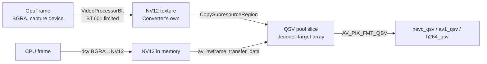
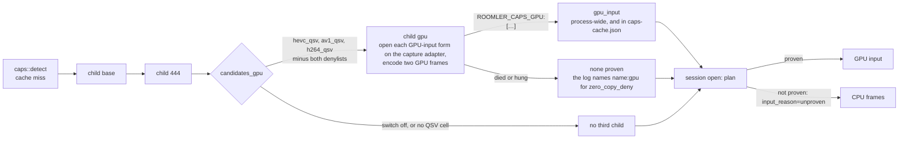

# FR-118: GPU-resident frames — a captured frame stays on the GPU until the encoder takes it

**Issue:** [#2669](https://github.com/gjovanov/roomler-ai/issues/2669) · **Status:** proposed 2026-10-21 —
spec and claim · **Owner:** the agent's capture and encode path · **Anchors:** master `c636c6e8c` ·
**Program:** [StarDesk teardown](../plans/stardesk-teardown-program.md), wave 2 ("zero-copy") ·
**Builds on:** [FR-70](FR-70-media-pipeline-leaves-the-runtime.md) (the encoder thread, M1),
[FR-77](FR-77-encoder-chroma-matrix.md) (cells and the probe), [FR-107](FR-107-drm-capture-throughput.md)
(the DRM arm's GPU path), [FR-16](FR-16-rc-quality-benchmark.md) / [FR-98](FR-98-input-to-photon-budget.md)
(L0 and L4) · **Unblocks:** [FR-119](FR-119-high-refresh-streaming.md) above 60 fps

## 1. Goal

On a host whose screen and hardware encoder share a GPU, a captured frame goes from the capture surface to
the encoder **without leaving the GPU**. Scaling and the BGRA → NV12 conversion happen on the GPU, and the
encoder takes the GPU surface. A frame is read back into CPU memory only when something that runs on the
CPU asks for it.

Today every hardware-encoded frame makes a round trip. The capture backend copies the GPU surface into
system memory, the pump converts it to NV12 on the CPU, and the encoder copies it back onto the GPU (§2).
StarDesk advertises a "Zero-Copy pipeline". The question for us is narrower and measurable: **how much of
each frame's time is that round trip, on the encoders the fleet actually runs?** The pump's heartbeat
cannot answer it yet (§3), so P0 measures before anything is built.

## 2. Evidence

### 2.1 Where the copies happen (master `c636c6e8c`)

| Step | Where | What it costs |
|---|---|---|
| WGC reads every arrived frame back, **inside `FrameArrived`**, before the latest-wins slot | `capture/wgc_backend.rs:610` → `copy_to_cpu` `:771` (`CopyResource` `:804`, then a synchronous `Map` and a row copy into a `Vec`) | A GPU → CPU copy plus a CPU stall per frame, including frames the slot then drops |
| WGC's D3D11 device is on the **default adapter** | `create_d3d11_device` `wgc_backend.rs:729`, `None` at `:740` ("defer until that's a real field issue") | Which GPU holds the frames is not decided by anyone |
| The SystemContext DXGI arm reads back too, and its device is bound to the adapter that **owns the output** | `system_context/dxgi_direct.rs:366` (`find_primary_output` `:1071`); `read_acquired` `:861`; its Phase B GPU scale still ends in a readback (`vp_blt_and_read` `:702`) | Desktop Duplication cannot cross adapters (`E_INVALIDARG`), so on that arm the capture adapter is fixed |
| `Frame` owns a `Vec<u8>` | `capture/mod.rs:85`, `data` at `:90`; `PixelFormat` is `Bgra`, `Nv12` or `I420` (`:281`) | The contract has no way to say "this frame is on the GPU" |
| The pump converts BGRA → NV12 (or I444) **on the CPU**, BT.601 limited range | `FfmpegEncoder::convert_into` `encode/ffmpeg/encoder.rs:1960` (dcv, in row bands on a persistent pool above 2 MP, straight into the frame since FR-119 P2b-11; it was `convert_bgra`, which then copied the planes in); the matrix is `encode/color.rs:16` | Per-pixel CPU work on every frame |
| …then copies the planes into an `AVFrame`, uploads it for the VAAPI / D3D12 / Vulkan encoders, and submits | `encode_sync` `encoder.rs:2375`; `HwKind` `encode/ffmpeg/hwframes.rs:50` (those three kinds only) | The VAAPI, D3D12 and Vulkan cells make the full GPU → CPU → GPU round trip in our code; NVENC, QSV and AMF do the upload inside `send_frame` |
| The portal arm copies twice | `capture/portal/pipewire.rs:806` (out of the PipeWire buffer), then the helper's stdout into the daemon (`capture/portal/wire.rs`, which argues for exactly this as a first version); a DmaBuf buffer is reported, never read | Two CPU copies, by design until a measurement says otherwise |
| macOS copies the `CGDisplayStream` surface into the `Vec` | `capture/scrap_backend.rs` (the vendored scrap's quartz arm) | One copy per frame |

### 2.2 What the fleet measures today (7 days to 2026-10-21, read-only)

From `agent_logs`: 142 538 FFmpeg DC pump heartbeats from 11 hosts, read-only, from mars. The "encode"
column is the pump's `avg_encode_ms` (`peer.rs:9542`): the time inside `encode_sync`, so **conversion,
copies, upload, submission and the packet drain together** (§3). The fps columns are the delivered rate
between consecutive heartbeats (spaced 2.0 s). The median sits at 16–17 fps on almost every host because an
idle desktop produces few frames, which is not a limit. So the table shows the top of the distribution, p99
and max, and how many windows reached 50 fps.

| Encoder | Encode geometry | Windows | Encode ms (median / p90) | fps p99 / max (60 targeted) | Windows ≥ 50 fps |
|---|---|---|---|---|---|
| `hevc_qsv` | 1366×768 | 21 378 | 7.6 / 7.9 | 35.9 / 60.4 | 73 |
| `hevc_qsv` | 1920×1080 | 96 013 | 10.6 / 11.2 | 19.0 / 60.1 | 14 |
| `av1_qsv` | 1920×1200 | 4 715 | 11.9 / 12.8 | 48.0 / 59.0 | 28 |
| `hevc_qsv` | **2880×1800** | 591 | **24.4 / 25.6** | **27.6 / 29.4** | **0** |
| `av1_nvenc` | 1920×1200, direct | 88 | 9.9 / 10.9 | 57.6 / 57.6 | 2 |
| `hevc_nvenc` | 1920×1200, direct, the same host | 136 | **21.7 / 24.7** | **26.8 / 31.8** | **0** |
| `av1_nvenc` | 2560×1600 | 513 | 16.4 / 17.8 | 54.3 / 58.3 | 21 |
| `hevc_videotoolbox` | 3024×1964 | 803 | 6.3 / 6.6 | 54.6 / 55.1 | 645 of 794 |
| `hevc_vaapi` | 1600×900, a virtual desktop | 105 | 4.2 / 4.8 | 40.3 / 41.1 | 0 |

> [!IMPORTANT]
> **The 2880×1800 `hevc_qsv` laptop never reached 30 fps** in 590 windows, against a 60 fps target. At
> 1080p the QSV encode stage already takes **10.6 ms**: 64 % of a 60 fps frame period, and more than a whole
> 120 fps period (8.3 ms). At the measured cost, the CPU path cannot carry 120 fps at 1080p on any of these
> encoders.

## 3. What the numbers do and do not say

- **"Encode" is five things.** `encode_sync` runs `convert_bgra`, `build_av_frame` (a plane copy), the hardware
  upload, `send_frame` and `drain_packets` in one timed call. How much of the 10.6 ms is the CPU round trip and
  how much is the hardware encoding is **not known**. Nothing in this FR is built until P0 splits it.
- **Not every slow cell is a copy problem.** On the host that runs both, `hevc_nvenc` takes 22 ms where
  `av1_nvenc` takes 10–11 ms. The CPU work is the same for both, so at most ~11 ms of the 22 is conversion and
  copies. The rest is HEVC NVENC itself on that GPU, and a GPU-resident frame would not fix it. Recorded so that
  P2's result is not read as a promise for every encoder.
- **The capture readback is off the pump's clock on WGC, and on it on the DXGI arm.** WGC reads back on its own
  worker thread (§2.1), so its cost shows up as frame age (latency) and CPU load, not as pump time. The DXGI arm
  reads back on its capture thread while the pump waits, so there it is pump time, inside `avg_capture_ms`, which
  also includes the wait for a frame on an event-driven backend. P0 measures WGC's readback on the capture
  thread, and P0b the DXGI arm's.

## 4. Design

### 4.1 The contract first (C0)

```rust
pub enum FrameData {
    Cpu(Vec<u8>),
    /// Windows: a texture from the capture's own pool, on the capture device.
    D3d11(D3d11Frame),
    /// macOS: the IOSurface the stream delivered, its use count held.
    IoSurface(IoSurfaceFrame),
    /// Linux: a dma-buf (fd, modifier, planes) exported by the DRM arm.
    DmaBuf(DmaBufFrame),
}
```

`Frame.data` becomes `FrameData`. `Frame::cpu()` returns the bytes. On a GPU frame it reads them back
**once**, with today's code, and keeps them. Every consumer that has not moved keeps working and pays the copy
only when it asks:

| Consumer | Anchor | After C0 |
|---|---|---|
| the pump's CPU resample | `encode/resample.rs:461`, `:463` | `cpu()`; on the GPU path the scale happens on the GPU first (§4.3), so it passes through |
| `FfmpegEncoder::convert_into` | `encode/ffmpeg/encoder.rs:1960` | takes the GPU surface instead, on a GPU cell |
| libvpx (VP9 4:4:4), openh264, Media Foundation | `encode/libvpx.rs`, `encode/openh264_backend.rs:455`, `encode/mf/sync_pipeline.rs:313` | `cpu()`, unchanged |
| the idle detector's hash | `session_idle.rs:218` | `cpu()`; it samples a few rows, and the cost is measured in P2 |
| the recorder and its pointer | `recording/recorder.rs`, `recording/pointer.rs` | `cpu()`, unchanged |

While only `Cpu` is produced (P1), behaviour is byte-identical. That is P1's test.

### 4.2 The adapter rule

A frame stays on the GPU only when the capture surface and the encoder are on **the same adapter**: equal
`AdapterLuid`, read from the live capture device (`IDXGIDevice::GetAdapter`), never assumed. Otherwise the frame
is read back, which is exactly today's path.

- **SystemContext (DXGI):** the device is on the output's adapter by construction (§2.1).
- **WGC:** the device is on the default adapter today. WGC itself can deliver to a device on another adapter (the
  OS copies across), so creating the WGC device on the **encoder's** adapter would make the LUIDs equal on a
  hybrid laptop at the price of an OS-side cross-adapter copy. Whether that beats today's path is measured, not
  assumed (open decision 1).
- **Linux:** the DRM arm's dma-buf lives on the scanout's render node, and VAAPI must open that node.

> [!WARNING]
> An adapter mismatch must never produce a wrong picture. It falls back to the readback, and the session
> reports why (§4.6).

### 4.3 Windows

- **Scale and convert on the GPU.** One D3D11 `VideoProcessorBlt` from the BGRA capture texture into an NV12
  texture at the encode box. The output colour space is **BT.601, limited range**: the matrix the CPU path uses
  today (`encode/color.rs:16`). A host that flips paths must not change colour. The DXGI arm already builds a
  VideoProcessor for its Phase B scale (`dxgi_direct.rs:203`–`326`); this generalises it to NV12 output on that
  arm (P2), then gives it to WGC (P3).
- **One device, shared.** `HwKind::D3d11va` wraps the **capture's** `ID3D11Device` with
  `av_hwdevice_ctx_alloc` (never `_create`, which would open a second device), then
  `AVD3D11VADeviceContext.device` and `av_hwdevice_ctx_init`. The capture worker and the encoder thread (FR-70
  M1) then use one immediate context from two threads. That needs `ID3D10Multithread::SetMultithreadProtected`,
  or FFmpeg's lock callbacks shared with the capture thread. P2 picks one and proves it under load.
- **Never hand over the capture pool's own surface.** `CopyResource` into a texture from the encoder's frame pool,
  then release the WGC frame. Holding WGC's surface past `FrameArrived` stalls the capture. On the DXGI arm the
  `VideoProcessorBlt` writes straight into the encoder's texture, and the duplication frame is released before
  the next acquire, as it is today.
- **The encoder follows the capture device.** The DXGI arm rebuilds its device after an `AccessLost` (a lock, an
  unlock, a UAC prompt, a mode change: `reset()` runs `primary()` again), and the lock screen is the reason this
  arm exists. So a GPU frame carries its device, and the encoder rebuilds its hardware frames context when the
  device changes, at the cost of the keyframe any rebuild costs. Until it has, frames take the CPU path.
- **Per backend:** NVENC takes `AV_PIX_FMT_D3D11` frames on its own adapter. QSV takes a device and frames
  **derived** from the D3D11VA ones (`av_hwdevice_ctx_create_derived`, `av_hwframe_ctx_create_derived`). AMF
  takes `AV_PIX_FMT_D3D11` frames. The first cell is QSV on the DXGI arm (§5). The panel and the encoder share the
  Intel adapter on the fleet's QSV hosts, every one of them captures through that arm (§9, 2026-10-27), and the
  arm's device is on the output's adapter by construction, so the adapter rule holds there without open
  decision 1. That is also where the measured cost is largest.

### 4.4 macOS

The stream's `IOSurface` becomes a `CVPixelBuffer` (`CVPixelBufferCreateWithIOSurface`, no copy) and reaches
VideoToolbox as an `AV_PIX_FMT_VIDEOTOOLBOX` frame. VideoToolbox converts BGRA itself. The surface's use count
is held until the encoder releases the frame. `CGDisplayStream` recycles a small pool, so a held surface must
never outlive one frame period. The capture API is deprecated on recent macOS versions; that migration is
FR-97's, and this phase rides whichever API delivers the surface.

### 4.5 Linux

The DRM arm already imports the scanout through EGL (FR-107 P3, `capture/drm_gpu.rs`) and reads it back. The
GPU path exports a dma-buf instead, as `AV_PIX_FMT_DRM_PRIME`, and maps it to VAAPI (`av_hwframe_map`) for
`*_vaapi`. The scanout's modifier must be one the VAAPI driver can import; otherwise the readback is used. The
portal and mutter arms stay on the copy. Passing the compositor's buffers to the daemon needs a per-frame
lifetime handshake, and `wire.rs` already records why that waits for a measurement.

### 4.6 A GPU cell is a cell

The GPU input path is a property of a **cell** (encoder × chroma × input path). Every rule in the
`encoder-cells` skill applies:

- **The probe proves an open.** The probe child opens the GPU-input form on a D3D11 device of the **same
  adapter** (Windows), on the render node (Linux), or with a `CVPixelBuffer` (macOS), and reports it. Any failure
  means no GPU cell, never a crashed daemon.
- **Only a session proves the cell.** The first sessions on a new cell are read for decode errors, keyframe
  requests and colour before the cell is trusted.
- **One kill switch, honoured everywhere.** `ROOMLERD_ZERO_COPY` (config `zero_copy`), default OFF for one
  release. Plus `zero_copy_deny` in the `encoder_cells_deny` shape (`name:path`). Both are honoured by the probe
  **and** by session dispatch: "a kill switch a child process honours and the daemon ignores keeps nothing out of
  the daemon".
- **The session says which path it took and why.** The heartbeat and `rc:video-info` carry
  `input_path = gpu | cpu`, and for `cpu` a reason: `switch_off`, `denied`, `adapter_mismatch`,
  `consumer_needs_cpu`, `open_failed`. Without the reason, "zero-copy did nothing" is unattributable.

```mermaid
flowchart LR
  subgraph today["Today: every hardware cell"]
    A1[capture surface<br/>GPU] -->|CopyResource + Map| B1[Vec&lt;u8&gt; BGRA<br/>CPU]
    B1 -->|dcv BGRA→NV12| C1[NV12 planes<br/>CPU]
    C1 -->|AVFrame copy| D1[AVFrame<br/>CPU]
    D1 -->|upload inside send_frame,<br/>or hwframes upload| E1[encoder<br/>GPU]
  end
  subgraph gpu["FR-118: same adapter, switch on"]
    A2[capture surface<br/>GPU] -->|CopyResource into<br/>the encoder's pool| B2[pool texture<br/>GPU]
    B2 -->|VideoProcessorBlt<br/>scale + BT.601 NV12| C2[NV12 texture<br/>GPU]
    C2 -->|AV_PIX_FMT_D3D11| E2[encoder<br/>GPU]
    B2 -.->|cpu(): only when a CPU<br/>consumer asks| F2[Vec&lt;u8&gt;]
  end
```

## 5. Phases

| P | Scope | Kill switch | Status |
|---|---|---|---|
| P0 | **The split.** `encode_sync`'s five steps timed apart: `avg_convert_ms`, `avg_upload_ms`, `avg_submit_ms`, `avg_drain_ms` on the FFmpeg DC heartbeat, plus `avg_readback_ms` from the capture thread: WGC's (P0), then the SystemContext DXGI arm's (P0b). Then a fleet read, per encoder × geometry | none: telemetry, a handful of `Instant` pairs per frame, no knobs read in the frame path | **built** (§5.1): P0 shipped in 0.4.150, P0b rides the next agent release; the fleet read is AC1 |
| P1 | **C0, the contract.** `FrameData` + `Frame::cpu()`. Only `Cpu` is produced | none: no behaviour change, byte-identical by test | **built** (§5.2) |
| P2 | **Windows, the SystemContext DXGI arm → QSV, the first cell.** Every QSV host in the fleet captures through this arm, none through WGC (§9, 2026-10-27). The GPU scale + NV12 conversion, `HwKind::D3d11va` on the capture device, the adapter rule, the probe's GPU-input open, the session's `input_path` and reason, and the encoder following the capture device across a rebuild (§4.3). In three steps: **P2-1** the GPU frame, read back by every consumer; **P2-2** QSV takes it; **P2-3** the probe's GPU-input open | `zero_copy` / `ROOMLERD_ZERO_COPY` (default OFF) + `zero_copy_deny` | **P2-1 built** (§5.3), **P2-2 built** (§5.4), **P2-3 built** (§5.5); the field test next (AC3) |
| P3 | The WGC arm, and NVENC and AMF on D3D11 frames; open decision 1 measured on a hybrid laptop | the same | — |
| P4 | Folded into P2 on 2026-10-27: it was the DXGI arm, which is where the first cell's hosts capture | — | → P2 |
| P5 | macOS: IOSurface → VideoToolbox | the same | — |
| P6 | Linux: the DRM arm's dma-buf → VAAPI | the same | — |
| P7 | Docs and the final field table | — | — |

P0 decides the rest. If convert + copy + upload turn out to be a small share of the encode stage on a backend,
that backend's phase is not built, and the reason is recorded here.

### 5.1 P0 — as built (2026-10-21)

Telemetry only, on the FFmpeg DC pump's heartbeat. No knob is read in the frame path, and nothing changes
what the pump does.

| Heartbeat field | What it times | Where |
|---|---|---|
| `avg_convert_ms` | `convert_bgra` and the `AVFrame` build: the CPU colour conversion and a plane copy | `encode_sync`, `agents/roomlerd/src/encode/ffmpeg/encoder.rs` |
| `avg_upload_ms` | the hardware-frame upload: VAAPI, D3D12 and Vulkan; zero for every other encoder | the same |
| `avg_submit_ms` | `send_frame`, where NVENC, QSV and AMF upload a software frame themselves | the same |
| `avg_drain_ms` | receiving the packets | the same |
| `avg_readback_ms` | the capture thread's copy of the capture surface into CPU memory. WGC's runs off the pump's clock, so `avg_capture_ms` never contained it. The DXGI arm's (P0b) runs while the pump waits for the reply, so there it is a part of `avg_capture_ms` | WGC: the `FrameArrived` handler, `agents/roomlerd/src/capture/wgc_backend.rs`. DXGI: `read_acquired`, `agents/roomlerd/src/system_context/dxgi_direct.rs` |

- **The four parts add up to the encode stage** (`avg_encode_ms` also includes the hop to FR-70's encoder
  thread). They are cumulative per encoder (`StageTimes`, carried by `rate_stats()`) and reported per frame
  over each heartbeat window. A background swap keeps the encoder struct, so it keeps counting. An inline
  re-open builds a new encoder, and each encoder carries its own id, so a window never diffs two encoders'
  totals.
- **P0 left the DXGI arm out; P0b (2026-10-27) adds it.** Its readback runs while the pump waits for the
  worker's reply, so it was already inside `avg_capture_ms`, together with the acquire wait, and P0 deferred it.
  Then the first fleet read showed that every QSV host captures through this arm (§9), so their readback read
  `0`: not measured, not free. Now `read_acquired` times the whole copy (the staging copy, the `Map` and the row
  copy, or the VideoProcessor scale and its smaller readback), the capture thread adds it to the capture's
  totals, and `SystemContextCapture` reports them through the same `readback_totals`. The scrap-wrapped DXGI
  backend copies inside scrap and is not measured, and GDI reads nothing back from a GPU. Every other backend
  reports `avg_readback_ms = 0`: scrap copies on the pump's clock, and the synthetic source has nothing to read
  back.
- **Tests:** five. They cover the window rule (the per-frame difference, an empty window, a new encoder
  starting its own window even after it has counted more frames, distinct ids) and the readback window
  (including a reopened capturer).
- **Negative controls:** run together, each fails exactly its target, 2 failed / 3 passed. In NC1 the window
  ignores the encoder id: `left: None, right: Some([12.0, 1.0, 2.0, 0.5])`. In NC2 the readback window loses its
  reopen rule and panics on the u64 underflow the rule prevents.
- **P0b's test:** `readback_totals_count_only_measured_frames`. A frame whose backend did not time its readback
  is not counted, so the scrap-wrapped backend's frames cannot dilute the average with zeros. Its negative
  control counts every frame and fails it: `left: (1, 0), right: (0, 0)`. The agent's lib suite is 2375 with the
  Windows hardware features.

### 5.2 P1 — C0, the contract, as built (2026-10-27)

`Frame.data` is now a `FrameData` (`agents/roomlerd/src/capture/mod.rs`), and every consumer reads the pixels
through `Frame::cpu()`. Only `FrameData::Cpu` exists, so nothing changes at run time.

| Piece | What it is |
|---|---|
| `FrameData::Cpu(Vec<u8>)` | the one variant today. The GPU forms of §4.1 arrive with their cells, each as a variant |
| `Frame::cpu() -> &[u8]` | the bytes, laid out as `pixel_format` with `stride` per row. On a GPU frame it will read them back once and keep them |
| `Frame::cpu_mut() -> &mut Vec<u8>` | the bytes to change in place: the recorder draws its pointer into a frame, and tests paint one |
| `From<Vec<u8>> for FrameData` | so a backend that captures into memory builds a frame with `data: bytes.into()` |

- **Every accessor destructures without a wildcard** (`let FrameData::Cpu(bytes) = …`). A new variant
  therefore fails to compile until each accessor handles it, so a GPU frame can never be read as an empty or
  stale CPU buffer by accident.
- **Where it changed:** 21 files. Every capture backend that builds a frame (WGC, the SystemContext pump,
  scrap, DRM, the portal, the synthetic source), the resample, every encoder's input (FFmpeg, libvpx,
  openh264, Media Foundation), the encoder thread, the recorder and its pointer layer, the idle detector, the
  lock overlay, and two integration tests. All the edits are the same two shapes: `data: bytes.into()` where a
  frame is built, and `frame.cpu()` / `frame.cpu_mut()` where one is read. Nineteen of the files are
  line-neutral.
- **Tests:** a new one, `a_cpu_frame_reads_back_the_bytes_it_was_built_with`. The bytes a frame is built with
  come back unchanged, a `cpu_mut` write lands in place, and a clone carries the same bytes. The agent's lib
  suite (2374 with the Windows hardware features) and the recorder and export integration tests pass unchanged.
- **Negative control:** a `cpu()` that drops the first byte fails 11 tests, the new one and 10 of the
  recorder's pointer tests, which draw through these accessors.
- **AC2's GPU half** (a GPU frame's `cpu()` equals today's readback, on a Windows CI device) waits for the
  first GPU variant (P2). Its L0 half reads the `l4_latency` cells on this change's CI run against master's.

### 5.3 P2-1 — the GPU frame, as built (2026-10-28)

The DXGI arm can now deliver a frame that stays on the GPU. Nothing takes it as a texture yet (that is P2-2),
so every consumer reads it back through `Frame::cpu()`: with the switch on, the readback moves from the
capture thread to whichever consumer asks first, and nothing else changes.

| Piece | What it is | Where |
|---|---|---|
| `FrameData::Gpu(GpuFrame)` | a BGRA8 texture on the capture's D3D11 device. Cheap to clone: the clones share the texture and its one readback | `agents/roomlerd/src/capture/gpu_frame.rs` |
| `GpuFrame::cpu()` | the bytes, read back on the first call (a staging copy, `Map` and a row copy, as every Windows backend reads back today) and kept. A readback that fails yields a black frame of the right size, never a short buffer, because every consumer trusts the frame's dims | the same |
| `Frame::cpu_mut()` on a GPU frame | turns it into a CPU frame first: a consumer that changes pixels (the recorder's pointer) needs them in memory | `agents/roomlerd/src/capture/mod.rs` |
| `TexturePool` | the textures a backend copies its frames into, on its device. A texture goes back when the last clone of its frame is dropped; a pool keeps at most 6. Making one turns the device's multithread protection on (the switch FFmpeg's D3D11VA device turns on too), because frames are read back on other threads while the capture thread keeps using the immediate context; a device that refuses it keeps CPU frames | `agents/roomlerd/src/capture/gpu_frame.rs` |
| the DXGI arm's GPU frame | `try_gpu_frame` → `gpu_frame`: one `CopyResource` from the duplication surface into a pool texture (native), or the Phase B VideoProcessor scale and a copy of its output (a smaller box). It runs before the CPU paths. An FP16 desktop and a rotated output keep their CPU paths (the LUT, the raw copy), and a failure is contained like a VP failure: CPU frames until `VP_RETRY_AFTER`, never a `BackendBail`. The backend's label reads `dxgi-direct-gpu` while it delivers GPU frames | `agents/roomlerd/src/system_context/dxgi_direct.rs` |
| the switch | `ROOMLERD_ZERO_COPY` (config `zero_copy`): `1`/`true`/`yes`/`on` turn it on, anything else leaves it off. Read once when the backend opens, so a capture rebuilt after a desktop switch reads it again | `gpu_frame::zero_copy_enabled` |

- **What the heartbeat shows with the switch on:** `avg_readback_ms` falls to about 0, because the capture
  thread reads nothing back, and the readback reappears in the stage of whichever consumer reads the frame
  first: the encoder's `avg_convert_ms`, whose conversion reads the bytes. That shift is P2-1's field signal
  that frames are travelling on the GPU.
- **The duplication surface is released right after the copy is queued**, without waiting for the copy, as
  Microsoft's Desktop Duplication sample does; the copy is ordered before the next frame's by the device. The
  CPU paths still wait (their `Map` does). A torn or stale picture with the switch on would point here first.
- **Tests:** five, in the Windows recorder lane (`capture::gpu_frame`), four of them on a WARP device so CI
  needs no GPU. A GPU frame's `cpu()` is the bytes its texture holds (an odd width, so the staging rows are
  padded), and its clones share the one readback; `cpu_mut()` turns it into a CPU frame; a texture returns to
  its pool, and one of the old dims is not kept after the pool moves on; a frame reads back on another
  thread, with the device's multithread protection on; and the switch's parsing. The lib suite is 2380 with
  the Windows hardware features.
- **Negative controls**, run together, each failing its own tests: a readback that copies row 0 for every row
  fails the two readback tests (the bytes repeat after the first row); a frame that never returns its texture
  fails the pool test (`left: 0, right: 1`); a pool that skips multithread protection fails the threads test.
- **AC2's GPU half is met in CI** by the first test: a GPU frame's `cpu()` returns exactly the bytes its
  texture holds, which is what today's readback returns. Its L0 half (the `l4_latency` cells of C0's CI run
  against master's, §5.2) is still to be read, so the box stays open until it is.

### 5.4 P2-2 — QSV takes the GPU frame, as built (2026-10-28)

A QSV encoder opened while the pump encodes a GPU frame takes GPU frames: the frame becomes NV12 on the GPU,
in a frame pool on the capture's own device, and reaches `send_frame` without touching CPU memory. Any other
case opens today's CPU form, and the heartbeat says which form and why.



| Piece | What it is | Where |
|---|---|---|
| `gpu_input::Converter` | one D3D11 VideoProcessor, BGRA in, NV12 out, BT.601 studio range (`ID3D11VideoContext1` colour spaces, or the older bit fields), driver enhancements off | `agents/roomlerd/src/encode/ffmpeg/gpu_input.rs` |
| `gpu_input::QsvGpuInput` | a D3D11VA device context wrapping the capture's device (`av_hwdevice_ctx_alloc`, never `_create`), a QSV device derived from it, and a 12-frame QSV pool made on that device as **decoder-target**: FFmpeg 9.0.1 builds a fixed D3D11 pool as one array texture and maps a decoder-target surface to (texture, slice), the transcode path; a render-target surface it tags `MFX_INFINITE` over the same array texture, which this code does not rely on. A GPU frame is converted, then copied into a pool frame's slice; a CPU frame is uploaded by FFmpeg. The converter writes into a texture of the slices' 16-aligned size (`qsv_init_child_ctx` aligns them), with the picture top-left, so the copy is a whole subresource. A slice of another size, from an FFmpeg that aligns differently, falls back to copying the picture's box, checked and logged on the first frame | the same |
| `gpu_input::plan` | the gates, read at every open: the switch, the capture device the pump named, the cell (`hevc_qsv`, `av1_qsv`, `h264_qsv` at 4:2:0; `vp9_qsv` waits for its own probes to be measured), `zero_copy_deny` (`name:gpu` entries, the `encoder_cells_deny` shape), then the pool, which fails on an adapter without QSV | the same |
| `gpu_hint` | how the capture device reaches the open: the pump names the frame's device around its one `codec.open` (`opening_on`, a thread-local scope inside its `spawn_blocking`, no `.await` within), and a background rebuild names the device its `RebuildSpec` carries. `InputForm` is the form and reason | `agents/roomlerd/src/encode/ffmpeg/gpu_hint.rs` |
| the encoder | `build_encoder` tries the GPU form first for a QSV cell and falls back to the CPU form on any refusal or failed open. `encode_sync` takes the GPU input's path when there is one. A rate rebuild, synchronous or in the background, opens on the same device. When a GPU frame comes from another device, or when the encoder opened on a CPU frame (`cpu_frames`, such as the first-frame prime), it reopens once on that device; a device it was refused on is not tried again | `agents/roomlerd/src/encode/ffmpeg/encoder.rs` |
| the DXGI arm keeps its device | with the switch on, `reset` keeps the D3D11 device and its texture pool across an `AccessLost` when the device is alive and still on the primary output's adapter (`Kept::fits`, the adapter LUID). Without that, each lock, unlock and cap lift would make a new device, and the encoder would reopen (0.6–0.9 s for QSV) and send a keyframe each time. The duplication is still rebuilt from scratch | `agents/roomlerd/src/system_context/dxgi_direct.rs` |
| the heartbeat | `input_path` (`gpu` / `cpu`) and `input_reason`: `switch_off`, `cpu_frames`, `no_gpu_cell`, `denied`, `adapter_mismatch`, `open_failed` | `agents/roomlerd/src/peer.rs` |

- **On the GPU path the stages read differently.** `avg_convert_ms` is the CPU time it takes to submit the GPU
  conversion and the copy, `avg_upload_ms` is about zero, and `avg_submit_ms` is QSV without its own copy and
  upload of the frame.
- **Colour**, checked against the CPU path's dcv conversion on flat patches at 64×32, and at 72×36 inside an
  80×48 texture: max |GPU − CPU| Y 0 / UV 0 on an AMD Radeon 610M, Y 1 / UV 0 on an NVIDIA RTX 5090 Laptop GPU.
  Intel's VideoProcessor is AC3's field check. WARP has no video processor, so this comparison cannot run in CI.
- **Chroma at a horizontal colour edge can differ.** Where two colours meet inside a 2×2 chroma block (an edge
  on an odd row), the AMD processor takes one row's chroma where dcv averages the two: 56 code values at a blue
  bar over grey, on that one chroma row only, while every flat row matched exactly. This is chroma siting, not
  a misplaced picture, and it stays in the chroma of one sample row at an edge. AC3's ±2 is on flat colour for
  this reason. Measure Intel's behaviour at an edge in the field too.
- **Tests:** five. The colour comparison runs on every adapter that has a video processor, at both sizes. The pool opens
  where QSV runs, and elsewhere fails with `adapter_mismatch` and leaves nothing behind (shown on the AMD and
  NVIDIA adapters). `plan` reads its gates in order (on WARP). The `gpu_hint` scope restores what was there,
  and a denylist entry must be exact. The lib suite is 2385 with the Windows hardware features.
  - **Where they run:** the two `gpu_hint` tests also run in the Linux FFmpeg lane. The three Windows ones run
    locally only, because no Windows CI lane builds FFmpeg (`ci.yml` keeps the media half out of the Windows
    test lane on purpose).
- **Negative controls**, run together, each fail their own test:
  - a BT.709 output colour space fails the colour test, at max |GPU − CPU| Y 28 / UV 12 on the Radeon;
  - a `plan` that skips the denylist fails the gate test (`left: "open_failed"`, `right: "denied"`);
  - a denylist that also matches a bare name fails the exact-entry test.
- **Not yet:** the probe's GPU-input open (P2-3, built next: §5.5), `input_path` on `rc:video-info`, and any
  run on a QSV host. With the switch OFF (the default), every path is today's.

### 5.5 P2-3 — the probe proves the GPU-input form, as built (2026-10-28)

After P2-2, the first open of a QSV encoder's GPU-input form would have happened in the daemon, in a session.
The `encoder-cells` rules forbid that order. A driver is untrusted code, and a fault inside one in the daemon's
address space takes `roomlerd` down, and with it the operator's remote access to a corp laptop. Now the
capability probe's child opens the form first, and a session opens it only on a host where the child did.



| Piece | What it is | Where |
|---|---|---|
| the `gpu` phase | a third child, `ROOMLERD_CAPS_PHASE=gpu`, after `base` and `444`, given its names in `ROOMLERD_CAPS_GPU_NAMES`. For each name it announces `ROOMLER_CAPS_PROGRESS:<name>:gpu`, opens the encoder in the GPU-input form on a D3D11 device of the adapter that owns the primary output (the adapter the DXGI arm captures on), checks that the encoder really took GPU input rather than falling back to CPU frames, and encodes two moving 480×270 GPU frames, which must produce packets. It answers `ROOMLER_CAPS_GPU:[…]` | `probe_gpu`, `agents/roomlerd/src/encode/caps.rs` |
| `candidates_gpu` | what the phase tries: the base matrix's QSV cells that the GPU input covers (`hevc_qsv`, `av1_qsv`, `h264_qsv` at 4:2:0), minus `encoder_cells_deny` and `zero_copy_deny`. With the switch off there are none, so no third child is spawned, and a probe costs what it did before | the same |
| the proof gate | `gpu_input::plan` adds `unproven` after `denied`: a session opens the GPU-input form only for a name the child proved. The probe child is the only process where an unproven form may open, because proving it is its job | `agents/roomlerd/src/encode/ffmpeg/gpu_input.rs` |
| the cache | `gpu_input` rides the probe report and `caps-cache.json`, and a cache hit installs it the way a probe does. It is not a wire capability, so the hello does not change. The knob hash already covers `ROOMLERD_ZERO_COPY` and `ROOMLERD_ZERO_COPY_DENY` (env and config), so turning the switch on or editing the denylist re-probes | `agents/roomlerd/src/encode/caps_cache.rs` |
| a dying child | the log names the open it was inside (`<name>:gpu`, the entry to add to `zero_copy_deny`). It costs only the GPU forms: sessions take CPU frames, and the daemon and every cell are unaffected. A hung child is killed at the probe's 60 s bound | `caps.rs` |
| `primary_output_device` | the device the phase opens on: the primary output's adapter, and a device there | `agents/roomlerd/src/system_context/dxgi_direct.rs` |
| `zero_copy` and `zero_copy_deny` in config | P2-1 and P2-2 shipped both as env vars only, although the code's comments already named the config keys. Both are now config keys: `roomler config set zero_copy true`, and `zero_copy_deny` validated as `name:gpu` entries or `none`. They are bridged to the env names through the config fallbacks, so they reach the probe child, and a Windows service, without editing the service's environment. Local only: `zero_copy_deny` is not pushable through remote config yet | `crates/agent-core/src/config.rs`, `crates/agent-core/src/config_surface.rs` |

- **What the field test reads:** the probe's `caps probe: GPU-input phase reported` line, with `tried` and
  `proven`, then each session's `input_path` and `input_reason`. On a QSV host with the switch on, `unproven`
  means the child did not prove the form, and its own `GPU-input form not proven` line says why.
- **What it costs:** nothing with the switch off. With it on, one more child on a probe-cache miss: at most
  three QSV opens (0.6–0.9 s each, §5.4) and six small frames.
- **A cached "none proven" lasts as long as the cache**, like a 4:4:4 answer. A child that died or proved
  nothing is not retried until the cache expires (7 days), a knob changes, or the build or the driver changes.
  To re-probe sooner, delete `caps-cache.json` or set `caps_cache = false`.
- **Tests:**
  - `the_gpu_phase_tries_only_what_a_session_may_open` (AC6's probe half): nothing with the switch off;
    `hevc_qsv`, `av1_qsv` and `h264_qsv` with it on, never `vp9_qsv` or NVENC; a `zero_copy_deny` entry and a
    4:2:0 `encoder_cells_deny` entry each remove their cell.
  - `plan_reads_every_gate_at_the_open` (AC6's session half) now stops at `unproven` once past the denylist,
    because no probe runs in a test process.
  - The probe envelope's round trip carries `gpu_input`.
  - `zero_copy_and_its_denylist_set_echo_clear_and_bridge` and `env_fallbacks_carry_every_bridged_kind` cover
    the config keys.
  - The agent's lib suite is 2386 with the Windows hardware features, and agent-core's is 276.
  - Like P2-2's, the Windows tests run locally only: no Windows CI lane builds FFmpeg.
- **Negative controls**, each failing only its own tests:
  - `candidates_gpu` ignoring the switch fails the phase test (`the switch is off`);
  - `plan` skipping the proof fails the gate test (`left: "open_failed"`, `right: "unproven"`);
  - a `zero_copy_deny` validator that accepts any input path fails the config test
    (`"hevc_qsv:cpu" must be refused`);
  - a denylist that never reaches the fallback map fails the config test and the fallback map's test
    (`left: None`).
- **The child, run by hand** on this build's debug binary on neo16, which has no Intel graphics:
  `ROOMLERD_CAPS_CHILD=1 ROOMLERD_CAPS_PHASE=gpu ROOMLERD_CAPS_GPU_NAMES=hevc_qsv,av1_qsv ROOMLERD_ZERO_COPY=1
  roomlerd caps-probe`. For each name, `plan` refused with `adapter_mismatch` ("no QSV on this device"), the
  CPU form did not open either, and the name was not proven (29–32 ms each). The child printed
  `ROOMLER_CAPS_GPU:[]` and exited 0. ⚠️ A debug binary run by the signed-in user logs into the live worker's
  daily file: the 15 lines at 2026-10-28T02:59:11.197–.348Z in neo16's `roomlerd.log` are this run, not the
  daemon.
- **Not yet:** a run on a QSV host (AC3, which needs a release carrying P2-1 to P2-3), `input_path` on
  `rc:video-info`, and pushing `zero_copy_deny` through remote config.

## 6. Acceptance criteria

- [ ] **AC1 — the split, measured.** P0 has shipped, and a fleet week is read per encoder × geometry into the
  §9 log: the share of the encode stage that is conversion, copy and upload, against submission and drain, and
  the capture thread's readback. On the QSV hosts that readback is the DXGI arm's, so its half is read once P0b
  has shipped. This is the red record for AC3 and AC4.
- [ ] **AC2 — C0 is invisible.** `Frame::cpu()` on a GPU frame returns the bytes today's readback returns:
  tested on a Windows CI device (WARP is enough), and on the synthetic source. L0's cells read the same within
  their spread, with only `Cpu` produced.
- [ ] **AC3 — the first cell, in the field.** On a QSV host whose panel is on the Intel adapter, 20-minute
  sessions with the switch on and off, back to back, on the same content. Pass if all of these hold: the encode
  stage per frame falls by at least the conversion + copy + upload share P0 measured on that host, minus the GPU
  conversion's own time; process CPU falls; zero viewer decode errors, and no rise in keyframe requests; a test
  pattern decodes to within ±2 code values of the CPU path in every plane. The off-session is the red run.
- [ ] **AC4 — the slow laptop.** A host at ≥ 2560×1600 on QSV reaches a peak of **≥ 50 fps** with the switch on;
  §2.2's 2880×1800 laptop peaked at 29.4 over 590 windows. If P0 shows the hardware encode itself is the bound
  there, this AC records the measured bound instead, and why.
- [ ] **AC5 — the adapter rule.** A host whose capture and encoder adapters differ never takes the GPU path:
  unit-tested on the rule, and seen on one hybrid host in the field as `input_path=cpu reason=adapter_mismatch`.
- [ ] **AC6 — the gate holds at every entry point.** With the switch off, or the cell denied, neither the probe
  nor a session opens the GPU-input form. Tested at both entry points. *(Both halves unit-tested in P2-3, §5.5,
  locally; AC3's switch-off run on a QSV host is the field read: no `gpu` child in the probe's log, and
  `input_reason=switch_off` on the session.)*
- [ ] **AC7 — every further cell, or its reason.** NVENC, AMF, the WGC arm, VideoToolbox and VAAPI are each
  field-verified like AC3, or deferred with the measurement that deferred them.
- [ ] **AC8 — docs.** `docs/encoders.md` (the input path as a cell dimension, the switch, the denylist) and
  `docs/remote-control.md` (the frame path, both arms, as the §4.6 mermaid diagram with the measured numbers).
  Linked from `docs/README.md`.

## 7. Open decisions

1. **Which adapter WGC's device uses.** The default adapter (today), or the encoder's adapter, letting the OS
   copy across on a hybrid laptop. Recommended: keep the default until P3 measures the encoder's-adapter variant
   on a hybrid laptop against the readback.
2. **The default.** Recommended: OFF for one release, then ON per cell after a clean fleet week of that cell
   (decode errors, keyframe requests, `input_path` reasons), never globally.
3. **Colour.** Recommended: BT.601 limited range on the GPU path, matching today's CPU path, so the switch never
   changes the picture. Moving both paths to BT.709 with VUI signalled is a separate decision for every viewer.
4. **Who converts to NV12.** Our VideoProcessor (one matrix we control and test), or the encoder from BGRA (NVENC
   ARGB input, QSV RGB4: one pass fewer, each with its own matrix). Recommended: VideoProcessor first. Encoder-side
   RGB input is measured afterwards as an optimisation, per backend, against AC3's colour check.

## 8. Out of scope

- The portal and mutter arms' dma-bufs: fd passing and the compositor's buffer lifetime (`wire.rs`).
- GPU input for the D3D12 and Vulkan encoders (a D3D11 → D3D12 shared-handle path), Media Foundation's H.264 on
  the RTP track, and X11 (XShm is CPU memory by construction).
- Raising the frame rate: [FR-119](FR-119-high-refresh-streaming.md). HDR: wave 3.
- HEVC NVENC's own cost on the host in §2.2: an encoder setting, not a copy.

## 9. Field-verification log

| Date | Build | Cell | Result |
|---|---|---|---|
| 2026-10-21 | fleet, agents 0.4.135–0.4.148 | every FFmpeg DC session for 7 days: 142 538 heartbeats, 11 hosts | **The red record, before P0.** §2.2's table. The 2880×1800 `hevc_qsv` laptop peaked at 29.4 fps against 60. At 1080p, QSV's encode stage takes 10.6 ms. `hevc_nvenc` takes 22 ms where `av1_nvenc` takes 10–11 ms on the same host, so that host's cap is not a copy |
| 2026-10-27 | fleet, agents 0.4.150–0.4.180, 10-21 16:55Z → 10-27 23:35Z | every FFmpeg DC heartbeat with P0's fields: 26 encoder × geometry groups of ≥ 10 windows | **An interim split, not AC1** (AC1 reads a full week). §9.1's table. On QSV, conversion is 16–35 % of the encode stage and `send_frame` 60–83 %. **Every QSV host captures through the SystemContext DXGI arm**: all 8 logged `capture: backend=system-context` (197 selections) and none `backend=wgc`, so their readback reads `0` because P0 never timed that arm. Two changes follow: P0b times it, and P2 moves from WGC to the DXGI arm |
| 2026-10-28 | FFmpeg 9.0.1 CLI, `hevc_nvenc` with the agent's options (`-preset p4 -tune ll -rc vbr -cq 22 -bf 0 -rc-lookahead 0 -delay 0 -split_encode_mode forced`), an idle RTX 5090 Laptop GPU | **NVENC's own upload, measured for P3**: the same 8 frames looped 1200 times, once from system memory (NVENC uploads each, the production path) and once from CUDA memory (uploaded once by `hwupload_cuda`). Four runs; the CUDA path is steady and the system-memory path varies, so the upload is given as min–median. **2560×1600 NV12: 1.8–2.6 ms a frame** (system memory 4.04–5.04 ms, CUDA 2.25–2.43), 4:4:4 1.7–3.4 ms; **1920×1080 NV12: 0.7–1.1 ms**, 4:4:4 0.7–1.5 ms. These are throughput numbers. The agent's `submit` is latency-bound (8.8 ms at 2560×1600 HEVC in §9.1), so there the upload is about a fifth of it. With the 1.3 ms conversion and WGC's 6 ms readback, P3 would take about 3 ms off the encode stage, plus the readback off the capture thread. Script: `nvenc-split.sh` (FR-118 tools) |

### 9.1 The interim split (2026-10-27)

Medians of each heartbeat's per-frame average, in milliseconds, over the groups with the most windows. The
medians of the parts need not add up to the median of the whole. "Readback" is the capture thread's copy (§5.1).
"—" means it was not measured on that host's arm: the SystemContext DXGI arm before P0b, or scrap, which copies
on the pump's clock, inside `avg_capture_ms`.

| Encoder | Geometry | Windows (hosts) | Encode | Convert | Upload | Submit | Drain | Readback |
|---|---|---|---|---|---|---|---|---|
| `hevc_qsv` | 1366×768 | 121 640 (2) | 7.6 | 2.7 | 0 | 4.8 | 0.1 | — |
| `hevc_qsv` | 1920×1080 | 91 456 (3) | 7.4 | 1.4 | 0 | 4.8 | 0.1 | — |
| `hevc_qsv` | 1920×1200 | 1 297 (1) | 10.5 | 3.7 | 0 | 6.3 | 0.1 | — |
| `av1_qsv` | 1920×1200 | 2 683 (1) | 13.1 | 2.7 | 0 | 10.1 | 0.1 | — |
| `av1_qsv` | 2880×1800 | 1 071 (1) | 19.6 | 3.1 | 0 | 16.3 | 0.1 | — |
| `vp9_qsv` | 1920×1080 | 8 218 (1) | 23.7 | 4.7 | 0 | 17.9 | 0.1 | — |
| `hevc_videotoolbox` | 3024×1964 | 33 712 (1) | 6.0 | 4.7 | 0 | 1.3 | 0 | — |
| `av1_nvenc` | 1920×1080 | 2 514 (1) | 6.9 | 0.7 | 0 | 6.2 | 0 | — |
| `hevc_nvenc` | 1920×1200 | 1 699 (2) | 20.7 | 4.4 | 0 | 15.6 | 0 | — |
| `hevc_nvenc` | 2560×1600 | 824 (1) | 10.4 | 1.3 | 0 | 8.8 | 0 | 5.7 (WGC) |
| `av1_nvenc` | 2560×1600 | 787 (1) | 5.6 | 1.1 | 0 | 4.3 | 0 | 6.1 (WGC) |
| `hevc_vaapi` | 1600×900 | 259 (1) | 4.1 | 0.7 | 0.5 | 2.9 | 0 | — |

- **On QSV, `send_frame` is most of the stage, and it is two things.** It holds QSV's own upload of the
  system-memory frame and, with one frame in flight, the wait for the hardware encode. The heartbeat cannot
  separate them. P2's switch can: the same host, the same content, with the upload and without it (AC3).
- **The CPU conversion is the smaller part on QSV and NVENC** (0.7–4.7 ms). On VideoToolbox it is the larger
  part, 70–87 % of the stage across the Mac's geometries, and VideoToolbox converts BGRA itself. Per frame,
  P5's case is the strongest, though the Mac already makes 120 fps ([FR-119](FR-119-high-refresh-streaming.md)
  AC4).
- **WGC's readback on the one WGC host is as long as a whole AV1 encode stage** at 2560×1600 (6.1 ms against
  5.6), on the capture thread: latency and CPU, not pump time.
- **§2.2's 2880×1800 laptop now encodes AV1.** Its encode stage is 19.6 ms, which alone allows ~51 fps, and its
  capture averages 6.7 ms with the DXGI readback inside it. P0b separates the two, and AC4 is read against
  both.

## 10. Related

- [FR-119](FR-119-high-refresh-streaming.md): above 60 fps needs the encode stage under one period; this FR is
  how that is reached on the CPU-bound cells.
- [FR-70](FR-70-media-pipeline-leaves-the-runtime.md): the encoder thread this design shares a device with.
- [FR-77](FR-77-encoder-chroma-matrix.md) and `docs/encoders.md`: the cell model, the probe and the denylist.
- [FR-107](FR-107-drm-capture-throughput.md): the DRM arm's EGL import, which P6 builds on.
- [FR-98](FR-98-input-to-photon-budget.md): the readback is latency as well as CPU; L4 sees it.
- `docs/plans/stardesk-teardown-program.md` §3: the design notes this spec started from.
