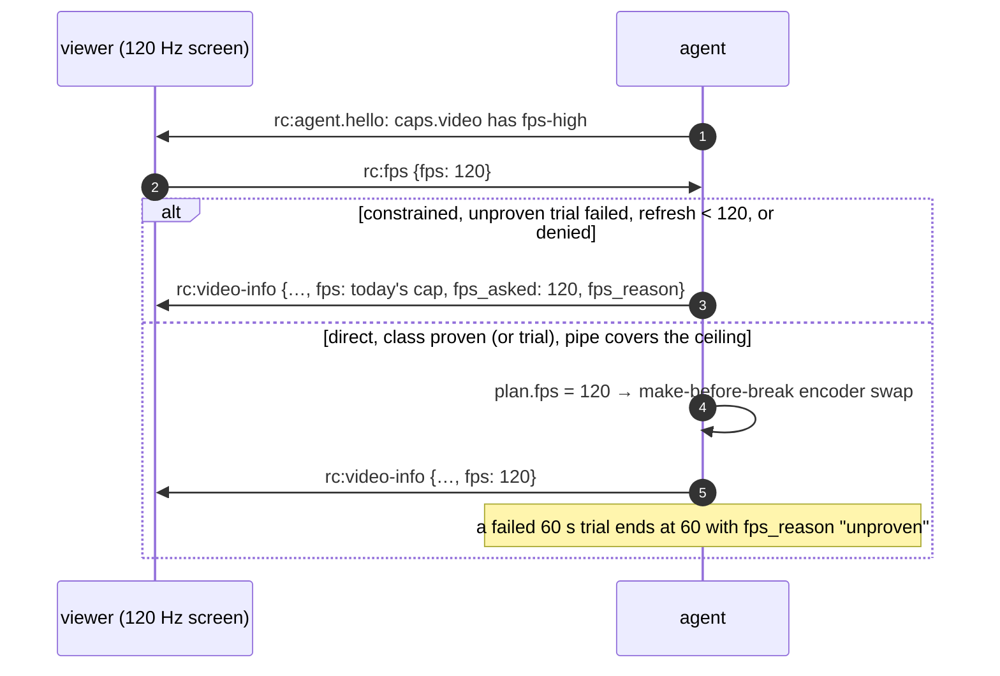
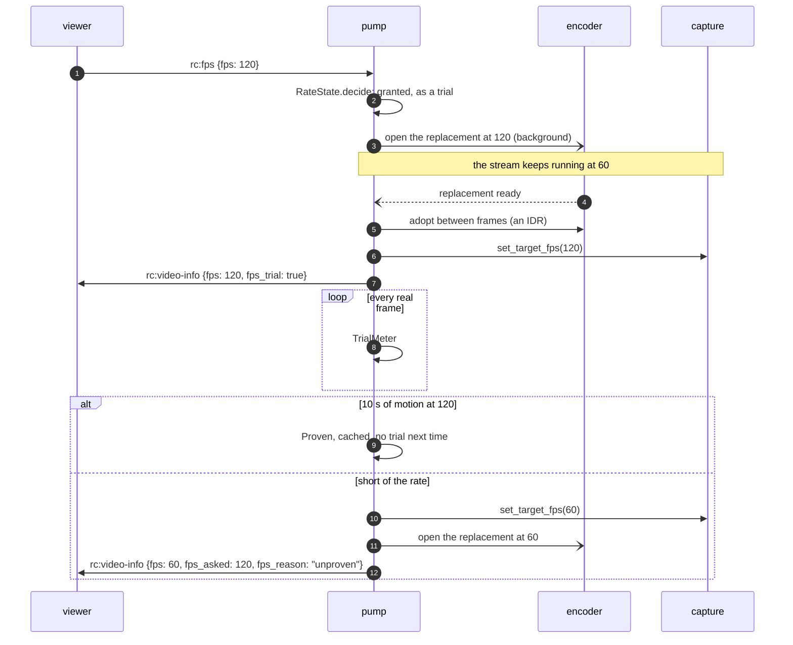

# FR-119: High-refresh streaming — 120 fps on a direct path when the host can sustain it, and the viewer asked

**Issue:** [#2670](https://github.com/gjovanov/roomler-ai/issues/2670) · **Status:** proposed 2026-10-21 —
spec and claim · **Owner:** the agent's capture, encode and rate path, the viewer's settings and decode path ·
**Anchors:** master `c636c6e8c` · **Program:** [StarDesk teardown](../plans/stardesk-teardown-program.md), wave 2
("high refresh": D1, then D2) · **Builds on:** [FR-118](FR-118-gpu-resident-frames.md) (the encode stage under
one period), [FR-98](FR-98-input-to-photon-budget.md) (the slot-first capture gate, L4),
[FR-70](FR-70-media-pipeline-leaves-the-runtime.md) (make-before-break), [FR-74](FR-74-text-clarity-on-direct-paths.md)
(the direct ceiling law)

## 1. Goal

A controller on a high-refresh display, on a direct path to a host that can sustain it, gets **120 fps**
(D1, up to 1440p), and later **144 fps at 4K** (D2), instead of today's hard 60. It happens only when the viewer
asked for it and the host has proven it can deliver it. Every other session stays exactly as it is today.

StarDesk advertises "4K HDR at up to 144 fps" with an fps lock of 60, 120 or 144. Roomler streams at most 60 on
every path (§2). That halves the motion steps a person sees on a 120 Hz or 144 Hz screen. FR-98 measures the
latency side; this FR is the cadence side.

## 2. Evidence (master `c636c6e8c`)

| What | Where | Consequence |
|---|---|---|
| The hardware target is a constant 60 | `TARGET_FPS_HW` `agents/roomlerd/src/peer.rs:105` | By default every RTP and DC session is capped at 60 |
| The FFmpeg DC pump already accepts more, from the environment only | `ffmpeg_target_fps` `peer.rs:9843`: `ROOMLERD_FFMPEG_FPS` clamped 1–240; default 60 direct, 30 constrained | Above 60 is a host-wide override today, not a session decision, and nothing checks the host can carry it |
| The viewer cannot ask, and the agent cannot say what the screen refreshes at | no fps message among the control-channel handlers (`rc:resolution` `peer.rs:10261` is the model); `DisplayInfo` has no refresh rate (`crates/remote_control/src/models.rs:195`) | No picker is possible without a wire change |
| pts were whole milliseconds (**fixed in P2a**, §4.2) | master `c636c6e8c` had `TIME_BASE_DEN = 1000` and `pts = monotonic_us / 1000`; now `TIME_BASE_DEN` is 1 000 000 (`encode/ffmpeg/encoder.rs:94`) and `live_pts` returns the capture time (`:97`) | At 144 fps (6.9 ms period), two frames delivered within 1 ms of each other carried equal pts |
| The encoder's frame rate is fixed at open, and a replacement copies it | `set_frame_rate` `encoder.rs:1717`; `rebuild_spec` / `rebuild_spec_at_dims` copy `fps` (`:2289`; the second is `rebuild_spec_at` since P2b-2, which takes the rate, `:2312`) | A change of fps is an encoder rebuild. FR-70 M2's make-before-break covers dims and rate, not fps (until P2b-2, §4.4) |
| The direct ceiling law was linear in fps and clamped at 48 Mbps (**reshaped above 60 in P2a**, §4.2) | `ffmpeg_maxrate_bps_scaled` `encode/rate_profile.rs:219`: W·H·fps·0.25, clamped to [3, 48] M × the codec factor; above 60 it now follows `rate_law_fps` | Before P2a, 1920×1080 at 144 fps computed 74.6 M and clamped to 48 M: 333 kbit per frame, where 60 fps gets 518 kbit, so above 60 the picture got softer per frame |
| The default capture gate's period is whole milliseconds; the microsecond gate is opt-in | `capture/gate.rs` (the legacy rule caps `1000/144` at 166 fps and can phase-lock); the slot-first gate keeps µs (`:103`) behind `ROOMLERD_CAPTURE_GATE`, field A/B owed (FR-98 P1) | Above 60, the slot-first gate should be the one in use |
| WGC and `CGDisplayStream` deliver at the panel's refresh | WGC is compositor-driven; scrap's quartz stream is unthrottled (`throttle: 0.0`, `crates/vendored/scrap/src/quartz/config.rs:69`) | A 60 Hz panel cannot produce 120 fps. A 120 Hz MacBook already can |
| The viewer's struggle rule counts frames | `DEFAULT_MAX_DECODE_QUEUE = 4` (`ui/src/workers/rc-hop-stats.ts:253`), `DEFAULT_STRUGGLE_QUEUE = 2` (`:256`) | At 144 fps, two frames of queue is 14 ms, where at 60 it is 33 ms: the rule tightens by itself |
| **The encode stage alone exceeds a 120 fps period on every measured cell but one** | [FR-118](FR-118-gpu-resident-frames.md) §2.2, a 7-day fleet read: 10.6 ms (`hevc_qsv`, 1080p), 11.9 ms (`av1_qsv`, 1200p), 9.9 ms (`av1_nvenc`, 1200p), 16.4 ms (`av1_nvenc`, 1600p); **6.3 ms (`hevc_videotoolbox`, 3024×1964)** | 120 fps needs ≤ 8.3 ms per frame. On today's CPU path, only the Mac's VideoToolbox cell fits |

> [!IMPORTANT]
> The program note said D1 "works on the CPU path". The fleet's numbers say otherwise: at the measured
> 10–12 ms per 1080p–1200p frame, the serial pump tops out near 85–100 fps on QSV and NVENC. D1 on those cells
> waits for [FR-118](FR-118-gpu-resident-frames.md), or for a conversion pipelined off the encoder thread. The
> first D1 cell is the one that fits today: a MacBook host (VideoToolbox, ProMotion 120 Hz).

## 3. Design

### 3.1 The viewer asks; the host says what it can do

- **Hello.** `AgentCaps.video`, where `chunk-framing` and `bench` already live, gains `fps-high`. It is matched by
  **equality** like every capability verb, and ignored by servers and viewers that do not know it.
- **The host's refresh rate** rides `rc:video-info` (`refresh_hz`, the captured monitor's), read per OS since
  P2b-3 (§4.5). It does not go into `DisplayInfo`: that struct lives in the agent row the server stores and the
  viewer never reads, so a field there would change the server and still reach no picker.
- **Ask.** `rc:fps {fps: 60 | 120 | 144}` on the control channel, handled next to `rc:resolution`. The viewer
  sends it only to an agent that advertised `fps-high`; an agent that receives an unknown value drops it, as it
  does for `rc:resolution`. Shared pipelines merge their viewers' asks by `min`, the way they floor-merge
  resolution (`media_share.rs:318`). A viewer on a 60 Hz screen therefore never receives a heavier stream than it
  asked for.
- **Answer.** In `rc:video-info`, the message that already describes the stream: `fps` (what the stream runs
  at), and when an ask was not granted, `fps_asked` + `fps_reason`. Not a separate message: the pump knows its
  cap and its transport, so its answer is always correct, and a new ask or a new target re-sends video-info
  through the path every other refresh already takes.
- **Picker.** Settings → Frame rate: 60 (default), 120, 144. It is shown only for an agent that advertises
  `fps-high`. A picker every viewer sees before any agent can honour it is noise. Once the host's refresh rate is
  reported, an option above it is shown disabled, with the reason.

### 3.2 When the agent grants it

Above 60 fps only when **all** of these hold, re-checked whenever any of them moves:

1. The transport is not constrained (`detect_constrained_transport`, `peer.rs:1967`). Relayed paths wait for
   [FR-17](FR-17-partial-reliability-video.md) stage C, [FR-63](FR-63-one-delay-based-rate-controller.md) and
   FR-70 M3, and stay at their current cap.
2. The host has **proven the rate class** (§3.3) for this capture backend, display refresh, encoder and geometry.
3. The pipe belief ([FR-79](FR-79-one-validity-gate.md)) covers the higher ceiling (§3.4).

The agent answers every ask in `rc:video-info` with what the stream runs at and, when it did not grant the ask,
why: `fps_reason` is `constrained` or `unproven` in P1, and P2 adds `refresh`, `pipe` and `denied`. A viewer
that asked for 120 and sees 60 is told why, as FR-108 tells the display-match refusal.

### 3.3 The rate class: proven by a session, never assumed

What fps a host sustains depends on its capture backend, panel refresh, encoder and geometry. It is a **cell**,
and as with encoder cells, the probe proves an open and only a session proves the cell:

- A trial runs the class at the higher target and judges only **moving content**. Capture is event-driven, so
  an idle desktop delivers few frames: the fleet's median window is 16–17 fps with 60 targeted, and a rule over
  wall time would fail every capable host that sat still. So the trial keeps only active stretches, frames at
  most three periods apart, and a frame the pump drops for the viewer or the link ends a stretch. Once it has
  seen 10 s of motion, a class that ran at ≥ 0.9 × the target with p99 inter-frame time under two periods is
  proven and written to the agent's cache (the caps cache's keying: build, hardware fingerprint, knobs). It
  **fails** only when the host is the limit: the encoder's p90 time per frame at 90 % of a period or more. A
  window whose content changed slower than the rate (a 60 fps video, a browser page held at 60 on a 120 Hz panel)
  while the encoder kept up concludes nothing and starts over (P2b-2, §4.4). (The first draft said 60 s at
  ≥ 0.9 × the target; P2b-1 measured that rule against event-driven capture and replaced it, §4.3.)
- A class that fails is not granted again until the build, the hardware or the knobs change.
- `fps_deny` (`name:fps`, the `encoder_cells_deny` shape) removes classes. It is honoured at **every** entry
  point (the grant and the trial), pushable through remote config with `MANAGE_AGENTS`, and only ever removes.
- The first grant on an unproven host is a **trial**, never a promise. The viewer's picker says "trial", and
  the stream goes back to 60 if the trial fails.

### 3.4 The encoder and the rate law

- **pts in microseconds:** `TIME_BASE_DEN = 1_000_000`, `pts = monotonic_us`. The recorder keeps its own
  counter clock (`recording_pts`, `encoder.rs:738`), which already never repeats; P2a moved it to the
  microsecond base with the live pts.
- **An fps change is a make-before-break swap.** `rebuild_spec_at` takes the dims and the rate (it was
  `rebuild_spec_at_dims`), and an fps move rides FR-70 M2's dims swap: the same pending slot, the same adoption
  between frames. The live encoder keeps serving at the old rate until the replacement is ready. The plan's `fps`
  (FR-70 M3a) follows the pump's target, so the shadow sees the move too (§4.4).
- **The ceiling law:** `ceiling(fps) = ceiling(60) × (fps / 60)^α`, with a higher band top for the 120–144 class.
  At 60 the law is byte-identical to today's. α is **measured**, not chosen: a constant-quality run on the same
  screen content at 60 and at 120 shows how many bits the encoder actually spends per second. Inter frames 8 ms
  apart differ less than frames 17 ms apart, so α is expected well below 1. There is a precedent in the code:
  FR-112 already scales the RTP pump's bitrate base by `√(fps / 30)`, i.e. α = 0.5 (`bitrate_base_for_fps`,
  `agents/roomlerd/src/encode/mod.rs`).
- **The capture gate:** above 60, WGC runs the slot-first gate (FR-98 C1) regardless of `ROOMLERD_CAPTURE_GATE`.
  Its legacy rule sleeps out the rest of a period before it looks at the slot, so a frame that landed during the
  encode waits, and at 120 fps that wait comes out of an 8.3 ms budget. scrap has no slot to look at first, so
  above 60 the same bucket paces its asks (P2b-6, §4.8): its whole-millisecond period, meant to run a little fast,
  fell short of the target by each sleep's overshoot. DRM's period is in microseconds already. (The first draft
  gave a phase-lock as the reason. At 120 and 144 the whole-millisecond period is 8 and 6 ms, a little faster than
  the frames, so as at 30 and 60 it drifts out of the wait instead.)
- **The cursor channel:** its poll interval follows the frame period above 60 (FR-98's `poll_interval` knob,
  `capture/cursor.rs:44`).

### 3.5 The viewer

The decode path (WebCodecs) already decodes above 60. What changes: the struggle and drop thresholds become
**times**, not frame counts (§2), and `rc:decodestat` carries the target fps so the agent reads the viewer's
rate against the right number.



## 4. Phases

| P | Scope | Kill switch | Status |
|---|---|---|---|
| P0 | **Measure first.** (a) A µs pts unit test that is red on master's ms rule (two frames 0.5 ms apart). (b) L0 cells at 120 and 144 fps on the synthetic source: cadence and pts. (c) The vendored webrtc-rs data-channel throughput ceiling, measured in process over loopback (`agents/roomlerd/tests/dc_throughput.rs`), which decides D2's transport. (d) α, from a constant-quality run at 60 and 120 fps. (a) and (b) need P2's changes to mean anything, so they land with P2 as red → green tests | none: tests and measurements | **(c) measured** (§4.1, §8); **(d) measured offline** (§8): α ≈ 0–0.8, and 0.8 is used; **(a) red → green with P2a** (§4.2); (b) owed with P2b |
| P1 | **The wire.** `fps-high`, `rc:fps`, and the answer in `rc:video-info`, plus the viewer's picker. The agent grants nothing above today's cap yet: every ask is answered at that cap, with `fps_reason` `"unproven"` (or `"constrained"`) | `ROOMLERD_FPS_HIGH`, or the `fps_high` config key since P2b-3 (default OFF): no `fps-high` in the hello, so no viewer asks | **built** (§4.1); the host's `refresh_hz` is reported since P2b-3 (§4.5) |
| P2 | **The encoder and the gate.** µs pts, the fps swap, the ceiling law, the slot-first gate above 60, the rate-class cache and trial, `fps_deny` | the same switch; `fps_deny` | **P2a built** (§4.2): µs pts and the rate law, both byte-identical at and below 60. **P2b-1 built** (§4.3): the grant, the rate class and its trial, `fps_deny`, the rate-class cache. **P2b-2 built** (§4.4): the fps swap, a capture pace that moves without a reopen, the slot-first gate above 60, the wiring. **P2b-3 built** (§4.5): the screen's refresh rate, `fps_deny` in config and remote config, the viewer's words. **P2b-4 built** (§4.6): the viewer-rate cap follows a rate move up, found on P3's first direct run. **P2b-5 built** (§4.7): the macOS capture period runs from the ask, found on the same run. **P2b-6 built** (§4.8): above 60 the scrap backend paces its asks with the bucket, found on P2b-5's first after. **P2b-7 built** (§4.9): the viewer measures decode health in time, not frames. **P2b-8 built** (§4.10): the evidence gate runs on every window, rejects the transport's opening, and reads whole windows. Both found on AC4's third attempt. **P2b-9 built** (§4.11): the macOS daemon's launchd job is Interactive, so the session worker it spawns no longer runs throttled; found on AC4's fourth attempt. P2 is built; its field proof is P3 |
| P3 | **D1, the first cells.** The MacBook host (VideoToolbox, ProMotion) to a 120 Hz-or-faster viewer, direct. Then the Windows cells as FR-118 lands them | the same | **run 1, 2026-10-23** (§8): AC3's relay half verified on the MacBook. AC4 not run, because that viewer relayed every session. On a two-half Mac, `fps_high` reaches the session only with FR-43's #2758 (0.4.155). **Run 2, 2026-10-23** (§8): #2758 verified on 0.4.155. AC4 attempt 2, direct from Edge at the Mac's native size, was granted 120 and then taken back by the pipe; it found P2b-4 and P2b-5. **Run 3** (§8): AC4 attempt 3 on 0.4.158 found P2b-7 and P2b-8. **Run 4, 2026-10-23/24** (§8): on 0.4.160 the grant held 120 for 15 minutes, but read at the viewer (§8.1) the cadence missed (p99 19–20 ms). A launchd experiment found P2b-9; with it, 65 of 76 windows passed both clauses. **Run 5, 2026-10-24** (§8): on 0.4.162, which ships P2b-9, **AC4 met**: 120 fps in every 60 s window, p99 at the viewer 14.4–17.3 ms, 65 of 104 windows under 16.7 |
| P4 | **D2: 4K at 144**, after FR-118's cells and P0(c)'s transport verdict | the same | — |
| P5 | Docs and the final field table | — | — |

### 4.1 P0(c) and P1 — as built (2026-10-21)

**P0(c), the data-channel ceiling.** `agents/roomlerd/tests/dc_throughput.rs` runs two peers in one process
over real loopback UDP (host candidates, mDNS off), sending 16 KiB messages back to back the way the
production send task does. It is `#[ignore]`d: CI runners are too noisy for a throughput assertion, so the
numbers live in §8. The first run (neo16, release build) delivered every byte:

| Mode | Run 1 | Run 2 | Run 3 |
|---|---|---|---|
| ordered | 375.9 Mbit/s | 278.8 Mbit/s | 275.7 Mbit/s |
| unordered | 281.0 Mbit/s | 287.1 Mbit/s | 271.6 Mbit/s |

That is ~2.7× D2's ~100 Mbit/s on that CPU. A weaker host and a real round trip are owed before open decision
3 closes.

**P1, the wire.** It grants nothing above today's cap; P2 builds the grant.

| Piece | Where |
|---|---|
| `fps-high` in `AgentCaps.video`, only with `ROOMLERD_FPS_HIGH=1` (a test locks the default off) | `encode::frame_rate::CAP`, `video_features` in `agents/roomlerd/src/encode/caps.rs` |
| `rc:fps {fps}`: 60, 120 or 144; anything else is dropped. The ask is stored on the session's `ViewerFeedback`, which already reaches the control handler and every pump | the `rc:fps` arm next to `rc:resolution` in `agents/roomlerd/src/peer.rs`; `agents/roomlerd/src/encode/frame_rate.rs` |
| The answer, in `rc:video-info`: `fps` (what the stream runs at) and, when it refused an ask, `fps_asked` + `fps_reason` (`unproven`, or `constrained` on a relay) | `video_info_payload` and the FFmpeg pump in `agents/roomlerd/src/peer.rs` |
| The viewer's half: the options, the wire message, the answer read back, the words | `ui/src/composables/frameRate.ts` |
| The pick (per browser), re-sent when the control channel opens, to an agent with `fps-high` only; a Frame rate picker shown only for such an agent | `ui/src/composables/useRemoteControl.ts`, `ui/src/views/remote/RemoteControl.vue` |

- **With the switch off, the frame-rate fields are never written**, so every `rc:video-info` payload is
  byte-identical to before; the wire-shape tests pass unchanged. A new ask or a new target re-sends video-info
  through the path every other refresh already takes.
- **P1 answers only the session's own viewer.** A shared pipeline's followers merge their asks by `min` in P2,
  where the grant is built.
- **Tests:**
  - agent: four in `encode::frame_rate`, the video-info fields, and `fps-high` off by default;
  - viewer: seven in `frameRate.spec.ts`, plus two video-info parse tests fed the agent's exact bytes.
- **Negative controls, each failing exactly its targets:**

  | Control | Failed |
  |---|---|
  | A: accept any fps | the ask test |
  | B: grant every ask | the three tests that involve a refusal |
  | C: advertise `fps-high` always | the default test |
  | D (viewer): offer above 60 without `fps-high` | the options test (1 failed / 6 passed) |

  A–C were run together: 5 failed / 2 passed.

### 4.2 P2a — microsecond pts and the rate law above 60, as built (2026-10-21)

These are the encoder-side half of P2, the half that changes nothing at or below 60. P2b builds the grant (the
rate class and its trial, `fps_deny`, the fps swap, the slot-first gate above 60). Until then, only an
operator's `ROOMLERD_FFMPEG_FPS` reaches anything here.

| Piece | What changed | Where |
|---|---|---|
| The time base | `TIME_BASE_DEN` 1000 → 1 000 000; a live frame's pts is its capture time (`live_pts`) | `agents/roomlerd/src/encode/ffmpeg/encoder.rs` |
| The recorder's counter pts | `recording_pts_ms` → `recording_pts`, in the same base | the same |
| Packet durations | `ticks_to_us`, where `* 1000` assumed milliseconds. No consumer reads `duration_us` from this encoder today; it is kept right anyway | the same |
| The rate law | `rate_law_fps`: fps itself up to 60, `60 × (fps / 60)^0.8` above; the band's top grows the same way (`HIGH_FPS_ALPHA`) | `agents/roomlerd/src/encode/rate_profile.rs` |

- **Why the pts change is safe on every backend.** Each FFmpeg backend either rescales pts from the codec time
  base itself (QSV to 90 kHz, AMF and VideoToolbox to their own clocks) or carries it through untouched
  (NVENC, VAAPI). None assumes milliseconds. The recorder's MP4 writer keeps its own 90 kHz clock and never
  reads the encoder's pts. Still, a probe proves an open and only a session proves a cell, so P3's field cells
  include one session per backend at 60 before anything above 60 is granted.
- **α = 0.8** is the upper envelope of P0(d)'s offline read (§8): α ran from ~0 to 0.8 by codec and content.
  That puts 1080p144 at 62.7 M where today's law clamped it to 48 M, and 4K144 at the class top, 96.7 M, where
  today's law gave 48 M. Per frame, 120 fps gets 0.87 of what 60 does, not the 0.5 a fixed band gives. Open
  decision 2 refines it on P3's field cells.
- **Tests:**
  - two frames 0.5 ms apart get distinct pts;
  - a steady second at 144 fps strictly increases;
  - ticks are microseconds;
  - the recorder's pts strictly increase up to 240 fps;
  - the law is byte-identical to the old formula at and below 60 (7 geometries × 7 rates × both transports × 3
    codec factors);
  - above 60 the rate and the top follow α.
- **Negative controls, each failing exactly its target:**

  | Control | Failed |
  |---|---|
  | live pts back to milliseconds, master's rule | the pts test, with `left: 10000, right: 10000`: the collision itself |
  | the law linear above 60 | the α test |
  | α applied below 60 | the byte-identity test, `left: 3050564, right: 3000000` |

This is AC1's pts half: red on master's rule, green here.

### 4.3 P2b-1 — the grant, the trial, `fps_deny` and the rate-class cache, as built (2026-10-21)

This is the decision half of P2b. It is pure and unit-tested, and nothing calls it yet. P2b-2 wires it into the
pump: the fps swap, a capture pace that moves without a reopen, and the trial run.

| Piece | What it decides | Where |
|---|---|---|
| `grant()` | above the cap only when every condition holds; otherwise refused at the cap, with one named reason | `agents/roomlerd/src/encode/frame_rate.rs` |
| `pipe_covers()` | the pipe input: nothing measured says the path carries less than the ceiling at the asked rate | the same |
| `TrialMeter` | whether this host sustains the rate while the content moves | the same |
| `parse_fps_deny` / `fps_denied` | the owner's removals, in the `encoder_cells_deny` shape (`name:fps`, `*` for every encoder) | the same |
| `fps_class_cache` | what trials concluded, next to the probe cache and under its key | `agents/roomlerd/src/encode/fps_class_cache.rs` |

- **The refusal order** follows what a viewer can see and act on: `constrained`, then `refresh` (the captured
  screen refreshes slower than the ask), then `denied`, then `unproven` (a failed trial), then `pipe`. A class
  never tried is granted as a **trial**; a proven one is granted without one.
- **The pipe input** reads the FR-79 belief's pushed-back estimate (`capacity_bps`), and no push-back is no
  claim. ⚠️ Never the belief's floor: at 60 fps the floor is the content's weight at 60, always under the ceiling
  at 120, so reading it as a limit would refuse every healthy session.
- **The trial judges what the host did.** A frame the pump drops for the viewer or the link (the viewer-rate
  divisor, the byte gate) ends the stretch (`TrialMeter::pause`). Counted, one drop in fifty puts a two-period
  gap at the p99 and fails a host that kept up, and the verdict is cached as a fact about the host.
- **The cache** keeps one verdict per class, the newest. It is keyed exactly like the probe cache (build,
  hardware fingerprint, knobs hash), so any change forgets it. Any miss reads as unproven, a verdict older than
  a week is forgotten, and `ROOMLERD_CAPS_CACHE=0` switches it off with the probe cache. ⚠️ macOS has no
  hardware fingerprint, so no key and no cache: there, every session's first ask above the cap is a trial.
- **Tests:**
  - every refusal reason, and the order between them;
  - proven against trial;
  - an unknown refresh rate deciding nothing;
  - the pipe input with and without a push-back;
  - the trial on steady motion, an encoder that cannot keep up, a slower screen, pauses between bursts, 30 fps
    content, a rare late frame, and frames dropped for the viewer;
  - the deny list's parse;
  - the cache's read-back, newest-wins, key change, damaged file and age.
- **Negative controls,** six, run together:
  - pauses counted as frames;
  - the refresh check skipped;
  - a failed verdict ignored by the cache;
  - the cache key ignored;
  - a dropped frame counted;
  - no push-back read as a refusal.

  Exactly the seven tests that guard them failed: 17 passed, 7 failed. The first control fails two tests, because
  "a pause is not evidence" and "content slower than three periods is not evidence" are one rule.

### 4.4 P2b-2 — the rate moves in place, and the grant runs, as built (2026-10-21)

The wiring half of P2b. With `fps-high` on, an ask above the session's rate is decided by P2b-1's `grant()`.
A granted rate is reached without a freeze: the encoder is replaced in the background, and the capture's pace
moves in place. An unproven class runs as a trial, and its verdict is cached.

| Piece | What it does | Where |
|---|---|---|
| `ScreenCapture::set_target_fps` | moves the capture's pace without a reopen. WGC, scrap and DRM move their sleep, and WGC runs the slot-first gate above 60. The portal keeps its helper's pace (the default), so a trial there fails on what it delivers | `agents/roomlerd/src/capture/mod.rs` and the backends |
| `ScreenCapture::backend` | the backend's name in a rate class | the same |
| `GateMode::at_fps`, `gate::legacy_period` | the gate a granted rate runs, and the legacy period every backend computed inline | `agents/roomlerd/src/capture/gate.rs` |
| `FfmpegEncoder::rebuild_spec_at` | a replacement at new dims, at a new rate, or both; `adopt_rebuilt` takes the rate too | `agents/roomlerd/src/encode/ffmpeg/encoder.rs`, `agents/roomlerd/src/encode/thread.rs` |
| `RateState` | one session's decision: the grant, the running rate, what the session knows of each class, the trial | `agents/roomlerd/src/encode/frame_rate.rs` |
| `Pipeline::merged_fps_ask` | a shared stream's ask: the smallest, and a viewer that asked nothing holds today's rate | `agents/roomlerd/src/media_share.rs` |
| the pump | decides, swaps, paces, feeds the trial, persists the verdict | `media_pump_ffmpeg_dc`, `agents/roomlerd/src/peer.rs` |



- **The encoder is never fed faster than it was built for.** The capture runs at the lower of what the grant
  wants and what the live encoder was built for. Going up, the replacement opens at the higher rate while the
  stream keeps running at the old one, and the capture's pace follows at the adoption. Going down, the capture
  slows at once and the replacement follows. An encoder's rate control counts time in frames at its rate, so
  frames that come faster spend its ceiling faster by the same factor.
- **One make-before-break.** An fps move rides FR-70 M2's dims swap: the same pending slot, the same pinned
  target, the same adoption between frames. A dims move opened meanwhile carries the wanted rate too. A rate swap
  opened at a frame rate the session has since left is discarded as stale, like one opened for dims it has left.
- **A replacement that will not open.** One at another rate that fails to open is not opened again for 10 s,
  and a rate above the cap is not granted again that session. That is not cached: an open can fail for a reason
  that is not the rate (two encoder sessions at once, on a card at its session limit).
- **With `fps-high` off,** the wanted rate is the live encoder's own, so every path is unchanged, with one
  exception, a fix: a rate swap opened before a transport flip and finished after it carried the old frame rate
  and was adopted; now it is discarded as stale.
- **When it decides.** On a change of the ask, the base rate, the transport, the capture backend, the encoder or
  its dims, and once a second for the pipe's belief. The ceiling at the asked rate comes from the same chain the
  replacement opens at. Nothing new is read per frame: the deny list and the cache are read once per pump, the
  cache off the runtime.
- **The trial** is fed every real frame that left the encoder, at its capture time. The viewer-rate divisor, the
  byte gate, the drain and the pump's own stale-frame skip pause it. A verdict holds for the rest of the session at
  once, and is written next to the probe cache off the runtime. `rc:video-info` carries `fps_trial: true` while
  a trial runs, and names a refusal only once the stream runs below the ask.
- **The trial's Failed rule changed here.** P2b-1 failed a class on the frames' rate alone. Content slower than
  the rate (a 60 fps video; Safari holds web pages at 60 on a ProMotion panel by default) would have failed a
  capable host and cached that for a week. Now Proven is as before; Failed needs the encoder's p90 time per
  frame at 90 % of a period or more (`TRIAL_MAX_ENCODE_PCT`); anything else is no verdict, and the window starts
  over. The pump passes each frame's own encode time.
- **The slot-first gate above 60 is WGC's alone** (§3.4).
- **Not yet, for P2b-3** (built there, §4.5): the screen's refresh rate (every class has `refresh_hz` 0, so
  `refresh` is never the reason yet); `fps_deny` as a config key and through remote config; and the viewer's
  words for `trial`, `refresh`, `denied` and `pipe`. Until then the viewer shows the raw word for those, as it
  does for any word it does not know.
- **Tests:**
  - `RateState`: a trial starts only when the stream runs at the granted rate; a proven trial runs on without
    one; a failed one goes back to the cap and says `unproven`, once the stream runs below the ask; a class
    the session failed is not tried again, another class is; the cache decides from the first ask; a new class
    starts the trial over; a replacement that fails to open fails the class for the session only; an ask the
    cap covers wants the cap;
  - the gate above 60, and the legacy period at 120 and 144;
  - the shared stream's ask, floor-merged, a viewer that asked nothing holding today's rate;
  - the trial: slow content with a fast encoder concludes nothing however long it runs, a slow encoder fails on
    slow content too, and fast content after a slow window still proves the class;
  - `rc:video-info`'s frame-rate fields, byte for byte.

  The lane: CI's FFmpeg clippy clean, and 1815 of the agent's 1817 library tests pass in WSL; the two that
  fail need a display `:99` and a dialer timeout this box does not have, as on master. Windows clippy with
  `wgc-capture`, `scrap-capture` and `system-context` is clean.
- **Negative controls,** six, run together:
  - the refusal named while the swap down still opens;
  - a trial's verdict not remembered;
  - a new class not starting the trial over;
  - the slot-first gate not taken above 60;
  - a viewer that asked nothing not holding the shared stream;
  - a failed open not failing the class.

  Exactly the seven tests that guard them failed: 46 passed, 7 failed. The second control fails three tests,
  which guard one property. It masks the first control, so that one was also run alone: one test failed, its own.

  The trial rule's own controls: Failed on the rate alone (3 tests failed), the encode threshold at two periods
  (4), no fresh window after one with no verdict (1). The first masks the second, so each was also run alone.

### 4.5 P2b-3 — the screen's refresh rate, `fps_deny` in config, and the viewer's words, as built (2026-10-21)

A screen cannot produce frames faster than it refreshes. P2b-3 makes the agent say what the captured screen
refreshes at, lets an admin push the frame-rate denylist, and has the viewer say what P2b-2's answers mean.

| OS, backend | The reading | Where |
|---|---|---|
| Windows, WGC | the captured monitor: `GetMonitorInfoW` → `EnumDisplaySettingsW(ENUM_CURRENT_SETTINGS)` → `dmDisplayFrequency` | `capture/refresh.rs` `of_monitor` |
| Windows, scrap (DXGI) | the primary display, the same call | `of_primary` |
| macOS, scrap (quartz) | `CGDisplayModeGetRefreshRate` of the main display's current mode | `of_main_display` |
| Linux, scrap (X11) | the primary RandR output's mode: the dot clock over `htotal × vtotal`, halved when interlaced, doubled when double-scanned | `of_x11_primary`, `of_mode_timings` |
| Linux, DRM | the CRTC mode's `vrefresh` | `drm_backend.rs`, at the open |

- **Read once, at the open,** like the gate (`ScreenCapture::refresh_hz`). A capture opened again reads it again.
  A reading of 0 or 1 is no rate: Windows reports those for the hardware's default, and macOS reports 0 for some
  built-in panels. Neither decides anything, and a trial then finds out. The portal, the system context and the
  synthetic source do not read it.
- **Where it goes:** the grant refuses a rate above it (`refresh`), the rate class is keyed on it, and
  `rc:video-info` carries it as `refresh_hz`, beside the frame-rate answer and only with `fps-high` on. The
  viewer's picker disables the rates above it, with the reason.
- **The viewer's words:** a trial reads "on trial until this host has shown it can keep up". `refresh`, `denied`
  and `pipe` get sentences, and an unknown word is still shown as it came.
- **`fps_high` in config.** The switch is no longer environment-only: `roomler config set fps_high true`
  (Video encoding, Advanced) bridges to `ROOMLERD_FPS_HIGH`. It is read at start with the hello's capabilities,
  so a change needs a restart, and it stays device-local: it is not pushable, because it widens what a session
  may do. Default off.
  ⚠️ On a supervised (two-half) Mac, the hello comes from the root half while the session runs in the GUI
  worker, which resolves its own config. Set as root, the key changed only the hello: the picker showed and the
  pump ignored the ask (§8, 2026-10-23). Since #2758 (0.4.155), FR-43 forwards `FPS_HIGH` and `FPS_DENY` to the
  worker: [the worker inherits the root's session knobs](FR-43-macos-single-enrollment.md).
- **`fps_deny` in config.** The denylist is now a config key on `encoder_cells_deny`'s terms.
  `roomler config set fps_deny` validates it: a plain FFmpeg name or `*`, and a rate above 60, because an entry
  that could only deny nothing would read as in force. It rides `desired_config` with `MANAGE_AGENTS` alone,
  since it only ever removes rates. The device writes it, reports `needs_restart` (the fallbacks are registered
  once per process), and a blank push clears it. `none` denies nothing, where a blank box in the dialog hands the
  key back to the device. [`docs/remote-config.md`](../remote-config.md) has the key.
- **A trial's conclusion says what it measured.** The line `FR-119: the rate-class trial concluded` carries the
  counted frames, the motion they covered, the achieved rate, the p99 interval and the encoder's p90 time
  (`measured=`), so a field run reads the numbers the verdict was decided on, not the verdict alone.
- **Tests:**
  - what a reading is (0, 1, negative and absurd values are none; 59.94 Hz is 60);
  - RandR timings of real modes, including interlaced and double-scanned ones;
  - the `refresh_hz` field;
  - a concluded trial's numbers (1201 frames over 10.007 s at 8333 µs gaps: 120.0 fps, p99 8333 µs, encoder p90
    6000 µs);
  - `fps_deny`: the config surface (set, echo, `none`, clear, refusals), the fallback bridge, the route's
    permission (`MANAGE_AGENTS` alone, refused without it), and the agent's apply (written, `needs_restart`,
    idempotent, a blank clears it);
  - `fps_high`: a tribool that reaches the daemon as `ROOMLERD_FPS_HIGH`, unset bridging nothing; the check that
    every bridged switch is a config key of the right kind now covers it;
  - in the viewer: a trial read only when the agent says so, the trial's words and a refusal outranking them,
    the three new reasons, the host refresh rate, a 60 Hz host disabling 120 and 144, and the store passing the
    denylist through.

  The lanes: CI's FFmpeg clippy is clean, and 1820 of the agent's 1822 library tests pass in WSL. The two that
  fail need a display `:99` and a dialer timeout. The touched server crates pass 216 + 376 + 255 tests with
  clippy clean at CI's scope. Windows clippy with `wgc-capture`, `scrap-capture` and
  `system-context` is clean. In the viewer, `vue-tsc` is clean, the frame-rate spec passes 12 of 12 and the
  agents store 62 of 62.
- **Negative controls,** each set run together; in every set exactly the tests that guard them failed:
  - in the agent: 1 Hz read as a rate, interlace ignored, the field misnamed (3 failed, 28 passed);
  - in the viewer: the trial never read, the `refresh` sentence missing, a 0 Hz host read as a rate, the trial's
    words skipped (4 failed, 8 passed);
  - in the config path: the push ignored by the agent, a 60 accepted, a denylist-only request read as empty, the
    fallback not bridged (4 failed);
  - for `fps_high`: the bridge entry misnamed (2 failed, 253 passed: its own test and the bridge's parity check);
  - for the trial's numbers, each alone: the summary not kept, and the rate counted in the wrong unit (its test failed
    both times).

### 4.6 P2b-4 — the viewer-rate cap follows a rate move up, as built (2026-10-23)

Found on P3's first direct run (§8, 2026-10-23). The swap from 60 to 120 was adopted, and the first viewer window
after it read `cap_fps=60 skip_divisor=2`. Divisor 1 came only 3–5 s later.

- **The cause.** The viewer-rate controller (rc.188) starts every session with its cap at the capture rate, which
  means no cap. When the capture rate rose, the cap stayed at the old rate, so "no cap" became a clamp at 60. It then
  climbed back like any clamp the viewer had caused: three clean windows, then probes. For those 3–5 s every other
  frame was dropped, and the trial measured nothing, because each drop ends its stretch (§4.4).
- **The fix** (`encode/viewer_rate.rs:147-157`). A cap at the capture rate follows the rate when it moves. A cap below
  it is the viewer's own number and stays where it is: what the viewer managed does not change because the host can
  now capture faster. A move down is unchanged.
- **The base rate moving up with the transport** (30 on a relay, 60 direct) follows the same rule, and now gets the
  higher rate from the next window instead of climbing back to it.
- **Tests** (`viewer_rate.rs:954`, `:968`). An unclamped cap follows a move from 60 to 120, on both the plain and the
  slow-start controller. A clamped cap stays clamped: 25 at 60 is still 25 at 120, which is divisor 5. The first is
  red on the code before the fix. The second passes on both, and guards the half that must not change.

### 4.7 P2b-5 — the macOS capture period runs from the ask, as built (2026-10-23)

Found on the same run. The MacBook's heartbeats read a capture rate of 97 fps at a 120 target and 54 at 60, both
below the target whatever the viewer did.

- **The cause.** The scrap backend, which is macOS's capture path, timed its frame period from each frame's
  ARRIVAL. So every period also paid for the wait on the CoreGraphics stream and the frame's copy (about 2.3 ms at
  3024×1964). At 120 that is 8 + 2.3 ms a frame, or 97 fps. FR-107's P2b found the same on X11 and fixed it there
  alone (#2421), because the CG stream's wait had not been measured against the change. These heartbeats are that
  measurement.
- **The fix** (`capture/scrap_backend.rs:652-664`). On macOS too, the period runs from when the frame was asked for.
  The stream is unthrottled, so a 120 Hz panel can now deliver the 120 asked for. At 60 the whole-millisecond
  period (16 ms) runs a little fast, as on X11, up to 62.5 fps when the screen changes faster than 60. Windows
  keeps the arrival: there this backend is the fallback, and DXGI's wait is unmeasured.
- **No unit test**, as with #2421: the period is the worker's real wait, and a test would check a model of it, not
  the code. The proof is a before/after on the MacBook. The before is in §8 (2026-10-23). The first after, on
  0.4.157, is in §8 too, and it led to P2b-6 (§4.8).

### 4.8 P2b-6 — above 60 the scrap backend paces its asks with the bucket, as built (2026-10-23)

P2b-5's first after-measurement, on the MacBook (0.4.157): a relayed session at a 30 target captured 29.05 fps
(28.9–29.2 per window), up from 28.09 on 0.4.155. The wait and the copy are gone from the period. What is left is
each sleep overshooting its period by about 1.4 ms (tokio's 1 ms timer, and macOS's timer coalescing). The legacy
period was meant to run a little fast at 120, 8 ms against 8.33, but 0.33 ms of margin cannot absorb 1.4 ms: 8 + 1.4
ms is 106 fps, under the 108 AC4 asks for.

- **The fix** (`capture/gate.rs:85-94`, `capture/scrap_backend.rs:626-644`). Above 60 the scrap backend paces its
  asks with the slot-first bucket at the microsecond period, debited at each ask. What a sleep overshoots by is
  credit the next ask already holds, so the long-run rate is the target. With no slot to look at first, the bucket
  here paces asks rather than frames; the CoreGraphics stream delivers at most one new frame per refresh, so the panel
  still caps it. At 60 and below the legacy rule stays, as it does for WGC.
- **Windows' scrap fallback** (used only when WGC is unavailable) takes the same bucket above 60.
- **Tests** (`gate.rs:210`, `:223`). Above 60 a pull backend gets the bucket. On a synthetic timeline where every
  sleep overshoots by 1.4 ms, the bucket holds 120 asks a second and the legacy rule falls to about 106. A negative
  control, `pull_gate` returning `None` (master's behaviour), fails exactly those two tests and no other.

### 4.9 P2b-7 — the viewer measures decode health in time, not frames, as built (2026-10-23)

Found on AC4's third attempt (§8, 2026-10-23, 0.4.158). The host delivered 109–116 fps in every window, but about
every 30 s the viewer said it was struggling, and the agent's viewer-rate cap shed frames for 4–8 s: 13–60 fps
delivered, with the session's IDR counter jumping 2–3 at each dip and nowhere else.

- **The cause.** The viewer's flow control (P6 of the Parsec-class plan) counted frames: a worker dropped deltas, and
  asked for an IDR, once the decoder's queue held more than 4; a 1 s window was "bad" once it held more than 2. A
  frame count is a different amount of time at every rate: 4 frames are 67 ms at 60, 33 ms at 120 and 133 ms at 30.
  At 120 one slow keyframe decode put 5 frames behind it, so the shed fired, its IDR fired it again, and two bad
  windows sent `struggling`. The count also missed the frames already inside the codec: WebCodecs'
  `decodeQueueSize` holds only the requests not yet handed to it. This is §3.5's "thresholds become times", which
  P2 had not built.
- **The fix** (`ui/src/workers/rc-hop-stats.ts:285`). Both rules read the decode BACKLOG: how long the oldest frame
  still waiting for its output has waited since it was submitted. `DecodeBacklog` keeps the submit times the HEVC
  and VP9-444 workers already kept for their submit→output statistic. Output follows submission order (the agent's
  encoders send no B-frames), so a frame that outputs retires every older frame still pending: the decoder skipped
  those, and they must not age for ever.
  - The shed drops an arriving delta when the backlog exceeds 67 ms (`:349`, sampled once per arriving frame,
    `rc-hevc-worker.ts:745`, `rc-vp9-444-worker.ts:668`).
  - A window is bad on a shed, or when its MEAN backlog exceeds 33 ms (`:355`, read at
    `useRemoteControl.ts:6958`). One slow keyframe lifts a few frames' ages and barely moves a mean; a decoder that
    cannot keep up lifts every sample.
  - Both are P6's counts as the time they meant at 60 fps, the rate they were tuned at, and now mean the same at
    every rate.
- **Knobs** in ms (`roomler-rc-max-backlog-ms`, `roomler-rc-struggle-backlog-ms`, `useRemoteControl.ts:2500`). A
  viewer still carrying the retired frame-count knobs has them read as the ms they meant at 60 fps.
- **The HUD** shows the backlog's window mean and max beside the raw queue. `rc:decodestat` is unchanged, so the
  agent needs nothing.
- **Tests** (`useRemoteControl.spec.ts:4168`). A synthetic decoder shows one 40 ms keyframe is the same backlog at
  30, 60, 120 and 144 fps and sheds nothing, while a decoder that cannot keep up is still shed and reported at 60
  and 120. Skipped frames do not fake a backlog. Plus the window mean and max, and the knobs with the legacy
  conversion. Negative controls, each run alone, fail exactly their test: the threshold halved (what P6's count
  meant at 120), and skipped frames kept.

### 4.10 P2b-8 — the evidence gate runs on every window, rejects the transport's opening, and reads whole windows, as built (2026-10-23)

Found on the same attempt. In two of four direct sessions a freshly granted 120 fps was taken back one second in,
on `pipe`, and held at 60 for exactly the capacity claim's 60 s TTL. Three defects in what the rate controllers took
as evidence, each fixed where it lives rather than around FR-119's grant.

- **The gate ran on constrained windows only.** A direct window was evidence by definition, so FR-119's grant (which
  only runs on a direct path) read capacity claims nothing had gated. The gate now runs on every window
  (`encode/governor.rs:1071`). On a direct window the classifier does not run, so its state is `Unknown` with no
  predecessor, and only the agent's own stall and the opening apply.
- **The opening is not evidence** (`encode/evidence.rs:71`). The session's first keyframe, meeting a transport still
  ramping, blocked sends for 43–82 ms, and the drain rate folded as a capacity of 14–22 Mbps against the 104 Mbps
  ceiling at 120. `Reason::Opening` rejects any window a pass of which fell inside FR-35's opener window: at least
  2 s from the first keyframe and until the send ledger drains, at most 3 s, now kept for every session
  (`peer.rs:8823`). FR-35 already declined to cut for that burst, so it is not congestion either. Its counter is
  appended to `evidence_rejected` (fifth), so the first four positions keep their meaning.
- **The window was one pass long.** The pump hands its sender facts to the governor on every pass, as deltas since
  the previous pass, and each call overwrote the last. A stalled pass anywhere but in a window's last iteration
  never reached `AgentStalled`, and `frames_sent` and `gate_skips` read 0–2 where the window held 30–120.
  `WindowSenderStats::absorb` (`governor.rs:372`, called from `note_window_sender`, `:1429`) folds the passes: counts
  add, the longest wait wins, the average is weighted by frames sent (the send task records a wait for every frame
  it writes), `opening` ORs, and the levels are the latest.
  ⚠️ This also corrects the inputs FR-71's classifier reads on constrained sessions: a gate skip anywhere in a window
  now classifies it `overproduced`, and the silent-viewer gap rule sees real frame counts. That is what the
  classifier's tests always encoded; it was never what the field ran. Watch the relay fleet's `pipe_states` and
  `evidence_rejected` after the release that carries it.
- **Tests** (`governor.rs:3728`, `:3769`, `:3800`, `evidence.rs` tests). A window is the sum of its passes. A stalled
  pass early in a window still rejects it, which is red on the overwrite. A direct window in the opening folds no
  capacity, and the same window after the opening folds as before, which is red with the gate constrained-only. The
  negative controls, each alone, fail exactly their test. CI's `ffmpeg-encoder` clippy lane compiles the pump change,
  proven with a planted fault.

### 4.11 P2b-9 — the macOS daemon's launchd job is Interactive, as built (2026-10-24)

Found on AC4's fourth attempt (§8, 0.4.160). With P2b-7 and P2b-8 shipped, 120 held for 15 minutes and the viewer
never struggled. But read at the viewer (§8.1), the cadence missed AC4's bound: p99 19–20 ms between frame arrivals.
The agent already handed frames to the send task bunched. A third of the intervals were under 4.5 ms and a quarter
over 11, and two thirds of the long ones were followed by a short one. A frame was taken late, the next on time.

- **Cause: launchd throttled the whole session pipeline.** `com.roomler.daemon.plist` set no `ProcessType`, and
  launchd gives such a job "light resource limits", throttling its CPU usage and I/O bandwidth. FR-43's worker, which
  runs every session (capture, encode, send), is spawned inside the daemon's job (`macos_supervisor.rs:392`) and
  inherits them. On the MacBook every thread of both halves scheduled at priority 20, the utility band, under
  WindowServer (79), coreaudiod (63) and the apps (47). The per-user LaunchAgent, which captured before FR-43, and
  the desktop companion have carried `ProcessType = Interactive` from their first installers. So the session
  pipeline lost it when it moved.
- **The fix** (`com.roomler.daemon.plist:66`): `ProcessType = Interactive`. A session pipeline is the person's
  experience, not background work. The update helper keeps the default: it is background work.
- **Measured before shipping** (§8, the same pair and content, with the plist edited by hand and then restored).
  Both halves scheduled at 37. Hand-off intervals under 4.5 ms went from 32% to 0, hand-off p99 from 17.5 to
  10.65 ms, the viewer's arrival p99 from 19–21 to 13.4 ms, and the rate from 113 to 119 fps. 65 of 76 sliding
  60 s windows met both of AC4's clauses; the 11 that did not contain the session's first 5 s.
- **Two levers that did not move it**, tried first: `taskpolicy -l 0 -t 0` on the worker (the latency and
  throughput tiers, which govern timer coalescing) and `renice -20`. Neither changed the band or the cadence.
- **What it is not.** The capture worker polls the CoreGraphics slot every 2 ms (`scrap_backend.rs:568`), and
  P2b-6's bucket paces the asks. A simulation of that loop against a regular 120 Hz source shows neither bunching
  frames by itself, and with the job Interactive both stayed as they are.
- ⚠️ **What the two timestamps mean.** The trial's is the capture worker's receipt (`frame.monotonic_us`). The wire
  header's is the hand-off to the send task, after encode (`agent_epoch_us()`, `peer.rs:9422`). So a trial that
  passes at p99 16.4 ms says the host CAN keep up; it says nothing about the cadence the viewer gets.
- **Guards.** CI's macOS packaging lint (`ci.yml:1301`) fails if the daemon, agent or desktop job loses
  `ProcessType = Interactive`. The macOS install smoke (`installer-smoke.yml:1168`) asserts that launchd loaded the
  daemon as `spawn type = interactive (4)`, after an enabled install and after a plain re-install (the self-update
  path). Both checks were run red against the shipped job on the MacBook, which reads `daemon (3)`.

## 5. Acceptance criteria

- [ ] **AC1 — P0 measured.** The pts test is red on master and green after P2. L0's 120 and 144 cells hold their
  cadence. The data-channel ceiling and α are recorded in §8 with how they were measured.
- [ ] **AC2 — the wire is additive.** An agent without `fps-high` never receives `rc:fps`; a viewer without the
  picker never sends it; an unknown value is dropped. Tests on both sides. An old viewer with a new agent and a
  new viewer with an old agent both stream at today's rate.
- [x] **AC3 — constrained paths stay where they are.** A constrained session never exceeds its current cap,
  whatever the viewer asks. Unit-tested on the grant, and seen on one relay cell in the field answering at its
  current cap (30 on a relayed FFmpeg DC session today) with `reason:"constrained"`. **Verified** 2026-10-23 on
  agent 0.4.154 (§8). The MacBook, on a relayed session, was asked for 120 and answered at 30 with
  `refused=Some((120, Constrained))`; the viewer read "120 fps not granted: the connection is relayed, and a
  relay stays at its current rate". The grant's unit tests are P2b-1's (§4.3).
- [x] **AC4 — D1 in the field.** One direct pair delivers ≥ 0.9 × 120 fps for 60 s, with p99 inter-frame time
  under 16.7 ms, on a 120 Hz-or-faster viewer. The red run is the same pair on today's build, at ≤ 60. Read at the
  viewer, from the arrival of every frame (§8.1); the agent's 10 s trial proves the host, not the delivery.
  **Verified** 2026-10-24 on agent 0.4.162 (§8, AC4 run 5). The MacBook direct to Edge on neo16 (a 240 Hz panel),
  1662×1078 at 120 fps, the shipped defaults, 164 s untouched. Every sliding 60 s window delivered 119.8–120.1 fps,
  and 65 of 104 had a p99 between arrivals under 16.7 ms (14.4 at best). The windows that missed were at
  16.8–17.3 ms, with the agent's own hand-off flat at a p99 of 11.8 ms, so that margin belongs to the network and the
  viewer. The red runs: ≤ 60 before FR-119 (§8, P3 run 1), and on 0.4.160, one release before P2b-9, 113 fps with a
  p99 of 19–20 ms at the viewer (AC4 attempt 4).
- [ ] **AC5 — the rate law.** At 60 fps the ceiling is byte-identical to today's at every geometry (a table
  test). At 120 and 144 it follows the measured α and the class band top.
- [ ] **AC6 — trial and denial.** A host that cannot sustain 120 falls back to 60 once its trial has seen 10 s of
  moving content, reports `unproven`, and is not trialled again until its build, hardware or knobs change. A denied class is
  never granted, at either entry point. Tests on both.
- [ ] **AC7 — latency does not get worse.** L4 on AC4's pair at 120 vs 60: p50 and p95 no higher at 120.
- [ ] **AC8 — docs.** `docs/remote-control.md` (the frame-rate classes, the gate, the wire), `docs/rate-control.md`
  (the ceiling law above 60), `docs/ui.md` (the picker). Linked from `docs/README.md`.

## 6. Open decisions

1. **The default.** Recommended: 60 unless the viewer picks more. Auto-raising to the display's refresh on
   direct paths can come after a fleet week of the trials.
2. **α and the 120–144 band top:** set by P0(d)'s measurement, written into AC5 then.
3. **The transport for D2.** If P0(c) shows the vendored webrtc-rs data channel cannot carry 4K at 144, a move to
   webrtc-rs 0.20 is a separate FR and the operator's decision.
4. **144 Hz without a 144 Hz panel.** Only a virtual display can produce frames faster than the panel. That rides
   on the virtual-display decision (FR-108 P3 / the IddCx note in the program).
5. **An ask of 60 (raised by P3's first run).** The viewer sends the rate it shows, 60 included. A relayed session
   now reads "60 fps not granted: the connection is relayed", which is accurate, since the stream runs at 30,
   below the ask. But before FR-119 a relay's 30 was silent (§8, 2026-10-23). Recommended: the viewer shows a
   refusal only for an ask above 60.

## 7. Out of scope

- Above 60 on constrained (relayed) paths: FR-17 stage C, FR-63, FR-70 M3.
- The H.264 RTP track and the `<video>` render path: the data-channel cells only.
- HDR (wave 3). The virtual display itself.

## 8. Field-verification log

| Date | Build | Cell | Result |
|---|---|---|---|
| 2026-10-21 | fleet, agents 0.4.135–0.4.148 | every FFmpeg DC session for 7 days (FR-118 §2.2) | **The red record for the encode stage.** Only `hevc_videotoolbox` (6.3 ms at 3024×1964) fits a 120 fps period on today's CPU path; QSV and NVENC need 9.9–16.4 ms per 1080p–1600p frame. No session ran above 60, because nothing lets one |
| 2026-10-21 | dev build, release profile, neo16 (a Ryzen 9 7945HX laptop, Windows 11) | P0(c): the data channel alone, in process over loopback UDP (`agents/roomlerd/tests/dc_throughput.rs`): 16 KiB messages awaited back to back, as the production send task sends them; 5 s × 3 rounds per mode | **The transport is not D1's limiter.** Ordered: 375.9 / 278.8 / 275.7 Mbit/s. Unordered: 281.0 / 287.1 / 271.6. Every byte was delivered. That is ~2.7× D2's ~100 Mbit/s on this CPU. Still owed before open decision 3 closes: a weaker host's CPU and a real round trip, because this is an upper bound for a LAN path |
| 2026-10-21 | ffmpeg (a winget build) with NVENC on neo16 (RTX 5090), offline | P0(d): α. The same content at 60, 120 and 144 fps: code-like text scrolling at a fixed **px/s** (each frame's y is `40 − t·speed`). HEVC at `cq 28`, AV1 at `cq 34`, `-b:v 0`; preset p4, tune ll, no B-frames, no periodic keyframes. 10 s per clip, bits counted after the first IDR | **α ≈ 0 to 0.8 by codec and content.** HEVC on text moving a whole number of pixels per frame (720 px/s: 12 / 6 / 5 px): 471 / 805 / 950 kbit/s, so α = 0.77 (120 vs 60) and 0.80 (144 vs 60). HEVC at 200 px/s: 0.73. HEVC at 800 px/s: −0.12. HEVC static: 0.23. AV1: 0.02–0.32. **Wrong turn:** every 144 fps clip with fractional per-frame motion came out 31–34 Mbit/s, about 20× its neighbours. `drawtext` renders each frame at a different sub-pixel glyph phase (18 at 200 px/s), which defeats motion compensation. Whole-pixel steps behave. That is a caveat for real smooth-scrolled text too, for P3. P2a uses 0.8, the upper envelope. Posted on #2670 |
| 2026-10-23 | agent 0.4.154, `fps_high` unset (the default) | **P3 run 1, the red.** The MacBook host: a two-half Mac (root daemon plus a GUI worker in the person's session), 3024×1964, `hevc_videotoolbox`. The viewer is the MCP-driven Chrome on neo16, on the same LAN. Motion: a 120 fps test pattern (1512×982, looping) in a Safari tab | **No picker, 30 fps.** The Video settings offer no frame-rate control (no `fps-high` in the hello). The heartbeat read `target_fps=30 constrained=true`, about 28 fps delivered, `avg_encode_ms` 5.8–5.9. The capture read the panel as `refresh_hz=Some(120)` through CoreGraphics |
| 2026-10-23 | agent 0.4.154, `fps_high = true` in both halves | **AC3**: the same cell, with the viewer asking 120 | **A relay answers at its cap, with `constrained`.** The agent logged `rc:fps asked … fps=120`, then `FR-119: frame rate decided … asked=Some(120) base_fps=30 want=30 refused=Some((120, Constrained))`. `rc:video-info` carried `"fps":30,"fps_asked":120`. The viewer read "30 fps (120 fps not granted: the connection is relayed, and a relay stays at its current rate)". The heartbeat stayed `target_fps=30 constrained=true`. **Wrong turn:** `fps_high` was first set as root, which reached only the root half. The hello advertised `fps-high`, so the picker showed, but the worker that runs the pump resolves its own config: the ask was logged and ignored, and `rc:video-info` carried no frame-rate fields. Set as the console user (`roomler config` as that user talks to the worker), with the worker restarted (7.5 s), it worked. The fix is FR-43's #2758, in 0.4.155. Also: picking 60 on this relay now reads "60 fps not granted" (open decision 5) |
| 2026-10-23 | — | AC4 from the same viewer | **Not run: this viewer relays every session.** Both ends were on one LAN, and the overlay between them read direct at 5 ms. Yet ICE nominated the agent's host candidate against the browser's TURN relay candidate. An `RTCPeerConnection` with no ICE servers gathered zero candidates in that Chrome profile: its WebRTC IP-handling policy forbids non-proxied UDP. AC4 needs a viewer browser that allows direct UDP |
| 2026-10-23 | agent 0.4.155, `fps_high = true` in the root's config only | **The two-half fix in the field** (FR-43's #2758). The worker's own config has no `fps_high` | **The worker takes the root's knob.** When the root spawned the worker it logged `macOS supervisor: the worker inherits the root's session knobs keys=["ROOMLERD_FPS_HIGH"]`, and the worker honoured the viewer's ask: `FR-119: frame rate decided … want=120` on a direct session, `refused=Some((120, Constrained))` on a relayed one. On 0.4.154 the same state ignored the ask |
| 2026-10-23 | agent 0.4.155 | **AC4, attempt 2.** The MacBook, direct (host to host on one LAN), to Edge on neo16, whose panel is 2560×1600 at 240 Hz. At the Mac's native 3024×1964, with a 120 fps video moving on it | **Granted, then taken back by the pipe, as designed. Not an AC4 run.** `asked=Some(120) base_fps=60 want=120`, and the swap was adopted in 20 ms with no freeze. Three things stopped it. (1) The viewer-rate cap held the old 60 for 5 s (`cap_fps=60 skip_divisor=2`), so the trial measured nothing: **P2b-4**. (2) The capture delivered 97 fps at 120 and 54 at 60, because the macOS period ran from each frame's arrival: **P2b-5**. (3) When the full rate reached Edge, one send blocked for 44 ms. That one window gave a capacity of 10.1 Mbit/s against a ceiling of 104 Mbit/s at 120 for 5.9 Mpixel, so the grant went back to 60 on `pipe` (a capacity holds for 60 s). The session before it, at the same geometry, ended in an SCTP error and Edge reconnected; the panel is driven by a Radeon 610M, and which GPU Edge decoded on was not read. AC4's D1 is up to 1440p, so the next run picks 1080p. The log printed `refused=None` beside `want=60` because a refusal is named only once the stream runs below the ask, and the line is written before the swap down |
| 2026-10-23 | agent 0.4.157 (P2b-4, P2b-5) | **P2b-5's first after.** The MacBook, a relayed session at a 30 target, against the same kind of session on 0.4.155 earlier that day; the same 120 fps video moving | **Better, not yet the target.** The capture rate went from 28.09 fps (mean of 3,794 heartbeat windows) to 29.05 (937 windows, each 28.9–29.2): the wait and the copy are out of the period. What remains is each sleep overshooting by about 1.4 ms, and at 120 that would be 8 + 1.4 ms a frame, 106 fps, under AC4's 108: **P2b-6** |
| 2026-10-23 | agent 0.4.158 (P2b-4 to P2b-6) | **Why the viewer relayed, twice.** Edge on neo16, which had gone direct that morning | **Two field traps, neither ours.** (1) A **PureVPN Proxy** extension in that Edge profile set `webrtc.ip_handling_policy = disable_non_proxied_udp`, its WebRTC leak protection. The profile then gathered no candidate at all, not even with a STUN server, so every session went through a TURN relay over TCP and ran at a relay's 30. Found in the profile's `Secure Preferences`, not in any policy; removing the extension restored host and server-reflexive candidates. (2) A second viewer **joins the first viewer's pipeline** (`media_share: joined shared encoder pipeline as follower`): a direct Edge session behind a relayed Chrome tab ran at that tab's 30. Close every other viewer of the host before a rate test |
| 2026-10-23 | agent 0.4.158, the viewer's shipped defaults | **AC4, attempt 3.** The MacBook direct to Edge (no VPN extension), 1662×1080 (a 1080p target) and native 3024×1964, at 120, then 60 | **The host holds 120; the viewer and the opening do not, yet. AC4 not met.** Captured and encoded 109–116 fps in every 2 s window. The trial was **Proven** twice: native, 1,129 frames in 10.0 s of activity, 112.8 fps, p99 interval 16.593 ms, p90 encode 3.9 ms; 1080p, 112.1 fps, p99 16.583 ms. But about every 30 s the viewer flagged `struggling` and the agent shed frames for 4–8 s, delivering 13–60 fps. The session's IDR counter jumped exactly there (9→10, 10→12, 12→13→16, 16→18→21): one keyframe, then the viewer's own frame-count sheds asking for more. No contiguous 60 s at 108 or more: **P2b-7**. In two of four direct sessions, 120 was taken back one second in on `pipe` and held for 60 s: the opening window's blocked sends (43–82 ms) had folded as 14–22 Mbps of capacity against a 104 Mbps ceiling: **P2b-8**. The negative arm at 60 delivered a steady 57.6–58.2 fps, from 54 on 0.4.155 (P2b-5) |
| 2026-10-23 | agent 0.4.158, P2b-7's rules set by hand | **The design check for P2b-7.** The same cell, with the viewer's two thresholds set to what P6's counts mean in time at 120 fps (8 and 4 frames, i.e. 67 and 33 ms) | **64 s at 108.4–115.5 fps, no struggle, no new IDR.** From the moment 120 was granted, 32 windows in a row at 108 or more; the viewer-rate cap did not fire once, and the IDR counter stayed at 10. The trial was Proven again at p99 16.583 ms. The 120 came only after 60 s at 60: the opening's capacity claim again (P2b-8). AC4 needs this with the shipped defaults, after P2b-7 and P2b-8 ship |
| 2026-10-23 | agent 0.4.160 (P2b-8), viewer `hosted-20261023-c680ec9` (P2b-7) | **AC4, attempt 4.** The MacBook direct to Edge on neo16, 1662×1078 (a 1080p target), 120 fps, the viewer's shipped defaults, no other viewer, 15 minutes. Also read at the viewer (§8.1) | **The rate holds; the cadence does not. AC4 not met.** Granted once and never taken back: three opening windows were rejected (`evidence_rejected=[1, 0, 0, 0, 3]`), and no capacity was folded (`pipe_belief_n=(898, 0)`). The viewer-rate cap fired 0 times in 445 windows, against every ~30 s on 0.4.158, and 2 of the 445 windows fell below 108 fps. The trial was Proven (112.5 fps, p99 16.397 ms). At the viewer, every 60 s window delivered 112.8–113.2 fps, but the p99 between arrivals was 19.1–20.3 ms, and 17.5 ms already at the agent's hand-off. A second motion source and keep-busy's cursor were each ruled out in the same session: **P2b-9** |
| 2026-10-24 | agent 0.4.160, the daemon's launchd job edited by hand, then restored | **The P2b-9 experiment.** The same pair and content. First `taskpolicy -l 0 -t 0` and `renice -20` on the worker; then `ProcessType = Interactive` in `com.roomler.daemon.plist`, reloaded through a one-shot launchd job of its own (a script under the daemon's job dies at its bootout) | **Throttling was the cause.** The tiers and the renice changed nothing (32% short intervals, hand-off p99 17.7 ms). With Interactive, both halves scheduled at 37 instead of 20: 119.1 fps, no hand-off interval under 4.5 ms, hand-off p99 10.65 ms, arrival p99 at the viewer 13.4 ms. 65 of 76 sliding 60 s windows met both of AC4's clauses; the 11 that did not contain the first 5 s, before 120 ran. Not an AC4 tick: the plist was restored byte for byte at 00:10 UTC, and the tick waits for the release that ships it |
| 2026-10-24 | agent 0.4.162 (P2b-9), viewer `hosted-20261023-c680ec9` | **AC4, run 5.** The MacBook, updated through its own helper (01:47 UTC), direct to Edge on neo16; 1662×1078, 120 fps, the shipped defaults, no other viewer; 164 s untouched, read at the viewer (§8.1). Before the update, on 0.4.161: no `ProcessType`, launchd `spawn type = daemon (3)`, every thread at priority 20 | **AC4 met.** After the update the installed plist reads `ProcessType: Interactive`, launchd `interactive (4)`, and the daemon and worker run at 37 (the worker's threads mostly at 31, none left in the utility band but one). 120 was granted once and held (`refused=None`, carrier direct host to host). All 92 heartbeat windows ran at 119.6–120.2 fps, the viewer-rate cap fired 0 times, and `evidence_rejected=[0, 0, 0, 0, 3]`. The trial was Proven at 119.7 fps, p99 11.572 ms (16.397 on 0.4.160). At the viewer: 19,655 frames, every sliding 60 s window 119.8–120.1 fps, 65 of 104 with a p99 between arrivals under 16.7 ms (14.4–16.6); the rest at 16.8–17.3. At the agent's hand-off, p99 11.8 ms and 1.2–1.6% of intervals under 4.5 ms (32% on 0.4.160), so the remaining tail is the network's and the viewer's |

### 8.1 How AC4 is read

"Delivers" is read where the frames arrive. Paste this into the viewer page's console **before** pressing Connect.
It wraps `createDataChannel`, so it sees the session's `video-bytes` channel, and its listener runs before the page's
own, which hands the buffer to the decode worker. It times the arrival of every frame's last FR-17 chunk on the
page's main thread, and keeps the agent's header timestamp, stamped at hand-off after encode (§4.11), not at capture.

```js
(() => {
  const N = 1 << 18, st = { N, arr: new Float64Array(N), cap: new Float64Array(N), n: 0, pending: new Map() }
  window.__ac4 = st
  const orig = RTCPeerConnection.prototype.createDataChannel
  RTCPeerConnection.prototype.createDataChannel = function (label, opts) {
    const dc = orig.call(this, label, opts)
    if (label === 'video-bytes') dc.addEventListener('message', (ev) => {
      if (!(ev.data instanceof ArrayBuffer) || ev.data.byteLength < 8) return
      const v = new DataView(ev.data) // FR-17 prefix: frame_seq u32, chunk_idx u16, chunk_count u16
      const seq = v.getUint32(0, true), idx = v.getUint16(4, true), cnt = v.getUint16(6, true)
      let p = st.pending.get(seq)
      if (!p) st.pending.set(seq, (p = { seen: 0, cnt, cap: 0 }))
      if (idx === 0 && ev.data.byteLength >= 21) p.cap = Number(v.getBigUint64(13, true)) // header timestamp_us
      if (++p.seen >= p.cnt) {
        st.pending.delete(seq)
        const i = st.n++ % N
        st.arr[i] = performance.now()
        st.cap[i] = p.cap
      }
    })
    return dc
  }
})()
```

Run at least 90 s untouched (no screenshots: they cost the viewer frames), then judge sliding 60 s windows stepped
by 1 s. A window passes when it holds at least 108 × 60 frames and the 99th percentile of its arrival intervals is
under 16.7 ms. The same windows over the header timestamps give the agent's hand-off cadence, which tells a host
problem from a transport one. A window that touches the first seconds includes the swap up from 60 and the opening,
so AC4 asks for one passing window, not for every window.

## 9. Related

- [FR-118](FR-118-gpu-resident-frames.md): how the QSV and NVENC cells get under one 120 fps period.
- [FR-98](FR-98-input-to-photon-budget.md): the slot-first gate and L4.
- [FR-70](FR-70-media-pipeline-leaves-the-runtime.md): `Plan.fps`, and the make-before-break this extends to fps.
- [FR-74](FR-74-text-clarity-on-direct-paths.md): the direct ceiling law this extends above 60.
- [FR-108](FR-108-display-follows-the-viewer.md): the virtual display that 144 Hz on a 60 Hz host would need.
- `docs/plans/stardesk-teardown-program.md` §3: the design notes this spec started from.
