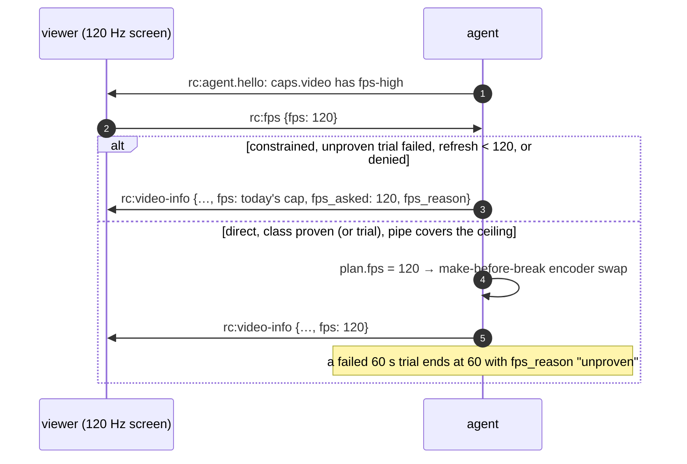

# FR-119: High-refresh streaming — 120 fps on a direct path when the host can sustain it, and the viewer asked

**Issue:** [#2670](https://github.com/gjovanov/roomler-ai/issues/2670) · **Status:** proposed 2026-10-21 —
spec and claim · **Owner:** the agent's capture, encode and rate path, the viewer's settings and decode path ·
**Anchors:** master `7a3dd06a6` · **Program:** [StarDesk teardown](../plans/stardesk-teardown-program.md), wave 2
("high refresh": D1, then D2) · **Builds on:** [FR-118](FR-118-gpu-resident-frames.md) (the encode stage under
one period), [FR-98](FR-98-input-to-photon-budget.md) (the slot-first capture gate, L4),
[FR-70](FR-70-media-pipeline-leaves-the-runtime.md) (make-before-break), [FR-74](FR-74-text-clarity-on-direct-paths.md)
(the direct ceiling law)

## 1. Goal

A controller on a high-refresh display, on a direct path to a host that can sustain it, gets **120 fps**
(D1, up to 1440p), and later **144 fps at 4K** (D2), instead of today's hard 60. It happens only when the viewer
asked for it and the host has proven it can deliver it. Every other session stays exactly as it is today.

StarDesk advertises "4K HDR at up to 144 fps" with an fps lock of 60, 120 or 144. Roomler streams at most 60 on
every path (§2). That halves the motion steps a person sees on a 120 Hz or 144 Hz screen. FR-98 measures the
latency side; this FR is the cadence side.

## 2. Evidence (master `7a3dd06a6`)

| What | Where | Consequence |
|---|---|---|
| The hardware target is a constant 60 | `TARGET_FPS_HW` `agents/roomlerd/src/peer.rs:105` | By default every RTP and DC session is capped at 60 |
| The FFmpeg DC pump already accepts more, from the environment only | `ffmpeg_target_fps` `peer.rs:9534`: `ROOMLERD_FFMPEG_FPS` clamped 1–240; default 60 direct, 30 constrained | Above 60 is a host-wide override today, not a session decision, and nothing checks the host can carry it |
| The viewer cannot ask, and the agent cannot say what the screen refreshes at | no fps message among the control-channel handlers (`rc:resolution` `peer.rs:9952` is the model); `DisplayInfo` has no refresh rate (`crates/remote_control/src/models.rs:195`) | No picker is possible without a wire change |
| pts were whole milliseconds (**fixed in P2a**, §4.2) | master `7a3dd06a6` had `TIME_BASE_DEN = 1000` and `pts = monotonic_us / 1000`; now `TIME_BASE_DEN` is 1 000 000 (`encode/ffmpeg/encoder.rs:94`) and `live_pts` returns the capture time (`:97`) | At 144 fps (6.9 ms period), two frames delivered within 1 ms of each other carried equal pts |
| The encoder's frame rate is fixed at open, and a replacement copies it | `set_frame_rate` `encoder.rs:1717`; `rebuild_spec` / `rebuild_spec_at_dims` copy `fps` (`:2282`, `:2298`) | A change of fps is an encoder rebuild. FR-70 M2's make-before-break covers dims and rate, not fps |
| The direct ceiling law was linear in fps and clamped at 48 Mbps (**reshaped above 60 in P2a**, §4.2) | `ffmpeg_maxrate_bps_scaled` `encode/rate_profile.rs:219`: W·H·fps·0.25, clamped to [3, 48] M × the codec factor; above 60 it now follows `rate_law_fps` | Before P2a, 1920×1080 at 144 fps computed 74.6 M and clamped to 48 M: 333 kbit per frame, where 60 fps gets 518 kbit, so above 60 the picture got softer per frame |
| The default capture gate's period is whole milliseconds; the microsecond gate is opt-in | `capture/gate.rs` (the legacy rule caps `1000/144` at 166 fps and can phase-lock); the slot-first gate keeps µs (`:78`) behind `ROOMLERD_CAPTURE_GATE`, field A/B owed (FR-98 P1) | Above 60, the slot-first gate should be the one in use |
| WGC and `CGDisplayStream` deliver at the panel's refresh | WGC is compositor-driven; scrap's quartz stream is unthrottled (`throttle: 0.0`, `crates/vendored/scrap/src/quartz/config.rs:69`) | A 60 Hz panel cannot produce 120 fps. A 120 Hz MacBook already can |
| The viewer's struggle rule counts frames | `DEFAULT_MAX_DECODE_QUEUE = 4` (`ui/src/workers/rc-hop-stats.ts:253`), `DEFAULT_STRUGGLE_QUEUE = 2` (`:256`) | At 144 fps, two frames of queue is 14 ms, where at 60 it is 33 ms: the rule tightens by itself |
| **The encode stage alone exceeds a 120 fps period on every measured cell but one** | [FR-118](FR-118-gpu-resident-frames.md) §2.2, a 7-day fleet read: 10.6 ms (`hevc_qsv`, 1080p), 11.9 ms (`av1_qsv`, 1200p), 9.9 ms (`av1_nvenc`, 1200p), 16.4 ms (`av1_nvenc`, 1600p); **6.3 ms (`hevc_videotoolbox`, 3024×1964)** | 120 fps needs ≤ 8.3 ms per frame. On today's CPU path, only the Mac's VideoToolbox cell fits |

> [!IMPORTANT]
> The program note said D1 "works on the CPU path". The fleet's numbers say otherwise: at the measured
> 10–12 ms per 1080p–1200p frame, the serial pump tops out near 85–100 fps on QSV and NVENC. D1 on those cells
> waits for [FR-118](FR-118-gpu-resident-frames.md), or for a conversion pipelined off the encoder thread. The
> first D1 cell is the one that fits today: a MacBook host (VideoToolbox, ProMotion 120 Hz).

## 3. Design

### 3.1 The viewer asks; the host says what it can do

- **Hello.** `AgentCaps.video`, where `chunk-framing` and `bench` already live, gains `fps-high`. It is matched by
  **equality** like every capability verb, and ignored by servers and viewers that do not know it.
- **The host's refresh rate** rides `rc:video-info` (`refresh_hz`, the captured monitor's) once a per-OS reader
  exists. It does not go into `DisplayInfo`: that struct lives in the agent row the server stores and the viewer
  never reads, so a field there would change the server and still reach no picker. Not built in P1.
- **Ask.** `rc:fps {fps: 60 | 120 | 144}` on the control channel, handled next to `rc:resolution`. The viewer
  sends it only to an agent that advertised `fps-high`; an agent that receives an unknown value drops it, as it
  does for `rc:resolution`. Shared pipelines merge their viewers' asks by `min`, the way they floor-merge
  resolution (`media_share.rs:318`). A viewer on a 60 Hz screen therefore never receives a heavier stream than it
  asked for.
- **Answer.** In `rc:video-info`, the message that already describes the stream: `fps` (what the stream runs
  at), and when an ask was not granted, `fps_asked` + `fps_reason`. Not a separate message: the pump knows its
  cap and its transport, so its answer is always correct, and a new ask or a new target re-sends video-info
  through the path every other refresh already takes.
- **Picker.** Settings → Frame rate: 60 (default), 120, 144. It is shown only for an agent that advertises
  `fps-high`. A picker every viewer sees before any agent can honour it is noise. Once the host's refresh rate is
  reported, an option above it is shown disabled, with the reason.

### 3.2 When the agent grants it

Above 60 fps only when **all** of these hold, re-checked whenever any of them moves:

1. The transport is not constrained (`detect_constrained_transport`, `peer.rs:1968`). Relayed paths wait for
   [FR-17](FR-17-partial-reliability-video.md) stage C, [FR-63](FR-63-one-delay-based-rate-controller.md) and
   FR-70 M3, and stay at their current cap.
2. The host has **proven the rate class** (§3.3) for this capture backend, display refresh, encoder and geometry.
3. The pipe belief ([FR-79](FR-79-one-validity-gate.md)) covers the higher ceiling (§3.4).

The agent answers every ask in `rc:video-info` with what the stream runs at and, when it did not grant the ask,
why: `fps_reason` is `constrained` or `unproven` in P1, and P2 adds `refresh`, `pipe` and `denied`. A viewer
that asked for 120 and sees 60 is told why, as FR-108 tells the display-match refusal.

### 3.3 The rate class: proven by a session, never assumed

What fps a host sustains depends on its capture backend, panel refresh, encoder and geometry. It is a **cell**,
and as with encoder cells, the probe proves an open and only a session proves the cell:

- A trial runs the class at the higher target and judges only **moving content**. Capture is event-driven, so
  an idle desktop delivers few frames: the fleet's median window is 16–17 fps with 60 targeted, and a rule over
  wall time would fail every capable host that sat still. So the trial keeps only active stretches, frames at
  most three periods apart, and a frame the pump drops for the viewer or the link ends a stretch. Once it has
  seen 10 s of motion, a class that ran at ≥ 0.9 × the target with p99 inter-frame time under two periods is
  proven and written to the agent's cache (the caps cache's keying: build, hardware fingerprint, knobs).
  (The first draft said 60 s at ≥ 0.9 × the target; P2b-1 measured that rule against event-driven capture and
  replaced it, §4.3.)
- A class that fails that test is not granted again until the build, the hardware or the knobs change.
- `fps_deny` (`name:fps`, the `encoder_cells_deny` shape) removes classes. It is honoured at **every** entry
  point (the grant and the trial), pushable through remote config with `MANAGE_AGENTS`, and only ever removes.
- The first grant on an unproven host is a **trial**, never a promise. The viewer's picker says "trial", and
  the stream goes back to 60 if the trial fails.

### 3.4 The encoder and the rate law

- **pts in microseconds:** `TIME_BASE_DEN = 1_000_000`, `pts = monotonic_us`. The recorder keeps its own
  counter clock (`recording_pts`, `encoder.rs:738`), which already never repeats; P2a moved it to the
  microsecond base with the live pts.
- **An fps change is a make-before-break swap.** `rebuild_spec_at_fps` next to `rebuild_spec_at_dims`; the plan
  names the fps (FR-70 M3a's `Plan.fps`), and a swap is adopted between frames like a dims swap. The live encoder
  keeps serving at the old rate until the replacement is ready.
- **The ceiling law:** `ceiling(fps) = ceiling(60) × (fps / 60)^α`, with a higher band top for the 120–144 class.
  At 60 the law is byte-identical to today's. α is **measured**, not chosen: a constant-quality run on the same
  screen content at 60 and at 120 shows how many bits the encoder actually spends per second. Inter frames 8 ms
  apart differ less than frames 17 ms apart, so α is expected well below 1. There is a precedent in the code:
  FR-112 already scales the RTP pump's bitrate base by `√(fps / 30)`, i.e. α = 0.5 (`bitrate_base_for_fps`,
  `agents/roomlerd/src/encode/mod.rs`).
- **The capture gate:** above 60, the slot-first gate (FR-98 C1) is used regardless of `ROOMLERD_CAPTURE_GATE`,
  because the legacy gate's whole-millisecond period phase-locks at these rates.
- **The cursor channel:** its poll interval follows the frame period above 60 (FR-98's `poll_interval` knob,
  `capture/cursor.rs:44`).

### 3.5 The viewer

The decode path (WebCodecs) already decodes above 60. What changes: the struggle and drop thresholds become
**times**, not frame counts (§2), and `rc:decodestat` carries the target fps so the agent reads the viewer's
rate against the right number.

## 4. Phases

| P | Scope | Kill switch | Status |
|---|---|---|---|
| P0 | **Measure first.** (a) A µs pts unit test that is red on master's ms rule (two frames 0.5 ms apart). (b) L0 cells at 120 and 144 fps on the synthetic source: cadence and pts. (c) The vendored webrtc-rs data-channel throughput ceiling, measured in process over loopback (`agents/roomlerd/tests/dc_throughput.rs`), which decides D2's transport. (d) α, from a constant-quality run at 60 and 120 fps. (a) and (b) need P2's changes to mean anything, so they land with P2 as red → green tests | none: tests and measurements | **(c) measured** (§4.1, §8); **(d) measured offline** (§8): α ≈ 0–0.8, and 0.8 is used; **(a) red → green with P2a** (§4.2); (b) owed with P2b |
| P1 | **The wire.** `fps-high`, `rc:fps`, and the answer in `rc:video-info`, plus the viewer's picker. The agent grants nothing above today's cap yet: every ask is answered at that cap, with `fps_reason` `"unproven"` (or `"constrained"`) | `ROOMLERD_FPS_HIGH` (default OFF): no `fps-high` in the hello, so no viewer asks | **built** (§4.1); the host's `refresh_hz` is not reported yet |
| P2 | **The encoder and the gate.** µs pts, the fps swap, the ceiling law, the slot-first gate above 60, the rate-class cache and trial, `fps_deny` | the same switch; `fps_deny` | **P2a built** (§4.2): µs pts and the rate law, both byte-identical at and below 60. **P2b-1 built** (§4.3): the grant, the rate class and its trial, `fps_deny`, the rate-class cache, pure and not yet called. **P2b-2 owed**: the fps swap, a capture pace that moves without a reopen, the slot-first gate above 60, and the wiring |
| P3 | **D1, the first cells.** The MacBook host (VideoToolbox, ProMotion) to a 120 Hz-or-faster viewer, direct. Then the Windows cells as FR-118 lands them | the same | — |
| P4 | **D2: 4K at 144**, after FR-118's cells and P0(c)'s transport verdict | the same | — |
| P5 | Docs and the final field table | — | — |

### 4.1 P0(c) and P1 — as built (2026-10-21)

**P0(c), the data-channel ceiling.** `agents/roomlerd/tests/dc_throughput.rs` runs two peers in one process
over real loopback UDP (host candidates, mDNS off), sending 16 KiB messages back to back the way the
production send task does. It is `#[ignore]`d: CI runners are too noisy for a throughput assertion, so the
numbers live in §8. The first run (neo16, release build) delivered every byte:

| Mode | Run 1 | Run 2 | Run 3 |
|---|---|---|---|
| ordered | 375.9 Mbit/s | 278.8 Mbit/s | 275.7 Mbit/s |
| unordered | 281.0 Mbit/s | 287.1 Mbit/s | 271.6 Mbit/s |

That is ~2.7× D2's ~100 Mbit/s on that CPU. A weaker host and a real round trip are owed before open decision
3 closes.

**P1, the wire.** It grants nothing above today's cap; P2 builds the grant.

| Piece | Where |
|---|---|
| `fps-high` in `AgentCaps.video`, only with `ROOMLERD_FPS_HIGH=1` (a test locks the default off) | `encode::frame_rate::CAP`, `video_features` in `agents/roomlerd/src/encode/caps.rs` |
| `rc:fps {fps}`: 60, 120 or 144; anything else is dropped. The ask is stored on the session's `ViewerFeedback`, which already reaches the control handler and every pump | the `rc:fps` arm next to `rc:resolution` in `agents/roomlerd/src/peer.rs`; `agents/roomlerd/src/encode/frame_rate.rs` |
| The answer, in `rc:video-info`: `fps` (what the stream runs at) and, when it refused an ask, `fps_asked` + `fps_reason` (`unproven`, or `constrained` on a relay) | `video_info_payload` and the FFmpeg pump in `agents/roomlerd/src/peer.rs` |
| The viewer's half: the options, the wire message, the answer read back, the words | `ui/src/composables/frameRate.ts` |
| The pick (per browser), re-sent when the control channel opens, to an agent with `fps-high` only; a Frame rate picker shown only for such an agent | `ui/src/composables/useRemoteControl.ts`, `ui/src/views/remote/RemoteControl.vue` |

- **With the switch off, the frame-rate fields are never written**, so every `rc:video-info` payload is
  byte-identical to before; the wire-shape tests pass unchanged. A new ask or a new target re-sends video-info
  through the path every other refresh already takes.
- **P1 answers only the session's own viewer.** A shared pipeline's followers merge their asks by `min` in P2,
  where the grant is built.
- **Tests:**
  - agent: four in `encode::frame_rate`, the video-info fields, and `fps-high` off by default;
  - viewer: seven in `frameRate.spec.ts`, plus two video-info parse tests fed the agent's exact bytes.
- **Negative controls, each failing exactly its targets:**

  | Control | Failed |
  |---|---|
  | A: accept any fps | the ask test |
  | B: grant every ask | the three tests that involve a refusal |
  | C: advertise `fps-high` always | the default test |
  | D (viewer): offer above 60 without `fps-high` | the options test (1 failed / 6 passed) |

  A–C were run together: 5 failed / 2 passed.

### 4.2 P2a — microsecond pts and the rate law above 60, as built (2026-10-21)

These are the encoder-side half of P2, the half that changes nothing at or below 60. P2b builds the grant (the
rate class and its trial, `fps_deny`, the fps swap, the slot-first gate above 60). Until then, only an
operator's `ROOMLERD_FFMPEG_FPS` reaches anything here.

| Piece | What changed | Where |
|---|---|---|
| The time base | `TIME_BASE_DEN` 1000 → 1 000 000; a live frame's pts is its capture time (`live_pts`) | `agents/roomlerd/src/encode/ffmpeg/encoder.rs` |
| The recorder's counter pts | `recording_pts_ms` → `recording_pts`, in the same base | the same |
| Packet durations | `ticks_to_us`, where `* 1000` assumed milliseconds. No consumer reads `duration_us` from this encoder today; it is kept right anyway | the same |
| The rate law | `rate_law_fps`: fps itself up to 60, `60 × (fps / 60)^0.8` above; the band's top grows the same way (`HIGH_FPS_ALPHA`) | `agents/roomlerd/src/encode/rate_profile.rs` |

- **Why the pts change is safe on every backend.** Each FFmpeg backend either rescales pts from the codec time
  base itself (QSV to 90 kHz, AMF and VideoToolbox to their own clocks) or carries it through untouched
  (NVENC, VAAPI). None assumes milliseconds. The recorder's MP4 writer keeps its own 90 kHz clock and never
  reads the encoder's pts. Still, a probe proves an open and only a session proves a cell, so P3's field cells
  include one session per backend at 60 before anything above 60 is granted.
- **α = 0.8** is the upper envelope of P0(d)'s offline read (§8): α ran from ~0 to 0.8 by codec and content.
  That puts 1080p144 at 62.7 M where today's law clamped it to 48 M, and 4K144 at the class top, 96.7 M, where
  today's law gave 48 M. Per frame, 120 fps gets 0.87 of what 60 does, not the 0.5 a fixed band gives. Open
  decision 2 refines it on P3's field cells.
- **Tests:**
  - two frames 0.5 ms apart get distinct pts;
  - a steady second at 144 fps strictly increases;
  - ticks are microseconds;
  - the recorder's pts strictly increase up to 240 fps;
  - the law is byte-identical to the old formula at and below 60 (7 geometries × 7 rates × both transports × 3
    codec factors);
  - above 60 the rate and the top follow α.
- **Negative controls, each failing exactly its target:**

  | Control | Failed |
  |---|---|
  | live pts back to milliseconds, master's rule | the pts test, with `left: 10000, right: 10000`: the collision itself |
  | the law linear above 60 | the α test |
  | α applied below 60 | the byte-identity test, `left: 3050564, right: 3000000` |

This is AC1's pts half: red on master's rule, green here.

### 4.3 P2b-1 — the grant, the trial, `fps_deny` and the rate-class cache, as built (2026-10-21)

This is the decision half of P2b. It is pure and unit-tested, and nothing calls it yet. P2b-2 wires it into the
pump: the fps swap, a capture pace that moves without a reopen, and the trial run.

| Piece | What it decides | Where |
|---|---|---|
| `grant()` | above the cap only when every condition holds; otherwise refused at the cap, with one named reason | `agents/roomlerd/src/encode/frame_rate.rs` |
| `pipe_covers()` | the pipe input: nothing measured says the path carries less than the ceiling at the asked rate | the same |
| `TrialMeter` | whether this host sustains the rate while the content moves | the same |
| `parse_fps_deny` / `fps_denied` | the owner's removals, in the `encoder_cells_deny` shape (`name:fps`, `*` for every encoder) | the same |
| `fps_class_cache` | what trials concluded, next to the probe cache and under its key | `agents/roomlerd/src/encode/fps_class_cache.rs` |

- **The refusal order** follows what a viewer can see and act on: `constrained`, then `refresh` (the captured
  screen refreshes slower than the ask), then `denied`, then `unproven` (a failed trial), then `pipe`. A class
  never tried is granted as a **trial**; a proven one is granted without one.
- **The pipe input** reads the FR-79 belief's pushed-back estimate (`capacity_bps`), and no push-back is no
  claim. ⚠️ Never the belief's floor: at 60 fps the floor is the content's weight at 60, always under the ceiling
  at 120, so reading it as a limit would refuse every healthy session.
- **The trial judges what the host did.** A frame the pump drops for the viewer or the link (the viewer-rate
  divisor, the byte gate) ends the stretch (`TrialMeter::pause`). Counted, one drop in fifty puts a two-period
  gap at the p99 and fails a host that kept up, and the verdict is cached as a fact about the host.
- **The cache** keeps one verdict per class, the newest. It is keyed exactly like the probe cache (build,
  hardware fingerprint, knobs hash), so any change forgets it. Any miss reads as unproven, a verdict older than
  a week is forgotten, and `ROOMLERD_CAPS_CACHE=0` switches it off with the probe cache. ⚠️ macOS has no
  hardware fingerprint, so no key and no cache: there, every session's first ask above the cap is a trial.
- **Tests:**
  - every refusal reason, and the order between them;
  - proven against trial;
  - an unknown refresh rate deciding nothing;
  - the pipe input with and without a push-back;
  - the trial on steady motion, an encoder that cannot keep up, a slower screen, pauses between bursts, 30 fps
    content, a rare late frame, and frames dropped for the viewer;
  - the deny list's parse;
  - the cache's read-back, newest-wins, key change, damaged file and age.
- **Negative controls,** six, run together:
  - pauses counted as frames;
  - the refresh check skipped;
  - a failed verdict ignored by the cache;
  - the cache key ignored;
  - a dropped frame counted;
  - no push-back read as a refusal.

  Exactly the seven tests that guard them failed: 17 passed, 7 failed. The first control fails two tests, because
  "a pause is not evidence" and "content slower than three periods is not evidence" are one rule.

## 5. Acceptance criteria

- [ ] **AC1 — P0 measured.** The pts test is red on master and green after P2. L0's 120 and 144 cells hold their
  cadence. The data-channel ceiling and α are recorded in §8 with how they were measured.
- [ ] **AC2 — the wire is additive.** An agent without `fps-high` never receives `rc:fps`; a viewer without the
  picker never sends it; an unknown value is dropped. Tests on both sides. An old viewer with a new agent and a
  new viewer with an old agent both stream at today's rate.
- [ ] **AC3 — constrained paths stay where they are.** A constrained session never exceeds its current cap,
  whatever the viewer asks. Unit-tested on the grant, and seen on one relay cell in the field answering at its
  current cap (30 on a relayed FFmpeg DC session today) with `reason:"constrained"`.
- [ ] **AC4 — D1 in the field.** One direct pair delivers ≥ 0.9 × 120 fps for 60 s, with p99 inter-frame time
  under 16.7 ms, on a 120 Hz-or-faster viewer. The red run is the same pair on today's build, at ≤ 60.
- [ ] **AC5 — the rate law.** At 60 fps the ceiling is byte-identical to today's at every geometry (a table
  test). At 120 and 144 it follows the measured α and the class band top.
- [ ] **AC6 — trial and denial.** A host that cannot sustain 120 falls back to 60 once its trial has seen 10 s of
  moving content, reports `unproven`, and is not trialled again until its build, hardware or knobs change. A denied class is
  never granted, at either entry point. Tests on both.
- [ ] **AC7 — latency does not get worse.** L4 on AC4's pair at 120 vs 60: p50 and p95 no higher at 120.
- [ ] **AC8 — docs.** `docs/remote-control.md` (the frame-rate classes, the gate, the wire), `docs/rate-control.md`
  (the ceiling law above 60), `docs/ui.md` (the picker). Linked from `docs/README.md`.

## 6. Open decisions

1. **The default.** Recommended: 60 unless the viewer picks more. Auto-raising to the display's refresh on
   direct paths can come after a fleet week of the trials.
2. **α and the 120–144 band top:** set by P0(d)'s measurement, written into AC5 then.
3. **The transport for D2.** If P0(c) shows the vendored webrtc-rs data channel cannot carry 4K at 144, a move to
   webrtc-rs 0.20 is a separate FR and the operator's decision.
4. **144 Hz without a 144 Hz panel.** Only a virtual display can produce frames faster than the panel. That rides
   on the virtual-display decision (FR-108 P3 / the IddCx note in the program).

## 7. Out of scope

- Above 60 on constrained (relayed) paths: FR-17 stage C, FR-63, FR-70 M3.
- The H.264 RTP track and the `<video>` render path: the data-channel cells only.
- HDR (wave 3). The virtual display itself.

## 8. Field-verification log

| Date | Build | Cell | Result |
|---|---|---|---|
| 2026-10-21 | fleet, agents 0.4.135–0.4.148 | every FFmpeg DC session for 7 days (FR-118 §2.2) | **The red record for the encode stage.** Only `hevc_videotoolbox` (6.3 ms at 3024×1964) fits a 120 fps period on today's CPU path; QSV and NVENC need 9.9–16.4 ms per 1080p–1600p frame. No session ran above 60, because nothing lets one |
| 2026-10-21 | dev build, release profile, neo16 (a Ryzen 9 7945HX laptop, Windows 11) | P0(c): the data channel alone, in process over loopback UDP (`agents/roomlerd/tests/dc_throughput.rs`): 16 KiB messages awaited back to back, as the production send task sends them; 5 s × 3 rounds per mode | **The transport is not D1's limiter.** Ordered: 375.9 / 278.8 / 275.7 Mbit/s. Unordered: 281.0 / 287.1 / 271.6. Every byte was delivered. That is ~2.7× D2's ~100 Mbit/s on this CPU. Still owed before open decision 3 closes: a weaker host's CPU and a real round trip, because this is an upper bound for a LAN path |
| 2026-10-21 | ffmpeg (a winget build) with NVENC on neo16 (RTX 5090), offline | P0(d): α. The same content at 60, 120 and 144 fps: code-like text scrolling at a fixed **px/s** (each frame's y is `40 − t·speed`). HEVC at `cq 28`, AV1 at `cq 34`, `-b:v 0`; preset p4, tune ll, no B-frames, no periodic keyframes. 10 s per clip, bits counted after the first IDR | **α ≈ 0 to 0.8 by codec and content.** HEVC on text moving a whole number of pixels per frame (720 px/s: 12 / 6 / 5 px): 471 / 805 / 950 kbit/s, so α = 0.77 (120 vs 60) and 0.80 (144 vs 60). HEVC at 200 px/s: 0.73. HEVC at 800 px/s: −0.12. HEVC static: 0.23. AV1: 0.02–0.32. **Wrong turn:** every 144 fps clip with fractional per-frame motion came out 31–34 Mbit/s, about 20× its neighbours. `drawtext` renders each frame at a different sub-pixel glyph phase (18 at 200 px/s), which defeats motion compensation. Whole-pixel steps behave. That is a caveat for real smooth-scrolled text too, for P3. P2a uses 0.8, the upper envelope. Posted on #2670 |

## 9. Related

- [FR-118](FR-118-gpu-resident-frames.md): how the QSV and NVENC cells get under one 120 fps period.
- [FR-98](FR-98-input-to-photon-budget.md): the slot-first gate and L4.
- [FR-70](FR-70-media-pipeline-leaves-the-runtime.md): `Plan.fps`, and the make-before-break this extends to fps.
- [FR-74](FR-74-text-clarity-on-direct-paths.md): the direct ceiling law this extends above 60.
- [FR-108](FR-108-display-follows-the-viewer.md): the virtual display that 144 Hz on a 60 Hz host would need.
- `docs/plans/stardesk-teardown-program.md` §3: the design notes this spec started from.
