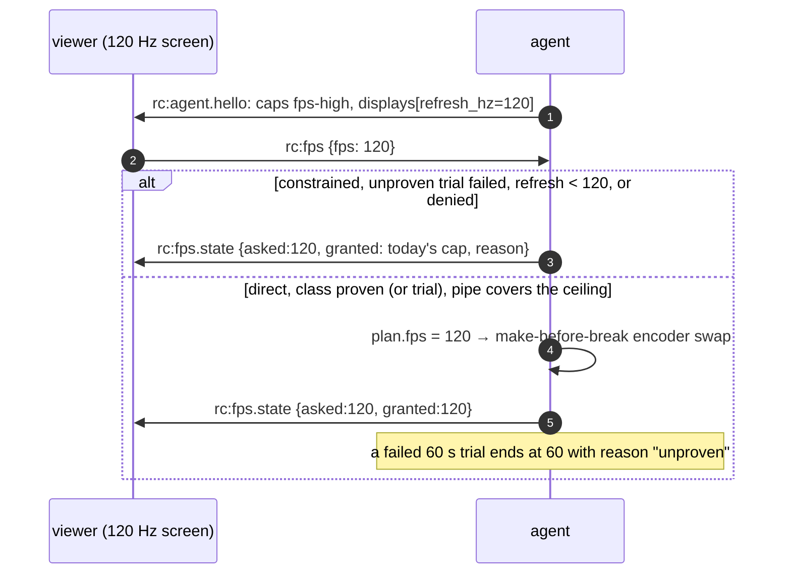

# FR-119: High-refresh streaming — 120 fps on a direct path when the host can sustain it, and the viewer asked

**Issue:** [#2670](https://github.com/gjovanov/roomler-ai/issues/2670) · **Status:** proposed 2026-10-21 —
spec and claim · **Owner:** the agent's capture, encode and rate path, the viewer's settings and decode path ·
**Anchors:** master `7a3dd06a6` · **Program:** [StarDesk teardown](../plans/stardesk-teardown-program.md), wave 2
("high refresh": D1, then D2) · **Builds on:** [FR-118](FR-118-gpu-resident-frames.md) (the encode stage under
one period), [FR-98](FR-98-input-to-photon-budget.md) (the slot-first capture gate, L4),
[FR-70](FR-70-media-pipeline-leaves-the-runtime.md) (make-before-break), [FR-74](FR-74-text-clarity-on-direct-paths.md)
(the direct ceiling law)

## 1. Goal

A controller on a high-refresh display, on a direct path to a host that can sustain it, gets **120 fps**
(D1, up to 1440p), and later **144 fps at 4K** (D2), instead of today's hard 60. It happens only when the viewer
asked for it and the host has proven it can deliver it. Every other session stays exactly as it is today.

StarDesk advertises "4K HDR at up to 144 fps" with an fps lock of 60, 120 or 144. Roomler streams at most 60 on
every path (§2). That halves the motion steps a person sees on a 120 Hz or 144 Hz screen. FR-98 measures the
latency side; this FR is the cadence side.

## 2. Evidence (master `7a3dd06a6`)

| What | Where | Consequence |
|---|---|---|
| The hardware target is a constant 60 | `TARGET_FPS_HW` `agents/roomlerd/src/peer.rs:105` | Every RTP and DC session is capped at 60 |
| The FFmpeg DC pump already accepts more, from the environment only | `ffmpeg_target_fps` `peer.rs:9471`: `ROOMLERD_FFMPEG_FPS` clamped 1–240; default 60 direct, 30 constrained | Above 60 is a host-wide override today, not a session decision, and nothing checks the host can carry it |
| The viewer cannot ask, and the agent cannot say what the screen refreshes at | no fps message among the control-channel handlers (`rc:resolution` `peer.rs:9888` is the model); `DisplayInfo` has no refresh rate (`crates/remote_control/src/models.rs:195`) | No picker is possible without a wire change |
| pts are whole milliseconds | `TIME_BASE_DEN = 1000` `encode/ffmpeg/encoder.rs:86`; `pts = monotonic_us / 1000` `:1978` | At 144 fps (6.9 ms period), two frames delivered within 1 ms of each other carry equal pts |
| The encoder's frame rate is fixed at open, and a replacement copies it | `set_frame_rate` `encoder.rs:1631`; `rebuild_spec` / `rebuild_spec_at_dims` copy `fps` (`:2195`, `:2211`) | A change of fps is an encoder rebuild. FR-70 M2's make-before-break covers dims and rate, not fps |
| The direct ceiling law is linear in fps and clamped at 48 Mbps | `ffmpeg_maxrate_bps_scaled` `encode/rate_profile.rs:193`: W·H·fps·0.25, clamped to [3, 48] M × the codec factor | 1920×1080 at 144 fps computes 74.6 M and clamps to 48 M: 333 kbit per frame, where 60 fps gets 518 kbit. Above 60 the picture gets softer per frame |
| The default capture gate's period is whole milliseconds; the microsecond gate is opt-in | `capture/gate.rs` (the legacy rule caps `1000/144` at 166 fps and can phase-lock); the slot-first gate keeps µs (`:78`) behind `ROOMLERD_CAPTURE_GATE`, field A/B owed (FR-98 P1) | Above 60, the slot-first gate should be the one in use |
| WGC and `CGDisplayStream` deliver at the panel's refresh | WGC is compositor-driven; scrap's quartz stream is unthrottled (`throttle: 0.0`, `crates/vendored/scrap/src/quartz/config.rs:69`) | A 60 Hz panel cannot produce 120 fps. A 120 Hz MacBook already can |
| The viewer's struggle rule counts frames | `DEFAULT_MAX_DECODE_QUEUE = 4` (`ui/src/workers/rc-hop-stats.ts:253`), `DEFAULT_STRUGGLE_QUEUE = 2` (`:256`) | At 144 fps, two frames of queue is 14 ms, where at 60 it is 33 ms: the rule tightens by itself |
| **The encode stage alone exceeds a 120 fps period on every measured cell but one** | [FR-118](FR-118-gpu-resident-frames.md) §2.2, a 7-day fleet read: 10.6 ms (`hevc_qsv`, 1080p), 11.9 ms (`av1_qsv`, 1200p), 9.9 ms (`av1_nvenc`, 1200p), 16.4 ms (`av1_nvenc`, 1600p); **6.3 ms (`hevc_videotoolbox`, 3024×1964)** | 120 fps needs ≤ 8.3 ms per frame. On today's CPU path, only the Mac's VideoToolbox cell fits |

> [!IMPORTANT]
> The program note said D1 "works on the CPU path". The fleet's numbers say otherwise: at the measured
> 10–12 ms per 1080p–1200p frame, the serial pump tops out near 85–100 fps on QSV and NVENC. D1 on those cells
> waits for [FR-118](FR-118-gpu-resident-frames.md), or for a conversion pipelined off the encoder thread. The
> first D1 cell is the one that fits today: a MacBook host (VideoToolbox, ProMotion 120 Hz).

## 3. Design

### 3.1 The viewer asks; the host says what it can do

- **Hello.** `AgentCaps` gains the verb `fps-high`, matched by **equality** like every capability verb, and
  ignored by servers and viewers that do not know it. `DisplayInfo` gains `refresh_hz: Option<u16>` (serde
  default; old peers skip it).
- **Ask.** `rc:fps {fps: 60 | 120 | 144}` on the control channel, handled next to `rc:resolution`. The viewer
  sends it only to an agent that advertised `fps-high`; an agent that receives an unknown value drops it, as it
  does for `rc:resolution`. Shared pipelines merge their viewers' asks by `min`, the way they floor-merge
  resolution (`media_share.rs:318`). A viewer on a 60 Hz screen therefore never receives a heavier stream than it
  asked for.
- **Picker.** Settings → Frame rate: 60 (default), 120, 144. An option above the host display's `refresh_hz`,
  or any option for an agent without `fps-high`, is shown disabled, with the reason.

### 3.2 When the agent grants it

Above 60 fps only when **all** of these hold, re-checked whenever any of them moves:

1. The transport is not constrained (`detect_constrained_transport`, `peer.rs:1957`). Relayed paths wait for
   [FR-17](FR-17-partial-reliability-video.md) stage C, [FR-63](FR-63-one-delay-based-rate-controller.md) and
   FR-70 M3, and stay at their current cap.
2. The host has **proven the rate class** (§3.3) for this capture backend, display refresh, encoder and geometry.
3. The pipe belief ([FR-79](FR-79-one-validity-gate.md)) covers the higher ceiling (§3.4).

The agent answers every ask with what it granted and why: `rc:fps.state {asked, granted, reason}`, with reasons
such as `constrained`, `unproven`, `refresh`, `pipe`, `denied`. A viewer that asked for 120 and sees 60 is told
why, as FR-108 tells the display-match refusal.

### 3.3 The rate class: proven by a session, never assumed

What fps a host sustains depends on its capture backend, panel refresh, encoder and geometry. It is a **cell**,
and as with encoder cells, the probe proves an open and only a session proves the cell:

- A session that ran at the higher target for 60 s, at ≥ 0.9 × the target with p99 inter-frame time under two
  periods, writes the class to the agent's cache (the caps cache's keying: build, hardware fingerprint, knobs).
- A class that fails that test is not granted again until the build, the hardware or the knobs change.
- `fps_deny` (`name:fps`, the `encoder_cells_deny` shape) removes classes. It is honoured at **every** entry
  point (the grant and the trial), pushable through remote config with `MANAGE_AGENTS`, and only ever removes.
- The first grant on an unproven host is a **trial**, never a promise. The viewer's picker says "trial", and
  the trial ends at 60 if the 60 s test fails.

### 3.4 The encoder and the rate law

- **pts in microseconds:** `TIME_BASE_DEN = 1_000_000`, `pts = monotonic_us`. The recorder keeps its own
  counter clock (`recording_pts_ms`, `encoder.rs:715`), which already never repeats.
- **An fps change is a make-before-break swap.** `rebuild_spec_at_fps` next to `rebuild_spec_at_dims`; the plan
  names the fps (FR-70 M3a's `Plan.fps`), and a swap is adopted between frames like a dims swap. The live encoder
  keeps serving at the old rate until the replacement is ready.
- **The ceiling law:** `ceiling(fps) = ceiling(60) × (fps / 60)^α`, with a higher band top for the 120–144 class.
  At 60 the law is byte-identical to today's. α is **measured**, not chosen: a constant-quality run on the same
  screen content at 60 and at 120 shows how many bits the encoder actually spends per second. Inter frames 8 ms
  apart differ less than frames 17 ms apart, so α is expected well below 1.
- **The capture gate:** above 60, the slot-first gate (FR-98 C1) is used regardless of `ROOMLERD_CAPTURE_GATE`,
  because the legacy gate's whole-millisecond period phase-locks at these rates.
- **The cursor channel:** its poll interval follows the frame period above 60 (FR-98's `poll_interval` knob,
  `capture/cursor.rs:44`).

### 3.5 The viewer

The decode path (WebCodecs) already decodes above 60. What changes: the struggle and drop thresholds become
**times**, not frame counts (§2), and `rc:decodestat` carries the target fps so the agent reads the viewer's
rate against the right number.

## 4. Phases

| P | Scope | Kill switch | Status |
|---|---|---|---|
| P0 | **Measure first.** (a) A µs pts unit test that is red on master's ms rule (two frames 0.5 ms apart). (b) L0 cells at 120 and 144 fps on the synthetic source: cadence and pts. (c) The vendored webrtc-rs data-channel throughput ceiling, measured in L0, which decides D2's transport. (d) α, from a constant-quality run at 60 and 120 fps | none: tests and measurements | — |
| P1 | **The wire.** `fps-high`, `refresh_hz`, `rc:fps`, `rc:fps.state`, the viewer's picker. The agent grants nothing above today's cap yet: every ask is answered at that cap, with `reason:"unproven"` (or `"constrained"`) | `fps_high` (default OFF): no `fps-high` in the hello, so no viewer asks | — |
| P2 | **The encoder and the gate.** µs pts, the fps swap, the ceiling law, the slot-first gate above 60, the rate-class cache and trial, `fps_deny` | the same switch; `fps_deny` | — |
| P3 | **D1, the first cells.** The MacBook host (VideoToolbox, ProMotion) to a 120 Hz-or-faster viewer, direct. Then the Windows cells as FR-118 lands them | the same | — |
| P4 | **D2: 4K at 144**, after FR-118's cells and P0(c)'s transport verdict | the same | — |
| P5 | Docs and the final field table | — | — |

## 5. Acceptance criteria

- [ ] **AC1 — P0 measured.** The pts test is red on master and green after P2. L0's 120 and 144 cells hold their
  cadence. The data-channel ceiling and α are recorded in §8 with how they were measured.
- [ ] **AC2 — the wire is additive.** An agent without `fps-high` never receives `rc:fps`; a viewer without the
  picker never sends it; an unknown value is dropped. Tests on both sides. An old viewer with a new agent and a
  new viewer with an old agent both stream at today's rate.
- [ ] **AC3 — constrained paths stay where they are.** A constrained session never exceeds its current cap,
  whatever the viewer asks. Unit-tested on the grant, and seen on one relay cell in the field answering at its
  current cap (30 on a relayed FFmpeg DC session today) with `reason:"constrained"`.
- [ ] **AC4 — D1 in the field.** One direct pair delivers ≥ 0.9 × 120 fps for 60 s, with p99 inter-frame time
  under 16.7 ms, on a 120 Hz-or-faster viewer. The red run is the same pair on today's build, at ≤ 60.
- [ ] **AC5 — the rate law.** At 60 fps the ceiling is byte-identical to today's at every geometry (a table
  test). At 120 and 144 it follows the measured α and the class band top.
- [ ] **AC6 — trial and denial.** A host that cannot sustain 120 falls back to 60 within the trial's 60 s,
  reports `unproven`, and is not trialled again until its build, hardware or knobs change. A denied class is
  never granted, at either entry point. Tests on both.
- [ ] **AC7 — latency does not get worse.** L4 on AC4's pair at 120 vs 60: p50 and p95 no higher at 120.
- [ ] **AC8 — docs.** `docs/remote-control.md` (the frame-rate classes, the gate, the wire), `docs/rate-control.md`
  (the ceiling law above 60), `docs/ui.md` (the picker). Linked from `docs/README.md`.

## 6. Open decisions

1. **The default.** Recommended: 60 unless the viewer picks more. Auto-raising to the display's refresh on
   direct paths can come after a fleet week of the trials.
2. **α and the 120–144 band top:** set by P0(d)'s measurement, written into AC5 then.
3. **The transport for D2.** If P0(c) shows the vendored webrtc-rs data channel cannot carry 4K at 144, a move to
   webrtc-rs 0.20 is a separate FR and the operator's decision.
4. **144 Hz without a 144 Hz panel.** Only a virtual display can produce frames faster than the panel. That rides
   on the virtual-display decision (FR-108 P3 / the IddCx note in the program).

## 7. Out of scope

- Above 60 on constrained (relayed) paths: FR-17 stage C, FR-63, FR-70 M3.
- The H.264 RTP track and the `<video>` render path: the data-channel cells only.
- HDR (wave 3). The virtual display itself.

## 8. Field-verification log

| Date | Build | Cell | Result |
|---|---|---|---|
| 2026-10-21 | fleet, agents 0.4.135–0.4.148 | every FFmpeg DC session for 7 days (FR-118 §2.2) | **The red record for the encode stage.** Only `hevc_videotoolbox` (6.3 ms at 3024×1964) fits a 120 fps period on today's CPU path; QSV and NVENC need 9.9–16.4 ms per 1080p–1600p frame. No session ran above 60, because nothing lets one |

## 9. Related

- [FR-118](FR-118-gpu-resident-frames.md): how the QSV and NVENC cells get under one 120 fps period.
- [FR-98](FR-98-input-to-photon-budget.md): the slot-first gate and L4.
- [FR-70](FR-70-media-pipeline-leaves-the-runtime.md): `Plan.fps`, and the make-before-break this extends to fps.
- [FR-74](FR-74-text-clarity-on-direct-paths.md): the direct ceiling law this extends above 60.
- [FR-108](FR-108-display-follows-the-viewer.md): the virtual display that 144 Hz on a 60 Hz host would need.
- `docs/plans/stardesk-teardown-program.md` §3: the design notes this spec started from.
